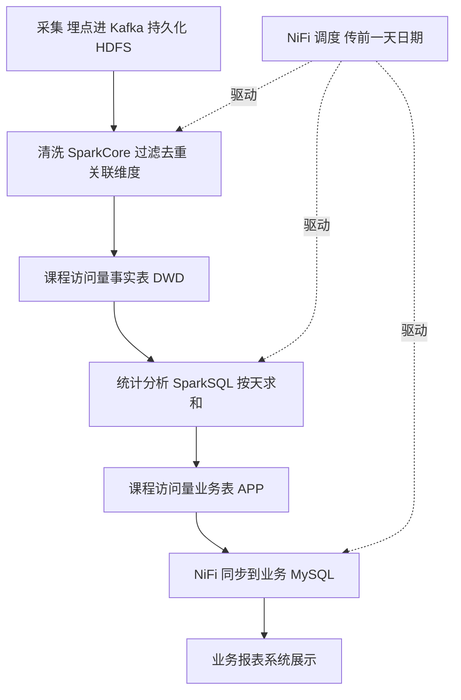

# 面试高频题：智慧学成的离线分析是如何实现的

离线分析是这套数仓产生业务价值的那一环，也是面试官最爱顺藤摸瓜的地方：你说数据采进来了、洗干净了，那指标到底是怎么算出来的、算完给谁用？答这题的关键不是罗列技术名词，而是把「一条指标从原始数据到报表展示」的完整路径讲成一条流水线。智慧学成的离线分析今天分析前一天的数据，用 SparkCore 与 SparkSQL 实现，三个指标课程访问量、课程购买量、热门学科排名共用同一副骨架。

## 先给结论

- 离线分析是 T+1 的：今天跑昨天的数据，SparkCore 负责清洗，SparkSQL 负责统计。
- 每个指标的流程同构：数据采集、数据清洗、数据统计分析、落到业务库，四步走完报表才有数。
- 统计基于分层推进：清洗产出事实表，部分指标先做 DWM 轻度聚合，最后写 APP 层业务表。
- 日期一律由 NiFi 调度传参（当前时间减一天），Spark 程序自身无状态，任意日期可定点重算。
- 结果由 NiFi 从 Hive 同步到业务 MySQL，报表系统查业务库，不直连数仓。

## 四步骨架：以课程访问量为例

课程访问量的完整流程是三个指标里最标准的，把它走一遍，另外两个指标只是在个别环节换了零件：



虚线是这题的题眼：整条流水线由 NiFi 统一调度，日期参数一路传下去，清洗、统计、同步各环节自己不再判断「今天该算哪天」。看每一步的细节。

**数据采集。** 用户访问业务系统产生课程访问行为，JS 埋点发给采集服务，采集服务发 Kafka，再由自定义 Kafka Connector 持久化到 HDFS，按天落目录。到这一步为清洗准备好了原始数据。

**数据清洗。** SparkCore 按日期读 HDFS 上的访问数据，用 map 与 filter 算子过滤去重，然后关联时间、用户、区域等维度，得到事实表基础数据；此时数据还是 RDD，转成 DataFrame 后用 SparkSQL 写进课程访问量事实表。事实表数据落库，意味着清洗环节完成，后续所有统计都以它为唯一入口。

**数据统计分析。** SparkSQL 按日期读取事实表数据，把年月日三个分区列拼成日期列，按日期分组求和，得到当天的课程访问量，写进 APP 层业务表。课程里的统计程序就是这样（节选自讲义代码，包名按本课规范书写）：

```scala
package com.study.xc.analysis.visit

import com.study.xc.common.EtlEnvironment
import org.apache.spark.sql.SparkSession

object CourseVisitProcessByDay {
  val spark: SparkSession = EtlEnvironment.getSparkSession(this.getClass.getSimpleName)

  def main(args: Array[String]): Unit = {
    val dateInfo = args(0)
    // 1. 读取访问量事实表，年月日分区列拼成日期
    val visitDF = spark.sql(
      s"""select concat_ws('-', years, months, days) as date_info,
         |       years, months, days
         |from data_course.course_visit_fact
         |where concat_ws('-', years, months, days) = '$dateInfo'""".stripMargin)
    // 2. 按天分组求和，得到当天访问量
    val visitCount = visitDF.groupBy("date_info", "years", "months", "days").count()
    // 3. 保存到业务表，同分区覆盖
    spark.conf.set("hive.exec.dynamic.partition.mode", "nonstrict")
    visitCount
      .selectExpr("date_info", "count", "years", "months", "days")
      .write
      .mode("overwrite")
      .insertInto("data_course.course_visit_biz")
    // 4. 释放资源
    spark.close()
  }
}
```

**落到业务库。** 业务表在 Hive 里，报表系统查的却是业务 MySQL，中间的搬运由 NiFi 完成：SelectHiveQL 读 `course_visit_biz`，经 Avro 转 JSON、字段拆解后，PutSQL 写入业务库的 `course_visit_biz` 表。NiFi 配置里的落库语句是实打实的一条 INSERT：

```sql
-- NiFi PutSQL 处理器中的业务库落库语句（课程模板节选）
INSERT INTO `business`.`course_visit_biz` VALUES ('${date_info}', '${counts}');
```

## 课程购买量：多出一个 DWM 聚合层

课程购买量与课程访问量只在采集与聚合两处不同。采集不用埋点：订单数据在 MySQL 里，NiFi 监听 binlog 实时捕获，过滤出订单后直接落数仓的 source 表，这是采集那一篇讲过的 CDC 链路。清洗改为 SparkSQL 按日期读订单 source、关联维度写事实表。差别在事实表之后：热门学科排名也要用购买量数据，为了不让它从事实表从头算起，这里按课程 id 做轻度聚合，得到课程购买量 DWM 中间表，再由 DWM 出业务表。一个 DWM 层，让购买量统计与学科排名统计共享同一份中间结果，这是分层设计直接的复用收益。

## 热门学科排名：复用中间层加一项新采集

热门学科排名统计销售额、销售量、学生人数三项，每项还带增幅。销售额与销售量的数据就是订单数据，课程购买量阶段已经采集并聚合出 DWM，直接复用，不再清洗；学生人数依赖用户选课数据，这是一项新采集，同样用 NiFi 监听 MySQL binlog，过滤选课数据落仓，选课数据单独清洗成选课事实表。统计分析阶段三条线并行：销售额、销售量基于购买量 DWM 按日期计算，学生人数基于选课事实表按日期计算，增幅用同比方式算出，结果分别写进各自业务表，最后照旧由 NiFi 同步业务库。它与前两个指标的区别浓缩成两句：采集上多了一个选课 binlog 链路，统计上多了同比增幅，增幅的算法是下一篇的主题。

## 调度与日期：NiFi 怎么把流水线串起来

三个指标的每一步都是独立程序，靠 NiFi 串成每日流水线。调度用 ExecuteStreamCommand 处理器拉起 shell 脚本，脚本再提交 Spark 任务，日期参数由 NiFi 的表达式算好传进来：

```bash
#!/usr/bin/env bash
# 课程访问量统计分析调度脚本（讲义 course_visit_process.sh 节选，类名按本课规范书写）
if [[ $1 != "" ]];then
    TD_DATE=$1
else
    echo "[===no params input,default date_info is yesterday($TD_DATE)===]"
    exit 1
fi
SPARK_SUBMIT=/opt/spark/bin/spark-submit
$SPARK_SUBMIT \
  --master spark://xc-online-spark:7077 \
  --class com.study.xc.analysis.visit.CourseVisitProcessByDay \
  /opt/run/jars/xc-service-offline-jar-with-dependencies.jar ${TD_DATE}
```

NiFi 侧的参数表达式是 `${now():toNumber():minus(86400000):format('yyyy-MM-dd')}`，当前时间减去一天的毫秒数再格式化，正是 T+1 的日期。清洗程序与统计程序各配一个调度节点，按顺序执行；统计程序里不再自己计算昨天，因为调度传来的就是要统计的那一天。哪一天算错了，把这个日期作为参数重跑一遍即可，分区覆盖保证结果幂等。

## 常见误区

- **在统计程序里自己算「昨天」。** 错例：代码里取系统时间减一天当统计日期。正解：日期由调度传参，程序对任意日期可重算，定点回刷、补数都靠这个前提。
- **清洗与统计揉在一个作业里。** 错例：读原始数据、过滤、关联、统计一把梭，直接出业务表。正解：清洗落事实表、统计读事实表，中间产物可复用可核查，热门学科排名复用购买量 DWM 靠的正是这个分层。
- **让报表直连数仓查数。** 错例：报表 SQL 直接打 Hive。正解：统计结果经 NiFi 同步到业务 MySQL，报表查业务库，查询压力与数仓计算互不干扰。
- **把 DWM 聚合当成锦上添花。** 错例：觉得多一层中间表多余。正解：没有 DWM，购买量与学科排名要各自从事实表聚合一遍，口径还可能算出两个版本；中间层是复用与口径统一的地基。

## 面试可能被问到的问题

1. 面试官追问：「离线分析和实时分析在你们项目里怎么分工？」
   答：离线分析 T+1 跑前一天数据，用 SparkCore 加 SparkSQL，出课程访问量、课程购买量、热门学科排名三个指标的准确值，经 NiFi 落业务 MySQL 供报表；实时分析直接消费 Kafka 当分钟数据，用 SparkStreaming 算今日访问量、新增用户量、今日购买量，结果进 Redis 供大屏。同一个数据源按时效与精度分别走两条计算链路。
2. 面试官追问：「课程访问量从原始数据到报表要经过哪几步？」
   答：四步。埋点行为数据经 Kafka 持久化到 HDFS；SparkCore 按天读取，过滤去重、关联时间用户区域维度后写事实表；SparkSQL 按日期对事实表分组求和写业务表；NiFi 把业务表同步到业务 MySQL，报表系统查询展示。
3. 面试官追问：「为什么课程购买量要多做一层 DWM？」
   答：热门学科排名的销售额、销售量与课程购买量统计用的是同一份订单数据，先按课程 id 轻度聚合出 DWM 中间表，两个指标都从它取数，计算不重复，口径唯一。数据被多个下游共享时，聚合下沉到中间层是分层给的复用机制。
4. 面试官追问：「统计任务失败了怎么补数？」
   答：任务按日期传参、结果按分区覆盖，天然幂等。把出错那天的日期作为参数重新调度即可，只重算该天分区，历史数据不动。日期由 NiFi 统一计算传递，重跑与正常跑走的是同一条链路。
5. 面试官追问：「Hive 里的结果怎么到业务 MySQL？」
   答：NiFi 流水线四步：SelectHiveQL 查业务表得 Avro，ConvertAvroToJSON 转格式，SplitJson 与 EvaluateJsonPath 拆字段，PutSQL 按模板语句批量插入业务库。报表与数仓解耦，同步失败在 NiFi 里可重试可告警。
6. 面试官追问：「为什么整条链路都用 NiFi 调度，而不是 crontab？」
   答：NiFi 用处理器编排采集、Spark 任务、数据同步，依赖顺序与日期参数都在流程里显式表达，状态与失败可在界面看到并重试；脚本散在 crontab 里则顺序、传参与监控都要自己造。项目里从 binlog 采集到落业务库的全部调度收敛在 NiFi 一处。

## 配套资料

- 讲义：`materials/docs/08/智慧学成-项目就业指导.md`，第 7 节离线分析是如何实现的（7.1 课程访问量、7.2 课程购买量、7.3 热门学科排名）为本课出处。
- 讲义：`materials/docs/08/智慧学成-第3章-课程分析.md`，课程访问量统计 CourseVisitProcessByDay、NiFi 调度脚本 course_visit_fact.sh 与 course_visit_process.sh、Hive 同步 MySQL 流程在该讲义，正文 Scala 与 bash 为其节选改写。
- 资料：`materials/code/08/_散落资料/`，课程购买量与热门学科排名的调度脚本（course_buy_source_to_fact、course_buy_process_to_dwm、subject_sales_by_week_biz 等）、课程访问量与课程购买量的整体流程 NiFi 模板在该目录（内层文件名带站点后缀，属元信息，按用途自取）。
- 说明：统计程序示例中把讲义里写死的测试日期改为从参数读取，以符合调度传参的实际运行方式；Scala 包名已按本课规范统一书写。
