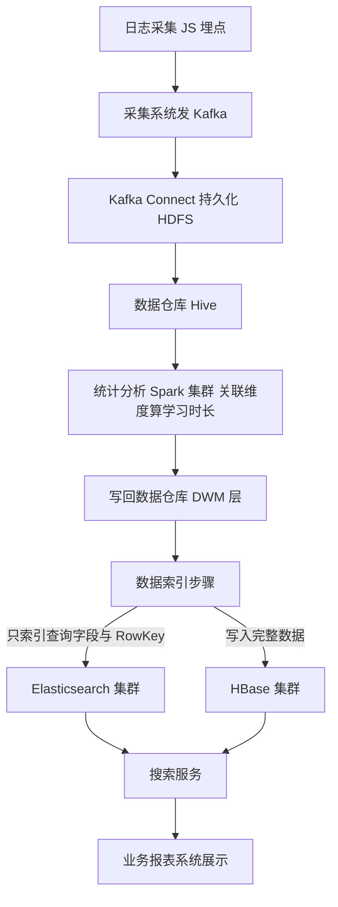

# 面试高频题：智慧学成如何从海量数据中查询想要的数据

明细查询是大数据项目里最容易被追问的场景：学习日志按天落库，越积越多，而产品要在「在线听课详情」页里按学生、课程、视频随口查一段学习记录，还要求点开就有。拿 Hive 直接扫表，一次查询几十秒起步；拿 MySQL 硬扛，行数到千万级就先垮掉。智慧学成的答案叫即时查询，核心动作是把「检索」与「取数」拆给两个系统，面试时能把这个拆分讲清楚，比背一堆组件名词值钱得多。

## 先给结论

- 数据底座是「HBase 存全量 + Elasticsearch 存索引」：完整数据进 HBase，只把查询字段与 RowKey 索引进 Elasticsearch。
- 查询走两跳：先在 Elasticsearch 按关键字搜出 RowKey 集合，再拿 RowKey 去 HBase 点查完整数据，返回给用户展示。
- 写入分两步：SparkSQL 关联维度算出学习时长写进 Hive 的 DWM 层，再由第二个 Spark 任务把 DWM 层数据同时写 HBase 与 Elasticsearch。
- RowKey 用学习记录的 uuid，Elasticsearch 文档里以 id 字段回传，搜索结果与点查主键天然对齐。

## 为什么不直接查数仓

Hive 擅长按天分区的批量扫描，劣势恰恰在随机明细查询：查询条件是任意关键字组合，命中行数极少，却要为此扫掉整分区的列存文件。MySQL 能做随机点查，但单表上千万行、查询字段组合一多，索引与容量都难以为继。即时查询的访问模式其实是两种模式的叠加：关键字检索是倒排索引的活，明细回看是主键点查的活。HBase 只支持按 RowKey 点查与范围扫描，做不了全文检索；Elasticsearch 擅长检索，把大字段全量塞进去既费存储又拖慢建索引。两者拼起来正好互补，谁也不越界。

整套流程从采集到展示如下：



图里两个集群都被搜索服务引用，但职责不同：搜索请求先落到 Elasticsearch 集群，拿回 RowKey 后再落到 HBase 集群，用户感知到的是一次搜索，背后是检索与点查的两跳接力。

## 写入侧：一个任务同时喂两个库

统计分析产出「在线听课详情」的中间数据落在 Hive 的 `data_course.learning_course_online_dwm` 表，字段包含学习记录 id、课程、视频、用户、学习时间、学习时长、日期。第二个 Spark 任务把它分发给 HBase 与 Elasticsearch：

```scala
package com.study.xc.analysis.search

import com.study.xc.analysis.common.EtlEnvironment
import com.study.xc.entity.{LearningCourseOnlineDwm, LearningCourseOnlineEsIndex}
import com.study.xc.utils.HbaseUtils
import org.apache.hadoop.hbase.client.Put
import org.apache.hadoop.hbase.io.ImmutableBytesWritable
import org.apache.hadoop.hbase.util.Bytes
import org.apache.spark.sql.SparkSession
import org.elasticsearch.spark.sql.EsSparkSQL

object InstantQueryStep2ToHbaseAndES {
  // es 索引名：索引/类型
  val esTableName = "learning_online_detail/doc"
  val spark: SparkSession = EtlEnvironment.getSparkSession(this.getClass.getSimpleName, esTableName)

  def main(args: Array[String]): Unit = {
    // hbase 表与列族
    val hbaseTableName = "LearningOnlineDetail"
    val hbaseColumnName = "learning_online_detail"
    val hbaseUtils = new HbaseUtils
    hbaseUtils.createTable(hbaseTableName, hbaseColumnName)
    val jobConf = hbaseUtils.getJobConf(hbaseTableName)

    // 1. 按日期从数据仓库 DWM 层取数
    val date_info = "2019-12-12"
    val learnDS = spark.sql(
      s"select * from data_course.learning_course_online_dwm where date_info ='$date_info'"
    ).as[LearningCourseOnlineDwm]

    // 2. 只挑查询字段与 rowkey 索引进 es
    val learnES = learnDS.map(obj =>
      LearningCourseOnlineEsIndex(
        obj.learning_course_online_id, obj.course_name,
        obj.video_name, obj.user_name, obj.date_info))
    EsSparkSQL.saveToEs(learnES, esTableName)

    // 3. 完整数据写入 hbase，rowkey 即学习记录 id
    learnDS.rdd.map(obj => {
      val put = new Put(Bytes.toBytes(obj.learning_course_online_id))
      put.addColumn(Bytes.toBytes(hbaseColumnName), Bytes.toBytes("course_name"), Bytes.toBytes(obj.course_name))
      put.addColumn(Bytes.toBytes(hbaseColumnName), Bytes.toBytes("video_name"), Bytes.toBytes(obj.video_name))
      put.addColumn(Bytes.toBytes(hbaseColumnName), Bytes.toBytes("user_name"), Bytes.toBytes(obj.user_name))
      put.addColumn(Bytes.toBytes(hbaseColumnName), Bytes.toBytes("learn_count"), Bytes.toBytes(obj.learn_count))
      put.addColumn(Bytes.toBytes(hbaseColumnName), Bytes.toBytes("date_info"), Bytes.toBytes(obj.date_info))
      (new ImmutableBytesWritable(), put)
    }).saveAsHadoopDataset(jobConf)
    spark.close()
  }
}
```

两份产出的字段清单刻意不同：进 Elasticsearch 的 `LearningCourseOnlineEsIndex` 只有 id、课程名、视频名、用户名、日期五个字段，全是用户会拿来搜的字段加上 RowKey；进 HBase 的是完整明细。ES 文档的 id 字段与 HBase 的 RowKey 是同一个 uuid，这个对齐关系是整套方案的枢纽，搜索结果的每一行都能直接换算成 HBase 的 get 请求。

## 查询侧：ES 一跳拿键，HBase 二跳取数

搜索服务的逻辑用 Spark 的 Elasticsearch 支持可以表达得很短：

```scala
// 按关键字在 es 中检索，取回 rowkey 集合
val query = """{"query":{"match":{"user_name":"张三"}}}"""
val rdd = sc.esRDD("learning_online_detail/doc", query)
val rowKeys = rdd.collect().map(p => p._2.get("id").get.toString).toBuffer

// 拿 rowkey 去 hbase 批量 get 完整数据
val hbaseUtils = new HbaseUtils
val result = hbaseUtils.getRowKeyList("LearningOnlineDetail", rowKeys)
println(result.mkString(","))
```

用户在页面输入的查询词落到 `match` 查询上，命中的文档只取 id 字段；随后 `getRowKeyList` 逐个 `Get` HBase 行，拼出完整明细返回。Elasticsearch 里千万级文档的检索在毫秒级，HBase 单行点查同样在毫秒级，两跳相加用户无感，这就是「海量数据里查想要的数据」的全部秘密。

## 两个工程上的坑

**RowKey 敏感于写入分布。** 明细记录若用递增时间戳当 RowKey，写入会永远压在最后一个 region 上，形成单点热点；课程用 uuid 天然散列，各 region 均匀吃流量。代价是 uuid 不可范围扫描，按日期过滤改由 Elasticsearch 的 `date_info` 字段承担，两类查询各找各的索引。

**HBase 依赖 ZooKeeper 的启动顺序。** 课程环境用 docker-compose 编排，容器随系统自启动时会出现 HBase 容器已起而 ZooKeeper 未就绪的情况，表现为 HBase Web 页面（60030 端口）信息显示异常、代码操作时报 socket 超时。处理办法是进入容器执行 `$HBASE_HOME/bin/start-hbase.sh` 重新拉起，再访问 Web 页面确认。依赖编排的系统里，组件启动顺序是实打实的故障源。

## 常见误区

- **把全量字段灌进 Elasticsearch。** 错例：为了省一次 HBase 查询，把整行数据都索引进 ES。正解：ES 只放查询字段与 RowKey，明细留在 HBase；全量进 ES 会让索引体积膨胀数倍，还会拖慢写入与检索。
- **用 HBase 做关键字检索。** 错例：把用户名拼进 RowKey 做前缀扫描。正解：HBase 的检索能力仅限 RowKey 点查与前缀扫，任意关键字组合必须交给倒排索引，两个系统各干各的。
- **RowKey 用时间戳或自增 id。** 错例：顺序写入导致 region 热点，写入吞吐上不去。正解：用 uuid 或对键做散列前缀，把流量摊到所有 region。
- **两步写入当一步用。** 错例：以为写完 HBase 就自动有 ES 索引。正解：HBase 与 ES 是两次独立写入，按天重跑时两步都要执行，数据修正以重跑当日任务为准。

## 面试可能被问到的问题

1. 面试官追问：「为什么搜索不直接查 HBase，要先经过 Elasticsearch？」
   答：HBase 只有 RowKey 点查与范围扫描，用户查询是任意关键字组合，HBase 无从下手。Elasticsearch 用倒排索引把关键字检索做到毫秒级，但它不适合放大字段与复杂明细。所以先用 ES 查出 RowKey，再用 RowKey 去 HBase 点查完整数据，检索与取数各用所长。
2. 面试官追问：「RowKey 是怎么设计的，为什么这样设计？」
   答：RowKey 用学习记录的 uuid，与 ES 文档的 id 字段一一对应，搜索结果可以直接换算成点查请求。uuid 无序，写入分散到各 region 避免热点；日期过滤这类范围条件不在 RowKey 里做，交给 ES 的日期字段。
3. 面试官追问：「ES 和 HBase 两步写入，怎么保证数据一致？」
   答：写入链路是按天的批处理任务，同一天的 DWM 数据重跑时覆盖写 Hive 表、重建 ES 索引、重写 HBase 行，一致性以任务幂等重跑来保证，而不是引入分布式事务。明细数据一天一批，重跑代价可控。
4. 面试官追问：「HBase 里为什么用单列族？」
   答：明细字段一起读出，没有按列族隔离冷热的诉求，单列族最简单；列族过多会放大 store 文件与 flush 次数。一行一个列族、按字段切列，够用且好维护。
5. 面试官追问：「数据量再涨十倍，这套方案瓶颈在哪？」
   答：检索侧 ES 扩分片、存储侧 HBase 扩 region 都有水平空间，先顶住的通常是写入吞吐与索引膨胀。手段是把写入批次的并行度与 HBase 预分区对齐，以及严格控制 ES 索引字段数，必要时按月滚动索引。

## 配套资料

- 讲义：`materials/docs/08/智慧学成-项目就业指导.md`，第 10 节「如何从海量数据查询想要的数据」为本课大纲出处。
- 讲义：`materials/docs/08/智慧学成-第5章-即时查询.md`，1.2 技术方案、3.2 步骤 2 保存到 ES 与 HBase 代码、3.2.4 HBase 使用注意事项、4.2.2 NiFi 调度脚本为本课代码与配置出处。
- 资料：`materials/code/08/_散落资料/`，`instant_query_step1_to_hive.sh`、`instant_query_step2_to_hbase_and_es.sh` 两个 spark-submit 脚本与即时查询整体流程 NiFi 模板在该目录（内层文件名带站点后缀，属元信息，按用途自取）。
- 说明：Scala 代码节选自讲义并做了精简，包名按本系列口径改为 `com.study.xc` 系；查询示例中的关键字为演示用，示例站点一律 example.com 占位。
