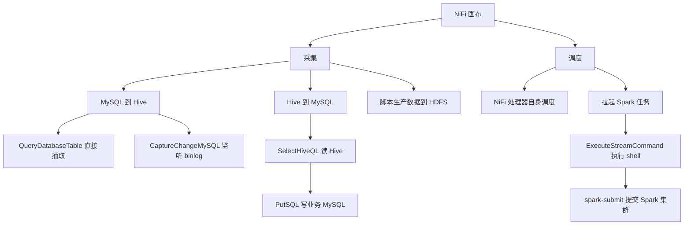

# 面试高频题：智慧学成项目中的任务调度是如何做的

项目跑起来之后，面试官常把问题从「算法怎么写」拐到「任务怎么管」：清洗程序每天几点跑、谁拉起的 Spark 任务、Hive 和 MySQL 之间的数据来回搬靠什么串起来。智慧学成里这些活全部交给 NiFi，它是实时数据流处理系统，提供了丰富的处理器，把数据采集与任务调度放在同一张可视化画布上完成。能说清 NiFi 在项目里「调度了什么、怎么调度」，比只会背它是个数据流工具要高出一个层次。

## 先给结论

- 调度范围分三类：数据采集（MySQL 到 Hive 的两条路、Hive 到 MySQL 的回写）、数据生产（ExecuteScript 跑脚本造数）、执行 Spark 任务（定时触发 shell，shell 里 spark-submit）。
- 采集与转换靠处理器组合：`QueryDatabaseTable` 直接抽取、`CaptureChangeMySQL` 监听 binlog、`SelectHiveQL` 与 `PutSQL` 完成 Hive 到 MySQL 的回写。
- Spark 任务的调度链是 `GenerateFlowFile` 定时产流文件，`ExecuteStreamCommand` 执行容器内的 shell 脚本，脚本再 spark-submit 拉起 jar 里的主类。
- 处理组之间靠 success 连接衔接上下游，连接带背压阈值，画布上串行并行一目了然。

## 采集与调度：两种倾向，一套画布

数据采集与任务调度在项目里都算调度，但倾向不同：采集更贴近数据，关心数据从哪来、变成什么、落到哪；调度更贴近任务，关心程序什么时候跑、跑失败怎么办。NiFi 的处理器模型恰好两头都覆盖，于是采集、转换、Spark 提交被编排进同一张画布，替代了 crontab 加一堆散落脚本的做法。项目里调度与采集的分布如下：



## 采集与转换：处理器组合拳

MySQL 到 Hive 有两条路。直接抽取用 `QueryDatabaseTable`，它自带增量状态，按约定的列从 MySQL 取数，经 `ConvertAvroToJSON`、`SplitJson`、`EvaluateJsonPath`、`ReplaceText` 一串转换整理成目标格式，再写进 Hive。监听 binlog 用 `CaptureChangeMySQL`，捕获 MySQL 的增改事件，配置过滤条件只放行需要的库表与 insert 语句，再落到 Hive，维度数据与业务数据的采集走的就是这条路。反方向 Hive 到 MySQL 的场景是把统计分析好的业务数据写回业务库，供业务报表系统使用：`SelectHiveQL` 从 Hive 读出结果，转换链整理成 MySQL 可识别的格式，`PutSQL` 写入业务 MySQL。三个处理器清单合起来看，采集与转换不写一行 Java 代码，全部是配置出来的。

## 数据生产：ExecuteScript 跑脚本

编写清洗程序需要测试数据时，自建采集系统收到的真实行为数据量偏小，课程用 NiFi 的 `ExecuteScript` 处理器调用脚本批量造数，它支持 Python（Jython）、Ruby、JavaScript 等脚本。下面是项目里新增用户造数脚本的骨架，输出与埋点字段对齐的 JSON 数组：

```python
import random, uuid, time, datetime, json
from java.nio.charset import StandardCharsets
from org.apache.nifi.processor.io import StreamCallback

class PyStreamCallback(StreamCallback):
    def process(self, inputStream, outputStream):
        arr = []
        for i in xrange(1, random.randint(10, 50)):
            obj = {
                'id': str(uuid.uuid4()).replace('-', ''),
                'username': str(uuid.uuid4()).replace('-', ''),
                'ip': '.'.join(str(random.randint(1, 255)) for i in xrange(4)),
                'create_time': datestamp(),  # 往前推 1 到 60 天的随机时间戳
            }
            arr.append(obj)
        outputStream.write(bytearray(json.dumps(arr), encoding='utf-8'))

flowFile = session.create()
if flowFile is not None:
    flowFile = session.write(flowFile, PyStreamCallback())
    session.transfer(flowFile, ExecuteScript.REL_SUCCESS)
```

造出来的流文件顺着连接交给下游处理器，由 `PutHDFS` 落到 HDFS 的采集目录，格式与埋点数据一致，清洗程序完全无感。测试完成停掉流程即可，不污染正式数据。

## 调度 Spark 任务：定时器加命令执行器

Spark 任务本身不在 NiFi 里运行，NiFi 只负责按时把它拉起来。调度链由两个处理器构成：`GenerateFlowFile` 按调度周期产出空流文件充当定时信号，`ExecuteStreamCommand` 收到信号后执行配置好的 shell 脚本。课程模板里今日购买量的实时统计程序是这样配置的：

```properties
# ExecuteStreamCommand 关键配置（节选自 NiFi 模板）
    Command Path      = /opt/run/script/real_time_buy.sh
    Working Directory = /opt/run/script
    Argument Delimiter= ;
    Ignore STDIN      = true
```

被调用的脚本内容同样在课程资料里，Spark 程序打包成 jar 放进 NiFi 容器的 `/opt/run/jars` 目录：

```bash
#!/usr/bin/env bash
SPARK_SUBMIT=/opt/spark/bin/spark-submit

$SPARK_SUBMIT \
  --master spark://xc-online-spark:7077 \
  --conf spark.executor.cores=1 \
  --total-executor-cores 1 \
  --class com.study.xc.analysis.RealTimeBuy \
  /opt/run/jars/xc-service-rt-jar-with-dependencies.jar
```

 NiFi 调度 shell、shell 调度 jar，三层各司其职：定时策略改画布上的调度周期即可，提交参数改脚本即可，业务逻辑改 jar 即可。离线任务在脚本里多带一个日期参数，由上游处理器把昨天日期拼进 `Command Arguments` 传下去。上传脚本后要补一步 `chmod +x` 增加可执行权限，漏掉它，`ExecuteStreamCommand` 会一直报命令执行失败，这是课程里明确强调的部署细节。

串行与并行在画布上是显式的：即时查询步骤 1（关联维度写 Hive）与步骤 2（写 HBase 与 ES）是两个处理组，用 success 关系串成先后；三条实时指标的链路互不相连，天然并行。每条连接都有背压设置，课程模板里是数据量 1 GB 或对象数 10000 触发上游暂停，下游处理不过来时整条链自动降速，不会把内存压爆。处理组里的处理器也可以各配调度周期，课程的整体流程里就有以 9000 秒为周期循环的采集流程，长周期任务与常驻任务在同一画布上和平共处。

## 常见误区

- **把 NiFi 只当 ETL 工具用。** 错例：采集用 NiFi，定时调度又另起 crontab 管理脚本。正解：`GenerateFlowFile` 加 `ExecuteStreamCommand` 就是完整的定时任务调度器，采集与调度统一在一张画布上，依赖关系与失败重试都有现成的可视化支撑。
- **以为 Spark 跑在 NiFi 里面。** 错例：把 NiFi 调度理解成 Spark 任务运行于 NiFi 进程。正解：NiFi 只通过 shell 调用 spark-submit 把任务提交到独立的 Spark 集群，jar、脚本、NiFi 三者是调用关系，不是运行关系。
- **脚本上传后忘记加执行权限。** 错例：本地能跑的脚本放进容器就失败。正解：`chmod +x` 补权限，并用与 NiFi 容器一致的路径（如 `/opt/run/script`）核对 Command Path 配置。
- **采集与调度混为一谈。** 错例：面试时把 `CaptureChangeMySQL` 说成定时任务。正解：采集是数据按事件实时流转，调度是任务按时间周期触发，NiFi 同时承担两者，但处理器选型与关注点不同。

## 面试可能被问到的问题

1. 面试官追问：「为什么选 NiFi 做调度，而不是 crontab 或者 Azkaban？」
   答：项目的调度对象不只是定时任务，还有大量实时数据流：binlog 采集、Kafka 投递、Hive 与 MySQL 互导。NiFi 用同一套处理器模型与画布编排把两类事统一管理，连接自带背压与失败队列，可视化定位问题，这是 crontab 与纯批调度工具给不了的。
2. 面试官追问：「NiFi 是怎么把 Spark 任务跑起来的？」
   答：`GenerateFlowFile` 按周期产出流文件作为触发信号，`ExecuteStreamCommand` 收到信号执行容器内的 shell 脚本，脚本里用 spark-submit 把 jar 提交到 Spark 集群。NiFi 容器里提前放好脚本与 jar，改调度频率改画布配置，改提交参数改脚本，互不牵连。
3. 面试官追问：「MySQL 到 Hive 的采集为什么要做两条路？」
   答：维度与业务数据的形态不同。能按增量列识别的表用 `QueryDatabaseTable` 直接查询抽取，配置简单；变更频繁、需要捕获增改的表用 `CaptureChangeMySQL` 监听 binlog，按库表与事件类型过滤后入库。两种方式覆盖不同数据源特征，避免为迁就一种方式改业务库。
4. 面试官追问：「下游挂了，上游数据会丢吗？」
   答：不会立即丢。NiFi 的连接是有界缓冲，背压阈值触发后上游自动停止产出；处理失败的流文件进入失败关系，可配置重试或回退，攒在队列里等下游恢复后继续处理。
5. 面试官追问：「处理组之间怎么保证执行顺序？」
   答：组间用 success 连接显式串行，上游组处理成功的关系才流向下游组，比如即时查询先关联维度写 Hive，成功后触发写 HBase 与 Elasticsearch 的组。并行的组之间不建连接，各自独立调度，顺序诉求全部落在画布的连接关系上。

## 配套资料

- 讲义：`materials/docs/08/智慧学成-项目就业指导.md`，第 11 节「Spark 任务是如何调度的 / 数据处理的任务是如何调度的」为本课大纲出处。
- 讲义：`materials/docs/10/智慧学成-第2章-ETL.md`，数据采集与 ETL 的 NiFi 处理器编排为本课前置出处（资料库把这份讲义归档在编号 10 的目录下，路径真实存在）。
- 资料：`materials/code/08/_散落资料/`，实时分析整体流程、数据清洗统计、数据生产 ToHDFS 等全部 NiFi 模板 XML，`course_buy_process_by_biz.sh`、`real_time_buy.sh` 等被调度脚本，新增用户实时分析 Python 造数脚本，工程 `pom.xml` 与自动构建脚本在该目录（内层文件名带站点后缀，属元信息，按用途自取）。
- 说明：Python 脚本节选自课程资料并做了精简，包名按本系列口径改为 `com.study.xc` 系；示例站点一律 example.com 占位。
