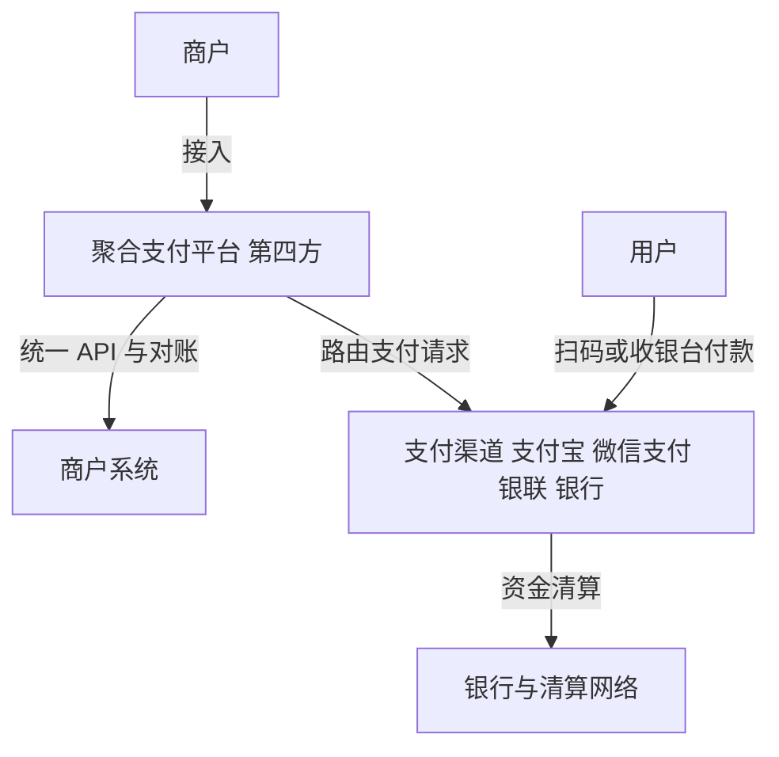

# 从第四方支付说起：聚合支付项目第 1 章全景

> 🔒 安全提示：文中示例的口令/密钥均为课程教学环境演示口径，生产环境的安全要求见《安全与合规须知》。

到一个新项目，最先要回答的不是怎么写代码，而是「这是个什么项目、用什么东西做的、环境怎么搭起来」。第 1 章就是干这件事的：先把聚合支付这门生意的来龙去脉讲清，再把微服务技术架构与开发环境搭建的路线铺开。本项目以「闪聚支付」为课程虚构的聚合支付产品名展开，聚合支付平台是它的项目定位；与前几个阶段一致，正文把工程包名与模块名统一改写为 `com.study.pay` 系，支付渠道的 appid、商户私钥、API 密钥一律以 `example-appid`、`example-secret`、`example-key` 这样的占位符出现，课程环境的 MySQL 仍按教学配置用 root/123456。

## 先给结论

- 聚合支付又称「第四方支付」：整合支付宝、微信、银联等主流支付渠道，形成第三方支付的聚合通道；它不做资金清算，因此不需要支付牌照。
- 闪聚支付以 SaaS 形式给商户提供订单管理、门店管理、财务统计等服务，形态是线上聚合收银台（开放 API）、线下 C 扫 B 一码多付与 B 扫 C 商家扫码。
- 功能分三大块：官网与开放平台、商户平台、运营平台；业务主线是商户注册、资质认证、配置支付渠道参数、生成二维码收款。
- 技术架构是前后端分离的微服务架构：服务端基于 Spring Boot，采用 Spring Cloud Alibaba 微服务体系，Nacos 承担服务发现与配置中心。
- 第 1 章的动手任务是把 Nacos、数据库环境、基础工程搭起来，并写一个测试程序验证环境可用。

## 聚合支付是什么：第四方支付的定位

移动支付盛行之后，商业银行、第三方支付公司、清算机构、消费金融公司都在给商户提供网络支付方案，用户的支付需求又五花八门，支付渠道呈碎片化状态，而且碎片化还在加深。商户的痛点随之而来：接一个渠道要对接一套 SDK、签一次约、对一次账。聚合支付做的事就是把主流支付渠道整合起来，形成第三方支付的聚合通道，所以行业里叫它「第四方支付」。它的产业结构可以用一张图说清：



资金链路在渠道侧走完：用户付款、渠道清算给商户；聚合支付平台自始至终只处理支付环节的信息流转与商户运营的承载，不碰资金，因此无需支付牌照。这一定位带来三个特点：中立性（不偏袒任何渠道）、灵活性（渠道可插拔）、便捷性（商户一次接入）。对商户的价值直接了当：降低接入成本，提高运营效率。

## 项目概述：一个聚合支付平台的骨架

闪聚支付目前的主要做法分三类场景：线上聚合收银台，以开放 API 的方式供商户系统直接对接；线下 C 扫 B，用户扫商户门店的一张二维码付款，一码多付指的是同一个码可以按用户打开的 App 自动路由到对应渠道；线下 B 扫 C，商家拿扫码设备扫用户付款码。平台以 SaaS 服务形式向商户提供订单管理、门店管理、财务数据统计等基础服务，并以支付为入口，向广告、营销、金融服务延伸，构成移动支付生态。

功能模块分三块。官网与开放平台负责产品展示、帮助中心与开发者中心；商户平台是商户的日常工作界面，从注册登录、企业资质认证、创建应用、配置支付渠道参数、生成门店收款二维码，到员工与优惠管理；运营平台面向平台方，承担商户检索与审核、优惠策略设置、管理员与角色管理。商户侧的完整业务流程是一条链：注册账号、提交资质认证、平台审核通过、购买套餐、创建应用、填写支付渠道参数（支付宝、微信、银联等）、测试渠道后上线，之后 C 端用户扫码消费，商户在平台上做运营管理。后续各章的代码基本都长在这条链的节点上。

## 技术架构：从单体演进到微服务

软件架构走过单体架构、分布式（垂直）架构、SOA 架构到微服务架构的路。单体把所有功能打进一个 war 包，开发部署简单，但大型项目难扩展、难按需伸缩；垂直拆分让子系统按需伸缩，代价是数据冗余与高耦合；SOA 抽取公共服务、以 ESB 做通信桥梁，但服务边界模糊、接口协议繁杂；微服务把服务层按业务细粒度拆分，服务间用 RESTful、RPC 等轻量级协议通信，配合前后端分离，迭代周期短、可精准伸缩，代价是开发复杂度与服务治理成本上升。聚合支付平台选择微服务架构，看中的正是渠道多变、业务迭代快对伸缩与独立部署的要求。

落到系统分层上，从外到内是用户层（PC、APP、H5）、CDN 加速静态资源、负载均衡（4 层与 7 层结合）、UI 层（商户平台与运营平台两套前端）、微服务层、数据层。微服务层分两类：业务微服务包括统一认证、商户服务、交易服务；基础微服务为系统级公共服务，包括文件服务、配置服务、验证码服务、调度服务。数据层由 MySQL 持久化业务数据，消息队列承接服务间通信，缓存存放商户、验证码等热点信息，文件存储服务作为 CDN 的数据源。外部系统接口对接支付宝与微信支付、第三方短信、云文件存储与 CDN。

## 技术栈：Spring Cloud Alibaba 是主轴

服务端基于 Spring Boot 构建，采用 Spring Cloud Alibaba 微服务架构，版本关系在工程的父 pom 里写得很明确：

```xml
<!-- 聚合支付平台父工程坐标与依赖管理（节选，groupId 与模块名按本系列口径改写） -->
<groupId>com.study.pay</groupId>
<artifactId>pay</artifactId>
<version>1.0-SNAPSHOT</version>
<parent>
    <groupId>org.springframework.boot</groupId>
    <artifactId>spring-boot-starter-parent</artifactId>
    <version>2.1.3.RELEASE</version>
</parent>

<dependencyManagement>
    <dependencies>
        <dependency>
            <groupId>org.springframework.cloud</groupId>
            <artifactId>spring-cloud-dependencies</artifactId>
            <version>Greenwich.RELEASE</version>
            <type>pom</type>
            <scope>import</scope>
        </dependency>
        <dependency>
            <groupId>com.alibaba.cloud</groupId>
            <artifactId>spring-cloud-alibaba-dependencies</artifactId>
            <version>2.1.0.RELEASE</version>
            <type>pom</type>
            <scope>import</scope>
        </dependency>
    </dependencies>
</dependencyManagement>
```

微服务一旦多起来，两个问题立刻出现：服务实例的地址谁来记，服务各自的配置谁来管。Nacos 一个组件管两件事，注册中心让服务上线即注册、调用方按名发现，配置中心把各服务的配置集中托管、动态刷新，是这套微服务体系的第一块基石。业务微服务的依赖清单能看出接入方式：

```xml
<!-- 业务微服务接入 Nacos 与 Dubbo（节选自课程工程依赖清单） -->
<dependency>
    <groupId>com.alibaba.cloud</groupId>
    <artifactId>spring-cloud-starter-alibaba-nacos-config</artifactId>
</dependency>
<dependency>
    <groupId>com.alibaba.cloud</groupId>
    <artifactId>spring-cloud-starter-alibaba-nacos-discovery</artifactId>
</dependency>
<dependency>
    <groupId>com.alibaba.cloud</groupId>
    <artifactId>spring-cloud-starter-dubbo</artifactId>
</dependency>
```

其余组件各管一段：Zuul 网关做客户端认证与路由转发，Dubbo 完成微服务间 RPC 调用，JWT 做前后端令牌管理；持久化用 Mybatis Plus 加 Druid 连接池，交易相关数据用 Sharding-jdbc 做分库分表，缓存用 Redis，RocketMQ 的事务消息承担部分分布式事务控制，限流交给 Sentinel，任务调度用 XXL-Job，接口文档用 Swagger，文件上传走第三方云平台。

## 环境搭建：第 1 章的动手清单

项目介绍读完了要落到手上。因为工程基于微服务架构，环境搭建从 Nacos 开始：安装并启动 Nacos 服务端，验证控制台可访问；然后是数据库环境，安装 MySQL 并创建数据库、导入商户与交易相关的表结构和初始数据（课程环境账号 root/123456）；接着把微服务基础工程建起来，统一依赖、统一日志、统一返回结构；最后是工程测试手段，Spring Boot 集成 Swagger 出接口文档，配合 Postman 调试接口。验收标准是写一个测试程序：服务能注册进 Nacos、能被发现、能调通一条接口，环境才算搭成。项目介绍部分的要求则是另一维度的：能用自己的话说清项目的背景、模块与业务流程，到了企业里被人问「你做的什么项目」时答得上来。

## 常见误区

- **把聚合支付当成第三方支付的一种。** 错例：认为聚合支付平台也持有支付牌照、参与资金清算。正解：聚合支付是第四方，只做信息流转与商户运营承载，资金清算发生在支付宝、微信、银联等持牌渠道侧。
- **把 Nacos 只当注册中心。** 错例：只配置了 discovery 依赖就开始写业务。正解：Nacos 同时承担服务发现与配置中心，工程里 config 与 discovery 两个 starter 成对出现，配置集中管理与动态刷新是微服务能运维的前提。
- **认为微服务拆得越细越好。** 错例：把商户平台的每个页面都拆成一个服务。正解：拆分粒度以业务边界为准，本项目按统一认证、商户、交易与文件、配置、验证码、调度等功能域划分，粒度过细只会放大治理成本。
- **跳过环境搭建直接看业务代码。** 错例：Nacos 没装、库没导，跑商户注册时到处报连接错误。正解：按 Nacos、数据库、基础工程、工程测试的顺序搭好，并用测试程序验证服务注册与调用链路，再进入业务开发。

## 面试可能被问到的问题

1. 面试官追问：「什么是聚合支付？它和第三方支付的区别是什么？」
   答：聚合支付把支付宝、微信支付、银联等主流渠道整合成统一的接入通道，所以叫第四方支付。区别在于职责：第三方支付持有牌照、负责资金清算；聚合支付不碰资金、无需牌照，只完成支付信息流转与商户运营承载，帮商户一次接入多家渠道。
2. 面试官追问：「你们项目为什么用微服务架构？」
   答：支付渠道多变、业务迭代快。微服务按业务边界拆分后，商户、交易等业务微服务可以独立开发、独立部署、按需伸缩，服务间用 RESTful 与 RPC 轻量通信；配套 Nacos 做注册与配置、网关做统一入口，治理成本可控。单体架构在这种多渠道、多端场景下迭代与伸缩都吃力。
3. 面试官追问：「Nacos 在项目里承担什么角色，为什么选它？」
   答：两个角色，服务注册发现与配置中心。服务启动即注册，调用方按服务名发现实例，地址变化无需改配置；各服务的配置集中托管在 Nacos，支持动态刷新。相比把注册与配置拆成两个组件，Nacos 一套控制台与协议覆盖两件事，运维成本低，与 Spring Cloud Alibaba 生态无缝集成。
4. 面试官追问：「这个平台有哪些功能模块和服务划分？」
   答：功能上三块，官网与开放平台、商户平台、运营平台。服务上分业务微服务与基础微服务：业务侧是统一认证、商户服务、交易服务，基础侧是文件、配置、验证码、调度等公共服务，前面用 Zuul 网关统一接入，服务间用 Dubbo 调用。
5. 面试官追问：「商户从注册到收款要走哪些环节？」
   答：注册平台账号，提交企业资质认证，平台审核通过后购买套餐，创建应用并填写支付宝、微信等渠道参数，测试渠道后上线，生成门店二维码让 C 端用户扫码付款，之后商户在平台做订单、门店与财务管理。渠道参数是商户与渠道绑定关系的落点，是支付路由的依据。

## 配套资料

- 讲义：`materials/docs/10/闪聚支付-第1章-讲义-项目介绍v1.0.md`，1.1 项目背景、1.2 项目概述、1.3 功能模块、1.4 业务流程、2 技术架构与 2.3 技术栈为本课出处。
- 讲义：`materials/docs/10/闪聚支付-第1章-讲义-开发环境搭建v1.0.md`，服务端搭建（Nacos 服务发现与配置中心、数据库环境、工程测试）为本章动手部分出处。
- 讲义：`materials/docs/10/Nacos-服务发现与配置管理v1.0.md`，Nacos 专题文档，环境搭建与后续章节都会用到。
- 代码：`materials/code/10/`，聚合支付平台各微服务工程与 Nacos 服务端安装包在该目录（内层目录名含项目原始命名，与正文包名口径不一致，不在此展开，按用途自取）；正文两段 pom 依赖为该工程真实文件节选，groupId 与模块名已按本系列口径改写为 `com.study.pay` 系。
- 说明：该阶段课程资料与下一阶段共用资料目录编号，以上路径均真实存在；支付渠道密钥一律 example-appid、example-secret、example-key 占位，示例站点一律 example.com。
