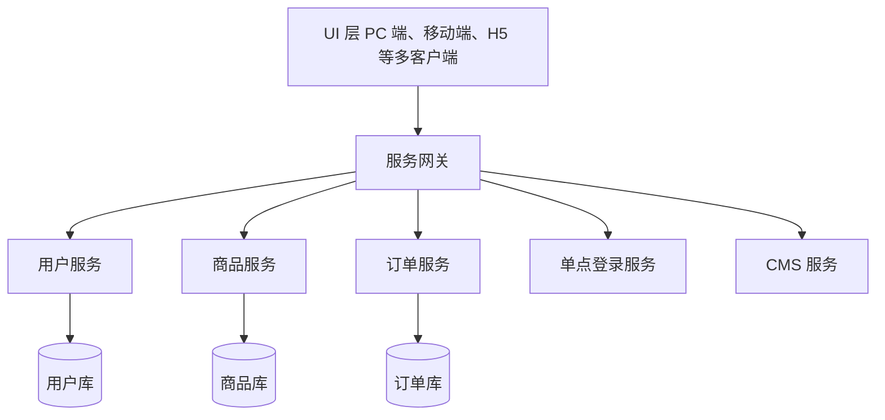

# 微服务架构：把服务层拆细之后，事情变好也变难了

SOA 已经把公用的功能抽成了服务，为什么还要再造一个「微服务」的概念？很多人背了四条微服务特点，被追问「它和 SOA 到底差在哪」就卡住。从单体到分布式再到 SOA 的演进线走完之后，遗留的问题恰恰是理解微服务的入口：拆分的时机与粒度没有解决，通信协议也没有收敛。这一课讲的就是微服务如何收掉这两个尾巴，以及拆细之后新冒出来的治理难题。

## 先给结论

- 微服务不是颠覆，而是基于 SOA 思想的再拆分：SOA 在系统建成之后抽公共服务，微服务从系统设计之初就把服务层按业务拆成细粒度的服务。
- 微服务四条特点：服务层按业务拆分、每个微服务职责单一、服务间用 RESTful 与 RPC 等轻量级协议传输、有利于前后端分离。
- 收益是资源复用提高开发效率、按需伸缩的粒度变精准、适配互联网产品短周期迭代；代价是开发复杂度上升、服务治理成本高。
- 服务拆多之后，实例地址动态变化、扩缩容频繁，靠配置文件写死地址的路子走不通，服务注册与发现成为微服务体系要解决的第一件事。

## SOA 留下的两个尾巴

**第一，服务粒度过大，边界模糊。** SOA 是在分布式架构的基础上，把重复公用的功能抽取为组件、以服务的方式向各系统提供。听起来很好，但它是在系统已经建成的条件下回头抽服务，系统与服务之间的界限模糊，抽出来的服务往往粒度过大，系统与服务之间耦合性依然偏高。功能复用推进了，可伸缩的粒度却卡在「子系统级」上，无法对同一个子系统里的不同业务分别优化。

**第二，接口协议不固定。** SOA 依赖 ESB 企业服务总线作为系统与服务之间通信的桥梁，虽然减少了接口间的耦合，但服务的接口协议种类繁多，webservice、rpc 等方式混着用，维护起来非常吃力。

**第三，移动互联网把压力抬到了新高度。** 手机软件爆发之后，客户端形态极多：PC 网站、Android、iOS、iPad、H5 页面，全是 UI 层。总不能为每一种客户端单独开发一套系统，那样客户端有多少种，系统就要写多少套。多客户端要支撑同一套业务，大型项目还要快速迭代，这两个需求一起把架构逼到了下一步。

## 微服务的拆法：设计之初就把服务层打散

微服务架构基于 SOA 的思想，为了满足移动互联网对大型项目及多客户端的需求，对服务层进行细粒度的拆分，拆出来的每个服务只完成某个特定的业务功能：订单服务只做订单相关的业务，用户服务只做用户管理相关的业务，物流服务只做物流。服务粒度很小，所以叫微服务架构。它落地时有四个要点，缺一个味道就不对：

**其一，完全的前后端分离。** 前端负责用户界面与交互，服务层负责真正提供业务能力。前端形态千变万化，服务层把用户业务梳理完毕、抽成一个一个细粒度服务之后，就不再跟着客户端走：客户端只管变，服务层不用变。一套设计良好的服务层，可以同时支撑 PC 端和各种移动端。

**其二，服务与数据库一一对应。** 有用户服务就有用户数据库，有订单服务就有订单数据库，每个服务的数据自己管自己，这是按需伸缩和独立部署的前提。

**其三，协议固定且轻量。** 微服务之间大多采用 RESTful 协议，也有一部分 RPC 协议，不再像 SOA 那样协议种类繁多，这是前后端分离能顺畅运转的基础。

**其四，拆分发生在设计之初。** 这一点是和 SOA 最本质的差异：不是系统建成后回头抽服务，而是设计阶段就按业务域把服务层拆开。

微服务架构长这样：



客户端经网关进入服务层，服务层里每个服务只管一块业务，每个服务背后挂自己的库。前端怎么换，中间这一排服务不动，这就是「支持多客户端」的结构性保障。

## 与 SOA 的差别，一张表说清

| 对比维度 | SOA 架构 | 微服务架构 |
|---|---|---|
| 拆分时机 | 系统建成后抽取公共服务 | 系统设计之初按业务拆服务 |
| 服务粒度 | 粒度过大，边界模糊 | 细粒度，职责单一 |
| 通信方式 | ESB 总线，接口协议繁多 | RESTful、RPC 等轻量级协议 |
| 数据归属 | 各系统各自存储，存在冗余 | 服务与数据库一一对应 |
| 伸缩粒度 | 子系统级 | 单个服务级，按需精准伸缩 |

ESB 是 SOA 时代的通信中枢，也是它笨重的原因之一；微服务把「总线」的职责交给了网关与轻量协议，把「服务治理」的职责交给了注册中心等基础设施，这两步交换正是现代微服务技术栈的起点。

## 收益与代价

**收益有三条。** 服务拆分粒度更细，有利于资源重复利用，提高开发效率；可以对每个服务单独制定优化方案，按需伸缩的粒度小而精准，订单压力大就只扩订单服务；适合互联网时代的产品节奏，新业务上线时已有服务直接做支撑，只需要完成新业务本身的开发，迭代周期短。

**代价也有两条，而且真实存在。** 一条是开发复杂性增加：一个业务流程要多个微服务通过网络交互共同完成。单体时代一次调用就是本地方法，微服务时代一次请求可能跨好几个服务：

```java
// 单体应用：一次下单全部是本地方法调用，简单直接
public String createOrder(OrderRequest request) {
    UserDTO user = userService.getById(request.getUserId());         // 本地调用
    ProductDTO product = productService.getById(request.getSkuId()); // 本地调用
    Order order = orderService.create(user, product, request);       // 本地调用
    return order.getId();
}
```

```java
// 微服务架构：同样的下单流程，订单服务要通过网络调用商品服务、用户服务
public String createOrder(OrderRequest request) {
    // 订单服务远程查询商品，商品服务的地址与端口必须拿到才能调
    String product = restTemplate.getForObject("http://" + productServiceAddress + "/products/" + request.getSkuId(), String.class);
    // 订单服务远程查询用户
    String user = restTemplate.getForObject("http://" + userServiceAddress + "/users/" + request.getUserId(), String.class);
    return orderService.create(user, product, request);
}
```

另一条是服务治理成本：服务数量一多，维护难度上升，对维护人员的要求也提高。相比优点带来的效率提升，这两条代价在互联网项目里是可以忍受的，代价本身也催生了新的基础设施需求，下一节展开。

## 服务一多，地址记账成了新问题

微服务部署在云环境时，服务实例的网络位置可能是动态分配的；每个服务一般会有多个实例做负载均衡，由于宕机或升级，实例地址经常变化；访问压力临时增大时还会动态加节点。消费方要调用生产方，就必须知道生产方的 IP 与端口，可这个地址已经不是恒定的了。课程里专门做了一个测试工程演示这条老路：消费方在配置文件里写死提供方地址：

```yaml
server:
  port: 56020

#配置服务提供方的地址（ip和端口）
provider:
  address: 127.0.0.1:56010
```

这种写法在单实例演示环境里能跑通，放到真实的微服务集群立刻失效：地址一变就要改配置重启，扩容之后也不知道该挑哪一个实例。服务之间如何相互发现、服务如何管理，这就是服务发现要回答的问题，对应的组件叫服务注册中心。聚合支付这类支付平台的交易链路同样由多个服务协作完成，注册中心因此成了环境搭建的第一块基石，Nacos 正是承担这个角色的组件，它同时把配置管理也一并解决了。

## 常见误区

- **把微服务当成 SOA 的换个说法。** 错例：认为两者都是抽服务，答不出差别。正解：差异在拆分时机与粒度，SOA 是建成之后抽公共服务、粒度大、依赖 ESB；微服务是设计之初按业务拆、粒度细、用固定轻量协议。
- **认为拆得越细越好。** 错例：把每个页面、每个接口都拆成一个服务。正解：粒度以业务边界为准，一个服务只完成一个特定业务功能即可，拆过细只会放大网络调用与治理成本。
- **认为前后端分离是前端与后端各写各的。** 错例：服务层为了迁就某个客户端改接口形态。正解：分离的前提是服务层把业务梳理成与客户端无关的服务，客户端怎么变，服务层不动。
- **让多个微服务共用一个数据库。** 错例：服务拆开了，库还连同一个。正解：服务与数据库一一对应，否则按需伸缩与独立部署都是空谈。

## 面试可能被问到的问题

1. 面试官追问：「微服务架构和 SOA 架构的区别是什么？」
   答：思想上都是面向服务，差别在拆分方式。SOA 在系统建成之后抽取公共服务，粒度偏大、系统与服务界限模糊，通信依赖 ESB 且接口协议种类繁多；微服务从设计之初就按业务把服务层拆成细粒度服务，职责单一，服务与数据库一一对应，用 RESTful、RPC 等轻量级协议通信，天然支持前后端分离。
2. 面试官追问：「微服务的优点和缺点分别是什么？」
   答：优点是粒度细、资源可复用、开发效率高，可以针对单个服务精准按需伸缩，产品迭代周期短；缺点是一个业务流程要多个服务通过网络协作完成，开发复杂性增加，服务数量多之后治理成本高、维护要求提高。
3. 面试官追问：「为什么微服务架构有利于支撑多客户端？」
   答：因为完全前后端分离，前端只负责界面与交互，服务层在设计之初就按业务抽成细粒度服务，接口形态与客户端无关。PC、Android、iOS、H5 全部请求同一套服务层，客户端形态变化不需要服务层跟着改，避免了为每种客户端开发一套系统的浪费。
4. 面试官追问：「你们项目里微服务的拆分粒度是怎么定的？」
   答：按业务边界拆，一个服务只负责一块特定业务，比如用户服务只做用户相关业务、订单服务只做订单。判断标准是职责是否单一、能否独立部署与按需伸缩，而不是代码量的多少；粒度过细会让一次请求跨太多服务，网络交互与运维成本都会放大。
5. 面试官追问：「微服务拆多之后最先遇到什么新问题？」
   答：服务实例的地址管理。云环境里实例位置动态分配，多实例负载均衡加上宕机、升级、扩缩容，地址频繁变化，调用方靠配置文件写死地址行不通。解决办法是引入注册中心，服务启动时上报自己的网络位置形成服务注册表，消费方按服务名去发现可用实例，Nacos 就是承担这个角色的组件。

## 配套资料

- 讲义：`materials/docs/10/闪聚支付-第1章-讲义-项目介绍v1.0.md`，2.1.1 至 2.1.4 的架构演进与微服务特点、优点、缺点为本课出处。
- 代码：`materials/code/10/nacos-discovery-服务发现流程测试/`，消费方在 `application.yml` 写死提供方地址的测试工程，用来演示未引入注册中心时的痛点；工程内层包名与正文改写口径不一致，不再展开。
- 说明：单体与微服务下单流程的两段 java 对比代码，以及两段代码中的地址变量，为按本课写法补全的示例；该阶段课程资料归档在 `materials/docs/10/` 与 `materials/code/10/`（目录编号与相邻阶段共用）。
