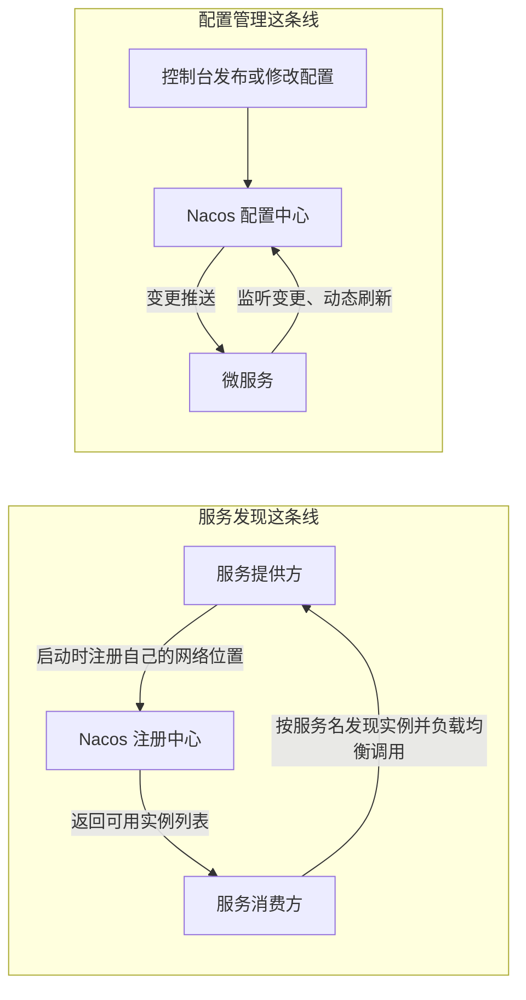

# Nacos 学习地图：服务发现与配置管理两条线

动手搭支付项目的开发环境之前，课程先插进来一整块 Nacos 的内容，不少人觉得这是绕路：环境不就是装个软件、把工程跑起来吗。真实的顺序恰恰相反，微服务工程一旦离开注册中心与配置中心，第一步都迈不出去，服务起不来、配置读不到，跑了也验证不了。所以先把 Nacos 的学习地图摊开：它是什么、为什么支付系统缺它不可、要达到哪几条目标、哪些要动手掌握、哪些理解即可。

## 先给结论

- Nacos 是阿里巴巴开源的组件，致力于帮助开发者发现、配置和管理微服务，本项目全程用它承担两件事：服务发现（服务注册中心）与配置管理（配置中心）。
- 服务发现这条线的目标链：理解微服务架构的特点，理解服务发现的流程，能说出 Nacos 的功能，掌握 Nacos 的安装，重点掌握 RESTful 与 Dubbo 两种服务发现的开发方法，理解 Nacos 服务发现的数据模型。
- 配置管理这条线的目标：掌握 Nacos 配置管理方法，掌握扩展配置方法。
- 动手掌握的重点共四个：RESTful 服务发现、Dubbo 服务发现、配置管理方法、扩展配置方法；流程与数据模型属于理解级目标，不要求手写但必须讲得清。
- 课程使用 nacos-server-1.1.3 版本，与工程锁定的 Spring Cloud Alibaba 2.1.0 配套。

## 为什么支付系统离不开注册中心

支付平台的业务链路天然是多服务协作：一笔交易从统一认证到商户服务再到交易服务，一次请求至少跨两三个服务做远程调用。调用方要拿到被调方的地址，最先想到的办法是在配置文件里写 IP 与端口，这条路在演示工程里能走通，在支付系统里全是坑。

**坑一，地址不是恒定的。** 服务实例部署在云环境时，网络位置可能是动态分配的；宕机、升级、扩容都会让实例地址变化，写死的配置随时过期，而支付请求一旦调不到交易服务就是真金白银的事故。

**坑二，多实例没有挑选依据。** 每个服务一般部署多个实例做负载均衡，配置文件里只写一个地址，既不知道背后还有哪些可用实例，也做不了流量分摊，一个实例挂了请求跟着失败。

**坑三，配置散落在各个服务本地。** 每个微服务都有自己的数据库连接、渠道开关、限流阈值，写在各自的配置文件里，改一处要重新打包发布全部相关服务；支付渠道参数、交易开关这类运行时需要调整的内容，更需要不重启就生效的能力。

把这三件事统一解决掉的组件就是 Nacos：服务注册表记录所有实例的地址并做健康检查，消费方按服务名发现可用实例并负载均衡调用；配置集中托管在配置中心，变更后推送到各服务动态刷新。环境搭建第一步装 Nacos，不是课程安排的偏好，而是这套微服务体系的运行前提。

## Nacos 的两大职能长什么样



左半边解决「服务在哪」：提供方启动即注册，形成服务注册表；消费方从注册中心拿实例列表，再做远程调用。右半边解决「配置谁管」：配置在控制台集中发布，服务端变更后推送给微服务，应用在运行中刷新行为。两条线共用同一个 Nacos 服务端与控制台，工程里对应的依赖也是成对的。

## 九条教学目标，四个动手重点

课程把 Nacos 部分的目标列成九条，按要求的深浅分成三类。理解类三条：能够理解微服务架构的特点、能够理解服务发现的流程、理解 Nacos 服务发现的数据模型。陈述类一条：能够说出 Nacos 的功能，服务发现与配置管理两项要脱口而出。掌握类五条：掌握 Nacos 的安装方法、掌握 RESTful 服务发现开发方法、掌握 Dubbo 服务发现开发方法、掌握 Nacos 配置管理方法、掌握扩展配置方法。

其中打勾要求动手掌握的是四点：RESTful 服务发现、Dubbo 服务发现、配置管理方法、扩展配置方法。这四点就是后续写代码时的肌肉记忆，跳过任何一个，环境搭建与业务开发都会在配置环节反复卡壳。理解类的数据模型（Namespace、Group、Cluster）看起来抽象，它决定了多环境与多项目的隔离方式，到配置管理的章节必须回头用到。

工程侧的接入点很集中，给微服务工程加上服务发现依赖：

```xml
<!-- 服务发现客户端：注册自身地址、拉取服务列表（节选自课程测试工程 pom） -->
<dependency>
    <groupId>com.alibaba.cloud</groupId>
    <artifactId>spring-cloud-starter-alibaba-nacos-discovery</artifactId>
</dependency>
```

再在配置文件里指明 Nacos 地址：

```yaml
server:
  port: 56010

spring:
  application:
    name: nacos-restful-provider #服务名
  cloud:
    nacos:
      discovery:
        server-addr: 127.0.0.1:8848  #服务发现中心地址
```

启动之后服务列表里就能看到这个服务，这就是服务发现这条线要跑通的第一段链路；配置管理那条线则是给工程加上 nacos-config 的依赖，从控制台读配置、监听变更，两条线在后续章节各有一整块实操。

## 建议的学习顺序

先 RESTful 后 Dubbo，再进配置管理。RESTful 版本用两个裸工程（服务提供者与服务消费者）把注册与发现的本质跑通：不借助 Dubbo，直接看到「注册表里有什么、消费方拿到什么」，流程感最强。随后切到 Dubbo 服务发现：Dubbo 是阿里巴巴开源的 RPC 框架，Spring Cloud Alibaba 集成了它，微服务可以暴露 Dubbo 协议的接口，RPC 调用像调本地方法一样，速度也更快，本项目微服务层正是基于 Dubbo 协议构造服务。理解了这两种方式之后，配置管理作为 Nacos 的另一半功能登场，最后用扩展配置收尾，覆盖一个应用读多个配置集的场景。

## 常见误区

- **把 Nacos 只当注册中心。** 错例：只引入 nacos-discovery，把配置继续留在本地文件。正解：Nacos 的题目就叫服务发现和配置管理，两条线同样重要，工程里 config 与 discovery 依赖成对出现。
- **认为 Dubbo 服务发现与 RESTful 服务发现用的是两套注册中心。** 错例：为 Dubbo 单独再装一个注册中心。正解：两种方式只是暴露协议与调用方式不同，注册与发现都走同一个 Nacos。
- **跳过理解类目标直接抄配置。** 错例：数据模型没搞清就配多环境，结果开发与测试环境的配置读到同一个空间。正解：Namespace、Group、Cluster 的隔离模型是配置管理实操的地基，理解了再动手。
- **随意选 Nacos 服务端版本。** 错例：装一个与课程工程不匹配的新版 Nacos，启动报错或兼容性问题。正解：与 Spring Cloud Alibaba 2.1.0 配套，课程使用 nacos-server-1.1.3。

## 面试可能被问到的问题

1. 面试官追问：「Nacos 是什么？它提供哪些功能？」
   答：Nacos 是阿里巴巴开源的组件，帮助开发者发现、配置和管理微服务。两大功能：服务发现，作为注册中心记录服务实例的网络位置并支持健康检查；配置管理，作为配置中心集中管理各服务配置并支持动态刷新。项目里 Nacos 承担注册中心与配置中心两个角色。
2. 面试官追问：「为什么你们项目必须要注册中心，不引入行不行？」
   答：行不通。微服务实例的地址是动态的，多实例之间需要负载均衡，宕机扩容还会让地址随时变化，调用方在配置文件里写死地址既过期快又没有实例选择依据。注册中心统一维护服务注册表，服务启动即注册，消费方按服务名发现可用实例，地址变化对调用方透明。
3. 面试官追问：「服务发现和配置管理两部分，学习重点分别是什么？」
   答：服务发现要掌握 RESTful 与 Dubbo 两种服务发现的开发方法，并理解服务发现流程与数据模型；配置管理要掌握 Nacos 配置管理方法与扩展配置方法。核心区分是：流程与模型要求理解并能讲清，四种开发方法要求动手实现。
4. 面试官追问：「RESTful 服务发现和 Dubbo 服务发现有什么区别？」
   答：都是基于同一个 Nacos 做注册与发现，差别在服务暴露与调用的协议。RESTful 用 HTTP 接口，流程直白，适合理解原理；Dubbo 是 RPC 框架，接口像本地方法一样调用，协议性能更好，项目微服务层最终采用基于 Dubbo 协议构造的服务。
5. 面试官追问：「数据模型要理解到什么程度？」
   答：知道服务在 Nacos 里按 Namespace、Group、Cluster 三层组织：Namespace 做租户或环境隔离，Group 做项目或分组隔离，Cluster 做机房级分组，配置管理侧还有 Namespace、Group、DataID 定位一个配置集。达到能解释多环境配置隔离怎么落地的程度即可。

## 配套资料

- 讲义：`materials/docs/10/Nacos-服务发现与配置管理v1.0.md`，教学目标页、Nacos 官方介绍与功能说明为本课出处，后续安装、服务发现、配置管理章节均出自该文档。
- 代码：`materials/code/10/nacos-discovery-服务发现流程测试/`，未引入 Nacos 时写死提供方地址的测试工程；`materials/code/10/nacos-discovery-RESTful服务发现与Dubbo服务发现/` 与 `materials/code/10/nacos-discovery全部代码/`，服务发现两种开发方法的完整工程；`materials/code/10/nacos-server-1.1.3/`，课程使用的 Nacos 服务端。
- 说明：该阶段课程资料归档在 `materials/docs/10/` 与 `materials/code/10/`（目录编号与相邻阶段共用）；工程内层包名与正文改写口径不一致，不在此展开，正文代码为课程工程真实文件节选，groupId 已按本系列口径改写。
