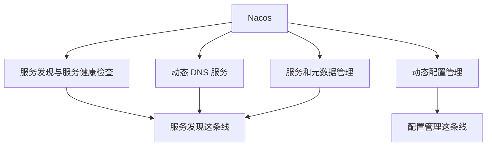
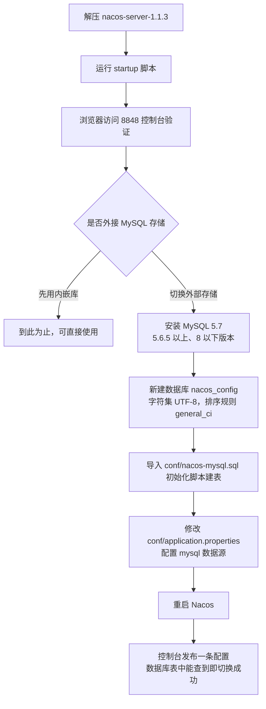
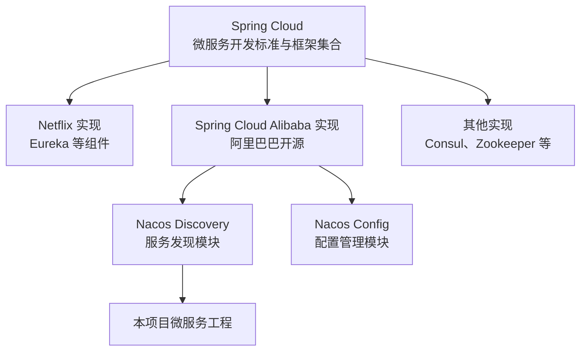
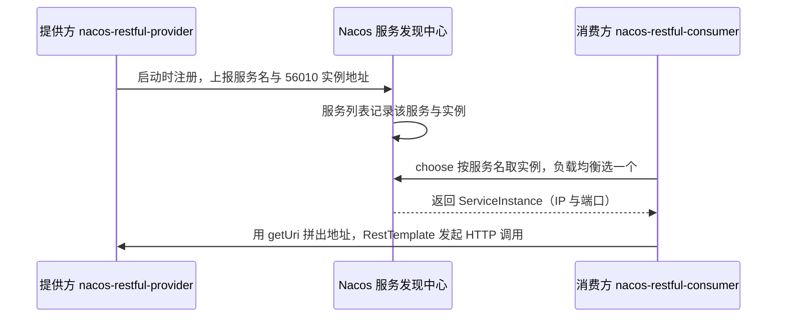
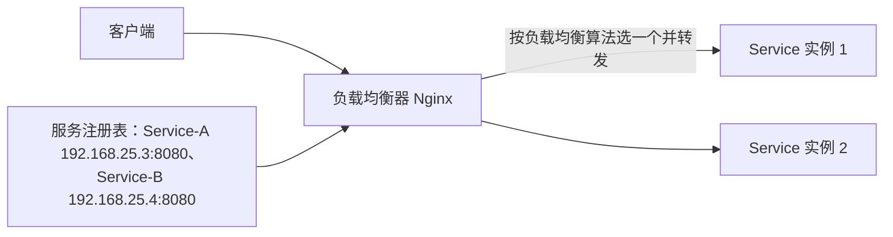
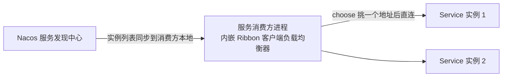
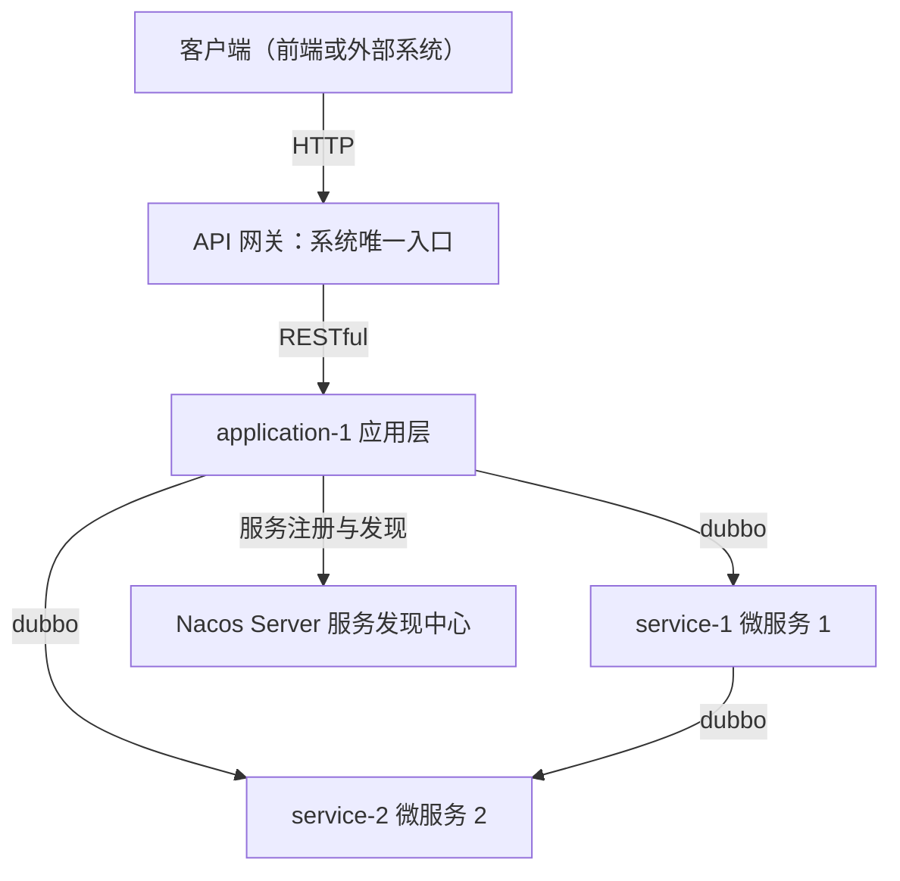
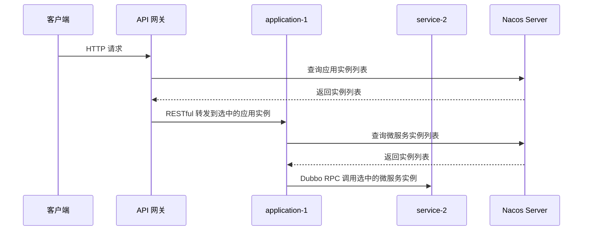
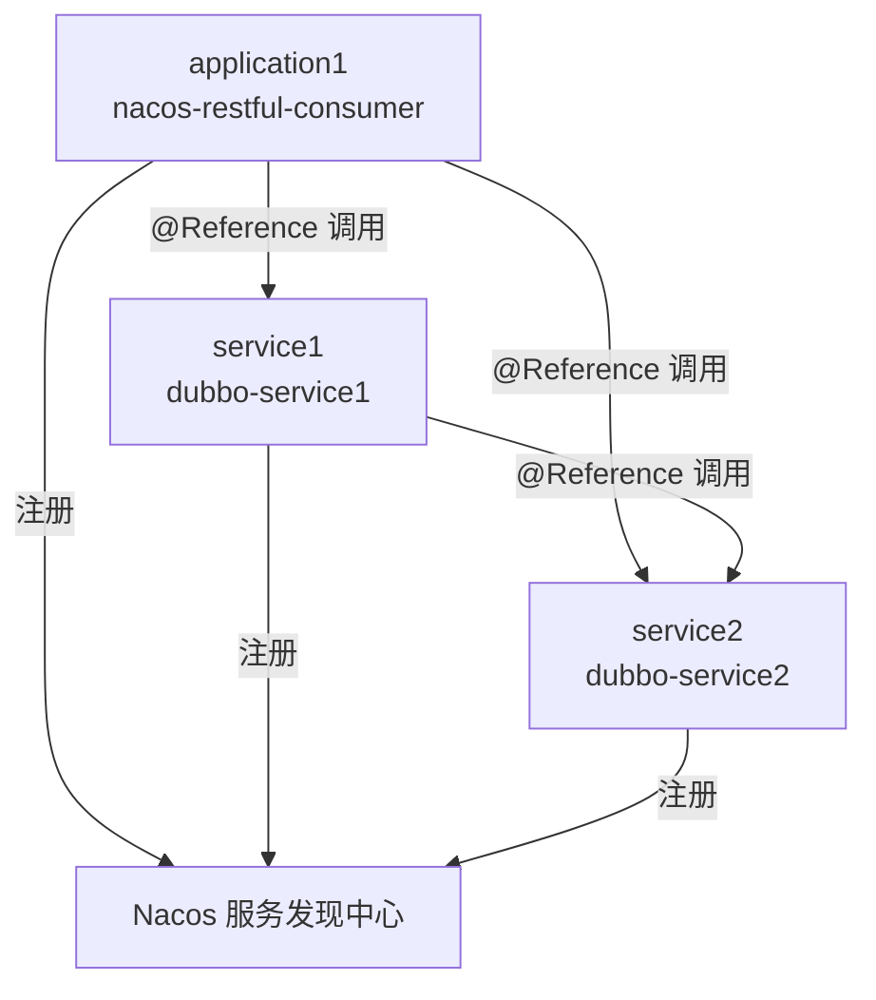
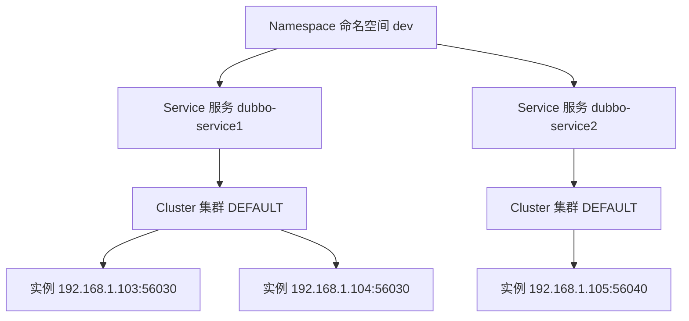

# Nacos 服务发现全景：从注册中心选型到 RESTful 与 Dubbo 两套实战

> 🔒 安全提示：文中示例的口令/密钥均为课程教学环境演示口径，生产环境的安全要求见《安全与合规须知》。

## 先给结论

- 注册中心四款候选摆在一起比：Nacos、Eureka、Consul、Zookeeper，Nacos 功能支持最全面，一致性协议 AP 与 CP 都支持，健康检查方式最多，还有雪崩保护，因此项目选它兼任注册中心与配置中心。
- 服务端安装本身极简：解压 `nacos-server-1.1.3`，Windows 跑 `startup.cmd`，Linux 跑 `startup.sh -m standalone`，控制台 8848 端口，单机默认内嵌存储，正经使用外接 MySQL。
- Spring Cloud 是一套微服务开发标准，Spring Cloud Alibaba 是按这套标准做的一套实现，Nacos 通过它接入 Spring Cloud 生态；版本配套是硬约束，项目组合是 Greenwich 加 2.1.0.RELEASE。
- RESTful 服务发现两端改造：提供方引 `spring-cloud-starter-alibaba-nacos-discovery`、配服务名与中心地址即可自动注册；消费方用 `LoadBalancerClient.choose(serviceId)` 选实例、`getUri()` 拿地址、`RestTemplate` 发调用。
- 负载均衡分服务端与客户端两类：Ribbon 内嵌在消费方进程里做客户端负载均衡，默认轮询 `RoundRobinRule`，可按服务名切换随机等策略，多实例用 `-Dserver.port` 参数跑起来验证。
- Dubbo 服务发现换的是协议不是流程：架构四层（客户端、API 网关、应用层、微服务层），网关与应用层之间走 RESTful，应用层与微服务层之间走 Dubbo，每层都注册到同一个 Nacos。
- Dubbo 工程按「api 加 server」组织，实现类标 `org.apache.dubbo.config.annotation.Service`，消费方 `@Reference` 注入接口，远程调用写起来就是本地方法调用。
- 数据模型三层坐标：命名空间（默认 public）、服务（默认集群 DEFAULT）、实例，定位一个实例要三层齐全；注册进指定命名空间填 ID 不填名称，同系统微服务必须配同一个空间。

## 第1部分：Nacos-服务发现-Nacos简介

服务发现的流程已经清楚：提供方上报地址，消费方的服务发现客户端拉取注册表，调用前负载均衡选地址。流程里那个最关键的角色，服务发现中心，到底用哪个产品来当？市面上不止一家。这一课先把四款主流产品摆在一起比出结论，再把选中的 Nacos 装起来，连数据存哪儿的问题一起解决。

### 四款服务发现中心摆在一起比
课程直接给出一张横向对比表，把市面上用得比较多的四款产品按十二个项目对齐。这张表值得整张留下，面试与选型都用得上：

| 对比项目 | Nacos | Eureka | Consul | Zookeeper |
| --- | --- | --- | --- | --- |
| 一致性协议 | 支持 AP 和 CP 模型 | AP 模型 | CP 模型 | CP 模型 |
| 健康检查 | TCP/HTTP/MySQL/Client Beat | Client Beat | TCP/HTTP/gRPC/Cmd | Keep Alive |
| 负载均衡策略 | 权重/metadata/Selector | Ribbon | Fabio | 无 |
| 雪崩保护 | 有 | 有 | 无 | 无 |
| 自动注销实例 | 支持 | 支持 | 不支持 | 支持 |
| 访问协议 | HTTP/DNS | HTTP | HTTP/DNS | TCP |
| 监听支持 | 支持 | 支持 | 支持 | 支持 |
| 多数据中心 | 支持 | 支持 | 支持 | 不支持 |
| 跨注册中心同步 | 支持 | 不支持 | 支持 | 不支持 |
| Spring Cloud 集成 | 支持 | 支持 | 支持 | 不支持 |
| Dubbo 集成 | 支持 | 不支持 | 不支持 | 支持 |
| k8s 集成 | 支持 | 不支持 | 支持 | 不支持 |

读这张表最快的办法是先看「不支持」，不满足需求的直接排除。Zookeeper 一列的短板最扎眼：多数据中心、跨注册中心同步、Spring Cloud 集成、k8s 集成全都不支持，访问协议只有 TCP，负载均衡策略一栏干脆是空白，它本身是分布式协调工具，当注册中心属于客串。Consul 的硬伤在雪崩保护与自动注销实例两项都没有，Dubbo 集成也不支持。Eureka 是 Netflix 体系里的老牌注册中心，但一致性协议只支持 AP 模型，负载均衡依赖 Ribbon，Dubbo 与 k8s 两项集成都没有。

Nacos 一列几乎满员：一致性协议 AP 和 CP 模型都支持，可以按场景切换取舍；健康检查支持 TCP、HTTP、MySQL、Client Beat 四种方式，覆盖面最宽；负载均衡策略能按权重、metadata、Selector 来选实例；雪崩保护有，访问协议 HTTP 与 DNS 双修；Spring Cloud、Dubbo、k8s 三套体系全部支持集成。单从功能支持项看，Nacos 作为服务发现中心的完备程度明显占优。

一致性协议那行值得单独解释一下。AP 与 CP 是分布式系统的两种取舍：AP 优先保证可用性，部分节点出故障时服务照样响应，代价是短时间内各节点看到的数据可能不一致；CP 优先保证一致性，数据没同步完成时宁可拒绝响应也要保证大家看到同一个结果。注册中心场景里，实例列表短暂不一致通常可以容忍，注册中心整体不可用却是灾难，所以服务发现产品多以 AP 为主，Eureka 只支持 AP，Zookeeper 与 Consul 只支持 CP，而 Nacos 两种模型都支持，按需切换，这是它的一项硬实力。

选型除了看当下还要看远期。Nacos 在后续版本规划里会支持 Spring Cloud 与 Kubernetes 的组合，填补两套体系的鸿沟，让两套体系下可以采用同一套服务发现与配置管理的解决方案，使用和维护成本都会显著降低；它还计划实现 Service Mesh 的支持，而服务网格正是微服务演进的下一个趋势。功能占优加上路线图靠谱，本项目就选定 Nacos 来搭建服务发现中心。

### Nacos 的定位与四大特性
Nacos 是阿里的一个开源产品，针对微服务架构中的服务发现、配置管理、服务治理给出综合型解决方案。官方介绍可以收成三句话：Nacos 致力于帮助您发现、配置和管理微服务；它提供一组简单易用的特性集，帮助实现动态服务发现、服务配置管理、服务及流量管理；它是构建以「服务」为中心的现代应用架构的服务基础设施。对照前面学过的流程，服务发现中心要做的「维护地址、供客户端查询」，正是 Nacos 名字里「发现」两个字的本职。

四大特性逐个看。这张图讲的是 Nacos 特性与两条能力线的关系：



**特性一，服务发现与服务健康检查。** Nacos 让服务更容易注册，并通过 DNS 或 HTTP 接口发现其他服务。健康检查是这个特性的另一半：服务注册上来不代表永远活着，实例随时可能死掉，Nacos 会定时检查服务的健康状态，发现实例已经死亡就把它从服务注册列表里剔除掉。检查手段里有个 Client Beat，即客户端心跳，实例定期上报一次心跳证明自己还活着，超时没报就视为失联。上一课强调注册表是动态更新的，健康检查就是「动态」二字的技术保障，防止消费方把请求发给一个已经不健康的主机或实例。

**特性二，动态配置管理。** 允许在所有环境中以集中、动态的方式管理所有服务的配置，更新配置时不再需要重新部署应用程序，配置的更改因此更高效、更灵活。这条特性不属于服务发现那条线，它是 Nacos 另一半功能「配置管理」的入口，本项目后面会用一整块内容去实操，这里先立个路标。

**特性三，动态 DNS 服务。** 提供基于 DNS 协议的服务发现能力，目标是支持异构语言的服务发现：不只 Java，C、Python 等语言写的服务同样能用。它可以把注册在 Nacos 上的服务以域名的方式暴露服务端点，让第三方应用方便地查阅和发现。有了这一层，服务发现能力就跳出了 Java 生态，其他技术栈的服务不用改造也能接入。

**特性四，服务和元数据管理。** 让你能从微服务平台建设的视角管理数据中心的所有服务及元数据，包括服务的描述、生命周期、服务的静态依赖分析、服务的健康状态、流量管理、路由及安全策略。元数据是描述服务的数据，比如实例上附加的自定义标签，负载均衡策略里的 metadata 选择就用得上它。

四个特性里，一、三、四说明的是服务发现这条线的功能特性，第二个特性对应配置管理。本阶段的重点先放在服务发现，安装 Nacos 服务端就是为它做准备的第一个动作。

### 安装前的环境清单
各微服务内部跑的是服务发现客户端，客户端要通过网络与服务发现中心交互，所以要先安装 Nacos Server，它扮演的就是服务端角色。启动之前把环境账算清：

```text
1. 64 位操作系统，支持 Linux/Unix/Mac/Windows
2. 64 位 JDK 1.8 及以上（Nacos 依赖 Java 环境运行）
3. Maven 3.2.x 及以上（仅从源码构建时需要，直接用发行包可跳过）
4. 8848 端口空闲（Nacos 默认端口，不能被其他进程占用）
```

JDK 这一项本项目天然满足，工程本来就是用 JDK 1.8 开发的，环境直接复用。获取 Nacos 有两条路：从源码 clone 下来用 Maven 编译，或者直接下载发行包。课程选第二条，资料包里已经提供了下载好的 `nacos-server-1.1.3` 版本 zip 包，解压就能运行，不必折腾编译。解压后的目录里，`bin` 放启动相关的可执行脚本，`conf` 放配置文件与初始化脚本，`target` 下是构建出的 jar 包，不想用脚本的话直接运行这个 jar 也能把服务端跑起来，程序结构本身相当简单。

版本这里要多说一句：课程工程锁定的 Spring Cloud Alibaba 版本是 2.1.0，与之配套的服务端就是 1.1.3，不要随手装一个不匹配的新版本，注册中心与客户端版本错配是新手最常见的翻车点。

### 单机启动与控制台初见
Windows 环境直接运行 `bin` 目录下的 `startup.cmd`，双击或在 cmd 里执行都可以；Linux、Unix、Mac 用脚本加单机模式参数启动：

```bash
# Windows：进入 nacos/bin 目录后运行（或直接双击 startup.cmd）
startup.cmd

# Linux/Unix/Mac：standalone 表示单机模式运行，非集群模式
sh startup.sh -m standalone
```

控制台出现 `Nacos started successfully in stand alone mode.` 就说明起来了。浏览器打开 `http://127.0.0.1:8848/nacos`，先见到登录页，默认用户名是 `nacos`，默认密码也是 `nacos`，提交后进入主界面。界面里能看到两大功能入口：配置管理和服务管理；因为 Nacos 自己也可以部署成集群，还有第三个入口集群管理。能进到这个主界面，安装就算成功了。

到这里已经可以支撑本机的学习与验证，不过离「正经使用」还差一步。Nacos 控制台里新增配置、注册服务都会产生数据，这些数据默认不存放在像 MySQL 这样的常用数据库里，而是落在 Nacos 自带的内嵌存储中。数据放在内嵌库里，查看、备份、迁移都不方便，所以接下来把它切到 MySQL。

### 把数据落到 MySQL：外部存储改造
单机模式下 Nacos 默认使用嵌入式数据库实现数据存储，想用外部 MySQL 存 Nacos 的数据，按四步走。这张图讲的是从解压到数据落库的完整路径：



第一步安装数据库。版本要求 5.6.5 以上、MySQL 8 以下，课程使用 5.7 版本，安装过程沿用前面 MySQL 课程的结论，不重复演示。

第二步初始化数据库。用客户端工具连上 MySQL，新建一个名为 `nacos_config` 的数据库，字符集选 UTF-8，排序规则选 `general_ci`。对应的 SQL 一行就够：

```sql
-- 新建 Nacos 专用的存储库（与图形界面建库操作等价，按本课操作补全）
CREATE DATABASE nacos_config DEFAULT CHARACTER SET utf8 COLLATE utf8_general_ci;
```

建好库之后初始化表结构。初始化脚本就在 Nacos 安装目录里，路径是 `conf/nacos-mysql.sql`，在客户端工具里选择执行这个外部脚本，它会自动创建所需的表，刷新后表列表就齐了。

第三步修改配置文件。打开 `conf/application.properties`，增加支持 MySQL 数据源的配置（目前只支持 MySQL），把数据源平台、地址、用户名、密码补进去：

```properties
# 数据源平台切换为 mysql
spring.datasource.platform=mysql
db.num=1
db.url.0=jdbc:mysql://127.0.0.1:3306/nacos_config?characterEncoding=utf8&connectTimeout=1000&socketTimeout=3000&autoReconnect=true
db.user=root
db.password=123456
```

地址按本机环境写 `127.0.0.1`，账号密码也换成自己环境的值。有个小坑要留意：直接在发行包自带的 `application.properties` 里可能搜不到这几行，它们不是被注释掉就是位置不同，做法是把上面这段配置复制进去，插到文件合适的位置即可，不必纠结原文档里有没有现成的段落。

第四步重启验证。改完配置要先停掉 Nacos 进程再重新启动，新数据源才会生效。验证的办法很直接：回到控制台随便添加并发布一条配置，然后去数据库里查，发布的数据出现在 `nacos_config` 库的表里，字段如 `data_id`、`group_id`、`tenant_id` 都有了值，这就证明 Nacos 的数据真的落到了 MySQL。当前还没讲具体功能，看不懂表内容没关系，能落库就说明链路通了。

至此 Nacos 的安装全部完成，包括使用外部 MySQL 存储数据的改造。下一课开始，让微服务带着服务发现客户端真正注册进来。
## 第2部分：Nacos-服务发现-RESTful服务发现-Spring Cloud Alibaba介绍

服务发现流程三步里，注册和调用发生在微服务进程内，靠的是每个微服务都要内置的服务发现客户端，以及调用前的客户端负载均衡。这两样东西要不要自己写？答案是不用，框架已经备好。课程为 RESTful 服务发现选的测试环境是 Spring Cloud Alibaba，动代码之前得先把它和 Spring Cloud 的关系、版本怎么配套弄清楚，否则依赖一引就乱。

### 测试环境要补的两个能力
回顾服务发现的流程：每个微服务启动时上报地址；每个微服务内部有一个服务发现客户端，负责从服务发现中心获取服务注册表；消费方调用前通过负载均衡从实例列表里选地址。落到工程上，有两件事必须有人做。

**第一件，通用的服务发现客户端。** 每个微服务都需要这个客户端，它是标准的通用组件，不可能每个项目自己实现一遍，测试环境里要引入一个现成的实现。

**第二件，客户端负载均衡。** 消费方拿到的是实例列表，要能按策略从中选出一个地址发起远程调用，这套机制同样该由框架提供。

自己造这两样轮子成本高且容易错，课程直接采用一个新发布的微服务开发框架来完成，它就是 Spring Cloud Alibaba。从名字看就能猜出血缘：阿里开源的、基于 Spring Cloud 的一套微服务框架。要理解它，得先把 Spring Cloud 讲明白。

### Spring Cloud：一套标准，一生态实现
Spring Cloud 是当前比较流行的微服务开发框架集合，覆盖微服务开发的方方面面，它是 Spring 家族的项目。理解它的关键是抓住 Spring 的一贯思想：拿来主义，自己不重复造轮子，把业界优秀的项目集成进来供企业使用。

沿这个思路看，Spring Cloud 做的事是制定一套微服务开发的标准，然后把众多满足标准的微服务开发项目集成进来，组成一个完整的技术生态。在 Spring 官网的项目页上能看到这个家族的全貌：配置管理、服务调用、网关、注册发现，每个方向下都有对应的子项目。集成进来的项目里最有名的来自 Netflix 公司，这家做流媒体业务的公司开发了很多优秀的开源框架，都被 Spring Cloud 收入生态，服务注册中心 Eureka、网关等组件都出自它家，后续深入学习 Spring Cloud 时会频繁碰到这个公司的项目。

所以对 Spring Cloud 的准确理解是：一套微服务开发的标准，加上众多公司按这套标准贡献的实现，合起来组成微服务开发框架的集合。标准与实现分离，这正是它下面能长出 Spring Cloud Alibaba 的原因。

### Spring Cloud Alibaba：同一标准下的另一套实现
Spring Cloud Alibaba 是阿里巴巴公司基于 Spring Cloud 标准实现的一套微服务开发框架集合，它和 Netflix 在生态里的地位是一样的，都是 Spring Cloud 微服务开发标准的实现方案。项目开源在 GitHub 上，源码仓库里能看到一个个功能模块，比如对应 Nacos 配置管理的模块、对应 Nacos 服务发现的模块，一个模块管一件事。

Nacos 与它的关系由此明确：Nacos 是 Spring Cloud Alibaba 技术生态中的一个产品。前面课程已经把 Nacos 服务端装好，接下来在工程里接入它，走的就是 Spring Cloud Alibaba 提供的依赖与封装。测试环境缺的两个能力它都给了：服务发现的客户端从服务发现中心获取服务列表，客户端负载均衡帮消费方选地址。这张图讲的是标准与几家实现之间的关系：



图里要抓住一条主线：工程面向 Spring Cloud 标准编程，底下挂哪家实现由依赖决定。本项目挂的是 Spring Cloud Alibaba，服务发现与配置管理两个模块后续都会用到。

### 版本配套：Greenwich 搭 2.1.0
标准与实现分离带来一个现实问题：版本必须匹配。Spring Cloud 的版本号不用数字，用的是伦敦地铁站名，Greenwich、Finchley、Hoxton 都是站名，站名后面跟的 SR 加数字表示修正版本，比如 Greenwich SR4。查 Spring Cloud 的文档页能看到一排版本入口，当时的最新版本已经发展到 Hoxton，Greenwich 也已迭代到 SR 系列。

Spring Cloud Alibaba 当前的版本已经发展到 2.1.1，本项目采用的是 2019 年发布的、比较主流的 2.1.0 版本。为什么 Spring Cloud 不用最新的 Hoxton？原因就出在匹配关系上：Spring Cloud Alibaba 2.1.0 支持的是 Greenwich 版本，选框架要以实现方的支持列表为准，所以项目确定采用 Spring Cloud Greenwich 加 Spring Cloud Alibaba 2.1.0 的组合。

这套版本关系最终落在父工程的依赖管理里，三个 BOM 一起锁版本：

```xml
<dependencyManagement>
    <dependencies>
        <dependency>
            <groupId>org.springframework.boot</groupId>
            <artifactId>spring-boot-dependencies</artifactId>
            <version>2.1.3.RELEASE</version>
            <type>pom</type>
            <scope>import</scope>
        </dependency>
        <dependency>
            <groupId>org.springframework.cloud</groupId>
            <artifactId>spring-cloud-dependencies</artifactId>
            <version>Greenwich.RELEASE</version>
            <type>pom</type>
            <scope>import</scope>
        </dependency>
        <dependency>
            <groupId>com.alibaba.cloud</groupId>
            <artifactId>spring-cloud-alibaba-dependencies</artifactId>
            <version>2.1.0.RELEASE</version>
            <type>pom</type>
            <scope>import</scope>
        </dependency>
    </dependencies>
</dependencyManagement>
```

原来的父工程里只有 `spring-boot-dependencies` 一条，现在补进 Spring Cloud 与 Spring Cloud Alibaba 两条版本管理依赖，子工程后面引具体的功能依赖时就不用再写版本号，也不会引出相互冲突的版本组合。这段配置是下一课改造工程的第一步。

### 改造前的最后交代
原来的两个裸工程完成了历史使命：把「配置文件写地址」的方案跑通，又暴露出它的失效场景。课程把这段未引入 Nacos 的代码单独归档保留，方便回头对照练习入门程序。接下来的改造就在现有工程上进行：提供方加依赖、加配置，把自己注册到 Nacos；消费方用按服务名的负载均衡发现取代写死的地址。改造只动依赖与配置加一小段调用代码，业务接口不变，下一课逐个工程落实。
## 第3部分：Nacos-服务发现-RESTful服务发现-服务注册

框架选型定了，Nacos 服务端也装好了，轮到改代码。改造的目标很明确：让提供方把自己的地址注册到 Nacos，让消费方不再读配置文件里写死的地址，而是拿着服务名通过负载均衡发现一个实例。服务注册与服务发现各占一半工作量，这一课把两边一次做完，顺带记录一次真实的排错。

### 改造总览：注册与发现是两件事
原来两个裸工程的调用链是「消费方读配置文件里写死的地址，直接 HTTP 调提供方」。改造后地址不再由任何人写死：提供方启动时自己把地址报给 Nacos，消费方按服务名找 Nacos 要实例。改造前课程把旧代码归档保留，作为对照练习的入门程序，接下来的工作在现有工程上推进。

这张时序图讲的是改造完成后一次调用涉及的完整交互，注册发生在启动阶段，发现与调用发生在请求阶段：



对照流程三步：第一步注册对应图的最上面一段，第二、三步的拉取与负载均衡选择被框架合并进 `choose` 一个动作里。整个改造不涉及任何业务接口的变化，`/service` 接口还是那个返回字符串的接口。

### 服务注册：提供方的三处改动
**第一处，父工程补版本管理。** Spring Cloud Alibaba 基于 Spring Cloud 标准，父工程的 `dependencyManagement` 里要在原有 `spring-boot-dependencies` 之外，补上 `spring-cloud-dependencies`（Greenwich.RELEASE）与 `spring-cloud-alibaba-dependencies`（2.1.0.RELEASE）两条，完整配置在上一课已经给出，这里直接沿用。

**第二处，提供方引入服务发现客户端。** 在 `nacos-restful-provider` 的 pom 里加一个依赖：

```xml
<dependencies>
    <dependency>
        <groupId>org.springframework.boot</groupId>
        <artifactId>spring-boot-starter-web</artifactId>
    </dependency>
    <!--服务发现的客户端：1、将自己的地址注册到服务发现中心；2、从服务发现中心获取服务列表-->
    <dependency>
        <groupId>com.alibaba.cloud</groupId>
        <artifactId>spring-cloud-starter-alibaba-nacos-discovery</artifactId>
    </dependency>
</dependencies>
```

这个依赖名很长，功能就是前面流程课说的服务发现客户端，它干两件事：把自己的地址注册到服务发现中心，以及从服务发现中心获取服务列表。注册动作不需要写代码，把依赖引进来，客户端就随工程启动生效了。

**第三处，配置文件指明服务名与中心地址。** 客户端要注册，得被告知两件事：以什么名字注册、向哪个中心注册。提供方的 `application.yml` 如下：

```yaml
server:
  port: 56010

spring:
  application:
    name: nacos-restful-provider #服务名
  cloud:
    nacos:
      discovery:
        server-addr: 127.0.0.1:8848  #服务发现中心地址
```

`spring.application.name` 就是将来注册到服务发现中心的服务名，`spring.cloud.nacos.discovery.server-addr` 指明服务发现中心的地址，8848 正是安装 Nacos 时验证过的控制台端口。配置文件建议直接复制讲义里的内容粘贴，不必逐字手敲，但要具备排错能力：yml 格式对缩进敏感，层级错一格或冒号后少了空格，配置就读不进来。

把「会排错」落到实处，就是能看出下面这两种写法的毛病：

```yaml
#错例一：冒号后没有空格，解析出来的值不对
spring:
  application:
    name:nacos-restful-provider

#错例二：缩进层级错乱，name 不在 application 下面
spring:
 application:
 name: nacos-restful-provider
```

正确的写法回到上一节的示例即可：同一层级左对齐，子层级缩进固定格数，冒号后面必须跟一个空格。配置写错的下场很隐蔽，工程照样能启动，只是注册到 Nacos 的服务名不是你想要的名字，控制台服务列表里找不到预期的服务，排查时先回头看配置文件。

**验证注册结果。** 重启提供方，打开 Nacos 控制台的服务列表页，`nacos-restful-provider` 已经出现在列表里，服务名与配置文件里 `spring.application.name` 的值完全一致。当前只启动了一个提供方进程，所以实例数是 1；点开详情能看到实例信息：端口 56010 与配置一致，健康状态为 UP，表示实例还健康、还活着。列表里还有分组信息，它属于数据模型的内容，到配置管理章节再展开，现阶段不用管。到这里服务注册完成，这是服务发现的第一部分，注册成功了才可以做发现。

### 服务发现：消费方的配置与核心代码
服务发现这一半做在哪一端，动手前要先想清楚：提供方已经把自己注册进服务注册中心，剩下的动作是消费方从服务发现中心获取服务列表，所以发现的工作全部落在消费方。消费方要回答的问题是：怎么按服务名把地址找出来。

**配置侧，消费方补上同样的三件套。** 把服务发现的 discovery 客户端依赖贴到消费方的 pom 里，依赖与提供方完全相同；`application.yml` 也按同样结构配置，只是服务名换成一个不重复的名字：

```yaml
server:
  port: 56020

spring:
  application:
    name: nacos-restful-consumer #服务名
  cloud:
    nacos:
      discovery:
        server-addr: 127.0.0.1:8848  #服务发现中心地址
```

每个微服务在注册中心里的标识必须唯一，消费方自己的服务名叫 `nacos-restful-consumer`，不能和提供方重名。原来写死的 `provider.address` 配置在改造后已经没有用处，可以顺手删掉。

**代码侧，把拼地址换成按服务名发现。** 消费方 Controller 的远程调用逻辑重写如下，旧的写死地址调用以注释形式留在代码里作对照：

```java
package com.study.pay.nacos.consumer.controller;

import org.springframework.beans.factory.annotation.Autowired;
import org.springframework.cloud.client.ServiceInstance;
import org.springframework.cloud.client.loadbalancer.LoadBalancerClient;
import org.springframework.web.bind.annotation.GetMapping;
import org.springframework.web.bind.annotation.RestController;
import org.springframework.web.client.RestTemplate;

import java.net.URI;

@RestController
public class RestConsumerController {

    //服务 id，即注册中心中的服务名
    private String serviceId = "nacos-restful-provider";

    //客户端负载均衡器：从服务发现中心拿该服务的实例列表，按负载均衡算法选一个地址
    @Autowired
    LoadBalancerClient loadBalancerClient;

    @GetMapping(value = "/service")
    public String service(){
        RestTemplate restTemplate = new RestTemplate();
        //旧写法：地址写死，来自配置文件
        //String providerResult = restTemplate.getForObject("http://" + providerAddress + "/service", String.class);
        //新写法：按服务名发现一个实例
        ServiceInstance serviceInstance = loadBalancerClient.choose(serviceId);
        //获取一个 http:// 开头的地址，包含 ip 和端口
        URI uri = serviceInstance.getUri();
        String providerResult = restTemplate.getForObject(uri + "/service", String.class);
        return "consumer invoke | " + providerResult;
    }
}
```

逐段读这段代码。`serviceId` 是要发现的服务名，值必须与提供方注册的服务名一字不差。`LoadBalancerClient` 由框架提供并注入，它是客户端负载均衡器：调用 `choose` 时传服务名，它从服务发现中心拿到该服务的实例列表，再按负载均衡策略选出一个，返回 `ServiceInstance` 对象。`ServiceInstance` 代表一个服务实例，能取到主机名、端口，也能通过 `getUri()` 直接拿到带 `http://` 开头的完整地址字符串。拿到 `uri` 后拼上接口路径 `/service`，剩下的动作与原来一样，交给 `RestTemplate` 发请求。

注意职责边界：`choose` 只负责「选出一个实例的地址」，`RestTemplate` 负责「按地址发请求」。`LoadBalancerClient` 内部按什么策略选实例，轮询还是随机，是负载均衡一课的主题，这里先记住它是客户端负载均衡器即可。

### 一次真实的排错：choose 返回了 null
第一次跑这段代码并没有一帆风顺，课程把翻车过程完整保留了下来，这个排查思路比代码本身更值钱。

现场是这样的：在 `service` 方法里打好断点，启动工程后访问消费方的 56020 端口，页面没有返回预期的字符串，而是错误页。断点跟进去对比两个变量：`loadBalancerClient` 不为空，说明负载均衡器注入正常；`serviceInstance` 却是空的，说明 `choose` 没有找到任何实例。这个先区分「对象注入是否成功、方法返回是否正常」的定位手法很通用：注入为空查依赖与注解，返回为空查数据与配置，一层排除下去，问题的范围就缩到了配置文件。

问题出在哪？回顾服务注册那一半的做法：提供方除了加客户端依赖，还在配置文件里指定了注册中心地址。消费方这边只加了依赖，没有告诉它从哪个服务发现中心去发现服务，客户端两眼一抹黑，自然选不出实例。把消费方配置里的 `spring.cloud.nacos.discovery.server-addr` 补上（也就是上一节展示的那份完整配置），重启消费方再访问，断点里的 `uri` 值变成了提供方实例的真实地址，形如 `http://192.168.1.103:56010` 的局域网地址，请求顺利走到提供方，链路打通。

这次排错沉淀下来的结论值得单独记：服务注册与服务发现虽然发生在不同的工程，但两边的配置结构完全对称，都要有服务发现客户端的依赖、都要配置服务发现中心的地址、都要有各自唯一的服务名。任何一端缺一样，链路都立不起来。

### 服务名与服务实例：控制台里的两级信息
Nacos 控制台的服务列表页与详情页，正好对应服务发现里最核心的两个概念。服务名称是每个服务在服务注册中心的标识，相当于 Java 中的类名；服务实例是网络中提供服务的实例，具有 IP 和端口，相当于 Java 中的对象，一个实例就是一个运行在服务器上的进程。

落到页面上：服务列表页一行一个服务名，旁边标注实例数，当前提供方只起了一个进程所以实例数是 1；哪天为了扛压多起几个进程，实例数就会变成 2、3、4，而服务名始终只有一个。点进详情看到的是实例级的信息：每个实例的地址与端口、健康状态。做支付平台这类多实例部署的系统时，扩容就是「同一服务名下多起几个进程」，消费方的代码与配置一行都不用动，这正是按服务名发现相对写死地址的根本优势。

### 改造前后的一条调用链对照
把改造前后的消费方调用链并排放在一起看，变化集中在地址从哪来、选几个这两个点上：

| 对照项 | 改造前（流程测试工程） | 改造后（接入 Nacos） |
| --- | --- | --- |
| 地址来源 | 配置文件 `provider.address` 写死 | 按服务名从注册中心发现实例 |
| 拿到的候选 | 一个固定地址 | 该服务名下的实例列表 |
| 选址方式 | 无，直接调用 | 客户端负载均衡器 choose 选实例 |
| 提供方扩缩容 | 消费方改配置并发版 | 提供方自行注册，消费方无感 |
| 依赖与配置 | 仅 starter-web | 两端都要 discovery 依赖与中心地址 |

对照下来还有一个容易被忽略的变化：消费方自己也有了服务名。改造前消费方只是一个「来者不拒的调用入口」，改造后它是注册中心里一个有名有姓的成员，将来别的服务同样可以按服务名发现它。支付平台的微服务之间正是以这种方式互相成为提供方与消费方，一个服务往往既是调用方又是被调方，两端的三件套配置缺一不可。
## 第4部分：Nacos-服务发现-RESTful服务发现-客户端负载均衡和服务端负载均衡

RESTful 服务发现的链路跑通之后，消费方手里拿到的不再是一个写死的地址，而是从注册中心查出来的实例列表。列表里可能有多个实例，选哪一个去发请求，答案就藏在消费方代码里的 `LoadBalancerClient` 对象上。不少初学者把它当工具类一笔带过，等到提供方扩成了多实例、想验证流量是否真的分摊出去，才发现不知道从哪里下手。

把这个问题拆开只要两步：理解负载均衡的两种类型，看清消费方 `choose` 方法的背后发生了什么；再把提供方真的跑成两个进程，用一次轮询测试把结论钉死。

### 负载均衡解决什么问题
微服务可以多实例部署，部署成一个集群，这意味着一次远程调用面对的不是一个地址，而是一组地址。负载均衡的定义是：将用户的请求通过一定的策略分摊到多个实例上去执行。这句话里有三个关键词值得抠一下。策略，指挑选实例所依据的算法，轮询、随机、按权重都是常见的策略；多个实例，指同一个服务名下并行运行的一组进程；分摊，指流量不是全压在某一个实例上，而是按策略均匀或有倾向地散开。

它为什么重要？系统处理高并发、缓解网络压力、进行服务端扩容，都把它当成重要手段。单实例的吞吐量有上限，扛不住就把实例数翻倍，前提是流量能自动分配到新实例上，这件事没人手工调度，全靠负载均衡机制完成。反过来想，如果没有负载均衡，多实例就只是多份部署：消费方要么只盯一个固定地址，其他实例全程空转；要么自己写一段轮换地址的逻辑，每接一个新服务就重复一遍。负载均衡把「在多个实例里挑一个」这件事标准化了，选择依据收敛到策略上，换策略就是换一个配置，不动业务代码。

服务发现流程里，消费方拿到实例列表之后、发出 HTTP 请求之前，缺的正是这一环。测试工程里 Service A 调 Service B 走的就是这套机制，只是它被封装在了 `LoadBalancerClient` 这个对象里，远程调用前从服务列表中通过负载均衡算法拿到一个地址再调用。

### 服务端负载均衡：注册表长在服务端
服务端负载均衡的结构是：客户端请求一个叫负载均衡器的东西，负载均衡器把请求分摊到后面的各个 Service 实例上。它之所以知道后面有哪些实例，是因为它自己维护着一个服务注册表，注册表里记录每个实例的 IP 与端口，请求到达时按配置好的负载均衡算法从清单里选一个地址，把客户端的请求转发到具体的实例上。



这张图的关键在负载均衡器的位置：它横在客户端与实例之间，所有请求都先过它。Nginx 就是典型的服务端负载均衡器，客户端把请求发给 Nginx，Nginx 通过负载均衡算法在多个服务器之间选择一个进行访问。

「服务端」三个字的由来也在这里：负载均衡器相对于客户端来说相当于一个服务端，客户端请求它，它在服务端一侧维护注册表并实现负载均衡，所以叫服务端负载均衡。

这种方案的特征是客户端完全无感知：客户端只知道负载均衡器的一个地址，背后有几个实例、哪台宕机、哪台新增，都由负载均衡器这一层处理。代价是所有流量都要多经过一跳，负载均衡器本身成为必须保证可用的关键节点，它的注册表也需要有人维护，或来自静态配置，或来自与注册中心的对接。

### 客户端负载均衡：把挑选搬进消费方进程
把视角切回服务调用双方：Service A 调 Service B，A 就是客户端。客户端负载均衡的意思是，注册表不再由中间设备维护，而是由客户端自己维护；负载均衡也不再发生在中间设备上，而是客户端自己实现，通过负载均衡算法拿到一个地址后，自己去请求具体的实例。

两种类型的差别可以压缩成一句话：注册表和挑选动作放在哪一侧。放在独立的服务端设备上，就是服务端负载均衡；放在消费方进程里，就是客户端负载均衡。

课程测试工程的消费方代码就是客户端负载均衡的落地：

```java
//消费方 RestConsumerController：通过负载均衡发现地址并发起远程调用
//指定服务名
String serviceId = "nacos-restful-provider";

//通过负载均衡发现地址，流程是从服务发现中心拿 nacos-restful-provider 服务的列表，通过负载均衡算法获取一个地址
@Autowired
LoadBalancerClient loadBalancerClient;

@GetMapping(value = "/service1")
public String service1(){
    //远程调用
    RestTemplate restTemplate = new RestTemplate();
    //发现一个地址
    ServiceInstance serviceInstance = loadBalancerClient.choose(serviceId);
    //获取一个 http:// 开头的地址，包括 ip 和端口
    URI uri = serviceInstance.getUri();
    String result = restTemplate.getForObject(uri + "/service", String.class);
    return "consumer invoke|" + result;
}
```

`LoadBalancerClient` 是一个客户端负载均衡器，Spring Cloud Alibaba 这套框架给它的底层实现是 Ribbon，一个客户端负载均衡框架，后续学习 Spring Cloud 的一些知识时还会遇到它。Ribbon 的职责就是从服务注册表当中根据负载均衡算法选择一个地址，供客户端去执行调用。`choose(serviceId)` 返回的 `ServiceInstance` 就是挑出来的那个实例，`getUri()` 拿到以 http 开头、包含主机与端口的完整地址，剩下的 HTTP 请求由 `RestTemplate` 完成。



与 Nginx 方案对比，这条路少了一层独立设备的转发：挑选动作发生在消费方进程内部，实例列表随注册中心的注册与下线动态更新，提供方扩容缩容对调用方透明。服务发现客户端会定期从服务发现中心同步服务注册表并缓存在消费方本地，当需要对某服务发请求时，消费方按注册表定位目标服务的网络地址；目标服务存在多个地址时，就用负载均衡算法从中选出一个，然后发出请求。注册中心负责「名单是新的」，Ribbon 负责「从名单里挑一个」，职责边界非常清晰。

### 把提供方跑成两个实例
要测负载均衡，至少得有两个实例，请求才有得挑。Service A 调 Service B，被调用的 B 也就是提供方 `nacos-restful-provider` 要部署多个实例。

一个运行中的 JVM 进程就是一个实例。再部署一个实例就是再启动一个进程，但把启动类直接再跑一次是不行的：配置文件里指定了端口号 56010，第二个进程与它冲突，启动不起来。解决办法是通过启动参数覆盖端口属性。

在 IDE 的运行配置里找到参数配置处，在 VM options 里加上：

```bash
-Dserver.port=56011
```

`server` 对应配置文件里的 `server` 段，`port` 对应其下的 `port` 属性，等号后面的 56011 就是新值。再把这条运行配置复制一份（比如命名为以 2 结尾的名字），两个脚本各自启动一个进程，端口分别为 56010 与 56011。启动参数的工作方式是给配置文件里的属性赋值：不传这个参数，进程就用配置文件里的默认端口；传了，启动参数优先生效。

提供方的配置文件本身很朴素：

```yaml
server:
  port: 56010

spring:
  application:
    name: nacos-restful-provider #服务名
  cloud:
    nacos:
      discovery:
        server-addr: 127.0.0.1:8848 #服务发现中心地址
```

两个进程都以 `nacos-restful-provider` 这个服务名注册到 Nacos，注册中心里这个服务名下就有了 56010 和 56011 两个实例。这正是服务与服务实例两个概念的落地现场：服务是注册中心里的逻辑标识，实例是带着 IP 与端口的运行进程，一个服务名下挂多个实例。

### 轮询测试与源码跟踪
测试步骤不复杂：两个提供方进程都启动后，先确认 Nacos 服务列表里该服务名下有 56010 与 56011 两个实例，然后把两个提供方进程的控制台输出清空，接着反复刷新消费方的接口。现象是每刷新两次，两个提供方控制台各出现一次 `provider invoke` 日志，交替进行，请求被轮流转发到两个实例上。这就是默认策略轮询在工作。

策略到底藏在哪？在消费方的 `choose` 调用上打断点，跟进去会进入 Ribbon 的源码：

```java
//Ribbon 源码节选：choose 通过负载均衡器挑选一个 Server
public ServiceInstance choose(String serviceId, Object hint) {
    Server server = this.getServer(this.getLoadBalancer(serviceId, hint));
    //server 为空则返回 null，否则包装成 ServiceInstance 返回
    return server == null ? null : ...;
}
```

`getLoadBalancer` 拿到的是负载均衡器对象，它内部有一个 `rule` 属性，也就是本次采用的负载均衡策略，默认值是 `RoundRobinRule`，名字里的 RoundRobin 就是轮询。继续往下看，负载均衡器里的服务列表有两个元素，端口分别是 56010 和 56011；断点放行后最终拿到一个实例对象，里面的端口、IP 等信息全部来源于 Nacos 里注册的信息。这一次拿到的实例端口是 56011，刷新一次再进断点，拿到的就是 56010，与控制台交替打印的现象完全对应。结论可以钉死了：Ribbon 从服务列表当中根据具体的负载均衡算法拿到一个地址，实例信息的源头是注册中心。

### 换一种策略：IRule 一族与配置切换
Ribbon 的核心组件 `IRule` 是负载均衡策略接口，它有一组实现，常用的几个如下，仅做了解即可：

- `RoundRobinRule`：轮询，默认策略，按一定的顺序轮换获取实例的地址。
- `RandomRule`：随机，以随机的方式获取实例的地址。
- `AvailabilityFilteringRule`：先过滤掉由于多次访问故障而处于断路器跳闸状态的服务，以及并发连接数量超过阈值的服务，然后对剩余的服务列表按轮询策略访问。
- `WeightedResponseTimeRule`：根据平均响应时间计算所有服务的权重，响应时间越快服务权重越大，被选中的几率越高；刚启动时统计信息不足，先使用轮询，统计信息足够后再切换过来。
- `RetryRule`：先按轮询策略获取服务，获取失败则在指定时间内重试，获取可用的服务。
- `BestAvailableRule`：先过滤掉由于多次访问故障而处于断路器跳闸状态的服务，然后选择一个并发量最小的服务。
- `ZoneAvoidanceRule`：复合判断 server 所在区域的性能和 server 的可用性来选择服务。

想从轮询换成随机，只需要在消费方的配置文件里改一处。负载均衡发生在客户端，也就是消费方 Service A 一侧，所以要改的是消费方的配置，并且按目标服务名来配：

```yaml
#消费方 application.yml 节选：为指定服务改用随机策略
nacos-restful-provider:
  ribbon:
    NFLoadBalancerRuleClassName: com.netflix.loadbalancer.RandomRule
```

键的最外层 `nacos-restful-provider` 是要请求的服务名，也就是提供方的服务名称；下面挂 `ribbon` 前缀；`NFLoadBalancerRuleClassName` 的值是负载均衡策略类的全路径。重启消费方后再进 `choose` 的断点，`rule` 已经变成随机策略，连续刷新两次可能都命中 56010，这正是随机与轮询的直观差别：轮询保证轮流，随机只保证概率。

到这里 RESTful 服务发现可以收口了，整个流程收成三步：服务提供方将自己注册到服务注册中心；服务消费方从注册中心获取服务地址；通过客户端负载均衡器进行远程调用。A 调 B 时 A 是消费方，B 调 A 时 B 就成了消费方，角色是相对的，所以所有微服务都要把自己注册到服务中心；在 Nacos 的服务列表里能找到所有微服务，谁来当消费方，都从注册中心拿地址、再由客户端负载均衡器完成调用。
## 第5部分：Nacos-服务发现-Dubbo服务发现-Dubbo服务架构

RESTful 服务发现已经把「注册、发现、负载均衡调用」这条链路跑通，暴露的接口是 HTTP 的 RESTful 接口。而支付项目的技术架构里，微服务层统一对外暴露的并不是 RESTful，而是 Dubbo 协议的接口。为什么内层服务要换一种协议？Dubbo 服务架构长什么样，每一层各自承担什么？这一节先把架构讲透，动手搭建放到下一节。

### 从 RESTful 到 Dubbo：换的是协议，不是流程
RESTful 服务发现的定义是：微服务暴露 RESTful 服务接口，把 RESTful 接口注册到注册中心；Dubbo 服务发现的定义则是：微服务暴露 Dubbo 协议的接口，然后注册到注册中心进行服务发现。注册与发现的流程没有变，变的是接口形态：一个走 HTTP，一个走 RPC。

先解释 RPC。RPC 是远程过程调用（Remote Procedure Call）的缩写形式，调用 RPC 远程方法就像调用本地方法一样，非常方便。远程调用的复杂性，建连接、编请求、解码结果，全部由框架吃掉，调用方看到的只是一次普通的方法调用。

Dubbo 相比 RESTful 协议的好处是速度快，因为它基于 RPC 协议。但它也有自己的缺点：用 Dubbo 开发微服务，它的微服务开发组件相对 Spring Cloud 来说并不那么完善。针对这个问题，阿里巴巴推出了 Spring Cloud Alibaba，它是基于 Spring Cloud 标准提供的一套微服务开发框架集合，其中整合了 Dubbo。这样既可以用 Dubbo 来开发微服务，又能享受 Spring Cloud 完整的技术生态。

闪聚支付项目正是因为这个原因，采用 Dubbo 服务作为微服务的接口注册到服务中心供其他服务调用：RESTful 基于 HTTP，Dubbo 基于 RPC 的远程过程调用协议格式，后者的速度更快，而微服务层恰恰是系统里相互调用最频繁的一层，性能上的差异会被调用次数放大。

### 四层架构：一次请求的完整路径
下面这张图就是项目采用的 Dubbo 服务架构：



图的路径自上而下：客户端通过 HTTP 请求 API 网关，网关通过 RESTful 调用 application-1，application-1 通过 Dubbo 调用 service-1 与 service-2，微服务之间也可以通过 Dubbo 相互调用，同时 application-1 通过服务注册与发现连接 Nacos Server。

五个组件各司其职。客户端是前端或外部系统；API 网关是系统唯一入口，负责路由转发，同时还可以过滤用户的请求，做认证、鉴权等处理，网关会在后面的课程里专门搭建；application-1 是应用 1，面向前端提供 HTTP 接口，接收用户的交互请求；service-1 与 service-2 是微服务，提供业务逻辑处理服务。

交互流程按四步走：网关负责客户端请求的统一入口与路由转发，前端通过网关请求后端服务；网关收到前端请求后转发给应用；应用接收前端请求，调用微服务进行业务逻辑处理；微服务为应用提供业务逻辑处理的支撑，为应用提供 Dubbo 协议接口。

拿一个具体的动作套进去：前端要添加商品，请求先到网关，网关转发到应用层，应用层有添加商品这个接口；具体向数据库写数据、做业务校验，这些处理由微服务层完成，应用层与微服务层之间走的就是 Dubbo 协议。

### 为什么每一层都要注册到服务发现中心


时序图把「每层都要注册」的原因画了出来：网关后面对接的是很多应用实例，它要通过负载均衡的方法从服务发现中心拿到应用的服务列表，挑一个具体的应用地址转发；应用也一样，要请求微服务，就得先从服务发现中心拿到微服务的实例地址，再通过负载均衡获取地址、转发请求。不注册就没有地址可查，不做发现就只能写死地址，动态扩缩容的能力全部失效。

### 这套架构的优势
优势有两点，都写在架构的分工里。

**第一，同时提供 RESTful 与 Dubbo 两种接口服务。** 应用层对客户端以 RESTful 接口的形式对外提供服务，RESTful 是互联网通用的轻量级交互协议，基于 HTTP，方便前端接入系统；微服务层向应用层提供 Dubbo 接口，Dubbo 基于 RPC 通信协议，速度更快。微服务的总类数量比较多，它们之间的交互特别频繁，交互性能非常重要，所以内部用 Dubbo；前端一定采用比较通用的 HTTP RESTful 协议，所以应用层对外暴露 RESTful。一套架构，两种协议，各干各擅长的事。

**第二，Nacos 集服务发现与配置中心于一身。** 在很多系统架构当中，配置中心是配置中心，服务发现中心是服务发现中心，要维护两套组件；本项目采用阿里开源的 Nacos，它把这两个功能一起实现，还同时支持 RESTful 及 Dubbo 服务的注册，一个组件顶两个用。

### 测试环境的分工
架构讲完，动手前的环境分工如下：父工程仍然使用 nacos-discovery；application1 使用 nacos-restful-consumer，就是当初 RESTful 服务发现测试时的消费方工程，服务发现客户端等依赖都是现成的；service1 微服务与 service2 微服务需要新建，它们要对外暴露 Dubbo 接口；API 网关属于后面的课程内容，这里先不搭。

搭建顺序也有讲究：service2 同时被 application1 与 service1 调用，处于依赖链的最底端，所以先搭 service2，再让 application1 调起来，最后搭 service1 把整条链路串起来。
## 第6部分：Nacos-服务发现-Dubbo服务发现-service2微服务

RESTful 一侧的注册、发现与负载均衡已经验证过了，Dubbo 这条线要补的是三件事：一个提供方把接口暴露成 Dubbo 服务，一个应用方把远程调用写成本地方法调用，再加一个既提供又消费的服务把链路串起来。三个工程分别是 service2、application1（由 RESTful 测试时的消费方工程充当）和 service1，三个视频按依赖顺序讲完这条链路，这里按同样的顺序融合成一次完整的搭建过程。

### 测试环境：三个工程怎么分工
按 Dubbo 服务架构图，测试环境要搭 application 与暴露 Dubbo 服务的 service1、service2，API 网关后面再搭。分工如下：父工程仍用 nacos-discovery；application1 相当于服务的消费方，直接用当初服务发现测试时的 nacos-restful-consumer 工程，服务发现客户端、Web 依赖都是现成的；service1 与 service2 需要新建，它们要对外暴露 Dubbo 接口。

对应到架构分层，application1 承担的是应用层的角色，面向前端提供 HTTP 接口；service1、service2 是微服务层，只对应用层提供 Dubbo 协议接口。测试环境里没有网关，前端的 HTTP 请求暂时直接打到 application1 的端口上，这不影响验证 Dubbo 链路本身，网关的路由与鉴权属于后续课程的内容。

三个工程的依赖关系是理解搭建顺序的关键：



service2 同时被 application1 和 service1 调用，站在依赖链的最底端，所以先搭 service2；application1 有了可调用的目标之后立刻能验证 RPC 调用；service1 最后搭，它既要暴露 Dubbo 接口又要调用 service2，把整条链路串起来。

### service2 第一步：拆出 api 工程与 server 工程
写 Dubbo 服务的过程和写本地 Service 几乎一样：定义接口、写实现类，RPC 的意义就是把本地的 Service 方法对外暴露成网络接口。写法像本地方法，暴露交给框架，这正是 RPC 体验好的地方。

有两个组织上的要点。接口必须被其他多个服务依赖，所以单独把接口抽在一个 api 工程里，将来其他服务想调用这个 Dubbo 服务，只要把 api 依赖引进去、调用接口就可以了；实现类则单独放在 server 工程里。于是 service2 是一个父工程，下面挂 service2-api 与 service2-server 两个子工程。

api 工程里的接口非常朴素，就是一个普通的 Java 接口：

```java
package com.study.pay.microservice.service2.api;

public interface Service2Api {
    public String dubboService2();
}
```

测试阶段先定一个最简单的方法，返回一个字符串，验证远程调用本身；业务逻辑等链路通了再补。值得多想一步的是这套结构的契约意义：接口先于实现存在，消费方依赖的只是接口而非实现，提供方替换实现、重构内部逻辑，只要接口签名不变，调用方一行代码都不用改。接口工程本身就是服务契约的载体，这与 RESTful 版本里消费方只能拿到地址与 URL 形成对比，Dubbo 把「约定」从口头文档升级成了 Maven 依赖。

建工程的过程也有两个细节值得交代。IDE 里每次新建模块都要选对父工程：先建 nacos-dubbo-service2，父工程选 nacos-discovery；再建 service2-api 与 service2-server，父工程就要改选 nacos-dubbo-service2，路径放在 service2 目录之下。父子工程的打包方式是 pom，父工程只做依赖管理与模块聚合，不写代码。这套「父工程挂 api、server」的手法在 service1 上会原样复用一遍，第一次建清楚，后面就快了。

### service2 第二步：引入依赖并暴露实现类
server 工程的 pom 需要三类依赖：本服务的 api（实现类要 implements 它，两者不在一个工程里）、Dubbo 的 starter、Nacos 服务发现客户端。依赖的选择有一条固定规律：只要开发 Dubbo 服务就引 `spring-cloud-starter-dubbo`；只要开发微服务，不管它是应用服务还是 Dubbo 微服务，就引 `spring-cloud-starter-alibaba-nacos-discovery`，因为所有微服务都要把自己注册到服务发现中心。这两个依赖加上 api 依赖，就是 Dubbo 微服务的标配。

```xml
<!-- service2-server 关键依赖 -->
<dependencies>
    <dependency>
        <groupId>com.study.pay</groupId>
        <artifactId>service2-api</artifactId>
        <version>1.0-SNAPSHOT</version>
    </dependency>
    <dependency>
        <groupId>com.alibaba.cloud</groupId>
        <artifactId>spring-cloud-starter-dubbo</artifactId>
    </dependency>
    <dependency>
        <groupId>com.alibaba.cloud</groupId>
        <artifactId>spring-cloud-starter-alibaba-nacos-discovery</artifactId>
    </dependency>
</dependencies>
```

实现类放在 server 工程的 service 包下，命名统一以 Impl 结尾：

```java
package com.study.pay.microservice.service2.service;

import com.study.pay.microservice.service2.api.Service2Api;

@org.apache.dubbo.config.annotation.Service
public class Service2ApiImpl implements Service2Api {
    public String dubboService2() {
        return "dubboService2";
    }
}
```

这里有一个极易踩的坑：项目里有两个名字相同的 `@Service` 注解，一个是 Spring 的，一个是 Dubbo 的，import 错对象服务就不会暴露。Dubbo 框架扫描到实现类上的这个注解后，会把该类的所有方法暴露成 Dubbo 协议的网络接口，供其他微服务调用。建议像上面这样直接写全路径，从写法上杜绝混淆。

启动类是标准的 Spring Boot 启动类，放在 server 工程的根包下：

```java
package com.study.pay.microservice.service2;

import org.springframework.boot.SpringApplication;
import org.springframework.boot.autoconfigure.SpringBootApplication;

@SpringBootApplication
public class Service2Bootstrap {
    public static void main(String[] args) {
        SpringApplication.run(Service2Bootstrap.class, args);
    }
}
```

### service2 第三步：bootstrap.yml 把服务注册出去
配置文件不用 application.yml，而是 bootstrap.yml。引入 Spring Cloud Alibaba 相关的包之后，工程已经间接进入 Spring Cloud 体系，bootstrap.yml 的加载顺序比 application.yml 提前，后续接入配置管理时必须用它。配置文件里端口那一行的注释写着「启动端口 命令行注入」，与负载均衡测试里用 `-Dserver.port` 覆盖端口的做法呼应：写在文件里是默认值，启动参数随时可以覆盖它，部署多实例时就是靠这个机制。

```yaml
server:
  port: 56040 #启动端口 命令行注入

spring:
  application:
    name: dubbo-service2
  main:
    allow-bean-definition-overriding: true # Spring Boot 2.1 需要设定
  cloud:
    nacos:
      discovery:
        server-addr: 127.0.0.1:8848
dubbo:
  scan:
    # dubbo 服务扫描基准包
    base-packages: com.study.pay.microservice.service2.service
  protocol:
    # dubbo 协议
    name: dubbo
    # dubbo 协议端口
    port: 20891
  registry:
    address: nacos://127.0.0.1:8848
  application:
    qos-enable: false #dubbo运维服务是否开启
  consumer:
    check: false  #启动时是否检查依赖的服务
```

上半部分是 Spring Cloud 侧的配置：`server.port` 是服务自己的 HTTP 端口；`spring.application.name` 是 Spring 应用名，用于 Spring Cloud 的服务注册和发现，该值在 Dubbo Spring Cloud 加持下被视作 `dubbo.application.name`，所以无需再显式配置 dubbo 的应用名；`allow-bean-definition-overriding` 是 Spring Boot 2.1 的要求，两个 Bean 同名时默认报错，开启后允许覆盖、不再报错；`spring.cloud.nacos.discovery.server-addr` 指定 Nacos 服务器主机和端口。

以 dubbo 开头的下半部分是 Dubbo 服务的配置，逐项看：`dubbo.scan.base-packages` 指定 Dubbo 服务实现类的扫描基准包，框架会把该包下标注了 Dubbo `@Service` 注解的实现类暴露为 Dubbo 服务，配置到 service 实现层这一级即可，子包里的实现类也会被扫到；`dubbo.protocol` 是服务暴露的协议配置，`name` 为协议名称（统一用 dubbo 协议），`port` 为 Dubbo 协议端口，也支持多协议；`dubbo.registry.address` 的值 `nacos://127.0.0.1:8848` 说明 Dubbo 服务注册到 Nacos，等价于当初基于 XML 方式开发 Dubbo 接口时 `<dubbo:registry>` 标签指定注册中心地址的写法；`qos-enable` 控制 Dubbo 运维服务是否开启，`consumer.check` 控制启动时是否检查依赖的服务，两项先置为 false，用到再说。

启动 service2-server，刷新 Nacos 控制台的服务列表：列表里出现 `dubbo-service2`，与配置文件里指定的服务名一致；同时连带冒出两个名字陌生的服务条目，它们是 Dubbo 框架自动注册的基于元信息的服务，服务相关的信息通过它们获取，不用管，认准自己定义的服务名即可。到这里，暴露 Dubbo 服务的 service2 微服务就注册成功了。

### application1：@Reference 注入接口，像本地方法一样调用
application1 就是 nacos-restful-consumer 工程。要调用 service2，先解决两件事：引入 service2-api 依赖拿到接口；以 Dubbo 协议调用，还要引入 `spring-cloud-starter-dubbo`，它会根据接口生成代理对象。

```xml
<!-- application1（nacos-restful-consumer）新增依赖 -->
<dependency>
    <groupId>com.study.pay</groupId>
    <artifactId>service2-api</artifactId>
    <version>1.0-SNAPSHOT</version>
</dependency>
<dependency>
    <groupId>com.alibaba.cloud</groupId>
    <artifactId>spring-cloud-starter-dubbo</artifactId>
</dependency>
```

Controller 里注入接口时不用 `@Autowired`，要用 Dubbo 提供的 `@Reference`：

```java
@org.apache.dubbo.config.annotation.Reference
Service2Api service2Api;

@GetMapping(value = "/service2")
public String service2(){
    //远程调用 service2
    String providerResult = service2Api.dubboService2();
    return "consumer dubbo invoke |" + providerResult;
}
```

`@Reference` 的作用是基于这个接口生成客户端的代理对象，代理对象的内部实现就是远程 RPC 调用。写法上 `service2Api.dubboService2()` 与调用本地方法没有任何区别，实例发现、连接建立、协议编解码全被代理对象消化掉了。在调用处打断点，刷新 `http://127.0.0.1:56020/service2`，断点里能清楚看到 service2Api 是一个代理对象，由 Dubbo 框架生成；方法返回后拿到 service2 的结果 `dubboService2`，页面显示 `consumer dubbo invoke | dubboService2`，表明调用成功。

把这段代码与 RESTful 版本的消费方代码放在一起看，差异一目了然。RESTful 版本要三步：`loadBalancerClient.choose(serviceId)` 挑实例、`getUri()` 取地址、`RestTemplate.getForObject` 拼着 URL 发请求，调用方始终在处理「地址」这个概念。Dubbo 版本只剩一步：调用接口方法。挑实例的负载均衡仍然存在，只是从「调用方可见的 choose」沉到了「代理对象内部」，这正是 RPC 框架的价值所在，把网络调用伪装成方法调用。

application1 调 service2 的完整过程收成四步：引入要调用的 Dubbo 接口；引入 Dubbo 的依赖包；用 `@Reference` 注解对接口生成代理对象；使用这个接口代理对象完成远程调用。注意新增的两个依赖与工程原有的 nacos discovery 依赖是并存的：discovery 负责把 application1 自己注册出去并支撑服务发现，dubbo starter 负责 RPC 调用能力，一个都不能少。

### service1：既是提供者又是消费者
service1 的职责有两项：对外暴露 Dubbo 接口（application1 将来要调它），同时调用 service2。它采用的工程结构和 service2 一致，同样是 service1-api 与 service1-server 两个子工程，创建过程也相同，这里直接看与 service2 的差异点。

api 工程里的接口：

```java
package com.study.pay.microservice.service1.api;

public interface Service1Api {
    public String dubboService1();
}
```

server 工程的 pom 与 service2 的差别只有一处：除了 service1-api，还要引入 service2-api，因为它要调用 service2；Dubbo 与 Nacos discovery 两个 starter 照旧引入。

```xml
<!-- service1-server 关键依赖：比 service2-server 多一个 service2-api -->
<dependencies>
    <dependency>
        <groupId>com.study.pay</groupId>
        <artifactId>service1-api</artifactId>
        <version>1.0-SNAPSHOT</version>
    </dependency>
    <dependency>
        <groupId>com.study.pay</groupId>
        <artifactId>service2-api</artifactId>
        <version>1.0-SNAPSHOT</version>
    </dependency>
    <dependency>
        <groupId>com.alibaba.cloud</groupId>
        <artifactId>spring-cloud-starter-dubbo</artifactId>
    </dependency>
    <dependency>
        <groupId>com.alibaba.cloud</groupId>
        <artifactId>spring-cloud-starter-alibaba-nacos-discovery</artifactId>
    </dependency>
</dependencies>
```

实现类是整条链路里最有代表性的一段代码，Dubbo 的 `@Service` 与 `@Reference` 同时出现在一个类里：

```java
package com.study.pay.microservice.service1.service;

import com.study.pay.microservice.service1.api.Service1Api;
import com.study.pay.microservice.service2.api.Service2Api;

@org.apache.dubbo.config.annotation.Service
public class Service1ApiImpl implements Service1Api {

    @org.apache.dubbo.config.annotation.Reference
    Service2Api service2Api;

    public String dubboService1() {
        //远程调用 service2
        String s = service2Api.dubboService2();
        return "dubboService1|" + s;
    }
}
```

类上的 `@Service` 声明它是 Dubbo 服务提供者，字段上的 `@Reference` 声明它又是 service2 的消费者。服务角色本来就是相对的：A 调 B 时 A 是客户端，B 调 A 时 B 就成了客户端，一个服务同时提供与消费在微服务架构里是常态。

bootstrap.yml 从 service2 拷贝过来改四处：服务端口改成 56030，服务名改成 `dubbo-service1`，扫描基准包改成 `com.study.pay.microservice.service1.service`，Dubbo 协议端口改成 20881。端口的唯一性要特别强调：56030 是 HTTP 层面的端口，20881 是 Dubbo 协议端口，两个端口都必须唯一、不能与其他服务重复，service2 的协议端口是 20891，两者不能撞。启动类同样从 service2 拷贝，改名 Service1Bootstrap 即可，代码结构完全一致。

```yaml
server:
  port: 56030 #启动端口 命令行注入

spring:
  application:
    name: dubbo-service1
  main:
    allow-bean-definition-overriding: true # Spring Boot 2.1 需要设定
  cloud:
    nacos:
      discovery:
        server-addr: 127.0.0.1:8848
dubbo:
  scan:
    # dubbo 服务扫描基准包
    base-packages: com.study.pay.microservice.service1.service
  protocol:
    # dubbo 协议
    name: dubbo
    # dubbo 协议端口
    port: 20881
  registry:
    address: nacos://127.0.0.1:8848
  application:
    qos-enable: false #dubbo运维服务是否开启
  consumer:
    check: false  #启动时是否检查依赖的服务
```

启动 service1-server，Nacos 服务列表里 `dubbo-service1` 与 `dubbo-service2` 同时在列。回到 application1，补上调用 service1 的代码：引入 service1-api 依赖，`@Reference` 注入 Service1Api，新增一个端点：

```java
@org.apache.dubbo.config.annotation.Reference
Service1Api service1Api;

@GetMapping(value = "/service3")
public String service3(){
    //远程调用 service1，service1 内部再调用 service2
    String providerResult = service1Api.dubboService1();
    return "consumer dubbo invoke |" + providerResult;
}
```

重启 consumer，请求 `http://127.0.0.1:56020/service3`，页面显示 `consumer dubbo invoke | dubboService1|dubboService2`：consumer 调 service1，service1 再调 service2，两跳 Dubbo 调用串在一条链路里，结果逐层拼回来。整条 Dubbo 服务架构的验证到此完成。

### 收口：协议分工与注册流程
整个 Dubbo 服务发现讲完，有两笔账要算清楚。一笔是协议分工：每个服务暴露什么协议要说清楚，应用层的 application1 统一对外暴露 RESTful 接口供客户端调用，微服务层的 service1、service2 统一对外暴露 Dubbo 协议接口；对外通用、对内高效，这套分工与架构设计一脉相承。另一笔是注册流程：所有微服务都注册到同一个 Nacos，服务列表里找得到每一个服务名；与 RESTful 服务发现相比，注册与发现的流程没变，变的只是接口形态与调用体验，RESTful 拿地址拼 URL 发请求，Dubbo 拿代理对象直接调方法。

再往深处看一层，服务注册与发现的三步流程在 Dubbo 版本里同样成立：服务提供方将自己注册到服务注册中心，service2、service1 启动即注册，application1 作为消费方也一样注册自己；服务消费方从注册中心获取服务地址，这一步由 Dubbo 集成层代理完成，`@Reference` 注入时就地向注册中心查询可用实例；通过客户端负载均衡器进行远程调用，Dubbo 的集群容错与负载均衡模块在代理对象内部按策略挑实例发起 RPC。三步一步不少，只是每一步的实现者从 Spring Cloud 的组件换成了 Dubbo 的组件，注册中心始终是同一个 Nacos。这套对应关系记住之后，将来切换到任何一种服务发现框架，要核对的东西都不变：谁注册、谁发现、谁负载均衡。
## 第7部分：Nacos-服务发现-服务发现的数据模型

RESTful 与 Dubbo 两条线的服务注册都跑通了，控制台的服务列表越来越长。列表一长，一个此前被略过的问题浮出水面：一套程序要跑开发、测试、生产三个环境，而服务名写在配置文件里，三个环境下必然同名；三个环境的服务若都向同一个 Nacos 注册，列表里就会出现三个同名服务，背后的程序内容却各不相同。换个视角也一样，张三、李四、王五几个团队共用一套 Nacos 开发，注册的服务名一旦撞车，同样说不清谁是谁。服务发现的数据模型就是为这类问题设计的，它回答的是：如何最终确定到某一个具体的服务和实例。

### 一个 Nacos 装下多套环境：隔离是刚需
把两个冲突场景并排放着看，就明白 Namespace 解决的是什么。**场景一，多套环境共用一个 Nacos。** 服务名是配置文件里写死的，生产环境注册上来叫这个名字，开发环境注册上来还是这个名字，注册信息重了，而两边程序的内容完全不同。**场景二，多个用户共用一个 Nacos。** 各团队各自开发各自的系统，服务名是各团队自己起的，撞名的概率一点也不低。

两个场景的病根是同一个：注册信息全堆在同一个平面里，没有边界。Namespace 给的正是这个边界，针对不同的环境建不同的命名空间，测试建一个、开发建一个、生产建一个，每个命名空间有自己的服务列表和配置，相互之间彻底隔离；多个用户共用一套 Nacos 时同理，一人一个命名空间，数据各自归属。Nacos 官方把这类机制称为租户粒度的隔离，Namespace 就是那个租户单位。

### 命名空间管理：public 保留空间与新建 dev
其实前面所有演示已经在用命名空间了，只是没用过「第二个」。打开 Nacos 控制台的「命名空间」菜单，列表里默认只有一个 public，它是 Nacos 的保留空间，此前注册的所有服务都落在 public 里。新建一个命名空间的操作非常简单：填一个名字 dev，描述里注明是开发环境，保存即生效。

新建成功后再回到「服务列表」页，页面上方多出了一个切换栏，一边是 public，一边是 dev。切换到 dev，服务列表是空的；public 里那一堆服务在 dev 里一条都看不到。这就是隔离最直观的证明：命名空间之间互相不可见，dev 下还没有任何服务注册。想让服务出现在 dev 下面，就得让服务自己「报名」到这个空间，这就要用到数据模型和对应的配置项。

### 服务、集群、实例与元数据
把命名空间打开之后往里看，数据模型还有三层。这张图讲的是一个命名空间内部的结构，服务往下分集群，集群往下挂实例：



四层概念逐个对齐。**服务是一个逻辑概念**，就是配置文件里 `spring.application.name` 指定的那个名字，它代表服务对外提供的软件功能，通过网络访问预定义的接口，服务名是找到它的唯一标识。**实例是物理的**，启动一个进程就产生一个服务实例，每个实例有可访问的网络地址 IP:Port；同一个服务为了扛流量多起几个进程，一个服务名下就挂着多个实例。**集群是实例的集合**，服务实例默认组成一个集群，也可以按需求进一步划分，划分的单位可以是虚拟集群，相同集群下的实例才能相互感知。**元数据是描述信息**，服务与实例都可以携带，比如服务版本、权重、负载均衡策略、自定义标签，在控制台服务详情页能看到这一栏，可以修改，程序运行时也能读取，供业务逻辑使用。

拿前面的 Dubbo 测试环境套一遍：`dubbo-service1` 是服务名，它有两个进程在跑就是两个实例，这两个实例构成它的集群；想知道某个具体实例，得先说清它在哪个命名空间、属于哪个服务、是哪个集群下的哪个 IP 和端口。这三段信息加起来，才能唯一圈定一个实例的范围，这就是「数据模型」四个字的实际含义。

集群这一层在日常开发里通常不用显式配置，默认就是 DEFAULT。它的价值在于就近调用：当一个实例要调用同一个服务的另一个实例时，会优先选择相同集群下的实例，因为它们大概率在同一个机房，网络开销更小；不配置集群也完全不影响功能，照样能找到具体实例去调用。Namespace 则不同，正式开发强烈建议按环境建好并把服务注册进去，这一步不能省。

### 把服务注册进指定命名空间
配置本身只有一行。给消费方 `nacos-restful-consumer` 的配置文件加上 namespace 项，值是 dev 命名空间的 ID：

```yaml
server:
  port: 58020

spring:
  application:
    name: nacos-restful-consumer #服务名
  cloud:
    nacos:
      discovery:
        server-addr: 127.0.0.1:8848 #服务发现中心地址
        namespace: f5eec3c1-4f05-40cd-964a-c8d44f342ab4 #指定命名空间的id
        cluster-name: DEFAULT #集群名称，不填默认 DEFAULT
```

最容易错的地方就在 namespace 的值上：控制台新建命名空间时会生成一串 UUID 形式的 ID，配置里填的是这个 ID，不是 dev 这个名称，填了名称是肯定不生效的。ID 在控制台的命名空间列表里可以直接复制。`cluster-name` 一栏写 DEFAULT 或者干脆不写，效果一样。

配置写完一启动，翻车了。consumer 在启动阶段检测所依赖的 Dubbo 服务状态时抛出异常，报错指向 service1 的接口，大意是 No provider available，找不到提供者。consumer 明明依赖 service1 和 service2，而那两个服务明明启动着，为什么找不到？原因正是本课的主题：consumer 被指定到了 dev 命名空间，而 service1、service2 还在 public 里，命名空间相互隔离，dev 的服务列表里自然没有它们，依赖检查当场失败。

修复的办法是把本系统所有相关的微服务配成同一个命名空间。给 service1、service2 的配置文件加上同一个 namespace ID，然后按依赖顺序重启：先启动被依赖的 service2，再启动 service1，最后启动 consumer，因为 consumer 起来时要做依赖检查，被依赖方不在就连工程都起不来。三个服务全部就位后，控制台切到 dev 命名空间，三个服务整整齐齐出现在列表里，访问 consumer 的接口，调用链路正常返回。

这次翻车留下的结论比配置本身更值钱：Namespace 是按系统整体划的，不是按单个服务划的。一个系统内部所有互相调用的微服务必须同处一个命名空间，任何一项配置只改一半，隔离反而变成了断链。
## 常见误区

- **服务端版本随手装最新的。** 错例：工程锁的是 Spring Cloud Alibaba 2.1.0，本机却装了一个高版本 Nacos，注册或配置读取出现兼容性问题。正解：服务端与客户端框架版本要配套，课程组合是 `nacos-server-1.1.3` 加 Spring Cloud Alibaba 2.1.0。
- **双击 `startup.cmd` 一闪而过就认为安装失败。** 错例：窗口闪退后直接下结论装不了。正解：闪退多半是 `JAVA_HOME` 没有配置，Nacos 依赖 JDK 1.8 以上环境；在 cmd 里进入 `bin` 目录手动执行脚本，报错信息就能留下来看。
- **只导入了 SQL 脚本，不改 `application.properties`，或改了不重启。** 错例：库里建好了表，Nacos 的数据却还是没进 MySQL。正解：导脚本与配数据源缺一不可，配置改完必须重启 Nacos 进程，再用「控制台发布一条配置、数据库能查到」来确认切换成功。
- **拿默认账号密码当生产配置。** 错例：控制台用默认的 `nacos/nacos` 登录就直接当生产环境用。正解：默认口令只适合本机学习环境，生产部署必须修改默认口令，并考虑部署集群模式。
- **把 Spring Cloud Alibaba 当成 Spring Cloud 的替代品。** 错例：以为两者是竞争关系，二选一。正解：Spring Cloud 是标准，Spring Cloud Alibaba 是按这套标准做的一套实现，与 Netflix 的实现同级，是「标准与实现」的关系，不是替代关系。
- **以为引入了版本管理依赖就有了功能。** 错例：在父工程加了 `spring-cloud-alibaba-dependencies` 就以为服务发现能用了。正解：这条只是版本管理（BOM），负责锁定版本号；具体功能要靠子工程引入对应的 starter 依赖，比如服务发现要引 `spring-cloud-starter-alibaba-nacos-discovery`。
- **版本随手混搭。** 错例：Spring Cloud 用最新站名版本，Spring Cloud Alibaba 用 2.1.0，启动报各种类找不到。正解：两者有严格的版本对应关系，2.1.0 对应 Greenwich，先查支持列表再定版本。
- **把 Spring Cloud 等同于 Netflix。** 错例：看到资料里 Eureka、网关等组件就以为 Spring Cloud 就是 Netflix 全家桶。正解：Netflix 只是标准下最有名的一批实现，生态里还有 Spring Cloud Alibaba、Consul 等多家实现，选实现要看项目需求与版本支持。
- **消费方与提供方配了相同的服务名。** 错例：两份 `application.yml` 复制粘贴后只改了端口，服务名都叫 `nacos-restful-provider`。正解：服务名是服务在注册中心的唯一标识，消费方要用自己的名字（如 `nacos-restful-consumer`），重名会搅乱服务列表的归属。
- **消费方只加依赖，不配中心地址。** 错例：以为 `spring-cloud-starter-alibaba-nacos-discovery` 引进来就万事大吉，结果 `choose` 返回 null。正解：客户端必须知道从哪里发现服务，`spring.cloud.nacos.discovery.server-addr` 是注册与发现两端共同的必配项。
- **`serviceId` 与注册的服务名对不上。** 错例：服务名配置的是 `nacos-restful-provider`，代码里的 `serviceId` 却写成了别的拼写。正解：`choose` 按服务名精确匹配，写错一个字母就找不到实例，排查时先对照控制台服务列表页的名字。
- **把 `ServiceInstance` 当地址字符串直接拼 URL。** 错例：拿 `serviceInstance` 对象去做字符串拼接。正解：它是实例对象，地址要通过 `getUri()`（或 `getHost()` 加 `getPort()`）取出来，再拼接口路径。
- **以为服务注册要手写注册代码。** 错例：到处找「register」之类的 API 想手动上报地址。正解：注册由服务发现客户端在工程启动时自动完成，工程要做的只有引依赖和配服务名、中心地址。
- **把负载均衡等同于部署一台 Nginx。** 错例：以为微服务之间调用也要先架一台负载均衡器转发。正解：Nginx 是服务端负载均衡的代表，多用于外部流量入口；微服务内部调用走客户端负载均衡，Ribbon 内嵌在消费方进程里，不需要额外部署设备。
- **把负载均衡的职责安到注册中心头上。** 错例：以为 Nacos 会挑好实例并把请求转发过去。正解：Nacos 只维护注册表并提供查询，真正按策略挑选实例并发起调用的是消费方侧的负载均衡器，注册中心不做流量转发。
- **认为负载均衡策略是全局一刀切。** 错例：改一处配置，期望对所有服务的调用都生效。正解：Ribbon 的策略按目标服务名配置，`<服务名>.ribbon.NFLoadBalancerRuleClassName` 只影响消费方对该服务的调用，其他服务仍用默认轮询。
- **多实例测试时忽略端口冲突。** 错例：同一个工程直接再启动一次，报端口占用。正解：用 JVM 启动参数 `-Dserver.port=56011` 覆盖配置文件端口，让两个进程并存，两个进程以同一服务名注册到 Nacos。
- **把连续命中同一实例当成负载均衡失效。** 错例：配了随机策略后两次刷新都打到 56010，怀疑配置没生效。正解：随机策略本来就可能连续命中同一实例；验证策略是否生效应回到 `choose` 断点看 `rule` 的实际类型，而不是凭两次请求的分布下结论。
- **认为 Dubbo 服务发现需要另装一个注册中心。** 错例：为 Dubbo 服务单独部署一套注册中心。正解：注册与发现仍走同一个 Nacos，Dubbo 服务注册到 Nacos 由 `dubbo.registry` 配置指定，与 RESTful 服务共用一个服务发现中心。
- **认为 Dubbo 可以完全替代 Spring Cloud。** 错例：只用 Dubbo 搭整套微服务。正解：Dubbo 的微服务开发组件相对 Spring Cloud 不够完善，项目用 Spring Cloud Alibaba 把两者结合，Dubbo 负责高性能 RPC，Spring Cloud 生态补齐其余能力。
- **认为前端也应该调 Dubbo 接口。** 错例：让前端直接请求微服务的 Dubbo 接口。正解：Dubbo 只用于后端服务之间，前端与外部系统统一走网关与 RESTful。
- **把网关当成单纯的转发器。** 错例：觉得网关可有可无，让前端直接请求应用层。正解：网关是系统唯一入口，除路由转发外还承担请求过滤、认证鉴权，并且需要从注册中心发现应用实例做负载均衡。
- **把 Dubbo 的 `@Service` 当成 Spring 的。** 错例：import 了 `org.springframework.stereotype.Service`，启动后服务没有暴露。正解：使用 `org.apache.dubbo.config.annotation.Service` 并建议写全路径，两个同名注解从写法上就区分开。
- **认为消费方要自己找地址。** 错例：在 application1 里找 service2 的 IP 与端口拼请求。正解：`@Reference` 生成代理对象，实例发现与负载均衡由框架完成，代码里只有接口方法调用。
- **端口复用。** 错例：两个 Dubbo 服务的协议端口都写成 20881，后启动的进程绑定失败。正解：HTTP 端口与 Dubbo 协议端口都要全局唯一，如 service1 用 56030/20881，service2 用 56040/20891。
- **忽略 bootstrap.yml 与 application.yml 的加载顺序。** 错例：把 Dubbo 与注册中心配置写进 application.yml，后续接入配置管理时读到另一份配置。正解：Spring Cloud 体系下用 bootstrap.yml，它加载在 application.yml 之前，配置管理章节依赖这个顺序。
- **被 Nacos 列表里的陌生服务名吓到。** 错例：看到列表里多了两个不是自己定义的服务名，以为注册错了。正解：那是 Dubbo 框架自动注册的基于元信息的服务，用于获取服务相关信息，认准配置文件里定义的服务名即可。
- **只在 server 工程引 api 依赖，忘了消费方也要引。** 错例：application1 没有引 service2-api，@Reference 注入的接口编译不过。正解：api 依赖是契约，提供方与消费方都要引，消费方引它只为拿到接口定义，实现仍在提供方的 server 工程里。
- **namespace 配置项填了名称而不是 ID。** 错例：控制台建了名为 dev 的空间，配置里写 `namespace: dev`。正解：程序注册与获取配置时指定的都是命名空间 ID（一串 UUID），名称只在控制台展示，ID 在命名空间列表页复制。
- **只给消费方配了命名空间，提供方没配。** 错例：consumer 配了 dev，service1、service2 还在 public，consumer 启动报 No provider available。正解：同一系统内所有相关微服务配同一个命名空间，再按依赖顺序重启。
- **以为必须手工配置集群。** 错例：为了「把模型配全」，给每个服务都写 cluster-name。正解：集群不配置时默认 DEFAULT，功能不受影响；它的意义在跨机房部署时同集群优先调用，单机房环境可以先不管。
- **把 public 当成可以随便清理的普通空间。** 错例：新建了 dev 之后把 public 里的服务全删掉。正解：public 是 Nacos 的保留命名空间，新建自定义空间时不要与 public 重名，且应该用有业务语义的名字，避免分不清哪个空间是哪个环境。
- **以为启动顺序无所谓。** 错例：consumer 先于 service1、service2 启动。正解：消费方启动时要检查所依赖服务的状态，被依赖方不在注册表里就启动失败，先起被依赖方，再起依赖方。

## 面试可能被问到的问题

1. 面试官追问：「Nacos 是什么？它提供哪些核心能力？」
   答：Nacos 是阿里开源的针对微服务架构中服务发现、配置管理、服务治理的综合型解决方案，官方定位是帮助开发者发现、配置和管理微服务。四大特性：服务发现与服务健康检查、动态配置管理、动态 DNS 服务、服务和元数据管理。在本项目里它同时承担注册中心与配置中心两个角色。

2. 面试官追问：「注册中心为什么选 Nacos，而不是 Eureka、Consul、Zookeeper？」
   答：横向对比十二个项目，Nacos 功能支持最全：一致性协议 AP 与 CP 都支持，健康检查方式最多，有雪崩保护，HTTP 与 DNS 双协议访问，Spring Cloud、Dubbo、k8s 全部支持集成；Zookeeper 多项不支持且只有 TCP 协议，Consul 无雪崩保护且不支持自动注销，Eureka 只支持 AP 且缺 Dubbo 与 k8s 集成。另外 Nacos 规划支持 Spring Cloud 加 Kubernetes 的组合与 Service Mesh，长期路线也占优。

3. 面试官追问：「Nacos 的健康检查是做什么的？」
   答：服务注册进注册表不代表永远可用，实例可能宕机。Nacos 定时检查服务的健康状态，支持 TCP、HTTP、MySQL、Client Beat 等多种检查方式，发现实例不健康或死亡就把它从服务注册列表剔除，避免消费方把请求发给不可用实例。这是注册表保持动态准确的关键机制。

4. 面试官追问：「Nacos 单机模式的数据默认存在哪里？怎么切换到 MySQL？」
   答：默认使用内嵌的数据库存储。切换分四步：安装 MySQL（5.6.5 以上、8 以下）；新建数据库 `nacos_config` 并导入安装目录 `conf/nacos-mysql.sql` 初始化表结构；修改 `conf/application.properties`，设置 `spring.datasource.platform=mysql` 及数据源 url、用户名、密码；重启 Nacos，发布一条配置能在库里查到即成功。

5. 面试官追问：「动态 DNS 服务这个特性解决什么问题？」
   答：它提供基于 DNS 协议的服务发现能力，把注册在 Nacos 上的服务以域名方式暴露服务端点，让第三方应用方便查阅与发现。核心价值是支持异构语言：服务发现不再局限于 Java 生态，C、Python 等语言的服务同样可以通过 DNS 方式接入。

6. 面试官追问：「Nacos 的默认端口和默认账号是什么？有哪些管理入口？」
   答：默认端口 8848，启动后浏览器访问该端口的 nacos 路径进入控制台，默认用户名与密码都是 nacos。控制台有配置管理与服务管理两大功能入口，另有集群管理入口，用于 Nacos 自身的集群部署与节点管理。

7. 面试官追问：「Spring Cloud 是什么？」
   答：一套微服务开发框架集合，覆盖微服务开发的方方面面。更准确地说它是一套微服务开发的标准，Spring 的思想是拿来主义，把众多优秀的微服务开源项目集成进来组成技术生态，其中最有名的是 Netflix 公司的 Eureka 等项目。

8. 面试官追问：「Spring Cloud Alibaba 和 Spring Cloud 是什么关系？」
   答：Spring Cloud Alibaba 是阿里巴巴基于 Spring Cloud 标准实现的一套微服务开发框架集合，与 Netflix 的实现方案地位相同。Nacos、Sentinel 等阿里开源组件都通过它接入 Spring Cloud 生态，Nacos 就是 Spring Cloud Alibaba 生态中的一个产品。

9. 面试官追问：「你们项目为什么用 Greenwich 加 2.1.0 这个组合？」
   答：Spring Cloud 与 Spring Cloud Alibaba 有版本匹配关系，Spring Cloud Alibaba 2.1.0 支持的是 Greenwich 版本；2.1.0 是 2019 年发布的主流稳定版本，比最新的 2.1.1 更稳妥。选型以实现方支持列表为准，而不是哪个新用哪个。

10. 面试官追问：「Spring Cloud 的版本命名规则了解吗？」
   答：版本号用伦敦地铁站名命名，如 Greenwich、Finchley、Hoxton，站名后跟 SR 加数字表示该站名的修正版本，比如 Greenwich SR4。地铁名的字母顺序暗含版本先后，这套命名是为了避免原先数字版本号带来的误导。

11. 面试官追问：「服务发现的测试环境需要框架提供哪些能力？」
   答：两个。一是通用的服务发现客户端，每个微服务内置，负责上报自身地址并从服务发现中心获取服务列表；二是客户端负载均衡，消费方从实例列表中按策略选地址发起调用。Spring Cloud Alibaba 里前者由 Nacos Discovery 模块提供，后者由 LoadBalancerClient 这类客户端负载均衡器承担。

12. 面试官追问：「依赖管理里引了 spring-cloud-alibaba-dependencies，为什么还要引 spring-cloud-dependencies？」
   答：前者只管理 Spring Cloud Alibaba 自家组件的版本，微服务开发还会用到 Spring Cloud 本身的组件，比如负载均衡相关能力，它需要 spring-cloud-dependencies 来锁版本，再加上 spring-boot-dependencies 管住 Spring Boot，三个 BOM 一起保证整棵依赖树版本协调。

13. 面试官追问：「把一个服务注册到 Nacos 具体要做哪些事？」
   答：三处改动。父工程通过 `dependencyManagement` 锁定 Spring Cloud 与 Spring Cloud Alibaba 的版本；服务工程引入 `spring-cloud-starter-alibaba-nacos-discovery` 依赖；配置文件里写 `spring.application.name` 服务名与 `spring.cloud.nacos.discovery.server-addr` 中心地址。启动工程后客户端自动把地址注册上去，控制台服务列表即可见。

14. 面试官追问：「服务发现的核心代码怎么写？」
   答：注入 `LoadBalancerClient`，调用 `choose(服务名)` 得到 `ServiceInstance` 实例对象，再通过 `getUri()` 拿到 `http://IP:端口` 形式的地址，拼上接口路径交给 `RestTemplate` 发起调用。写死地址的拼 URL 方式被「按服务名选实例」取代。

15. 面试官追问：「LoadBalancerClient 是什么？choose 方法做了什么？」
   答：它是 Spring Cloud 提供的客户端负载均衡器接口，底层实现是 Ribbon。choose 接收服务名，从服务发现中心拿到该服务的实例列表，按负载均衡策略从中选出一个实例并返回 ServiceInstance 对象，调用方拿到的就是已经选定好的目标地址。

16. 面试官追问：「服务名称和服务实例的区别，在 Nacos 控制台上怎么体现？」
   答：服务名称是服务在注册中心的标识，相当于 Java 的类名；服务实例是网络中提供服务的进程，有 IP 和端口，相当于对象。服务列表页一行一个服务名并显示实例数，实例数随部署的进程个数变化；点进详情看到的是实例级的地址、端口与健康状态，负载均衡选的是实例而不是服务名。

17. 面试官追问：「消费方调用时 choose 返回 null，你会怎么排查？」
   答：按三件套顺序查。查消费方有没有引入服务发现客户端依赖；查有没有配置 `spring.cloud.nacos.discovery.server-addr`，没配中心地址客户端就无从发现；查代码里的服务名与提供方注册的服务名是否完全一致，顺带确认提供方确实已启动并注册。本课排错实例就是漏配中心地址导致的 null。

18. 面试官追问：「改造之后，提供方再扩一个实例，消费方要改什么？」
   答：什么都不用改。新实例以同一个服务名注册进 Nacos，服务列表里该服务的实例数加一，消费方每次 choose 时自然会在包括新实例在内的列表里做负载均衡选择。地址的增减对调用方完全透明，这正是服务发现相对写死地址的核心价值。

19. 面试官追问：「什么是负载均衡？分哪两类？」
   答：负载均衡是将用户的请求通过一定的策略分摊到多个服务实例上执行，是系统处理高并发、缓解网络压力、进行服务端扩容的重要手段。分为服务端负载均衡和客户端负载均衡：前者由独立的负载均衡器（如 Nginx）维护实例清单并转发请求；后者由消费方自己维护实例列表并完成挑选，如 Ribbon。

20. 面试官追问：「服务端负载均衡和客户端负载均衡的区别是什么？」
   答：核心差别是注册表与挑选动作的位置。服务端负载均衡在服务端的负载均衡器里维护注册表，所有请求先经过它转发，多一层网络跳转；客户端负载均衡把实例列表同步到消费方本地，由客户端按算法选地址后直连实例，少一跳，实例变化随注册中心动态感知。

21. 面试官追问：「Ribbon 是什么？在代码里怎么用？」
   答：Ribbon 是客户端负载均衡器，核心组件 IRule 定义负载均衡策略，默认 RoundRobinRule 轮询。使用时注入 Spring Cloud 的 LoadBalancerClient，调用 choose(serviceId) 从实例列表挑出一个 ServiceInstance，取 getUri 得到地址后再用 RestTemplate 发起请求。

22. 面试官追问：「怎么把一个服务跑成多实例来验证负载均衡？」
   答：同一份代码再启动一个进程，用启动参数覆盖端口避免冲突，比如 VM 参数 `-Dserver.port=56011`。两个进程以同一个服务名注册到 Nacos，注册中心里该服务名下就有两个实例；清空两个进程的控制台后反复刷新消费方接口，默认轮询策略下两个控制台会交替打印被请求的日志。

23. 面试官追问：「Ribbon 有哪些负载均衡策略？怎么切换？」
   答：IRule 接口的常见实现有 RoundRobinRule 轮询（默认）、RandomRule 随机、AvailabilityFilteringRule 过滤故障与超阈值实例后轮询、WeightedResponseTimeRule 按响应时间加权、RetryRule 失败定时重试、BestAvailableRule 选并发量最小、ZoneAvoidanceRule 区域与可用性复合判断。切换方式是在消费方配置文件里按目标服务名配置 `<服务名>.ribbon.NFLoadBalancerRuleClassName`，值为策略类全路径，重启后生效。

24. 面试官追问：「什么是 Dubbo 服务发现？」
   答：微服务暴露 Dubbo 协议的接口并注册到注册中心，消费方按服务名发现提供方并进行 RPC 调用的过程。它与 RESTful 服务发现共用同一个注册中心，差别只在暴露与调用的协议。

25. 面试官追问：「Dubbo 和 Spring Cloud 什么关系？项目为什么两个都用？」
   答：Dubbo 是阿里开源的 RPC 框架，性能好但微服务开发组件不如 Spring Cloud 完善；Spring Cloud Alibaba 基于 Spring Cloud 标准并整合了 Dubbo。项目借此既得到 Dubbo 的高性能 RPC，又保留 Spring Cloud 完整的微服务生态。

26. 面试官追问：「描述一下 Dubbo 服务架构和一次请求的链路。」
   答：客户端发 HTTP 请求到 API 网关，网关路由转发给应用层（RESTful），应用层通过 Dubbo 调用微服务层完成业务处理，微服务之间也能通过 Dubbo 互调。网关、应用、微服务都注册到 Nacos，每层调用下游前都从注册中心取实例列表并负载均衡。

27. 面试官追问：「为什么应用层对前端用 RESTful，对内用 Dubbo？」
   答：RESTful 是互联网通用的轻量级协议，基于 HTTP，方便前端与外部系统接入；Dubbo 基于 RPC 协议，调用像本地方法且速度更快，适合内部高频的服务间调用。架构同时提供两种协议，让每一层都用最合适的通信方式。

28. 面试官追问：「RPC 是什么？和 HTTP 调用有什么区别？」
   答：RPC 是远程过程调用的缩写，调用远程方法就像调用本地方法一样，网络通信细节由框架封装。HTTP 调用面向资源，需要自行拼接 URL 并处理请求与响应；RPC 面向方法，协议更紧凑，性能更高。

29. 面试官追问：「Dubbo 服务是怎么对外暴露的？」
   答：实现类上标注 org.apache.dubbo.config.annotation.Service，dubbo.scan.base-packages 指定扫描基准包，框架扫描到注解后把该类的所有方法暴露成 Dubbo 协议的网络接口，同时按 dubbo.registry 配置把服务注册到 Nacos，协议与端口由 dubbo.protocol 指定。

30. 面试官追问：「@Reference 和 @Autowired 有什么区别？」
   答：@Autowired 注入的是 Spring 容器里的本地 Bean；@Reference 是 Dubbo 提供的注解，基于接口生成客户端代理对象，代理对象内部执行远程 RPC 调用，目标地址通过注册中心发现并负载均衡。调 Dubbo 服务必须用 @Reference，否则拿不到远程调用能力。

31. 面试官追问：「api 工程和 server 工程为什么要拆开？」
   答：接口是服务契约，会被多个服务依赖。拆成独立的 api 工程后，任何消费方只需依赖 api 拿到接口定义，不需要引入提供方的实现；server 工程持有实现类并通过注解暴露服务。这样契约与实现解耦，依赖关系清晰，也避免了实现代码的泄露与重复。

32. 面试官追问：「Dubbo 服务注册到 Nacos，配置上怎么体现？」
   答：dubbo.registry.address 配置为 nacos://127.0.0.1:8848，表示 Dubbo 服务注册到 Nacos，等价于原生 Dubbo XML 配置里的 dubbo:registry 标签；spring.application.name 用于 Spring Cloud 服务注册与发现，在 Dubbo Spring Cloud 下被视作 dubbo.application.name，无需重复配置。

33. 面试官追问：「consumer 调 service1、service1 调 service2 这条链路怎么验证？」
   答：application1 的 controller 里用 @Reference 注入 Service1Api，新增端点调用 dubboService1；service1 的实现类内部再用 @Reference 调 service2 并拼接结果。请求 application1 的端点，页面返回 consumer dubbo invoke 加 dubboService1|dubboService2，两跳调用与两层拼接结果一起返回，链路即验证通过。

34. 面试官追问：「一个服务既是提供者又是消费者，怎么处理？」
   答：在同一个实现类或同一个工程里同时使用 Dubbo 的 @Service 与 @Reference：@Service 标注实现类向外暴露接口，@Reference 注入它依赖的其他服务接口。服务的角色是相对的，被调用时是提供方，调用别人时是消费方，注册中心里同时记录它的两种身份。

35. 面试官追问：「Nacos 服务发现的数据模型是什么样的？」
   答：命名空间下是服务，服务下是集群，集群下挂实例，外加贯穿各层的元数据。服务是 spring.application.name 指定的逻辑名称，实例是带 IP:Port 的进程，集群是实例的集合且默认 DEFAULT。定位一个实例需要命名空间、服务名、集群三层信息，namespace 默认 public，cluster 默认 DEFAULT。

36. 面试官追问：「Namespace 用来解决什么问题？举两个典型场景。」
   答：它做租户粒度的隔离。场景一是多环境隔离，开发、测试、生产各建一个命名空间，同一套程序在不同环境注册互不干扰；场景二是多用户隔离，多个团队共用一套 Nacos 时各占一个命名空间，服务数据按租户归属，彼此不可见。

37. 面试官追问：「怎么把服务注册到指定的命名空间？有什么坑？」
   答：在 spring.cloud.nacos.discovery 下加 namespace 配置。坑在值上：必须填命名空间的 ID，也就是控制台生成的那串 UUID，填中文名称无效。另外同一系统内互相调用的所有微服务要配同一个命名空间，漏配一端，消费方就会在隔离的空间里找不到提供方。

38. 面试官追问：「集群 Cluster 的作用是什么？不配置行不行？」
   答：集群是服务实例的集合，作用是把实例按机房或地域分组，实例调用同服务的其他实例时优先选择相同集群内的目标，因为同集群大概率同机房、网络代价小。不配置完全可以，默认值是 DEFAULT，不影响注册与发现功能。

39. 面试官追问：「服务、实例、元数据分别是什么？在控制台上怎么对应？」
   答：服务是逻辑概念，代表对外提供的软件功能，对应服务列表里的一行服务名；实例是启动出来的进程，一个服务多实例部署时列表里的实例数随之增加，详情页里每个 IP:Port 就是一个实例；元数据是描述服务与实例的附加信息，如版本、权重、自定义标签，在服务详情页可以查看和修改，程序也能在运行时读取。

## 配套资料

- 讲义：`materials/docs/10/Nacos-服务发现与配置管理v1.0.md`，2.1 Nacos 简介（服务发现产品对比、Nacos 简介、Nacos 特性）与 2.2 安装 Nacos Server（预备环境准备、下载源码或安装包、启动服务器、外部 mysql 数据库支持）为本课出处，正文对比表与安装步骤均出自该文档。
- 代码：`materials/code/10/nacos-server-1.1.3/`，课程提供的 Nacos 服务端发行包，`bin` 启动脚本、`conf/application.properties` 配置文件与 `conf/nacos-mysql.sql` 初始化脚本即正文安装步骤所用的真实文件。
- 说明：该阶段课程资料归档在 `materials/docs/10/` 与 `materials/code/10/`（目录编号与相邻阶段共用）；正文建库 SQL 为按画面线操作补全的等价示例，数据源配置中的数据库地址与账号密码按本机环境填写（root/123456）。
- 讲义：`materials/docs/10/Nacos-服务发现与配置管理v1.0.md`，2.3.1 测试环境小节为本课出处，Spring Cloud 与 Spring Cloud Alibaba 的定位说明、测试环境两点能力均出自该节。
- 代码：`materials/code/10/nacos-discovery全部代码/`，父工程 `nacos-discovery` 的 pom 中三套 `dependencyManagement` 即正文版本管理配置的真实出处；`materials/code/10/nacos-discovery-RESTful服务发现与Dubbo服务发现/` 为同一工程的另一阶段归档。
- 说明：该阶段课程资料归档在 `materials/docs/10/` 与 `materials/code/10/`（目录编号与相邻阶段共用）；正文包名与 groupId 已按本系列口径改写为 `com.study.pay` 系。
- 讲义：`materials/docs/10/Nacos-服务发现与配置管理v1.0.md`，2.3.2 服务注册与 2.3.3 服务发现两小节为本课出处，服务名称与服务实例的定义、服务注册与服务发现的配置及调用代码均出自这两节。
- 代码：`materials/code/10/nacos-discovery-RESTful服务发现与Dubbo服务发现/` 与 `materials/code/10/nacos-discovery全部代码/`，其中 `nacos-restful-provider` 与 `nacos-restful-consumer` 两个工程的 pom、`application.yml` 以及消费方 Controller 中 `LoadBalancerClient` 的真实用法即正文代码的出处；未接入 Nacos 的改造前版本见 `materials/code/10/nacos-discovery-服务发现流程测试/`。
- 说明：该阶段课程资料归档在 `materials/docs/10/` 与 `materials/code/10/`（目录编号与相邻阶段共用）；正文包名与 groupId 已按本系列口径改写为 `com.study.pay` 系，资料包中的消费方工程还混有 Dubbo 与配置管理章节的依赖和代码，正文只节选与本课相关的部分。
- 讲义：`materials/docs/10/Nacos-服务发现与配置管理v1.0.md`，2.3.4 负载均衡（负载均衡定义、服务端与客户端负载均衡、IRule 策略说明、多实例测试环境与策略配置）为本课出处。
- 代码：`materials/code/10/nacos-discovery-RESTful服务发现与Dubbo服务发现/`，内含 nacos-discovery 父工程与服务提供方、服务消费方两个工程，消费方 controller 与 application.yml 中的随机策略配置即正文代码示例的出处；`materials/code/10/nacos-server-1.1.3/` 为课程使用的 Nacos 服务端。
- 说明：该阶段课程资料归档在 `materials/docs/10/` 与 `materials/code/10/`（目录编号与相邻阶段共用），路径列出至工程目录层级即可，内层目录的原始命名不在此展开；正文代码为课程工程真实文件节选，口播转写与画面中的同音误写（如轮循、负载均衡器类名）已按正确写法修正。
- 讲义：`materials/docs/10/Nacos-服务发现与配置管理v1.0.md`，2.4 Dubbo 服务发现与 2.4.1 Dubbo 服务架构（组件说明、交互流程、优势分析）、2.4.2 测试环境为本课出处。
- 代码：`materials/code/10/nacos-discovery-RESTful服务发现与Dubbo服务发现/` 与 `materials/code/10/nacos-discovery全部代码/`，测试环境涉及的父工程与 application1（nacos-restful-consumer）工程已包含其中，service1、service2 微服务工程在下一节搭建时使用。
- 说明：该阶段课程资料归档在 `materials/docs/10/` 与 `materials/code/10/`（目录编号与相邻阶段共用），路径列出至工程目录层级即可，内层目录的原始命名不在此展开；正文代码为课程工程真实文件节选，口播转写中的同音误写已按正确写法修正。
- 讲义：`materials/docs/10/Nacos-服务发现与配置管理v1.0.md`，2.4.3 service2 微服务、2.4.4 application1 调用 service2、2.4.5 service1 微服务及 bootstrap.yml 配置说明为本课出处。
- 代码：`materials/code/10/nacos-discovery-RESTful服务发现与Dubbo服务发现/`，内含 nacos-discovery 父工程、service1 与 service2 的 api 和 server 工程、消费方工程，正文各代码段为对应工程真实文件节选；`materials/code/10/nacos-discovery全部代码/` 为同一套工程的完整归档；`materials/code/10/nacos-server-1.1.3/` 为课程使用的 Nacos 服务端。
- 说明：该阶段课程资料归档在 `materials/docs/10/` 与 `materials/code/10/`（目录编号与相邻阶段共用），路径列出至工程目录层级即可，内层目录的原始命名不在此展开；正文代码中的包名与 groupId 已按本系列口径改写为 `com.study.pay` 系，口播转写中的同音误写（如 Dubbo、Nacos 的写法）已按正确写法修正。
- 讲义：`materials/docs/10/Nacos-服务发现与配置管理v1.0.md`，2.5 服务发现数据模型（2.5.1 Namespace 隔离设计、2.5.2 命名空间管理、2.5.3 数据模型）为本课出处，服务、集群、实例、元数据的定义与 namespace、cluster-name 的默认值说明均出自该节。
- 代码：`materials/code/10/nacos-discovery全部代码/`，其中 `nacos-restful-consumer` 工程的 `bootstrap.yml` 含真实的 `spring.cloud.nacos.discovery.namespace` 配置（示例 ID 为课程环境生成值），正文消费方配置即以它为底本补充 cluster-name 注释；服务与服务详情页对应的 `dubbo-service1`、`dubbo-service2` 工程在同一目录下。
- 说明：该阶段课程资料归档在 `materials/docs/10/` 与 `materials/code/10/`（目录编号与相邻阶段共用），路径列出至工程目录层级，内层目录的原始命名不在此展开；正文代码中的包名与配置注释已按本系列口径改写为 `com.study.pay` 系与中文注释。
