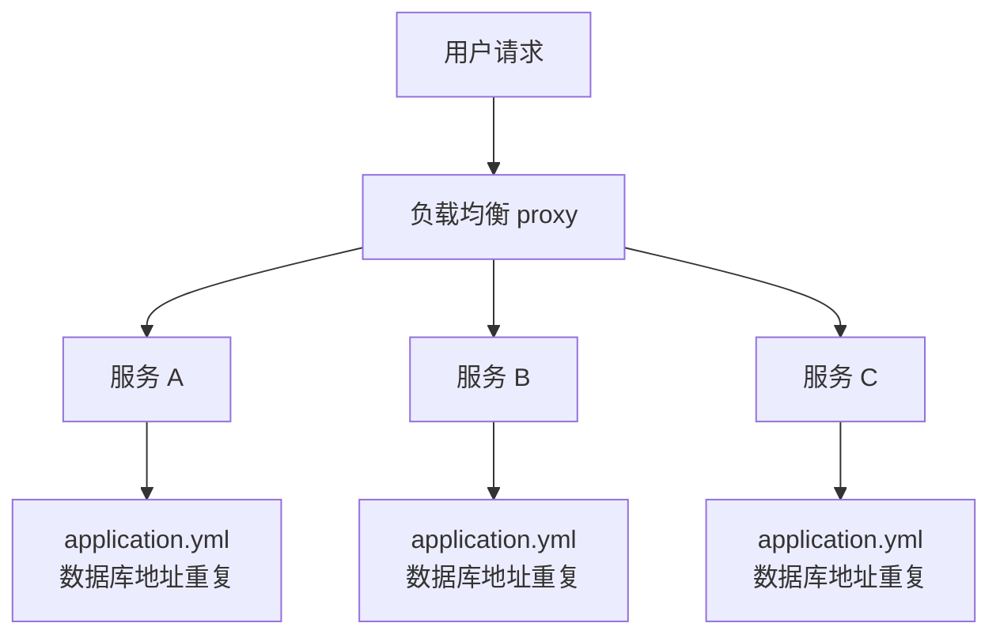
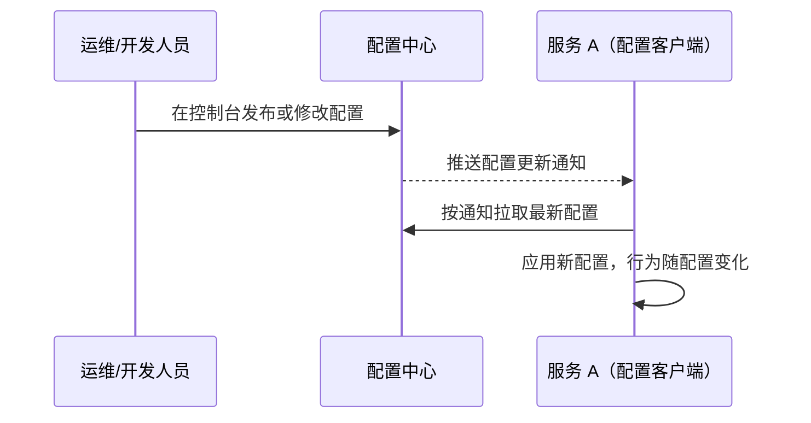
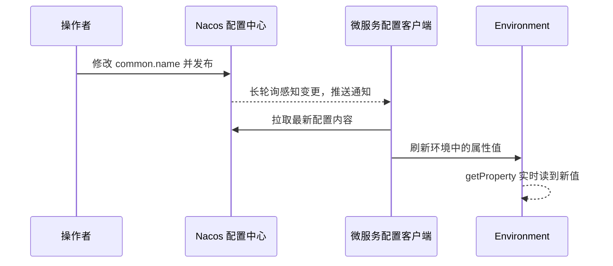
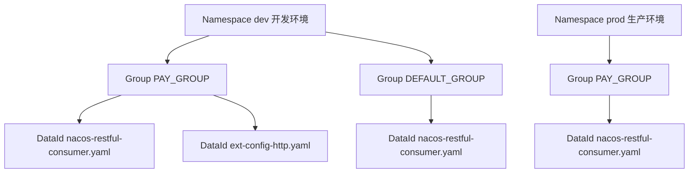
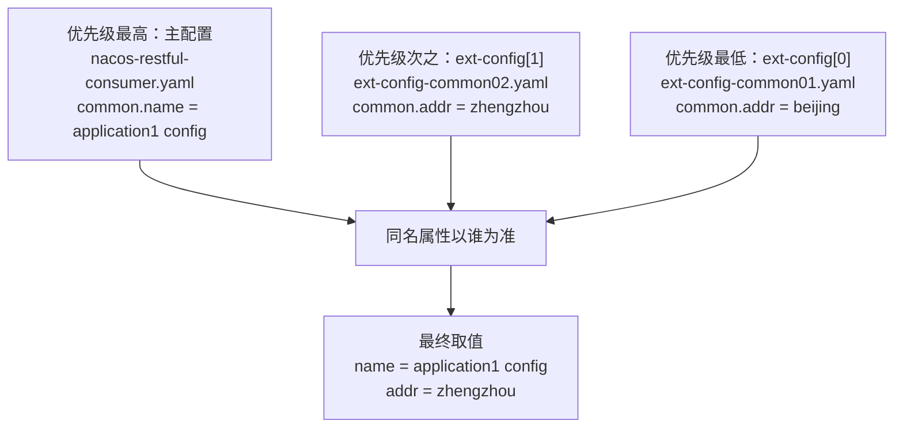

# Nacos-配置管理四讲：配置中心概念、发布与热更新实操、三层定位模型与扩展配置

## 先给结论

Nacos 的另一半能力是配置管理：微服务拆散了配置，还带来了公共参数重复 N 份的冗余，配置中心就是把配置从各应用剥离出来统一管理的基础组件。全系列四讲从为什么讲到怎么用，再到怎么组织，构成一条完整主线。
概念讲先想透必要性：配置的四个特点、微服务下配置分散与冗余的两个毛病、配置中心发布、通知、获取的三步工作流，以及 Spring Cloud Config、Apollo、Nacos 的选型对比，服务发现已经选了 Nacos，配置中心顺势复用，一套部署两个角色。
实操讲落控制台与代码：控制台发布 YAML、客户端三件套、配置必须写在 bootstrap.yml，`@Value` 固化不刷新而 Environment 动态可取，两个真实的坑踩完主干就通。数据模型讲把 Namespace、Group、Data ID 三层坐标讲透，环境、项目、主配置文件各归各位。扩展配置讲收尾：ext-config 数组挂多份公共配置，下标越大优先级越高，主配置一票否决，公共与个性化共存的组织模式由此定型。
四讲依次是：
- 理解配置中心：配置是什么、两个毛病、三步工作流与选型对比。
- 发布配置和获取配置：控制台发布、客户端三件套与热更新验证。
- 数据模型：Namespace、Group、Data ID 三层坐标与最佳实践映射。
- 扩展配置：ext-config 挂载、优先级覆盖与 servlet 公共配置落地。

## 第1部分：配置中心登场：为什么微服务必须把配置交出去

数据库连接参数、系统启动参数、线程池大小、日志级别，这些信息每写一个应用都躲不开，它们有一个共同的名字：配置。单体应用时代，一份 `application.yml` 从头管到尾，配置顶多算个杂务；系统拆成几十个微服务之后，每个服务各带一份配置文件，配置就成了一个正经的管理问题。Nacos 的另一半能力，配置管理，从这个概念课开始进入实操，先把「为什么需要配置中心」想透，后面的发布与获取才有着力点。

### 配置是什么：四个特点

配置这个东西看着不起眼，用一句话概括它的边界：配置是独立于程序的只读变量。程序通过读配置来改变自己的行为，但程序不应该反过来改配置，读写方向是单向的，这一条划清了配置与数据的界限，用户数据是程序写出来的，配置不是。

剩下的三个特点都好理解。**配置伴随应用的整个生命周期**，应用启动时读配置来初始化，比如服务端口号在系统启动那一刻就被用上了；运行中还要按配置调整行为，比如定时任务按配置的策略执行，从进程起到进程被杀掉，配置一直在场。**配置可以有多种加载方式**，常见的有程序内部 hard code、配置文件、环境变量、启动参数、基于数据库等，方式不拘，本质都是给程序的外部行为参数留一个入口。**配置需要治理**，同一份程序在不同环境（开发、测试、生产）、不同集群（比如不同数据中心）经常需要不同的配置，最典型的就是数据库地址，开发连一套、生产连另一套，环境不同配置必然不同，这就要求有完善的环境与集群配置管理能力，不能靠人肉记住哪个环境改哪份文件。

四个特点里，「只读」和「需要治理」是后面一切讨论的伏笔：正因为配置独立于程序又必须分环境管理，它才有资格被抽出去集中托管。

### 微服务下配置的两个毛病：分散与冗余

单体的配置文件只需要管好自己，微服务的配置文件是一群。系统从单体拆成一个个服务节点后，配置文件必须跟着迁移分割，原来的一份变成 N 份。这 N 份配置有两个并发的毛病。

这张图讲的是拆分后的配置现状，负载均衡入口后面的每个服务都自带一份配置文件：



**第一是冗余。** 很多服务需要的配置是同一批，数据库连接参数、中间件地址这类信息在每份配置文件里各写一遍，内容完全相同。**第二是分散。** 配置文件散落在各个服务的工程里，而每个服务将来都要部署成集群，一个实例一份配置文件，改一个公共参数要跑遍所有实例的所有文件。散与冗叠在一起，配置的变更风险和人力成本随服务数量线性增长，微服务架构下急需一个统一的配置管理机构。

### 配置中心的职能：发布、通知、获取

配置中心干的事情一句话可以说清：把配置从各应用中剥离出来，对配置进行统一管理，应用自身不需要自己管理配置。它跟前面学过的服务发现中心是同一个思路的产物，服务发现中心收拢的是地址，配置中心收拢的是参数，都是微服务架构里的基础服务组件。

它的完整工作流程分三步。这张时序图讲的是配置从发布到生效的链路：



用户在配置中心更新配置信息，比如把数据库连接参数录进去；服务 A 和服务 B 的配置客户端及时得到配置更新通知；随后微服务从配置中心获取配置，应用程序拿参数干活。发布、通知、获取，三步就是配置中心的全部主干，后面 Nacos 的实操课正是按这三步逐个落地。

把配置中心放回微服务基础架构的全景里看，它的位置与服务注册发现（Eureka 一类）、服务网关（Zuul 一类）、监控体系并列，是整个微服务基础架构体系中的一个组件。它的功能看上去并不起眼，无非是配置的管理和存取，但它是不可或缺的一环：所有微服务的配置都由它托管，没有这些配置信息，微服务从启动到运行随时可能出问题。配置中心就是在微服务化进程中应运而生的中心化配置服务。

### 选型对比：Spring Cloud Config、Apollo 与 Nacos

市面上用得比较多的配置中心有 Spring Cloud Config、Apollo、Nacos 和 Disconf 等，Disconf 已不再维护，剩下三款摆在一起比。这张对比表来自课程讲义，值得整张留下：

| 对比项目 | Spring Cloud Config | Apollo | Nacos |
| --- | --- | --- | --- |
| 配置实时推送 | 支持（Spring Cloud Bus） | 支持（HTTP 长轮询 1s 内） | 支持（HTTP 长轮询 1s 内） |
| 版本管理 | 支持（Git） | 支持 | 支持 |
| 配置回滚 | 支持（Git） | 支持 | 支持 |
| 灰度发布 | 支持 | 支持 | 不支持 |
| 权限管理 | 支持（依赖 Git） | 支持 | 不支持 |
| 多集群 / 多环境 / 监听查询 | 支持 | 支持 | 支持 |
| 多语言 | 只支持 Java | 主流语言，提供 Open API | 主流语言，提供 Open API |
| 配置格式校验 | 不支持 | 支持 | 支持 |
| 单机读（QPS） | 7（限流所致） | 9000 | 15000 |
| 单机写（QPS） | 5（限流所致） | 1100 | 1800 |
| 3 节点读（QPS） | 21（限流所致） | 27000 | 45000 |
| 3 节点写（QPS） | 5（限流所致） | 3300 | 5600 |

逐列读。Spring Cloud Config 的问题出在构造方式上：它依赖 Git 存储配置，每次读写配置都要与 Git 交互，QPS 数字被限流压到了个位数，实时推送还要额外搭一套 Spring Cloud Bus，它更适合大规模自动化运维依赖 Git 的场景。Apollo 是携程开源的项目，功能最完善，灰度发布、权限管理、配置格式校验都有，性能也不错，生产应用很广。Nacos 是阿里开源的项目，读写性能三项对比里最高，单机读 15000、3 节点读 45000，功能上具备 Apollo 的大部分配置管理能力，短板在灰度发布与权限管理暂不支持。

Nacos 还有一层别家没有的优势：它把注册中心与配置中心融合成了一个产品，部署和操作比 Apollo 直观简单，架构复杂度更低，运维部署的工作量也随之减轻。本项目做服务发现时已经选了 Nacos，配置中心没有理由再引入第二套中间件，性能、功能、部署三笔账算下来，选 Nacos 是顺理成章的结论。

## 第2部分：从发布到热更新：Nacos 配置管理的第一轮实操

配置中心的流程课已经把三步走法说清楚了：发布配置，微服务得到通知，微服务获取配置。这一课把三步落到控制台和代码上，中间会掉进两个真实的坑：一个是不改配置文件名字就读不到配置，一个是改了配置 `@Value` 却纹丝不动。两个坑都踩完，Nacos 配置管理的主干就通了。

### 在控制台发布一份 YAML 配置

浏览器打开 `http://127.0.0.1:8848/nacos`，点菜单「配置管理」下的「配置列表」。页面上方是命名空间切换栏，配置和服务一样都按命名空间隔离，这一点和服务发现课讲的 Namespace 是同一个机制。本课把配置发在 public 里，切到 public 点「添加」：

| 表单项 | 填写值 | 说明 |
| --- | --- | --- |
| Data ID | `nacos-restful-consumer.yaml` | 文件名加点加扩展名，含义稍后展开 |
| Group | `DEFAULT_GROUP` | 暂用默认分组 |
| 描述 | 数据库连接等公共配置示例 | 对这份配置用途的一句话说明 |
| 配置格式 | `YAML` | 必须与内容格式一致，properties 文件就选 Properties |
| 配置内容 | 见下 | YAML 层层递进，属性后跟冒号分割 |

配置内容按讲义给一份最简的：

```yaml
common:
  name: application1 config
```

YAML 的书写习惯和服务发现的配置文件一致：层级靠缩进递进，属性名后是冒号加空格。点发布成功后，配置列表的 public 命名空间下出现这一条记录，点进去还能回看和编辑内容。到这里第一步完成，配置已经在配置中心里待命了。

### 客户端三件套：依赖、地址、端点

当初做服务发现时要给工程配一个服务发现客户端，现在要从配置中心读配置，同样需要一个配置管理客户端。往 `nacos-restful-consumer` 的 pom 里加依赖：

```xml
<!-- 配置管理的客户端：从配置中心获取配置，与服务发现客户端一起构成 Nacos 使用标配 -->
<dependency>
    <groupId>com.alibaba.cloud</groupId>
    <artifactId>spring-cloud-starter-alibaba-nacos-config</artifactId>
</dependency>
```

后期用 Nacos 的工程，discovery 与 config 这两个依赖就是标配，都要添加。光有依赖还不够，得告诉它去哪个配置中心取，配置里指定 config 一段的中心地址；配置也可以指定 namespace，本课配置发在 public，客户端默认就从 public 读取，不用写。读取配置的代码写在 consumer 的 Controller 里，先用最顺手的 Spring 注解方式：

```java
package com.study.pay.nacos.consumer.controller;

import org.springframework.beans.factory.annotation.Value;
import org.springframework.web.bind.annotation.GetMapping;
import org.springframework.web.bind.annotation.RestController;

@RestController
public class RestConsumerController {

    //读取配置中心 common.name 配置项的值
    @Value("${common.name}")
    private String commonName;

    @GetMapping(value = "/configs")
    public String getValue(){
        return commonName;
    }
}
```

`@Value("${common.name}")` 是标准的 Spring 占位符注入，键名与刚发布的配置层级对应：`common` 是第一层，`name` 是第二层。再准备一个 `/configs` 端点把读到的值返回，方便浏览器验证。

### 配置必须写在 bootstrap.yml

工程一启动就报错了：占位符 `common.name` 无法解析。先把环境理顺，配置中心服务本身也启动好，重启应用，还是解析失败。问题不在 Nacos 那边，而在配置文件的加载顺序上。

这里要强调一个此前没有点破的机制：使用配置中心时，相关配置要写在 `bootstrap.yml` 里。Spring Cloud 体系里 `bootstrap.yml` 的加载顺序优先于 `application.yml`，原因是配置中心的信息在系统启动阶段就要用：客户端要连上配置中心、拉到远程配置，远程配置才有资格参与后续 Bean 的初始化，`@Value` 注入发生在容器装配阶段，等 `application.yml` 加载完黄花菜都凉了。所以原来的 `application.yml` 在这一课里要弃用，整体备份一份留作参考，工程里只保留改名后的 `bootstrap.yml`：

```yaml
server:
  port: 56020

spring:
  application:
    name: nacos-restful-consumer #服务名
  cloud:
    nacos:
      discovery:
        server-addr: 127.0.0.1:8848 #服务发现中心地址
      config:
        server-addr: 127.0.0.1:8848 #配置中心地址
        file-extension: yaml #Data ID 按应用名加扩展名拼装为 nacos-restful-consumer.yaml
```

`file-extension` 这个配置项也是排错过程中补上的关键一环：客户端怎么知道去配置中心拿哪个文件？它拿 `spring.application.name` 的值加上扩展名拼出 Data ID，应用名是 `nacos-restful-consumer`，扩展名指定为 yaml，拼出来的正是控制台发布的 `nacos-restful-consumer.yaml`。扩展名不指定或对不上，拼出来的 Data ID 在配置中心找不到，占位符自然解析不了。重启之后访问 `http://127.0.0.1:56020/configs`，页面返回 `application1 config`，远程配置读到了。

### 验证热更新：@Value 与 Environment 的分野

链路通了之后做一个更进一步的实验：在控制台把 `common.name` 的值改掉，点发布，再刷新 `/configs`。结果是页面纹丝不动。按配置中心的流程，配置变更微服务应该收到通知并拿到新值，通知其实已经到了，新配置也已经被客户端拉进来了，卡住的是 `@Value` 这个注解本身，它不具备更新配置的能力，注入进字段的值在启动时就固定了。这张时序图把热更新的完整链路拆开看：



图里每一步都在动，唯独 `@Value` 注入的字段不在链路上，它早在启动装配时就把值抄进了自己的字段，后续环境怎么刷新都与它无关。

讲义给出的解法是换一个取值通道，注入配置文件上下文 `ConfigurableApplicationContext`，改用 `getEnvironment().getProperty()` 现取现用：

```java
package com.study.pay.nacos.consumer.controller;

import org.springframework.beans.factory.annotation.Autowired;
import org.springframework.context.ConfigurableApplicationContext;
import org.springframework.web.bind.annotation.GetMapping;
import org.springframework.web.bind.annotation.RestController;

@RestController
public class RestConsumerController {

    //注入配置文件上下文
    @Autowired
    ConfigurableApplicationContext applicationContext;

    @GetMapping(value = "/configs")
    public String getValue(){
        //从环境里实时读，配置变更后立刻拿到新值
        return applicationContext.getEnvironment().getProperty("common.name");
    }
}
```

重启后先访问一次拿到旧值，回控制台修改 `common.name` 发布，刷新页面，新值立刻出现。这就是配置「动态更新」的字面演示：应用没有重启，行为随配置变了。两种写法的分工从此明确：要动态感知的读 Environment，允许启动时固定的才交给 `@Value`。另外动态刷新可以用配置 `spring.cloud.nacos.config.refresh.enabled` 控制，设为 false 即关闭。补充一句版本差异：后续主流版本常配 `@RefreshScope` 让 `@Value` 也具备刷新能力，本课使用的 Spring Cloud Alibaba 版本未涉及，属于本课写法之外的扩展手段。

## 第3部分：Namespace、Group、Data ID：三层坐标定位一份配置

上一课发布配置时，表单里有三个字段被匆匆带过：Data ID 填了文件名，Group 用了默认值，Namespace 停在 public。这三个字段不是随手填的表单项，它们合起来是配置管理的数据模型，决定了「茫茫配置海里，怎么唯一定位到一份配置」。这一课把三个概念的职责、默认值与项目的映射关系一次讲透，顺带回答一个细节问题：为什么 Group 建议不要一直用默认值。

### 三层模型总览

Nacos 的配置管理模型是一个三层嵌套结构，最外层是 Namespace，往里是 Group，最里层是 Data ID。这张图把嵌套关系画出来，同时标出了两个关键特性：同名配置集可以出现在不同分组里，同名分组可以出现在不同命名空间里：



图里同一个 `nacos-restful-consumer.yaml` 出现了三次，分别在 dev 的两个分组和 prod 的一个分组下，它们互不冲突，因为定位一份配置靠的是三层坐标的完整组合，缺一层就可能指到别人家的同名文件。这与服务发现的数据模型一脉相承：那边的三层是 Namespace、Service、Cluster，用于圈定一个实例；这边的三层是 Namespace、Group、Data ID，用于圈定一个配置集，Namespace 在两侧的语义完全一致，都是环境与租户的隔离边界。

### 配置集与配置项：文件与键值的两个粒度

配置集（Data ID）是 Nacos 中配置的基本单位。在系统里，一个配置文件通常就是一个配置集，一个配置集可以包含系统的各种配置信息，比如一个配置集里可能同时装着数据源、线程池、日志级别的配置。每个配置集都定义一个有意义的名称，这个名称就是配置集的 ID，也就是 Data ID。

配置集往下一个粒度是配置项：配置集中包含的一个个配置内容就是配置项，它代表一个具体的可配置参数与其值域，通常以 key=value 的形式存在。例如配置系统的日志输出级别 `logLevel=INFO|WARN|ERROR` 就是一个配置项。落到 YAML 文件里，第一层的 `common`、第二层的 `name`，每一对键值都是一个配置项。配置集与配置项的关系，大致相当于文件与文件里的字段。

### Data ID：应用名加扩展名的拼装规则

Data ID 怎么取，上一课的实操已经给出了规则：客户端用 `spring.application.name` 的值加上 `file-extension` 指定的扩展名自动拼装，应用名 `nacos-restful-consumer` 加上 `yaml`，拼出 `nacos-restful-consumer.yaml`，这个名字直接对应到 Nacos 里配置集的 Data ID。这个对应关系要记牢，它是「发布在配置中心的文件」与「工程里的应用」之间的纽带。

还有一层更实在的对应：一个项目总有主配置文件，工程 `nacos-restful-consumer` 的主配置文件，在 Nacos 里就对应 Data ID 为 `nacos-restful-consumer.yaml` 的这份配置集。项目下的每个工程各有一份主配置文件，各自对应一个 Data ID，Data ID 的清单实际上就是工程的清单。

### Group：给配置集按项目分组

Group 是对配置集的分组，通过一个有意义的字符串来表示，比如 Buy 或 Trade 这类业务语义的名字。分组的一个直接效果是：不同的配置分组下可以有相同的配置集，同名 Data ID 在两个 Group 里互不干扰。创建配置时如果不填分组名称，默认采用 `DEFAULT_GROUP`。

分组在生产里的常见用法是区分不同的项目或应用。比如一个学生管理系统用 Nacos，系统里有很多微服务、每个微服务又有很多配置文件，就可以定一个组名叫 `STUDENT_GROUP`，该系统所有的配置集统一归入这个项目组。本项目是聚合支付平台，同理可以把项目的配置分组定为 `PAY_GROUP`，所有支付项目的配置统一归属这个组。分组不填不影响功能，但 Nacos 在设计上把这一层留得很灵活，就是要看开发团队怎么用；按项目划组之后，控制台里配置的归属一目了然，跨项目的配置也不会搅在一起。

### Namespace：环境隔离的最后一道边界

命名空间可用于进行不同环境的配置隔离，比如隔离开发、测试、生产环境，因为它们的配置可能各不相同；也可以隔离不同的用户，不同开发人员共用同一个 Nacos 时各管各的配置。不同的命名空间下，可以存在相同名称的配置分组或配置集，Group 与 Data ID 的同名问题在 Namespace 层再次被豁免。

使用规则与服务发现那边完全一致：不指定时默认 public 这个保留空间；程序里获取配置集时，namespace 参数要填命名空间的 ID，而不是名称，这一条上一课的排错已经验证过一次，配置管理侧同样适用。

### 最佳实践：三层概念与项目结构的映射

Nacos 抽象定义了 Namespace、Group、Data ID 三个概念，具体它们代表什么，取决于使用者把它们看成什么。课程推荐的一套用法经过实践检验，直接给出映射：

| Nacos 概念 | 项目中的对应物 | 示例 |
| --- | --- | --- |
| Namespace | 不同环境 | dev 开发、test 测试、prod 生产 |
| Group | 某个项目 | `PAY_GROUP` 聚合支付项目 |
| Data ID | 项目下某个工程的主配置文件 | `nacos-restful-consumer.yaml` |

按这套映射，定位一份配置的语义就完整了：哪个环境的、哪个项目的、哪个工程的主配置文件。落到客户端配置上，获取一份配置集需要指定四样东西，优先级与默认值各不相同：

```yaml
spring:
  application:
    name: nacos-restful-consumer #应用名，参与拼装 Data ID
  cloud:
    nacos:
      config:
        server-addr: 127.0.0.1:8848 #配置中心地址，必填
        file-extension: yaml #参与拼装 Data ID
        namespace: a1f8e863-3117-48c4-9dd3-e9ddc2af90a8 #开发环境，不填默认 public
        group: DEFAULT_GROUP #业务分组，不填默认 DEFAULT_GROUP
```

四要素按讲义的原文收拢：nacos 服务地址必须指定；namespace 如不指定默认 public；group 如不指定默认 `DEFAULT_GROUP`；dataId 必须指定，名称为应用名称加配置文件扩展名。Data ID 表面上不在 config 段出现，实际上由前两行配置拼装出来，四样一个都不能少。上一课的发布与获取流程，用这套模型的语言重新描述一遍就是：在 dev 命名空间、`DEFAULT_GROUP` 分组下发布 Data ID 为 `nacos-restful-consumer.yaml` 的配置集，客户端按同样的三层坐标把它取回来。

## 第4部分：扩展配置 ext-config：公共配置抽离、优先级覆盖与一次真实落地

主配置文件的接入规则上一课已经打通：应用名加扩展名拼出 Data ID，一份远程配置就能被微服务读到。但真实项目里配置从来不止一份。多个工程共用同一批参数，数据库连接、线程池大小，写在谁的主配置里都不合适；框架级的配置，HTTP 编码、servlet 上下文路径这类，散在每个服务里更是重复劳动。Nacos 的自定义扩展 DataId 配置就是为这个场景准备的：让一个微服务按需挂载多份远程配置。这一课先讲 ext-config 的配置方法与加载优先级，再用一个把 servlet 公用配置抽进 Nacos 的完整案例收尾，两个演示合成一条完整的主线。

### 为什么需要扩展配置

一个工程的主配置文件只有一份，但配置需求是多份的。站在单个项目内部看，一个系统往往不止一个配置文件：数据库一套、中间件一套、业务开关一套，全塞进主配置会让它膨胀成大杂烩。站在多个项目之间看，不同项目共用一批配置文件，比如连接同一个中间件的参数，每个项目各写一份，改一次就要跑遍所有项目。

扩展配置解决的问题就是「一个微服务，多份远程配置」的挂载问题。配置仍然集中发布在 Nacos，工程侧按 Data ID 逐份引用，共用逻辑一份不改，项目私有配置与公共配置各归各位。它和上一课的主配置不冲突：主配置走应用名拼装的固定规则，扩展配置走显式声明的数组，两套通道并存。

哪些配置适合走扩展通道，判据有三条。改动频率低且所有服务取值一致的，比如 HTTP 编码字符集，抽成公共配置一份管全部；跨项目共享的，比如多个系统连同一个中间件的连接参数，抽成独立配置供各项目挂载；而随服务不同必然不同的，比如端口、应用名，留在各自的主配置里。抽错了方向，把个性化配置塞进公共文件，就只能靠覆盖规则来回打补丁，得不偿失。

### ext-config 的三个配置项

配置方法是数组式的：在 `spring.cloud.nacos.config` 下定义 `ext-config[n]`，n 是数组下标。每条扩展配置有三个属性，含义与默认值要先钉死：

| 属性 | 作用 | 默认值与注意点 |
| --- | --- | --- |
| `data-id` | 指向的配置集 ID | 值必须带文件扩展名，如 `ext-config-common01.yaml` |
| `group` | 该 Data ID 所在的分组 | 不明确配置时默认 `DEFAULT_GROUP` |
| `refresh` | 配置变更时是否支持应用动态刷新 | 默认不支持，要动态感知必须显式写 true |

三条注意事项都来自讲义的 Note 与课程口播。第一，`ext-config[n].data-id` 的扩展名既支持 properties 也支持 yaml/yml，而 `spring.cloud.nacos.config.file-extension` 的配置对自定义扩展配置的 Data ID 文件扩展名没有影响，别指望主配置的扩展名设置替你补全。第二，refresh 写成 true 才表示配置文件更新时立即刷新，默认是关的，忘了写 true，后面验证热更新就会莫名失败。第三，数组下标从 0 开始，第一个扩展配置写 `ext-config[0]`，千万别从 1 开始编号，下标错位不影响启动，但会搅乱优先级判断。

### 发布两份公共配置做实验

实验用两份内容相近的配置，控制台 public 命名空间下逐份发布，两条配置都放在自定义分组 `COMMON_GROUP` 里，与默认分组区分开：

| Data ID | Group | 配置格式 | 配置内容 |
| --- | --- | --- | --- |
| `ext-config-common01.yaml` | `COMMON_GROUP` | YAML | `common.name: zhangsan`、`common.addr: beijing` |
| `ext-config-common02.yaml` | `COMMON_GROUP` | YAML | `common.name: lisi`、`common.addr: zhengzhou` |

两份配置内容故意做成「同键不同值」：`common.name` 与 `common.addr` 在 01 和 02 里各出现一次，值分别是 zhangsan/beijing 与 lisi/zhengzhou。同键不同值正是验证优先级的必要条件，如果两份配置的键毫无交集，覆盖关系根本无从观察。发布成功的标志是配置列表里同时出现这两条记录，分组栏都是 `COMMON_GROUP`。

分组值得多说两句。上一课的实验配置放在默认的 `DEFAULT_GROUP`，这一课自定义了 `COMMON_GROUP`，两个名字的差异本身就是语义：默认分组打算留给各工程的主配置，自定义的公共配置集中归到专门的组，控制台里一眼就能分清哪些是公共文件、哪些是工程私有文件。分组一经选定，客户端引用时必须写同一个名字，两侧对不齐配置就挂不上。

### 客户端挂载与读取

回到 consumer 工程，bootstrap.yml 的 config 段把两份扩展配置依次挂上：

```yaml
server:
  port: 56020

spring:
  application:
    name: nacos-restful-consumer #服务名
  cloud:
    nacos:
      discovery:
        server-addr: 127.0.0.1:8848 #服务发现中心地址
      config:
        server-addr: 127.0.0.1:8848 #配置中心地址
        file-extension: yaml #主配置 Data ID 按应用名拼装为 nacos-restful-consumer.yaml
        ext-config[0]:
          data-id: ext-config-common01.yaml
          group: COMMON_GROUP
          refresh: true
        ext-config[1]:
          data-id: ext-config-common02.yaml
          group: COMMON_GROUP
          refresh: true
```

主配置段原样保留，扩展配置以数组元素的形式并列在 config 之下，group 与 refresh 两项都显式写出。结构上有两点值得留意：ext-config 是 config 的直接子项，缩进层级要与 file-extension 平齐，数组感靠方括号下标表达而不是靠列表符号；下标本身就是这份配置在加载顺序里的位置，与它写在文件里的先后次序无关，只认方括号里的数字。读取代码沿用上一课的 Environment 通道，一次取两个键拼接返回：

```java
package com.study.pay.nacos.consumer.controller;

import org.springframework.beans.factory.annotation.Autowired;
import org.springframework.context.ConfigurableApplicationContext;
import org.springframework.web.bind.annotation.GetMapping;
import org.springframework.web.bind.annotation.RestController;

@RestController
public class RestConsumerController {

    //注入配置文件上下文
    @Autowired
    ConfigurableApplicationContext applicationContext;

    @GetMapping(value = "/configs")
    public String getValue(){
        //分别取扩展配置里的两个属性
        String name = applicationContext.getEnvironment().getProperty("common.name");
        String addr = applicationContext.getEnvironment().getProperty("common.addr");
        return name + "|" + addr;
    }
}
```

重启工程访问 `http://127.0.0.1:56020/configs`，扩展配置确实被加载进来了，返回了值。但内容与预期对不上，这个「对不上」恰好是本课最有价值的部分。

### 一次预期外的返回，引出优先级规则

按直觉，返回的应该是扩展配置里的某个组合，实际页面显示的是 `application1 config|zhengzhou`。逐项溯源：前半段 `common.name` 取到的是 `application1 config`，这个值来自主配置文件 `nacos-restful-consumer.yaml`，01 和 02 里的 zhangsan、lisi 都没露面；后半段 `common.addr` 取到的是 `zhengzhou`，它来自 02，01 里的 beijing 没露面。两个属性各自投奔了不同的来源，规则藏在这个错位里。

**规则一：扩展配置之间，下标越大优先级越高。** 01 和 02 都配了 `common.addr`，ext-config[1] 指向的 02 下标大于 ext-config[0] 指向的 01，所以 02 的配置信息优先于 01，同名属性 02 覆盖 01，取值落在 zhengzhou 上。把下标写反或跳号，覆盖关系就会跟着错位。

**规则二：主配置文件与扩展配置同时存在时，主配置的优先级最高。** 主配置（通过应用名加扩展名自动生成的 Data ID）与所有扩展配置里都有 `common.name`，主配置覆盖扩展配置，扩展里的 zhangsan 与 lisi 全部落选，最终取到主配置里的 application1 config。这张图把两个规则画成一条优先级链：



把这两条规则记住，ext-config 的行为就完全可预测：先按主配置压一遍，再在扩展配置内部按下标压一遍，任何同名属性都有唯一确定的赢家。想在环境里复核这两条规则，有一个零成本的反向验证：把 bootstrap.yml 里 ext-config[0] 与 ext-config[1] 的 data-id 对调，重启后再取 `common.addr`，返回值从 zhengzhou 翻回 beijing。文件内容一个字没动，取值跟着下标走而不是跟着文件名走，优先级与下标的绑定关系当场坐实。排查「扩展配置取值不符合预期」这类问题时，对调下标是最快的定位手法。

另外讲义里还有一句总括：通过内部相关规则（应用名、扩展名）自动生成的 DataId 配置优先级最大，它与规则二说的是同一件事。

### 案例：把 servlet 框架级配置抽进 Nacos

方法演示用的配置是纯测试数据，案例来一次真的。需求：把 servlet 相关的公用配置抽到独立的配置文件，让所有微服务共享，包括 HTTP 编码的字符集与开关、消息编码、上下文路径、转发头处理等。这类配置的特点是每个服务都要、内容基本一致，正是抽公共的最佳对象。它与前面的实验还有一个本质区别：前面发布 zhangsan、beijing 这类键值，纯粹是为了验证「能不能读到」，发布的配置本身没有业务含义；这一份 ext-config-http.yaml 是框架真正消费的参数，写进去立刻改变应用的行为，配置中心从演示道具变成了生产工具。

先在控制台发布 `ext-config-http.yaml`，分组仍是 `COMMON_GROUP`，内容按讲义案例整理（键名按 Spring Boot 2.1 的配置键规范校正了 PDF 提取时粘连的层级）：

```yaml
#HTTP 编码与 servlet 上下文路径等框架级公用配置
spring:
  http:
    encoding:
      charset: UTF-8
      force: true
      enabled: true
    messages:
      encoding: UTF-8
server:
  servlet:
    context-path: /a
  use-forward-headers: true
  tomcat:
    remote-ip-header: x-forwarded-for
    protocol-header: x-forwarded-proto
```

客户端挂载沿用同一套路，下标接着已有配置往下排，新增 ext-config[2]：

```yaml
        ext-config[2]:
          data-id: ext-config-http.yaml
          group: COMMON_GROUP
          refresh: true
```

重启 consumer，验证方式直接而意外：原来访问 `http://127.0.0.1:56020/configs` 现在打不开了，必须访问 `http://127.0.0.1:56020/a/configs` 才能返回内容。路径里多出来的 `/a` 正是公共配置里 `server.servlet.context-path` 的值，配置在应用启动加载时已经生效，它就是应用实际的访问路径，不再是「读出来给你看」的演示数据。

这里有一个认知要对齐：这些配置如果拷回工程本地的 `application.yml`，效果完全一样，`/a` 照样生效。区别只在于存放位置，现在这堆框架级参数搬进了 Nacos，微服务启动时从配置中心读取加载。位置换了，能力反而多了：公共参数一处修改、所有挂载它的服务共享，不必逐个工程发版。

### 个性化覆盖：主配置一票否决

案例走到一半冒出一个新问题：公共配置把所有服务的 context-path 统一定成了 `/a`，但真实的微服务群路径不可能千篇一律，某个服务想用根路径怎么办。答案就藏在优先级规则里：主配置文件优先级最高，把想个性化的键值抽到主配置里重配即可。

操作是发布主配置 `nacos-restful-consumer.yaml`（Data ID 与上一课规则一致），加上同名键：

```yaml
server:
  servlet:
    context-path: /
```

发布后重启 consumer，`/a/configs` 打不开了，根路径 `http://127.0.0.1:56020/configs` 正常返回。主配置里的 context-path 覆盖了公共配置文件里的同名属性，服务的个性化诉求和公共配置的统一管理同时得到满足。覆盖关系再复述一遍：公共配置定基调，主配置做微调，谁的优先级高谁说了算，规则与上一节完全一致。

到这里，扩展配置的完整流程就闭环了，值得把真实的用法总结成型。真正开发时不需要专门写 `getProperty` 的测试端点，配置在应用程序启动时已经生效，框架级参数直接作用于容器。后续做 Nacos 应用的基本模式固定为三层，各层的职责与内容可以直接对号入座：

| 配置层 | Data ID 的来源 | 承载内容 | 优先级地位 |
| --- | --- | --- | --- |
| 主配置 | 应用名加扩展名自动拼装 | 应用私有参数、个性化覆盖键 | 最高，覆盖一切扩展配置 |
| 扩展配置 | ext-config[n] 显式声明 | 项目内公共服务与框架级公用配置 | 组内下标越大越高 |
| 公共分组 | 同上，归入 COMMON_GROUP 等自定义分组 | 跨工程共享的公用参数 | 同扩展配置，按组区分归属 |

补充一句版本演进：后续版本的 Spring Cloud Alibaba 把 ext_config 细化为 extension-configs 与 shared-configs 两组写法，分层思想与本课一致，主配置优先级最高、组内下标越大优先级越高，学透了本课的规则，新写法只需查一下配置项名称即可平移。

## 常见误区

- **把配置当成可以随便读写的普通数据。** 错例：程序运行时修改配置文件来「保存状态」。正解：配置是独立于程序的只读变量，程序读它来改变行为，状态类的数据应该进数据库，不能倒灌进配置。
- **以为微服务就是把单体配置文件复制几份。** 错例：每个服务拷一份全量 `application.yml`，公共参数改一次要改 N 处。正解：公共配置抽到配置中心统一托管，服务本地只留自己独有的少量配置，冗余自然消失。
- **选型只看功能清单，不看部署成本。** 错例：Apollo 功能最全就无脑选它，结果为了一个配置中心多维护一套独立系统。正解：功能、性能、运维成本一起算；本项目已用 Nacos 做注册中心，配置中心复用同一套部署，综合成本最低。
- **以为配置中心只是「把配置文件换个地方存」。** 错例：把配置中心当静态网盘用，改完配置还要逐台重启。正解：配置中心的核心价值在动态，配置变更后客户端能收到通知并获取新值，后面课程会实际验证不用重启就能生效。
- **把配置中心配置写进 `application.yml`。** 错例：沿用原来的配置文件，启动即报占位符无法解析。正解：写在 `bootstrap.yml`，它的加载先于 `application.yml`，配置中心客户端必须在容器装配前拉到远程配置。
- **不配 `file-extension`，或扩展名与控制台发布的不一致。** 错例：客户端拼出的 Data ID 是 `nacos-restful-consumer`，配置中心里的却是 `nacos-restful-consumer.yaml`。正解：`file-extension: yaml` 与发布格式保持一致，拼装规则是应用名加点加扩展名。
- **以为 `@Value` 注入的值会自动更新。** 错例：改完配置反复刷新，返回值不变，怀疑 Nacos 没推送。正解：通知和拉取都已发生，`@Value` 读取的是启动时固定的值，动态读取要改用 `ConfigurableApplicationContext` 的 Environment 取值。
- **配置格式选错。** 错例：内容是 YAML，格式选了 Properties，客户端解析失败。正解：格式选项与内容一一对应，properties 文件选 Properties，YAML 文件选 YAML。
- **以为 Data ID 可以随便起名。** 错例：发布时把 Data ID 写成 `my-config`，工程里却按应用名拼装去找，永远对不上。正解：主配置集的 Data ID 必须是应用名加扩展名，自定义命名的配置属于扩展配置，要用专门的方式引用，下一课展开。
- **Group 永远用默认值，跨项目混在 `DEFAULT_GROUP` 里。** 错例：多个项目的配置全堆在默认分组，同名 Data ID 想复用也复用不了。正解：按项目定 Group，如 `PAY_GROUP`，客户端与控制台两侧保持一致。
- **namespace 填了名称。** 错例：`namespace: dev`，客户端去了 public 找配置。正解：填命名空间 ID，名称只用于控制台展示。
- **只填 Data ID 就以为能定位。** 错例：以为配置中心和文件系统一样按文件名全盘查找。正解：定位配置集靠 Namespace、Group、Data ID 三层组合，坐标不全时默认值会悄悄顶上，实际找的空间可能与你以为的完全不同。
- **扩展配置数组下标从 1 开始或不连续。** 错例：第一条就写 `ext-config[1]`，第二条写 `ext-config[2]`。正解：下标从 0 开始连续编号，`ext-config[0]` 是第一个，下标顺序直接决定优先级。
- **data-id 不带文件扩展名。** 错例：写成 `ext-config-common01`，客户端找不到配置。正解：扩展配置的 data-id 必须带扩展名，properties 与 yaml/yml 均可，且 `file-extension` 的设置对它没有补全作用。
- **以为 refresh 默认开启。** 错例：公共配置在控制台改了值，应用毫无反应。正解：`ext-config[n].refresh` 默认不支持动态刷新，需要动态感知的配置要显式写 `refresh: true`。
- **以为扩展配置能覆盖主配置。** 错例：在 02 里改了 `common.name`，期望应用读到新值，实际主配置的值纹丝不动。正解：主配置（应用名自动生成的 Data ID）优先级最大，扩展配置内部才是下标大的覆盖下标小的。
- **客户端 group 与发布侧不一致。** 错例：配置发布在 `COMMON_GROUP`，客户端没写 group，默认去 `DEFAULT_GROUP` 找，配置加载失败。正解：发布侧与引用侧的 group 必须一致，自定义分组尤其容易漏。

## 面试可能被问到的问题

1. 面试官追问：「配置和配置中心分别是什么？」
   答：配置是独立于程序的只读变量，伴随应用整个生命周期，加载方式包括配置文件、环境变量、启动参数、数据库等；配置中心是在配置后面加了「中心」二字，把配置从各应用剥离出来统一管理的基础服务组件，流程为发布配置、微服务得到更新通知、微服务获取配置三步。

2. 面试官追问：「为什么微服务架构特别需要配置中心，单体应用就不那么迫切？」
   答：单体只有一份配置文件，改起来直接；微服务把配置拆散到几十个服务里，既分散又冗余，公共参数重复 N 份，集群部署后每实例一份。统一托管到配置中心后，一处修改、处处生效，变更风险和成本才可控。

3. 面试官追问：「Spring Cloud Config 的性能为什么这么低？」
   答：它依赖 Git 构造存储，每次读、写配置都要和 Git 交互，再叠加限流，单机读 QPS 只有 7、写只有 5，实时推送还得借助 Spring Cloud Bus。它适合以 Git 为中心的大规模自动化运维场景，不适合高频读写。

4. 面试官追问：「Apollo 和 Nacos 各自的优劣是什么？」
   答：Apollo 功能最完善，灰度发布、权限管理、格式校验齐全，性能次之；Nacos 读写性能最高，具备 Apollo 大部分配置管理能力，灰度与权限暂缺，最大优势是注册中心与配置中心融合，部署运维简单，还提供 Open API 支持多语言。

5. 面试官追问：「你的项目为什么选 Nacos 做配置中心？」
   答：三条理由。性能对比里 Nacos 读写最高；本项目服务发现已用 Nacos，一套部署同时承担注册中心与配置中心两个角色，架构简单、运维省力；课程技术栈是 Spring Cloud Alibaba，Nacos 配置客户端与现有依赖无缝衔接。

6. 面试官追问：「在 Nacos 发布并读取一份配置，完整步骤是什么？」
   答：控制台配置列表里添加配置，填 Data ID、Group、配置格式和内容并发布；微服务引入 spring-cloud-starter-alibaba-nacos-config 依赖；在 bootstrap.yml 配置 config 的 server-addr 与 file-extension；代码用 @Value 或 Environment 按键读取，访问端点验证返回值。

7. 面试官追问：「为什么配置中心相关配置必须写在 bootstrap.yml？」
   答：bootstrap.yml 的加载顺序优先于 application.yml。客户端要在系统启动阶段就连上配置中心并拉取远程配置，远程配置才能参与 Bean 装配；写在 application.yml 里时远程配置来得太晚，@Value 之类的注入直接失败，本课的占位符解析报错就是这个原因。

8. 面试官追问：「客户端是怎么知道该拉取哪个配置文件的？」
   答：按内部规则拼装 Data ID，规则是 spring.application.name 的值加 file-extension 指定的扩展名。应用名为 nacos-restful-consumer、扩展名为 yaml 时，客户端去配置中心找 nacos-restful-consumer.yaml，所以扩展名必须与控制台发布的配置格式一致。

9. 面试官追问：「配置改了但 @Value 的值没变，是什么原因，怎么解决？」
   答：配置客户端通过长轮询机制已经感知到变更并拉取了新配置，但 @Value 注入的字段值在启动时固定，不具备刷新能力。解决方式是注入 ConfigurableApplicationContext，用 getEnvironment().getProperty 实时读取；新版本也可以给 Bean 加 @RefreshScope 配合 @Value 实现刷新。

10. 面试官追问：「配置发布在非 public 命名空间时，客户端怎么对上？」
   答：Namespace 对配置与服务同样起隔离作用，客户端默认只读 public。配置发布到自定义命名空间时，在 spring.cloud.nacos.config 下加 namespace 配置，值同样是命名空间 ID 而不是名称，与服务发现一侧的规则一致。

11. 面试官追问：「Nacos 配置管理的数据模型是什么？」
   答：Namespace、Group、Data ID 三层结构。Namespace 做环境和租户隔离，Group 对配置集分组，Data ID 标识一份配置集。三者组合唯一定位一个配置集，不同命名空间下可以有同名分组，不同分组下可以有同名配置集。

12. 面试官追问：「配置集、配置项、Data ID 分别是什么？」
   答：配置集是系统中的一份配置文件，一个配置集可以包含数据源、线程池、日志级别等各类信息；配置项是配置集中一个个具体的键值对，如 logLevel=INFO；Data ID 是配置集的 ID，每个配置集定义一个有意义的名称，通常由应用名加扩展名拼装。

13. 面试官追问：「Group 有什么用？你项目里会怎么用？」
   答：它对配置集做分组，默认 DEFAULT_GROUP，不同分组下可以有同名配置集。实践上按项目划分，比如支付项目定 PAY_GROUP，学生管理系统定 STUDENT_GROUP，各项目的配置归各自的组，控制台归属清晰，跨项目同名配置也互不影响。

14. 面试官追问：「获取一份配置集，客户端要指定哪些东西？」
   答：四要素。配置中心地址 server-addr 必填；namespace 不填默认 public，且必须填 ID 不是名称；group 不填默认 DEFAULT_GROUP；Data ID 必填，由 spring.application.name 加 file-extension 扩展名拼装，前两个配置项正是在参与这个拼装。

15. 面试官追问：「配置管理和服务发现的数据模型有什么对应关系？」
   答：两边共用最外层的 Namespace 做环境隔离。服务发现侧用 Namespace、Service、Cluster 三层定位一个实例，配置管理侧用 Namespace、Group、Data ID 三层定位一个配置集，隔离思想一致，圈定的对象一个是进程地址、一个是配置内容。

16. 面试官追问：「一个微服务要加载多份远程配置，怎么实现？」
   答：主配置走应用名加扩展名自动拼装的 Data ID；额外的配置用 spring.cloud.nacos.config.ext-config[n] 数组逐份声明，每条写 data-id、group、refresh 三个属性，下标从 0 开始。主配置与扩展配置通道并存，互不替代。

17. 面试官追问：「ext-config 的优先级规则是什么？」
   答：两条。扩展配置之间，数组下标 n 越大优先级越高，下标大的同名属性覆盖下标小的；主配置文件与扩展配置同时存在时主配置优先级最高，通过内部规则（应用名、扩展名）自动生成的 DataId 配置优先级最大。判断取值先看主配置，再看扩展配置内部的下标。

18. 面试官追问：「ext-config 的 data-id 为什么必须带扩展名？file-extension 能补全吗？」
   答：data-id 的值就是配置集的完整 ID，扩展名是 ID 的一部分，客户端按它精确定位，不带扩展名就找不到。spring.cloud.nacos.config.file-extension 只参与主配置 Data ID 的拼装，对自定义扩展配置的扩展名没有影响，两套规则互不干涉。

19. 面试官追问：「refresh 属性解决什么问题？默认是什么？」
   答：它控制该 DataId 在配置变更时是否支持应用中动态刷新、感知最新的配置值，默认是不支持的。需要热更新的公共配置要显式写 refresh: true，否则控制台修改发布后，应用里的值保持启动时的旧值。

20. 面试官追问：「公共配置统一了 context-path，个别服务想要不同的值，怎么处理？」
   答：利用主配置优先级最高的规则做覆盖。在该服务的主配置文件里重配 server.servlet.context-path，发布重启后主配置的值生效，公共配置里的同名属性被压掉。公共配置定基调、主配置做个性化，是两套配置共存的标准手法。

21. 面试官追问：「实际项目的 Nacos 配置一般怎么组织？」
   答：三层结构。一份主配置挂应用名，承载应用私有参数与个性化覆盖；若干扩展配置挂项目公共配置与框架级公用配置，如 HTTP 编码、servlet 上下文，多服务共享一份；个性化键值上浮主配置覆盖。配置随应用启动自动加载生效，通常不需要写专门的读取代码，新版本可用 extension-configs 与 shared-configs 达到同样的分层效果。

## 配套资料

- 讲义：`materials/docs/10/Nacos-服务发现与配置管理v1.0.md`，3.1 理解配置中心（3.1.1 什么是配置、3.1.2 什么是配置中心、3.1.3 主流配置中心对比）为本课出处，配置四特点、配置中心流程与三款产品对比表均出自该节。
- 说明：本课为概念与选型课，无对应工程源码；正文 mermaid 图为按讲义插图结构重绘的示意图。该阶段课程资料归档在 `materials/docs/10/` 与 `materials/code/10/`（目录编号与相邻阶段共用）。
- 讲义：`materials/docs/10/Nacos-服务发现与配置管理v1.0.md`，3.2.1 发布配置与 3.2.2 获取配置为本课出处，控制台发布项、`spring-cloud-starter-alibaba-nacos-config` 依赖、bootstrap.yml 配置、@Value 读取与 ConfigurableApplicationContext 动态刷新代码均出自该两小节。
- 代码：`materials/code/10/nacos-discovery全部代码/`，`nacos-restful-consumer` 工程的 pom 含真实的 nacos-config 客户端依赖，`RestConsumerController` 中 `@Value("${common.name}")` 与 `applicationContext.getEnvironment().getProperty(...)` 的组合即正文代码出处，其 `bootstrap.yml` 为真实文件。
- 说明：该阶段课程资料归档在 `materials/docs/10/` 与 `materials/code/10/`（目录编号与相邻阶段共用），路径列出至工程目录层级；正文代码包名已按本系列口径改写为 `com.study.pay` 系，口播转写中的同音误写（如 bootstrap、@Value）已按正确写法修正。
- 讲义：`materials/docs/10/Nacos-服务发现与配置管理v1.0.md`，3.2.3 配置管理模型为本课出处，配置集、配置项、配置分组、命名空间的定义，最佳实践的 Namespace、Group、Data ID 映射以及获取配置集的四要素说明均出自该小节。
- 代码：`materials/code/10/nacos-discovery全部代码/`，`nacos-restful-consumer` 工程的 `bootstrap.yml` 为真实文件，其中的 `server-addr`、`file-extension`、namespace 配置与正文四要素示例同源。
- 说明：该阶段课程资料归档在 `materials/docs/10/` 与 `materials/code/10/`（目录编号与相邻阶段共用），路径列出至工程目录层级；正文示例中的 Group 值 `PAY_GROUP` 与 namespace ID 为按课程口径与课程环境写出的示例值，包名与注释已按本系列口径改写。
- 讲义：`materials/docs/10/Nacos-服务发现与配置管理v1.0.md`，3.3 自定义扩展的 DataId 配置（3.3.1 ext-config 扩展配置、3.3.2 案例）为本课出处，ext-config 三属性的说明与默认值、优先级结论、servlet 公用配置案例与 context-path 个性化验证均出自该两小节。
- 代码：`materials/code/10/nacos-discovery全部代码/`，`nacos-restful-consumer` 工程的 `bootstrap.yml` 真实包含 `ext-config[0]`、`ext-config[1]`、`ext-config[2]`（指向 ext-config-common01.yaml、ext-config-common02.yaml、ext-config-http.yaml，分组 COMMON_GROUP），正文挂载配置即出自该文件；`RestConsumerController` 中 `applicationContext.getEnvironment().getProperty(...)` 组合返回 name 与 addr 的代码为正文读取代码出处。
- 说明：该阶段课程资料归档在 `materials/docs/10/` 与 `materials/code/10/`（目录编号与相邻阶段共用），路径列出至工程目录层级；ext-config-http.yaml 的配置内容出自讲义案例，键名按 Spring Boot 2.1 配置键规范整理（PDF 提取的层级有粘连）；正文代码包名与注释已按本系列口径改写为 `com.study.pay` 系。
