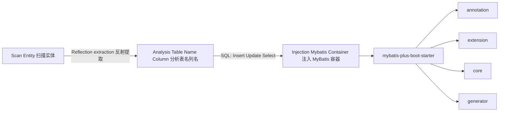
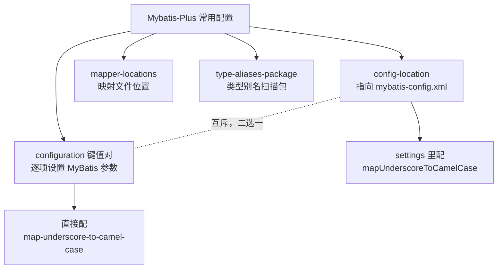
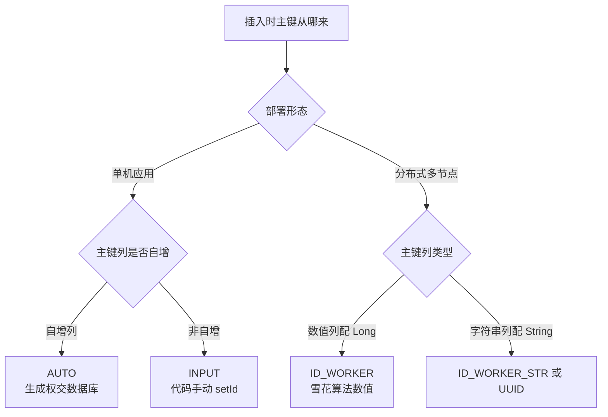
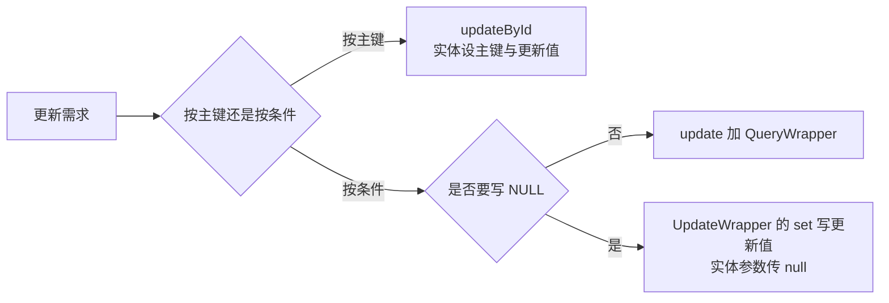
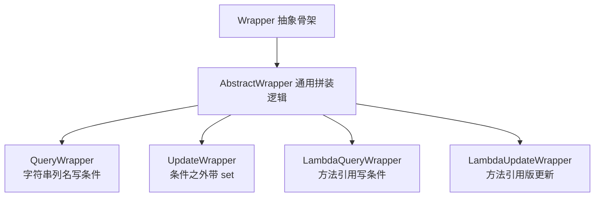
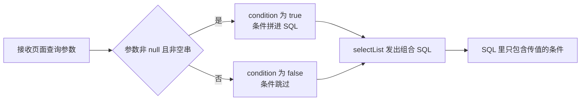
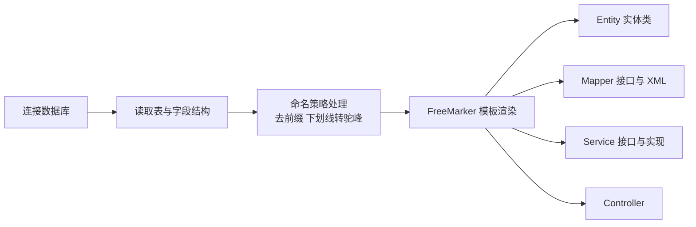

# Mybatis-Plus 实战全解：增强原理、通用 CRUD、条件构造器与代码生成器

> 🔒 安全提示：文中示例的口令/密钥均为课程教学环境演示口径，生产环境的安全要求见《安全与合规须知》。

## 先给结论

- Mybatis-Plus 是 MyBatis 的增强工具，只做增强不做改变：引入后原有 Mapper 与映射文件照常工作，启动即自动注入基本 CRUD，学习成本几乎为零。
- 快速入门五步：建库建表、建工程导依赖、配数据源、Mapper 继承 `BaseMapper<T>`、启动类加 `@MapperScan` 后用单元测试验证。
- 高频配置四项：config-location、mapper-locations、type-aliases-package、驼峰映射（Mybatis-Plus 默认开启）；大坑是 `mybatis-plus.configuration.*` 与 config-location 不能同时配置。
- 通用 CRUD 的返回值有规律：增删改一律返回 int 受影响行数；insert 执行后数据库生成的主键回填到实体 id 属性；主键策略配在 `@TableId` 的 type 属性，五档可选。
- 更新的铁律：实体里为 null 的属性不进 SET 子句，想把列更新成 NULL 必须用 UpdateWrapper 的 set 方法；selectOne 条件命中多条直接抛异常；分页 selectPage 依赖先注册的 PaginationInterceptor。
- Wrapper 家族分工明确：QueryWrapper 写字符串列名，LambdaQueryWrapper 用方法引用锁死列名，UpdateWrapper 多一个 set 能力；condition 参数实现参数非空才拼的动态查询。
- 代码生成器链路：连库读表与字段、命名策略转换（去前缀、下划线转驼峰）、FreeMarker 模板渲染、批量产出 Entity 到 Controller 各层代码；依赖 generator、freemarker、mysql 驱动三件套，普通 main 方法即可运行。
- 模块名一头两用：既是生成代码的子包名，又拼作表名前缀去匹配；与表前缀一致时类名去掉前缀，不一致时前缀留在类名里。

## 第1部分：Mybatis-Plus 入门：只做增强不做改变的 MyBatis 增强工具

day02 开始准备持久层的技术与环境：数据库用 MySQL 5.7，持久层框架选 Mybatis-Plus。很多人的第一反应是又来一个新框架要学，动手前先要把定位搞清楚：它不是要替代 MyBatis，而是在 MyBatis 基础上做增强的封装。早期学过的 MyBatis 以轻量级著称，开发持久层 DAO 接口很灵活，代价是单表的增删改查也得一套接口加一份映射文件地写，这部分代码高度重复。Mybatis-Plus 正是冲着这块重复劳动来的。

### 定位：MyBatis 的搭档，不是替代品

把 Mybatis-Plus 讲清楚只需要一句话：它是 MyBatis 的增强工具，在 MyBatis 的基础上做增强，但是不做改变。这句话里有两个关键词。增强，指的是补齐 MyBatis 用起来繁琐的部分，单表 CRUD 不再手写；不做改变，指的是它没有动 MyBatis 的任何机制，Mapper 接口该怎么定义还怎么定义，映射文件该怎么写还怎么写，已有的 MyBatis 代码放进 MP 工程里照样运行。

官网首页的标语是「为简化开发而生」，并列了三个关键词：润物无声、效率至上、丰富功能。官方对愿景的表述是成为 MyBatis 最好的搭档。国内由苞米豆团队开发并开源，GitHub 与码云上都有仓库。选型时看中的就是这种关系：已有的 MyBatis 经验全部复用，增量学习的只有它新加的那部分。

支持面也足够宽：MySQL、MariaDB、Oracle、DB2、H2、HSQL、SQLite、PostgreSQL、SQLServer 都在支持列表里，还包括达梦、虚谷、人大金仓等国产数据库。支付平台这样的项目换数据库或做分库分表时，持久层不必跟着换框架。

### 核心特性：哪些重复劳动被省掉了

**无侵入与损耗小。** 引入它不会对现有工程产生影响，启动时自动注入基本 CRUD，性能基本无损耗。这意味着提升开发效率不需要付出运行时的代价。

**强大的 CRUD 操作。** 内置通用 Mapper 与通用 Service，通过少量配置即可实现单表大部分 CRUD 操作，再配合条件构造器满足各类查询需求。Mapper 接口继承一个 `BaseMapper<T>`，insert、deleteById、update、selectList 这些方法就直接可用，映射文件一行不用写。条件构造器支持 Lambda 形式调用，用方法引用指定字段，查询条件不会因为手写字符串列名写错而翻车。

**主键自动生成。** 支持多达 4 种主键策略，内含分布式唯一 ID 生成器。主键这件事看起来小，分布式系统里却很让人头疼：分库分表之后数据库自增主键必然冲突，业务层自己封装一套 ID 生成又费工夫。Mybatis-Plus 把这件事做进了框架，主键策略可自由配置，这是它特别实用的一个特性。

**周边插件。** 支持 XML 热加载，对简单的 CRUD 操作甚至可以无 XML 启动；支持 ActiveRecord 模式，实体类只需继承 Model 类即可进行强大的 CRUD 操作；内置代码生成器、分页插件、性能分析插件、全局拦截插件与 Sql 注入剥离器。性能分析插件值得单独一提：它能监控 SQL 的执行时间，一条写得复杂、跑得慢的 SQL 很容易被排查出来。

### 架构：启动时到底发生了什么

BaseMapper 里那些凭空多出来的方法，来自下面这条启动链路：



流程分三步：启动时扫描实体类，通过反射提取信息，分析出实体对应的表名与列名；据此生成 Insert、Update、Select 等一批 SQL；把这些 SQL 注入 MyBatis 容器。所以那些通用方法不是运行时临时反射拼出来的，而是启动阶段就注入好的现成 SQL，调用时与手写的 Mapper 方法没有区别，这就是「性能基本无损耗」的原因。整个能力由 `mybatis-plus-boot-starter` 承载，内部再分 annotation（注解）、extension（扩展插件）、core（核心）、generator（生成器）几个模块。

### 在本项目中的位置

支付平台服务端的技术栈里，持久化这一格写的是 Mybatis Plus 加 Druid 连接池，交易相关数据用 Sharding-jdbc 做分库分表。微服务工程全部基于 Spring Boot，Mybatis-Plus 提供了对应的 Spring Boot 启动器，引入依赖、配好数据源即可工作。把实体类按注解定义好，框架扫描后自动生成 SQL 语句，通用的增删改查代码不再需要手写，这就是本项目每个业务微服务持久层的标准姿势。

围绕它展开的学习路径是固定的几段：整合 Mybatis-Plus、通用 CRUD、Mybatis-Plus 的配置、条件构造器、Service 封装与代码生成器，后面逐段落地。本课先给一个能跑的最小工程感受整体流程：

```xml
<!-- Spring Boot 工程引入 Mybatis-Plus 的最小依赖 -->
<dependency>
    <groupId>com.baomidou</groupId>
    <artifactId>mybatis-plus-boot-starter</artifactId>
    <version>3.1.0</version>
</dependency>
<dependency>
    <groupId>mysql</groupId>
    <artifactId>mysql-connector-java</artifactId>
    <version>8.0.11</version>
</dependency>
```

Mapper 侧只需要一个接口声明，CRUD 能力由启动时注入的 SQL 提供：

```java
package com.study.pay.mp.mapper;

import com.baomidou.mybatisplus.core.mapper.BaseMapper;
import com.study.pay.mp.pojo.User;

// 继承 BaseMapper 后即拥有单表全套 CRUD 方法
public interface UserMapper extends BaseMapper<User> {
}
```

## 第2部分：Mybatis-Plus 快速入门与常见配置：从一个能跑的最小工程到四项高频配置

介绍看完了，day02 正式动手。目标很具体：在一个 Spring Boot 工程里把 Mybatis-Plus 跑通，从建库建表一路到单元测试查出数据，再把日后每个工程都会碰到的四项常用配置吃透。入门阶段最容易卡住的不是 API，而是配置之间的相互约束，比如两条配置项明明各配各的，放一起却直接启动失败，这类坑这一课会挨个踩一遍并给出正解。

### 第一步：建库建表，准备测试数据

环境四项先备齐：JDK 8、Maven 3.3.9、IDEA 2018.2 与 MySQL 5.7，开发工具本身的安装与配置不在重复展开，直接进入工程相关的动作。连上 MySQL 服务端，执行建库脚本：

```sql
-- 创建数据库，字符集 utf8
CREATE DATABASE `mp` CHARACTER SET 'utf8' COLLATE 'utf8_general_ci';

-- 创建测试表
CREATE TABLE `tb_user` (
`id` bigint(20) NOT NULL AUTO_INCREMENT COMMENT '主键ID',
`user_name` varchar(20) NOT NULL COMMENT '用户名',
`password` varchar(20) NOT NULL COMMENT '密码',
`name` varchar(38) DEFAULT NULL COMMENT '姓名',
`age` int(11) DEFAULT NULL COMMENT '年龄',
`email` varchar(50) DEFAULT NULL COMMENT '邮箱',
`birthday` datetime DEFAULT NULL,
PRIMARY KEY (`id`)
) ENGINE=InnoDB AUTO_INCREMENT=1 DEFAULT CHARSET=utf8;

-- 插入测试数据
insert into `tb_user` (`id`,`user_name`,`password`,`name`,`age`,`email`,`birthday`) values
(1,'zhangsan','123456','张三',18,'test1@example.com','2019-09-26 11:42:01'),
(2,'lisi','123456','李四',20,'test2@example.com','2019-10-01 11:42:08'),
(3,'wangwu','123456','王五',25,'test3@example.com','2019-10-02 11:42:14'),
(4,'zhaozhu','123456','赵六',21,'test4@example.com','2019-10-05 11:42:18'),
(5,'sunqi','123456','孙七',24,'test5@example.com','2019-10-14 11:42:23');
```

执行时先在左侧选中刚创建的 `mp` 库，脚本跑完刷新即可看到 `tb_user` 与 5 条初始数据。库与表的设计里有几处值得留意：`id` 用 `bigint` 自增做主键，留足了位数；`user_name`、`password` 设了 NOT NULL，其余列允许为空；字符集统一 utf8，避免中文数据进来变问号。更要紧的是列名风格：`user_name` 是下划线命名，Java 属性习惯用驼峰 `userName`，两者怎么对应起来，正是后面驼峰映射配置要解决的问题，这里先埋个伏笔。

### 第二步：建工程、导依赖

用 Maven 方式新建工程，坐标与讲义保持一致（按本系列口径，groupId 记作 `com.study.pay`，模块名 `pay-mp-springboot`）。因为后续微服务全部基于 Spring Boot 开发，这个练习工程也直接以 Spring Boot 为父工程，pom 如下：

```xml
<?xml version="1.0" encoding="UTF-8"?>
<project xmlns="http://maven.apache.org/POM/4.0.0"
         xmlns:xsi="http://www.w3.org/2001/XMLSchema-instance"
         xsi:schemaLocation="http://maven.apache.org/POM/4.0.0 http://maven.apache.org/xsd/maven-4.0.0.xsd">
    <modelVersion>4.0.0</modelVersion>

    <groupId>com.study.pay</groupId>
    <artifactId>pay-mp-springboot</artifactId>
    <version>1.0-SNAPSHOT</version>

    <parent>
        <groupId>org.springframework.boot</groupId>
        <artifactId>spring-boot-starter-parent</artifactId>
        <version>2.1.3.RELEASE</version>
    </parent>

    <dependencies>
        <dependency>
            <groupId>org.springframework.boot</groupId>
            <artifactId>spring-boot-starter</artifactId>
        </dependency>
        <dependency>
            <groupId>org.springframework.boot</groupId>
            <artifactId>spring-boot-starter-test</artifactId>
            <scope>test</scope>
        </dependency>
        <!--简化代码的工具包-->
        <dependency>
            <groupId>org.projectlombok</groupId>
            <artifactId>lombok</artifactId>
            <optional>true</optional>
        </dependency>
        <!--mybatis-plus 的 springboot 支持-->
        <dependency>
            <groupId>com.baomidou</groupId>
            <artifactId>mybatis-plus-boot-starter</artifactId>
            <version>3.1.0</version>
        </dependency>
        <!--mysql 驱动-->
        <dependency>
            <groupId>mysql</groupId>
            <artifactId>mysql-connector-java</artifactId>
            <version>8.0.11</version>
        </dependency>
    </dependencies>
</project>
```

五个依赖各司其职：`spring-boot-starter` 是 Spring Boot 基础包；`spring-boot-starter-test` 供单元测试用；lombok 方便创建模型类；`mybatis-plus-boot-starter` 是 Mybatis-Plus 自己的 Spring Boot 启动器；最后是 MySQL 驱动。这里选的是 starter 而不是裸的 `mybatis-plus` 坐标， starter 会把自动装配所需的配置类一并带进来，数据源、SqlSessionFactory 的组装全部自动化，这正是 Mybatis-Plus 官方推荐的 Spring Boot 集成方式。依赖改完把 IDE 的自动导入勾上，省去每次手动刷新。工程结构就是标准的 Maven 布局：代码进 `src/main/java`，配置文件进 `src/main/resources`，测试代码进 `src/test/java`，后面所有文件按这个归属落位。

### 第三步：配数据源

在 `src/main/resources` 下新建 `application.properties`，核心是数据库连接四件套：

```properties
spring.application.name=pay-mp-springboot

spring.datasource.driver-class-name=com.mysql.cj.jdbc.Driver
spring.datasource.url=jdbc:mysql://127.0.0.1:3306/mp?useUnicode=true&characterEncoding=UTF-8&serverTimezone=Asia/Shanghai&useSSL=false
spring.datasource.username=root
spring.datasource.password=123456

# 日志级别调到 debug，方便观察框架生成的 SQL
logging.level.root: debug
```

连接参数要按本机环境填对：驱动类是 8.x 驱动的 `com.mysql.cj.jdbc.Driver`，URL 指向本机 3306 的 `mp` 库并带上时区参数，账号密码用课程环境的 root/123456。这一步写错，程序不会在启动时立刻报出友好的提示，而是拖到第一次拿连接时才炸，所以连接串与账号密码值得逐项核对。`logging.level.root` 调成 debug 是有意为之，后面验证驼峰映射时，控制台里框架打印的 SQL 与结果就是最直接的证据。

### 第四步：写 pojo 与 Mapper

操作 `tb_user` 表，先建对应的模型类。两个注解是重点：`@TableName` 标明这个类对应哪张表，`@TableId` 指定主键字段名，`@TableField` 在属性名与列名不一致时指定列名：

```java
package com.study.pay.mp.pojo;

import com.baomidou.mybatisplus.annotation.TableField;
import com.baomidou.mybatisplus.annotation.TableId;
import com.baomidou.mybatisplus.annotation.TableName;
import lombok.AllArgsConstructor;
import lombok.Data;
import lombok.NoArgsConstructor;

import java.time.LocalDateTime;

@Data
@NoArgsConstructor
@AllArgsConstructor
@TableName("tb_user")
public class User {

    @TableId("id") // 指定主键的字段名
    private Long id;

    @TableField("user_name") // 指定对应字段名
    private String userName;

    private String password;
    private String name;
    private Integer age;
    private String email;

    // 数据库类型是 datetime，这里用 LocalDateTime 接
    @TableField("birthday")
    private LocalDateTime birthday;
}
```

`birthday` 列在数据库里是 `datetime` 类型，Java 侧用 `LocalDateTime` 来接。写法上的建议是：哪怕属性名与列名只差一个大小写或驼峰转换，也显式指定列名，代码可读性与可移植性更强；完全依赖驼峰自动映射的做法，后面配置部分会专门验证。

Mapper 更简单，一个空接口：

```java
package com.study.pay.mp.mapper;

import com.baomidou.mybatisplus.core.mapper.BaseMapper;
import com.study.pay.mp.pojo.User;

// 继承 BaseMapper 即拥有单表全套 CRUD 方法
public interface UserMapper extends BaseMapper<User> {
}
```

与 MyBatis 不同的是，这里没有映射文件，泛型参数 `User` 就是框架分析表结构、生成 SQL 的依据。

### 第五步：启动类与单元测试

工程要能被 Spring Boot 拉起来，还需要一个启动类。除了常规的 `@SpringBootApplication`，还必须指定 Mapper 接口的扫描路径，否则容器里不会有 UserMapper 的代理对象：

```java
package com.study.pay.mp;

import org.mybatis.spring.annotation.MapperScan;
import org.springframework.boot.SpringApplication;
import org.springframework.boot.autoconfigure.SpringBootApplication;

@SpringBootApplication
@MapperScan("com.study.pay.mp.mapper")
public class MyApplication {
    public static void main(String[] args) {
        SpringApplication.run(MyApplication.class, args);
    }
}
```

练习工程只写持久层代码，不必真的把 Web 服务跑起来，用单元测试验证最直接。测试类建在 `src/test/java` 下，包名与启动类所在包保持一致，写法与 Spring 的单元测试一脉相承：

```java
package com.study.pay.mp;

import com.study.pay.mp.mapper.UserMapper;
import com.study.pay.mp.pojo.User;
import org.junit.Test;
import org.junit.runner.RunWith;
import org.springframework.beans.factory.annotation.Autowired;
import org.springframework.boot.test.context.SpringBootTest;
import org.springframework.test.context.junit4.SpringRunner;

import java.util.List;

@RunWith(SpringRunner.class)
@SpringBootTest
public class UserMapperTest {

    @Autowired
    private UserMapper userMapper;

    @Test
    public void testSelect() {
        // 查询 tb_user 全部记录，参数是条件构造器，传 null 表示不加条件
        List<User> users = userMapper.selectList(null);
        System.out.println(users);
    }
}
```

运行 `testSelect`，断点里能看到查出的 5 条记录，与表里的初始数据一一对应，入门程序到此跑通。这一路有两个小插曲值得记录。一个是编译期报错：新建类时类名与文件名不一致，编译器直接拒绝，改一致即通过，属于低级但真会发生的失误。另一个是 IDE 对 `@Autowired private UserMapper userMapper` 画红线：UserMapper 是接口，容器里的 bean 由框架在启动时生成，静态检查拿不到它的类型提示就报「找不到 bean」，功能上并无问题，可以关掉这条提示，也可以接受红线继续跑。

回头对照 MyBatis 的开发步骤：pojo、Mapper 接口两步完全相同，省掉的是映射文件。BaseMapper 里的通用方法开箱即用，覆盖了单表的增删改查；什么时候需要映射文件？给 Mapper 自定义方法、手写 SQL 的时候，这一点正好由下一节的 `mapper-locations` 配置引出来。

| 对照项 | 纯 MyBatis 快速入门 | Mybatis-Plus 快速入门 |
| --- | --- | --- |
| pojo 与注解 | 需要时手写映射规则 | @TableName、@TableId、@TableField 声明映射 |
| Mapper 接口 | 自己定义方法 | 继承 BaseMapper 即得全套单表 CRUD |
| 映射文件 | 每个方法都要写 XML | 通用方法免 XML，自定义方法才写 |
| 启动类 | 常规配置 | 增加一行 @MapperScan |
| 测试方式 | 相同，SpringRunner 加 @SpringBootTest | 相同 |

把日志级别开到 debug 后，这次查询在控制台的输出能直接印证框架干了什么：日志里出现 `Preparing:` 开头的 SQL 语句与 `Parameters:` 开头的参数行，SQL 是框架按实体分析结果生成的完整查询语句，参数为空时没有附加条件。看懂这两行日志，后面排查任何一条增删改查都有据可依。

### 常见配置之一：config-location 与 mapper-locations

Mybatis-Plus 在 Spring Boot 配置体系之外，仍兼容 MyBatis 自己的全局配置文件。先在 `resources` 下建 `mybatis/mybatis-config.xml`，内容可以先留一个空壳，将来分页之类的插件就配在这里：

```xml
<?xml version="1.0" encoding="UTF-8" ?>
<!DOCTYPE configuration
        PUBLIC "-//mybatis.org//DTD Config 3.0//EN"
        "http://mybatis.org/dtd/mybatis-3-config.dtd">
<configuration>
    <settings>
        <!--开启自动驼峰命名映射，见下一节-->
        <setting name="mapUnderscoreToCamelCase" value="true"/>
    </settings>
    <!--plugins：插件配置，如分页插件，后续课程使用-->
</configuration>
```

再用一行配置告诉框架它的位置：

```properties
# 指定 mybatis-config.xml 的位置
mybatis-plus.config-location = classpath:mybatis/mybatis-config.xml
```

`classpath:` 后面跟着文件在资源目录下的路径，文件若再挪一层目录，路径就跟着改一层。想知道配置到底生没生效，有个朴素的验证法：故意把路径改错，工程一跑就报「路径不存在」，改回来正常，说明这行配置真的被读到了。这份全局配置文件就是当初学 MyBatis 时的那份 `mybatis-config.xml`，settings、typeAliases、plugins 等原生配置项都能放，Mybatis-Plus 没有另造一套体系，只是提供了一行配置把它挂回 Spring Boot 工程里。

`mapper-locations` 管的是 Mapper 映射文件的位置，它的故事要从默认规则讲起。MyBatis 的老规矩：不配置映射文件位置时，映射文件要与 Mapper 接口同名、同路径，接口在 `com.study.pay.mp.mapper.UserMapper`，映射文件就得放在资源目录的 `com/study/pay/mp/mapper/UserMapper.xml`。这里有个工具层的细节：`resources` 目录下没法像源码包那样直接建多级包，只能在目录上右键逐层新建，`com` 建完建 `study`，再建 `pay`、`mapper`，四层目录一层都不能少，最终两类文件打进 classes 后落在同一个目录里。给 Mapper 加一个自定义方法试试这条默认规则：

```java
package com.study.pay.mp.mapper;

import com.baomidou.mybatisplus.core.mapper.BaseMapper;
import com.study.pay.mp.pojo.User;

public interface UserMapper extends BaseMapper<User> {

    // 自定义方法：按 id 查询，SQL 写在映射文件里
    public User findById(Long id);
}
```

```xml
<?xml version="1.0" encoding="UTF-8" ?>
<!DOCTYPE mapper
        PUBLIC "-//mybatis.org//DTD Mapper 3.0//EN"
        "http://mybatis.org/dtd/mybatis-3-mapper.dtd">
<mapper namespace="com.study.pay.mp.mapper.UserMapper">

    <select id="findById" resultType="com.study.pay.mp.pojo.User" parameterType="java.lang.Long">
      select * from tb_user where id = #{id}
    </select>

</mapper>
```

`findById` 的方法名与映射文件里 select 的 id 保持一致，测试方法传 `2L` 跑一遍，能正常返回记录，说明默认规则成立。麻烦在于接口包名动辄五六层，目录建起来又长又费事，实际项目里通常把映射文件集中到一个短路径。把上面的 XML 挪到 `mybatis/mapper/` 下再跑，立刻报错说找不到对应 statement，此时就该 `mapper-locations` 登场：

```properties
# 指定 mapper 文件位置
mybatis-plus.mapper-locations = classpath*:mybatis/mapper/*.xml
```

配完再跑，`findById` 恢复正常。挪动位置后没配这行时的报错是 MyBatis 的经典款：`BindingException`，提示 invalid bound statement，意思是有接口方法声明却没有找到绑定它的 SQL，看到它第一反应就该检查映射文件的位置与 `mapper-locations` 是否对得上。前缀里的星号有讲究：`classpath*` 会让框架去扫描 classpath 下所有 jar 包里符合该路径的映射文件，多模块工程里依赖 jar 中携带的 XML 也能被装进来，单用 `classpath:` 只扫第一个命中的路径。通配符 `*.xml` 则把该目录下全部映射文件一次收编，新增一个 Mapper 映射文件不必追加配置。把位置从六层深的长路径收拢到一个短目录，写起来省事，团队约定也统一。

### 常见配置之二：别名与驼峰映射

`type-aliases-package` 解决映射文件里写全限定类名太啰嗦的问题。配好扫描包后，`resultType` 直接写类名即可：

```properties
# 类型别名包
mybatis-plus.type-aliases-package = com.study.pay.mp.pojo
```

```xml
<select id="findById" resultType="user" parameterType="java.lang.Long">
  select * from tb_user where id = #{id}
</select>
```

框架按包扫描注册别名，`user` 按类名首字母小写解析回 `User` 类，映射文件里的长串包名从此消失。别名只对扫描包里的类生效，所以包路径一旦调整，这行配置要跟着改，算得上它唯一需要记住的维护点。

驼峰映射这一项是这组配置里最值得动手验证的。数据库列名习惯下划线命名（`user_name`），Java 属性习惯驼峰命名（`userName`），`mapUnderscoreToCamelCase` 就是两者之间的自动翻译：把列名中的下划线去掉，其后首字母转大写。MyBatis 原生这个参数默认是 false，需要手动开启；Mybatis-Plus 把默认值改成了 true，开箱即用。验证方法很直接：把 User 类里 `@TableField("user_name")` 注释掉，让 userName 属性失去显式的列名指引，再跑 `findById`，控制台返回的记录里 `userName` 字段照样有值，说明框架靠驼峰规则自动完成了 `user_name` 到 `userName` 的映射；把这个开关关掉再跑，该字段立刻变成 null，因为框架不知道这个属性对应哪一列。

动手配这个参数时撞上了一个典型报错。在 `application.properties` 里写 `mybatis-plus.configuration.map-underscore-to-camel-case=true`，工程一启动就抛出「Property 'configuration' and 'configLocation' cannot be specified with together」。原因在于这两条配置走的是两套互斥的配置通道：`configuration` 直接以键值对的方式逐项设置 MyBatis 参数，`config-location` 则指向一份完整的 MyBatis 全局配置文件，框架不允许两者同时生效，否则同一批参数可能被打架的两份定义。化解办法是二选一：要么删掉 `config-location`，全部参数走 Spring Boot 的键值对；要么保留 `config-location`，把驼峰参数写进 `mybatis-config.xml` 的 `<setting>` 里。验证完效果，还有一个工程化的取舍要定：有些字段符合驼峰规则可以不加 @TableField，有些不符合必须加，同一个类里两种风格混着写，读代码的人要来回判断哪些列靠规则、哪些靠注解。实战里的建议是字段一律显式标注 @TableField，多写几个注解换来映射关系一目了然，代码的可读性与可移植性都更强，本课工程按此办理。四项配置的关系与选择路径画成图更直观：



本课的工程保留了 `config-location`，驼峰参数落在 `mybatis-config.xml` 中；四种写法的详细清单在讲义配置章节，更多配置项可查阅官方文档的配置说明页。到这里四项常用配置全部到位，组合起来的完整 `application.properties` 如下：

```properties
spring.datasource.driver-class-name=com.mysql.cj.jdbc.Driver
spring.datasource.url=jdbc:mysql://127.0.0.1:3306/mp?useUnicode=true&characterEncoding=UTF-8&serverTimezone=Asia/Shanghai&useSSL=false
spring.datasource.username=root
spring.datasource.password=123456
#指定 mybatis-config.xml 配置
mybatis-plus.config-location = classpath:mybatis/mybatis-config.xml
#指定 mapper 文件位置
mybatis-plus.mapper-locations = classpath*:mybatis/mapper/*.xml
#类型别名包
mybatis-plus.type-aliases-package = com.study.pay.mp.pojo
#日志配置
logging.level.root: debug
```

顺带补一笔 lombok。测试输出最初打印的是对象地址，原因是类里没有 toString；手写 getter/setter、toString、构造方法又太机械。类上加 @Data 即自动生成 getter/setter 与 toString，再加 @NoArgsConstructor 与 @AllArgsConstructor 补齐无参与全参构造，编译期完成，运行时零成本。快速入门工程里的 User 类已经按这个风格写好了。

### 这套配置在支付平台工程里的位置

练习工程虽小，配置骨架与正式工程完全同构。day02 后半段会把这些配置原样搬进闪聚支付的基础工程：商户平台应用工程、商户服务等微服务的持久层同样是 Mybatis-Plus 加 Druid 连接池，实体与 Mapper 由代码生成器批量产出，生成的代码里 @TableName、@TableField 与本课手写的写法一一对应；`application.yml` 里照搬数据源四件套与 `mapper-locations`，驼峰映射沿用框架默认。换掉的只是库名与连接地址，动手练熟这套最小工程，后面进正式工程时这些配置一眼就能看懂，出问题时也知道往哪几行配置上找原因。

## 第3部分：Mybatis-Plus 通用 CRUD 全家桶：插入、主键策略、更新、删除、查询一次跑通

上一课把最小工程跑通后，UserMapper 里没有一行实现代码，接口视图里却已经列出了几十个现成方法。方法多不是问题，问题是心里没底：每个方法到底拼出什么 SQL、返回什么值、主键从哪来。这一课把 `tb_user` 表当靶子，按增、改、删、查的顺序把 BaseMapper 的高频方法逐个跑一遍，全程盯着 debug 日志里 `Preparing:` 与 `Parameters:` 两行，验证框架生成的 SQL 是否符合预期。

### 插入 insert：从第一次报错说起

先认清 BaseMapper 给了什么。接口里方法几十个，按用途归组其实只有四类：insert 一枝独秀管插入；deleteById、delete、deleteByMap、deleteBatchIds 管删除；updateById、update 管更新；selectById、selectBatchIds、selectByMap、selectOne、selectCount、selectList、selectPage 管查询。方法签名高度相似，掌握「方法加条件对象」的组合方式后，一类通、类类通。这一课挑每类里使用频率最高的成员逐一验证。

先写插入测试。`tb_user` 的 id 列是自增的，实体里不用管 id，只填业务字段：

```java
@Test
public void testInsert() {
    User user = new User();
    user.setUserName("caocao");
    user.setName("曹操");
    user.setPassword("123456");
    user.setAge(20);
    user.setEmail("caocao@example.com");
    // datetime 类型列用 LocalDateTime 接收
    DateTimeFormatter df = DateTimeFormatter.ofPattern("yyyy-MM-dd HH:mm:ss");
    LocalDateTime birthday = LocalDateTime.parse("1990-01-01 00:00:00", df);
    user.setBirthday(birthday);
    // 返回受影响的记录数
    int result = userMapper.insert(user);
    System.out.println("result = " + result);
    // 数据库生成的主键已回填到对象
    System.out.println(user.getId());
}
```

birthday 列在库里是 datetime，Java 侧用 `LocalDateTime` 接。`LocalDateTime.parse` 要求字符串与 `DateTimeFormatter` 声明的模式完全一致，库里 datetime 带时分秒，所以模式写成 `yyyy-MM-dd HH:mm:ss`，喂给 parse 的字符串也得是 `1990-01-01 00:00:00` 这种带时分秒的完整形态，少一段都解析失败。IDEA 对 parse 方法有完整的 Javadoc 提示，参数含义一目了然，不熟悉 java.time 这套 API 时值得先读一遍再动手。

第一次运行并没有一次通过，控制台抛出列不能为空的异常：password 列建表时声明了 NOT NULL，代码里恰好没给它赋值，MySQL 直接拒绝了这条 insert。把 `user.setPassword("123456")` 补上再跑，返回 result = 1，切到数据库客户端刷新，新记录已经躺在表里。

这一步有两个结论值得记下。其一，insert 的返回值是受影响行数，不是主键，讲义在方法说明里专门用注释强调「返回的 result 是受影响的行数，并不是自增后的 id」。其二，主键由框架在插入后回填进实体对象，自增策略下 `user.getId()` 就是数据库新分配的那个值，后续想拿这条记录的主键做关联，不必再发一次查询。

排查插入类问题时，调试模式是最直接的手段：在 insert 那行打断点，检查 user 对象的每个属性是否已赋值，哪一项是 null，缺的正是报错里点名的那列。本次报错的根因是 password 漏赋值，断点里一眼就能对上号，比反复改代码重跑快得多。

### 主键生成策略：@TableId 的 type 属性

插入成功了，新问题跟着来：表里 id 明明是自增列，这条新记录的 id 却不一定是顺着上一条排下来的。原因藏在 `@TableId` 注解上，它有个 type 属性专门指定主键生成策略，对应框架里的 `IdType` 枚举：

```java
package com.baomidou.mybatisplus.annotation;

/**
 * 生成 ID 类型枚举类
 */
public enum IdType {
    AUTO(0),          // 数据库 ID 自增
    NONE(1),          // 未设置主键类型
    INPUT(2),         // 用户手动输入 ID
    ID_WORKER(3),     // 全局唯一 ID，雪花算法，数值
    UUID(4),          // 全局唯一 ID，UUID 字符串
    ID_WORKER_STR(5); // 全局唯一 ID，雪花算法的字符串表示

    private final int key;

    IdType(int key) {
        this.key = key;
    }
}
```

| 策略 | 生成方式 | 主键列类型 | 程序里要不要 setId |
| --- | --- | --- | --- |
| AUTO | 数据库自增 | 数值自增列 | 不用 |
| INPUT | 手动输入 | 自增与否皆可 | 必须，否则报错 |
| ID_WORKER | 雪花算法，数值 | 数值，非自增 | 不用 |
| ID_WORKER_STR | 雪花算法，字符串 | varchar，非自增 | 不用 |
| UUID | 32 位随机字符串 | varchar，非自增 | 不用 |

五档策略挨个演示一遍，各自的特点就清楚了。AUTO 是把生成权完全交回数据库：把注解改成 `@TableId(value = "id", type = IdType.AUTO)` 后，程序不用设 id，插入前库里自增值停在 8642，插一条新记录就是 8643，纯自增。顺带一提，之前几次插入失败也会消耗自增序号，所以自增值不一定等于表里的记录数，这是 MySQL 的正常行为。

INPUT 是反过来，生成权全交给人：注解换成 `IdType.INPUT` 后必须在代码里手动 `user.setId(100)`，不设值直接报错。反过来自增策略下手动设了 id 也无用，数据库照样按自增走，两套策略的主导权互斥，实际项目里按需二选一。

UUID 生成的是 32 位字符串。想演示它得先把 id 列从 bigint 改成 varchar，实体属性同步改成 String，再跑测试，日志里能看到框架已经生成了一串 32 位的字符串写进 id 列。这里最容易翻车：只改策略不改列类型，bigint 的列装不下 32 位字符串，插入照样失败，列与属性类型都改完才真正跑通。

ID_WORKER 与 ID_WORKER_STR 用的是同一个雪花算法，区别只在输出形态，前者落成数值配 Long，后者落成字符串配 String。雪花算法生成的 ID 是纯数字且按时间顺序递增，它以当前时间为因子，再掺入机器 IP 等设备信息，拼出一个全局唯一的串，任何时刻任何机器生成的值都不重复。与 UUID 对比更能看出取舍：UUID 是一串无序的随机字符，插入位置在索引里不可预测，有序的雪花 ID 天然对索引更友好，这也是主流项目偏爱雪花算法的原因之一。全局唯一正是分布式系统的刚需：闪聚支付是微服务架构，将来多节点分布式部署，订单号这类标识必须做到跨机器不重复，雪花算法的数值形态 ID_WORKER 就是首选，课程工程里 User 实体的 `@TableId(value = "id", type = IdType.ID_WORKER)` 配的正是这一档。

枚举里还有一个 NONE，表示不指定策略，交给全局配置或框架默认值兜底，日常显式声明五种之一即可，NONE 知道有这么一档就够了。

选型路径画成图更直观：



图里的关键分叉是部署形态：单机自增列选 AUTO 最省事；一旦服务要多节点部署，自增主键在分库分表后会撞号，必须换成 ID_WORKER 这类全局唯一策略，这也是支付平台工程实体类的统一做法。

### 更新操作：三种姿势与「不为 null 才更新」的铁律

更新按粒度分三种。第一种 updateById，按主键更新：

```java
@Test
public void testUpdate() {
    User user = new User();
    user.setId(100L);          // 要更新的记录主键
    user.setAge(100);          // 要更新的值
    user.setPassword("12222"); // 要更新的值
    int i = userMapper.updateById(user);
    System.out.println(i);
}
```

对象里只设置了主键与两个要改的字段，控制台生成的 SQL 是：

```sql
UPDATE tb_user SET password=?, age=? WHERE id=?
```

SET 子句里只有两个参数，与设置的字段一一对应。这个方法的特点由此而来：只将对象中不为 null 的属性更新到数据库，没设置的属性既不报错也不写库。讲义把 updateById 的动作拆成四步：设置对象的主键属性值，再设置要更新的属性值，框架按主键定位记录更新对应字段，返回影响的记录数。按主键更新一次只能改一条记录，想批量改就得换姿势。

第二种 update(entity, wrapper)，按条件更新。参数一还是装更新值的实体，参数二用 QueryWrapper 描述条件，比如把所有 name 等于曹操的记录年龄批量改成 100：

```java
@Test
public void testUpdate2() {
    User user = new User();
    user.setAge(100);       // 要更新的值
    user.setPassword("12222");
    // 设置条件，可以设置多个
    QueryWrapper<User> queryWrapper = new QueryWrapper<>();
    queryWrapper.eq("name", "曹操");
    int i = userMapper.update(user, queryWrapper);
    System.out.println(i);
}
```

返回的同样是受影响条数，条件命中几条就更新几条，SQL 里 `where name=?` 后面的更新量与匹配数一致，这正是它与 updateById 的本质区别：按条件更新天然具备批量能力。

第三种解决一个真实需求：把 name 等于曹操的记录的 birthday 全部清空。前面两种方法都做不到，实体里 birthday 不赋值就是 null，而 null 属性根本不会进 SET 子句。这时候要用 UpdateWrapper，更新值直接用 set 方法写进条件对象，实体参数传 null：

```java
@Test
public void testUpdate3() {
    UpdateWrapper<User> updateWrapper = new UpdateWrapper<>();
    updateWrapper.eq("name", "曹操").set("birthday", null);
    int i = userMapper.update(null, updateWrapper);
    System.out.println(i);
}
```

SQL 里会出现 `SET birthday=NULL`，空值如愿写进数据库。三种更新方式的选择逻辑：



更新这一组方法里反复出现同一个关键词：条件对象。QueryWrapper 负责描述 where 部分，UpdateWrapper 在条件之上多出一个 set 能力，谁装更新值、谁装条件，方法签名早已约定好，用错位置要么空更新要么拼不出 SQL，后面条件构造器一课会把这套对象彻底讲透。

### 删除操作：单删、条件删、批量删

deleteById 最简单，传主键删一条，返回受影响条数，用法与按主键更新对称，动手跑一遍即可。

条件删除用 delete(wrapper)，条件的给法有两种。第一种手动往 QueryWrapper 里塞条件，比如删掉 age 等于 100 且 name 等于曹操1 的记录，条件可以叠加多个：

```java
@Test
public void testDelete() {
    QueryWrapper<User> queryWrapper = new QueryWrapper<>();
    queryWrapper.eq("age", 100);
    queryWrapper.eq("name", "曹操1");
    int delete = userMapper.delete(queryWrapper);
    System.out.println(delete);
}
```

第二种更省事：把一个装了属性值的实体直接包进 QueryWrapper 的构造参数，框架自动拿实体里不为 null 的属性拼等值条件。注意讲义里的提示，删除条件只匹配对象中不为 null 的属性值，实体里设了几项，条件就有几个 AND：

```java
@Test
public void testDelete() {
    User user = new User();
    user.setAge(100);
    user.setName("曹操1");
    // 将实体对象包装为操作条件
    QueryWrapper<User> queryWrapper = new QueryWrapper<>(user);
    int delete = userMapper.delete(queryWrapper);
    System.out.println(delete);
}
```

两种写法生成的 SQL 同为 `DELETE FROM tb_user WHERE age=? AND name=?` 的形态。条件组合在表里没有匹配记录时方法不报错，返回 0，从 SQL 日志确认条件拼装符合预期即可，删除这种破坏性操作尤其要先看一眼日志再确认结果。

批量删除 deleteBatchIds 接收一个 id 集合：

```java
@Test
public void testDelete2() {
    int delete = userMapper.deleteBatchIds(Arrays.asList(101L, 102L, 103L));
    System.out.println(delete);
}
```

`Arrays.asList` 把一堆 id 转成集合传入，生成的 SQL 是 `DELETE FROM tb_user WHERE id IN (?, ?, ?)`，一次清掉多条。

### 查询操作：六法与一个必须先注册的分页插件

查询方法在 BaseMapper 里最多。selectById 按 id 查一条，生成的 SQL 形如 `SELECT id,user_name,password,name,age,email FROM tb_user WHERE id=?`，返回单个实体；selectBatchIds 按 id 集合查一批，SQL 是 `WHERE id IN (?, ?, ?)`，返回 List，与对应的删除方法用法对称，各自跑一遍即可。重点展开四个。

selectOne 按条件查一条，参数是 QueryWrapper：

```java
@Test
public void testSelectOne() {
    QueryWrapper<User> queryWrapper = new QueryWrapper<>();
    queryWrapper.eq("name", "张三");
    // 根据条件查询，只能查出一条，多条报错
    User user = userMapper.selectOne(queryWrapper);
    System.out.println(user);
}
```

它与 selectById 的区别在条件能力：selectById 只吃主键，selectOne 可以按任意条件查。但它的契约是结果必须恰好一条，演示库里 name 叫曹操的记录经过几轮插入已经攒了四条，把条件换成 name=曹操 一跑，框架直接抛 TooManyResultsException，报错信息明说匹配到多条而方法只允许一条；换回唯一的张三，正常返回一个对象。用它之前先确认条件在业务上是否唯一，唯一索引列、唯一业务键才是它的主场。

selectCount 按条件查总数，返回 Integer，SQL 自动变成 `SELECT COUNT(1) FROM tb_user WHERE ...`。条件拼法与前面完全一致，把 eq 换成 gt 就能数出年龄大于某值的记录条数。selectList 按条件查列表，返回 List，两者条件对象通用，不再展开。

selectPage 是项目开发里使用频率最高的一类，它不是开箱即用的，必须先注册分页插件。Spring Boot 工程里新建一个独立的配置类：

```java
package com.study.pay.mp.config;

import com.baomidou.mybatisplus.extension.plugins.PaginationInterceptor;
import org.mybatis.spring.annotation.MapperScan;
import org.springframework.context.annotation.Bean;
import org.springframework.context.annotation.Configuration;

@Configuration
@MapperScan("com.study.pay.mp.mapper") // 设置 mapper 接口的扫描包
public class MybatisPlusConfig {

    /**
     * 分页插件
     */
    @Bean
    public PaginationInterceptor paginationInterceptor() {
        return new PaginationInterceptor();
    }
}
```

分页插件基于 MyBatis 拦截器实现：程序发出 SQL 时拦截器把它截住，按设置的参数在语句尾部自动拼上 LIMIT 子句。思路与 MyBatis 时代的分页插件一脉相承，MySQL 的分页本来就靠 `limit 起始下标, 记录数` 完成，插件只是替你把这两个参数算好填上。配置类上的 `@Configuration` 与 `@Bean` 就是 Spring Boot 时代注册 bean 的方式，等价于早年 XML 里的 bean 定义；`@MapperScan` 与启动类上的作用相同，配置类里再写一份保证扫描不漏。

测试代码：

```java
@Test
public void testSelectPage() {
    QueryWrapper<User> queryWrapper = new QueryWrapper<>();
    queryWrapper.gt("age", 20); // 条件
    // 构造方法设置当前页码与每页记录数
    int pageIndex = 1; // 当前页码
    int size = 2;      // 每页记录数
    Page<User> page = new Page<>(pageIndex, size);
    IPage<User> userIPage = userMapper.selectPage(page, queryWrapper);
    long pages = userIPage.getPages();   // 总页数
    long total = userIPage.getTotal();   // 总记录数
    List<User> records = userIPage.getRecords(); // 当前页数据
    System.out.println(records);
}
```

Page 的构造方法两个参数是当前页码与每页记录数，页码小于 1 时框架按 1 处理，不用自己兜底。执行后控制台出现两条 SQL：先 `SELECT COUNT(1)` 算总数，再 `SELECT ... WHERE age>? LIMIT ?,?` 拿当前页。按第一页每页 2 条跑，LIMIT 的下标是 0、条数是 2；total 返回 7、总页数 4，这 7 条是演示过程反复增删后的表状态，数值本身不重要，重要的是 SQL 的形态与参数换算；换成第二页每页 3 条，LIMIT 的起始下标自动变成 3，下标等于「当前页减一」乘「每页条数」，这道算术插件替你做完了。IPage 返回对象里 total、pages、records 三件套齐备，前端分页组件要的数据一次拿全。返回类型声明成接口 IPage 而不是实现类 Page，是面向接口编程的习惯，调用方只关心取数方法，实现换掉也不影响代码。

到这里 BaseMapper 的通用方法就走完一圈了。回头看，这一课真正记住的其实是三件事：所有方法的返回值与回填行为、主键策略的选型依据、以及每个操作都靠 debug 日志里的 Preparing 与 Parameters 两行来验证。方法名千变万化，验证手段始终不变，后面的条件构造器、Service 封装都建立在这套组合之上。

## 第4部分：Mybatis-Plus 条件构造器 Wrapper：从 eq、like 到动态拼条件的完整拼装手册

通用 CRUD 那一课里，QueryWrapper 已经反复出场：条件更新要它，条件删除要它，selectOne 与分页查询也要它，但始终是零散用法。真正写业务列表页时问题立刻暴露：等于、大于、区间、模糊这些条件各对应哪个方法？页面传来的筛选参数可有可无时，SQL 怎么按需拼装？列名写成实体属性名为什么直接报错？这一课把 Wrapper 单独拎出来，从继承结构到比较器体系再到动态拼装，一次讲全。

### Wrapper 家族：先把继承结构认全

在 MyBatis 里写动态条件，套路是映射文件里堆 `<where>` 加一堆 `<if test>` 标签，条件一多 XML 长得没法看；更糟的是有人图省事在 Java 里手拼 SQL 字符串，值直接往里塞，SQL 注入风险随之而来。Wrapper 的定位就是把「条件的拼装」从 XML 和字符串里解放出来，变成类型安全的方法调用：每个条件是一个方法，值走占位符预编译，注入问题从根上解决。

Wrapper 本质是框架定义的条件拼装骨架，源码里是个抽象类，声明为 `public abstract class Wrapper<T> implements ISqlSegment`，下面挂着一长串实现。它实现 ISqlSegment 接口，意思是 Wrapper 的每个条件片段都能输出成一段 SQL 文本，框架最终把片段按顺序串成完整的 WHERE 子句再交给 MyBatis 执行。挑常用的四个画出来：



四个实现的分工由名字就能读出来。前缀 Query 的负责查询条件，前缀 Update 的在条件之外多出 set 方法，用于把更新值直接写进条件对象，上一课把 birthday 更新成 NULL 用的正是它。中间的 AbstractWrapper 承载着条件拼装、AND 与 OR 连接、片段输出这些通用逻辑，四个子类只是在「列名怎么给、要不要 set」两个点上做差异。前缀 Lambda 的与不带 Lambda 的一一对应，功能完全相同，唯一区别是条件的表达方式：一个写字符串列名，一个写方法引用。

选择上没有强制约束，但有一致的偏好：字符串版写起来短，适合条件固定的场景；Lambda 版编译期就能发现属性名写错，重构时跟着方法名一起改，业务代码里更稳。后面的例子两种都会给，SQL 效果完全一致。

### 基本比较器：eq、gt、in 各自拼了什么

条件拼装的最小单元是比较器。讲义把常用方法与 SQL 的对应关系列成一张表：

| 方法 | 对应 SQL | 含义 |
| --- | --- | --- |
| eq | `=` | 等于 |
| ne | `<>` | 不等于 |
| gt | `>` | 大于 |
| ge | `>=` | 大于等于 |
| lt | `<` | 小于 |
| le | `<=` | 小于等于 |
| between | `BETWEEN 值1 AND 值2` | 闭区间 |
| notBetween | `NOT BETWEEN 值1 AND 值2` | 区间取反 |
| in | `IN (v1, v2, ...)` | 集合匹配 |
| notIn | `NOT IN (v0, v1, ...)` | 集合取反 |

组合几个方法跑一个查询，最直观。这批方法的使用结构高度统一：第一个参数是列名，第二个参数是期望值，少数方法多收一个参数，比如 between 收区间两端，in 收一串集合值。记住这个统一签名，方法名即语义，不用刻意背。

查密码正确、年龄不小于 20、姓名在指定名单内的用户：

```java
@Test
public void testEq() {
    QueryWrapper<User> wrapper = new QueryWrapper<>();
    // SELECT id,user_name,password,name,age,email FROM tb_user
    // WHERE password = ? AND age >= ? AND name IN (?, ?, ?)
    wrapper.eq("password", "123456")
           .ge("age", 20)
           .in("name", "李四", "王五", "赵六");
    List<User> users = userMapper.selectList(wrapper);
    for (User user : users) {
        System.out.println(user);
    }
}
```

三个方法链式串起来，生成的 SQL 把三个条件用 AND 连接，注释里的语句就是框架实际发出的形态，与预期完全一致。链式能一直点下去，是因为每个条件方法返回 Wrapper 自身，拼完一个条件把对象递回来接着拼，构造器模式的标准实现。链式调用之间默认 AND 这一点要焊牢，它决定了大多数查询根本不需要显式写 and 方法。

in 的参数是可变参数，传几个值就拼几个占位符，`IN (?, ?, ?)` 的问号数量与传入值一一对应；between 是闭区间，两端都包含，查「20 到 25 岁」用 `wrapper.between("age", 20, 25)` 即可，不必再手动拼 gt 加 le。日常业务里这些方法各守着一个高频场景：eq 按唯一键取数，ne 排除已作废的状态，gt 与 le 拼范围边界，in 处理多选框一次勾选多个值的查询，notBetween 与 notIn 则是各自的反向操作，用到时查一下表即可。

这里埋着一个所有字符串版 Wrapper 共有的坑：第一个参数是数据库列名，不是实体属性名。演示时把列名误写成属性名，SQL 一发出去数据库就报 Unknown column，框架不会提前拦截。两个办法规避：写之前对照实体注解确认列名，或者干脆换下一节的 Lambda 写法，让编译器替你把关。

### LambdaQueryWrapper：方法引用锁死列名

同样的条件，换成 Lambda 写法：

```java
@Test
public void testEq2() {
    LambdaQueryWrapper<User> queryWrapper = new LambdaQueryWrapper<>();
    queryWrapper.eq(User::getPassword, "123456")
                .ge(User::getAge, 20)
                .in(User::getName, "李四", "王五", "赵六");
    List<User> users = userMapper.selectList(queryWrapper);
    System.out.println(users);
}
```

生成的 SQL 与字符串版一字不差，变的只是条件的表达方式：`User::getPassword` 这类方法引用代替了 `"password"` 字符串。框架在运行期从方法引用里反解出实体属性，再按驼峰映射规则换算回列名，属性与列名的对应关系早就在实体注解里登记过了。

好处是实打实的。属性名拼错，编译直接不过，错误在写代码的瞬间暴露，而不是等 SQL 发出去被数据库拒绝；实体属性重命名时，IDE 全局重构会把方法引用一起改掉，条件跟着同步；写条件时也不必来回翻建表脚本核对列名拼写。讲义在基本比较操作一节的原话是「降低数据库列名写错的风险」，IDEA 对方法引用还有完整的补全提示，按模型类的字段一路点下来即可，比手敲字符串顺手得多。

框架的反解原理值得了解一句：方法引用被序列化后，框架从中提取出实体属性，再结合实体注解登记的表名与列名信息换算成真实列名。理解了这一层，就能明白 Lambda 版的前提是实体注解写得规范，属性与列名对得上；也就能判断什么时候字符串版反而合适，比如列名要到运行期才能确定、或者条件对象要跨实体复用时，字符串版更自由。两种写法按场景混用，不冲突。

### condition 参数：动态查询的官方拼法

真实业务里的查询很少是条件固定的。管理列表页按名称、年龄筛选，两个条件都可能传也可能不传，SQL 得按传值情况拼装。MyBatis 时代的解法是 XML 里堆 `<if test>` 标签，Mybatis-Plus 把这件事做成了方法重载：每个条件方法都多一个打头的 boolean 参数，表达式为 true 时才把该条件拼进 SQL：

```java
@Test
public void testEq3() {
    LambdaQueryWrapper<User> queryWrapper = new LambdaQueryWrapper<>();
    // 模拟页面传入的查询参数，两个都可能为空
    String name = "曹操";
    Integer age = 20;
    // 第一个布尔表达式为 true 时才拼装该条件
    queryWrapper.eq(name != null && !name.equals(""), User::getName, name);
    queryWrapper.gt(age != null, User::getAge, age);
    List<User> users = userMapper.selectList(queryWrapper);
    System.out.println(users);
}
```

布尔表达式的写法按参数类型定：字符串既要判 null 又要判空串，`name != null && !name.equals("")`，因为空串传进来拼出的 `name = ''` 通常不是业务想要的；数值类型判 null 就够。整套判断就是「用户真的传了这个条件，才去拼」。写布尔表达式时保持它纯粹：只做非空判断，别塞业务运算或副作用调用，它决定的是一条 SQL 片段的去留，条件一多更要保持每行一个判断、各管一个条件的节奏。

效果跑一遍立刻清楚。name 传曹操、age 传 20，SQL 里两个条件都在，返回的只是匹配的那几条；把 name 置成 null 再跑，eq 条件整个消失，SQL 只剩 `age>?`，查询范围一下扩大到全表。条件拼与不拼，完全由布尔参数决定，调用代码一行不改。

对比一下就知道这套设计的价值：同样的逻辑用 XML 的 if 标签写，动态 SQL 散落在映射文件里，Java 侧看不到条件结构；用 condition 重载写，条件、判断、查询三者在同一个方法调用里，读代码的人一眼看全。真实项目里这套判断还会再组合出更多花样：名称模糊搜、年龄区间、时间范围、状态多选，每个参数一个 condition 重载，判断条件按类型定制，几行代码就是一整张筛选表单的后端实现。动态列表查询的场景里，它是项目中最值得练熟的写法，课堂结尾也把它点名为重点练习对象。

动态拼装的决策过程：



### 模糊、逻辑、选列、排序：把 SQL 拼图的剩余几块补齐

基本比较器之外，Wrapper 还包揽了查询语句里其余几类常用片段。这些方法与比较器共用同一套拼装节奏，链式混用毫无障碍，学起来只有方法名与新语义两层，成本很低。

模糊查询有四个方法。like 在值两边加百分号，notLike 换成 NOT LIKE 用于排除包含某关键词的记录，likeLeft 只在左边加，likeRight 只在右边加。百分号不用自己拼，框架自动补：

```java
@Test
public void testWrapper() {
    QueryWrapper<User> wrapper = new QueryWrapper<>();
    // like：参数 %曹%，两边模糊
    // likeRight：参数 曹%，只右模糊，适合按姓查
    // likeLeft：参数 %曹，只左模糊，适合按尾字查
    wrapper.likeRight("name", "曹");
    // 指定查询列，SELECT id,name FROM tb_user WHERE name LIKE ?
    wrapper.select("id", "name");
    List<User> users = userMapper.selectList(wrapper);
    for (User user : users) {
        System.out.println(user);
    }
}
```

三个方向的业务含义不同：like 全模糊适合按关键词搜，likeRight 右模糊适合按前缀查，比如按姓氏找用户，likeLeft 左模糊适合按尾号、尾字查。方向选对，命中范围差很多，右模糊还能借上索引的前缀匹配能力；全模糊在数据量大的表上难以走索引，高频查询接口里要掂量表规模再决定模糊的写法。

逻辑查询默认全走 AND，主动调用 or() 才把紧邻的下一个条件换成 OR：

```java
QueryWrapper<User> wrapper = new QueryWrapper<>();
// WHERE name = ? OR age = ?
wrapper.eq("name", "李四").or().eq("age", 24);
// 不调 or 则默认 AND 连接
// wrapper.eq("name", "李四").eq("age", 24);
```

or() 只影响紧随其后的那一个条件，之后的条件又回到 AND，长链路里要心里有数。典型的或关系查询是「命中名称或者命中年龄」，两条路径的记录都要返回，or() 正好表达这层语义；写完记得对照日志里的 WHERE 子句核一遍连接符，或关系拼错最常见的结果就是结果集莫名变少。更复杂的成组嵌套用 lambda 传参，`and(i -> i.eq("name", "李白").ne("status", "活着"))` 生成一对括号包住的子条件，优先级一目了然。

select 解决「列太多」的问题。不指定时 SQL 查全部列，指定 `wrapper.select("id", "name")` 后语句收窄成 `SELECT id,name`，列表页只需要展示两列时既省传输又省内存。Lambda 版同样支持，写作 `wrapper.select(User::getId, User::getName)`，列名同样由方法引用换算。代价是实体里其余属性一律 null，那是预期行为，不是数据丢了；需要完整对象时不要限定列。

排序有三个方法，orderByAsc 升序、orderByDesc 降序，两者都接收变长参数，`orderByAsc("id", "name")` 生成 `ORDER BY id ASC, name ASC`，多字段依序排列。orderBy 本体最灵活，签名是 `orderBy(boolean condition, boolean isAsc, R... columns)`，第一个布尔控制这条排序是否生效，第二个控制升降序，与条件方法的 condition 参数一脉相承，动态排序也能拼。列表页常见的「按创建时间倒序、分页展示」，就是 orderByDesc 与上一课 selectPage 的组合，一行排序加一个 Page 对象，两件事各归各位。

条件构造器这一课的方法名看着多，学习路径其实只有两条：把基本比较器与 like 系列的 SQL 对应关系记牢，再把 condition 重载与 Lambda 写法练成肌肉记忆。拼装顺序照着要生成的 SQL 从左到右对应着写，条件顺序就是 SQL 顺序，写完对照日志核验一遍即可。拿不准某个方法拼出什么 SQL 时，最朴素的验证手段依然是 debug 日志里 Preparing 与 Parameters 两行，与通用 CRUD 那一课的验证方式完全一致。

## 第5部分：Mybatis-Plus 代码生成器：连上数据库，批量产出各层代码

一张表对应一个实体类、一个 Mapper 接口，再配上 Service 与 Controller 的固定骨架，这类代码没有任何思维含量，却要按字段逐个敲出来，列一多就是纯粹的体力活，表结构一改还得回头逐个同步。Mybatis-Plus 提供的代码生成器（AutoGenerator）专治这件事：连上数据库读出表结构，按模板批量生成各模块的代码文件。本课用一个独立的生成器工程把它跑通，之后搭建商户服务时，五张表的实体与 Mapper 就靠它一次产出来。

### 原理：模板引擎的一套老手艺

代码生成器解决的问题可以用一句话概括：凡是有固定规律、按表结构机械重复的代码，都不该手写。一张表对应一个实体类，实体类的每个属性对应一个列名；Mapper 接口继承 BaseMapper 后就拥有单表增删改查的通用方法；Service 与 Controller 的骨架也是固定套路。这些「规律」正是程序最擅长的东西，生成器把它们沉淀成模板。

它的工作方式与早期学过的 JSP 是同一个思路。JSP 用动态标签加数据渲染出 HTML 页面，生成器用 FreeMarker 模板加表结构数据渲染出 Java 类文件：模板里预先写好 package 声明、import 列表、类声明、注解与字段占位符，运行时把表名、列名、类型填进去，拼装出完整的类内容。理解了这一层，生成器就没有神秘感可言。



这条链路的关键点在命名策略：数据库侧的习惯是下划线命名（`user_name`），Java 侧的习惯是驼峰命名（`userName`），表名到类名的转换、列名到属性名的转换都在这一步完成，生成的实体类里同时带有 `@TableField` 注解显式标注列名，与手写实体的规范完全一致。

### 生成器工程的组成与依赖

课程资料里提供了一个独立的生成器工程（按本系列口径记作 `com.study.pay` 下的 `generator` 模块），它把官方示例做了工程化改造，解压导入 IDEA 就能用。它的 pom 依赖不多，每一项都有明确用途：

```xml
<dependencies>
    <!--mybatis-plus 与代码生成器-->
    <dependency>
        <groupId>com.baomidou</groupId>
        <artifactId>mybatis-plus</artifactId>
        <version>3.1.2</version>
    </dependency>
    <dependency>
        <groupId>com.baomidou</groupId>
        <artifactId>mybatis-plus-generator</artifactId>
        <version>3.1.2</version>
    </dependency>
    <!--数据库驱动：生成器要连库读表结构-->
    <dependency>
        <groupId>mysql</groupId>
        <artifactId>mysql-connector-java</artifactId>
        <version>8.0.11</version>
        <scope>runtime</scope>
    </dependency>
    <!--模板引擎：按模板渲染出类文件-->
    <dependency>
        <groupId>org.freemarker</groupId>
        <artifactId>freemarker</artifactId>
        <version>2.3.28</version>
    </dependency>
    <!--生成实体类带 lombok 注解，编译期需要-->
    <dependency>
        <groupId>org.projectlombok</groupId>
        <artifactId>lombok</artifactId>
        <version>1.18.0</version>
    </dependency>
</dependencies>
```

资源目录下还有一个 `templates/` 目录，放着 entity、controller、service 实现与 Mapper XML 四份 `.ftl` 模板。打开 entity 的模板能看到它的真实构造：按条件引入 `io.swagger.annotations.ApiModel`、`lombok.Data`、`@TableName` 等导入，再循环遍历字段列表，为主键生成 `@TableId`、为普通字段生成 `@TableField`。模板是工程提供的，现阶段不必读懂每一行，知道「模板加表结构等于类文件」即可。

### 主类五段配置

生成器的使用入口是一个 main 方法，配置按职责分成几段，拿真实的生成主类精简如下：

```java
public static void main(String[] args) {
    // 代码生成器
    AutoGenerator autoGenerator = new AutoGenerator();

    // 全局配置：输出目录、作者、主键策略
    GlobalConfig globalConfig = new GlobalConfig();
    String projectPath = System.getProperty("user.dir");
    String projectName = "/generator";
    globalConfig.setOutputDir(projectPath + projectName + "/src/main/java");
    globalConfig.setAuthor("author");
    globalConfig.setOpen(false);
    globalConfig.setIdType(IdType.ID_WORKER);
    autoGenerator.setGlobalConfig(globalConfig);

    // 数据源配置：连哪个库，读哪里的表
    DataSourceConfig dataSourceConfig = new DataSourceConfig();
    dataSourceConfig.setUrl("jdbc:mysql://127.0.0.1:3306/mp?serverTimezone=Asia/Shanghai");
    dataSourceConfig.setDriverName("com.mysql.cj.jdbc.Driver");
    dataSourceConfig.setUsername("root");
    dataSourceConfig.setPassword("123456");
    autoGenerator.setDataSource(dataSourceConfig);

    // 包配置：生成到哪个包，模块名由控制台输入
    PackageConfig packageConfig = new PackageConfig();
    packageConfig.setParent("com.study.pay");
    packageConfig.setModuleName(scanner("模块名"));
    autoGenerator.setPackageInfo(packageConfig);

    // 策略配置：命名策略、lombok、表选择与表前缀
    StrategyConfig strategyConfig = new StrategyConfig();
    strategyConfig.setNaming(NamingStrategy.underline_to_camel);        // 表名下划线转驼峰
    strategyConfig.setColumnNaming(NamingStrategy.underline_to_camel);  // 列名下划线转驼峰
    strategyConfig.setEntityLombokModel(true);                          // 实体类使用 lombok
    strategyConfig.setInclude();                                        // 不填表名则处理所有表
    strategyConfig.setTablePrefix(packageConfig.getModuleName() + "_"); // 表名去掉该前缀
    strategyConfig.setEntityBooleanColumnRemoveIsPrefix(true);          // boolean 字段去掉 is 前缀
    autoGenerator.setStrategy(strategyConfig);

    // 选择 freemarker 引擎，默认是 velocity
    autoGenerator.setTemplateEngine(new FreemarkerTemplateEngine());
    System.out.println("===================== MyBatis Plus Generator ==================");
    autoGenerator.execute();
}
```

`scanner` 是一个读控制台输入的小工具方法：程序启动后停在控制台等一个字符串，这个字符串就是模块名。Mapper XML 的落盘位置由一段自定义输出配置单独管理，让 XML 不再跟随接口的深层包路径，统一收进资源目录：

```java
// 自定义配置：mapper.xml 模板走 FileOutConfig 输出
String templatePath = "/templates/mapper.xml.ftl";
List<FileOutConfig> focList = new ArrayList<>();
focList.add(new FileOutConfig(templatePath) {
    @Override
    public String outputFile(TableInfo tableInfo) {
        // 自定义输出文件名：resources/mapper/模块名/实体名Mapper.xml
        return projectPath + projectName + "/src/main/resources/mapper/"
                + packageConfig.getModuleName() + "/"
                + tableInfo.getEntityName() + "Mapper" + StringPool.DOT_XML;
    }
});
injectionConfig.setFileOutConfigList(focList);
autoGenerator.setCfg(injectionConfig);

// 模板配置里关掉默认的 XML 输出，交给上面的自定义输出
templateConfig.setXml(null);
autoGenerator.setTemplate(templateConfig);
```

这段配置与前面 Mybatis-Plus 常用配置一课的 `mapper-locations` 正好呼应：XML 生成到 `mapper/` 这个短目录，业务工程里配置 `classpath*:mapper/**/*.xml` 之类的规则就能装进来。

### 跑一次看产物：模块名与表前缀的规则

运行 main，控制台提示输入模块名。以快速入门的 `mp` 库为例，库里是 `tb_user` 表，输入 `tb` 回车，生成器连库找到带 `tb_` 前缀的表，生成的实体类名就是 `User` 而不是 `TbUser`：策略配置里的 `setTablePrefix(模块名 + "_")` 把 `tb_` 整段剥掉，剩下的部分转驼峰作为类名，生成的代码也落在 `com.study.pay.tb` 这个子包下。反过来，如果输入的是一个与表前缀无关的字符串（比如 `xxx`），找不到匹配的前缀，`tb_user` 就会整体作为类名来源，生成 `TbUser`。所以模块名输入前要先想清楚两件事：子包叫什么，表前缀要不要去掉。

生成完成后输出目录里能看到成套文件：实体类把表的字段逐一罗列成属性，主键带 `@TableId`；Mapper 接口、Service 接口与实现、Controller 也一并产出。拿实体和 Mapper 拷进业务工程，与当初手写的版本几乎逐行一致，直接可用。企业开发里这类按规则固定的代码普遍交给工具生成，把手工时间省下来花在业务逻辑上。

生成器也是可定制的：熟悉 FreeMarker 之后可以改模板里的类注释、注解风格，甚至换自己的模板；但在项目实战中，更常见的做法是拿来即用，生成后直接拷走需要的部分（本课项目里最终只用实体与 Mapper），不用的文件删掉即可。

## 常见误区

- **以为引入 MP 要迁移或改造现有 MyBatis 代码。** 错例：担心旧 Mapper 与映射文件冲突，干脆不用。正解：只做增强不做改变，旧代码原样运行，新需求才用 MP 的通用方法，两者可以共存。

- **以为通用方法是运行时反射生成 SQL，性能有损耗。** 错例：觉得自动注入的东西一定不如手写快。正解：SQL 在启动阶段就注入 MyBatis 容器，运行时与手写方法等价。

- **把 MP 等同于「不能写复杂 SQL」。** 错例：多表关联的场景被劝退。正解：自定义方法照旧写映射文件，MP 不改变 MyBatis 的任何用法，只是把单表重复劳动接管了。

- **主键策略随手用默认值。** 错例：自增表里的实体没有显式声明主键策略，插入后主键值不符合预期。正解：按表的实际主键类型与业务形态选择策略，分布式场景优先用内置的分布式唯一 ID 生成器，具体注解与配置在主键策略一课展开。

- **以为不用配 `mapper-locations` 映射文件随便放。** 错例：把 UserMapper.xml 挪进 `mybatis/mapper/` 目录后直接跑，报找不到 statement。正解：不配置时映射文件必须与 Mapper 接口同名同路径；挪了位置就必须配 `mybatis-plus.mapper-locations`，多模块场景用 `classpath*:` 前缀。

- **`configuration` 与 `config-location` 同时配置。** 错例：既留 `mybatis-plus.config-location` 又加 `mybatis-plus.configuration.map-underscore-to-camel-case=true`，启动直接报 cannot be specified with together。正解：两条通道互斥，参数要么全写在 MyBatis 全局配置文件里，要么全走 Spring Boot 键值对。

- **以为驼峰映射要手动开，或以为永远自动生效。** 错例：在纯 MyBatis 项目里不配 `mapUnderscoreToCamelCase`，user_name 映射不上就以为框架坏了。正解：MyBatis 原生默认 false，Mybatis-Plus 默认 true；字段与列名不符合驼峰规则时仍需 @TableField 显式指定。

- **在 resources 下试图直接建多级包放映射文件。** 错例：想在资源目录一步建出 `com.study.pay.mp.mapper` 的层级。正解：资源目录下只能逐层建目录，或者干脆用 `mapper-locations` 指到一个短路径目录，后者才是常规做法。

- **别名配成类路径或类名。** 错例：`type-aliases-package` 里写具体的类文件路径。正解：它接收的是包名，框架扫描整个包按类名注册别名，映射文件里写首字母小写的类名即可。

- **以为 insert 的返回值是主键。** 错例：`int id = userMapper.insert(user)` 然后拿 id 当主键用，实际拿到的是受影响行数 1。正解：主键在插入后回填进实体，取 `user.getId()`。

- **UUID 或 ID_WORKER_STR 策略只改注解不改类型。** 错例：id 列还是 bigint、实体属性还是 Long，策略改成 UUID 后插入报错。正解：这两种策略生成字符串，主键列要改 varchar、属性要改 String；ID_WORKER 与 AUTO 才配数值。

- **指望 updateById 把没赋值的字段清空。** 错例：new 一个 User 只 setId，想顺便把 birthday 清空，结果 birthday 原样不动。正解：通用更新的铁律是只更新非 null 属性，写 NULL 必须用 UpdateWrapper 的 `set("列名", null)`。

- **对可能多条的条件用 selectOne。** 错例：用 name 这类可重复列做 selectOne 的条件，表里同名记录一多就抛 TooManyResultsException。正解：selectOne 只用于业务上必然唯一的查询，普通条件查询用 selectList。

- **没注册分页插件就用 selectPage。** 错例：直接跑 selectPage，返回的 records 是全部匹配记录，SQL 里没有 LIMIT。正解：先在配置类注册 PaginationInterceptor 这个 bean，再执行分页查询。

- **日期模板大小写随手写。** 错例：模式写成 `yyyy-MM-DD`，解析 1 月 1 日碰巧正确，换别的日期全部错位，因为大写 D 是年积日不是日。正解：日期用小写 dd，完整模式 `yyyy-MM-dd HH:mm:ss`。

- **把实体属性名当列名传给字符串版 Wrapper。** 错例：`queryWrapper.eq("userName", "caocao")`，SQL 发出去数据库报 Unknown column。正解：第一参数是数据库列名 `user_name`，或者换 LambdaQueryWrapper 传 `User::getUserName`，让编译期把关。

- **like 方向记反。** 错例：想查姓王的用了 likeLeft，拼出 `%王`，匹配的是尾字，结果为空。正解：likeLeft 左模糊 `%值`，likeRight 右模糊 `值%`，按前缀查用 likeRight。

- **以为 or() 之后的整条链都是 OR。** 错例：`eq("a", 1).or().eq("b", 2).eq("c", 3)`，误以为后两个条件也是 OR。正解：or() 只作用于紧邻的下一个条件，其余仍走 AND；成组换接法用嵌套 lambda。

- **condition 布尔表达式写反。** 错例：`eq(name == null, User::getName, name)`，条件永远不生效，查出来像全表。正解：布尔为 true 才拼，写 `name != null && !name.equals("")`。

- **select 限定列后把 null 属性当 bug。** 错例：`select("id", "name")` 查出的对象 age 为 null，以为是映射丢了。正解：限定列查询只回填所选列，其余属性为 null 属于预期，需要完整对象时去掉 select 限定。

- **担心条件值拼接带来 SQL 注入，往回退到手写 SQL。** 错例：觉得 `eq("name", 用户输入)` 把输入直接拼进 SQL 不安全，改回手拼 WHERE 字符串。正解：Wrapper 的值走预编译占位符，Parameters 行里的值与 SQL 分离传递，注入风险早已在框架层处理，手拼字符串才是真的危险。

- **以为必须先学 FreeMarker 才能用生成器。** 错例：看到 `templates/` 下的 `.ftl` 文件就搁置不敢用。正解：模板由工程提供，使用生成器只需要填五段配置；FreeMarker 的作用与 JSP 生成 HTML 同理，想自定义输出内容时再学即可。

- **模块名随手乱输。** 错例：表是 `tb_user`，模块名输入 `xxx`，得到类名 `TbUser`，子包也跟着错。正解：模块名既决定子包名又参与表前缀匹配，输入前先确定包结构期望与是否去前缀。

- **连错数据库就开始生成。** 错例：URL 还指着练习库就运行 main，生成的实体与业务库的表对不上。正解：先改 `DataSourceConfig` 的 URL 与账号，确认连的是目标库，再运行生成。

- **生成产物不核对直接全量拷贝。** 错例：把 Service、Controller 一股脑拷进工程，与项目分层约定冲突。正解：按项目需要拷贝，本项目只用实体与 Mapper；同时核对主键策略与字段类型映射是否符合预期。

## 面试可能被问到的问题

1. 面试官追问：「Mybatis-Plus 和 MyBatis 是什么关系？」
   答：Mybatis-Plus 是 MyBatis 的增强工具，在 MyBatis 基础上只做增强不做改变，为简化开发、提高效率而生。它由国内团队开发开源，愿景是成为 MyBatis 最好的搭档，MyBatis 的用法与已有代码完全兼容。

2. 面试官追问：「只做增强不做改变，怎么理解？」
   答：增强指补齐 MyBatis 繁琐的部分，单表 CRUD 由内置通用 Mapper 与通用 Service 完成，还带条件构造器与各类插件；不改变指它没有动 MyBatis 的机制，引入后对现有工程无影响，自定义 SQL 仍走原来的映射文件写法。

3. 面试官追问：「BaseMapper 的方法是怎么来的？有性能损耗吗？」
   答：工程启动时扫描实体类，反射提取并分析出表名与列名，生成 Insert、Update、Select 等基础 SQL，注入 MyBatis 容器。因为注入发生在启动阶段，运行时调用与手写 Mapper 方法没有区别，性能基本无损耗。

4. 面试官追问：「MP 的主键策略解决什么问题？」
   答：分库分表等分布式场景下，数据库自增主键会冲突。MP 支持多达 4 种主键策略，内含分布式唯一 ID 生成器，可按实体注解或全局配置自由选择，业务层不再自己封装 ID 生成逻辑。

5. 面试官追问：「项目持久层为什么选 Mybatis-Plus 而不是纯 MyBatis 或 JPA？」
   答：团队已有 MyBatis 经验，迁移成本为零；单表 CRUD 与条件构造器能省掉大量模板代码；需要复杂 SQL 时仍可手写映射文件；与 Spring Boot 集成只需一个 starter，配合 Druid 与分库分表组件在微服务体系里落地很顺。

6. 面试官追问：「用 Mybatis-Plus 搭一个最小可跑的持久层，步骤是什么？」
   答：建库建表后新建 Spring Boot 工程，引入 mybatis-plus-boot-starter 与 MySQL 驱动；application.properties 配好数据源四件套；pojo 用 @TableName、@TableId、@TableField 映射表结构；Mapper 接口继承 BaseMapper；启动类加 @MapperScan 扫描 Mapper 包；单元测试里 selectList 传 null 即可查出全表。

7. 面试官追问：「Mapper 里一个方法没写，CRUD 是从哪来的？」
   答：来自启动阶段的自动注入。框架扫描实体类，反射分析出表名与列名，生成 Insert、Update、Select、Delete 等基础 SQL 注入 MyBatis 容器，BaseMapper 接口声明的方法在运行时都有对应的现成实现，性能与手写方法无异。

8. 面试官追问：「mapper-locations 不配置会怎样？classpath 与 classpath* 有什么区别？」
   答：不配置时映射文件必须与 Mapper 接口同名、同包路径，打包后在同一目录才能被找到。classpath 只在第一个命中的路径下找，classpath* 会扫描 classpath 下所有 jar 包中符合路径的映射文件，多模块工程里依赖包内的 XML 也能被加载，通常配置里都用 classpath*。

9. 面试官追问：「mapUnderscoreToCamelCase 是什么？MyBatis 和 Mybatis-Plus 的默认值一样吗？」
   答：它开启自动驼峰命名映射，把数据库经典下划线列名 A_COLUMN 映射到 Java 属性 aColumn。MyBatis 原生默认 false，Mybatis-Plus 默认 true，所以 MP 工程里 user_name 能直接映射到 userName；不符合驼峰规则的列仍需 @TableField 指定。

10. 面试官追问：「configuration 和 config-location 为什么不能同时配置？」
   答：两者是两套互斥的参数通道，configuration 用键值对逐项设置 MyBatis 参数，config-location 指向一份完整的全局配置文件，同时设置会导致参数来源冲突，框架直接抛 cannot be specified with together。处理方式是二选一，本项目保留 config-location，驼峰参数写在 mybatis-config.xml 的 settings 里。

11. 面试官追问：「type-aliases-package 的作用是什么？」
   答：设置类型别名扫描包，框架扫描该包下的实体类并按类名注册别名，映射文件的 resultType 可以直接写首字母小写的类名而不必写全限定类名，简化 XML 的同时包路径调整时映射文件也不用手改。

12. 面试官追问：「BaseMapper 的插入与更新方法返回值是什么？怎么拿到数据库生成的主键？」
   答：insert、updateById、update 都返回 int，表示受影响的记录数，不是主键。插入后框架把数据库生成的主键回填到实体对象的主键属性，调用 user.getId() 即可取得，自增与雪花策略下都是如此。

13. 面试官追问：「Mybatis-Plus 支持哪些主键生成策略？分布式场景选哪个，为什么？」
   答：IdType 枚举定义了 AUTO 数据库自增、INPUT 手动输入、ID_WORKER 雪花数值、ID_WORKER_STR 雪花字符串、UUID 五种。分布式多节点部署下自增会撞号，雪花算法以时间为因子掺入机器信息，生成趋势递增且全局唯一的数值 ID，所以微服务项目普遍选 ID_WORKER。

14. 面试官追问：「updateById 为什么没把传 null 的字段更新掉？想把字段清空怎么办？」
   答：updateById 与条件更新 update 的通用实现都会跳过实体中为 null 的属性，null 不进 SET 子句，这是防止误清空的设计。要把字段更新为 NULL，需改用 UpdateWrapper，用 set(列名, null) 显式写出更新值，并把实体参数置为 null。

15. 面试官追问：「selectOne 和 selectById 有什么区别？selectOne 查出多条会怎样？」
   答：selectById 只按主键查，天然最多一条；selectOne 接收 QueryWrapper，能按任意条件查，但契约是结果集必须恰好一条，命中多条时抛 TooManyResultsException，适合唯一索引或唯一业务键查询。

16. 面试官追问：「selectPage 的分页是怎么实现的？一次执行会发出几条 SQL？」
   答：分页由 PaginationInterceptor 拦截器实现，它拦截原 SQL 自动拼 LIMIT，起始下标按当前页减一乘每页条数计算，页码小于 1 按 1 处理。一次分页先发一条 SELECT COUNT(1) 求总记录数，再发一条带 LIMIT 的查询取当前页数据，总数、总页数、记录列表都封装在返回的 IPage 里。

17. 面试官追问：「按条件删除有哪几种给条件的方式？」
   答：可以手动创建 QueryWrapper 逐个调 eq 等方法拼条件；也可以把设置了属性值的实体直接传给 QueryWrapper 的构造方法，框架自动把不为 null 的属性转成等值条件；批量删除用 deleteBatchIds 传 id 集合，生成 where id in 语句。

18. 面试官追问：「Wrapper 体系有哪些常用实现？分别适用什么场景？」
   答：顶层是抽象类 Wrapper，常用实现有 QueryWrapper、LambdaQueryWrapper、UpdateWrapper、LambdaUpdateWrapper。Query 系拼查询条件，Update 系额外带 set 方法能把列更新成 NULL；带 Lambda 的用方法引用代替字符串列名，编译期就能发现拼写错误，适合业务代码，字符串版更适合条件来自配置或动态列名的场景。

19. 面试官追问：「QueryWrapper 与 LambdaQueryWrapper 生成的 SQL 一样吗？Lambda 版框架怎么知道列名？」
   答：SQL 完全一样。Lambda 版接收方法引用如 User::getName，框架从 lambda 中反解出实体属性，再结合实体的表信息与驼峰映射换算成真实列名，属性与列名的映射关系在建实体时已经声明过。

20. 面试官追问：「页面上多个筛选条件都可能不传，查询怎么写？」
   答：用条件方法的 condition 重载，第一个布尔参数决定该条件是否拼进 SQL，判断写参数非 null 且非空串。比如 `eq(name != null && !name.equals(""), User::getName, name)`，传值才拼，不传就跳过，等价于 XML 动态 SQL 的 if 标签，但条件结构集中在 Java 代码里更直观。

21. 面试官追问：「like、likeLeft、likeRight 分别生成什么样的 SQL？」
   答：`like("name","王")` 生成 name LIKE %王%，两边模糊；likeLeft 生成 %王，只左模糊；likeRight 生成 王%，只右模糊。百分号由框架自动补，按前缀查询用 likeRight，还能利用索引前缀匹配。

22. 面试官追问：「链式条件默认怎么连接？想拼 OR 和带括号的嵌套怎么做？」
   答：条件方法链式调用默认 AND 连接；主动调 or() 会把紧邻的下一个条件换成 OR，但只影响那一个条件，之后回到 AND。成组嵌套用 and(i -> i.eq(...).ne(...)) 这类 lambda 传参，框架给整组条件加括号，优先级清晰。

23. 面试官追问：「Wrapper 能控制查询列和排序吗？」
   答：可以。select 方法指定查询列，SQL 从 SELECT 全列收窄成指定列，实体未选属性为 null 属预期；排序有 orderByAsc、orderByDesc 接收变长字段名，orderBy 本体带 condition 与 isAsc 两个布尔参数，能动态控制排序是否生效与升降方向。

24. 面试官追问：「Mybatis-Plus 代码生成器的工作原理是什么？」
   答：启动时连接数据库，读取指定表的表名与字段元数据，按命名策略做转换（去表前缀、下划线转驼峰），再把数据交给模板引擎渲染。模板是 FreeMarker 写的类骨架，填入表结构后输出完整的 Java 文件，涵盖 Entity、Mapper 接口与 XML、Service、Controller 各层。

25. 面试官追问：「为什么生成器需要模板引擎？没有它行不行？」
   答：生成的类文件结构固定、只有字段部分随表变化，这正是模板引擎的适用场景：静态骨架放模板，变化部分用占位符注入。不用模板引擎就得手写字符串拼接，可读性和维护性都差，所以官方实现内置了模板机制，默认 Velocity，可切换 FreeMarker。

26. 面试官追问：「模块名在生成器里起什么作用？」
   答：两个作用。一是决定生成代码的子包名，代码会落在父包加模块名的路径下；二是拼接下划线后作为表名前缀参与匹配，模块名与表前缀一致时生成器把前缀剥掉，tb_user 生成 User，不一致时前缀保留，生成 TbUser。

27. 面试官追问：「生成的代码哪些可以直接用，哪些通常要调整？」
   答：实体与 Mapper 接口基本开箱即用，注解齐全且与表结构对应；Service 与 Controller 是通用骨架，实际项目往往有自己的分层规范与返回结构，通常按需取舍或重写。本项目就只把实体与 Mapper 拷进服务工程，Service 层按项目的接口规范自己写。

28. 面试官追问：「生成器怎么处理数据库下划线列名与 Java 驼峰属性的关系？」
   答：策略配置里同时指定表名与列名的 underline_to_camel 策略，列 user_name 转成属性 userName，并在实体上生成 @TableField 注解显式声明列名。这样即使运行环境关闭了驼峰自动映射，显式注解也能保证映射正确。

## 配套资料

- 讲义：`materials/docs/10/Mybatis-Plus讲义v1.0.md`，第 1 章全部（1.1 介绍、1.2 支持的数据库、1.3 特性、1.4 架构）为本课出处，特性清单与架构流程均出自该章。

- 代码：`materials/code/10/mp-springboot/`，Mybatis-Plus 的 Spring Boot 测试工程（内层目录沿用原始命名，与正文包名口径不一致，不在此展开），正文 pom 依赖与 `BaseMapper` 接口写法出自该工程。

- 说明：该阶段课程资料归档在 `materials/docs/10/` 与 `materials/code/10/`（目录编号与相邻阶段共用）；正文包名已按本系列口径改写为 `com.study.pay` 系。

- 讲义：`materials/docs/10/Mybatis-Plus讲义v1.0.md`，第 2 章快速入门（2.1 准备环境、2.2 创建数据库以及表、2.3 工程搭建含创建工程、导入依赖、编写 application.properties、pojo、mapper、启动类与测试用例）与第 3 章常见配置（3.1 configLocation、3.2 mapperLocations、3.3 typeAliasesPackage、3.4 mapUnderscoreToCamelCase）为本课全部出处。

- 代码：`materials/code/10/mp-springboot/`，Mybatis-Plus 的 Spring Boot 测试工程（内层目录沿用原始命名，与正文包名口径不一致，不在此展开），正文 pom、User 实体、UserMapper、启动类、测试类、application.properties、`mybatis/mybatis-config.xml` 与 `mybatis/mapper/UserMapper.xml` 均出自该工程。

- 说明：该阶段课程资料归档在 `materials/docs/10/` 与 `materials/code/10/`（目录编号与相邻阶段共用）；正文包名与模块名已按本系列口径改写为 `com.study.pay` 系；数据库账号按课程环境口径 root/123456，示例邮箱统一以 example.com 占位。

- 讲义：`materials/docs/10/Mybatis-Plus讲义v1.0.md`，第 4 章通用 CRUD（4.1 插入操作与 4.1.3 MP 主键生成策略、4.2 更新操作、4.3 删除操作、4.4 查询操作含分页插件与 selectPage）为本课全部出处。

- 代码：`materials/code/10/mp-springboot/`，Mybatis-Plus 的 Spring Boot 测试工程（内层目录沿用原始命名，与正文包名口径不一致，不在此展开），正文 User 实体、MybatisPlusConfig 与 UserMapperTest 中 testInsert、testUpdate、testUpdate2、testUpdate3、testDelete、testDelete2、testSelectOne、testSelectCount、testSelectPage 等用例均出自该工程。

- 说明：该阶段课程资料归档在 `materials/docs/10/` 与 `materials/code/10/`（目录编号与相邻阶段共用，无 docs/09、code/09 目录）；正文包名按本系列口径改写为 `com.study.pay` 系；示例邮箱统一以 example.com 占位。

- 讲义：`materials/docs/10/Mybatis-Plus讲义v1.0.md`，第 5 章条件构造器（5.1 基本比较操作、5.2 模糊查询、5.3 逻辑查询、5.4 select、5.5 排序）为本课全部出处。

- 代码：`materials/code/10/mp-springboot/`，Mybatis-Plus 的 Spring Boot 测试工程（内层目录沿用原始命名，与正文包名口径不一致，不在此展开），正文 UserMapperTest 中 testEq、testEq2、testEq3、testWrapper 用例以及 User 实体均出自该工程。

- 说明：该阶段课程资料归档在 `materials/docs/10/` 与 `materials/code/10/`（目录编号与相邻阶段共用，无 docs/09、code/09 目录）；正文包名按本系列口径改写为 `com.study.pay` 系；示例人名与参数沿用课程测试数据口径。

- 讲义：`materials/docs/10/Mybatis-Plus讲义v1.0.md`，第 6 章代码生成器（AutoGenerator 介绍、pom 引入依赖、官方案例、使用生成器工程测试与产物说明）为本课出处。

- 代码：`materials/code/10/generator/`，生成器工程（内层包名沿用资料原始命名，与正文 `com.study.pay` 口径不一致，不在此展开），正文的主类配置、pom 依赖与 `templates/` 下的 FreeMarker 模板均出自该工程。

- 说明：该阶段课程资料归档在 `materials/docs/10/` 与 `materials/code/10/`（不存在 09 编号目录，引用路径截至该层级，内层含原始命名的目录不写进博客）；正文包名已按本系列口径改写为 `com.study.pay` 系；数据库账号按课程环境口径 root/123456。
