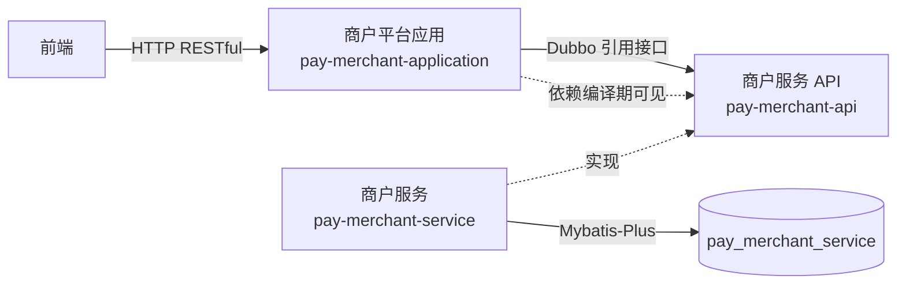

# 搭建商户平台应用与商户服务：从一个业务域拆出三个工程

商户管理是聚合支付平台要开发的第一个业务模块，动手写功能之前，先把承载它的工程骨架立起来：商户平台应用与商户服务。这两类工程怎么分工、各要哪些依赖、配置文件怎么配、Nacos 里要放什么、启动后怎么验证，这一课把一条完整的工程搭建路径走完。跟着做一遍，后面每个微服务的搭建都是同一套动作的重复。

## 先给结论

- 一个业务域拆成三个工程：`pay-merchant-application` 商户平台应用（为前端提供商户管理功能，暴露 RESTful 接口）、`pay-merchant-api` 商户服务 API（定义商户服务提供的接口）、`pay-merchant-service` 商户服务（实现商户服务的所有接口）。
- 依赖骨架分两档：应用与服务都要 Nacos 配置中心加注册中心、Dubbo 启动器；应用层额外要 Web 启动器写 Controller；服务层额外要 jdbc、Mybatis-Plus、Druid 连接池与 MySQL 驱动，直接面向数据库。
- 引入 `spring-boot-starter` 时排除自带的 `spring-boot-starter-logging`，统一改用 log4j2，两套日志实现共存会冲突。
- 配置遵循统一套路：工程里 `bootstrap.yml` 加 `log4j2.xml`，Nacos 里一份服务主配置（服务名.yaml，业务组 `PAY_GROUP`）加一份通用配置（`spring-boot-http.yaml`，通用组 `COMMON_GROUP`）；应用与服务两份 bootstrap 的差异只有端口、服务名与 Dubbo 端口。
- 启动验证以控制台端口日志与 Nacos 服务列表为准；服务工程第一次启动报「Failed to configure a DataSource」属预期现象，等数据源配置补齐后自然消失。

## 为什么是三个工程

前端请求先进网关，再落到商户平台应用，应用对外暴露的是 RESTful 接口；应用要做业务处理时，调用微服务层的商户服务，服务对外暴露的是 Dubbo 协议的接口。按照当初研究 Dubbo 服务架构时定下的开发模式：每个 Dubbo 服务都用「一个 API、一个接口实现」两个工程来开发，API 工程只放接口与传输对象，实现工程放真正的业务逻辑。于是商户这一域落成三个工程：

| 服务名 | 职责 |
| --- | --- |
| 商户平台应用（pay-merchant-application） | 为前端提供商户管理功能 |
| 商户服务 API（pay-merchant-api） | 定义商户服务提供的接口 |
| 商户服务（pay-merchant-service） | 实现商户服务的所有接口 |

三者在架构中的位置如下：



API 工程同时被应用与服务依赖：应用靠它拿到接口声明并以 Dubbo 代理发起远程调用，服务靠它实现接口。接口定义与实现分离，调用方与提供方只共享一个薄薄的接口包，这是这套架构能持续扩的前提。商户服务自己的启动逻辑要跑在服务工程里，所以在 `pay-merchant` 之下再拆 api 与 service 两个子模块，由 `pay-merchant` 做二者的聚合父模块。

拆分的收益要到多人协作时才真正显现。前端团队只关心商户平台应用暴露了哪些 RESTful 接口，接口一变即通知；后端团队在服务工程里演进业务，对外的承诺固化在 API 工程的接口签名里；两个团队交接的唯一媒介就是 API 包，谁也不必读对方的实现代码。若把 REST 接口、Dubbo 接口与实现揉在一个工程里，短期省事，代价是任何一方的改动都可能波及全部调用方。

## 搭建商户平台应用工程

打开导入好的基础工程，选中聚合父工程右键新建 Module，选择 Maven 与 JDK 1.8，填入 ArtifactId 为 `pay-merchant-application`，父工程选 `pay`，完成创建。工程建出来只是一个空壳，依赖逐项补齐：

```xml
<parent>
    <artifactId>pay</artifactId>
    <groupId>com.study.pay</groupId>
    <version>1.0-SNAPSHOT</version>
</parent>
<artifactId>pay-merchant-application</artifactId>

<dependencies>
    <!--Nacos 配置中心-->
    <dependency>
        <groupId>com.alibaba.cloud</groupId>
        <artifactId>spring-cloud-starter-alibaba-nacos-config</artifactId>
    </dependency>
    <!--Nacos 注册中心-->
    <dependency>
        <groupId>com.alibaba.cloud</groupId>
        <artifactId>spring-cloud-starter-alibaba-nacos-discovery</artifactId>
    </dependency>
    <!--Dubbo 启动器-->
    <dependency>
        <groupId>com.alibaba.cloud</groupId>
        <artifactId>spring-cloud-starter-dubbo</artifactId>
    </dependency>
    <!--Web 启动器：应用层要写 Spring MVC 的 Controller-->
    <dependency>
        <groupId>org.springframework.boot</groupId>
        <artifactId>spring-boot-starter-web</artifactId>
    </dependency>
    <!--基础启动器，排除自带 logging，改用 log4j2-->
    <dependency>
        <groupId>org.springframework.boot</groupId>
        <artifactId>spring-boot-starter</artifactId>
        <exclusions>
            <exclusion>
                <groupId>org.springframework.boot</groupId>
                <artifactId>spring-boot-starter-logging</artifactId>
            </exclusion>
        </exclusions>
    </dependency>
    <dependency>
        <groupId>org.springframework.boot</groupId>
        <artifactId>spring-boot-starter-log4j2</artifactId>
    </dependency>
    <!--配置注释处理器-->
    <dependency>
        <groupId>org.springframework.boot</groupId>
        <artifactId>spring-boot-configuration-processor</artifactId>
        <optional>true</optional>
    </dependency>
    <!--健康检查与运维端点-->
    <dependency>
        <groupId>org.springframework.boot</groupId>
        <artifactId>spring-boot-starter-actuator</artifactId>
    </dependency>
    <!--测试启动器-->
    <dependency>
        <groupId>org.springframework.boot</groupId>
        <artifactId>spring-boot-starter-test</artifactId>
        <scope>test</scope>
    </dependency>
</dependencies>
```

依赖项都在父工程 `dependencyManagement` 的管辖之内，所以这里看不到一个版本号。日志那条排除是刻意的：Spring Boot 自带 logback，项目统一用 log4j2（log4j 的升级版本，性能更好），不排除的话两套日志实现同时在 classpath 里，启动即冲突。

**第一件配置事是 bootstrap.yml。** 微服务工程的主配置文件叫 bootstrap 而不是 application，因为它加载得更早，负责在启动瞬间连上 Nacos 把远程配置拉回来。按讲义逐项写全：

```yaml
server:
  port: 57010 # 启动端口 命令行注入
  max-http-header-size: 100KB

nacos:
  server:
    addr: 127.0.0.1:8848

spring:
  application:
    name: merchant-application
  main:
    allow-bean-definition-overriding: true # Spring Boot 2.1 需要设定
  cloud:
    nacos:
      discovery:
        server-addr: ${nacos.server.addr}
        namespace: a1f8e863-3117-48c4-9dd3-e9ddc2af90a8 # 替换为你自己的 dev 命名空间 ID
        cluster-name: DEFAULT
      config:
        server-addr: ${nacos.server.addr} # 配置中心地址
        file-extension: yaml
        namespace: a1f8e863-3117-48c4-9dd3-e9ddc2af90a8 # 替换为你自己的 dev 命名空间 ID
        group: PAY_GROUP # 聚合支付业务组
        ext-config:
        -
          refresh: true
          data-id: spring-boot-http.yaml # spring boot http 配置
          group: COMMON_GROUP # 通用配置组
  #SpringMVC 上传文件配置
  servlet:
    multipart:
      enabled: true
      file-size-threshold: 0
      max-file-size: 1MB
      max-request-size: 30MB

dubbo:
  scan:
    base-packages: com.study.pay # dubbo 服务扫描基准包
  protocol:
    name: dubbo
    port: 20891
  registry:
    address: nacos://127.0.0.1:8848
  application:
    qos:
      port: 22310 # dubbo qos 端口 命令行注入
  consumer:
    check: false
    timeout: 3000
    retries: -1

logging:
  config: classpath:log4j2.xml
```

这份文件有几个设计点值得咀嚼。顶部自定义了 `nacos.server.addr`，后面服务发现与配置中心都用 `${nacos.server.addr}` 引用它，改地址只动一行。开发阶段统一使用 Nacos 的 `dev` 命名空间，`namespace` 的值必须替换成自己在 Nacos 里创建的 dev 命名空间 ID，讲义示例里的值是教师环境的，照抄会连到别人的命名空间去。`spring.application.name` 是服务名，它决定 Nacos 里主配置文件的文件名：服务名加 `file-extension` 自动拼装，即 `merchant-application.yaml`。`ext-config` 把通用配置 `spring-boot-http.yaml` 挂进来，它放在 `COMMON_GROUP` 组，因为多个项目工程都要用它；本服务自己的配置则属于业务组 `PAY_GROUP`。Dubbo 段声明了协议端口 20891，与后面服务工程的 20890 错开，`consumer.check: false` 让启动时不强制检查依赖的服务是否可用，`retries: -1` 关闭失败重试，避免查询之外的写操作被重复执行。

几处容易被当成噪音的配置其实各司其职。`allow-bean-definition-overriding: true` 是 Spring Boot 2.1 的行为开关：同名的 bean 定义默认禁止覆盖，微服务场景下配置中心与本地可能各自注册同名定义，打开它才不至于一启动就报冲突。`max-http-header-size` 把请求头上限设为 100KB，为后续认证令牌放进请求头留出余量。注释里反复出现的「命令行注入」提示了另一层用意：这些端口与地址都允许被启动参数覆盖，同一份配置既能本地调试也能部署到不同环境。`actuator` 依赖配的运维端点（refresh、health、info、env）会在通用配置里统一开放，服务健康与否在 Nacos 与运维侧都能看得到。

**第二件配置事在 Nacos 里。** 登录 Nacos 控制台，切到 dev 命名空间，先建通用配置：Data ID 为 `spring-boot-http.yaml`，Group 为 `COMMON_GROUP`，内容是各服务通用的 HTTP 行为：

```yaml
#HTTP 格式配置
spring:
  http:
    encoding:
      charset: UTF-8
      force: true
      enabled: true
    messages:
      encoding: UTF-8
#tomcat 头信息（用户 ip 和访问协议）及访问路径配置
server:
  tomcat:
    remote_ip_header: x-forwarded-for
    protocol_header: x-forwarded-proto
  servlet:
    context-path: /
  use-forward-headers: true
#服务监控与管理配置，运维相关
management:
  endpoints:
    web:
      exposure:
        include: refresh,health,info,env
```

这里的 `context-path` 配的是根路径，微服务可以在各自的主配置文件里覆盖它，比如商户平台应用会覆盖成 `/merchant`。再建服务主配置：Data ID 为 `merchant-application.yaml`，Group 为 `PAY_GROUP`，当前只需要覆盖访问路径一项：

```yaml
#覆盖 spring-boot-http.yaml 的访问路径
server:
  servlet:
    context-path: /merchant
```

主配置文件的优先级高于 ext-config 扩展配置，同一项配置两处都有时主配置说了算。为什么把它拆成两层？HTTP 编码、运维端点这类配置所有服务都一样，收进通用组一次维护；而访问路径、端口这类带个性的配置留在各服务的主配置里按需覆盖。当初 Nacos 配置管理一课讲过的优先级规则，在这里第一次派上实际用场。

**第三件事是日志文件。** 依赖里指定了 `logging.config: classpath:log4j2.xml`，在工程 `resources` 目录下把这个文件建出来。完整文件较长，核心骨架节选如下：

```xml
<Configuration monitorInterval="180" packages="">
    <properties>
        <property name="logdir">logs</property>
        <property name="PATTERN">[%date{YYYY-MM-dd HH:mm:ss,SSS}] %highlight{%level}[%thread] - %msg%n%throwable</property>
    </properties>
    <Appenders>
        <!--控制台输出-->
        <Console name="Console" target="SYSTEM_OUT">
            <PatternLayout pattern="${PATTERN}"/>
        </Console>
        <!--错误日志滚动文件，按小时归档-->
        <RollingFile name="ErrorAppender" fileName="${logdir}/error.log"
                     filePattern="${logdir}/$${date:yyyy-MM-dd}/error.%d{yyyy-MM-dd-HH}.log">
            <PatternLayout pattern="${PATTERN}"/>
            <ThresholdFilter level="ERROR" onMatch="ACCEPT" onMismatch="DENY"/>
            <Policies><TimeBasedTriggeringPolicy interval="1" modulate="true"/></Policies>
        </RollingFile>
        <!--异步 appender，把文件写入交给独立线程-->
        <Async name="AsyncAppender" includeLocation="true">
            <AppenderRef ref="ErrorAppender"/>
        </Async>
    </Appenders>
    <Loggers>
        <!--过滤掉 spring 和 mybatis 的一些无用的 debug 信息-->
        <logger name="org.springframework" level="INFO"/>
        <logger name="org.mybatis" level="INFO"/>
        <logger name="com.alibaba.nacos" level="WARN"/>
        <Root level="INFO" includeLocation="true">
            <AppenderRef ref="AsyncAppender"/>
            <AppenderRef ref="Console"/>
        </Root>
    </Loggers>
</Configuration>
```

平时需要改的基本只有日志级别：开发期可以调到 DEBUG 看细节，输出量大但排查方便；生产环境尽量调高到 INFO 或 ERROR。这份文件在应用与服务两个工程里内容完全一样，直接拷贝复用即可。配置里两处机制顺带说明：`monitorInterval="180"` 让 log4j2 每 180 秒检查一次配置文件是否变更，改级别不用重启服务；RollingFile 按「天加小时」的文件名模式滚动归档，错误与常规日志分开落盘，配合异步 Appender 把磁盘写入交给独立线程，业务线程不因刷日志而阻塞。Loggers 段里对 spring、mybatis、nacos 等框架包逐个压级，是为了滤掉框架调试期刷屏的无用信息，让控制台里真正有用的输出浮出来。

**第四件事是启动类。** 在 `com.study.pay.merchant` 包下建启动类，这个包是商户域所有代码的根，后面 Controller、config 都挂在这条包路径下：

```java
package com.study.pay.merchant;

import org.springframework.boot.SpringApplication;
import org.springframework.boot.autoconfigure.SpringBootApplication;
import org.springframework.cloud.client.discovery.EnableDiscoveryClient;

@SpringBootApplication
@EnableDiscoveryClient
public class MerchantApplicationBootstrap {
    public static void main(String[] args) {
        SpringApplication.run(MerchantApplicationBootstrap.class, args);
    }
}
```

运行 main，控制台滚过一串日志后停稳，出现端口 57010 启动完成的输出即算成功。此时打开 Nacos 控制台的服务列表，`merchant-application` 应该已经注册进 dev 命名空间，能看到它的实例端口与元数据。如果服务列表里始终没有它，优先排查 namespace 是否改成了自己的 dev 命名空间 ID，这是跟着讲义搭建最容易漏改的一处，改完重启即可。应用层将来写的是 Controller，调的是 Dubbo 服务接口，所以注册中心这一跳必须先通。

## 搭建商户服务工程

商户服务工程对外暴露 Dubbo 服务，供商户平台应用调用，它包括接口与接口实现两个子工程。搭建动作与前面如出一辙：先选中聚合父工程新建 Module `pay-merchant` 作为二者的聚合父模块，再选中 `pay-merchant` 分别新建 `pay-merchant-api` 与 `pay-merchant-service` 两个子模块。坐标从讲义里抄，不要自己发挥，坐标写错后面的依赖关系全乱。创建过程中如果 IDE 出现模块报错，把有问题的模块从 Module 列表移除，核对磁盘目录后重新添加即可，新手在这一步反复出问题多半是父模块没选对。

API 工程是纯粹的接口包，依赖极简，基本所有工程都会依赖的 `pay-common` 在这里挂上：

```xml
<parent>
    <artifactId>pay-merchant</artifactId>
    <groupId>com.study.pay</groupId>
    <version>1.0-SNAPSHOT</version>
</parent>
<artifactId>pay-merchant-api</artifactId>

<dependencies>
    <dependency>
        <groupId>com.study.pay</groupId>
        <artifactId>pay-common</artifactId>
        <version>1.0-SNAPSHOT</version>
    </dependency>
</dependencies>
```

service 工程是接口实现，依赖立刻厚了起来：注册进 Nacos、暴露 Dubbo 接口、连数据库一样都不能少。在 application 已有的那套依赖（Nacos 配置与注册、Dubbo、Web、starter 排除 logging、log4j2、configuration-processor、actuator、test）之外，追加持久层一套：

```xml
<!--持久层相关依赖（在服务工程 pom 的 dependencies 中追加）-->
<dependency>
    <groupId>org.springframework.boot</groupId>
    <artifactId>spring-boot-starter-jdbc</artifactId>
</dependency>
<dependency>
    <groupId>com.baomidou</groupId>
    <artifactId>mybatis-plus-boot-starter</artifactId>
</dependency>
<dependency>
    <groupId>com.baomidou</groupId>
    <artifactId>mybatis-plus-generator</artifactId>
</dependency>
<dependency>
    <groupId>com.alibaba</groupId>
    <artifactId>druid-spring-boot-starter</artifactId>
</dependency>
<dependency>
    <groupId>mysql</groupId>
    <artifactId>mysql-connector-java</artifactId>
</dependency>
<!--对象池与对象映射工具，后续章节使用-->
<dependency>
    <groupId>org.apache.commons</groupId>
    <artifactId>commons-pool2</artifactId>
</dependency>
<dependency>
    <groupId>org.mapstruct</groupId>
    <artifactId>mapstruct-jdk8</artifactId>
</dependency>
<dependency>
    <groupId>org.projectlombok</groupId>
    <artifactId>lombok</artifactId>
</dependency>
```

版本号依旧全部由父工程裁决。Mybatis-Plus 的 generator 依赖出现在这里，是为了后续在工程内跑代码生成做准备；mapstruct 与对象池暂用不到，先备着。

配置文件的搭法可以直接「依葫芦画瓢」：log4j2.xml 从应用工程原样拷贝，不用改一个字；bootstrap.yml 也整体拷贝，然后只改三处差异：端口改成 56040，`spring.application.name` 改成 `merchant-service`，Dubbo 协议端口改成 20890（qos 端口同步改成 22240，消费超时按服务调大）。两份 bootstrap 的其余内容逐行相同，这正说明微服务工程的配置骨架是同一套模具，差异只有身份信息。Nacos 里同样要建它自己的主配置 `merchant-service.yaml`（Group 为 `PAY_GROUP`），当前先覆盖访问路径：

```yaml
#覆盖 spring-boot-http.yaml 的项目
server:
  servlet:
    context-path: /merchant-service
```

启动类放到 `com.study.pay.merchant` 包下，与应用工程的启动类同名不同工程，结构一模一样：

```java
package com.study.pay.merchant;

import org.springframework.boot.SpringApplication;
import org.springframework.boot.autoconfigure.SpringBootApplication;

@SpringBootApplication
public class MerchantBootstrap {
    public static void main(String[] args) {
        SpringApplication.run(MerchantBootstrap.class, args);
    }
}
```

启动它会遇到本课第一个「像样的报错」：控制台抛出 `APPLICATION FAILED TO START`，描述是 `Failed to configure a DataSource: 'url' attribute is not specified and no embedded datasource could be configured`。原因很直白：工程引入了 jdbc 与 Mybatis-Plus 相关依赖，Spring Boot 的自动配置检测到数据源能力却拿不到连接参数。现在还没配数据库，这个报错完全在预期之内，等下一课把 Druid 连接池配置补上，它自然消失。除此之外还要确认 namespace 已换成 dev 命名空间 ID，调整后重新启动，控制台不再报错即代表配置加载成功，服务也注册进了 Nacos。

到这一步，商户域的三个工程、两份 Nacos 主配置、一份通用配置、两套启动类全部就位。把两个工程的落位清单对齐检查一遍，可以当作搭建完成的自查表：

| 落位项 | 商户平台应用 | 商户服务 |
| --- | --- | --- |
| 工程坐标 | pay-merchant-application | pay-merchant-api 与 pay-merchant-service |
| 本地配置 | bootstrap.yml、log4j2.xml | 同左，内容不变 |
| 端口 | HTTP 57010，Dubbo 20891 | HTTP 56040，Dubbo 20890 |
| 服务名 | merchant-application | merchant-service |
| Nacos 主配置 | merchant-application.yaml（PAY_GROUP） | merchant-service.yaml（PAY_GROUP） |
| ext-config | spring-boot-http.yaml（COMMON_GROUP） | 同左 |
| 启动类 | MerchantApplicationBootstrap | MerchantBootstrap |

工程骨架立起来之后，剩余的工作就是往里填代码：先由代码生成器把库表对应的实体与 Mapper 产出来，再配置数据源与 Mybatis-Plus，最后按「API 接口、服务实现、应用 Controller」的顺序写通第一个查询案例。

## 常见误区

- **namespace 照抄讲义示例值。** 错例：把教师环境示例里的命名空间 ID 原样粘进 bootstrap.yml，服务注册进了别人的命名空间，自己的服务列表始终为空。正解：在 Nacos 创建 dev 命名空间后，把它的 ID 替换进 discovery 与 config 两处 namespace 配置。
- **两个工程端口或服务名撞车。** 错例：服务工程的 bootstrap 只改了端口忘了改服务名，Nacos 里出现两个同名服务互相干扰。正解：拷贝配置后逐项核对端口（57010 与 56040）、服务名（merchant-application 与 merchant-service）、Dubbo 协议端口（20891 与 20890）三处差异。
- **不排除默认日志实现直接加 log4j2。** 错例：引入 `spring-boot-starter-log4j2` 但没在 `spring-boot-starter` 里排除 `spring-boot-starter-logging`，启动时日志初始化报错或行为异常。正解：两套日志实现只能留一个，排除是必须动作。
- **把服务工程的 DataSource 报错当成搭建失败。** 错例：看到 `Failed to configure a DataSource` 就回头推翻工程配置重来。正解：这是引入持久层依赖但尚未配置数据源的必然结果，按顺序先把 Nacos 配置补齐，报错自动消除。
- **通用配置与服务主配置的 Group 用混。** 错例：把 `spring-boot-http.yaml` 发布到业务组 `PAY_GROUP`，其他服务的 ext-config 按 `COMMON_GROUP` 去拉取却拉不到。正解：多服务共用的配置进通用组 `COMMON_GROUP`，单个服务自己的配置进业务组 `PAY_GROUP`，ext-config 里的 group 要与发布时的组一致。

## 面试可能被问到的问题

1. 面试官追问：「为什么一个业务域要拆成应用工程与服务工程两类？」
   答：职责不同。应用工程面向前端，暴露 RESTful 接口，做参数校验、组装与转发，不含业务数据访问；服务工程面向其他服务，暴露 Dubbo 接口，承载真正的业务逻辑与数据库访问。拆开后前端改动与业务演进互不影响，服务可被多个应用复用，伸缩也可以按流量特征分别做。
2. 面试官追问：「商户服务的 API 为什么要独立成一个工程？」
   答：API 工程只放接口声明与 DTO，是调用方与提供方之间的契约。应用工程依赖它获得接口定义，以 Dubbo 代理发起远程调用；服务工程依赖它实现接口。契约单独成包后版本可控，调用方不需要依赖服务实现的任何传递依赖，耦合被压到最小。
3. 面试官追问：「bootstrap.yml 和 application.yml 有什么区别？」
   答：加载时机与职责不同。bootstrap 由父上下文更早加载，用于连接配置中心拉取远程配置，所以 Nacos 地址、命名空间、ext-config 都写在 bootstrap 里；application 是应用自身配置。本项目把数据源等配置托管到 Nacos，本地只留 bootstrap 与日志配置。
4. 面试官追问：「Nacos 里服务主配置和 ext-config 通用配置的优先级关系是什么？」
   答：服务主配置（服务名加扩展名，业务组）优先级最高，ext-config 引入的扩展配置按声明顺序依次生效，被主配置覆盖。本项目用这套规则实现配置分层：HTTP 编码、运维端点等收进 COMMON_GROUP 的 spring-boot-http.yaml，各服务的访问路径在自己的主配置里覆盖。
5. 面试官追问：「服务工程第一次启动报 Failed to configure a DataSource，怎么排查？」
   答：Spring Boot 检测到数据源相关依赖后要求提供连接参数，报错说明 DataSource 的 url 未配置。排查顺序是确认是否已在配置中心发布数据源配置、bootstrap 的 ext-config 是否引入了对应配置文件、命名空间与分组是否正确。本项目属于刻意分步搭建，等 Druid 配置补齐后消除。
6. 面试官追问：「为什么统一用 log4j2 并排除 starter 自带的日志？」
   答：Spring Boot 默认引入 logback，log4j2 在异步日志性能上更优，项目按运维规范统一选型。两套日志 API 与实现共存会引发 LoggerFactory 冲突或日志重复输出，所以在 spring-boot-starter 里排除 spring-boot-starter-logging，再引入 spring-boot-starter-log4j2，全项目只留一套实现。

## 配套资料

- 讲义：`materials/docs/10/闪聚支付-第1章-讲义-开发环境搭建v1.0.md`，1.6 搭建项目服务（三个工程职责表、1.6.1 搭建商户平台应用工程、1.6.2 搭建商户服务工程，含依赖清单、bootstrap.yml、Nacos 配置与启动类）为本课出处。
- 代码：`materials/code/10/`，聚合支付工程中的商户平台应用与商户服务模块（内层目录名含项目原始命名，与正文模块名口径不一致，不在此展开），正文依赖清单、bootstrap.yml、log4j2.xml 与启动类均为该工程真实文件按 `com.study.pay` 口径改写后的节选。
- 说明：该阶段课程资料归档在 `materials/docs/10/` 与 `materials/code/10/`（不存在 09 编号目录，引用路径截至该层级）；命名空间 ID 以教师环境示例占位，实际替换为自建 dev 命名空间 ID；资料里的业务配置分组原名已按本系列口径改写为 `PAY_GROUP`。
