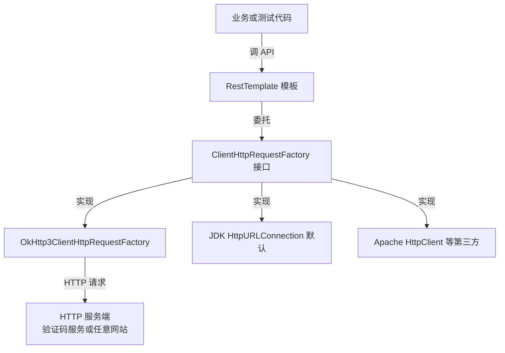
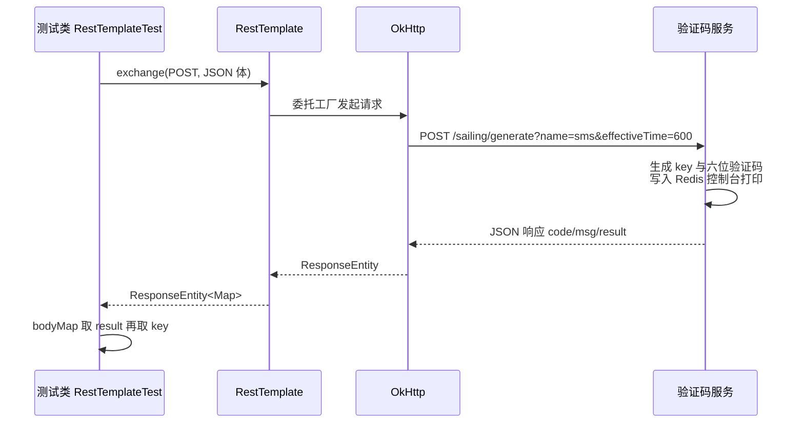

# RestTemplate 入门：先请求一个网页练手，再用 exchange 调通验证码服务

验证码服务的两个接口已经在页面上手动测通了，但注册功能里的验证码不能靠人去点页面：用户在注册页填手机号点「获取验证码」，真正去调验证码服务的应该是商户平台应用这段服务端代码。问题就卡在这里，浏览器和 Swagger 页面都是现成的 HTTP 客户端，Java 程序要靠什么扮演同样的角色？这一课给出答案：Spring 提供的 RestTemplate。先用它请求一个普通网页摸清用法，再把目标换成验证码服务的生成接口，用 POST 加 JSON 请求体拿到响应、解析出校验要用的 key。

## 先给结论

- RestTemplate 是 Spring 提供的访问 RESTful 服务的客户端模板类，名字里的 Template 点明它的模式：模板负责约定调用方式，真正执行 HTTP 连接的底层客户端可插拔，默认用 JDK 自带的 HttpURLConnection，也能换成 Apache HttpClient、Netty、OkHttp 等第三方实现。
- 本项目综合比较后选定 OkHttp 作为底层客户端，版本由父工程统一裁决为 3.9.1；RestTemplate 本身随 `spring-web` 提供，商户平台应用已有 web 依赖，只需补 okhttp 一个依赖。
- 接入三步：加依赖、在启动类用 `@Bean` 定义 RestTemplate 并传入 `OkHttp3ClientHttpRequestFactory`、使用处直接注入。
- GET 请求用 `getForEntity` 一行拿到响应；带 JSON 体的 POST 请求用 `exchange`，请求体与请求头装进 `HttpEntity`，`Content-Type` 指定 `application/json`。
- 响应转 String 出现中文乱码的根因是 `StringHttpMessageConverter` 默认字符集为 ISO-8859-1，在定义 Bean 时把转换器列表里下标 1 的实例替换为 UTF-8 版本即可根治。

## 浏览器能发 HTTP 请求，Java 程序凭什么不行

把角色先摆正。HTTP 是客户端与服务端之间的协议，浏览器打开一个网址，本质就是客户端向服务端发请求、渲染响应；Swagger 文档页点 Execute，同样是以客户端身份发请求。可见「客户端」从来不是浏览器的专利，任何能按 HTTP 协议拼装请求、解析响应的程序都算客户端。Java 程序当然也能做这件事：网络爬虫抓取网页，用的正是这类技术，模拟 HTTP 客户端向目标站点发起请求、抓回内容。

还有一个更本源的方案值得对照：JDK 标准库里的 `HttpURLConnection` 本身就能发请求，不引任何依赖也能写出可用的客户端代码。但它太底层了，连接的建立与释放、流的使用与关闭、字符编码、异常分支全要自己管，代码冗长且极易出错，业务里到处是这样粘贴出来的「连接样板」时，可维护性无从谈起。RestTemplate 把这些样板活全部模板化，这正是它存在的理由。

**微服务之间的调用要分清两种通道。** 商户平台应用调商户服务，走的是 Dubbo，那是 Spring 体系内部的 RPC 接口，方法签名即契约；而验证码服务是一个开源的独立服务，对外只暴露 HTTP 接口，没有也不需要接进 Dubbo 注册中心。服务暴露成什么样，调用方就用什么技术：Dubbo 接口用 `@Reference` 注入，HTTP 接口用 HTTP 客户端请求。把这条分界线刻在脑子里，以后见到服务间调用就不会选错工具。这一课要解决的就是后一种：用什么 HTTP 客户端、怎么用。

具体的落点就是 RestTemplate。它对 HTTP 调用做了模板化封装：连接管理、请求头处理、响应解析这些重复劳动框架替你做掉，调用方只面对「给 URL、选方法、拿结果」这样干净的 API。它真正的设计精髓在「模板之下」：RestTemplate 并不亲自实现网络连接，而是把这件事委托给一个 `ClientHttpRequestFactory` 接口的实现类。默认实现基于 JDK 自带的 HttpURLConnection，不需要任何额外依赖；觉得它不好用，可以整体换成第三方的客户端库。这层关系画出来是这样的：



选型时在几个实现里做了比较，OkHttp 的性能与连接管理表现更好，最终确定本项目用它。于是技术方案定型为：RestTemplate 当门面，OkHttp 干苦力。这套组合的好处是可替换性，将来想换底层实现，业务代码一行不用动，换掉 Bean 里的 Factory 即可。

## 依赖引入与 Bean 定义

RestTemplate 来自 Spring 的 web 模块，商户平台应用基于 Spring Boot 且已有 `spring-boot-starter-web`，这部分开箱即用；需要补的只有 OkHttp 的依赖。版本按 Maven 的规矩放在父工程的 `dependencyManagement` 里统一裁决：

```xml
<!-- 父工程 pom.xml：统一 okhttp 版本 -->
<dependency>
    <groupId>com.squareup.okhttp3</groupId>
    <artifactId>okhttp</artifactId>
    <version>3.9.1</version>
</dependency>
```

子工程（商户平台应用模块）的 pom 里引用同一坐标、不写版本号即可：

```xml
<dependency>
    <groupId>com.squareup.okhttp3</groupId>
    <artifactId>okhttp</artifactId>
</dependency>
```

接下来解决「从哪里拿到一个配置好的 RestTemplate」。它是一个需要放进 Spring 容器的 Bean，Spring Boot 时代定义 Bean 用注解即可，最顺手的位置是启动类。先写最简版本验证通路：

```java
@SpringBootApplication
public class MerchantApplicationBootstrap {
    public static void main(String[] args) {
        SpringApplication.run(MerchantApplicationBootstrap.class, args);
    }

    @Bean
    RestTemplate restTemplate() {
        return new RestTemplate(new OkHttp3ClientHttpRequestFactory());
    }
}
```

构造参数 `OkHttp3ClientHttpRequestFactory` 就是上节说的工厂实现，把它传进去，RestTemplate 就知道所有请求都经 OkHttp 发出。省略这个参数也能工作，走的是 JDK 默认实现，但既然定了 OkHttp 方案，这里就要显式指明。

## 第一个测试：请求一个网页

测 RestTemplate 的思路很直接：它是个 HTTP 客户端，那就让它向任何一个 HTTP 服务端发请求。验证码服务算一个，随便一个网站也算一个。在商户平台应用的 `src/test/java` 下建测试类，注意包路径要和启动类一致（本例是 `com.study.pay.merchant`），否则 `@SpringBootTest` 按包结构找配置类时会出问题：

```java
@Slf4j
@RunWith(SpringRunner.class)
@SpringBootTest
public class RestTemplateTest {

    @Autowired
    RestTemplate restTemplate;

    //测试使用 RestTemplate 作为 HTTP 客户端向 HTTP 服务端发起请求
    @Test
    public void gethtml() {
        String url = "http://www.example.com/";
        //向 url 发送 GET 请求，得到响应结果
        ResponseEntity<String> forEntity = restTemplate.getForEntity(url, String.class);
        String body = forEntity.getBody();
        System.out.println(body);
    }
}
```

`getForEntity(url, String.class)` 的两个参数是目标地址与期望的响应类型，返回的 `ResponseEntity<String>` 把一次响应的完整信息打包在一起：状态码、响应头、响应体，`getBody()` 取出响应体。课程演示时请求的是一个中文门户首页，控制台打印出了整页 HTML，说明 Java 程序确实以客户端身份完成了完整往返（示例 URL 按规范以 example.com 占位，现象与机制完全相同）。这等价于浏览器打开网页再右键查看源代码，只不过渲染 HTML 的换成了程序。

顺带认识一下测试本身的运行机制。执行测试方法时，`@SpringBootTest` 会先把整个 Spring Boot 容器拉起来：主配置扫描、Bean 装配一样不少，然后才执行 `@Test` 方法。这也是为什么测试类必须与启动类同包：容器按启动类所在包扫描装配，包路径偏了，测试环境就装配不起来。跑一个测试相当于启动了一次应用，耗时可接受，但要有这个心理预期。

运行结果里藏着一个必修的坑：HTML 结构完整，中文却全是乱码。服务端问题？换接口也一样乱。根因在 RestTemplate 的响应解析环节。它靠一组消息转换器（`HttpMessageConverter`）把 HTTP 响应流转成 Java 对象，默认注册了七个转换器，其中下标 1 的 `StringHttpMessageConverter` 负责转 String，而它的默认字符集是 ISO-8859-1，不含中文，中文自然全部变问号或乱码。确认方式很朴素：在定义 Bean 的方法里打断点，把转换器列表拿出来观察，为什么偏偏是下标 1 也就清楚了，因为本次测试把响应转成了 String，命中列表里负责 String 的那个转换器，而它恰好排在第 2 位。修复就在 Bean 定义处动手：

```java
@Bean
RestTemplate restTemplate() {
    RestTemplate restTemplate = new RestTemplate(new OkHttp3ClientHttpRequestFactory());
    //得到消息转换器列表
    List<HttpMessageConverter<?>> messageConverters = restTemplate.getMessageConverters();
    //把下标 1 的 StringHttpMessageConverter 替换为 UTF-8 字符集版本
    messageConverters.set(1, new StringHttpMessageConverter(StandardCharsets.UTF_8));
    return restTemplate;
}
```

再跑一次测试，中文正常显示。这个坑值得多想一层：乱码类问题的排查套路是先定位「字符在哪个环节被转错」，拿到的是字节流，转成字符用了哪个字符集，两端对不上就乱。这里错在客户端解析侧，所以在客户端配置侧修；若是服务端响应头声明错了字符集，修的地方就不同，套路不变。

## 用 exchange 请求验证码服务：POST 加 JSON 体的正确姿势

练手结束，回到正题：用 RestTemplate 调验证码服务的 `/generate` 接口发验证码。回顾上一课手动测试的请求形态：POST 方法、query 上带 `name=sms` 与 `effectiveTime`、请求体是 JSON 格式的手机号、`Content-Type: application/json`。这比刚才的 GET 复杂在两处：要带请求体，要控制请求头。`getForEntity` 没有地方放请求体，这时就要用全家桶里最通用的 `exchange`：

```java
//exchange 方法签名（节选）
ResponseEntity<Map> exchange = restTemplate.exchange(
        String url, HttpMethod method, HttpEntity<?> requestEntity, Class<Map> responseType, Object... uriVariables);
```

四个参数各就各位：URL、HTTP 方法、请求信息（体加头）、期望的响应类型。响应选 `Map` 是因为验证码服务回的是 JSON，JSON 的键值结构转 Map 正合适。完整的测试方法如下：

```java
//向验证码服务发送请求，获取验证码
//http://localhost:56085/sailing/generate?effectiveTime=600&name=sms
@Test
public void getSmsCode() {
    String url = "http://localhost:56085/sailing/generate?effectiveTime=600&name=sms";

    //请求体：JSON 格式的手机号
    Map<String, Object> body = new HashMap<>();
    body.put("mobile", "13xxxxxxxxx");
    //请求头：指定 Content-Type 为 application/json
    HttpHeaders httpHeaders = new HttpHeaders();
    httpHeaders.setContentType(MediaType.APPLICATION_JSON);
    //请求信息：体与头装进 HttpEntity
    HttpEntity httpEntity = new HttpEntity(body, httpHeaders);
    //发起 POST 请求
    ResponseEntity<Map> exchange = restTemplate.exchange(url, HttpMethod.POST, httpEntity, Map.class);

    log.info("请求验证码服务，得到响应:{}", JSON.toJSONString(exchange));
    Map bodyMap = exchange.getBody();
    System.out.println(bodyMap);
    Map result = (Map) bodyMap.get("result");
    String key = (String) result.get("key");
    System.out.println(key);
}
```

这段代码的每一步都值得咀嚼。请求体与请求头两件套在客户端这边有着明确的类型分工。`HttpHeaders` 是请求头的载体，它本质上是一个多头部的 Map 结构，提供了 `setContentType` 这类语义化方法；`setContentType(MediaType.APPLICATION_JSON)` 做的事等价于手动写请求头 `Content-Type: application/json`，服务端的 `@RequestBody` 靠这个头判断怎么解析请求体，漏了它就会收到 415 一类的解析错误。请求体没有限定死类型，JSON 对象用 Map 装即可，键 `mobile`、值手机号，与接口文档的 `payload` 说明一一对应。`HttpEntity` 把两者打包成一个整体交给 exchange，它有多个构造重载：只传体、只传头、体加头都可以，本例用体加头的版本，与接口要求严丝合缝。

URL 从哪里来？Swagger 文档页执行请求时展示的请求地址直接可复制，query 上的 `name=sms` 与 `effectiveTime=600` 也从接口文档的参数说明来，参数含义上一课已经逐个吃透，这里只是把它们搬进代码。整条链路跑起来是这样的：



执行测试，日志打印出完整响应，结构与在 Swagger 页面测试时看到的完全一致：`code` 为 0、`msg` 为「正常」、`result` 里有 `key` 与 `content`。打日志时用 `JSON.toJSONString(exchange)` 把 ResponseEntity 整体序列化输出，状态码、响应头、响应体一次看全，比零散地打印各字段高效得多。解析分两步走：先从响应 Map 里取 `result`（它本身又是一个 Map，强转即可），再从 `result` 里取 `key` 拿到那串以 `sms:` 开头的凭证。key 为什么必须解析出来，上一课已经交过底：注册时校验验证码，靠的就是 key 加用户输入的验证码这对组合。与此同时，验证码服务的控制台打印出「给手机号 13xxxxxxxxx 发送验证码：xxxxxx」，Redis 里也多了一条带过期时间的验证码键值，说明这次 Java 程序发起的调用与手动测试效果完全等价。

到这里，「模拟客户端」这件事已经完成了从概念到代码的闭环：同样的接口，人点页面能调，Java 程序也能调，而且程序拿到响应后还能立刻解析出业务要用的数据。这项能力马上就要转正，下一课把这段测试代码改造成正式的接口实现，让它长在商户平台应用的业务逻辑里。

## API 家族怎么选：getForObject、getForEntity、exchange

RestTemplate 针对常见场景都给了快捷方法，同一件事往往有三种写法，选型的依据是信息的完整度与请求的复杂度。`getForObject(url, String.class)` 最省事，直接返回响应体，拿不到状态码与响应头，适合「我只关心内容」的场景；`getForEntity` 返回 `ResponseEntity`，状态码、头、体俱全，需要判断响应状态时用它；`exchange` 是全功能方法，HTTP 方法任意、请求头请求体任意、响应类型任意，POST 加 JSON 体这种组合非它莫属。一个可操作的判断标准：GET 且不带复杂头，前两个方法哪个顺手用哪个；涉及 POST、PUT、DELETE 或要精确控制请求头，直接上 `exchange`，一步到位，将来加认证头也有地方放。

拿状态码做判断是个高频动作，值得单独说一句。服务是否健康、接口是否存在、限流有没有触发，都会先体现在状态码上：`forEntity.getStatusCode()` 配合 `is2xxSuccessful()` 一类的方法即可分支处理，拿到 `getStatusCode().value()` 还能做精确匹配。这套判断在 RestTemplate 里是同步阻塞执行的，请求发出去、响应回来、代码才往下走，没有回调也没有异步编排，与本项目微服务间简单直接的调用场景正相配。

## 常见误区

- **没定义 Bean 就到处注入。** 错例：测试类里 `@Autowired RestTemplate` 直接标红或运行时报 `NoSuchBeanDefinitionException`。正解：RestTemplate 不会自动装配，必须在配置类或启动类用 `@Bean` 定义后才能注入。
- **把中文乱码当成服务端的锅。** 错例：怀疑数据库编码、怀疑接口返回错乱，来回改服务端配置。正解：RestTemplate 转 String 走 `StringHttpMessageConverter`，默认 ISO-8859-1，客户端解析侧的问题要在客户端侧修，替换转换器为 UTF-8 即可。
- **POST 请求硬用 getForEntity。** 错例：想当然地找 `postForEntity` 塞请求体，或试图在 GET 方法里拼 JSON。正解：带请求体的请求用 `exchange`，体与头装进 `HttpEntity`。
- **漏设 `Content-Type: application/json`。** 错例：只放了请求体没设头，服务端 `@RequestBody` 解析失败返回 415。正解：`httpHeaders.setContentType(MediaType.APPLICATION_JSON)`，发什么格式的体就声明什么类型。
- **测试类建在任意包下。** 错例：测试类随手放在根包之外，`@SpringBootTest` 找不到启动类与配置，Bean 注入全部失败。正解：测试类包路径与主工程启动类保持一致。
- **URL 与参数硬编码进业务代码。** 错例：测试代码里的地址、有效期原样搬进 Service，环境一换就要改代码重新编译。正解：测试阶段硬编码无妨，进入正式实现前抽到配置中心，这是下一课接口实现要处理的事。

## 面试可能被问到的问题

1. 面试官追问：「RestTemplate 和 OkHttp 是什么关系？」
   答：RestTemplate 是 Spring 提供的同步 HTTP 客户端模板，负责统一的调用 API 与消息转换；OkHttp 是第三方 HTTP 客户端库，负责真正的连接与传输。RestTemplate 通过 `ClientHttpRequestFactory` 接口解耦底层实现，传入 `OkHttp3ClientHttpRequestFactory` 即让 OkHttp 承担实际请求，换成 JDK 默认或 Apache HttpClient 也不影响上层代码。
2. 面试官追问：「getForObject、getForEntity、exchange 三者怎么选？」
   答：getForObject 只返回响应体，最简洁；getForEntity 返回 ResponseEntity，包含状态码与响应头，需要判断状态时用；exchange 是全功能方法，支持任意 HTTP 方法、自定义请求头与请求体、任意响应类型。简单 GET 用前两者，POST 带 JSON 体或需精确控制请求的场景用 exchange。
3. 面试官追问：「用 RestTemplate 请求返回的网页中文乱码，你怎么排查？」
   答：先定位字符集失配发生在哪一侧。响应本身是字节流，转成字符串时代码用了哪个字符集是关键：RestTemplate 默认的 StringHttpMessageConverter 用 ISO-8859-1，不含中文，必然乱码。处理方式是在定义 RestTemplate 时取消息转换器列表，把下标 1 的转换器替换为指定 UTF-8 的新实例。若服务端响应头字符集声明错误，则要在服务端修正，排查思路相同。
4. 面试官追问：「exchange 发一个 POST 加 JSON 请求体需要哪几步？」
   答：三步。构造请求体 Map 并放入业务数据；构造 HttpHeaders 并 `setContentType(MediaType.APPLICATION_JSON)`；把体和头装进 HttpEntity 交给 exchange，指定 HttpMethod.POST 与响应类型如 Map.class，从返回的 ResponseEntity 中 getBody 拿到响应 Map 再逐层解析业务字段。
5. 面试官追问：「RestTemplate 是线程安全的吗？项目里怎么管理它的实例？」
   答：RestTemplate 自身无请求状态、线程安全，适合作为单例在容器中共享，本项目正是在启动类用一个 @Bean 定义、各处注入同一实例。需要个性化时（超时时间、拦截器、底层客户端）都在 Bean 定义处配置，不必每次请求新建。
6. 面试官追问：「为什么选 OkHttp 做底层客户端？」
   答：综合比较了 JDK 自带连接与几个第三方实现后选的 OkHttp：连接池复用与性能表现好，API 现代且轻量，对 HTTP/2 等特性支持完善，社区活跃。关键是它通过工厂接口接入，属于可替换的实现细节，选型失误的迁移成本也低。

## 配套资料

- 讲义：`materials/docs/10/闪聚支付-第2章-讲义-商户注册&资质申请v1.0.md`，2.3 获取短信验证码之 2.3.1 RestTemplate 技术预研（RestTemplate 介绍、OkHttp 依赖、消息转换器中文乱码解决方案）为本课出处。
- 代码：`materials/code/10/shanjupay/`，聚合支付工程，涉及父 pom 的 okhttp 版本裁决、商户平台应用模块的 `MerchantApplicationBootstrap`（RestTemplate Bean 定义）与测试类 `RestTemplateTest`（gethtml、getSmsCode 两个测试方法）；该目录下另有按开发阶段归档的完整工程副本，内层目录名含项目原始命名，与正文包名口径不一致，不在此展开，按用途自取。
- 说明：正文代码为真实文件按 `com.study.pay` 口径改写后的节选；网页请求示例 URL 按规范以 example.com 占位（课程演示为一个中文门户首页，乱码现象相同）；手机号以 `13xxxxxxxxx` 占位，验证码以 `xxxxxx` 占位。
