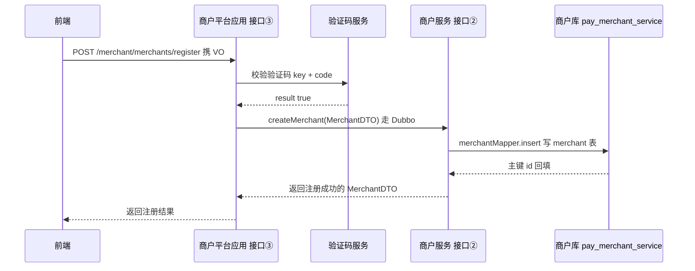
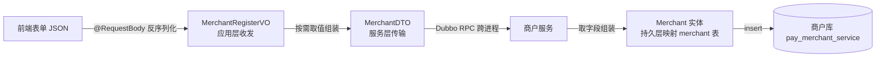

# 商户服务注册商户接口：DTO 接参、Dubbo 实现与商户平台应用接口定义

> 🔒 安全提示：文中示例的口令/密钥均为课程教学环境演示口径，生产环境的安全要求见《安全与合规须知》。

验证码能发了，注册接口该动手了。可一打开 IDE 就会撞上一个顺序问题：注册链路横跨商户平台应用与商户服务两个工程，先写哪头？按「从 Controller 写到 Service 再写到 Dao」的老习惯顺着写，写到一半会发现下游接口根本不存在，代码悬在半空。这一课把注册链路的编码顺序、商户服务注册接口的定义与实现、商户平台应用对外接口的定义一次讲完，核心是让每一步都踩在已经就绪的地基上。

## 先给结论

- 编码顺序由依赖关系决定：商户平台应用的注册接口（接口③）要远程调用商户服务的注册接口（接口②），先实现接口②，接口③才能一气呵成；多人协作时则各自先立接口契约，谁都不必等谁。
- 协议分工看调用方：接口③面向前端，暴露 HTTP；接口②面向服务端内部，暴露 Dubbo。商户平台应用拿 `@Reference` 注入接口②的代理，调用即 RPC。
- 服务层统一用 DTO 接收数据：`createMerchant(MerchantDTO)` 的入参是全量商户信息 DTO，当前虽只落手机号与审核状态，接口却按可扩展性设计，注册、资质申请共用这一个类。
- 实现只需三步：new Merchant 实体、set 手机号与审核状态 0、`merchantMapper.insert` 落库；insert 后 Mybatis Plus 把雪花 id 回填进实体，再把 id 写回 DTO 返回。
- 商户平台应用一侧按前端表单定义 VO（手机号、用户名、密码、验证码 key、验证码五项），`POST /merchants/register` 以 `@RequestBody` 接 JSON，VO 不照搬 DTO。

## 先写接口二还是接口三：依赖决定顺序

把交互流程图重新摊开，注册链路的接力棒次序很清楚：前端携验证码、账号、密码请求商户平台应用（接口③）；接口③先调验证码服务校验验证码；校验通过后，接口③远程调用商户服务的注册接口（接口②）；接口②把商户信息写进商户表，返回注册结果。两条腿各有各的协议：



图上第二跳依赖第三跳：接口③要调接口②，接口②不存在时接口③只能写一半。答案因此明确，先写接口②。这个习惯在微服务开发里比在单体里重要得多，因为接口②与接口③往往不是同一个人写的，服务端先把 Dubbo 接口立起来，应用层的同事拿着接口定义就能并行开发，没人需要等别人「写到底层」。反过来说，如果今天你只负责接口③，也应该先把方法签名与文档定义出来，让依赖你的前端先行，实现可以后补，契约必须先走。

顺带把两个协议的差异钉牢。接口③是 HTTP：前端是浏览器，HTTP 是它与生俱来的语言，接口定义完还能在 Swagger 文档页即写即测。接口②是 Dubbo：调用方是另一个 Java 工程，RPC 直连内网、序列化传参，性能好但前端碰不着。判断一个接口该暴露什么协议，看一眼调用方是谁就有答案，这个判断在拆分应用层与服务层时就该做完，写代码时只是执行它。

## 用 MerchantDTO 接住注册数据

接口②的入参定成什么类型，是定义前要想清的问题。注册提交的数据在系统设计时已盘点过：账号、密码、手机号要提交，当前阶段落库的只有手机号，将来对接 SaaS 时账号密码要用，资质申请时企业名称、证照照片等十来个字段也要用。如果按「当前只收手机号」定义一个单字段参数，后续每次扩展都得改方法签名，所有调用方跟着改。服务层的做法是统一用 DTO（Data Transfer Object，数据传输对象）传数据，把商户信息的全量字段一次定义到位：

```java
package com.study.pay.merchant.api.dto;

@ApiModel(value = "MerchantDTO", description = "商户信息")
@Data
public class MerchantDTO implements Serializable {

    private static final long serialVersionUID = 1L;

    @ApiModelProperty(value = "主键")
    private Long id;

    @ApiModelProperty(value = "商户名称")
    private String merchantName;

    @ApiModelProperty(value = "企业编号")
    private Long merchantNo;

    @ApiModelProperty(value = "企业地址")
    private String merchantAddress;

    @ApiModelProperty(value = "商户类型")
    private String merchantType;

    @ApiModelProperty(value = "营业执照（企业证明）")
    private String businessLicensesImg;

    @ApiModelProperty(value = "法人身份证正面照片")
    private String idCardFrontImg;

    @ApiModelProperty(value = "法人身份证反面照片")
    private String idCardAfterImg;

    @ApiModelProperty(value = "联系人姓名")
    private String username;

    @ApiModelProperty(value = "联系人手机号（关联统一账号）")
    private String mobile;

    @ApiModelProperty(value = "用户密码")
    private String password;

    @ApiModelProperty(value = "联系人地址")
    private String contactsAddress;

    @ApiModelProperty(value = "审核状态 0-未申请,1-已申请待审核,2-审核通过,3-审核拒绝")
    private String auditStatus;

    @ApiModelProperty(value = "租户ID，关联统一用户")
    private Long tenantId;
}
```

DTO 放在 `pay-merchant-api` 工程的 `dto` 包里，这个工程是接口②的「身份证」，Dubbo 的提供方与调用方都依赖它。类声明里有两个不起眼但必需的细节：实现 `Serializable` 并给出 `serialVersionUID`。Dubbo 调用要把对象在网络上序列化传输，实现 Serializable 是前提；显式声明版本号则是给类定一个「指纹」，两端类结构不一致时能立刻暴露，而不是拿到一堆不可预料的数据。`@ApiModelProperty` 注解在 DTO 里同样不白给，虽然 Swagger 文档主要服务于 HTTP 接口，但字段含义注释跟着类走，任何一方打开这个类，每个字段的业务含义就在眼前。

十几个字段带着注解手敲一遍费时且容易抄错列名，环境搭建阶段用过的代码生成器正好补位。生成器工程里的 `MyBatisPlusGenerator` 原本只生成 Entity、Mapper 那一套持久层代码，加一个开关就能让它顺手生成 DTO：

```java
public class MyBatisPlusGenerator {

    //是否生成 DTO：true 时按 dto 规则输出
    private static final Boolean IS_DTO = true;

    public static void main(String[] args) {
        //...数据源指向 pay_merchant_service 库，包名 com.study.pay，运行时输入模块名 merchant
        if (IS_DTO) {
            globalConfig.setSwagger2(true);       //生成的类自动携带 Swagger 注解
            globalConfig.setEntityName("%sDTO");  //类名后缀由 Entity 换成 DTO
            packageConfig.setEntity("dto");       //输出到 dto 包
        }
        autoGenerator.execute();
    }
}
```

开关打开后运行 main，生成器按表结构把每个字段翻译成带 `@ApiModelProperty` 的属性，把产出的 DTO 整体拷进 `pay-merchant-api` 的 `dto` 包即可。字段名与表列一一对应，个别字段想调整（比如注释措辞）局部改就行。这份 DTO 同时是注册与资质申请的公共类，一处定义两处复用，这正是用 DTO 而不是散装参数的第二次回报。

## 接口定义：createMerchant 长什么样

数据类型就位，接口签名水到渠成。在 `pay-merchant-api` 的 `MerchantService` 接口里追加注册方法：

```java
public interface MerchantService {

    //根据 id 查询商户
    public MerchantDTO queryMerchantById(Long id);

    /**
     * 注册商户服务接口，接收账号、密码、手机号，为了可扩展性使用 MerchantDTO 接收数据
     * @param merchantDTO 商户注册信息
     * @return 注册成功的商户信息
     */
    MerchantDTO createMerchant(MerchantDTO merchantDTO);
}
```

三个设计点都写在签名里。入参是 MerchantDTO，把「接收账号密码手机号、但留足扩展空间」的决策固化下来；返回值也是 MerchantDTO，注册成功后把落库完成的商户信息（包括新生成的 id）带给调用方，与查询接口 `queryMerchantById` 的返回口径一致，调用方拿到即可直接使用，不必再查一遍。签名里没有验证码参数，这是刻意为之：验证码校验发生在商户平台应用一侧，等请求到达商户服务时，验证码这一关已经过了，商户服务只管拿着商户信息落库。边界划在这里，服务接口才不会被「我先校验点什么」这类应用层职责污染。

## 接口实现：三行核心代码与一次主键回填

实现类在 `pay-merchant-service` 的 `service` 包里，类上已有的 `@org.apache.dubbo.config.annotation.Service` 把它注册为 Dubbo 服务，注意这是 Dubbo 的 `@Service`，不是 Spring 的 Bean 注册注解，两者的区别在导入时就要分清。往类里补 `MerchantMapper` 注入与实现方法：

```java
@org.apache.dubbo.config.annotation.Service
@Slf4j
public class MerchantServiceImpl implements MerchantService {

    @Autowired
    MerchantMapper merchantMapper;

    @Override
    @Transactional
    public MerchantDTO createMerchant(MerchantDTO merchantDTO) {
        Merchant merchant = new Merchant();
        //设置审核状态 0-未申请,1-已申请待审核,2-审核通过,3-审核拒绝
        merchant.setAuditStatus("0");
        //设置手机号，注册阶段商户表只落这一个业务字段
        merchant.setMobile(merchantDTO.getMobile());
        //...写入其它属性
        //保存商户
        merchantMapper.insert(merchant);
        //将新增商户的 id 回写到 merchantDTO
        merchantDTO.setId(merchant.getId());
        return merchantDTO;
    }
}
```

方法体短得出乎意料，但每一行都有讲究。new 出来的 Merchant 实体只 set 两个字段：审核状态写 0，对应表设计里「注册即未申请」的字典约定；手机号从 DTO 取来，是本次注册唯一落库的业务数据。`merchantMapper.insert` 由 Mybatis Plus 的 BaseMapper 提供，单表插入不需要写 SQL。真正值得盯住的是 insert 之后的那一行：主键 id 在插入前是 null，实体上 `@TableId(type = IdType.ID_WORKER)` 声明了雪花算法，框架在生成 SQL 时先把 id 算出来填进实体，插入完成后实体带着 id 回来，把它写回 DTO 再返回，调用方拿到的就是「注册成功且知道自己是几号」的商户信息。返回值设计也在这里有了着落：如果声明成 void，调用方注册完还得再发一次查询才知道新商户是谁；返回 MerchantDTO 让一次调用同时完成注册与确认，RPC 往返少一次。

`@Transactional` 标在方法上，当前只有一条 insert 看不出威力，等后续对接 SaaS 要在一个方法里连写多张表时，它就是回滚的保险丝，先挂上后受益。扩展路径也顺带看清了：将来注册要同步写员工信息，就在这个方法里继续从 DTO 取值、往对应实体 set、调对应 mapper，接口签名一动不动。当初坚持 DTO 接参的回报，此刻兑现。

## 商户平台应用接口定义：VO 接前端表单

接口②就绪，转战商户平台应用定义接口③。入参类型在这里换了角色：DTO 字段太多，远超注册表单的五项，前后端分离开发给前端的接口应该「前端提交什么就收什么」，不多不少。为它单独定义一个 VO（View Object，视图对象，专用于视图层接收与响应数据）：

```java
package com.study.pay.merchant.vo;

@ApiModel(value = "MerchantRegisterVO", description = "商户注册信息")
@Data
public class MerchantRegisterVO implements Serializable {

    @ApiModelProperty("商户手机号")
    private String mobile;

    @ApiModelProperty("商户用户名")
    private String username;

    @ApiModelProperty("商户密码")
    private String password;

    @ApiModelProperty("验证码的key")
    private String verifyKey;

    @ApiModelProperty("验证码")
    private String verifyCode;
}
```

五个字段与注册表单一一对应，验证码 key 也在其中，因为校验验证码要凭「key 加验证码」这对组合，前端获取验证码时拿到的 key 正是为这一刻准备的。VO 是按接口定义的对象，一个接口一个形状，不为复用而生；字段名以表单元素的语义命名，前端对接时不需要理解商户表的列结构。敏感信息在这里就要有防备意识：密码只能收进请求体经 HTTPS 传输，手机号在进入业务逻辑前应做格式校验，应用层是这些规则的天然关卡，后端服务不该替前端收拾漏网的脏数据。

VO 的字段与 DTO 有部分重名（mobile、username、password），却各自服务于自己的层，转换发生在 Controller 方法体里：从 VO 逐个取值组装 DTO，再把 DTO 交给 Dubbo 代理。手工 set 在字段少时清晰直观，字段一多便显笨重，对象映射工具能按约定自动完成这层转换，属于后续课程的内容，先把转换的必要性与位置弄清。有了 VO，Controller 里落接口定义：

```java
@ApiOperation("商户注册")
@ApiImplicitParam(value = "商户注册信息", name = "merchantRegisterVO", required = true,
        dataType = "MerchantRegisterVO", paramType = "body")
@PostMapping("/merchants/register")
public MerchantRegisterVO registerMerchant(@RequestBody MerchantRegisterVO merchantRegisterVO) {
    //校验验证码
    //...
    //注册商户
    //...
    return merchantRegisterVO;
}
```

定义里的每项注解都对应一个对外承诺。`@PostMapping("/merchants/register")` 指定 POST 方法与路径，配合应用的 context-path `/merchant`，完整地址是 `http://localhost:57010/merchant/merchants/register`；`@RequestBody` 把请求体里的 JSON 反序列化成 VO，`@ApiImplicitParam` 的 `paramType = "body"` 把这一点写进文档，前端打开 Swagger 就知道数据该放在请求体里。用 POST 而非 GET 也有实际考量：注册要带密码，放进 URL 的查询串会留在历史记录与访问日志里，放进请求体安全一个量级，字段多时 JSON 也比拼接 URL 舒服。前端提交时请求体的形状就是把 VO 的字段名逐个译成 JSON：

```json
{
    "mobile": "13xxxxxxxxx",
    "username": "studytest01",
    "password": "123456",
    "verifyKey": "sms:xxxxxxxxxxxxxxxxxxxxxxxxxxxxxxxx",
    "verifyCode": "123456"
}
```

方法体此刻留空返回 VO 本身，把工程重启后打开 Swagger 文档页，「商户平台应用接口」分组下立刻能看到「商户注册」，参数模型把五个字段列得清清楚楚；在文档页随手填一组数据（手机号按占位格式填 `13xxxxxxxxx`）执行，请求能进来、参数能反序列化，接口契约即告验收。实现虽然还是空的，但前端从今天起就可以照着文档开发了，这就是先定契约后补实现的工作方式。

VO、DTO、Entity 三种对象在注册链路里各守一段，合起来是数据穿越分层的完整路线：



图里的每一次换形都是一次显式决定：应用层只暴露表单需要的字段，服务层携带业务全量信息，持久层只认表列。分层对象看似繁琐，换来的是任何一层的字段调整都不会外溢到其他层。

## 常见误区

- **按「Controller 到 Dao」的顺序顺手写接口③。** 错例：先在商户平台应用里把注册方法写完，调商户服务的代码因接口不存在而卡住，半成品搁置。正解：先实现被依赖的接口②（或至少先定契约），接口③随后一气呵成；多人并行时各自先立接口定义。
- **在应用层直接拿 DTO 接前端请求。** 错例：注册接口的入参声明为 MerchantDTO，文档里冒出十几个与注册无关的字段，前端无所适从。正解：应用层按前端表单定义 VO，字段刚好覆盖提交项；VO 到 DTO 的转换发生在 Controller 之内。
- **接口②入参里带上验证码。** 错例：为了「校验方便」给 createMerchant 加 verifyKey、verifyCode 参数。正解：验证码校验是商户平台应用的职责，商户服务的入参只含商户信息，服务接口的边界由调用链上游把关。
- **忽略 insert 后的主键回填，另查一遍库拿 id。** 错例：insert 完再按手机号 select 出来取 id。正解：`@TableId(type = IdType.ID_WORKER)` 让框架在插入时把雪花 id 写回实体，直接 `merchant.getId()` 回填 DTO 即可。
- **把 Dubbo 的 @Service 与 Spring 的 @Service 混用。** 错例：导入注解时随手选了 `org.springframework.stereotype.Service`，服务不起、引用报错。正解：实现类上标注 `@org.apache.dubbo.config.annotation.Service` 对外暴露 RPC 服务；本工程的本地 Bean 另有 Spring 注解负责，两者职责不同。

## 面试可能被问到的问题

1. 面试官追问：「注册链路里商户平台应用和商户服务分别暴露什么协议的接口，为什么这样分？」
   答：商户平台应用面向前端暴露 HTTP 接口，方便浏览器直接调用、配合 Swagger 出文档；商户服务面向内部暴露 Dubbo 接口，走 RPC 提高性能且只被可信的服务端调用。对内对外协议分离，前端碰不到数据库层，服务也能被多个应用复用。
2. 面试官追问：「为什么服务层接口用 DTO 接收参数，而不是直接用实体类？」
   答：DTO 是服务层的数据契约，字段按业务需要定义，与表结构解耦。实体类跟着表走，把表结构直接暴露给调用方会让数据库改动外溢到接口层；DTO 还能携带实体没有的组装字段，注册与资质申请共用一个 MerchantDTO，扩展时只加字段不改签名。
3. 面试官追问：「VO、DTO、Entity 三层对象会不会太啰嗦？什么时候可以省？」
   答：它们分别服务视图层、服务层、持久层，职责边界清楚。跨进程、跨层的调用建议保留，字段差异大时尤其必要，比如注册表单五个字段对 DTO 十四个字段；内部纯透传的小接口可以简化，但要防止某一层的字段变化顺着引用链扩散出去。
4. 面试官追问：「Mybatis Plus 的 insert 之后为什么能直接拿到 id？」
   答：实体主键上声明了 `@TableId(type = IdType.ID_WORKER)`，框架采用雪花算法在执行插入前生成分布式唯一 id，并回填到实体对象里。所以 insert 完成后实体的 id 属性已经有值，不需要再回库查询，也不依赖数据库自增。
5. 面试官追问：「createMerchant 现在只写两个字段，为什么签名却接收全量 DTO？」
   答：为扩展性留口。注册当前只落手机号与审核状态，但注册链路很快要写入账号密码、对接租户体系，资质申请也会复用商户信息的传输结构。接口签名一旦发布就被多个调用方依赖，收窄字段再放开是破坏性变更，一次到位收全量 DTO、按需落库是更稳的选择。
6. 面试官追问：「验证码的 key 为什么出现在注册请求里，它有什么作用？」
   答：验证码服务发送验证码时返回一个 key，校验时凭 key 加验证码成对提交才能比对。前端把发送阶段拿到的 key 与用户输入的验证码一起随注册请求提交，商户平台应用拿这对组合去验证码服务核验，确认注册者真的持有这部手机，通过后才调用商户服务注册。

## 配套资料

- 讲义：`materials/docs/10/闪聚支付-第2章-讲义-商户注册&资质申请v1.0.md`，2.4.2 商户服务注册商户之接口②（接口描述、MerchantDTO 定义、代码生成工具生成 DTO、MerchantService 接口定义、MerchantServiceImpl 接口实现）与 2.4.3 商户平台应用注册商户之接口③（接口描述、MerchantRegisterVO 定义、MerchantController 接口定义）为本课三段内容的出处。
- 代码：`materials/code/10/shanjupay/`，聚合支付工程，涉及 `pay-merchant-api`（MerchantService、dto/MerchantDTO）、`pay-merchant-service`（service/MerchantServiceImpl、entity/Merchant、mapper/MerchantMapper）、商户平台应用（controller/MerchantController、vo/MerchantRegisterVO）以及代码生成器工程 `materials/code/10/generator/`（MyBatisPlusGenerator）；该目录下另有按开发阶段归档的工程副本，内层目录名含项目原始命名，与正文包名口径不一致，不在此展开，按用途自取。
- 说明：正文代码为真实文件按 `com.study.pay` 包名口径改写后的节选；原工程源码中 VO 字段与校验方法名拼作 `verifiykey`、`checkVerifiyCode`（笔误），正文统一按常规拼写写作 `verifyKey`、`checkVerifyCode`，不影响结构；示例注册数据中手机号以 `13xxxxxxxxx` 占位。
