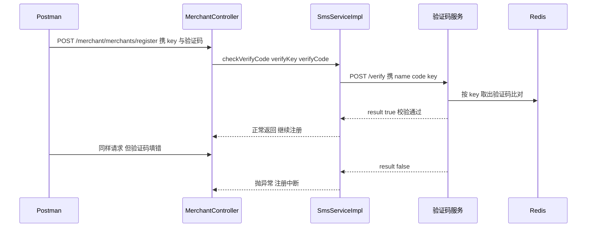

# 商户平台应用注册商户接口：先校验验证码，再远程注册商户

> 🔒 安全提示：文中示例的口令/密钥均为课程教学环境演示口径，生产环境的安全要求见《安全与合规须知》。

接口③的定义已经立在 Controller 里，方法体却还是空的，Swagger 页面上能发请求，数据进来之后什么都不做。把它补成完整业务要两步：先拿前端提交的 key 与验证码去验证码服务核验，通过后再远程调用商户服务的 createMerchant 落库。两步都不能省，也不能颠倒，验证码没过就注册等于让任何人凭一个手机号占库。这一课把校验方法的设计与实现、Controller 的编排、以及从 Postman 一路联调到数据库落库的全过程走完，途中还会遇到两个典型的联调故障，正好练一次微服务排错。

## 先给结论

- 校验方法设计成「无返回值，失败即抛异常」：`checkVerifyCode(verifyKey, verifyCode)` 正常返回就是通过，抛异常就是失败，调用方无需判断结果。
- 校验请求与发送请求结构不同：`/verify` 的参数全在 URL 上（`name`、`verificationCode`、`verificationKey`），没有请求体也没有特殊请求头，RestTemplate 用 `HttpEntity.EMPTY` 发 POST 即可。
- 结果判定看 `result` 布尔值：响应 Map 的 `result` 为 true 才算通过，为 null 或 false 一律抛异常，`!(Boolean) bodyMap.get("result")` 把三种失败收进一个判断。
- Controller 的编排顺序是安全边界：第一行校验验证码，异常短路后面的代码；通过后才组装 DTO 调 Dubbo 接口注册。
- 联调故障分两类对诊：校验失败多半是 key 过期或验证码不配对，重新获取即可；报「没有可用的服务提供者」是商户服务没启动或未注册进 Nacos，起服务、查服务列表、稍等订阅生效。

## 校验方法的设计：无返回值，异常即失败

SmsService 里已经有一个发送验证码的 `sendMsg`，校验验证码作为第二个方法加进同一个接口。方法签名先于实现，它要回答两个问题：参数是什么，结果怎么表达。参数在需求分析阶段就定过型，校验凭「key 加验证码」这对组合，缺一不可；结果的表达方式则选了异常约定：校验不通过就抛异常，通过则方法正常执行完毕，于是返回值类型是 void：

```java
/**
 * 校验手机验证码，抛出异常则校验无效
 * @param verifyKey 验证码的 key
 * @param verifyCode 验证码
 */
void checkVerifyCode(String verifyKey, String verifyCode);
```

这个约定把「成功」从一条数据变成了「方法执行到 return 没有被打断」这一事实，调用方的代码因此长得非常干净：第一行调校验，校验不过异常直接把请求打断，第二行起的注册逻辑天然只在通过后执行，不需要写 `if (校验通过) { ... } else { ... }` 的分支。把失败表达成异常还有一个隐性收益：失败原因集中在校验方法内部维护（key 失效、验证码不对、服务不可达），调用方不必逐个理解，业务代码里看不到一坨错误码判断。异常体系现阶段先用 RuntimeException 兜底，工程后续引入统一异常处理与业务异常分类后再细分，套路不变，只是异常的类型更专业。

## 校验实现：拼 URL、空请求体、布尔判定

实现照着 sendMsg 的骨架改，先看完整代码再逐段拆：

```java
@Value("${sms.url}")
String url;

@Autowired
RestTemplate restTemplate;

@Override
public void checkVerifyCode(String verifyKey, String verifyCode) {
    //校验验证码的 url，参数与地址来自验证码服务的接口文档
    String verify_url = "http://localhost:56085/sailing/verify?name=sms&verificationCode="
            + verifyCode + "&verificationKey=" + verifyKey;

    Map bodyMap = null;
    try {
        //参数全在 URL 上，无请求体、无特殊请求头，传空 HttpEntity
        ResponseEntity<Map> exchange = restTemplate.exchange(verify_url, HttpMethod.POST,
                HttpEntity.EMPTY, Map.class);
        log.info("请求验证码服务，得到响应:{}", JSON.toJSONString(exchange));
        bodyMap = exchange.getBody();
    } catch (RestClientException e) {
        e.printStackTrace();
        throw new RuntimeException("校验验证码失败");
    }
    if (bodyMap == null || bodyMap.get("result") == null || !(Boolean) bodyMap.get("result")) {
        throw new RuntimeException("校验验证码失败");
    }
}
```

与 sendMsg 并排读，三处同、一处异。相同的是骨架：RestTemplate 的 `exchange` 发请求、`JSON.toJSONString` 打日志留痕、try/catch 拦网络异常、解析前判空，这一套在发送验证码时已经立过规矩，照搬即可。不同的是请求结构与结果判定。请求结构上，`/generate` 要 JSON 请求体装手机号、要 `Content-Type: application/json` 请求头，而 `/verify` 的三个参数全部以查询串形式挂在 URL 上，验证码服务的接口文档里写得明明白白，所以请求体与请求头统统不需要，`HttpEntity.EMPTY` 这个现成的空实体正好表达「我什么也不带」。结果判定上，`/generate` 的 `result` 是装着 key 的对象，`/verify` 的 `result` 直接就是布尔值，true 通过、false 失败。判定条件把三种失败合并成一句：响应体为空、result 缺失、result 非 true，任何一种都抛「校验验证码失败」。`!(Boolean)` 的写法值得多看一眼，强转后取反，false 与 null 之外的情况全被挡在门外，比连写三个 or 条件紧凑。

URL 里写死了验证码服务的地址，与 sendMsg 用配置注入的做法不一致，这是课程推进过程中的临时写法，规范做法是复用 `sms.url` 配置拼上 `/verify`，与工程后续版本一致，误区一节还会再提。三个查询参数各有含义：`name=sms` 是验证码服务的业务名称约定，与发送接口一致，校验时它决定去 Redis 里比对哪一组键值；`verificationCode` 是用户在表单里输入的验证码；`verificationKey` 是发送阶段拿到的 key，也就是这次校验的凭证。三个参数都是字母数字，拼进 URL 不涉及转义问题，若参数可能含特殊字符就得先做 URL 编码，这是拼请求串时的一般常识。

## Controller 编排：先校验后注册

校验方法就位，回到 Controller 把方法体从空壳补成完整业务。已有的两路注入此刻同时上场：`@Autowired` 的本地 `SmsService` 管校验，`@Reference` 的远程 `MerchantService` 管注册：

```java
@ApiOperation("商户注册")
@ApiImplicitParam(value = "商户注册信息", name = "merchantRegisterVO", required = true,
        dataType = "MerchantRegisterVO", paramType = "body")
@PostMapping("/merchants/register")
public MerchantRegisterVO registerMerchant(@RequestBody MerchantRegisterVO merchantRegisterVO) {
    //1 校验验证码，不通过直接抛异常，后续代码不执行
    smsService.checkVerifyCode(merchantRegisterVO.getVerifyKey(), merchantRegisterVO.getVerifyCode());

    //2 组装 DTO，向商户服务提交注册信息
    MerchantDTO merchantDTO = new MerchantDTO();
    merchantDTO.setMobile(merchantRegisterVO.getMobile());
    merchantDTO.setUsername(merchantRegisterVO.getUsername());
    merchantDTO.setPassword(merchantRegisterVO.getPassword());
    //...写入其它属性

    //3 调用 Dubbo 服务接口完成注册
    merchantService.createMerchant(merchantDTO);

    //4 返回注册结果
    return merchantRegisterVO;
}
```

方法体四步，步与步之间有一条硬约束：校验必须排在组装与注册之前，这不是代码风格而是安全边界。验证码校验失败抛出的异常会沿调用栈一路抛给 Web 层，后续三行根本没机会执行，注册动作被挡在门外；把顺序反过来或放进 try 里吞掉异常，等于给绕过验证码的注册开门。VO 到 DTO 的组装用最直白的手工 set：手机号、用户名、密码三项从 VO 取出写进 DTO，当前阶段商户服务只落手机号，用户名与密码先随 DTO 传过去，等对接 SaaS 时立刻派上用场，这正是接口②收全量 DTO 的好处。手工组装在字段多时略显啰嗦，对象映射工具可以按约定自动完成转换，后续课程专门展开。调用 `merchantService.createMerchant(merchantDTO)` 时，看上去是普通方法调用，实际已经穿过 Dubbo 代理、注册中心寻址、网络序列化，抵达商户服务并把数据落进商户表。返回值直接把 VO 原样交回前端，注册成功与否的判断前端可以凭响应是否报错得知。

## 校验链路测试：成功与失败两条路径都要走

实现写完，Postman 接手。测试注册接口之前先造数据：请求 `GET http://localhost:57010/merchant/sms?phone=13xxxxxxxxx` 拿到本次验证码的 key，验证码本身在验证码服务控制台有打印，专业一点的做法是直接打开 Redis 客户端按 key 查值，演示环境里两种方式都行，开发阶段手机号是占位数据，并不会真的发出短信。然后在既有的「商户注册」请求里填入 JSON 请求体，key 与验证码必须是同一次发送产生的一对：

```json
{
    "mobile": "13xxxxxxxxx",
    "username": "studytest01",
    "password": "123456",
    "verifyKey": "sms:xxxxxxxxxxxxxxxxxxxxxxxxxxxxxxxx",
    "verifyCode": "123456"
}
```

发出请求后在 `checkVerifyCode` 处下断点，能直观看到整条链路的每一步。成功路径与失败路径都要验证，只测成功等于没测：



上半段是成功路径：断点里能看到请求带着正确的 key 与验证码抵达，验证码服务比对后返回 true，方法顺利返回，Controller 继续向下执行。下半段把验证码故意改错再发一次，同样的代码走到判定处，`result` 变成 false，抛出异常，注册流程在第一行就被截停。两条路径都符合预期，校验方法才算验收通过。断点跟踪还有个附带价值：`log.info` 打出的完整响应 JSON 里能直接看到 `result` 的取值，日后再遇到「校验莫名其妙失败」，先看响应原文再怀疑代码。

## 联调排错：两类故障与一次落库验证

校验通过后请求继续向下，真正的联调才开始，而故障也随之而来。演示中先后遇到两个典型问题，处理思路值得记下。

第一类是校验失败。前一轮测试用过的 key 拿来再发，响应是校验失败，这不是代码错了，key 与验证码是一次性凭证，验证码服务的有效期一过或已被消费，重放必然失败。处理方式很简单：重新获取验证码、重新拿新 key 组请求。测试脚本化之后要记得每轮注册前先刷凭证，老 key 反复用会浪费大量排错时间。

第二类故障的报错信息直说「没有可用的服务提供者」。请求卡住不返回，重启商户平台应用也没用，这已经不是验证码环节的问题，而是 Dubbo 调用找不到商户服务。排错顺着依赖链走：调用方要找的是 `merchant-service`，去 Nacos 控制台的服务列表里看它在不在。演示时列表里只有 `merchant-application`，商户服务压根没启动，把它起起来，服务列表里出现 `merchant-service` 的注册记录。注意即使列表里已经能看到服务，调用也可能短暂报同样的错，因为消费方从注册中心拉取与订阅服务实例有一点延迟，等几秒再发请求即可。判断一个 Dubbo 调用为什么失败，Nacos 服务列表就是第一现场，这条经验适用于本项目所有微服务联调。

故障排除后重发注册请求，响应正常返回。验证最后一步去数据库：打开商户库的 merchant 表，新记录已经在那里，MOBILE 是提交的手机号，AUDIT_STATUS 是 0，其余字段全部为空。空字段不是 bug，系统设计时就约定这些字段留给资质申请补填；AUDIT_STATUS 为 0 说明「注册成功但未申请资质」的状态机正确启动。至此注册链路全部打通：前端到应用的 HTTP、应用到服务的 RPC、服务到数据库的落库，三段在同一个请求里完成。回望整条链路的排错顺序，先是拿响应原文与日志对证据，再下断点逐步缩小范围，最后才动用服务注册中心这类基础设施视角，这套顺序在下一个接口的联调里还会原样复用。

## 常见误区

- **校验方法设计成返回布尔值。** 错例：`boolean checkVerifyCode(...)`，调用方写 `if (!checkVerifyCode(...)) throw ...`，每个调用点都要重复失败处理。正解：按「失败即异常」约定声明 void，失败细节收进校验方法，调用方顺序执行即可，Controller 的注册逻辑不被错误分支污染。
- **给校验请求也装请求体和请求头。** 错例：照搬 sendMsg 的写法 new 一个装参数的 Map 和 `application/json` 请求头，而 `/verify` 的参数在 URL 上，多出来的 body 被对端忽略还容易误导后人。正解：按对端接口文档对齐请求结构，无 body 用 `HttpEntity.EMPTY`。
- **结果判定只判 true 之外的都算失败时漏判 null。** 错例：`if (bodyMap.get("result") == false)`，验证码服务异常返回空结构时直接空指针。正解：响应体、result 字段、布尔取值三层一起判，`!(Boolean)` 取反写法把失败情形收敛成一个条件。
- **校验地址硬编码在实现里。** 错例：把 `http://localhost:56085/sailing/verify?...` 整串写死，换环境就要改代码。正解：复用 Nacos 里的 `sms.url` 配置拼 `/verify`，与 sendMsg 的做法保持一致，讲义的最终稿也是这么改的。
- **校验失败或注册失败时重放旧 key 反复试。** 错例：一个 key 用到底，失败后不重新获取验证码，把时间耗在排查假问题上。正解：key 与验证码是一次性凭证，每次注册前重新走发送流程拿新凭证。
- **Dubbo 报「没有可用的服务提供者」只盯调用方代码。** 错例：反复检查 @Reference 注解与包名，忽略了对端服务状态。正解：先看 Nacos 服务列表里 provider 在不在，确认服务已启动且注册成功，再排查订阅延迟，调用方配置往往是最后一环。

## 面试可能被问到的问题

1. 面试官追问：「校验验证码的方法为什么设计成无返回值、失败抛异常？」
   答：这是把失败处理收敛到方法内部的约定。调用方不需要 if/else 判断结果，正常执行就是通过，异常就是失败，Controller 里校验永远是第一行，抛异常自然短路后续注册逻辑。相比返回布尔值，这个设计避免了每个调用点重复写失败分支，失败原因也在校验方法内部统一维护。
2. 面试官追问：「校验验证码的请求和发送验证码的请求在结构上有什么区别？」
   答：发送接口 `/generate` 的手机号在 JSON 请求体里，需要设置 Content-Type 为 application/json 的请求头；校验接口 `/verify` 的三个参数 name、verificationCode、verificationKey 全部以查询串挂在 URL 上，没有请求体和特殊请求头，RestTemplate 用 HttpEntity.EMPTY 发 POST 即可。对齐对端接口文档来定请求结构，而不是想当然复用上一个请求的模板。
3. 面试官追问：「如果前端跳过验证码直接调注册接口，你的设计能拦住吗？」
   答：能拦。校验发生在服务端 Controller 的第一行，验证码的 key 与值由服务端拿去验证码服务核验，前端传什么都要过这一关；校验不通过抛异常，注册代码不会执行。要注意的是校验与注册必须在同一次请求里顺序完成，不能把校验放在前端 JS 里做，那是可以绕过的。
4. 面试官追问：「调用 Dubbo 服务时报没有可用的服务提供者，你怎么排查？」
   答：按依赖链排查。先确认 provider 进程活着且已完成注册，去 Nacos 控制台看服务列表里有没有目标服务名与健康实例；再确认消费方与 provider 的服务名、分组、命名空间一致；刚启动时可能有订阅同步延迟，稍等重试；都正常仍失败再看网络与 Dubbo 端口。多数情况是 provider 没启动或注册失败。
5. 面试官追问：「注册接口为什么不把账号密码直接透传给前端展示，而是返回 VO？」
   答：响应对象按接口契约定义，返回 VO 是把注册请求原样确认，前端需要的是结果而非落库细节。密码属于敏感信息，任何响应都不该扩大它的暴露面；同时 VO 与 DTO、实体隔离，服务端内部字段调整不会影响前端契约。工程后续还可以在统一返回结构里包一层状态码，让成功与失败的表达更规范。
6. 面试官追问：「注册成功后数据库里大部分字段是空的，这合理吗？」
   答：合理，是设计使然。注册阶段只确立商户身份，写入手机号并把审核状态置 0 表示未申请资质；企业名称、营业执照、法人证照等字段属于资质申请环节补填的数据。商户表按写入时机分字段管理，注册、资质申请各自只碰自己那段，审核状态从 0 到 1 再到 2 或 3 的流转串起商户生命周期。

## 配套资料

- 讲义：`materials/docs/10/闪聚支付-第2章-讲义-商户注册&资质申请v1.0.md`，2.4.3 商户平台应用注册商户之接口③（2.4.3.2 校验验证码实现、2.4.3.3 注册商户实现、2.4.3.4 接口测试）为本课两段内容的出处。
- 代码：`materials/code/10/shanjupay/`，聚合支付工程，涉及商户平台应用的 `service/SmsService` 与 `service/SmsServiceImpl`（checkVerifiyCode 实现原文件）、`controller/MerchantController`（registerMerchant）、`vo/MerchantRegisterVO`，以及 `pay-merchant-service` 的 `MerchantServiceImpl`（createMerchant）；该目录下另有按开发阶段归档的工程副本，内层目录名含项目原始命名，与正文包名口径不一致，不在此展开，按用途自取。
- 讲义：`materials/docs/10/验证码服务使用指南.md`，校验接口 `/verify` 的参数说明是本课拼 URL 的对端依据。
- 说明：正文代码为真实文件按 `com.study.pay` 包名口径改写后的节选；原工程源码中字段与方法名拼作 `verifiykey`、`checkVerifiyCode`（笔误），正文统一写作 `verifyKey`、`checkVerifyCode`；示例请求中手机号以 `13xxxxxxxxx` 占位，验证码 key 以 `sms:xxxx` 占位，课程演示中验证码为每次随机的六位数字；Redis 密码按课程环境约定 123456。
