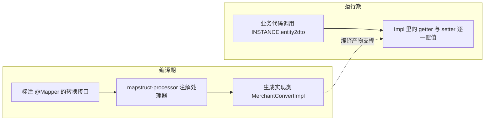
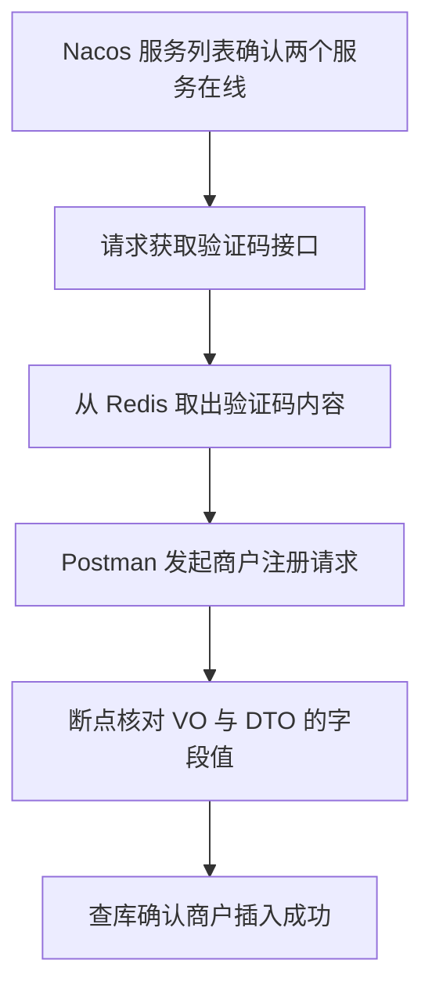

# MapStruct 实战：从转换接口写法到注册链路的手工 set 全量下线

上一课确认了 VO、DTO、entity 必须分层接力，转换代码省不掉，但它的写法可以升级。现状是 Controller 与 Service 里成片的 get、set：VO 转 DTO 十个字段写十行，DTO 转 entity 又是十行，字段一多既难看又容易漏。MapStruct 专门解决这个问题：它按「属性同名就自动映射」的规律，把转换代码在编译期生成出来，业务代码里只剩一行调用。这一课从引入依赖、定义转换接口、跑通单对象与 List 的测试做起，再把服务层与应用层的转换代码全部替换掉，最后完整回归一遍商户注册链路。

## 先给结论

- MapStruct 是一个代码生成器：`@Mapper` 接口在编译期生成实现类，运行期执行的就是普通 getter、setter，没有反射开销。
- 转换方法只认入参与返回值：入参是原对象，返回值是目标对象，方法名随意；属性名相同即自动赋值。
- 哪个工程做转换，哪个工程加依赖：`mapstruct-jdk8` 提供 API，`mapstruct-processor` 负责编译期生成，版本由父工程统一为 1.3.0.Final。
- 单对象与 List 都能转：在接口里再定义一个 `entityList2dtoList(List<Merchant>)` 形式的方法即可批量转换。
- 服务层与应用层各自建转换器：`MerchantConvert` 负责 DTO 与 entity，`MerchantRegisterConvert` 负责 VO 与 DTO；替换后必须回归注册全流程。

## 手工转换有多繁琐，MapStruct 怎么看这个问题

先看服务层 `createMerchant` 的现状，DTO 转 entity 全靠手写：

```java
public MerchantDTO createMerchant(MerchantDTO merchantDTO) {
    Merchant entity = new Merchant();
    entity.setAuditStatus("0");
    entity.setUserName(merchantDTO.getUsername());
    entity.setMobile(merchantDTO.getMobile());
    //...其余属性继续 set
    merchantMapper.insert(entity);
    merchantDTO.setId(entity.getId());
    return merchantDTO;
}
```

Controller 里把 VO 转 DTO 是同样的一幕，`new MerchantDTO()` 之后逐字段 set。假设 VO 有 10 个属性，这 10 行代码一行都少不了，写的人累，读的人更累，漏掉一行就是一个悄悄丢数据的缺陷。

观察这些转换会发现一个规律：VO 里的属性名和 DTO 里的属性名是相同的，DTO 与 entity 之间也是。规律意味着可以交给工具批量处理，这就是 MapStruct 的切入角度。它的官方定位是 Java bean 映射的代码生成器，基于属性同名的约定自动完成对象之间的映射转换，开发时只写接口定义，生成代码这件事交给编译器。

编译期生成、运行期直调，是这个工具与那些反射式拷贝工具的本质区别：



开发时写的只是接口，编译后 class 目录里多出一个实现类，真正干活的 getter、setter 是机器按映射规则生成的，一遍生成、处处调用。业务代码感知不到它的存在，也承担不了任何额外运行成本。

## 引入依赖：哪个工程用，哪个工程加

MapStruct 是工具，哪里用就往哪里装。服务工程里要把 DTO 转成 entity，应用工程里要把 VO 转成 DTO，两边都要引依赖。版本不写死在各个模块，统一放在父工程的 `dependencyManagement` 里管理：

```xml
<!-- 父工程 pom：统一 MapStruct 版本 -->
<properties>
    <org.mapstruct.version>1.3.0.Final</org.mapstruct.version>
</properties>

<dependencyManagement>
    <dependencies>
        <dependency>
            <groupId>org.mapstruct</groupId>
            <artifactId>mapstruct-jdk8</artifactId>
            <version>${org.mapstruct.version}</version>
        </dependency>
    </dependencies>
</dependencyManagement>
```

具体模块里再声明用到的东西，商户服务工程与商户平台应用工程的依赖完全相同：

```xml
<!-- 做对象转换的工程各自引入 -->
<dependency>
    <groupId>org.mapstruct</groupId>
    <artifactId>mapstruct-jdk8</artifactId>
</dependency>
<dependency>
    <groupId>org.mapstruct</groupId>
    <artifactId>mapstruct-processor</artifactId>
    <version>${org.mapstruct.version}</version>
</dependency>
```

两个 artifact 各司其职：`mapstruct-jdk8` 是运行期用到的 API，注解与 `Mappers` 工厂都在里面；`mapstruct-processor` 是注解处理器，只在编译期工作，负责生成实现类。只引前者不引后者，接口永远没有实现，调用处直接报错，这是新手最常见的踩坑点，依赖必须成对出现。依赖装没装对，编译一次就能验证：转换接口所在的模块执行编译后，编译产物目录里能看到生成的实现类，看不到就回头检查 processor 依赖。

## 定义转换类：一个接口说清映射规则

在商户服务工程新建 `convert` 包，转换类就住在这里。转换类是一个接口，写它之前先解决两个问题：实例从哪来，方法怎么定义。

实例问题靠工厂方法解决。接口无法直接 new，MapStruct 提供了 `Mappers.getMapper`，传入转换接口的 class，它返回一个基于该接口构造出来的实例。把这个实例存在接口自己的静态常量里，用起来就是 `MerchantConvert.INSTANCE`，一处定义，处处引用。静态常量随接口加载只初始化一次，全工程共用同一个转换器实例，转换又是无状态操作，这样写既省了反复创建的开销，也让调用方不需要关心实例管理，拿到 INSTANCE 就能用。

方法定义问题有一条极简规则：把谁转换成谁，谁就是入参，转换的目标就是返回值。DTO 转 entity，入参是 DTO、返回值是 entity；entity 转 DTO，入参换成 entity、返回值换成 DTO。方法名本身不参与任何映射逻辑，叫 `abc` 也能正常工作，MapStruct 完全根据输入参数类型决定「转换谁」，根据返回值类型决定「转成什么」。但名字要让人看得懂，`dto2entity`、`entity2dto` 读起来就是调用说明书，方法名随意、语义要讲究。

完整定义如下：

```java
//定义 dto 和 entity 之间的转换规则
@Mapper //对象属性的映射
public interface MerchantConvert {

    //转换类实例
    MerchantConvert INSTANCE = Mappers.getMapper(MerchantConvert.class);

    //把 dto 转换成 entity
    Merchant dto2entity(MerchantDTO merchantDTO);

    //把 entity 转换成 dto
    MerchantDTO entity2dto(Merchant merchant);

    //包含 entity 的 List 转成包含 dto 的 List
    List<MerchantDTO> entityList2dtoList(List<Merchant> merchants);
}
```

接口上的 @Mapper 是 MapStruct 的注解，含义就是「对象属性的映射」，编译器看到它才会去生成实现。第三个方法展示了批量能力：入参换成包含 entity 的 List，返回值换成包含 DTO 的 List，生成的实现会自动遍历集合并逐元素调用单对象转换，查询数据库得到实体列表再转 DTO 返回这个高频场景就一行搞定。顺带一提，测试代码直接写进接口也是合法的，Java 8 之后接口允许定义静态方法，main 方法就这样借住了。

应用层的转换器如法炮制，只是两端对象换成了 VO 与 DTO。在商户平台应用工程同样新建 convert 包，定义商户注册的转换接口：

```java
//商户注册 vo 和 dto 的转换
@Mapper
public interface MerchantRegisterConvert {

    MerchantRegisterConvert INSTANCE = Mappers.getMapper(MerchantRegisterConvert.class);

    //将 vo 转成 dto
    MerchantDTO vo2dto(MerchantRegisterVO merchantRegisterVO);

    //将 dto 转成 vo
    MerchantRegisterVO dto2vo(MerchantDTO merchantDTO);
}
```

两把转换器分开建而不是共用一个，原因与数据传输对象分层一致：服务工程里只有 DTO 与 entity，应用工程里才有 VO，两边依赖的对象类型本来就不同，转换规则也互不相干。哪个工程做哪段转换，转换器就建在哪个工程，和依赖一个道理。

## main 方法测试：单对象与 List 各转一遍

接口写完就能测，直接在 main 方法里验证两个方向。先造一个 entity 对象填上数据，调 `entity2dto`，再给 DTO 补上商户名称，调 `dto2entity` 转回来：

```java
public static void main(String[] args) {
    //构造一个 entity，填入数据
    Merchant merchant = new Merchant();
    merchant.setUsername("测试");
    merchant.setMobile("123456");

    //entity 转 dto
    MerchantDTO merchantDTO = MerchantConvert.INSTANCE.entity2dto(merchant);
    System.out.println(merchantDTO);

    //dto 转 entity
    merchantDTO.setMerchantName("商户名称");
    Merchant merchant1 = MerchantConvert.INSTANCE.dto2entity(merchantDTO);
    System.out.println(merchant1);

    //List 之间也可以转换
    List<Merchant> merchantList = new ArrayList<>();
    merchantList.add(merchant);
    List<MerchantDTO> dtoList = MerchantConvert.INSTANCE.entityList2dtoList(merchantList);
    System.out.println(dtoList);
}
```

跑之前在调用处打断点，跟着数据走一遍最直观。转换前 entity 的 `username` 是「测试」，单步执行 `entity2dto` 这一行，DTO 对象被自动创建出来，数据自动 set 成功，原本要写的一串 new 加 set 被一行替代；反向转换时，DTO 里的商户名称也带到了新 entity 上。没有转换工具的话，这两个方向各自都要手动 new 一个目标对象、再从源对象逐个 get 加 set，写的正是上一课 Controller 里那几行。List 那段更有意思：定义的集合里放的是 entity，调用 `entityList2dtoList` 之后打印出来，集合里的元素类型已经全部变成 DTO，一行代码完成了一整批对象的搬家。三个断点核对下来，「把对象之间转换的繁琐代码替代掉」这个目标算是眼见为实了。

生成的实现类长什么样，也值得看一眼。在编译产物目录里找到 `MerchantConvertImpl`，逻辑大致是：

```java
//MapStruct 编译期生成的实现类（示意，按本课写法补全）
public class MerchantConvertImpl implements MerchantConvert {

    @Override
    public Merchant dto2entity(MerchantDTO merchantDTO) {
        if (merchantDTO == null) {
            return null;
        }
        Merchant merchant = new Merchant();
        merchant.setUsername(merchantDTO.getUsername());
        merchant.setMobile(merchantDTO.getMobile());
        merchant.setPassword(merchantDTO.getPassword());
        //同名属性逐一赋值
        return merchant;
    }
}
```

没有反射，没有运行期解析注解，就是一份按映射规则展开的普通代码，性能与手写完全一致。看懂这段产物，也就看懂了 @Mapper 接口里每一条定义会在编译期变成什么。

## 优化服务层：createMerchant 的两处替换

测试通过，回头改业务代码。服务层 `createMerchant` 里手工 set 的那一整段屏蔽，换上 `MerchantConvert`：

```java
@Override
public MerchantDTO createMerchant(MerchantDTO merchantDTO) throws BusinessException {
    //将 dto 转成 entity
    Merchant entity = MerchantConvert.INSTANCE.dto2entity(merchantDTO);
    //设置审核状态 0-未申请, 1-已申请待审核, 2-审核通过, 3-审核拒绝
    entity.setAuditStatus("0");
    //保存商户信息
    merchantMapper.insert(entity);
    //将 entity 转成 dto 返回
    MerchantDTO merchantDTONew = MerchantConvert.INSTANCE.entity2dto(entity);
    return merchantDTONew;
}
```

两个方向各出现一次，各有用途。入库前用 `dto2entity`，把注册信息装进实体，原来手工 new 加逐字段 set 的十来行代码全数下线；插入成功后主键 id 已由 Mybatis Plus 回填到 entity，再用 `entity2dto` 转成返回值，主键就随 DTO 交还给调用方。手工版里那句 `merchantDTO.setId(entity.getId())` 正是被这个反向转换顺带完成的，而且手工版只 set 了少数字段，entity 上已有的其他属性全被丢弃，反向转换则把转换规则覆盖到的字段一个不落地带回。审核状态这类非映射字段的赋值照旧写在转换之后：机器管同名复制，业务规则归业务代码。返回值用新变量 `merchantDTONew` 接住而不是直接复用入参，语义上区分了「调用方传来的注册信息」与「落库后带主键的完整商户信息」，变量名即文档。

## 优化应用层：Controller 里的 VO 转 DTO

Controller 里的那段 set 同样下线。转换接口已经备好，替换动作只有一行：

```java
@PostMapping("/merchants/register")
public MerchantRegisterVO registerMerchant(@RequestBody MerchantRegisterVO merchantRegisterVO) {
    //校验验证码
    smsService.checkVerifyCode(merchantRegisterVO.getVerifyKey(), merchantRegisterVO.getVerifyCode());
    //使用 MapStruct 转换对象
    MerchantDTO merchantDTO = MerchantRegisterConvert.INSTANCE.vo2dto(merchantRegisterVO);
    //调用服务层接口
    merchantService.createMerchant(merchantDTO);
    return merchantRegisterVO;
}
```

十几行 set 收成一行，方法体一眼读完：校验验证码、转换、调服务、返回。VO 转 DTO 的转换器放在应用工程而不是复用 `MerchantConvert`，两层各司其职，接口边界没有被表结构或前端结构穿透。

## 回归测试：改了代码就要重走一遍

凡是更改了代码，都建议重新测试，以免产生新的问题。这次替换动了注册链路的两层，验证路径要走完整：



工程重启后先看 Nacos 的服务列表，商户服务与商户平台应用两个服务都在列表里。刚启动时如果日志里闪过一次「服务接口没有找到」的报错，先不要慌，那是注册中心信息尚未同步完成的时序问题，等一会儿不再报就说明没问题。之后换一个新手机号，走标准流程：请求获取验证码接口，打开 Redis 客户端取出验证码内容，把它填进注册请求。

Postman 发起注册，断点打在 Controller 的转换一行。请求进来的是 VO，手机号、用户名、验证码字段全部有值；执行完 `vo2dto`，DTO 里同名属性一一就位，手机号转成功了，用户名、验证码也都在。有一个细节正好验证映射规则：VO 里的密码字段在当时的 DTO 里还没有对应属性，转换后 DTO 的密码为空。MapStruct 只在同名属性之间搬运，多出来的字段静默忽略、缺着的字段留空，密码要等服务层接入统一账号体系补上 DTO 属性后自然接通，转换代码本身一个字都不用改。放行断点，查库确认新手机号的商户记录插入成功，整条链路在替换转换方式之后依然完整可用。

## 原理与延伸：生成代码、字段不一致怎么办

把前面看到的产物和规则收拢一下。MapStruct 的能力边界由三条规则构成：同名属性自动映射；属性名不一致时用 `@Mapping(source = "旧名", target = "新名")` 在方法上显式指定，多个字段用 `@Mappings` 聚合；类型兼容的字段自动隐式转换，比如基本类型与包装类型、字符串与数字之间按常规规则走，完全不兼容的类型需要自定义转换方法或显式忽略。本课的两个转换器字段全部同名，所以一条 @Mapping 都没写；课程后续的交易服务转换类里会出现指定映射的写法，遇到名字对不上的场景照方抓药即可。

与反射式工具的对比在选型时经常被问起：反射拷贝在运行期逐字段 introspect，性能低一截，字段改名后静默失配，编译期毫无提示；MapStruct 把这些问题都推到编译期解决，写错签名、字段缺失在编译或检查阶段就能暴露。转换逻辑集中在接口定义里，新增字段只改一处规则，重新编译即可，维护成本远低于散落各处的手工 set。

## 常见误区

- **只引 `mapstruct-jdk8` 不引 `mapstruct-processor`。** 错例：依赖加了一半，编译不报错，一运行 `Mappers.getMapper` 处抛实现类不存在的异常。正解：两个依赖成对出现，processor 负责编译期生成，缺它就没有实现类。
- **方法名对，入参与返回值写反。** 错例：想转 entity 却把 entity 写成入参、DTO 写成返回值，结果转反了。正解：MapStruct 只看方法签名，入参是原对象、返回值是目标对象，写完在断点里核对一遍方向。
- **以为运行期靠反射、性能差。** 错例：因为「注解」两个字就把它当运行时反射框架，担心性能不敢用。正解：实现类在编译期生成，运行期是普通的 getter、setter 调用，与手写代码同级别。
- **不同名字段默认会被转换，丢了数据没发现。** 错例：字段改名后照旧跑，转换静默跳过，下游拿到的属性为空。正解：同名才映射，不同名要用 `@Mapping` 显式指定，关键属性转换后核对一次。
- **替换转换代码后不做回归测试。** 错例：编译通过就认为万事大吉，实际上字段缺失、方向转反这类问题运行期才暴露。正解：改完重走验证码、注册、查库的完整链路，断点核对关键字段。

## 面试可能被问到的问题

1. 面试官追问：「MapStruct 和 BeanUtils.copyProperties 有什么区别？」
   答：BeanUtils 基于反射在运行期逐字段拷贝，性能低，字段名对不上时静默跳过且编译期毫无提示；MapStruct 在编译期生成普通的 getter、setter 代码，性能与手写一致，属性不匹配能在编译或检查阶段暴露，还支持 @Mapping 显式指定映射关系。
2. 面试官追问：「MapStruct 的实现原理是什么？」
   答：它是一个注解处理器。编译期扫描 @Mapper 接口，按方法签名与属性同名规则生成实现类，实现内容就是逐字段的 getter、setter 调用；业务代码通过 Mappers.getMapper 拿到单例调用。整个过程没有反射，属于编译期代码生成。
3. 面试官追问：「dto2entity 和 entity2dto 两个方法互为反向，会不会互相干扰？」
   答：不会。MapStruct 按方法的入参类型与返回值类型区分，两个方法的签名不同，各自生成独立的实现；方法名不参与匹配，只影响可读性。
4. 面试官追问：「List 之间的转换是怎么实现的？」
   答：在接口里定义一个入参为原对象 List、返回值为目标对象 List 的方法，生成的实现会遍历集合并逐元素调用已定义的单对象转换方法，等价于替你写了循环加单对象转换。
5. 面试官追问：「字段名不一致怎么处理？类型不一致呢？」
   答：名字不一致用 @Mapping 注解在方法上指定 source 与 target，多字段用 @Mappings 聚合；类型兼容的会自动隐式转换，比如基本类型与包装类型，完全不兼容的类型需要自定义转换方法或忽略该字段。
6. 面试官追问：「既然有转换工具，为什么还要坚持每层不同的对象？」
   答：转换工具解决的是成本问题，分层对象解决的是边界问题。字段集合跟着职责走，前端输入、服务间契约、表结构互不污染，出问题时的排查范围也小；工具让这个好习惯不再昂贵。

## 配套资料

- 讲义：`materials/docs/10/闪聚支付-第2章-讲义-商户注册&资质申请v1.0.md`，2.4.4 MapStruct 对象转换之依赖引入、2.4.4.2 MapStruct 测试（单对象与 List 转换）与 2.4.4.3 代码优化（服务层与应用层替换、回归测试）为本课出处。
- 代码：`materials/code/10/代码/`，课堂随堂代码，convert 目录下有 `MerchantCovert` 等转换接口片段；`materials/code/10/基准代码/`，聚合支付工程副本，含商户服务工程的 `MerchantConvert`、商户平台应用工程的 `MerchantRegisterConvert`、`MerchantServiceImpl` 与 `MerchantController` 改造后全貌，以及父工程 pom 的 MapStruct 版本管理；内层目录名含项目原始命名，与正文包名口径不一致，不在此展开，按用途自取。
- 说明：正文 pom、转换接口与方法代码为真实文件按 `com.study.pay` 口径改写后的节选；生成的 `MerchantConvertImpl` 与 `@Mapping` 写法为按本课工具用法补全的示意，课程后续章节的交易服务转换类中同样出现该用法。
