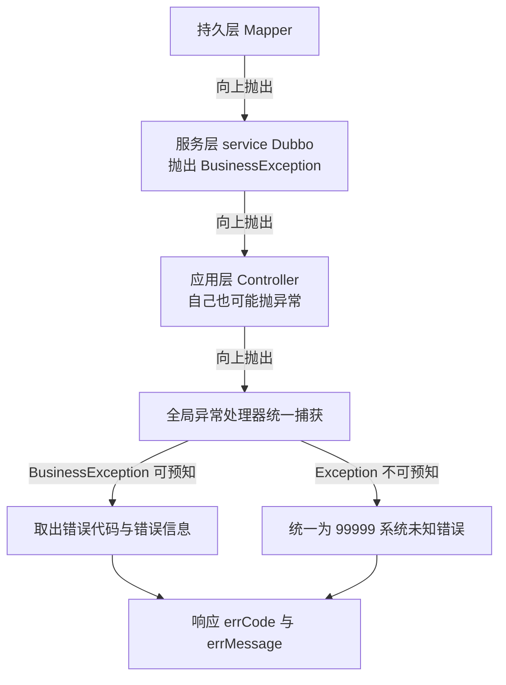
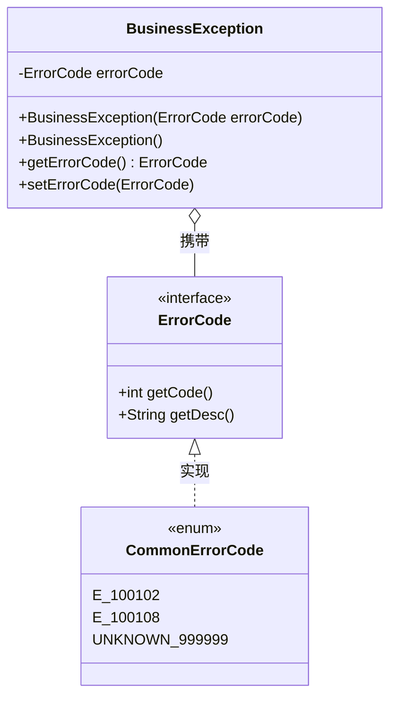
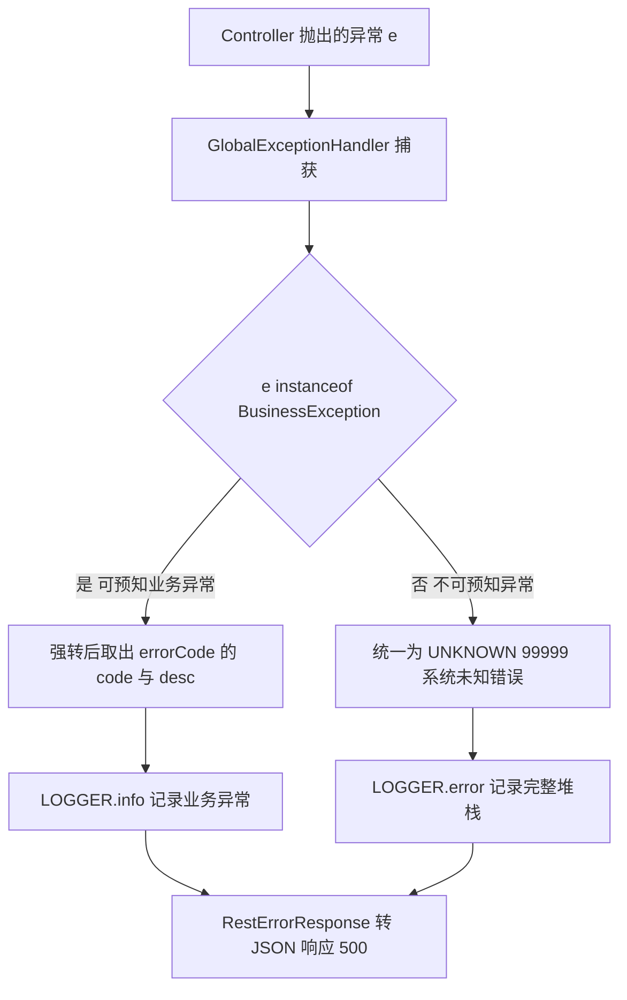
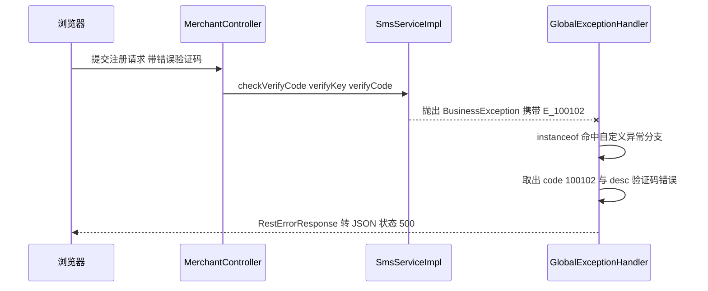

# 商户注册的统一异常处理：从 500 现状到 BusinessException 全链路落地

## 先给结论

- 目标链路是层层上抛、统一捕获：异常沿调用链抛给 Controller，`@ControllerAdvice` 加 `@ExceptionHandler` 在这一处统一拦截；HTTP 状态码做粗分类，错误细节靠 `errCode` 与 `errMessage` 两个约定字段承载。
- 异常分两类：可预知的业务异常由程序员主动抛 `BusinessException`，不可预知异常统一收敛为 99999 系统未知错误，原始堆栈只进服务端日志。
- `BusinessException` 定义在通用工程 pay-common，继承 `RuntimeException` 保持上抛顺畅；体内只持有一个 `ErrorCode`，错误码用枚举 `CommonErrorCode` 按服务分段编号，UNKNOWN 999999 兜底。
- 处理器方法三注解配套：`@ExceptionHandler(value = Exception.class)` 声明范围、`@ResponseBody` 转 JSON、`@ResponseStatus` 固定 500；捕获根类型加 instanceof 分流，保证无死角。
- 抛出点选在校验验证码方法：接口声明 `throws BusinessException`，实现里 `throw new BusinessException(CommonErrorCode.E_100102)`，代码与描述同时带出，抛异常用错误码枚举当构造参数。
- 验收标准只有一条：响应里的错误码与错误描述和抛出异常时指定的完全一致；两条测试路径都要走，除零运算是最省事的兜底探针。
- 日志分级：业务异常是预期内的失败用 info 留痕，系统异常用 error 带完整堆栈，级别差异就是排查时的第一道过滤条件。

## 第1部分：商户注册-异常处理-异常处理流程

在 Postman 里故意填错验证码再请求商户注册，响应区立刻给出一个 500，body 里是一段 Spring Boot 默认风格的 JSON。状态码 500 没问题，问题出在 body：前端与后端约定好的错误信息字段名，跟这段 JSON 里的对不上。异常处理这个模块要解决的就是这件事，这一课先看清楚现状差在哪，再把目标链路定下来，后面几课按链路逐一实现。

### 先看现状：错误验证码触发的 500 长什么样
带着错误验证码请求注册接口，拿到的是这样的响应：

```json
{
  "timestamp": "2019-12-10T10:06:19.936+0000",
  "status": 500,
  "error": "Internal Server Error",
  "message": "验证码错误",
  "path": "/merchant/merchants/register"
}
```

逐个字段看：`status` 是 500，符合「程序错误」的状态码规范；`error` 与 `path`、`timestamp` 都是 Spring Boot 默认错误响应的固定搭配；`message` 里有我们抛异常时写的那句「验证码错误」。问题就出在这个键名上。这个 JSON 不是我们写的，是 Spring Boot 默认的异常处理机制在异常没人管时兜底生成的，它把异常信息塞进 `message` 字段。

前端为什么不认这个格式。因为前后端分离开发，接口规范就是两边的契约：后端承诺凡有错误就返回两个信息，`errCode` 说明错误代码，`errMessage` 说明错误内容，前端按这两个固定键写解析代码。今天叫 `message`，明天某个接口返回 `errorMessage`，后天又变成 `abc`，前端的程序根本不知道该取哪个属性。错误信息叫什么名字不是小事，是契约的一部分。

### 前端要的格式：状态码加自定义错误体
系统定义的响应状态规范只有三行：

```text
200 成功
401 没有权限
500 程序错误（需要自定义错误体）
```

状态码只回答「这次请求成没成功、是不是程序出了错」，具体错在哪、错成什么样，要靠 500 配套的错误体表达。前端定义的错误体格式如下：

```json
{
  "errCode": "000000",
  "errMessage": "错误说明"
}
```

对照现状，500 这个外层是合格的，错误体的两个键不合格。目标就是把所有异常的出口收拢到一处，让每个错误响应都长成这个样子。

### 目标链路：层层上抛，统一捕获
先想清楚异常在系统里是怎么流动的。前端请求进来，最终会到达 Controller，Controller 调用 Service，Service 再调持久层的 Mapper。这三层里任何一层都可能出问题：Mapper 操作数据库可能抛异常，Service 业务校验不过要抛异常，Controller 自己校验入参也可能抛异常。不管哪一层抛，异常都沿调用链向上传播，Service 抛出的异常交给调用它的 Controller，Controller 抛出的异常再往上交给框架。这个传播方向决定了捕获点选在哪：



拦截器不必逐层去拦 Service 或者 Mapper，只要统一拦住 Controller 抛出的异常就够了：Service 的异常要交给 Controller，Mapper 的异常要经 Service 再交给 Controller，拦住 Controller 就拦住了系统里所有的异常。捕获之后进入解析阶段，最终按前端要的 `errCode` 加 `errMessage` 格式响应出去。这张流程图就是后面几课的施工图，自定义异常类型与全局异常处理器都是照着它实现的。

### 两类异常，两条出路
异常捕获之后怎么解析，取决于异常的类型，流程图里特意分出两个分支。

**第一类是可预知的业务异常。** 程序员在写代码时就知道这个位置会失败：校验验证码失败、手机号格式不对、查询结果为空。这类异常由我们自己定义类型，抛出时把错误代码与错误信息一并带上。对比一下现状代码，发送验证码失败时抛的是 JDK 自带的 RuntimeException：

```java
//现状：JDK 异常只带一句话，错误代码无处安放
if (bodyMap == null || bodyMap.get("result") == null) {
    throw new RuntimeException("发送验证码失败");
}
```

RuntimeException 是 JDK 1.8 提供的类型，不是我们自定义的异常类型，它能附一句 message，但要携带 `errCode` 加 `errMessage` 这样的结构化信息就不支持了。而且它是系统里到处可见的通用类型，异常处理器拿到它，分不清这是业务失败还是程序 bug。自定义异常类型，为的就是往里放我们要的信息，错误代码加错误说明这对组合。将来校验验证码的位置，就要把这句 `RuntimeException` 换成携带错误代码的自定义异常。

**第二类是不可预知的异常。** 数据库无法连接、服务器宕机、代码里一时手滑写出 `int i = 1 / 0` 的除零异常，这些在编码时无法穷举，是系统自己抛出来的，身上没有我们指定的错误代码。这类异常捕获后取不出错误代码与错误信息，就统一定义一个错误代码 99999，信息用「系统未知错误，请与管理员联系」这类兜底文案。给不可预知异常一个统一的身份，前端才能对它做统一处理，日志里则保留完整堆栈供开发排查。

两条出路最终汇合在同一点：不管哪类异常，异常处理器都按 `errCode` 与 `errMessage` 的结构响应给前端。现状里散落在各处、无人认领的异常，将来全部汇入这条链路。
## 第2部分：商户注册-异常处理-自定义异常类型

异常处理流程已经定好：各层抛出带错误代码的自定义异常，统一交由处理器解析。落地第一步是造出这个异常类型。JDK 自带的 RuntimeException 只能塞一句 message，错误代码无处安放；而流程要求抛出的异常自带 `errCode` 与 `errMessage`，处理器拿到就能直接取用。这一课把异常类型与错误码清单设计出来。

### 这个异常类要装什么、放在哪
先想清楚它与 JDK 异常的差异。流程规定异常处理器最终要取出错误代码与错误信息，所以自定义异常的构造就得把这两样装进去。类比操作系统报错：既有错误代码，又有错误说明，用户报障时报得出代码，支持人员按代码查问题。Java 异常体系里没有现成的这种类型，自己写一个，字段就是一个 ErrorCode。

再考虑放哪。这个异常类型商户服务要抛、商户平台应用要抛，后面每一个微服务都会用到，属于全系统公用的基础设施，所以放进 common 通用工程的 domain 包，让所有工程通过依赖共享。包结构里 domain 收放这一类通用领域对象，与 RestResponse 这些兄弟类作伴。

三个类型的关系一图看清：



BusinessException 携带一个 ErrorCode，CommonErrorCode 实现这个接口并提供具体的代码清单。异常类不认识具体错误码，只认识接口，将来某个服务要扩展自己的错误码清单，再写一个枚举实现同一接口即可，异常类一行都不用改。

### 编写 BusinessException
在通用工程的 domain 包下新建异常类：

```java
//自定义的异常类型，全系统公用的业务异常
public class BusinessException extends RuntimeException {

    //错误代码
    private ErrorCode errorCode;

    //抛出时指定错误代码，错误代码内含代码与描述
    public BusinessException(ErrorCode errorCode) {
        super();
        this.errorCode = errorCode;
    }

    //无参构造，方便灵活构造
    public BusinessException() {
        super();
    }

    public void setErrorCode(ErrorCode errorCode) {
        this.errorCode = errorCode;
    }

    public ErrorCode getErrorCode() {
        return errorCode;
    }
}
```

几个设计点逐一说明。**继承 RuntimeException** 是主动选择：运行时异常不强制调用方捕获，业务代码里 `throw` 出去就能沿调用链直达异常处理器；本项目同时在服务接口上保留 `throws BusinessException` 声明，把「此方法可能抛业务异常」写进接口契约，读接口的人一眼可见。**字段只有一个 ErrorCode**：不存 `int code` 也不存 `String message`，因为代码与描述总是一起出现，用一个对象打包最稳。**构造方法一式两份**：带参构造是主力，抛异常时传入错误码；无参构造留着应对特殊场景，配合 setter 使用。

### 定义错误代码：接口加枚举
异常类引用的 ErrorCode 是个接口，只声明两个方法：

```java
//错误代码的统一契约
public interface ErrorCode {

    int getCode();

    String getDesc();

}
```

getCode 给出错误代码，getDesc 给出错误描述。有了接口，具体错误码清单用枚举实现最合适：枚举天然保证每个实例的代码与描述成对出现、不可篡改、集中罗列。通用工程里的 CommonErrorCode 就是这份清单：

```java
//通用异常编码，按服务分段
public enum CommonErrorCode implements ErrorCode {

    //公用异常编码
    E_100101(100101, "传入参数与接口不匹配"),
    E_100102(100102, "验证码错误"),
    E_100103(100103, "验证码为空"),
    E_100104(100104, "查询结果为空"),
    E_100106(100106, "上传错误"),
    E_100107(100107, "发送验证码错误"),
    E_100108(100108, "传入对象为空"),
    E_100109(100109, "手机号格式不正确"),
    E_100110(100110, "用户名为空"),
    E_100111(100111, "密码为空"),
    E_100112(100112, "手机号为空"),
    E_100113(100113, "手机号已存在"),

    //SaaS 服务异常编码 110 段
    E_110001(110001, "账号不存在"),

    //商户服务异常编码 200 段
    E_200002(200002, "商户不存在"),
    E_200016(200016, "资质申请已通过，无需重复申请"),

    //交易服务异常编码 300 段
    E_300001(300001, "支付金额为空"),

    //特殊异常编码
    E_999991(999991, "调用微服务-授权服务 被熔断"),
    UNKNOWN(999999, "未知错误");

    private final int code;
    private final String desc;

    CommonErrorCode(int code, String desc) {
        this.code = code;
        this.desc = desc;
    }

    @Override
    public int getCode() {
        return code;
    }

    @Override
    public String getDesc() {
        return desc;
    }
}
```

这份清单的编号是有讲究的：六位数的前两段标识服务归属，100 段公用、110 段 SaaS 服务、200 段商户服务、300 段交易服务、400 段支付渠道代理服务，末段的 99999x 留给熔断等特殊场景，UNKNOWN 999999 是上一课说的系统未知错误兜底码。看到错误码就知道它来自哪个服务，排障时顺着号段定位。清单会随功能开发不断补充，课程资料里提供了完善版本，按讲义的约定直接覆盖工程内的文件即可，不必逐条手敲。

### 抛出去：一行代码完成约定
异常类型与错误码就位后，原来抛 RuntimeException 的位置统一替换成：

```java
//校验验证码失败：抛出带错误代码的业务异常
if (bodyMap == null || bodyMap.get("result") == null || !(Boolean) bodyMap.get("result")) {
    throw new BusinessException(CommonErrorCode.E_100102);
}
```

对比原来的 `throw new RuntimeException("验证码错误")`，信息量没有减少，多出来的东西是结构：错误代码 100102 与描述「验证码错误」被ErrorCode 打包在异常对象里，异常处理器将来调 `getErrorCode().getCode()` 与 `getDesc()` 就能原样取回，不用解析 message 字符串。抛异常这一行同时完成了两件事：标记失败位置，声明对外承诺的错误身份。
## 第3部分：商户注册-异常处理-异常处理器

自定义异常类型与错误码清单就位之后，链路上还差最后一环：接住异常并把它们翻译成前端要的 `errCode` 加 `errMessage`。动手之前先回答一个位置问题：这个异常处理器写在哪一层、哪个工程？想错了位置，链路就断在半路。这一课从返回包装类写到全局异常处理器，把流程图的最后一格补齐。

### 先补一个返回包装类
异常处理器捕获异常后要给前端返回规范错误体，这个返回值也是对象，先把它定义出来。与异常类一样，它属于全系统公用对象，放在通用工程 pay-common 的 domain 包：

```java
//错误响应参数包装类
@ApiModel(value = "RestErrorResponse", description = "错误响应参数包装")
@Data
public class RestErrorResponse {

    private String errCode;

    private String errMessage;

    public RestErrorResponse(String errCode, String errMessage) {
        this.errCode = errCode;
        this.errMessage = errMessage;
    }
}
```

两个 String 属性正好对应前端契约里的两个键，@Data 生成 getter，@ApiModel 让 Swagger 文档能说明这个类型的用途，构造方法强制创建时就把两个值给齐。errCode 设计成 String 而不是 int，与前端约定的 JSON 结构保持一致，错误码值直接以字符串形式出现在响应里。

### 处理器放在哪个工程
判断依据在异常处理流程图里已经给过：异常从持久层、服务层一路向上抛，最终都抛到应用层的 Controller。要拦住它们，自然要在「包含 Controller 的工程」里写拦截。系统当前有两个工程：商户服务是 Dubbo 服务提供方，对外暴露的是 RPC 接口，没有 Controller；商户平台应用对接前端、暴露 HTTP 接口，Controller 都在这里。所以异常处理器落在商户平台应用工程，新建 common 包下的 intercept 包，处理器类命名为 GlobalExceptionHandler，全局异常处理的意思。

### 认识 @ControllerAdvice：对 Controller 的切面增强
写类之前先认识核心注解。Advice 这个词在 Spring AOP 里学过，意思是「增强」：面向切面编程就是给目标对象挂上额外的增强逻辑。@ControllerAdvice 由 Spring MVC 3.2 提出，作用正是对 Controller 做面向切面编程，被它标注的类可以对全系统所有 Controller 生效增强。增强要做什么具体的事，看它与哪个注解配合，共有三种配合方式：

```text
ControllerAdvice 与 ExceptionHandler 配合：实现全局异常处理
ControllerAdvice 与 ModelAttribute 配合：实现全局数据绑定
ControllerAdvice 与 InitBinder 配合：实现全局数据预处理
```

全局异常处理是本课要用的第一种；后两种分别处理「请求参数绑定到对象」与「绑定前的预处理」，等用到时再展开。单看 @ExceptionHandler 这个名字也能猜到职责：专门捕获异常。

### 编写 GlobalExceptionHandler
处理器类与捕获方法的完整实现如下，方法上的注解逐个说明：

```java
//全局异常处理器：与 @ExceptionHandler 配合实现全局异常处理
@ControllerAdvice
public class GlobalExceptionHandler {

    private static final Logger LOGGER = LoggerFactory.getLogger(GlobalExceptionHandler.class);

    //捕获 Exception 异常后处理
    @ExceptionHandler(value = Exception.class)
    @ResponseBody
    @ResponseStatus(HttpStatus.INTERNAL_SERVER_ERROR)
    public RestErrorResponse processException(HttpServletRequest request,
                                             HttpServletResponse response,
                                             Exception e) {
        //如果是系统自定义异常，直接取出 errCode 和 errMessage
        if (e instanceof BusinessException) {
            LOGGER.info(e.getMessage(), e);
            //解析系统自定义异常信息
            BusinessException businessException = (BusinessException) e;
            ErrorCode errorCode = businessException.getErrorCode();
            //错误代码与错误信息
            int code = errorCode.getCode();
            String desc = errorCode.getDesc();
            return new RestErrorResponse(String.valueOf(code), desc);
        }

        LOGGER.error("系统异常：", e);
        //统一定义为 99999 系统未知错误
        return new RestErrorResponse(String.valueOf(CommonErrorCode.UNKNOWN.getCode()),
                CommonErrorCode.UNKNOWN.getDesc());
    }
}
```

类上只标一个 @ControllerAdvice，表示这个类对全系统的 Controller 生效。方法上三个注解各管一件事。@ExceptionHandler(value = Exception.class) 声明「捕获什么」：Exception 是所有异常的根类型，自定义的 BusinessException 是它的子类，一样会被捕获，所以这里不用写两个方法分别处理两类异常，捕获后用 instanceof 区分即可。@ResponseBody 让返回的 RestErrorResponse 对象转成 JSON 写进响应体，缺了它 Spring 会把返回值当视图名去找页面。@ResponseStatus(HttpStatus.INTERNAL_SERVER_ERROR) 把这次响应的状态码固定为 500，对应前面说的「程序错误」状态规范。方法参数里除了异常对象 e，还能按需拿 HttpServletRequest 与 HttpServletResponse，本课只用到异常本身。

方法体的解析逻辑就是流程图的两个分支：



第一分支处理可预知异常：instanceof 判断通过后强转成 BusinessException，getErrorCode 拿到抛异常时打包好的错误码，getCode 与 getDesc 一步到位，new 一个 RestErrorResponse 返回。日志级别用 info，业务异常是预期内的失败，不必按事故对待，但 message 与异常对象都要进日志留痕。第二分支兜底不可预知异常：不是 BusinessException 就走到这里，直接用 CommonErrorCode.UNKNOWN 构造响应，错误代码 999999、描述「未知错误」，日志级别用 error 并打印完整堆栈，这类异常才是真正需要开发介入排查的。

### 测试验证：两种异常两种响应
处理器写完，验证动作在下一课的抛出自定义异常改造后做完整联调，这里先给出预期结果作为验收标准。把校验验证码处换成抛 `BusinessException(CommonErrorCode.E_100102)` 之后，注册请求里填一个错误验证码，响应应该是：

```json
{
  "errCode": "100102",
  "errMessage": "验证码错误"
}
```

错误体格式与前端约定完全一致，状态码 500。再故意在 Controller 里制造一个不可预知异常，比如写一句 `int i = 1 / 0`，响应则变成：

```json
{
  "errCode": "999999",
  "errMessage": "未知错误"
}
```

两次请求走的是同一个方法，却因为 instanceof 分出了两条路：前者从异常对象里取出了当初抛出时指定的代码与信息，后者由 UNKNOWN 兜底。对照现状里 Spring Boot 默认的那段 timestamp、message 组成的 JSON，前后端契约终于完整落地：后端所有异常出口收敛到这一个方法，前端按两个字段写一次解析，长期有效。
## 第4部分：商户注册-异常处理-抛出自定义异常测试

自定义异常类型与全局异常处理器都已就位，但两个零件装好不代表机器能转。链路真正通不通，得让一个真实异常从业务代码出发，穿过处理器，最终变成前端手里的 `errCode` 与 `errMessage`。这一课就是动一次真格的测试：在业务代码里主动抛出 `BusinessException`，再故意制造一个不可预知异常，看统一异常处理是否两条路都收得住。

### 抛出点选在哪：从校验验证码方法下手
异常处理流程图早就规定了分工：可预知异常由程序员在编码时抛出，不可预知异常交给处理器兜底。测试第一步是给「可预知」找一个真实的发生点。校验验证码正合适：验证码输错是每天都在发生的业务失败，失败原因明确、错误码现成，而且这个方法在注册链路上，前端随时可以触发。

改造从接口声明开始。`SmsService` 的校验方法签名上补出 `throws BusinessException`：

```java
//校验验证码：声明抛出自定义异常，失败的处理方式由调用链上游统一决定
void checkVerifyCode(String verifyKey, String verifyCode) throws BusinessException;
```

`BusinessException` 继承自 `RuntimeException`，编译器并不强制声明。这里仍然把 `throws` 写在接口上，是把它当作显式契约：读到签名就知道这个方法可能失败、失败时携带错误码，调用方不必翻实现源码。团队协作里，这种写在签名上的约定比注释可靠得多。

### 把 RuntimeException 换成 BusinessException
实现类的改动只有两处 throw。改造前，校验失败抛的是裸 `RuntimeException`，错误信息是写死的字符串；改造后，换成携带错误码枚举的自定义异常：

```java
@Override
public void checkVerifyCode(String verifyKey, String verifyCode) throws BusinessException {
    //校验验证码的 url，参数与地址来自验证码服务的接口文档
    String verify_url = "http://localhost:56085/sailing/verify?name=sms&verificationCode="
            + verifyCode + "&verificationKey=" + verifyKey;

    Map bodyMap = null;
    try {
        //参数全在 URL 上，无请求体、无特殊请求头，传空 HttpEntity
        ResponseEntity<Map> exchange = restTemplate.exchange(verify_url, HttpMethod.POST,
                HttpEntity.EMPTY, Map.class);
        log.info("请求验证码服务，得到响应:{}", JSON.toJSONString(exchange));
        bodyMap = exchange.getBody();
    } catch (RestClientException e) {
        e.printStackTrace();
        //改造前：throw new RuntimeException("校验验证码失败");
        throw new BusinessException(CommonErrorCode.E_100102);
    }
    if (bodyMap == null || bodyMap.get("result") == null || !(Boolean) bodyMap.get("result")) {
        throw new BusinessException(CommonErrorCode.E_100102);
    }
}
```

两处抛出的含义不同：catch 块里是请求验证码服务本身出了问题，网络不通、服务挂了都算；if 判断里是验证码服务正常应答但比对结果为 false，也就是用户输错了验证码。两种失败在当前阶段先用同一个错误码 100102 表达「验证码错误」，后续要细分再拆枚举。

构造方法要的参数是 `ErrorCode` 类型，`CommonErrorCode` 枚举正好实现这个接口，错误码从这里取：

```java
public enum CommonErrorCode implements ErrorCode {
    E_100101(100101, "传入参数与接口不匹配"),
    E_100102(100102, "验证码错误"),
    E_100107(100107, "发送验证码错误"),
    //......按服务分段：1 开头公用、110 开头 SaaS 服务、200 开头商户服务、300 开头交易服务
    UNKNOWN(999999, "未知错误");

    private int code;
    private String desc;
    //getCode 与 getDesc、构造方法省略
}
```

每个枚举项就是一个「代码加描述」的组合。抛异常时写 `E_100102`，处理器就能原样取出 100102 和「验证码错误」这两个值，中间不需要任何翻译。

### 测试一：可预知异常被处理器接住
重启商户平台应用，在注册页填入一个错误验证码提交，同时在 `GlobalExceptionHandler` 的处理方法里打好断点。整条链路如下面这张时序图：



断点停下的瞬间可以看到，处理器方法参数里的异常对象正是刚才抛出的 `BusinessException`，类型匹配、错误码原封未动。日志级别走的是 info，因为这是预期内的业务失败。放开断点，前端收到的响应体是：

```json
{
  "errCode": "100102",
  "errMessage": "验证码错误"
}
```

两个键与前后端约定完全一致，状态码 500。当初抛异常时写进构造方法的那个枚举，经过一层 `instanceof` 加两次 getter，原样抵达了浏览器，链路每一环都对上了。

### 测试二：不可预知异常的兜底
可预知的路走通了，还有另一条路要验证。在注册接口里故意写一句不可能成功的运算：

```java
//临时测试代码：制造不可预知异常，验证完毕即删除
int i = 1 / 0;
```

除零会抛出 `ArithmeticException`，它不是系统自定义的异常类型。再次提交注册请求，断点照样进来，只是这次 `instanceof` 判断不通过，落入 UNKNOWN 兜底分支，日志级别是 error 并带完整堆栈。前端收到的响应变成：

```json
{
  "errCode": "999999",
  "errMessage": "未知错误"
}
```

同一个处理方法，靠一次类型判断分出两条路：可预知异常原样透出业务含义，不可预知异常收敛成统一的系统未知错误，原始堆栈留在服务端日志里等待排查。对照当初 Spring Boot 默认抛出的那段 `timestamp` 加 `message` 的 JSON，异常出口已经完全收拢，测试到此闭环。
## 常见误区

- **认为返回 500 就算完成了异常处理。** 错例：看到响应状态是 500 就觉得前后端都识别得出错误。正解：状态码只解决粗分类，错误细节靠约定字段的错误体承载，`errCode` 与 `errMessage` 缺一不可。
- **在 Service 层把异常 catch 住不上抛。** 错例：`catch` 之后只打印日志然后返回 null，前端拿到一个看似成功实则空白的响应。正解：业务失败要表达成异常沿调用链上抛，交给统一出口处理，返回值只承载成功语义。
- **错误体字段名随手起。** 错例：这个接口返回 `message`，那个接口返回 `errorMsg`。正解：字段名是接口契约的一部分，全系统统一为 `errCode` 与 `errMessage`，前端解析代码只写一次。
- **把不可预知异常包装成业务异常透传。** 错例：数据库异常的原始信息直接返回给前端，暴露表名与连接细节。正解：不可预知异常统一收敛为 99999 系统未知错误，原始堆栈进服务端日志。
- **继承 Exception 而不是 RuntimeException。** 错例：自定义异常继承受检异常，结果每个调用点都被迫 try 或 throws，业务代码被异常处理淹没。正解：业务异常继承 RuntimeException，保持上抛顺畅，必要时在接口上用 throws 声明契约。
- **错误码用魔法数字散落在代码里。** 错例：`throw new BusinessException(100102, "验证码错误")`，代码与文案写死在几十处，改一个错文案要全局搜。正解：错误码收敛进枚举，抛出时引用枚举常量，代码与描述单一出处。
- **在异常 message 里拼文案代替错误码。** 错例：继续 `new RuntimeException("验证码错误")`，前端只能拿一句话，无法按代码做分支处理。正解：错误代码与描述一起装进异常对象，处理器按结构取用。
- **errMessage 里塞堆栈或敏感信息。** 错例：把数据库连接串、表结构拼进错误描述返回。正解：errMessage 是给人看的一句话，堆栈与细节进服务端日志。
- **每个微服务各写一套互不相认的错误码。** 错例：商户服务与交易服务都从 100000 起号，错误码冲突难排查。正解：按服务分段统一规划，公共段收敛在通用工程的 CommonErrorCode，服务私有段预留自己的号段。
- **@ExceptionHandler 标注位置搞错。** 错例：把 @ExceptionHandler 标在类上，方法上却漏掉，捕获逻辑从未生效。正解：@ControllerAdvice 标在类上声明全局增强，@ExceptionHandler 标在具体方法上声明捕获范围，两者配合使用。
- **捕获范围只写 BusinessException。** 错例：@ExceptionHandler(value = BusinessException.class)，不可预知的系统异常全部漏网，前端仍会收到 Spring Boot 默认错误体。正解：捕获根类型 Exception，方法内用 instanceof 分流，保证无死角。
- **漏掉 @ResponseBody。** 错例：返回 RestErrorResponse 却被 Spring 当作视图名解析，报视图找不到的错误。正解：三注解配套，@ResponseBody 负责把返回对象转 JSON，或者用 @RestControllerAdvice 替代类注解。
- **捕获后不区分类型一律打 error 日志。** 错例：业务异常与系统异常混在同一堆 error 里，监控告警天天误报。正解：业务异常是预期失败用 info 留痕，系统异常用 error 并带完整堆栈，级别差异就是排查线索。
- **处理器方法里再抛异常。** 错例：解析过程写出空指针，异常处理器自身失败，前端收到更底层的天书。正解：方法体内做判空兜底，保证任何输入都能返回一个规范错误体。
- **只在实现类抛异常，接口上漏了 throws 声明。** 错例：实现方法里 `throw new BusinessException(...)`，接口签名照旧，读接口的人完全不知道它会失败。正解：接口与实现同步声明 `throws BusinessException`，把可能失败的契约写在签名上。
- **抛异常时用字符串当构造参数。** 错例：`new BusinessException("验证码错误")` 与现有的 `ErrorCode` 构造方法不匹配，处理器从异常对象里取不出错误码，统一异常链路等于白建。正解：构造参数传错误码枚举 `CommonErrorCode.E_100102`，代码与描述都从枚举里出。
- **只测自定义异常，不测兜底分支。** 错例：看到 100102 的响应就宣布测试通过，系统异常路径一次没跑过。正解：两条路都要走一遍，除零这类简单手段就能触发兜底分支，`int i = 1 / 0` 是最省事的探针。
- **断点看到异常进处理器就算测完。** 错例：断点命中了 `BusinessException` 就停手，不检查最终响应体。正解：验收对象是前端实际收到的 JSON，`errCode`、`errMessage` 与状态码三者都对上才算闭环。

## 面试可能被问到的问题

1. 面试官追问：「前后端分离项目的异常返回你会怎么设计？」
   答：两层结构，外层用 HTTP 状态码做粗分类，200 成功、401 无权限、500 程序错误；内层用约定字段的错误体表达细节，比如 errCode 加 errMessage。后端用全局异常处理器保证所有异常出口一致，前端按固定结构写一次解析即可。

2. 面试官追问：「为什么全局异常处理器只需要拦 Controller 一层？」
   答：因为异常沿调用链向上传播，持久层抛给 Service，Service 抛给 Controller，Controller 自己的异常也在这一层。Controller 是所有请求的必经出口，在这里统一捕获等价于捕获了系统全部异常，逐层拦截反而重复。

3. 面试官追问：「可预知异常和不可预知异常分别怎么处理？」
   答：可预知异常由程序员主动抛出，用自定义异常类型携带错误代码与信息，处理器直接取出响应；不可预知异常系统自己抛出、没有错误代码，处理器统一归入固定的未知错误码，如 99999，细节进日志。

4. 面试官追问：「99999 这种统一错误码有什么意义？」
   答：它给不可预知异常一个统一身份，前端能按同一规则提示用户联系管理员，不必为五花八门的系统异常写处理逻辑；同时它把系统内部细节与前端隔离，堆栈与敏感信息只留在服务端日志里。

5. 面试官追问：「自定义业务异常为什么通常继承 RuntimeException？」
   答：RuntimeException 属于运行时异常，不强制调用方逐层声明捕获，业务代码可以保持简洁，异常自然沿调用链上抛到统一出口；如果继承受检异常，每一层的方法签名都要跟着声明，代价大而收益低。本项目在服务接口上保留了 throws 声明，是为了把可能抛业务异常写进契约。

6. 面试官追问：「错误码为什么用枚举而不是常量类或者数据库表？」
   答：枚举让代码与描述强制成对、不可实例化、集中可查，编译期就能发现拼写与遗漏；常量类容易只定义 code 忘了描述，数据库表引入运行期依赖且改动需要发布流程。错误码属于系统契约，枚举的稳定性正合适。

7. 面试官追问：「异常里为什么存 ErrorCode 对象而不是一个 int code？」
   答：代码与描述总是成对使用，分开存取容易出现两者不一致；存对象后处理器一次 getErrorCode 就能拿到代码与描述，将来要扩展国际化描述等字段也只动实现不动异常类。

8. 面试官追问：「错误码的分段你是怎么规划的？」
   答：六位码前两段标识服务，100 段公用、110 段 SaaS、200 段商户、300 段交易、400 段渠道代理，特殊场景预留 99999x，未知错误固定 999999。分段保证全系统唯一、见码知源，新服务加号段即可，不会冲突。

9. 面试官追问：「不同微服务的错误码清单怎么共存？」
   答：接口先行，通用工程定义 ErrorCode 接口与公用清单 CommonErrorCode，各服务可以再实现自己的枚举清单实现同一接口，异常类只依赖接口，所以任何服务的错误码都能被同一个异常类型携带、被同一个处理器解析。

10. 面试官追问：「@ControllerAdvice 是什么，有哪些用法？」
   答：Spring MVC 3.2 提供的注解，对全系统 Controller 做切面增强。三种配合：与 @ExceptionHandler 实现全局异常处理，与 @ModelAttribute 实现全局数据绑定，与 @InitBinder 实现全局数据预处理。项目里用它做统一异常出口。

11. 面试官追问：「全局异常处理器为什么能捕获 Service 层抛出的异常？」
   答：异常沿调用链向上传播，Service 与持久层的异常最终都抛给调用它们的 Controller，Controller 抛出的异常在渲染响应前会被 @ControllerAdvice 增强逻辑拦截。所以拦在 Controller 层等价于拦截全系统的异常。

12. 面试官追问：「@ExceptionHandler 的 value 匹配规则是什么？」
   答：按异常类型匹配，声明的类型与其子类都会命中；同时存在多个匹配时按继承距离就近选择，比如同时声明 Exception 与 BusinessException 两个处理方法，BusinessException 会优先命中更精确的那个。本项目只声明 Exception，方法内 instanceof 分流。

13. 面试官追问：「@ResponseBody 与 @ResponseStatus 在异常处理里各起什么作用？」
   答：@ResponseBody 把方法返回的对象序列化成 JSON 写入响应体，错误体才能以 JSON 结构给到前端；@ResponseStatus 指定本次响应的 HTTP 状态码，设为 500 与系统「程序错误」的状态规范对齐，前端状态判断与错误体解析两层契约同时满足。

14. 面试官追问：「不可预知异常为什么不把原始异常信息透传给前端？」
   答：原始异常可能带出表结构、连接串、框架版本等敏感信息，暴露攻击面；而且这类信息对用户没有意义。统一收敛为 99999 未知错误，配合服务端 error 日志留全堆栈，用户体验与排障能力两不误。

15. 面试官追问：「除了统一异常处理，@ControllerAdvice 还能帮你做什么？」
   答：全局数据绑定，把公共数据预先放进 Model 供所有接口使用；全局数据预处理，统一处理日期格式、字符串去空格之类的入参转换。它们把原本散落在各 Controller 的横切逻辑收敛到一处。

16. 面试官追问：「业务代码抛出自定义异常后，前端是怎么拿到错误信息的？」
   答：异常沿调用链向上抛到 Controller，@ControllerAdvice 标注的全局异常处理器在响应渲染前拦住它，instanceof 判断出 BusinessException 后取出 ErrorCode 的 code 与 desc，包装成 RestErrorResponse 由 @ResponseBody 转成 JSON 返回，@ResponseStatus 把状态码固定为 500。前端只认 errCode 与 errMessage 两个字段。

17. 面试官追问：「BusinessException 继承 RuntimeException，为什么不强制声明 throws 还要在接口上写？」
   答：RuntimeException 是非受检异常，编译器不检查声明，这里写 throws 是显式契约而非语法要求。它告诉调用方该方法可能按业务规则失败、失败时携带错误码枚举，调用方读签名即可了解失败模型，也能让 IDE 与代码审查工具给出提示。

18. 面试官追问：「错误码为什么集中定义在枚举里，而不是在哪里失败就在哪里写字符串？」
   答：集中定义后错误码有了唯一出处，前后端契约、日志检索、监控告警都以它为准；散落的字符串会拼写漂移，同一个错误两种说法就没法按码统计。按服务分段编号（1 公用、200 商户、300 交易）还能从码值直接定位出错模块。

19. 面试官追问：「可预知异常和不可预知异常的日志级别为什么要区别对待？」
   答：业务异常是预期内的失败，用户输错验证码不是系统故障，用 info 留痕即可，打成 error 会让告警噪音淹没真正的故障；不可预知异常才是需要开发介入的信号，用 error 并打印完整堆栈。级别差异本身就是排查时的第一道过滤条件。

20. 面试官追问：「在事务方法里抛出 BusinessException，事务会回滚吗？」
   答：会。Spring 事务默认对 RuntimeException 与 Error 回滚，BusinessException 继承自 RuntimeException，正好落在默认回滚范围内。如果自定义异常改成继承 Exception 这样的受检异常，默认不回滚，需要在 @Transactional 上指定 rollbackFor，这是两种继承选择的实际差别之一。

## 配套资料

- 讲义：`materials/docs/10/闪聚支付-第2章-讲义-商户注册&资质申请v1.0.md`，2.4.5 异常处理之 2.4.5.1 异常信息格式（状态码说明与自定义错误体）与 2.4.5.2 异常处理流程（异常处理流程图与四步约定）为本课出处。
- 代码：`materials/code/10/基准代码/`，聚合支付工程副本，现状抛出 `RuntimeException` 的发送与校验验证码代码位于商户平台应用工程的 `SmsServiceImpl`，该目录同时已有目标形态的自定义异常类与全局异常处理器；内层目录名含项目原始命名，与正文包名口径不一致，不在此展开，按用途自取。
- 说明：正文错误响应 JSON 与现状代码节选自课程工程与讲义示例，接口地址、时间戳为课程演示环境的占位数据；包名按 `com.study.pay` 口径改写。
- 讲义：`materials/docs/10/闪聚支付-第2章-讲义-商户注册&资质申请v1.0.md`，2.4.5 异常处理之 2.4.5.3 自定义业务异常类（BusinessException 类定义、ErrorCode 接口与从资料获取 CommonErrorCode 的约定）为本课出处。
- 代码：`materials/code/10/基准代码/`，通用工程 domain 包下的 `BusinessException`、`ErrorCode`、`CommonErrorCode` 为真实文件，本课代码为按 `com.study.pay` 口径改写后的节选；该目录内层名含项目原始命名，与正文包名口径不一致，不在此展开，按用途自取。
- 说明：CommonErrorCode 全量清单以资料包提供的文件为准，正文仅节选代表性条目与号段注释；错误码数值与描述与课程工程一致。
- 讲义：`materials/docs/10/闪聚支付-第2章-讲义-商户注册&资质申请v1.0.md`，2.4.5 异常处理之 2.4.5.4 自定义业务异常处理器（RestErrorResponse、ControllerAdvice 三种用法、GlobalExceptionHandler 实现）为本课出处。
- 代码：`materials/code/10/基准代码/`，通用工程 domain 包下的 `RestErrorResponse` 与商户平台应用工程 intercept 包下的 `GlobalExceptionHandler` 为真实文件，本课代码为按 `com.study.pay` 口径改写后的节选；该目录内层名含项目原始命名，与正文包名口径不一致，不在此展开，按用途自取。
- 说明：测试响应 JSON 为讲义给出的验收数据，故意制造异常的 `int i = 1 / 0` 为讲义示例写法；抛出自定义异常的完整改造与联调在下一课展开。
- 讲义：`materials/docs/10/闪聚支付-第2章-讲义-商户注册&资质申请v1.0.md`，2.4.5.5 抛出自定义异常（接口声明 throws BusinessException、改造校验验证码方法、在异常处理器打断点验证）为本课出处。
- 代码：`materials/code/10/shanjupay/`，聚合支付工程，涉及商户平台应用的 `service/SmsService` 与 `service/SmsServiceImpl`（改造后的校验方法实现）、`controller/MerchantController`（registerMerchant），以及 `pay-common` 的 `domain/CommonErrorCode`；该目录下另有按开发阶段归档的工程副本，内层目录名含项目原始命名，与正文包名口径不一致，不在此展开，按用途自取。
- 说明：两段响应 JSON 与除零测试 `int i = 1 / 0` 为讲义给出的验收数据；原实现文件中校验方法名为 `checkVerifiyCode`（含拼写瑕疵），正文沿用系列口径写作 `checkVerifyCode`，包名按 `com.study.pay` 系改写。
