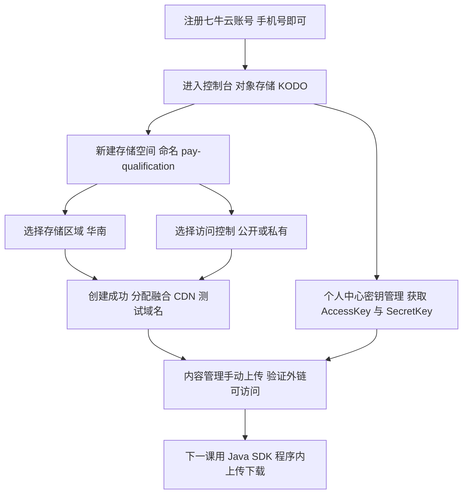

# 七牛云对象存储入门：给资质证件找一个放图的地方

> 🔒 安全提示：文中示例的口令/密钥均为课程教学环境演示口径，生产环境的安全要求见《安全与合规须知》。

系统交互流程已经定下：商户上传的营业执照、法人身份证照片不落业务库、不写本地磁盘，交给七牛云保存。这个决定落地前要先补一堂课：对象存储到底是什么，为什么适合放证件照，注册账号之后要新建哪些东西。这一课把七牛云的面貌、空间准备的完整步骤过一遍，下一课直接用它的 Java SDK 写上传下载。

## 先给结论

- 七牛云对象存储 KODO 是一个非结构化数据存储管理平台，图片、视频、文档这类没有固定表结构的文件都归它管，支持中心与边缘两类存储节点。
- 产品优势里与本项目最相关的是三条：数据可靠性宣称高达 11 个 9，按需使用按需付费，边缘节点上传下载平均提速 60% 以上。
- 使用前提是三样东西：注册账号、新建存储空间、拿到 AccessKey 与 SecretKey 密钥，缺一样程序都连不上。
- 新建空间要定三个参数：空间名（本系列写作 `pay-qualification`）、存储区域（选华南）、访问控制（公开空间或私有空间）。
- 空间创建成功后平台分配一个融合 CDN 测试域名，下载文件全靠它；控制台的内容管理里可以先手动传一张图验证外链。

## 对象存储是什么：非结构化数据的仓库

数据库擅长存结构化数据：字段固定、按行列查询，手机号、审核状态都是它的主场。但一张营业执照照片没有「列」可言，几个 MB 的二进制内容塞进数据库既占空间又拖慢查询。这类没有固定表结构的数据叫非结构化数据，对象存储就是专门为它们设计的仓库：每个文件作为一个「对象」存放，用唯一的 key 标识，通过 HTTP 接口上传与下载，容量随用随扩，不需要自己规划磁盘。

七牛云是国内做这一行的厂商之一，同类还有阿里云、腾讯云等云服务平台，选型时按价格、地域节点与文档体验比较即可，不必迷信某一家。七牛云除了对象存储，还有云主机、CDN 等一整排产品，本项目只用到对象存储这一格。

## 它凭什么承担证照存储

讲义里把优势列了一排，挑与资质申请直接相关的说透。**第一是可靠性。** 官方给出 11 个 9 的数据可靠性，即 99.999999999%，背后是纠删码存储方案与跨数据中心的副本冗余，服务不停机、数据不单点。证照照片丢了没法补传（用户早就不在线了），可靠性是这个场景的硬指标。

**第二是成本。** 按需使用、按需付费，不用前期买服务器配磁盘，存储与流量用多少结多少，避免资源闲置。**第三是速度。** 它在全国多地布置中心节点，并在靠近用户的地方放边缘节点，官方称数据在边缘节点上传下载平均提速 60% 以上；文件离用户越近，传输越快，这个朴素规律就是 CDN 与边缘存储的原理。

核心功能里还有两条值得点名：多媒体数据处理，上传视频图片可以顺带完成转码、裁剪、在线播放；镜像存储，帮存量系统做无缝数据迁移。上传与下载本身就是它最基础的能力，丰富的 API 与工具同时支持服务端上传和客户端直传，本项目走的是服务端上传。

## 动手准备：注册账号与新建存储空间

使用前的准备动作不多，串成一条线如下：



关键是新建存储空间这一步。空间（bucket）是对象存储里的「桶」，你上传的文件都落在某个桶里，空间名就是桶的名字，本系列按中性命名写作 `pay-qualification`。三个参数各有讲究：

```text
空间名称   pay-qualification          自定义，同一账号内不重复即可
存储区域   华南                        文件实际落在哪个区域的服务器
访问控制   公开空间 / 私有空间          决定下载是否需要授权
```

存储区域指文件存放在哪个地域的机房，有华北、华东、华南等选项。选距离用户近的区域，上传下载就快；如果套上 CDN 加速，文件会被分发到各地节点，地域的影响被抹平，本项目当前不做 CDN，直接选华南即可。要记住的一点是：空间建在哪个区域，下一课代码里指定的区域必须与它一致，否则上传直接报错，这是实战里最容易踩的坑。

访问控制是另一个必答题。公开空间：文件上传后，任何人拿到 URL 都能直接下载，不需要任何认证，分享图片类似网盘的外链。私有空间：文件不公开，下载请求必须经过授权，由密钥签出一个带有效期的 URL 才能访问。课程测试阶段用公开空间图省事；生产环境里身份证照片这类敏感材料要慎重，要么选私有空间，要么对 URL 做严格的访问防护。

## 空间之外的两样东西：测试域名与密钥

空间创建成功后，平台为它分配一个融合 CDN 测试域名，形如 `example.hn-bkt.clouddn.com` 的占位样式，每个账号分配的都不同。下载文件时，域名加文件名就是访问地址，这个域名在下一课生成下载链接时要用到。

第二样是密钥。进入个人中心的密钥管理页，可以看到平台分配的一对密钥：AccessKey 与 SecretKey。程序调用 SDK 上传下载时都要带上它们，服务端据此校验请求是不是你本人发起，相当于账号在代码里的通行证。密钥等同于账号权限，示例与文档里一律用 `example-ak`、`example-sk` 这样的占位值，真实密钥不要写进代码仓库。

## 手动上传验一轮：内容管理与外链

程序上传之前，先在控制台确认空间是活的。空间详情页里有内容管理入口，点击上传、选择一张本地图片，文件立刻出现在列表中。列表里每份文件都有「复制外链」的操作，把外链粘到浏览器地址栏，图片原样显示，这一刻对象存储的存与取就都验证过了，体验与往网盘传文件再分享链接并无二致。

控制台操作到此为止。接下来的问题是让程序代替人做这件事：商户平台应用在收到前端传来的证件照后，要自动完成同样的上传动作，并把 URL 拼出来还回去。这就是下一课的主题，Java SDK 的引入与上传下载测试。

## 常见误区

- **把对象存储当数据库用。** 错例：想按「某个用户的所有证件」做条件查询，指望对象存储提供筛选能力。正解：对象存储只认 key 不认条件，需要查询的是元数据，业务库里存 URL 与关联关系，文件本体在存储空间。
- **空间区域随手一选，代码里不对应。** 错例：空间建在华南，代码里写默认区域，上传收到 400 错误还找不到原因。正解：空间与代码使用同一个区域参数，两边对齐是上传成功的前提。
- **敏感证件放进公开空间。** 错例：测试用公开空间尝到甜头，生产环境照搬，任何人拿到 URL 都能翻看他人身份证。正解：敏感材料选私有空间，按密钥签发带有效期的下载 URL，或另做访问控制层。
- **真实密钥提交进代码仓库。** 错例：为了省事把密钥硬编码后随项目入库，仓库一旦外泄账号即沦陷。正解：代码里用占位值（`example-ak`、`example-sk`），真实密钥走配置中心或环境变量，泄漏后立即在密钥管理页作废重置。

## 面试可能被问到的问题

1. 面试官追问：「对象存储和数据库各适合存什么？」
   答：数据库面向结构化数据，字段固定、支持条件查询与事务，存业务记录；对象存储面向非结构化数据，以对象为单位按 key 存取，通过 HTTP 接口访问，容量弹性伸缩，存图片、视频、文档这类大文件。两者配合使用，库里存元数据与 URL，文件本体放对象存储。
2. 面试官追问：「宣传里的 11 个 9 可靠性是什么意思？」
   答：指数据可靠性 99.999999999%，即一年内单个对象丢失的概率约为十亿分之一量级。实现上靠纠删码存储方案与跨数据中心副本冗余，而不是简单地把数据存一份；对证件照这类丢失后无法补传的数据，可靠性是选型的硬指标。
3. 面试官追问：「公开空间和私有空间的区别是什么，怎么选？」
   答：公开空间的文件凭 URL 即可下载，无需认证，适合头像、公告图这类可公开内容；私有空间的下载请求要按 AccessKey 与 SecretKey 签名，生成带过期时间的临时 URL 才能访问，适合身份证照片这类敏感文件。证件照在测试环境可用公开空间验证流程，生产环境应选私有空间或加强访问控制。
4. 面试官追问：「存储区域应该怎么选？」
   答：按业务用户与系统服务器的地理位置就近选择，物理距离直接决定上传下载的时延；接入 CDN 后文件分发到边缘节点，地域影响会被削弱。另一个约束是代码端配置的 Region 必须与空间所在区域一致，不一致会直接请求失败。
5. 面试官追问：「AccessKey 与 SecretKey 在上传流程里起什么作用？」
   答：SDK 用这对密钥生成上传凭证（token），服务端校验凭证通过才允许写入，本质是把账号身份带进每一次请求。密钥即权限，必须与代码分离，通过配置中心或环境变量注入，泄漏后要在控制台立即重置。

## 配套资料

- 讲义：`materials/docs/10/七牛云对象存储使用指南.md`，第 1 章对象存储服务简介（KODO 定位、产品优势、核心功能与服务）与第 2 章创建对象存储空间（注册、新建空间、区域与访问控制、测试域名、服务密钥）为本课出处。
- 代码：本课为控制台操作，无配套源码包，正文的空间参数清单与密钥占位（`example-ak`、`example-sk`）为按本课写法补全的示意；上传下载的程序实现见下一课，真实依赖坐标可参考 `materials/code/10/shanjupay/shanjupay/pom.xml` 中的 `qiniu-java-sdk` 声明。
- 说明：空间名按本系列口径写作 `pay-qualification`，测试域名以占位样式 `example.hn-bkt.clouddn.com` 表达，真实域名以各账号控制台分配为准。
