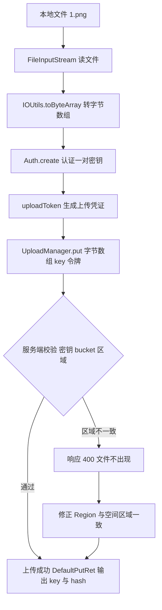

# 七牛云上传与下载测试：从 SDK 依赖到外链访问的完整闭环

> 🔒 安全提示：文中示例的口令/密钥均为课程教学环境演示口径，生产环境的安全要求见《安全与合规须知》。

空间建好了、密钥到手了、手动传图也验证过了，剩下的问题是怎么让程序替人干活：商户平台应用收到前端传来的证件照后，要自动把图片存进七牛云，再把能访问它的 URL 拼出来还给页面。这一课用七牛云的 Java SDK 把上传与下载各跑一遍，从引依赖、写测试、踩区域坑，一直走到公开空间外链与私有空间签名链接的差别，把对象存储的「存」与「取」两头都焊死。

## 先给结论

- 上传核心四步：`Auth.create(accessKey, secretKey)` 认证、`auth.uploadToken(bucket)` 生成上传凭证、`uploadManager.put(bytes, key, upToken)` 执行上传、Gson 把响应解析成 `DefaultPutRet` 拿到 key 与 hash。
- 依赖放进 pay-common 通用工程，全部子工程共享：`qiniu-java-sdk` 7.2.25，配套 `gson` 与 `fastjson`。
- put 方法的 key 就是文件在空间里的名字，必须自己生成保证唯一，UUID 加扩展名是惯用做法；不指定 key 时平台用文件内容 hash 命名，没有扩展名。
- 最隐蔽的坑在区域：`Configuration` 指定的 Region 必须与空间所在区域一致，不一致服务端返回 400，程序不报错、文件不出现。
- 下载分两类：公开空间用测试域名加文件名拼 URL 直接访问；私有空间用 `auth.privateDownloadUrl(公开URL, 有效期)` 生成带签名的临时链接。
- 验收看两处：程序无异常且打印出文件 key，控制台内容管理刷新能看到同名文件。

## SDK 的引入：依赖进通用工程

Java SDK 是七牛云提供的 Java 工具包，性质上就是一组封装好 HTTP 接口的 jar 包，导入工程即可调用。它属于七牛服务端 SDK 的一种，能力覆盖五块：生成客户端上传凭证、服务端直接上传、空间内文件管理、文件处理、CDN 刷新与预取。本项目当前只用前两条。

依赖加进 pay-common 而不是某个业务工程，理由在工程划分时立过规矩：通用工程是所有子工程的公共底座，放进去一次，商户平台应用、商户服务谁要用谁直接继承。上传证照的接口将来写在商户平台应用里，它要能看见这些类，依赖自然落在公共位置。根工程 `pom.xml` 里集中声明版本：

```xml
<!--根工程统一管理第三方依赖版本（节选），坐标以七牛官方文档为准-->
<dependency>
    <groupId>com.qiniu</groupId>
    <artifactId>qiniu-java-sdk</artifactId>
    <version>7.2.25</version>
</dependency>
<dependency>
    <groupId>com.google.code.gson</groupId>
    <artifactId>gson</artifactId>
    <version>2.8.2</version>
</dependency>
<dependency>
    <groupId>com.alibaba</groupId>
    <artifactId>fastjson</artifactId>
    <version>1.2.47</version>
</dependency>
```

三个依赖各司其职：SDK 提供上传下载的核心类，gson 负责把上传结果 JSON 转成对象，fastjson 是工程里本来就有的日志序列化工具。从文档复制坐标进 pom 时留意连字符，个别编辑环境会把它粘成全角短横，Maven 立刻报无法解析，改回英文半角即可。

## 先跑通官方样例：字节数组上传的四步

官方文档把文件上传分成几种姿势：简单文件上传直接传本地文件，字节数组上传把文件内容读成 byte 数组再传。选后者作为试验对象，因为将来业务里上传证件接口从 Web 请求拿到的是 `MultipartFile` 的字节流，与字节数组的入参天然对齐，样例跑通了就能顺势改成工具方法。

在 pay-common 的 util 包下新建 `QiniuUtils`，把官方样例粘进来做第一次试验：

```java
package com.study.pay.common.util;

//测试方法：把本地文件转成字节数组上传到七牛云
private static void testUpload() {
    //构造一个带指定 Region 对象的配置类，区域必须与存储空间所在区域一致
    Configuration cfg = new Configuration(Region.huanan());
    //其他参数参考类注释
    UploadManager uploadManager = new UploadManager(cfg);
    //默认不指定 key 的情况下，以文件内容的 hash 值作为文件名，这里自己控制文件名
    String key = UUID.randomUUID().toString() + ".png";
    FileInputStream fileInputStream = null;
    try {
        //读取本地文件，转成字节数组
        String filePath = "F:\\develop\\pay\\1.png";
        fileInputStream = new FileInputStream(new File(filePath));
        byte[] uploadBytes = IOUtils.toByteArray(fileInputStream);
        //认证：用一对密钥创建 Auth 对象
        Auth auth = Auth.create(accessKey, secretKey);
        //认证通过后生成上传凭证（token 令牌）
        String upToken = auth.uploadToken(bucket);
        try {
            //上传文件，参数：字节数组、key、令牌
            Response response = uploadManager.put(uploadBytes, key, upToken);
            //解析上传成功的结果
            DefaultPutRet putRet = new Gson().fromJson(response.bodyString(), DefaultPutRet.class);
            System.out.println(putRet.key);
            System.out.println(putRet.hash);
        } catch (QiniuException ex) {
            Response r = ex.response;
            System.err.println(r.toString());
            try {
                System.err.println(r.bodyString());
            } catch (QiniuException ex2) {
                //ignore
            }
        }
    } catch (IOException ex) {
        //ignore
    } finally {
        //关闭流的收尾动作此处省略
    }
}
```

逐段拆开看。`accessKey` 与 `secretKey` 从密钥管理页复制，`bucket` 就是要传进的空间名 `pay-qualification`，三个变量在类里先备好。`Configuration` 携带区域信息，`UploadManager` 是所有上传动作的发起者，一切都通过它的 put 方法走。`Auth.create` 拿一对密钥做认证，密钥不对直接抛异常；认证通过后 `uploadToken` 发出一个上传凭证，token 在这个场景里就是通行证，服务端凭它判断「这个请求是持有效密钥的人发起的」。`put` 收三个参数：文件内容的字节数组、key、令牌，返回的 `Response` 里带着服务端应答，用 Gson 反序列化成 `DefaultPutRet`，其中 `key` 是文件名、`hash` 是内容哈希。写一个 main 方法调用它，控制台打印出 key，第一次程序内上传就有了观察对象。

## key 是什么：云端文件名的生成规则

put 的第二个参数 key 决定文件上传后在空间里叫什么，这是整个上传流程里最值得停下来想清楚的参数。如果放任不管，平台会拿文件内容的 hash 值当文件名，内容相同 hash 相同，天然去重；代价是文件名没有扩展名，访问起来虽不受阻，但浏览器与运维工具都少了类型线索，人工排查也不直观。

更不能用原始文件名。用户上传的证件照可能都叫 `1.png`、`身份证.jpg`，同名文件在空间里相互冲突。惯用解法是用 JDK 自带的 `UUID.randomUUID().toString()` 生成一个全局不重复的字符串，再拼上原始文件的扩展名，文件名既唯一又保留类型信息。打一个断点在 key 赋值处，单步放行就能看到本次生成的名字，上传成功后到控制台内容管理刷新，列表里的文件名与断点里的一字不差，程序与云端对上了账。

key 还有一个容易被忽略的能力：它可以写成带斜杠的路径形态。官方样例里出现过 `公司/存档/qiniu.jpg` 这样的 key，效果是把文件归进「目录」里。对象存储并没有真实的目录树，斜杠只是 key 的前缀约定，控制台会按前缀渲染出文件夹的样子。资质证件若要按商户归档，用商户号做 key 的前缀即可，例如 `m1001/xxx.png`，列表查找与程序遍历都按前缀聚合，这是不花一分钱就得到的文件组织能力。

## 第一次上传失败的排查：无报错却看不到文件

试验不会一次就顺。第一次运行后出现了很典型的现象：程序没有任何红字，控制台打印了结果，但到空间的内容管理里刷新半天，列表空空如也，文件去向不明。回头翻日志，里面藏着一个 400 状态码。

排查按三个变量依次过：bucket 名字对不对、一对密钥对不对、区域对不对。前两项都对得上，问题出在区域：空间当初建在华南，而 `Configuration` 里的 Region 配置与它不一致，服务端按错误的区域入口处理请求，返回 400。把 Region 明确指定为 `Region.huanan()`，与空间创建时选的区域严格一致，重新运行，刷新内容管理，文件出现了。

400 是 HTTP 语义里的「请求不合法」，在对象存储的语境里最典型的诱因就是区域不匹配：服务端认得你是谁，密钥校验是通过的，但请求被送到了与空间无关的接入点，这个入口不肯受理这个空间。它的表象因此格外安静：参数里只有一个维度不对，服务端只回一个状态码，具体错误码要展开响应体才看得见。这也解释了为什么区域坑排在密坑榜第一，它绕过了所有显眼的失败信号。整条链路与排错点如下：



这张图也是排查清单：上传不成功时沿着 密钥、bucket、区域 三个校验点从上往下核对，区域不一致是最难发现的一个，因为它不像密钥错误那样立刻抛异常，而是安静地给你一个 400。

## 封装成工具方法：为上传证件接口铺路

testUpload 是一次性的试验代码，路径写死、变量写死，只负责证明 SDK 能用。业务里需要的是一个可复用的工具方法：字节数组与文件名由调用方传入，失败时记日志并抛出，而不是像样例那样 `catch` 里一句 ignore 把异常吞掉。`QiniuUtils` 的正式方法长这样：

```java
//文件上传的工具方法，文件名由调用方传入，七牛云上的文件名与之一致
public static void upload2qiniu(String accessKey, String secretKey, String bucket,
                                byte[] bytes, String fileName) throws RuntimeException {
    //构造一个带指定 Region 对象的配置类，区域与存储空间选择的区域一致
    Configuration cfg = new Configuration(Region.huanan());
    UploadManager uploadManager = new UploadManager(cfg);
    //key 由外部传入，建议调用方生成不重复名称
    String key = fileName;
    try {
        //认证
        Auth auth = Auth.create(accessKey, secretKey);
        //认证通过后得到 token 令牌
        String upToken = auth.uploadToken(bucket);
        try {
            //上传文件，参数：字节数组、key、令牌
            Response response = uploadManager.put(bytes, key, upToken);
            //解析上传成功的结果
            DefaultPutRet putRet = new Gson().fromJson(response.bodyString(), DefaultPutRet.class);
            LOGGER.info("上传成功 key：{} hash：{}", putRet.key, putRet.hash);
        } catch (QiniuException ex) {
            Response r = ex.response;
            LOGGER.error("上传文件到七牛：{}", ex.getMessage());
            try {
                //失败时把服务端响应体吐进日志，错误码就在里面
                LOGGER.error(r.bodyString());
            } catch (QiniuException ex2) {
                //ignore
            }
            throw new RuntimeException(r.bodyString());
        }
    } catch (Exception ex) {
        LOGGER.error("上传文件到七牛：{}", ex.getMessage());
        throw new RuntimeException(ex.getMessage());
    }
}
```

与试验代码的两点差别值得对照：一是参数化，区域、密钥、空间之外，字节数组与 key 都从方法签名进来，谁来调用谁负责准备；二是异常策略反转，样例里的静默 ignore 全部换成记日志加抛 `RuntimeException`，上传失败在业务里是不可静默的事件，调用方必须知道。方法签名上写明 `throws RuntimeException` 是一种提醒：上传是外部依赖调用，网络抖动、空间配额、区域配置错误最终都会以运行时异常的形态冒出来。工具方法不替业务决定失败之后怎么办，只负责如实上报并留下日志，这正是工具层与服务层分工的边界。后续实现上传证件接口时，从 `MultipartFile` 里取出字节数组与扩展名，用 UUID 拼好文件名，调这个方法即可完成转存。

## 下载：公开空间拼外链，私有空间签 URL

上传成功的文件，下载这件事其实已经做了一半。公开空间里，空间绑定的测试域名加文件名就是完整的访问地址，控制台每份文件旁边的「复制外链」拿到的正是它，发给任何人都能直接打开，体验与网盘分享链接一致。这类链接没有时效、没有鉴权，适合可公开的内容。

私有空间不能这样裸拼，下载请求必须带签名。SDK 提供了专门的下载 API，写法四步：

```java
//获取文件下载 url：私有空间必须签名，公开空间可直接拼外链
private static void getDownloadUrl() throws UnsupportedEncodingException {
    //文件名与上传成功后空间内容管理列表里的名称保持一致
    String fileName = "283d041b-2a49-4a04-8409-516043804870.png";
    //空间绑定的测试域名，以控制台实际分配的为准
    String domainOfBucket = "http://example.hn-bkt.clouddn.com";
    //URL 编码，并把编码产生的加号替换成 %20
    String encodedFileName = URLEncoder.encode(fileName, "utf-8").replace("+", "%20");
    //公开访问链接：域名加编码后的文件名
    String publicUrl = String.format("%s/%s", domainOfBucket, encodedFileName);
    String accessKey = "example-ak";
    String secretKey = "example-sk";
    Auth auth = Auth.create(accessKey, secretKey);
    //链接有效期 1 小时，可自定义
    long expireInSeconds = 3600;
    //签名后得到带凭证的临时下载地址
    String finalUrl = auth.privateDownloadUrl(publicUrl, expireInSeconds);
    System.out.println(finalUrl);
}
```

四个步骤各有含义。文件名先做 URL 编码，编码会把空格转成加号，而 URL 规范里空格应表达为 `%20`，所以紧跟一次 `replace` 修正；再用 `String.format` 把域名与文件名拼成公开访问链接，这一步与公开空间的拼法完全相同；然后照旧用一对密钥创建 Auth；最后 `privateDownloadUrl` 对公开链接做私有授权签名，有效期 3600 秒，超时链接自动失效。测试环境用的是公开空间，这段代码同样跑得通，它生成的是一个经过签名处理的临时下载路径，公开空间加签名并不冲突，只是平时没有这个必要。

运行后把打印出来的 `finalUrl` 与公开外链对比，尾巴上多出一对参数：`e` 是过期时间戳，`sign` 是签名值，二者共同构成这次访问的授权。把它粘进浏览器回车，图片正常打开；把过期时间改小再访问，服务端直接拒绝，时效性真实生效。有效期长短按场景定：审核人员当天查看证件，几个小时足够；若链接会在页面里停留很久，就要在安全与体验之间权衡，有效期拉得过长，私有空间也就名存实亡了。

两类空间的边界就此清晰：日常对外内容用公开空间，域名加文件名即为永久外链；不公开的文件要么让公司自建服务器去存，要么用私有空间配合签名 URL 按需发放。资质证件属于后者，审核环节查看照片时，走的就是带有效期的授权链接。

## 上传与下载闭环：对资质申请意味着什么

把两头的测试收拢到业务视角，闭环已经成形。上传一侧，工具方法 `upload2qiniu` 吃进字节数组与唯一文件名，吐出云端确认的 key，加上测试域名就能拼出证件照的完整 URL，这正是上传证件接口要回传给前端的那个标识；下载一侧，URL 的两种形态对应公开与私有两种空间的取用规则，审核人员查看证件靠的就是按规则生成的访问地址。程序里的存与取验证完毕，对象存储对资质申请链路的支撑到此就位，接下来就可以回到商户平台应用，把上传证件信息的接口真正接起来。

## 常见误区

- **依赖加进业务工程而不是通用工程。** 错例：qiniu 依赖只加到商户平台应用，后续其他服务要用文件上传时再引一遍，版本容易漂移。正解：通用能力依赖进 pay-common 统一管理，子工程按需继承，版本只声明一处。
- **key 直接用原始文件名。** 错例：拿 `1.png` 原样上传，第二个用户再传同名文件即冲突，空间里分不清谁是谁。正解：UUID 生成唯一主体、拼接原文件扩展名，唯一性与类型信息两全。
- **验收只看程序有没有抛异常。** 错例：main 方法跑完没有红字就宣布成功，区域不一致时响应 400 却安静得像成功一样。正解：程序打印的 key 与控制台内容管理列表两处核对；工具方法里把失败响应体记进日志，错误码直接可见。
- **把私有空间的签名链接当永久链接存库。** 错例：`privateDownloadUrl` 生成的 URL 被写进表里长期引用，一小时后全部 401。正解：签名 URL 带有效期，按需生成、用完即弃，库里存的永远是文件名（key）与元数据。

## 面试可能被问到的问题

1. 面试官追问：「七牛云上传文件的核心步骤与涉及的核心类有哪些？」
   答：四步。Configuration 携带区域配置构造 UploadManager；Auth.create 用 AccessKey 与 SecretKey 完成认证；auth.uploadToken(bucket) 生成上传凭证；uploadManager.put(字节数组, key, 凭证) 执行上传，响应经 Gson 解析成 DefaultPutRet 拿到 key 与 hash。区域必须与空间所在区域一致，否则服务端返回 400。
2. 面试官追问：「put 的 key 不传会怎样？为什么建议自己生成？」
   答：不传时平台以文件内容的 hash 值作为文件名，内容相同即同名，但没有扩展名。建议自己用 UUID 拼扩展名生成：原始文件名大量重名会造成冲突，UUID 保证唯一，扩展名保留类型信息，云端文件名还可控可排查。
3. 面试官追问：「上传显示成功但空间里看不到文件，怎么排查？」
   答：按三个校验点核对。bucket 名是否与空间一致，一对密钥是否有效，Configuration 指定的区域是否与空间创建时选的区域一致；其中区域不一致最隐蔽，服务端返回 400 而程序侧往往无显眼报错，需要翻日志里的响应体。三者对齐后重传即可在内容管理里看到文件。
4. 面试官追问：「公开空间和私有空间的下载有什么区别？」
   答：公开空间的访问地址是域名加文件名，无鉴权无时效，拿到 URL 即可下载；私有空间必须用密钥对公开链接做签名，auth.privateDownloadUrl 生成带过期时间的临时 URL，到期失效。公开外链适合可公开内容，敏感文件走私有空间签名发放。
5. 面试官追问：「上传凭证 token 的安全意义是什么？」
   答：凭证由一对密钥在服务端签出，代表「持有效密钥的身份授权这次写入」。上传请求必须携带有效凭证，服务端校验通过才受理，防止匿名向空间写文件。密钥本身不出现在前端与日志里，泄漏即可被用来伪造凭证，所以要与代码分离并支持随时重置。
6. 面试官追问：「文件上传走服务端中转还是客户端直传，怎么取舍？」
   答：客户端直传由服务端只签发上传凭证，文件从用户设备直达对象存储，节省应用服务器带宽，适合高并发大文件场景；服务端中转由应用先收文件再转存，流程简单、便于统一校验与留痕。本项目证件照走服务端上传，量级小且要与表单一起做完整性校验，可控性优先。

## 配套资料

- 讲义：`materials/docs/10/七牛云对象存储使用指南.md`，第 3 章上传文件测试（Java SDK 简介、引入依赖、配置密钥与空间名、字节数组上传样例、控制台查看上传结果）与第 4 章下载文件测试（公开空间链接构成、私有空间签名下载、浏览器访问验证）为本课出处。
- 代码：`materials/code/10/shanjupay/shanjupay/pom.xml`，根工程中 `qiniu-java-sdk` 7.2.25 的真实依赖声明；工具类 `QiniuUtils`（upload2qiniu、testUpload、getDownloadUrl 方法）的真实文件位于 `materials/code/10/基准代码/` 与 `materials/code/10/完整代码/` 两份归档工程中，该归档内层目录名含项目原始命名，与正文包名口径不一致，不在此展开，按用途自取。
- 说明：密钥一律以 `example-ak`、`example-sk` 占位，空间名按本系列口径写作 `pay-qualification`，下载测试域名以占位样式 `example.hn-bkt.clouddn.com` 表达，真实取值以各账号控制台分配为准；正文代码为真实文件按 `com.study.pay` 系包名改写后的节选。
