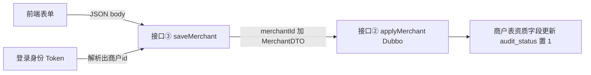
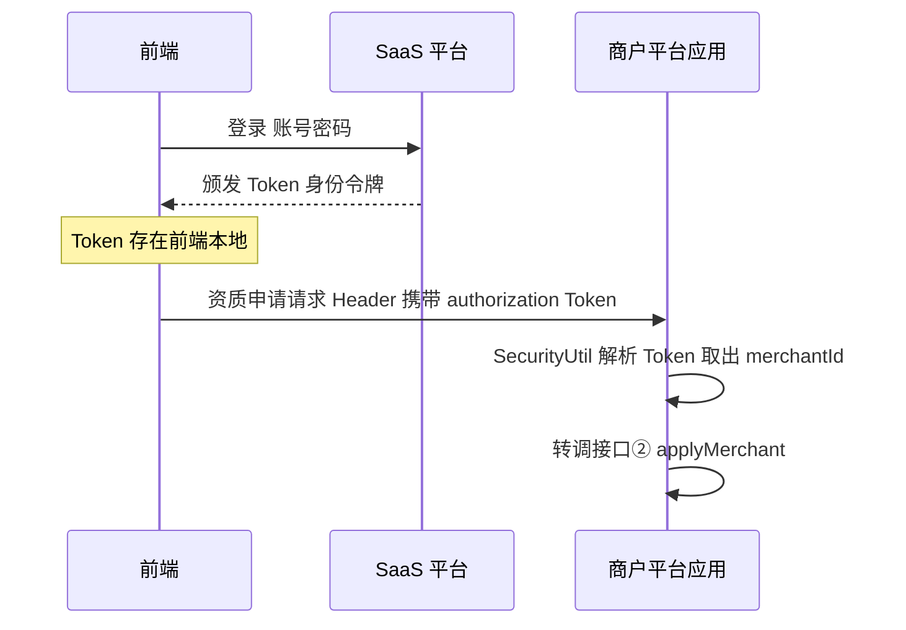
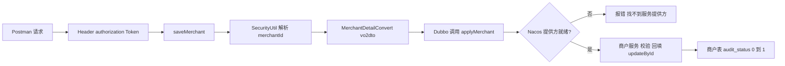

# 商户资质申请之商户平台应用：接口定义、商户身份解析与实现联调

## 先给结论

- 商户资质申请落在商户平台应用的接口③：`POST /my/merchants/save`，JSON 请求体，参数类型 `MerchantDetailVO`，无返回值，失败由全局异常处理器统一应答。
- URL 与请求方式必须按讲义原样使用，一个字符都不改：前端工程已按这个地址实现交互，改动必在联调时报错。
- 参数不直接用 `MerchantDTO`：DTO 是服务层的数据全集，带着 mobile、auditStatus、tenantId、password 等绝不能由前端提交的字段；为表单单独裁剪 `MerchantDetailVO`，字段与资质申请表单一一对应。
- 商户 id 不能走表单：资质申请永远是「商户给自己申请」，id 必须从当前登录身份推导；正式方案靠 Token，前端经 Header `authorization` 携带，结构是 `Bearer ` 前缀加 Base64 编码的 JSON。
- 未接登录时的临时方案：单元测试 `TokenTemp` 生成测试 Token，`SecurityUtil` 在控制器里解析；流程与将来登录后完全一致，只是 Token 的生成者从 SaaS 换成了测试代码。
- 接口实现固定三步：`SecurityUtil.getMerchantId()` 解析商户 id，MapStruct 把 VO 转成 DTO，转调 `applyMerchant` 落库；转换器 `MerchantDetailConvert` 用 `@Mapper` 声明并双向定义 vo2dto 与 dto2vo。
- 联调三坑记牢：企业编号 VO 里是 String、DTO 里是 Long 的类型错位；Nacos 提供方刚启动未注册报找不到服务；约束回填写错对象导致 `updateById` 更新 0 行、接口成功而库里没变。
- 联调成功的判据在数据库：资质字段有值且 `audit_status` 从 0 变 1；后续实战阶段会手动把它改成 2，模拟审核通过。

## 第1部分：商户平台应用资质申请接口定义：URL 约定与 VO 参数设计

商户服务的资质申请接口（接口②）已经就位，资质申请链路还差最后一环：前端请求的 HTTP 接口（接口③）。它落在商户平台应用工程里，收到请求后转调 Dubbo 接口②，由商户服务完成落库。动手之前有两个设计决策要先想清楚：URL 与请求方式定成什么样，参数类型用现成的 `MerchantDTO` 还是另建一个 VO。前者涉及前后端联调的硬约束，后者涉及接口安全的底线，这一课把两件事都定下来。

### 链路位置：接口③补上最后一环

资质申请的三接口编号沿用交互流程的约定：接口①上传证件信息，前端先把三张证照交给商户平台应用，由七牛云保存并回传 URL；接口②由商户服务提供，负责把资质信息写进商户表，上一课已实现；接口③是商户平台应用对前端的门面，把页面提交的申请转交给接口②。三个接口的接续关系如下：



图的右侧说明接口③只是一层转接：它不做落库、不做业务校验，收下前端数据、凑齐商户 id、转调 Dubbo 服务，就完成了自己的全部职责。数据真正写库的位置始终在商户服务，应用层管交互、服务层管数据的边界与注册接口（接口③注册、接口②注册）完全一致。

### URL 与请求方式：以讲义为准，不改一个字符

HTTP 接口的第一件事是定 URL 与请求方法。这个接口的地址直接从讲义拷贝：`POST /my/merchants/save`。看起来「随便定一个语义化的路径也行」，实际上没有这个自由度。本课程的前端工程不是开发对象，它早已按讲义中的地址写好了请求代码，后端把 URL 改成任何「更好听」的名字，前五端联调时都会以请求 404 或路径不匹配收场。地址不是后端单方面的选择，而是前后端共同签署的契约，契约以讲义为准。

路径里的 `my` 段也值得留意：`/my/merchants/save` 与查询商户的 `/my/merchants` 同属一组「我的商户」接口，语义是「对当前登录商户自己的资源做操作」。这类路径前缀把「操作谁」藏在了身份里而不是参数里，是资质申请只许商户给自己申请这一业务规则在 URL 层面的呼应。

### 参数用 VO 还是 DTO：字段全集与表单子集的错位

接口收什么数据？看资质申请表单：企业名称、企业编号、企业地址、行业类型、三张证照的 URL、联系人姓名、联系人地址。这些字段几乎都能在 `MerchantDTO` 里找到同名属性，DTO 确实是为「商户信息」设计的全集类型，注册课里 MapStruct 已经围着它转过一轮。但全集与子集之间有几处关键错位，直接把 DTO 暴露给前端不合适：

```java
@Data
@ApiModel(value = "MerchantDTO", description = "")
public class MerchantDTO implements Serializable {

    @ApiModelProperty(value = "主键")
    private Long id;

    @ApiModelProperty(value = "联系人手机号(关联统一账号)")
    private String mobile;

    @ApiModelProperty(value = "用户密码")
    private String password;

    @ApiModelProperty(value = "审核状态 0-未申请,1-已申请待审核,2-审核通过,3-审核拒绝")
    private String auditStatus;

    @ApiModelProperty(value = "租户ID,关联统一用户")
    private Long tenantId;

    //企业信息、证照 URL、联系人等其余字段与商户表一一对应，此处省略
}
```

逐项看这几处错位的分量。`auditStatus` 是审核状态，它的推进规则是提交时由服务端写 1，前端传什么都不该被采纳；`tenantId` 是对接 SaaS 后才有意义的租户字段，同样由服务端管理；`mobile` 是关联统一账号的标识，资质申请不允许改手机号；`password` 更不必说，资质申请界面压根没有密码输入框。这些字段留在参数类型里，等于把「服务端专属字段」的修改权开放给了前端，Swagger 文档还会堂而皇之地把它们展示给开发人员，误导前端以为这些字段该由页面提交。

服务层 DTO 与前端表单的字段集合不一致时，规范的做法是按表单裁剪一个 VO。`MerchantDetailVO` 就是这个裁剪结果：

```java
package com.study.pay.merchant.vo;

import io.swagger.annotations.ApiModel;
import io.swagger.annotations.ApiModelProperty;
import lombok.Data;

import java.io.Serializable;

/**
 * 资质申请信息
 */
@ApiModel(value = "MerchantDetailVO", description = "商户资质申请信息")
@Data
public class MerchantDetailVO implements Serializable {

    @ApiModelProperty("企业名称")
    private String merchantName;

    @ApiModelProperty("企业编号")
    private String merchantNo;

    @ApiModelProperty("企业地址")
    private String merchantAddress;

    @ApiModelProperty("行业类型")
    private String merchantType;

    @ApiModelProperty("营业执照")
    private String businessLicensesImg;

    @ApiModelProperty("法人身份证正面")
    private String idCardFrontImg;

    @ApiModelProperty("法人身份证反面")
    private String idCardAfterImg;

    @ApiModelProperty("联系人")
    private String username;

    @ApiModelProperty("联系人地址")
    private String contactsAddress;
}
```

九个字段，与表单严格一一对应，没有任何服务端专属字段混入。VO 放在商户平台应用的 `vo` 包下，它属于应用层私有类型，跨不出这个工程；Dubbo 接口②的参数类型仍然是 `MerchantDTO`，从 VO 到 DTO 的转换留给接口实现课，用 MapStruct 一个方法搞定。

### 接口定义落地：注解、签名与请求体

在商户平台应用的 `MerchantController` 中写下接口定义：

```java
@ApiOperation("资质申请")
@PostMapping("/my/merchants/save")
@ApiImplicitParams({
        @ApiImplicitParam(name = "merchantInfo", value = "商户认证资料", required = true,
                dataType = "MerchantDetailVO", paramType = "body")
})
public void saveMerchant(@RequestBody MerchantDetailVO merchantInfo) {
    //方法体在接口实现一课补齐
}
```

几个注解各司其职。`@ApiOperation` 给 Swagger 文档写明接口名「资质申请」，`@ApiImplicitParam` 的 `required = true` 声明参数必填，`dataType` 指向 `MerchantDetailVO`，`paramType = "body"` 说明参数从请求体传入。真正起作用的是 `@RequestBody`：前端把表单数据格式化成 JSON 后放进请求体，Spring MVC 用它把 JSON 反序列化成 VO 对象，这一步与前面注册接口的用法一致。返回值定为 `void`，资质申请要么成功要么抛异常，异常沿 `BusinessException` 体系交给全局异常处理器应答，控制器不返回业务数据。

定义到这里留了一个悬而未决的问题：转调接口②需要两个参数，`merchantId` 与 `MerchantDTO`。资质信息已经由 `@RequestBody` 收进来了，商户 id 却无处可寻，表单里没有它，也不该有它。这个 id 的来源与登录身份有关，下一课专门解决。

## 第2部分：获取商户身份：登录还没实现，商户 id 先从测试 Token 里解析

接口③的定义已经就位，转调接口②需要 `merchantId` 与 `MerchantDTO` 两个参数，资质信息由请求体带进来了，商户 id 却在表单里找不到踪影。这一课专门解决它的来源问题，顺带把「登录缺席」阶段的测试办法搭起来：用一个单元测试伪造 Token，用工具类从请求头里把它解析出来，最后在 Postman 里打断点验证解析结果与库中 id 一致。

### 商户 id 为什么不能走表单

回放一遍请求链路：用户在前端点「资质申请」，请求发到商户平台应用。是谁在发这个请求？是登录了闪聚支付平台的商户本人，他是在给自己申请资质。把视角换到服务端，这个判断就变成一条铁律：接口③处理的每一次申请，目标商户都等于当前登录商户。商户 id 因此不是「参数」，而是「身份」，它应当从登录态里解析出来，而不是由请求参数提供。

这条铁律反过来的情形值得警惕：假如商户 id 由前端提交，任何登录用户都可以把别人的商户 id 填进表单，替别人提交资质申请，甚至篡改别人的商户资料。身份字段一旦允许从参数进入，越权风险就跟着进来了。所以即使将来实现了登录，`saveMerchant` 的参数里也永远不会有商户 id，它只从 Token 来。

### 正式流程长什么样：Token 的颁发与携带

接入 SaaS 平台之后，登录功能就位，流程会自然长成这样：



登录成功后 SaaS 平台生成 Token 交给前端，前端把它存起来；此后每次请求资质申请等接口，都在请求头里带上 Token；服务端从请求头取出令牌、解析出商户 id。整条链路的关键约定有两个：一是 Token 放在名为 `authorization` 的请求头里传输，二是它的取值以「`Bearer ` 前缀」开头，前缀后跟一个空格，这是 HTTP 认证头里的通用格式。当前课程还没走到 SaaS 对接与登录，但流程不能临时变形：请求依然携带 Token、服务端依然从 Token 解析商户 id，只有 Token 的「出生方式」变了，由 SaaS 颁发改为手工伪造。

### 临时方案一：单元测试伪造 Token

课程代码资料里提供了 `TokenTemp`，把它拷进商户平台应用的测试目录，内容如下：

```java
@RunWith(SpringRunner.class)
@SpringBootTest
public class TokenTemp {

    @Autowired
    MerchantService merchantService;

    //生成token，指定商户id
    @Test
    public void createTestToken() {
        Long merchantId = 1211232081483444226L;//填写用于测试的商户id
        MerchantDTO merchantDTO = merchantService.queryMerchantById(merchantId);
        JSONObject token = new JSONObject();
        token.put("mobile", merchantDTO.getMobile());
        token.put("user_name", merchantDTO.getUsername());
        token.put("merchantId", merchantId);

        String jwt_token = "Bearer " + EncryptUtil.encodeBase64(JSON.toJSONString(token).getBytes());
        System.out.println(jwt_token);
    }
}
```

方法的逻辑一眼见底：指定一个要模拟登录的商户 id，查出这个商户的 DTO，把手机号、联系人姓名、商户 id 三项塞进一个 JSON 对象，整个 JSON 经 Base64 编码后前面拼上 `Bearer ` 前缀，打印出来就是一枚测试 Token。想测哪个商户申请资质，就填哪个商户的 id。生成的 Token 记下来，测试接口时要用。

两个运行细节容易翻车。**其一，运行前先停掉商户平台应用。** `@SpringBootTest` 标注的测试类会加载完整的 Spring Boot 配置，等于把应用整个拉起来一遍：Web 端口、Dubbo 服务注册一样不少。应用还在运行时再跑这个测试，端口冲突、注册中心重复注册的报错立刻出现。停掉应用再运行，控制台打印出 Token，测试的使命就完成了。**其二，不必细究 Token 的构造代码。** 这段工具代码属于登录与认证的知识范围，等对接 SaaS 讲认证时再回头补原理，当前阶段会复制、会改 id、会运行就够用。

### 临时方案二：SecurityUtil 从请求里解析

配套资料里还有一份解析 Token 的工具类 `SecurityUtil` 及相关类，拷进商户平台应用的 `common.util` 包。当前阶段用到的核心方法如下：

```java
/**
 * 测试阶段实现：从请求头解析 Token，取出当前登录商户的 id
 * 后续接入认证框架后，此方法将改为从认证上下文获取用户，再定位商户
 */
public static Long getMerchantId() {
    HttpServletRequest request = ((ServletRequestAttributes)
            (RequestContextHolder.currentRequestAttributes())).getRequest();
    String jsonToken = request.getHeader("authorization");
    if (StringUtils.isEmpty(jsonToken) || !jsonToken.startsWith("Bearer ")) {
        throw new RuntimeException("token is not as expected");
    }
    //去掉「Bearer 」前缀（前缀含一个空格，共 7 个字符）
    jsonToken = jsonToken.substring(7);
    //Base64 解码还原 JSON
    jsonToken = EncryptUtil.decodeUTF8StringBase64(jsonToken);
    JSONObject jsonObject = JSON.parseObject(jsonToken);
    return jsonObject.getLong("merchantId");
}
```

解析过程与生成过程严格互逆。`RequestContextHolder` 拿到当前线程绑定的 `HttpServletRequest`，从请求头 `authorization` 读出整个 Token 串；校验 `Bearer ` 前缀后用 `substring(7)` 截掉前缀，`Bearer ` 四个字母加一个空格正好七个字符；`EncryptUtil.decodeUTF8StringBase64` 做 Base64 解码还原出 JSON；再从 JSON 里取 `merchantId` 字段。请求头不存在、没有前缀、格式不对，统统抛异常挡下，解析失败的请求走不到业务逻辑。

这个方法将来会被替换而不是删除：接入认证框架后，Token 的校验与解析由框架在过滤器里完成，`SecurityUtil` 改为从认证上下文获取登录用户、再定位所属商户。对调用方而言方法签名不变，`getMerchantId()` 这一行代码从临时方案一直活到正式方案，这也是把它封成工具类而不是散落在控制器里的理由。

### Postman 验证：Header 里带上 Token 打断点

两块代码就位后做一次闭环验证，目的只有一个：确认商户 id 真能从 Token 里解析出来。商户平台应用启动起来，Postman 新建请求，URL 用资质申请的 `POST /my/merchants/save`。请求头加一项：key 填 `authorization`，value 填刚才生成的 Token，注意 `Bearer ` 与 Token 之间那个空格必须保留，这是解析代码 `substring(7)` 的前提。

请求体此时也必须填，哪怕只是象征性地填一个企业名称。原因在接口定义里写得很明白：`required = true` 且参数从请求体传入，Spring MVC 对缺失请求体的 `@RequestBody` 参数会直接报错，请求根本进不了方法体。本步骤只测身份解析，业务字段随便填一个即可。

在 `saveMerchant` 方法体第一行打断点，发送请求。断点停住后跟进 `SecurityUtil.getMerchantId()`，返回的商户 id 与当初填进 TokenTemp 的那个 id 完全一致，也就是数据库里这个商户的主键值。到这里，获取商户身份的临时方案验证完毕：将来登录功能上线，Token 由 SaaS 平台生成，前端携带、服务端解析的整条流程不变，变的只是 Token 的来源。

## 第3部分：资质申请接口实现与联调测试：对象转换、三处翻车与落库验证

商户 id 能从 Token 里解析出来了，接口③的实现只剩薄薄三层：解析身份、转换对象、转调 Dubbo 服务。写起来不到十行，联调起来却把这一阶段最容易踩的坑一个不落地暴露出来：类型错位的转换异常、注册中心没就绪的调用失败、回填写错对象的静默失败。这一课把实现与测试全程走完，商户表里的审核状态推进到 1，资质申请链路至此闭环。

### 实现三步走

`saveMerchant` 的方法体补齐后是这样的：

```java
@ApiOperation("资质申请")
@PostMapping("/my/merchants/save")
@ApiImplicitParams({
        @ApiImplicitParam(name = "merchantInfo", value = "商户认证资料", required = true,
                dataType = "MerchantDetailVO", paramType = "body")
})
public void saveMerchant(@RequestBody MerchantDetailVO merchantInfo) {
    //解析token，取出当前登录商户的id
    Long merchantId = SecurityUtil.getMerchantId();
    //vo 转 dto
    MerchantDTO merchantDTO = MerchantDetailConvert.INSTANCE.vo2dto(merchantInfo);
    //调用dubbo服务接口，保存资质申请信息
    merchantService.applyMerchant(merchantId, merchantDTO);
}
```

三步各管一件事。第一步取身份，上一课的临时方案在这里兑现成一行调用；第二步转类型，VO 与 DTO 之间隔着一套 MapStruct 转换器；第三步做转调，Dubbo 的 `@Reference` 注入的 `merchantService` 把请求送进商户服务，落库、校验、回填约束字段都是接口②的事，应用层不再掺和。接口③到此实现完毕，剩下的功夫全在测试上。

### 转换器：MerchantDetailConvert

VO 转 DTO 靠一个新的 MapStruct 转换器，定义在商户平台应用的 `convert` 包下：

```java
@Mapper
public interface MerchantDetailConvert {

    MerchantDetailConvert INSTANCE = Mappers.getMapper(MerchantDetailConvert.class);

    //dto 转 vo，供资质信息回显使用
    MerchantDetailVO dto2vo(MerchantDTO merchantDTO);
    //vo 转 dto，资质申请提交时使用
    MerchantDTO vo2dto(MerchantDetailVO merchantDetailVO);
}
```

写法与商户服务的 `MerchantConvert` 一脉相承：接口标 `@Mapper`，静态常量 `INSTANCE` 提供单例入口，方法签名声明转换方向。同名属性自动拷贝，`merchantName`、`businessLicensesImg`、`contactsAddress` 这些字段两边类型一致、名称一致，编译期生成的实现类逐个赋值。企业编号的 `merchantNo` 是唯一的不同名场外因素，VO 里是 `String`，DTO 里是 `Long`，MapStruct 会自动调类型转换，这也给后面的第一个坑埋了伏笔。`dto2vo` 虽然本课用不上，但资质信息回显（页面加载已提交的资料）是它的固定用武之地，顺手定义成对。

### 测试数据与第一个坑：企业编号的类型错位

Postman 的请求在上一课已经搭好骨架：Header 带 `authorization` 的 Token，Body 选 raw JSON。现在把测试数据补全，字段内容参考讲义给定的样例：

```json
{
  "merchantName": "学生餐厅",
  "merchantNo": "32321321312",
  "merchantType": "餐饮",
  "merchantAddress": "郑州梧桐创业大厦",
  "contactsAddress": "郑州梧桐街",
  "businessLicensesImg": "6272d44a-19e4-44a7-a714-58ffc7da8e45e.png",
  "idCardFrontImg": "6272d44a-19e4-44a7-a714-58ffc7da8e45e.png",
  "idCardAfterImg": "6272d44a-19e4-44a7-a714-58ffc7da8e45e.png",
  "username": "张先生"
}
```

三个证照字段的值就是上传接口①返回的证照 URL，联调时按实际上传结果替换。发送请求，第一轮就报错了，错误信息指向一个「无法解析为数字」的转换失败。根因在字段类型上：DTO 的 `merchantNo` 声明为 `Long`，商户表的企业编号列也是数值口径，而 VO 与前端表单把它当字符串处理；MapStruct 自动调用类型转换，一旦提交的内容不是合法数字，转换当场抛异常。修正办法有两个方向：测试数据里填纯数字的编号，或者把 VO 与 DTO 的类型统一成 `String`。本课按前一种走通流程，后一种属于字段口径的重新约定，改哪一侧都要前后端同步。

这个坑的教训值得沉淀：VO 与 DTO 字段同名不等于字段同型，跨类型自动转换是 MapStruct 的善意，也是类型口径漂移的源头。企业编号这类「形似数字实为标识」的字段，业界更通行的做法是从头到尾用 `String`，避免大数精度与前导零丢失问题。

### 第二个坑：注册中心的提供方还没就绪

清掉类型报错再发请求，新错误接踵而至：调用 Dubbo 服务时报找不到服务提供方。原因不在代码，在时序：商户服务的 `applyMerchant` 是上一课新写的，服务刚重启还在向 Nacos 注册，调用方从注册中心拉到的提供方列表里暂时没有它。等待片刻让注册完成，或确认商户服务确实已经启动，请求即可通过。这类「代码没错但环境没跟上」的失败在微服务联调里出现频率极高，写完代码启动相关服务之后，留几秒给注册中心，是联调的基本节奏。



这张图把整条链与两处环境敏感点串在一起：Nacos 就绪与否决定 Dubbo 调用成败，Token 是否携带决定身份解析成败，两处都过了才轮到真正的落库逻辑。

### 第三个坑：回填写错了对象，更新静默失败

环境问题清完，请求终于穿透到商户服务，断点逐行走完，应答也返回了，刷新数据库却发现资质字段纹丝没动。这是三个坑里最隐蔽的一个，问题出在接口②的实现里：注释写着「将必要的参数设置到 entity」，代码却把 `setId`、`setMobile`、`setAuditStatus`、`setTenantId` 这串回填写到了 `merchantDTO` 上。此时 DTO 已经被转换器消费完，entity 是从 DTO 拷贝出来的新对象，改 DTO 的属性不会传导给 entity，于是 entity 的主键 `id` 一直是空，`updateById` 找不到更新条件，更新了 0 行，方法还不抛任何异常，接口层一片「成功」。

修复有两条等价的路：把回填目标改成 entity，放在转换之后、更新之前；或者把回填挪到转换之前对 DTO 做，让转换把约束字段一并拷进 entity。修正后的关键段如下：

```java
//将dto转成entity
Merchant entity = MerchantConvert.INSTANCE.dto2entity(merchantDTO);
//将必要的参数设置到entity
entity.setId(merchant.getId());
entity.setMobile(merchant.getMobile());//资质申请时手机号不让改，沿用库中原值
entity.setAuditStatus("1");//审核状态1-已申请待审核
entity.setTenantId(merchant.getTenantId());
//调用mapper更新商户表
merchantMapper.updateById(entity);
```

选第一条路更稳：约束回填紧挨着更新语句，逐行对着库中记录 `merchant` 设置，语义直白，也不依赖「转换一定会拷贝这些字段」的隐含假设。这个坑的通用教训是「静默失败」的排查思路：更新操作影响行数为 0 不报错，验证落库必须以数据库为准，不能以接口应答为准。

### 落库验证与状态推进

三处障碍清空，重新发送请求，链路一气走通。刷新商户表，注册时留空的资质字段全部有值，`audit_status` 从 0 变成 1，表示已申请待审核。到这里，资质申请从上传证照到提交落库的完整链路宣告完成，商户表的状态机推进到待审核这一站。

审核动作本身安排在实战阶段实现，届时审核通过会把状态置 2；为了让后续依赖「已审核商户」的功能能继续开发与测试，实战前会在数据库里手动把这条记录的 `audit_status` 改成 2，模拟一次审核通过。手动改数据只服务于教学推进，真实系统的状态推进永远走业务接口。

## 常见误区

- **擅自修改接口地址或请求方式。** 错例：觉得 `/my/merchants/save` 不够语义化，改成 `/merchant/qualification/apply`。正解：前端工程已按讲义地址开发完毕，URL 是前后端契约，改动必导致联调报错；真要改地址，必须前后端同步改。

- **参数类型直接复用 DTO。** 错例：`saveMerchant(@RequestBody MerchantDTO merchantDTO)`，让前端有机会提交审核状态、手机号、密码。正解：按表单字段裁剪 VO，服务端专属字段不进参数类型；VO 到 DTO 的转换在服务端完成。

- **VO 里顺手加上 auditStatus 方便前端「展示」。** 错例：为了前端回显审核状态，在 `MerchantDetailVO` 里塞一个 `auditStatus` 字段。正解：查询展示走专门的查询接口返回 `MerchantDTO`，提交接口的 VO 只收表单字段，收发两个方向的类型各管各的。

- **把 URL 里的 `my` 当装饰去掉。** 错例：写成 `/merchants/save`，与「按 id 操作任意商户」的路径风格混同。正解：`my` 前缀表达「对当前登录商户自己的资源操作」，身份来自登录态而非路径参数，这是业务规则在 URL 层的表达。

- **商户 id 从请求参数或请求体里取。** 错例：表单加一个隐藏域存商户 id，服务端直接用它定位更新。正解：身份字段只从登录态解析，参数里的商户 id 一律忽略，否则等于把替别人申请、篡改别人资料的入口开给了前端。

- **`Bearer ` 前缀漏写或空格丢失。** 错例：请求头里直接填 Base64 串，或复制时把 `Bearer ` 后的空格弄丢。正解：解析代码以 `startsWith("Bearer ")` 校验并以 `substring(7)` 截取，前缀与空格是契约的一部分，缺一个字符都解析不出来。

- **应用未停就运行生成 Token 的单元测试。** 错例：商户平台应用正在运行，`@SpringBootTest` 再次拉起一套完整上下文，端口冲突、Dubbo 重复注册报错。正解：运行测试前先停应用，测试跑完拿到 Token 再启动应用做接口验证。

- **把伪造 Token 当成安全方案。** 错例：以为 Base64 编码就是加密，生产也照这个格式自造 Token。正解：临时方案只是测试脚手架，Base64 是可逆编码不设防；正式安全由 SaaS 认证体系与后续接入的认证框架承担，届时 Token 的生成、签名校验、过期控制全部由框架接管。

- **联调成功以接口应答为准。** 错例：Postman 返回正常就认为资质申请成功，不看数据库。正解：写操作的验证必须落到库里，核对资质字段与 `audit_status`；更新 0 行这类静默失败只有数据库能暴露。

- **同名属性不核对类型就提交测试。** 错例：VO 的 `String` 企业编号里填了含字母的内容，DTO 的 `Long` 接不住，转换异常。正解：跨类型自动转换的字段逐个核对口径，标识类字段统一用 `String`，或保证测试数据符合目标类型的合法格式。

- **服务重启后立刻发起调用。** 错例：商户服务刚启动就发请求，被「找不到服务提供方」拦下，误以为代码有错。正解：等注册中心完成服务注册再联调，报错先看 Nacos 的服务列表，再查代码。

- **约束回填写到 DTO 上图省事。** 错例：以为「反正转换会拷贝」，把回填写进 DTO，转换后 entity 的主键为空。正解：回填目标与使用目标保持一致，紧挨更新语句对 entity 设置，不依赖转换器的隐含行为。

## 面试可能被问到的问题

1. 面试官追问：「前后端分离开发中，HTTP 接口的 URL 由谁定？」
   答：由接口文档在编码前约定，通常以服务端的接口定义或讲义、设计文档为准，双方按文档各自开发。前端先行按文档实现后，后端不得单方面改动 URL、请求方法与参数结构，否则联调阶段请求就会失败。契约先行是前后端分离协作的基本纪律。

2. 面试官追问：「为什么不让前端直接提交 DTO，而要定义 VO？」
   答：DTO 面向服务层，是字段全集，包含审核状态、手机号、密码、租户 id 等服务端专属字段。直接暴露给前端，等于开放了这些字段的修改入口，存在越权改数据的安全风险，Swagger 文档也会误导前端。按表单字段裁剪 VO，参数边界清晰，服务端字段由后端强制回填，安全性和可读性都更好。

3. 面试官追问：「`@RequestBody` 和 `@RequestParam` 有什么区别，什么场景用哪个？」
   答：`@RequestBody` 从请求体读数据并按 Content-Type 反序列化成对象，适合 JSON 提交的复杂对象；`@RequestParam` 从 URL 查询串或表单编码里取单个参数，适合简单参数。资质申请是九个字段的对象提交，用 JSON 加 `@RequestBody`；像获取验证码按手机号取参，用 `@RequestParam` 更直接。

4. 面试官追问：「接口返回值为什么是 void，前端怎么知道成功还是失败？」
   答：资质申请没有需要回传的业务数据，成功与否通过 HTTP 应答与响应体表达：成功由统一应答结构包装，失败抛 `BusinessException` 由全局异常处理器转换成带错误码的应答。控制器只做参数接收与转调，不掺杂数据组装，返回类型保持干净。

5. 面试官追问：「VO、DTO、entity 三层对象各自的边界是什么？」
   答：entity 对应数据库表结构，只存在于服务层持久化附近；DTO 在服务间与层间传输，是面向业务的字段全集；VO 面向前端视图，按页面表单或展示需求裁剪。对象转换用 MapStruct 在边界处完成，各层各说各的语言，字段变更的影响范围就被限制在本层内。

6. 面试官追问：「为什么资质申请接口的参数里没有商户 id，它是怎么定位到要更新的商户的？」
   答：资质申请的业务语义是商户给自己申请，目标商户等于当前登录商户。登录态以 Token 形式放在请求头 `authorization` 里，服务端用工具类解析出 `merchantId`，用它查库校验并定位更新。身份字段不进参数，从根源上杜绝了前端提交任意商户 id 的越权操作。

7. 面试官追问：「Token 为什么放在 Header 里而不是放在请求参数里？」
   答：HTTP 认证的标准位置就是 `Authorization` 请求头，`Bearer ` 前缀加空格是通用格式。放 Header 的好处是与业务参数彻底分离，GET、POST 各类请求统一携带，代理与网关也好做统一拦截校验；拼在 URL 或表单参数里容易被日志记录、被缓存误存，泄露面更大。

8. 面试官追问：「登录没实现之前怎么测这个接口？」
   答：用单元测试手工生成一枚测试 Token，内容是一个含手机号、联系人、商户 id 的 JSON，Base64 编码后加 `Bearer ` 前缀；请求时放在 Header 里，服务端用同一套编码规则反向解析出商户 id。流程与登录后的完全一致，只是 Token 生成者从 SaaS 换成了测试代码，后续接入登录时代码不用改。

9. 面试官追问：「Base64 编码的 Token 安全吗？」
   答：不安全，Base64 是编码不是加密，任何人拿到串都能解出明文 JSON，也能伪造内容重新编码。这套临时方案只用于测试阶段；生产系统会用带签名的令牌（如 JWT）由认证服务签发，服务端验签后才信任内容，伪造与篡改都会被签名校验拦下。

10. 面试官追问：「`@SpringBootTest` 的测试为什么会和正在运行的应用冲突？」
   答：这个注解会启动完整的 Spring 上下文，Web 端口、数据库连接池、Dubbo 服务注册等资源全部按配置初始化一遍，等于第二个应用实例。与运行中的应用抢同一端口会启动失败，同时向注册中心重复注册还会干扰服务发现。跑集成测试前先停掉本机的应用实例，是最省事的规避方式。

11. 面试官追问：「VO 转 DTO 为什么要用 MapStruct，手写 getter/setter 不行吗？」
   答：手写可行但字段多时冗长易漏，字段增减要人工同步两侧。MapStruct 在编译期按同名属性生成实现，无反射开销，漏配字段在编译期就能暴露，类型不一致时自动做常规转换。工程里 DTO 与 entity、VO 与 DTO 的多套转换器风格统一，维护成本低。

12. 面试官追问：「updateById 更新了 0 行会报错吗，怎么发现这种问题？」
   答：MyBatis-Plus 的 `updateById` 按主键定位，定位不到就更新 0 行，方法正常返回不抛异常，属于典型的静默失败。发现手段有三：核对更新语句的返回影响行数并做断言；联调时以数据库数据为准做落库验证；给主键为空这类异常参数在入口处加校验，把问题挡在更新之前。

13. 面试官追问：「Dubbo 调用报找不到服务提供方，排查思路是什么？」
   答：先看提供方进程是否活着、日志里有没有注册成功的记录；再到 Nacos 控制台核对服务名、分组、版本与调用方配置是否一致；确认网络与端口连通。本课的情形最常见，提供方刚重启还没完成注册，等待重试即可。注册中心的「最终一致」需要时间，联调要给注册留出窗口。

14. 面试官追问：「资质申请落库成功后，商户表哪些字段发生了变化？」
   答：两组。资质内容组：企业名称、企业编号、企业地址、行业类型、营业执照与身份证正反面 URL、联系人信息，从注册时的空值变为提交值；状态组：`audit_status` 从 0 未申请推进到 1 已申请待审核。手机号、租户 id 等约束字段保持库中原值，由服务端强制回填，不受前端提交影响。

15. 面试官追问：「测试阶段为什么要手动把审核状态改成 2，这样改有什么隐患？」
   答：审核功能安排在实战阶段开发，而后续功能依赖「审核通过」这个前提，手动改库是为了解锁开发进度，属于教学场景的临时手段。隐患是绕过了业务校验与状态机，库里可能出现跳过 1 直接为 2 的记录，审计与追溯无从谈起。真实系统里状态推进必须走业务接口，权限、日志、通知都挂在接口里。

## 配套资料

- 讲义：`materials/docs/10/闪聚支付-第2章-讲义-商户注册&资质申请v1.0.md`，3.2.4 商户平台应用资质申请（接口③）之 3.2.4.1 接口定义（接口描述五步流程、MerchantDetailVO 定义、saveMerchant 接口声明）为本课出处。

- 代码：`materials/code/10/shanjupay/`，聚合支付工程，商户平台应用工程的 `controller/MerchantController`（saveMerchant 声明）、`vo/MerchantDetailVO`，以及 `pay-merchant-api` 的 `dto/MerchantDTO`（字段全集对照）为真实文件，正文代码为按 `com.study.pay` 口径改写后的节选；该目录下另有按开发阶段归档的工程副本，内层目录名含项目原始命名，与正文包名口径不一致，不在此展开，按用途自取。

- 说明：接口② `applyMerchant` 的定义与实现见前一课；VO 到 DTO 的 MapStruct 转换器与商户 id 的获取方式在后续两课展开，本课只定契约。

- 讲义：`materials/docs/10/闪聚支付-第2章-讲义-商户注册&资质申请v1.0.md`，3.2.4 商户平台应用资质申请（接口③）之 3.2.4.2 获取商户身份（商户登录临时方案、生成 Token 的 TokenTemp 测试类、从请求中获取并解析 Token 的工具类、接口测试的 Header 配置）为本课出处。

- 代码：`materials/code/10/shanjupay/`，聚合支付工程，商户平台应用工程的 `common/util/SecurityUtil`（解析 Token 的工具类）、`src/test` 下的 `TokenTemp`（生成测试 Token 的单元测试）与公共模块的 `common/util/EncryptUtil`（Base64 编解码）为真实文件，正文代码为按 `com.study.pay` 口径改写后的节选；该目录下另有按开发阶段归档的工程副本，内层目录名含项目原始命名，与正文包名口径不一致，不在此展开，按用途自取。

- 说明：本课的 `getMerchantId` 为登录缺席阶段的测试实现，正式接入认证后由认证框架解析令牌、按租户定位商户，演进细节随对接 SaaS 的课程展开；测试 Token 的构造与解析属于认证知识的前置占位，原理部分在认证课程中补齐。

- 讲义：`materials/docs/10/闪聚支付-第2章-讲义-商户注册&资质申请v1.0.md`，3.2.4 商户平台应用资质申请（接口③）之 3.2.4.3 资质申请实现（编写对象转换类 `MerchantDetailConvert`、编写 `saveMerchant` 方法）与接口测试小节（生成 Token 配置 Header、资质申请请求数据 JSON 样例）为本课出处。

- 代码：`materials/code/10/shanjupay/`，聚合支付工程，商户平台应用工程的 `controller/MerchantController`（saveMerchant 实现）、`convert/MerchantDetailConvert`（vo2dto 与 dto2vo），`pay-merchant-api` 的 `dto/MerchantDTO`（merchantNo 为 Long 的口径出处），以及 `pay-merchant-service` 的 `service/MerchantServiceImpl`（applyMerchant 的约束回填与 updateById）为真实文件，正文代码为按 `com.study.pay` 口径改写后的节选；该目录下另有按开发阶段归档的工程副本，内层目录名含项目原始命名，与正文包名口径不一致，不在此展开，按用途自取。

- 说明：资质申请测试数据的证照 URL 取值来自上传接口①的实际返回；审核置 2 的操作属于实战阶段审核功能的教学占位，正文已注明为手动模拟。
