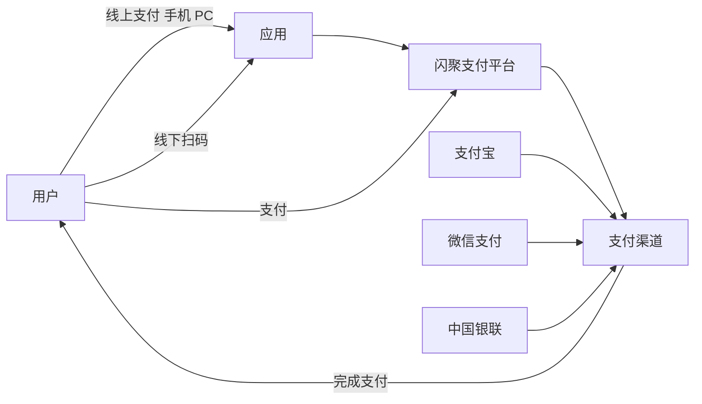
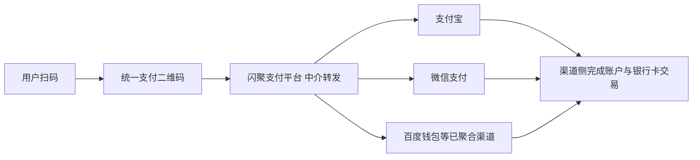
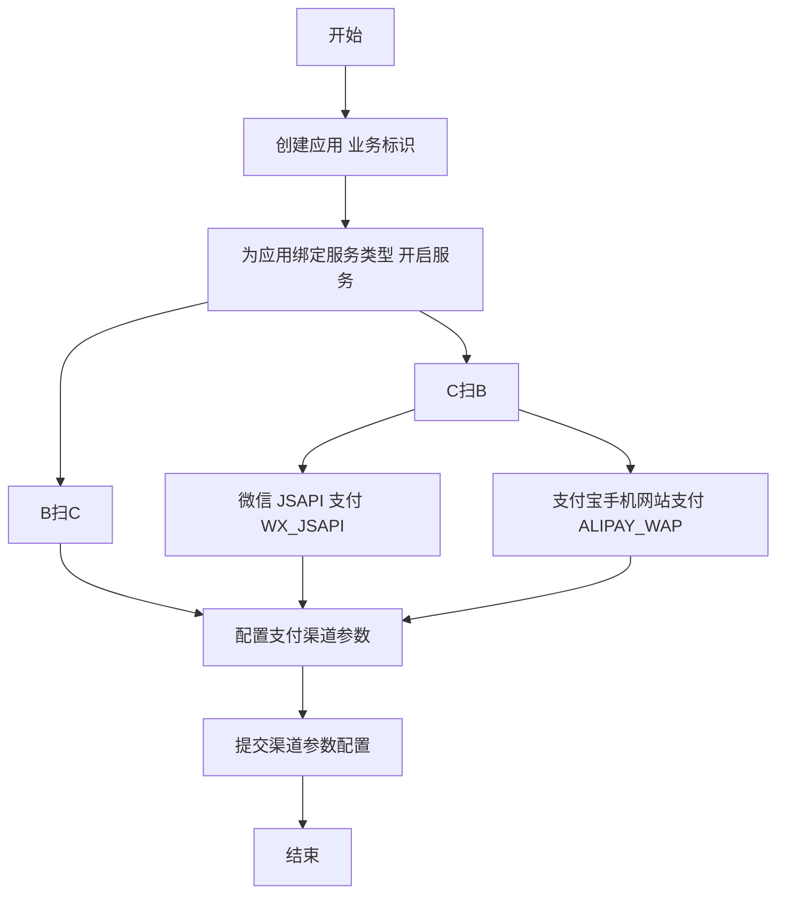

# 支付参数配置之需求概述合辑：理解应用、理解渠道参数与三步业务流程

> 🔒 安全提示：文中示例的口令/密钥均为课程教学环境演示口径，生产环境的安全要求见《安全与合规须知》。

## 先给结论

- 三篇内容讲清支付渠道参数配置的业务底盘：理解应用是什么、理解支付渠道参数是什么、从创建应用到提交参数的完整业务流程。
- 闪聚支付平台是不碰钱的中介，把支付宝、微信支付等众多渠道聚合为一个支付通道；支付渠道参数是渠道要求调用方出示的凭证，典型项有 AppID、支付网关地址、签名密钥。
- 应用是商户在平台创建的业务标识，不是技术概念：一个电商网站、一家餐厅各自对应一个应用；商户有几条业务线就建几个应用。
- 订单隶属于应用，平台按应用维度管理订单与统计财务数据，这是要求商户先建应用的根本目的；用户永远基于某个应用完成支付。
- 商户有两重身份：既是闪聚支付的商户，更是支付宝、微信的商户；必须先在渠道侧注册开通拿到参数，再配置到平台，扫码支付时平台读取参数连同请求一起提交渠道。
- 应用落在数据模型里就是商户库的 app 表：APP_ID 唯一标识、MERCHANT_ID 关联所属商户、PUBLIC_KEY 与 NOTIFY_URL 为参数配置预留位置。
- 要配哪些参数由应用绑定的服务类型决定，服务类型分线上与线下两大类，例如 C 扫 B 对应微信 JSAPI 支付与支付宝手机网站支付两组参数。
- 业务流程三步：创建应用（起步只要名称）、绑定服务类型（开启服务，可绑多个，平台默认提供 B 扫 C 与 C 扫 B）、逐渠道填参数保存提交；实际操作多由平台业务人员协助，但开发人员必须掌握全流程，后续要逐接口代码化。

## 第1部分：理解应用：商户接入聚合支付先立一块业务标识

商户资质审核通过，注册与资质申请的链路宣告完成，商户从此成为闪聚支付平台的正式用户。正式用户要用平台的支付能力，中间还隔着一个必经环节：支付参数配置。配置之前先把几个基础概念立稳，头一个是「应用」。它听起来像手机里的 APP，在聚合支付平台里却是一个有明确业务含义与数据模型的概念，订单归属、账目统计都挂在它身上。

### 从聚合支付说起：众多渠道拧成一个通道

理解应用之前得先看懂它服务的对象。闪聚支付平台是聚合支付平台，聚合的对象叫支付渠道，指微信、支付宝等第三方支付机构提供的支付通道；平台的职责是把这一堆渠道汇聚成一个支付通道，交给商户使用。聚合的价值用扫码场景一讲就透：商家收款台上只贴一张二维码，顾客用支付宝扫，手机自动拉起支付宝付款；用微信扫，自动拉起微信付款。商家不关心顾客用哪家支付，顾客不关心商家接了哪些渠道，一张码背后是平台把所有渠道的差异吸收掉了。整个链路如下：



图的走向对应平台的工作机制：用户基于某个应用发起支付，支付请求汇入闪聚支付平台，平台再根据请求选用具体的支付渠道完成支付。应用是这条链的起点，商户创建它，用户带着它支付，平台按它记账。

### 应用是什么：商户在平台开的业务门牌

应用这个词放在支付平台里容易望文生义，最贴切的类比仍然是手机里的 APP：团购软件是一个应用，电商软件是另一个应用，每个有支付需求的软件都是一个独立的支付入口。商户在闪聚支付平台创建应用，本质上是给自己的每一条业务线各立一块门牌。

举两个例子。一家商户经营着自己的电商网站 example.com，网站要接入闪聚支付完成线上收款，就在平台创建一个「电商网站应用」；这家商户同时开着餐厅，想在餐桌摆上平台的聚合二维码给顾客扫码付款，就再创建一个「餐厅应用」。两个应用同属一个商户，却对应两条互不相干的业务线，收款来源、订单归属、账目统计都要分开。

为什么必须先建应用才能用支付？有两层原因。**第一，这是平台的接入规则。** 商户要用平台的支付通道，先在平台创建应用，应用建好后支付参数配置、支付接口调用都以应用为单位展开，没有应用就没有挂载配置与流水的载体。**第二，这是订单记账的需要。** 用户扫码支付生成的订单隶属于创建这个码的应用，电商网站来的订单挂在电商网站应用下，餐厅扫码的订单挂在餐厅应用下。商户想统计某个业务在一定时间范围内生成了多少订单、往来账目是多少，按应用一查就清楚；假如所有业务的支付混在一起，对账就是一笔糊涂账。

### 一个商户多个应用：订单为什么隶属于应用

应用与商户的关系是一对多。商户是主体，应用是主体下按业务线拆分的标识，这个拆分在平台侧同时服务了两类视角。对商户，它是统计口径：餐厅应用和电商网站应用各自的交易额、退款额、对账单分开出具，经营分析才有颗粒度。对平台，它是管理口径：闪聚支付平台通过应用来管理商户的支付订单，按业务进行订单管理、财务数据统计，比如分别统计餐厅应用与电商网站应用下的订单信息。

再往支付流程里看一层，应用的归属属性贯穿始终。用户在餐厅扫码，扫的码由餐厅应用生成，支付请求带着这个应用的标识进入平台；平台选用具体支付渠道完成支付后，产生的交易流水同样记录在这个应用名下。从扫码到记账，应用的标识一路携带，这就是「用户是基于某个应用完成支付」的准确含义。业务标识虽然轻，却是整条支付链路里把「钱」与「业务」绑在一起的那根线。

### 应用的数据模型：app 表与应用 DTO

概念落到存储上，商户库 `pay_merchant_service` 里专门有一张 `app` 应用表，注册课盘点商户库五张表时它已经在列，如今到了用它的时候。建表脚本中 app 表的结构如下：

```sql
CREATE TABLE `app` (
  `ID` bigint(20) NOT NULL COMMENT '主键',
  `APP_ID` varchar(50) DEFAULT NULL,
  `APP_NAME` varchar(50) DEFAULT NULL COMMENT '应用名称',
  `MERCHANT_ID` bigint(20) DEFAULT NULL COMMENT '所属商户',
  `PUBLIC_KEY` varchar(50) DEFAULT NULL COMMENT '应用公钥(RSAWithSHA256)',
  `NOTIFY_URL` varchar(50) DEFAULT NULL COMMENT '授权回调地址',
  PRIMARY KEY (`ID`) USING BTREE,
  UNIQUE KEY `APP_ID` (`APP_ID`) USING BTREE
) ENGINE=InnoDB DEFAULT CHARSET=utf8;
```

六个字段分两组。基础组是 `ID`、`APP_ID`、`APP_NAME`、`MERCHANT_ID`：内部主键之外，`APP_ID` 上建了唯一索引，它是应用对外的唯一标识，将来支付请求里携带的应用标识就是它；`MERCHANT_ID` 是外键性质的关联字段，一个商户的多个应用共享同一个商户 id，一对多关系靠它落地。预留组是 `PUBLIC_KEY` 与 `NOTIFY_URL`：应用公钥用于支付接口调用的签名验签，授权回调地址用于支付结果的通知回传，两个支付参数字段现在先留空，等支付渠道参数配置的课程再填充。表结构印证了概念：应用从建表起就带着支付属性，它是为支付而生的业务标识。

应用在代码里的传输形态是商户服务对外提供的 `AppDTO`，定义在 `pay-merchant-api` 工程中：

```java
@Data
@ApiModel(value = "AppDTO", description = "")
public class AppDTO implements Serializable {

    private static final long serialVersionUID = 1L;

    private String appId;

    @ApiModelProperty(value = "商店名称")
    private String appName;

    @ApiModelProperty(value = "所属商户")
    private Long merchantId;

    @ApiModelProperty(value = "应用公钥(RSAWithSHA256)")
    private String publicKey;

    @ApiModelProperty(value = "授权回调地址")
    private String notifyUrl;
}
```

DTO 字段与表列一一对应，`merchantId` 的存在再次说明应用永远从属于商户。商户创建应用的接口设计、参数校验与落库实现，属于支付参数配置模块后续课程的内容，这里先把「应用是什么」的地基打牢，后面对着接口与表单就不会迷路。

## 第2部分：支付渠道参数配置是什么：聚合通道背后的那串第三方参数

商户注册与资质申请跑通之后，商户在平台上有了身份、交齐了证件，但此刻仍然收不了款。聚合支付平台自己不碰钱，真正的交易发生在支付宝、微信这些第三方渠道，而渠道只认参数不认人：请求里不带 AppID、网关地址、签名密钥，调用就会被拒。渠道参数是什么、从哪来、配在哪、要配多少，是支付参数配置模块要回答的第一组问题，把概念理清，后面的接口开发才知道在为谁写代码。

### 平台是中介，商户有两重身份

先把支付链路里各方的位置摆正，渠道参数的意义才看得懂。用户扫一张码完成支付，这张码背后是平台的统一通道，请求的流转如下：



平台在这一链路里只做请求消息的转发，账户余额的扣减、银行卡的入账都发生在渠道侧，平台全程不碰钱。看懂了中介定位，商户的两重身份就顺理成章。

**第一重身份在渠道，这是参数的来源。** 钱要从用户的账户划到商户的银行卡，这笔账只有渠道能记，商户若不是支付宝、微信的商户，渠道无从把钱给他。所以使用聚合平台之前，商户要先在渠道注册账号并开通支付，开通的含义就是渠道允许用户向他付款。开通之后，渠道会分配一组参数，典型如 AppID、支付宝网关地址、RSA2 签名密钥等，这些参数在之后的每一次接口调用中都要出示，是渠道确认「这笔交易属于哪个商户、签名是否可信」的依据。

**第二重身份在平台，这是参数的使用场景。** 没有聚合平台时，商户要在支付宝生成一张码、在微信生成一张码，柜台上摆一排；有了平台，各渠道被聚合成一个统一通道，一张码即可，用户用什么 App 扫码，平台就把请求转给对应的渠道。平台对接了几个渠道，商户就要在那几家开通：平台只聚合了支付宝和微信，商户开通这两家就够；平台若把百度钱包、京东支付也聚合进来，商户还得多配两家的参数。渠道参数配置的范围，随平台聚合能力与商户自身业务一起扩大。

### 参数配在哪：平台侧的一次登记

渠道的态度很明确，想调接口，先把参数带上。用户扫码产生的支付请求由平台代商户发起，平台转发时必须把这些参数拼进请求，因此商户在渠道拿到的参数要先登记到平台，这个登记动作就是支付渠道参数配置。参数落定之后，扫码支付发生时平台读出参数、组装请求、调用渠道接口，交易才能闭环。

渠道参数长什么样，以支付宝侧的参数模板为例（示例为按本课画面与主流渠道开放平台写法补全，所有敏感值一律占位）：

```yaml
# 支付宝渠道参数模板 数值全部为占位
ALIPAY:
  appId: "example-appid"                            # 支付宝开放平台分配的应用 ID
  gateway: "https://openapi.example.com/gateway.do" # 支付宝网关地址
  signType: "RSA2"                                  # RSA2 即 SHA256WithRSA 签名
  merchantPrivateKey: "example-sk"                  # 商户应用私钥 用于请求签名
  alipayPublicKey: "example-pk"                     # 支付宝公钥 用于验证渠道响应
```

微信侧的参数则以配置表单的形式出现，字段与本课演示页一致（示例按画面补全）：

```json
{
  "配置名称": "微信JSAPI参数示例",
  "appId": "example-appid",
  "应用秘钥": "example-secret",
  "安全校验码": "example-verify",
  "回调通知地址": "https://example.com/notify",
  "合作伙伴ID": "example-partner",
  "支付秘钥": "example-paykey"
}
```

两份示例里的密钥都是敏感信息：私钥泄露意味着任何人都能冒充商户签名调用渠道接口，真实环境中这类值只在渠道后台与受控配置里流转，文档与演示一律以 example-sk 这类占位符代替，落库与日志中也不应出现明文。

### 配哪些参数：服务类型说了算

渠道提供的支付接口远不止一个，微信的支付接口一页排不开，支付宝同样一大串，每个接口要求的参数还不完全一致。让商户把所有接口的参数全配一遍，工作量不现实，也没有必要，参数清单的裁剪靠服务类型。

服务类型是闪聚支付平台对外的服务产品，本质是平台包装出来的聚合支付服务通道，分线上与线下两大类：线上有手机 APP 支付、PC 网网页支付、手机网页支付、小程序支付；线下有 C 扫 B 与 B 扫 C，C 扫 B 是收款码支付，商户出示二维码用户来扫，B 扫 C 反过来，顾客出示付款码商户来扫。

商户为应用绑定服务类型，绑定关系一旦确定，平台落地这个服务类型所需要对接的渠道接口就确定了，参数清单随之确定。以 C 扫 B 为例：平台要实现 C 扫 B 的统一通道，必须对接微信的 JSAPI 支付与支付宝的手机网站支付两个接口，微信 JSAPI 是内嵌于微信 App 内的网页支付方式，可用于公众号场景，支付宝手机网站支付面向手机网页收银台。那么选了 C 扫 B 的商户只需要配这两组参数；选 B 扫 C 的商户则换成 B 扫 C 所用渠道接口的参数。参数不是越多越好，而是与应用的服务类型严格对齐。

### 把整条链路串起来

到这里可以给出一个精简的全景：商户在渠道开通支付拿到参数，在平台创建应用，为应用绑定服务类型，按服务类型把渠道参数配进平台；用户扫码后，平台读取该应用配置的渠道参数，调用对应渠道接口完成支付。应用、服务类型、渠道参数三层环环相扣，缺一层通道就断。这个流程怎么在页面上一步步操作、背后要用哪些接口来实现，正是支付参数配置模块接下来的全部内容。

## 第3部分：支付渠道参数配置的业务流程：从创建应用到提交参数

概念层已经清楚：应用是业务标识，服务类型决定参数清单，渠道参数是渠道分配的凭证。落到操作层面，商户在平台上到底按什么顺序点哪几个按钮、每一步页面给出什么反馈，需要一条完整的业务流程来回答。这条流程同时划定了后续开发的任务边界，页面上每一个动作背后都要有接口支撑。

### 第一步：创建应用，一个业务标识

应用在这里的表现形态非常朴素，一个名称而已，公钥等扩展信息暂不展开。名称由商户自己定，语义上对应他的一块业务：开餐厅的就建一个某某餐厅应用，同时经营电商网站的再建一个某某电商网站应用。一个商户可以建多个应用，每个应用代表一条独立的业务线，顾客在这条业务线上的每笔支付订单都隶属于这个应用，后续的服务类型绑定、渠道参数、对账查询都以应用为归属单位。

创建动作本身没有复杂表单，填应用名称、保存即可。应用创建成功后，系统不停留，直接跳转到为应用绑定服务类型的页面，这条自动流转把三步流程串成了向导式的操作路径。

### 第二步：绑定服务类型，开启服务

绑定页面列出平台提供的服务类型，默认给出 B 扫 C 与 C 扫 B 两个线下类型，它们面向线下门店场景。每个服务类型带一个「开启服务」按钮，商户按业务需要开启，选 C 扫 B 就开启 C 扫 B，两个都要就都开，数量不限制。

绑定与否直接控制第三步的入口：未开启的服务类型，配置参数的按钮处于不可用状态；开启之后，「配置实际支付渠道参数」的入口才会点亮。这个交互顺序不是界面装饰，而是业务约束的体现，参数清单由服务类型决定，没定服务类型就无从谈起配什么参数。整条流程与分支如下：



图中主链路是四个节点的直线：创建应用、绑定服务类型、配置支付渠道参数、提交渠道参数配置。C 扫 B 的分支展示了参数清单的来源，开启这个服务类型后，页面会列出微信 JSAPI 支付与支付宝手机网站支付两个原始支付渠道，每个渠道对应一份参数表单。

### 第三步：配置渠道参数，逐渠道填表

进入参数配置页后，商户针对每个原始支付渠道分别填写。参数内容以渠道官方分配的为准，商户要登录支付宝或微信的商户后台，把渠道给的参数逐项抄进平台。以微信侧的配置表单为例，字段与本课演示页一致（示例按画面补全，敏感值占位）：

```json
{
  "配置名称": "微信JSAPI参数示例",
  "appId": "example-appid",
  "应用秘钥": "example-secret",
  "安全校验码": "example-verify",
  "回调通知地址": "https://example.com/notify",
  "合作伙伴ID": "example-partner",
  "支付秘钥": "example-paykey"
}
```

支付宝侧同理，AppID、网关地址、签名密钥等逐项对应。全部渠道填完、保存后提交渠道参数配置，流程结束。从这一刻起，用户扫码时平台就能取到该应用、该服务类型、该渠道的完整参数，支付请求得以组装并发往渠道。

一个现实问题值得注意：这些参数专业性强，商户自己往往看不懂，实际操作中通常由平台的业务人员协助商户完成配置。开发人员虽不直接面对这个表单，却必须吃透整条链路，因为这三步里的创建应用、服务类型绑定、参数保存，最终都要落成平台的后端接口，哪一步没实现，页面就断在哪一步。

## 常见误区

- **把应用当成一个软件系统。** 错例：以为创建应用是要开发一个 APP 或一套前端。正解：应用只是平台内的业务标识，建应用是在平台登记一条业务线，真正的软件系统是商户自己的电商网站、自己的收银方式，与本标识无冲突。
- **一个商户只建一个应用，所有业务共用。** 错例：餐厅与电商网站共用一个应用收款，月底对账分不清钱来自哪条业务。正解：按业务线建应用，一商户多应用，订单与财务数据按应用隔离，统计与对账才有清晰口径。
- **认为应用只是名字，随手建了就完事。** 错例：应用建了一堆，名称随意，无人维护。正解：应用是支付参数与交易流水的挂载单元，`APP_ID` 唯一且不可再生，命名与归属要按业务规范管理，删除与停用同样要走管理流程。
- **把商户 id 当成支付记账的维度。** 错例：平台按商户聚合所有交易，商户内部想分业务统计时无从下手。正解：记账与统计以应用为维度，商户维度由应用聚合而来，两层口径各司其职。
- **把渠道参数当成平台自己的东西。** 错例：以为参数由闪聚平台分配给商户，平台后台随便生成一份。正解：参数由第三方渠道在商户开通支付后分配，平台只负责登记、保存与转发，源头始终在渠道。
- **只注册平台就想收款。** 错例：商户完成平台注册与资质申请后直接开始收款，扫码报错找不到渠道参数。正解：平台是中介，交易在渠道发生，商户必须先在渠道开通支付拿到参数，再回平台配置。
- **渠道参数全量配置。** 错例：把微信、支付宝所有支付接口的参数都配一遍求安心。正解：按应用绑定的服务类型确定要对接的渠道接口，只配用得到的，配了不用徒增维护与泄露风险。
- **密钥当普通配置随意贴。** 错例：把渠道私钥写进聊天群、代码注释或日志。正解：密钥类参数按敏感信息管理，示例与文档用 example-sk 这类占位符，真实值只在受控环境流转。
- **跳过绑定服务类型直接配参数。** 错例：应用一创建就去找渠道参数的填写入口，发现根本进不去。正解：参数清单由服务类型决定，先开启服务，配置入口才会放开，这是业务约束而非页面限制。
- **认为一个应用只能绑一个服务类型。** 错例：餐厅既要收款码又要付款码扫码，以为要建两个应用。正解：一个应用可以绑定多个服务类型，分别开启即可，应用是业务归属，服务类型是能力开关，二者一对多。
- **把配置方向搞反，去渠道侧填平台的参数。** 错例：以为要把平台生成的参数填到支付宝后台。正解：参数由渠道分配，商户从渠道后台取值，填进聚合平台，方向始终是渠道流向平台。
- **把流程当成商户独立完成。** 错例：验收时等商户自己配完参数。正解：配置专业性强，实际由平台业务人员协助操作，系统设计时要按完整的向导式流程提供页面与接口。

## 面试可能被问到的问题

1. 面试官追问：「聚合支付平台里的应用是什么，和手机里的 APP 有什么关系？」
   答：应用是商户在平台上创建的业务标识，类比手机里的 APP：每个有支付需求的软件对应一个支付入口。商户有几条业务线就建几个应用，电商网站建电商应用，餐厅建餐厅应用。它与手机 APP 的相同点在于「一个业务一个入口」，不同点在于它是平台内的登记信息与数据归属单元，不涉及软件开发。

2. 面试官追问：「为什么商户要用支付前必须先创建应用？」
   答：两个原因。规则层面，应用是平台定义的接入前提，支付参数配置、支付接口调用都以应用为单位展开；记账层面，订单隶属于应用，用户基于某个应用完成支付，平台按应用管理订单、做财务统计，没有应用，交易流水就失去了业务归属，对账与经营分析都做不了。

3. 面试官追问：「应用和商户是什么关系，为什么这样设计？」
   答：一对多。商户是主体，应用是按业务线拆分的标识。这样设计把「钱从哪条业务来」这个问题在数据模型层就回答了：商户维度回答「是谁的钱」，应用维度回答「哪条业务的钱」。一个商户多业务线是常态，单一维度会把统计与对账搅混。

4. 面试官追问：「支付渠道和应用有什么区别？」
   答：支付渠道是供给侧概念，指支付宝、微信支付等第三方支付机构提供的支付通道，平台把它们聚合起来；应用是需求侧概念，是商户的业务标识，支付的发起方归属。一笔支付从应用出发，经平台路由到某个渠道完成，两者一个是收款业务的名片，一个是资金通道的管道。

5. 面试官追问：「app 表为什么要有 APP_ID 和内部主键两个标识，PUBLIC_KEY 是干什么用的？」
   答：内部主键供数据库与关联查询使用，`APP_ID` 是对外暴露的唯一标识，带唯一索引，支付请求用它指明业务归属，两者内外分离避免暴露内部主键。`PUBLIC_KEY` 存应用公钥，用于支付接口调用的签名验签，`NOTIFY_URL` 是支付结果的授权回调地址，这两个字段是应用作为支付载体的配置位，随支付参数配置一起填充。

6. 面试官追问：「什么是支付渠道参数，为什么必须配置？」
   答：支付渠道是有支付牌照的第三方支付公司开通的支付通道，渠道参数是渠道要求调用方出示的凭证，包括 AppID、网关地址、签名密钥等。聚合平台代商户调用渠道接口时必须携带这些参数，渠道靠它们识别商户身份并验证签名，缺了参数调用会被直接拒绝，交易无法完成。

7. 面试官追问：「聚合支付平台在支付链路里扮演什么角色，碰不碰资金？」
   答：平台是不碰钱的中介，负责把用户的支付请求按扫码工具分流转发给对应渠道，真正的账户与银行卡交易由渠道完成。平台的增量价值在于把多个渠道聚合成一个二维码，商户不用在柜台上摆一排码，这也是渠道参数必须先登记到平台的原因。

8. 面试官追问：「商户应该配置哪些渠道参数，怎么确定清单？」
   答：清单由应用绑定的服务类型决定。服务类型是平台对外提供的聚合支付服务通道，分线上与线下两类；一个服务类型对应固定的若干渠道接口，例如 C 扫 B 对应微信 JSAPI 支付与支付宝手机网站支付，商户只需配置这些接口的参数，未绑定的服务类型不用配。

9. 面试官追问：「商户没有在渠道开通支付，能通过聚合平台收款吗？」
   答：不能。资金流转发生在渠道侧，商户不是渠道的商户，渠道无法把货款结算给他。平台聚合的是支付请求的入口，不是资金账户，所以开通渠道、拿到参数是使用平台的前提，顺序上不可颠倒。

10. 面试官追问：「平台对接的渠道数量对商户配置有什么影响？」
   答：商户的参数清单随平台聚合范围扩大。平台只对接支付宝和微信时，商户配置这两家即可；平台若再聚合百度钱包、京东支付等渠道，希望使用新渠道的商户就要在对应渠道开通支付并补配参数，配置范围跟着平台的渠道接入能力走。

11. 面试官追问：「支付渠道参数配置的业务流程分几步，每步产出什么？」
   答：三步。创建应用产出一个业务标识，后续订单与配置都以它归属；绑定服务类型确定应用具备哪些支付能力，同时确定参数清单；配置并提交渠道参数把渠道分配的凭证登记到平台，支付链路从此可用。三步是严格的先后关系，前一步是后一步的输入。

12. 面试官追问：「为什么创建应用成功后要自动跳转到绑定服务类型页面？」
   答：这是把业务依赖固化成交互路径。没有服务类型就没有参数清单，绑定是配置的前置条件，自动跳转让操作者不会漏掉这一步，也让三步流程在产品形态上保持向导式的连贯。

13. 面试官追问：「服务类型与原始支付渠道是什么关系？」
   答：一对多的映射。平台实现一个服务类型，需要对接一个或多个渠道接口，例如 C 扫 B 依赖微信 JSAPI 支付与支付宝手机网站支付两个原始渠道。开启服务后页面列出这些渠道，商户逐个配置参数，所以服务类型是参数清单的组织单位。

14. 面试官追问：「这个流程要代码化的话，系统需要提供哪些功能？」
   答：至少包括应用创建接口、应用与服务类型的绑定及开启接口、按渠道读取与保存参数的接口，以及对应的向导式页面。开发顺序上遵循依赖关系，先做被依赖的底层接口，再做面向前端的 REST 接口，后续课程按这条线展开。

## 配套资料

- 讲义：`materials/docs/10/闪聚支付-第2章-讲义-支付参数配置v1.0.md`，1.1 基础概念之 1.1.1 理解应用（聚合支付与支付渠道的定义、应用是什么与应用有什么用、订单隶属于应用的统计说明）为本课出处。
- 代码：`materials/code/10/_散落资料/`，商户服务建库脚本 `shanjupay_merchant_service`（app 表完整 DDL，正文 SQL 为按本系列口径整理后的原文）；`materials/code/10/shanjupay/`，聚合支付工程 `pay-merchant-api` 的 `dto/AppDTO` 为真实文件，正文代码为按 `com.study.pay` 口径改写后的节选；该目录下另有按开发阶段归档的工程副本，内层目录名含项目原始命名，与正文包名口径不一致，不在此展开，按用途自取。
- 说明：本课为需求概述的概念篇，商户创建应用与支付渠道参数配置的接口设计与实现，在支付参数配置模块的后续课程展开；示例站点以 example.com 占位。
- 讲义：`materials/docs/10/闪聚支付-第2章-讲义-支付参数配置v1.0.md`，1.1.2 理解支付渠道参数配置（整体流程、服务类型的线上线下分类、C 扫 B 对应微信 JSAPI 支付与支付宝手机网站支付的说明）与本课出处对应。
- 说明：本课为需求概述，无代码改动；文中两份参数示例为按本课画面与主流渠道开放平台写法补全，密钥与站点一律 example 系占位，不代表真实取值。
- 讲义：`materials/docs/10/闪聚支付-第2章-讲义-支付参数配置v1.0.md`，1.1 商户应配置哪些第三方渠道参数（服务类型定义与分类）、1.2 创建应用、1.3 支付渠道参数配置（配置流程六步与绑定服务类型页面说明）与本课出处对应。
- 说明：本课为需求概述，无代码改动；文中配置表单字段取自本课演示画面，示例值为按主流渠道文档写法补全的占位，渠道编码 WX_JSAPI、ALIPAY_WAP 以本课画面为准。
