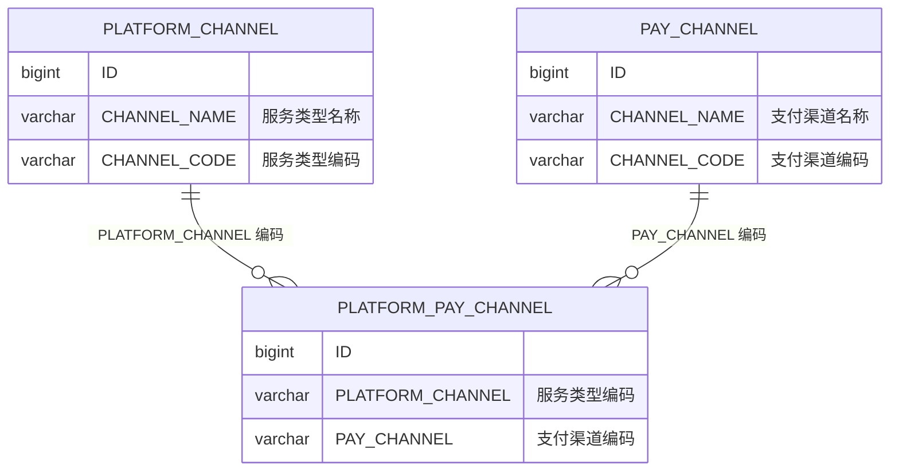

# 支付渠道参数配置的基础数据：服务类型、支付渠道与对应关系三张表

交互流程里第一步是查平台服务类型，紧接着还要查服务类型对应的支付渠道。这两类数据去哪儿查？答案是交易库里预先备好的基础数据。基础数据长什么样、三张表怎么分工、多对多关系怎么落库，这一课把这些地基砌好，后面的查询接口与配置接口都建在它上面。

## 先给结论

- 基础数据在平台安装时随初始化脚本写入交易库 `pay_transaction`，商户无须手工添加。
- 三张表分工明确：`platform_channel` 存平台服务类型，`pay_channel` 存第三方支付渠道，`platform_pay_channel` 存两者的对应关系。
- 服务类型与支付渠道是多对多：一种服务类型可对接多个支付渠道，一个支付渠道也可被多种服务类型使用。
- 服务类型按自身特点选择对接的渠道，C 扫B 对接微信 JSAPI 与支付宝手机网站支付，B 扫C 对接微信付款码支付与支付宝条码支付。
- 对应关系表用编码关联两张基础表，查询「某服务类型有哪些渠道」就是从这张关系表出发做关联查询。

## 基础数据为什么要预先初始化

把服务类型列表做成页面上的一个下拉或表格，数据总得有来源。闪聚支付平台对外提供哪些服务类型，相当于系统提前为商户准备好的支付服务方式清单，让商户按业务勾选；平台对接了哪些第三方支付渠道，同样是系统自身的家底。这两类数据都不随商户的操作产生，也不该由运营人员临时手填，所以作为基础数据在平台安装时就初始化进数据库。

基础数据的特征可以概括为三点：量小、稳定、被高频引用。量小体现在整个平台的服务类型不过几条，支付渠道也只覆盖微信、支付宝这类主流渠道；稳定体现在它们随版本发布而变，不随业务运行而变；高频引用体现在绑定服务类型、查询渠道列表、发起支付路由全都要读它们。这样的数据最适合在部署阶段一次性导入。

## 三张表各管什么

三张表都在交易库 `pay_transaction` 里，建表语句如下：

```sql
CREATE TABLE `platform_channel` (
  `ID` bigint(20) NOT NULL,
  `CHANNEL_NAME` varchar(50) DEFAULT NULL COMMENT '平台支付渠道名称',
  `CHANNEL_CODE` varchar(50) DEFAULT NULL COMMENT '平台支付渠道编码',
  PRIMARY KEY (`ID`) USING BTREE
) ENGINE=InnoDB DEFAULT CHARSET=utf8 COMMENT='平台服务类型';

CREATE TABLE `pay_channel` (
  `ID` bigint(20) NOT NULL,
  `CHANNEL_NAME` varchar(50) DEFAULT NULL COMMENT '原始支付渠道名称',
  `CHANNEL_CODE` varchar(50) DEFAULT NULL COMMENT '原始支付渠道编码',
  PRIMARY KEY (`ID`) USING BTREE
) ENGINE=InnoDB DEFAULT CHARSET=utf8 COMMENT='第三方支付渠道';

CREATE TABLE `platform_pay_channel` (
  `ID` bigint(20) NOT NULL,
  `PLATFORM_CHANNEL` varchar(20) DEFAULT NULL COMMENT '平台支付渠道编码',
  `PAY_CHANNEL` varchar(20) DEFAULT NULL COMMENT '原始支付渠道编码',
  PRIMARY KEY (`ID`) USING BTREE
) ENGINE=InnoDB DEFAULT CHARSET=utf8 COMMENT='平台服务类型对应第三方支付渠道';
```

两张基础表结构几乎一样，都是 id 加名称加编码三列，差别在语义。`platform_channel` 存的是平台服务类型，如闪聚B扫C、闪聚C扫B，它面向商户，是商户在绑定页面能选到的东西；`pay_channel` 存的是第三方支付渠道，讲义里也称原始支付渠道，如微信 JSAPI、支付宝手机网站支付，它面向平台内部，是真正对接第三方接口时的通道。`platform_pay_channel` 是关系表，两列分别放服务类型编码与支付渠道编码，一行记录表示某服务类型使用某支付渠道。



关系表把两张基础表的多对多关系落了地：一种服务类型对应多行关系记录，一个支付渠道也可以出现在多行里。不设外键、直接用编码做逻辑关联，是这套数据模型的选择，查询时由 SQL 负责把关系连起来。

## 初始化数据：导入什么、怎么读

初始化脚本往三张表里插入课程环境使用的基础数据，内容如下：

```sql
INSERT INTO `platform_channel` (`ID`, `CHANNEL_NAME`, `CHANNEL_CODE`) VALUES
(1,'闪聚B扫C','shanju_b2c'),
(2,'闪聚C扫B','shanju_c2b'),
(3,'微信Native支付','wx_native'),
(4,'支付宝手机网站支付','alipay_wap');

INSERT INTO `pay_channel` (`ID`, `CHANNEL_NAME`, `CHANNEL_CODE`) VALUES
(1,'微信JSAPI','WX_JSAPI'),
(2,'支付宝手机网站支付','ALIPAY_WAP'),
(3,'支付宝条码支付','ALIPAY_BAR_CODE'),
(4,'微信付款码支付','WX_MICROPAY'),
(5,'微信Native支付','WX_NATIVE');

INSERT INTO `platform_pay_channel` (`ID`, `PLATFORM_CHANNEL`, `PAY_CHANNEL`) VALUES
(1,'shanju_b2c','WX_MICROPAY'),
(2,'shanju_b2c','ALIPAY_BAR_CODE'),
(3,'wx_native','WX_NATIVE'),
(4,'alipay_wap','ALIPAY_WAP'),
(5,'shanju_c2b','WX_JSAPI'),
(6,'shanju_c2b','ALIPAY_WAP');
```

读这份脚本的钥匙在第三张表。`shanju_c2b` 闪聚C扫B 服务类型对应 `WX_JSAPI` 微信 JSAPI 与 `ALIPAY_WAP` 支付宝手机网站支付两条记录，这正是交互流程里说的 C 扫B 对接微信与支付宝两个接口的落库形态；`shanju_b2c` 闪聚B扫B 对应 `WX_MICROPAY` 微信付款码支付与 `ALIPAY_BAR_CODE` 支付宝条码支付，B 扫C 是商户拿扫码枪扫用户付款码的场景，两条渠道恰好都是条码类支付。B 与 C 的含义也顺带说明：B 指 Business 商户，C 指 Customer 用户，B 扫C 是商户扫用户，C 扫B 是用户扫商户的聚合码。

导入操作本身没有难度：打开数据库客户端，连上交易库，选中脚本执行即可。课程环境在搭建阶段已随初始化脚本导入了部分基础数据，`platform_channel` 当时已有数据，`pay_channel` 与 `platform_pay_channel` 需要在本模块开始时补导。库里已有数据就不必重复执行，插入脚本重复跑一遍会因主键冲突报错，先看数据再决定导不导是常规操作。

导入是小事，真正要带走的是三张表的关系。商户平台应用在绑定页面展示的服务类型列表，来自 `platform_channel`；点开配置参数页面看到的支付渠道列表，是拿服务类型编码去 `platform_pay_channel` 关联 `pay_channel` 查出来的。两张基础表加一张关系表，撑起了支付渠道参数配置的全部读路径。

## 常见误区

- **把服务类型与支付渠道混为一谈。** 错例：认为 C 扫B 就是一个支付渠道，直接拿它对接微信接口。正解：服务类型是平台对商户暴露的服务方式，支付渠道是平台对接第三方的通道，两层抽象各自建模，靠关系表连接。
- **认为对应关系可以不落库，代码里写死。** 错例：在代码里用 switch 判断 C 扫B 对应哪些渠道。正解：对应关系存入 `platform_pay_channel`，新增服务类型或渠道只需加数据不改代码，扩展性与查询接口都依赖这张表。
- **重复执行初始化脚本。** 错例：库里已有数据仍全量重导，主键冲突报错后不知所措。正解：先查当前数据，缺哪张表的数据导哪张，初始化脚本按需执行。
- **用主键 ID 关联关系表。** 错例：`platform_pay_channel` 里存两张基础表的 ID。正解：表里存的是编码 `CHANNEL_CODE` 系字段，编码是业务标识，可读且稳定，关联查询按编码连接。

## 面试可能被问到的问题

1. 面试官追问：「平台服务类型和第三方支付渠道为什么要分成两张表？」
   答：两者是不同抽象层级。服务类型面向商户，描述平台提供什么支付方式，如 B 扫C、C 扫B；支付渠道面向平台内部，描述用哪个第三方接口实现，如微信 JSAPI、支付宝手机网站支付。分成两张表后，服务类型的定义不依赖具体渠道，渠道的接入也不影响服务类型，扩展时各动各的表。
2. 面试官追问：「服务类型与支付渠道的多对多关系在数据模型上如何实现？」
   答：中间关系表 `platform_pay_channel`，两列分别存服务类型编码与支付渠道编码，一行表示一种对应关系。一种服务类型对应多行即它可使用多个渠道，一个渠道出现在多行即它可被多种服务类型使用，多对多由此落地。
3. 面试官追问：「为什么关系表用编码关联而不是主键 ID？」
   答：编码是业务标识，语义清楚，如 shanju_c2b 直接表明是 C 扫B 服务类型，排查数据时肉眼可读；同时编码跨库跨服务引用比自增主键更稳，避免依赖各库的 ID 生成规则。
4. 面试官追问：「基础数据为什么在安装时初始化，而不是做成管理页面动态维护？」
   答：这类数据量小且高度稳定，变更频率接近版本发布频率，做成页面维护的收益低，反而引入误操作风险。随部署脚本初始化，环境可复制、数据可回溯，需要调整时走发布流程改脚本，符合配置即数据的治理思路。
5. 面试官追问：「商户绑定服务类型时，系统如何知道要为它列出哪些可配参数的渠道？」
   答：拿应用绑定的服务类型编码，到 platform_pay_channel 关系表查出该编码对应的所有支付渠道编码，再关联 pay_channel 得到渠道列表。绑定决定范围，关系表决定渠道，参数配置页面展示的就是这个查询结果。

## 配套资料

- 讲义：`materials/docs/10/闪聚支付-第2章-讲义-支付参数配置v1.0.md`，5.1.2 基础数据（platform_channel、pay_channel、platform_pay_channel 三表说明与初始化 SQL）为本课出处。
- 代码：`materials/code/10/代码/`，交易服务工程中 `PlatformChannel`、`PayChannel`、`PlatformPayChannel` 实体类与对应 Mapper 为真实文件，正文按 `com.study.pay` 系口径改写（内层工程目录与包名为课程原始命名，不在此展开）；交易库初始化脚本见 `materials/code/10/_散落资料/`（交易库 SQL 转储，正文三表 DDL 为该脚本节选，初始化数据以讲义为准），库名按本系列口径书写为 `pay_transaction`。
- 说明：该阶段课程资料归档在 `materials/docs/10/` 与 `materials/code/10/`（不存在 09 编号目录），引用路径截至该层级。
