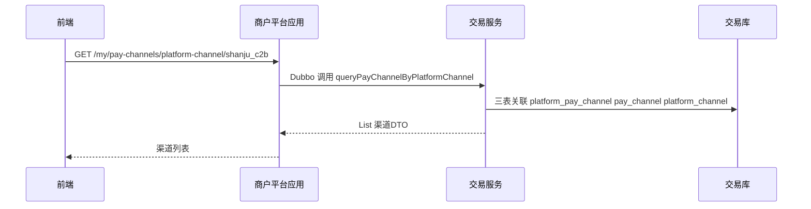

# 根据服务类型查询支付渠道列表：三表关联的实现、单元测试与接口串联

配置渠道参数之前，页面得先回答一个问题：这个服务类型下有哪些支付渠道可以配。接口⑤与接口⑥负责给出答案，查询逻辑横跨三张表，是本模块第一条多表关联查询。在交互流程图上，这两个接口处在第二阶段的开头：应用绑定服务类型完成之后，前端先拿渠道列表展示，用户选定渠道才进入参数填写与保存。拿不到准确的渠道列表，后面的配置就是无源之水，所以这一课按链路顺序走完三步：交易服务写出三表关联的 Dubbo 接口，单元测试验证 SQL 与列映射，商户平台应用暴露 REST 端点并用 Postman 打通全链路。三步各自独立成段，又由同一条查询串联，任何一步出问题都能单独回溯。

## 先给结论

- 接口⑤是交易服务的 `PayChannelService.queryPayChannelByPlatformChannel`，入参服务类型编码，返回 `List<PayChannelDTO>`。
- 查询要关联三张表：关系表 `platform_pay_channel` 分别连接 `pay_channel` 取渠道名称，连接 `platform_channel` 锁定服务类型条件。
- MyBatis-Plus 只覆盖单表操作，多表关联要在 Mapper 上写自定义 SQL，`@Select` 注解或 XML 皆可，课程采用注解方式。
- 单元测试前先停掉运行中的交易服务，避免测试启动的 Spring 容器与原进程的 Dubbo 端口冲突。
- `SELECT *` 在多表关联里是隐患：三张表都有同名列，列映射靠侥幸对上；收窄为只取渠道表的三列，与 DTO 字段一一对应才是稳妥写法。
- 接口⑥是商户平台应用的 `GET /my/pay-channels/platform-channel/{platformChannelCode}`，纯转发，联调返回微信与支付宝两条渠道。

## 接口⑤：从页面反推出三张表的关联

交互流程里，应用绑定服务类型之后，页面进入渠道配置阶段：点某个服务类型的「配置实际支付渠道」，页面列出该服务类型下的原始支付渠道，每个渠道后面才是「配置参数」按钮。这个列表的数据从哪儿来？数据在交易库的三张表里，`pay_channel` 存支付渠道，`platform_channel` 存服务类型，`platform_pay_channel` 存两者的对应关系，查询的落点就是这三张表。

先把 SQL 的思路推出来。要查的是「某种服务类型对应哪些支付渠道」，关系表里有服务类型编码与渠道编码两列，从它出发：第一步拿服务类型编码到关系表过滤，得到该服务类型的若干行关系记录；第二步拿着这些行里的渠道编码去 `pay_channel` 换出渠道名称，页面要展示名称，光有编码不够；第三步为了可扩展性，把服务类型表也关联上，将来页面要显示服务类型名称时查询无需返工。写成 SQL 时给三张表起短别名，关系表 `ppc`、渠道表 `pc`、服务类型表 `pla`，三行连接条件读起来一目了然。

这个推导在开发里可以真刀真枪走一遍：打开数据库客户端，先用两表连接把渠道编码查出来，确认关系数据正确；再补上渠道表换名称，核对页面要显示的两列；最后加上服务类型表关联，验证过滤条件仍然命中。SQL 在客户端验证通过后才进代码，接口只是这段 SQL 的载体。数据库驱动的开发顺序里，先把查询在客户端调通再封装成接口，能把 SQL 层的问题与代码层的问题隔离开，出问题时一眼分辨责任在哪层。

还有一个细节值得推敲：过滤条件为什么落在服务类型表 `pla.CHANNEL_CODE = #{platformChannelCode}`，而不是直接写在关系表 `ppc.PLATFORM_CHANNEL` 上。关系表里的服务类型编码列与服务类型表的编码列存的值相同，两种写法当前结果一致；条件写在被关联表上，语义是「按服务类型的编码过滤服务类型，再取其渠道」，表达的是业务实体自身的属性条件，将来若服务类型增加生效状态之类的过滤，条件有地方可放。连接条件与过滤条件分开书写，是让 SQL 保持可读、可演进的起码纪律。

接口契约顺着这个查询定义。入参是服务类型编码 `platformChannelCode`，出参是渠道列表，元素类型用现成的 `PayChannelDTO`，id、channelName、channelCode 三个字段对应渠道表的列。出参类型的选择上有一条克制原则：api 工程里已经有 `PayChannelDTO`，字段恰好覆盖页面需要的编码与名称，就不为单个接口再造一个新 DTO。DTO 是契约资产，每新增一个都有定义、转换器、文档三份成本，能复用时复用，确实承载不了新字段的语义时才扩字段或新建。在 `PayChannelService` 中追加：

```java
/**
 * 根据平台服务类型获取支付渠道列表
 * @param platformChannelCode 服务类型编码
 * @return
 * @throws BusinessException
 */
List<PayChannelDTO> queryPayChannelByPlatformChannel(String platformChannelCode) throws BusinessException;
```

## 交易服务实现：Mapper 自定义 SQL 与注解传参

实现类 `PayChannelServiceImpl` 里追加方法，职责清晰到只有一行转调：

```java
@Autowired
private PlatformChannelMapper platformChannelMapper;

@Override
public List<PayChannelDTO> queryPayChannelByPlatformChannel(String platformChannelCode) throws BusinessException {
    //调用mapper 查询数据库 platform_pay_channel，pay_channel，platform_channel
    return platformChannelMapper.selectPayChannelByPlatformChannel(platformChannelCode);
}
```

真正的难点在 Mapper。MyBatis-Plus 的 `BaseMapper` 提供的是单表 CRUD，三表关联必须自己写 SQL。实现类的其他部分不用动：类上的 Dubbo 服务注解、依赖注入的 Mapper 字段都是查询服务类型课时已经就位的结构，新方法只是往既有骨架上再挂一个方法，这也是服务实现类的正常生长方式，接口按业务功能逐个追加，类的职责域保持不变。自定义方法放在哪个 Mapper 都可以，它是完全自定义的接口，课程与讲义保持一致，写进 `PlatformChannelMapper`：

```java
@Repository
public interface PlatformChannelMapper extends BaseMapper<PlatformChannel> {

    /**
     * 根据服务类型code查询对应的支付渠道
     * @param platformChannelCode 服务类型编码
     * @return
     */
    @Select("SELECT " +
            "  pc.* " +
            "FROM" +
            "  platform_pay_channel ppc," +
            "  pay_channel pc," +
            "  platform_channel pla " +
            "WHERE ppc.PAY_CHANNEL = pc.CHANNEL_CODE " +
            "  AND ppc.PLATFORM_CHANNEL = pla.CHANNEL_CODE " +
            "  AND pla.CHANNEL_CODE = #{platformChannelCode}  ")
    List<PayChannelDTO> selectPayChannelByPlatformChannel(String platformChannelCode);
}
```

方法直接返回 `List<PayChannelDTO>`，MyBatis 按列名与属性名一致的规则自动映射结果集。SQL 写在 `@Select` 注解里，也可以放到 Mapper XML 中，工程在 Nacos 配置里已声明 `mapper-locations`，两种方式都能被扫描到；简单查询用注解省一个 XML 文件，复杂 SQL 用 XML 更好维护，按复杂度选择即可。传参用 `#{platformChannelCode}`，这是 MyBatis 的预编译占位符，参数值由框架安全注入，绝不能手工拼接字符串，这个写法在学 MyBatis 时已反复强调，此处是它的又一次实战。

这段 SQL 也是多对多关系的一次具象化。基础数据里 `shanju_c2b` 在关系表中有两行，分别指向 `WX_JSAPI` 与 `ALIPAY_WAP`，查询传入这个编码，两行关系记录经连接条件各带出一条渠道，列表返回两条；换一个编码比如 `shanju_b2c`，带出的就是微信付款码支付与支付宝条码支付。一种服务类型对应几个渠道，完全由关系表里的数据行数决定，SQL 不含任何硬编码，这就是对应关系落库而非写进代码的直接回报。



## 单元测试：端口冲突与列映射收窄

交易服务的 REST 端点还没写，验证 Dubbo 接口只能走单元测试，这也是企业开发里验证 Service 层的常规手段。在交易的 service 工程 `src/test/java` 下建测试类，类名与被测 Service 对应，加上 `Test` 后缀：

```java
@SpringBootTest
@RunWith(SpringRunner.class)
@Slf4j
public class TestPayChannelService {

    @Autowired
    PayChannelService payChannelService;

    //测试根据服务类型查询支付渠道
    @Test
    public void testqueryPayChannelByPlatformChannel() {
        List<PayChannelDTO> shanju_c2b = payChannelService.queryPayChannelByPlatformChannel("shanju_c2b");
        System.out.println(shanju_c2b);
    }
}
```

测试类与被测接口在同一个工程里，注入用 `@Autowired` 即可，虽然是 Dubbo 接口，同进程调用不走远程通信。`@SpringBootTest` 会把整个 Spring Boot 工程拉起来，Nacos、数据源一个不少，所以跑测试前要把正在运行的交易服务进程停掉，否则两个进程抢同一个 Dubbo 协议端口，测试直接失败。若新建的 test 目录在 IDE 里没有被识别成源码目录，刷新一下 pom 让 Maven 目录结构重新标记即可。

单元测试的定位也值得说清。企业开发里 Service 层的测试大量以单元测试形式存在，尤其是大型 Service，接口层还没成型时它就是第一道验证关口；测试方法名按「test 加被测方法名」命名，一个方法只测一条路径，断点就打在 Service 实现内部，变量窗口里能看到查询返回的完整列表。这条测试链路同时验证了三层东西：自定义 Mapper 的 SQL 能执行、注解传参正确、结果集能映射成 DTO 列表，一处报错就能定位到对应层。

运行测试，返回的列表里正是微信 JSAPI 与支付宝手机网站支付两条记录，与基础数据里 `shanju_c2b` 的对应关系一致，SQL 生效。测试通过不等于代码可以定稿，把结果列表展开检查时发现一个隐患：SQL 最初写的是 `SELECT *`，三张表的列全部返回，其中 `ID`、`CHANNEL_NAME`、`CHANNEL_CODE` 在多张表里重名，MyBatis 按列名映射时同名列表里谁覆盖谁，靠的是结果集的列序，当前能正确映射纯属列序恰好有利，换一个数据库驱动或调整表顺序就可能悄悄错位。收窄的办法是把 `SELECT *` 改成只取渠道表的三列 `pc.ID, pc.CHANNEL_NAME, pc.CHANNEL_CODE`，与 DTO 的三个属性一一对应，映射不再依赖任何侥幸。课程工程定稿保留了取渠道表全部列的 `pc.*` 写法，它已经规避了跨表重名问题，但显式列清单的表达意图更强，值得作为习惯保留。

## 商户平台应用接口：REST 转调与全链路返回

交易服务侧就绪，商户平台应用侧在 `PlatformParamController` 中追加 REST 端点：

```java
@ApiOperation("根据服务类型查询支付渠道")
@ApiImplicitParam(name = "platformChannelCode", value = "服务类型代码", required = true, dataType = "String", paramType = "path")
@GetMapping(value = "/my/pay-channels/platform-channel/{platformChannelCode}")
public List<PayChannelDTO> queryPayChannelByPlatformChannel(@PathVariable("platformChannelCode") String platformChannelCode) throws BusinessException {
    return payChannelService.queryPayChannelByPlatformChannel(platformChannelCode);
}
```

查询动作用 GET，服务类型编码在路径里传递，`@PathVariable` 与 Swagger 注解的 `paramType` 都是 path，与前几课的写法一致。这个端点的 Swagger 注解是从上一个接口拷贝过来改造的：参数只有一个，名称换成 `platformChannelCode`，描述改成服务类型代码，传递位置保持 path。同类接口的注解结构高度相似，拷贝改造比逐个手敲快得多，拷完逐项核对名称与描述，防止上一个接口的文案残留误导文档读者。方法体一行转调，业务逻辑全部留在交易服务。联调按三步走：启动交易服务，启动商户平台应用，Postman 里在「支付渠道参数配置」目录下新建 GET 请求，URL 为 `http://localhost:57010/merchant/my/pay-channels/platform-channel/shanju_c2b`，请求头带登录 token。

请求返回两条渠道记录：

```json
[
  {"id": 1, "channelName": "微信JSAPI", "channelCode": "WX_JSAPI"},
  {"id": 2, "channelName": "支付宝手机网站支付", "channelCode": "ALIPAY_WAP"}
]
```

结果与单元测试完全一致，也可以再与数据库里的关系数据交叉核对一遍：`platform_pay_channel` 中 `shanju_c2b` 的两行对应关系，与接口返回的两条渠道一一相合，接口、SQL、数据三方的口径对齐了。链路从 Postman 出发经商户平台应用、交易服务落到三张表，完整打通。

把这个结果放回业务链路里看它的位置。页面上先展示服务类型下的渠道列表，用户点某个渠道后面的「配置参数」，进入该渠道的参数表单，填写后保存进 `pay_channel_param`。本课的查询接口就是这个表单页的数据来源，它给出的渠道编码 `WX_JSAPI`、`ALIPAY_WAP` 正是后续保存参数时要传的 `payChannel` 字段取值，查询与保存共用同一套编码体系，数据才能首尾相接。到这一步，接口⑤与接口⑥交付完毕，渠道参数配置的前置查询全部就位，下一课的系统设计将把参数表的结构与四要素定位讲透。

## 常见误区

- **多表关联还在找 MyBatis-Plus 的现成能力。** 错例：试图用 `QueryWrapper` 拼出三表 JOIN。正解：MyBatis-Plus 只管单表，多表关联写自定义 Mapper 方法，`@Select` 注解或 XML 承载 SQL。
- **SQL 传参手工拼接。** 错例：把编码直接拼进 SQL 字符串，既有注入风险又丢缓存。正解：一律用 `#{}` 占位符传参，由 MyBatis 预编译处理。
- **多表查询用 SELECT * 依赖侥幸映射。** 错例：三表 JOIN 后直接 `SELECT *`，重名列靠列序对上。正解：显式列出目标表的列，与 DTO 字段一一对应，映射不依赖列序；至少收窄到单表范围如 `pc.*`。
- **单元测试与运行中的服务同时启动。** 错例：交易服务没停就跑 `@SpringBootTest`，Dubbo 端口冲突报错。正解：测试会启动完整容器，先停掉占用协议端口的进程再跑。
- **把渠道名称硬编码进前端。** 错例：前端自己判断 C 扫B 对应微信与支付宝。正解：渠道与服务类型的对应关系只在数据库里存一份，页面数据一律走查询接口，关系变更时前端零改动。
- **单元测试只有打印没有断言。** 错例：测试方法里 `System.out.println` 一下就结束，结果对不对靠人眼。正解：打印便于开发期观察，正式测试要补断言，比如断言列表非空且编码集合包含 `WX_JSAPI` 与 `ALIPAY_WAP`，让测试可重复、可回归。

## 面试可能被问到的问题

1. 面试官追问：「为什么把服务类型表也关联进来，当前查询并不需要它的列？」
   答：当前确实只用服务类型编码做过滤条件，但关联服务类型表后，查询结果天然具备输出服务类型名称与属性的能力，页面扩展显示服务类型信息时接口不用改。为可扩展性付出的代价只是一次主键级联，收益是接口演进免返工。
2. 面试官追问：「@Select 注解写 SQL 和 XML 写 SQL 怎么选？」
   答：简短 SQL 用注解，接口与 SQL 在一处，阅读直观；长 SQL、动态 SQL、需要复用的 SQL 用 XML，结构化与可维护性更好。两者可被同一工程的 mapper-locations 与注解扫描共同支持，按复杂度选择，同一方法不要两处都写。
3. 面试官追问：「MyBatis 的 #{} 与 ${} 有什么区别？」
   答：#{} 是预编译参数占位符，值以参数形式传给 SQL，防注入且能利用执行计划缓存；${} 是字符串替换，值直接拼进 SQL 文本，存在注入风险。业务传参一律 #{}，只有在表名、列名这类无法参数化的场景才考虑 ${}，且值必须来自白名单。
4. 面试官追问：「多表关联查询的结果映射，怎么保证不出错？」
   答：控制结果集列名与目标 DTO 属性名一一对应，SELECT 里显式列出所需列而不是 *，重名列用别名区分；结果出来后用单元测试或断点展开核对字段值。列序侥幸对上是隐形炸弹，显式映射才可靠。
5. 面试官追问：「这个查询为什么放在交易服务而不是商户服务？」
   答：服务类型与渠道的对应关系是交易域的基础数据，存在交易库，渠道参数配置与将来的支付路由都在交易服务里消费它。数据与使用它的服务同域，跨服务的数据调用减少，接口职责也清晰。
6. 面试官追问：「单元测试里 @SpringBootTest 会把整个应用拉起来，有什么代价与对策？」
   答：代价是启动慢，且会占用服务端口、连接 Nacos 与数据库，与运行中的实例冲突。对策是测试前停掉占用端口的进程，必要时用配置隔离（独立端口、独立库）或引入 mock 隔离外部依赖，让测试只验证目标逻辑。

## 配套资料

- 讲义：`materials/docs/10/闪聚支付-第2章-讲义-支付参数配置v1.0.md`，5.4.2 交易服务原始支付渠道查询接口（接口⑤，接口定义、Mapper 自定义 SQL、单元测试）与 5.4.3 商户平台应用支付渠道查询接口（接口⑥，接口定义与 Postman 测试）为本课出处。
- 代码：`materials/code/10/代码/`，交易服务与商户平台应用工程归档于该目录，`PayChannelService`、`PayChannelServiceImpl`、`PlatformChannelMapper`（含 `selectPayChannelByPlatformChannel` 的 `@Select` SQL）、`PayChannelDTO` 与 `PlatformParamController` 的对应端点为真实文件，正文代码为按 `com.study.pay` 系口径改写后的节选（内层工程目录与包名为课程原始命名，不在此展开）。
- 说明：该阶段课程资料归档在 `materials/docs/10/` 与 `materials/code/10/`（不存在 09 编号目录），引用路径截至该层级；测试 URL 与端口按课程环境口径书写，单测类 `TestPayChannelService` 的完整写法见讲义 5.4.2.3。
