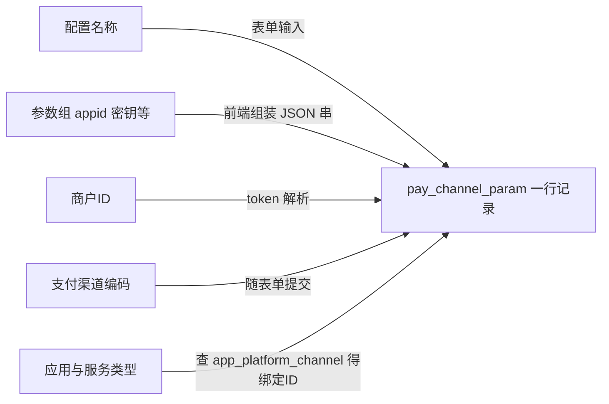
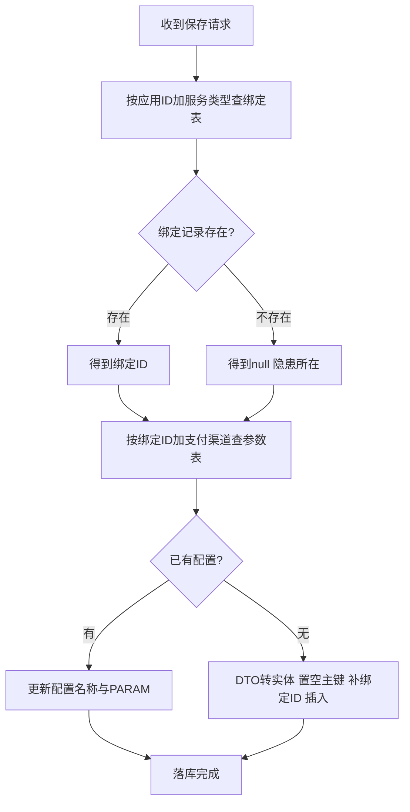
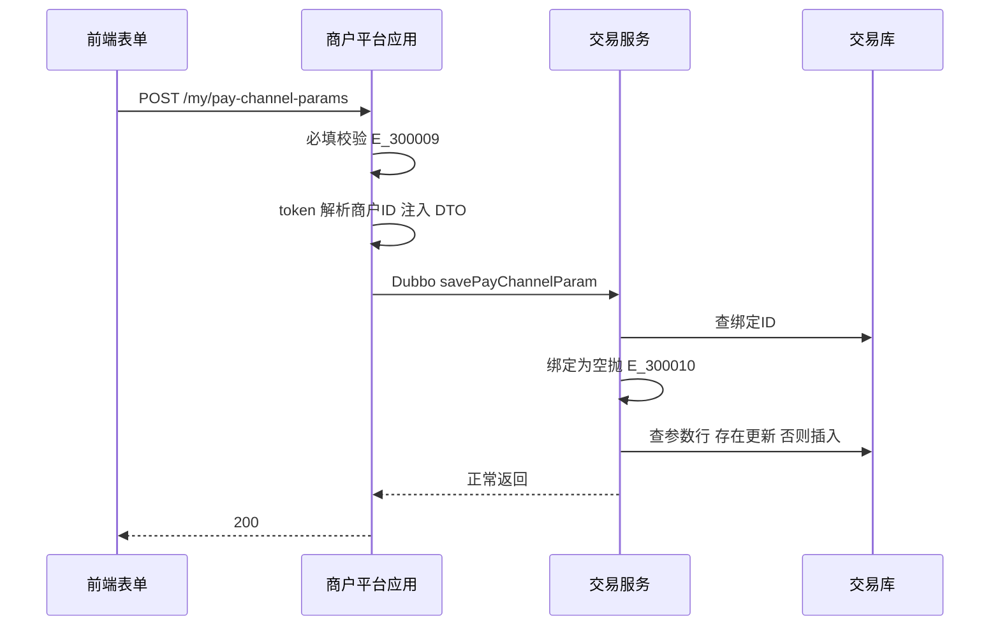
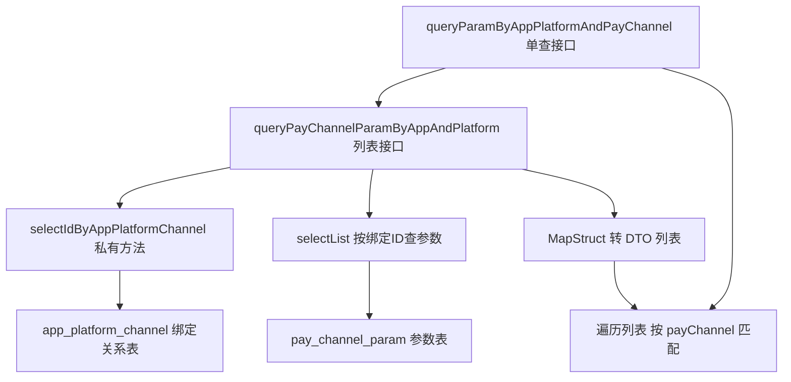
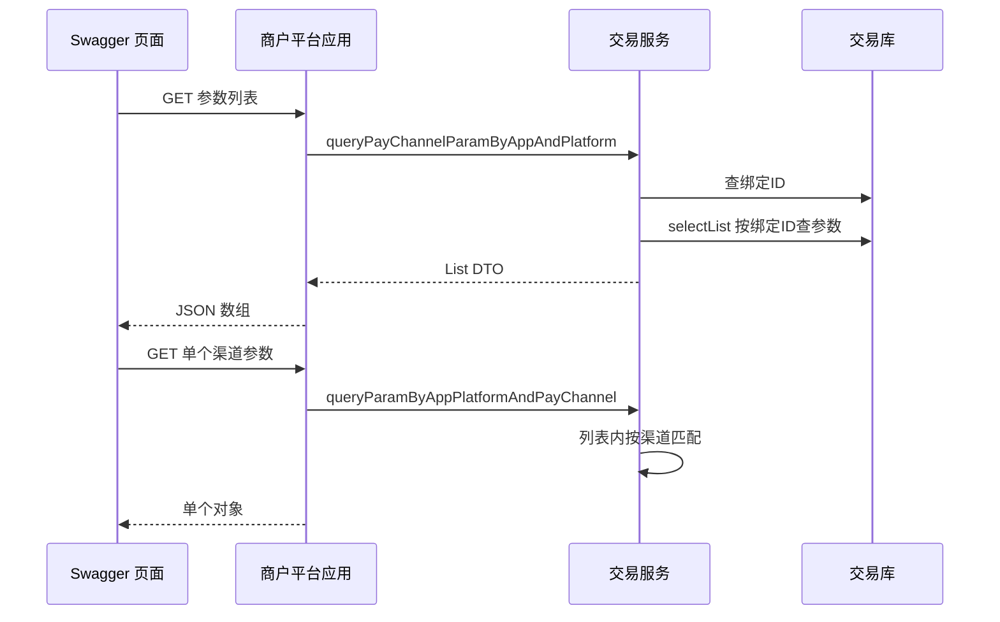

# 支付渠道参数配置：保存与查询接口从交易服务到商户平台的完整实现

> 🔒 安全提示：文中示例的口令/密钥均为课程教学环境演示口径，生产环境的安全要求见《安全与合规须知》。

## 先给结论

- 保存走交易服务接口⑦ `PayChannelService.savePayChannelParam`：入参 `PayChannelParamDTO`，表单里渠道参数那组输入框由前端组装成 JSON 串整体存进 `PARAM` 大文本，表结构不随渠道扩展。
- 一行参数六个字段四种来源：配置名称与参数 JSON 来自表单输入，商户 id 从登录 token 解析后由服务端强制注入，支付渠道编码随表单提交，绑定 id 由后端查 `app_platform_channel` 关系表得出。
- 保存逻辑做成存在即更新、不存在即插入，唯一性由 `APP_PLATFORM_CHANNEL_ID` 加 `PAY_CHANNEL` 唯一约束兜底；插入前把 DTO 的 id 置空，主键交给 `ID_WORKER` 雪花算法生成。
- 商户平台应用的接口⑧是 `/my/pay-channel-params`，同一 URL 挂 POST 与 PUT 两种方法，资源一个端点方法区分动作；校验分两层，Controller 拦结构抛 `E_300009`，交易服务拦业务抛 `E_300010`。
- 查询两个方法：列表按绑定 id 查参数表转 DTO 列表，单查复用列表后在内存按渠道匹配，定位逻辑全系统只存一份；未绑定时的返回契约要明确 null 还是空集合。
- REST 端点按资源层级嵌套路径变量，从粗到细与归属关系同构；返回体里 `appId` 与 `platformChannelCode` 为空是正常现象，归属由 `appPlatformChannelId` 表达。
- 身份与安全纪律：前端传来的商户 id 一律不可信，查询接口要校验 appId 归属当前登录商户，横向越权是参数接口的高发风险。

## 第1部分：支付渠道参数配置-支付渠道参数配置-交易服务接口定义

渠道列表能查出来了，页面就能在某个渠道后面点上「配置参数」，打开一张表单：一个配置名称输入框，下面跟着 appid、商户号、密钥一类的一组渠道参数输入框。填完点保存，这些数据要落进交易库的 `pay_channel_param` 表。麻烦在于，表里只有六列，微信接口要求的那一组参数在表里根本没有对应字段；商户 id 不该由前端填；应用与服务类型的绑定 id 更是前端拿不到的东西。数据从四面八方来，最终要汇成一行记录，这正是接口⑦要解决的问题。把每个字段的来源分析清楚，接口定义与实现就只是水到渠成的翻译工作。

### 表单与表：字段对不上的地方正是设计的关键
把表单和参数表摆在一起逐项对照，是写接口前最值得花时间的一步。`pay_channel_param` 的六列里，`CHANNEL_NAME` 对应表单最上面的配置名称输入框，一一对应，没有悬念。下面那一大组输入框，appid、appSecret、商户号、平台密钥、支付密钥，都是商户在微信官方平台注册开通支付之后由微信发放的凭证，这些参数在数据库里没有具体的字段与它们对应。硬要一参数一列，微信六个、支付宝又是另一套名字，表结构就得跟着渠道走，新增一个渠道改一次表。

设计的出口在系统设计阶段已经铺好：`PARAM` 字段是 text 大文本，专门装这种结构不定型的内容。前端把表单参数组里填的值组装成一个 JSON 对象，整串传给后端，后端原样存进 `PARAM`。微信的参数键值与支付宝的参数键值结构不同，差异全部被 JSON 吸收，表结构对渠道数量完全无感。理解了这一点，「配置参数」这个动作在数据层面的本质就一句话：往 `pay_channel_param` 写一行记录，名称进 `CHANNEL_NAME`，参数串进 `PARAM`。

组装 JSON 的活儿放在前端，这个职责划分值得多说一句。表单上输入框的名字与渠道接口要求的参数名是一一对应的，做表单的人最清楚每个渠道要哪些项、什么格式，由前端把填好的值直接组装成渠道参数对象，语义不会在传递中走样。后端对这个 JSON 串只做一件事：透传存储，不解析、不校验内部结构，把它当成一块不透明的文本。后端代码由此与任何具体渠道解耦，将来接入新的支付渠道，前端多一套表单页，交易服务的保存接口一行不用改。要是把组装逻辑挪到后端，每接一个渠道就得改一次服务端代码并重新发布，两边的改动成本完全不同。

剩下的字段各有来源，这张图把一行参数的四个来路画在一起。



商户 id 的来源要单独强调。操作者是登录商户平台的商户账号，前端手里只有 token，商户 id 就藏在 token 里，历来的接口都是从 token 解析出商户 id 再往下传，这一课沿用同一套路。支付渠道编码看起来要选，其实点「配置参数」链接的那一刻，页面就已经知道自己配的是微信 JSAPI 还是支付宝手机网站支付，提交表单时把这个编码一并带给接口即可。最有意思的是应用与服务类型的绑定 id：整个表单是先选应用再选服务类型的过程，前端持有的是应用 id 与服务类型编码两个值，而参数表要的是绑定关系表 `app_platform_channel` 的主键。这个主键前端无从得知，必须由后端拿着应用 id 与服务类型编码去绑定关系表查出来，再填进参数行。一个字段承载两个要素的压缩设计，在这里兑现成一次后端补查。

把六个字段的来源收拢成一句验收标准：表单能给的只有配置名称与参数 JSON，其余全部由链路上现成的信息推导。写字接口之前先做这轮来源分析，每个字段标注「前端传、token 来、查库补」，代码写起来就是按图索骥；跳过分析直接动手，写一半才发现商户 id 没来路、绑定 id 不知道谁查，返工的成本远高于先想清楚。这轮分析还能提前暴露接口契约问题，比如商户 id 必须进 Dubbo 入参，就是分析阶段而不是编码阶段得出的结论。

### 接口定义：DTO 承载全部入参
字段来源理清，接口要收哪些数据就明确了：应用 id、服务类型编码、支付渠道编码、配置名称、参数 JSON 串，外加从 token 解析出的商户 id。把这些装进一个 DTO，正是参数表的镜像。api 工程里已经备好 `PayChannelParamDTO`：

```java
@ApiModel(value = "PayChannelParamDTO", description = "商户原始支付渠道参数配置")
@Data
public class PayChannelParamDTO implements Serializable {

    @ApiModelProperty("参数配置id,新增时无需")
    private Long id;

    @ApiModelProperty("应用的appId,是业务id")
    private String appId;

    @ApiModelProperty("应用绑定的服务类型对应的code")
    private String platformChannelCode;

    @ApiModelProperty("参数配置名称")
    private String channelName;

    @ApiModelProperty("商户id")
    private Long merchantId;

    @ApiModelProperty("原始支付渠道编码")
    private String payChannel;

    @ApiModelProperty("原始支付渠道参数配置内容,json格式")
    private String param;

    @ApiModelProperty("应用绑定的服务类型Id")
    private Long appPlatformChannelId;
}
```

八个字段里藏着几个容易忽略的细节。`appId` 是业务 id，一串字符串，不是数字主键，前端从应用列表里带出来；`id` 与 `appPlatformChannelId` 在新增场景下前端都不会传，`id` 留给更新场景回显用，`appPlatformChannelId` 则完全由后端查库填入，DTO 里保留它只是为了查询接口能完整还原参数归属。DTO 与实体 `PayChannelParam` 的字段并非一一重合：实体里没有 `appId` 与 `platformChannelCode`，因为参数表的归属靠 `appPlatformChannelId` 一列表达，这正是系统设计时把应用与服务类型两个要素压缩成一个字段的落地处。

这个 DTO 放在交易服务的 api 工程里，也不是随手一放。Dubbo 接口的入参与出参类型要被服务两端同时引用，交易服务用它反序列化请求，商户平台应用用它组装请求，类型定义与接口声明同在 api 工程打包，消费方只要依赖这个 api 包就能参与调用，完全不必接触服务实现工程。接口契约的完整性由 api 工程一个包兜住，这是 Dubbo 分层的标准做法，前面定义查询接口时已经沿用，此处只是再次兑现。

在 `PayChannelService` 里追加接口方法：

```java
/**
 * 支付渠道参数配置
 * @param payChannelParam 配置支付渠道参数：包括商户id、应用id、服务类型code、支付渠道code、配置名称、配置参数(json)
 * @throws BusinessException
 */
void savePayChannelParam(PayChannelParamDTO payChannelParam) throws BusinessException;
```

返回值刻意留成 void。配置成功不需要带回什么数据，正常返回就是成功；失败的情形，比如入参残缺、应用没有绑定服务类型，抛出 `BusinessException` 交给统一异常处理转成错误响应。还有一个接口边界要交代清楚：这是 Dubbo 接口，交易服务本身没有登录态，token 在商户平台应用那一侧解析，商户平台应用从 token 里拿到商户 id 后，必须把商户 id 显式传给这个 Dubbo 接口。跨进程调用没有隐式的登录上下文，凡是下游需要的数据都要摆进参数里，这是 Dubbo 接口与 HTTP 接口在入参设计上的一个本质差别。

### 接口实现：存在即更新
实现类 `PayChannelServiceImpl` 里补上方法。写之前先想清楚一个业务事实：参数表上建着 `APP_PLATFORM_CHANNEL_ID` 加 `PAY_CHANNEL` 的唯一约束，同一应用同一服务类型下，一个渠道只允许一份配置。商户完全可能先配一次，过两天改了密钥再保存一次，第二次不能报错，也不能插出第二行，正确语义就是存在即更新、不存在即插入。

判断存不存在的依据是唯一约束的两列，于是实现的骨架是两次查询加一个分支，先查绑定 id，再按绑定 id 加支付渠道查参数行。绑定 id 的查询逻辑抽成私有方法，保存与将来的查询接口都要用它：

```java
/**
 * 根据应用和服务类型查询应用与服务类型的绑定id
 * @param appId 应用id
 * @param platformChannelCode 服务类型code
 * @return 绑定关系主键，未绑定时返回null
 */
private Long selectIdByAppPlatformChannel(String appId, String platformChannelCode) {
    AppPlatformChannel appPlatformChannel = appPlatformChannelMapper.selectOne(
            new LambdaQueryWrapper<AppPlatformChannel>()
                    .eq(AppPlatformChannel::getAppId, appId)
                    .eq(AppPlatformChannel::getPlatformChannel, platformChannelCode));
    if (appPlatformChannel != null) {
        return appPlatformChannel.getId();
    }
    return null;
}
```

两个等值条件与绑定关系表的语义严丝合缝，查到记录取主键，查不到返回 null。抽成私有方法而不写在主流程里，是因为这个「按应用加服务类型换绑定 id」的动作不会只出现一次：保存参数要用，接下来的参数查询接口要用，将来发起支付取参数还是要用。绑定关系表先行落库的设计，在消费端就转成「先查绑定、再查参数」的固定两跳，私有方法正是这两跳的第一跳，一次写对，处处复用。

顺带看 `selectOne` 与唯一约束的呼应。绑定表上应用加服务类型的组合是事实唯一的，参数表上绑定 id 加渠道编码的组合有唯一约束，两处查询都用两个 `eq` 条件取单行，查询假设与库内数据状态互为印证。假如约束被绕开、重复数据混进表里，`selectOne` 会因为查出多行而直接抛错，问题当场暴露而不是被悄悄吞掉，这也是敢用 `selectOne` 的前提：数据唯一性有约束背书。

主方法接着往下走：

```java
@Autowired
private PayChannelParamMapper payChannelParamMapper;

/**
 * 保存支付渠道参数
 * @param payChannelParam 配置支付渠道参数：包括商户id、应用id、服务类型code、支付渠道code、配置名称、配置参数(json)
 * @throws BusinessException
 */
@Override
public void savePayChannelParam(PayChannelParamDTO payChannelParam) throws BusinessException {
    //根据应用、服务类型查询应用与服务类型的绑定id
    Long appPlatformChannelId = selectIdByAppPlatformChannel(payChannelParam.getAppId(), payChannelParam.getPlatformChannelCode());
    //根据绑定id与支付渠道查询pay_channel_param的一条记录
    PayChannelParam entity = payChannelParamMapper.selectOne(new LambdaQueryWrapper<PayChannelParam>()
            .eq(PayChannelParam::getAppPlatformChannelId, appPlatformChannelId)
            .eq(PayChannelParam::getPayChannel, payChannelParam.getPayChannel()));
    //存在配置则更新
    if (entity != null) {
        entity.setChannelName(payChannelParam.getChannelName());//配置名称
        entity.setParam(payChannelParam.getParam());//json格式的参数
        payChannelParamMapper.updateById(entity);
    } else {
        //否则添加配置
        PayChannelParam entityNew = PayChannelParamConvert.INSTANCE.dto2entity(payChannelParam);
        entityNew.setId(null);//主键交给MyBatis-Plus生成
        entityNew.setAppPlatformChannelId(appPlatformChannelId);//应用与服务类型绑定关系id
        payChannelParamMapper.insert(entityNew);
    }
}
```

更新分支只动两个字段：配置名称与参数 JSON。对照表单看这个选择很自然，商户二次保存改的就是这两样，`MERCHANT_ID`、`PAY_CHANNEL`、绑定 id 都是定位信息，定位没变就不该被请求内容覆盖。`updateById` 按主键整行更新，但只 set 过的实体字段会进 SQL，未动的列保持原值，定位信息安全。

插入分支有两个动作值得逐字读。其一，`PayChannelParamConvert.INSTANCE.dto2entity` 把 DTO 转成实体，这是此前课程建好的 MapStruct 转换器，同名字段自动映射；DTO 里的 `appId` 与 `platformChannelCode` 在实体中没有对应字段，转换时自然被丢弃，落库的归属信息以 `appPlatformChannelId` 为准。其二，`setId(null)` 把主键显式清空。DTO 的 `id` 在新增场景本就不该有值，但防御式编程不赌调用方守规矩，置空之后主键完全交给 MyBatis-Plus 的 `ID_WORKER` 雪花算法生成，避免一个前端伪造或回显残留的 id 覆盖掉已有行。随后 `setAppPlatformChannelId` 把查出来的绑定 id 补进实体，这个值 DTO 里没有，是本次请求中后端唯一「生产」出来的字段，不补上这行，插进去的参数就是无归属的孤儿数据。



图上有一条带隐患的路径：绑定记录不存在时私有方法返回 null，流程并不会停，拿 null 去查参数表查不到任何行，代码安静地滑进插入分支，插出一行绑定 id 为空的参数。应用连服务类型都没绑定，参数却配上了，这是业务上不允许的状态。此刻这段代码还没有拦截，防线要在联调阶段真正暴露问题之后补上，用「应用没有绑定服务类型，不允许配置参数」的业务异常收口。先让代码按正常路径工作，再在测试中把异常路径逼出来，是这一模块两节课的真实开发节奏。
## 第2部分：支付渠道参数配置-支付渠道参数配置-商户平台应用接口实现

交易服务的保存接口就绪，商户平台应用要给前端一个 HTTP 入口。这个接口本体只有一行转发，写起来十分钟，真正花时间的是联调：param 里的 JSON 要不要转义、应用没绑定服务类型时会发生什么、往公共工程加了一个错误码为什么重启服务也不生效。这一课把接口⑧的定义、实现与这串排障过程完整走一遍，转发的代码简单，暴露出的问题个个典型。

### 接口定义：一个 URL 两种方法
在商户平台应用的 `PlatformParamController` 里追加端点：

```java
@ApiOperation("商户配置支付渠道参数")
@ApiImplicitParam(name = "payChannelParamDTO", value = "支付渠道参数", required = true, dataType = "PayChannelParamDTO", paramType = "body")
@RequestMapping(value = "/my/pay-channel-params", method = {RequestMethod.POST, RequestMethod.PUT})
void createPayChannelParam(@RequestBody PayChannelParamDTO payChannelParamDTO) {
    if (payChannelParamDTO == null || payChannelParamDTO.getChannelName() == null) {
        throw new BusinessException(CommonErrorCode.E_300009);
    }
    //商户id从登录态解析，不信任前端传值
    Long merchantId = SecurityUtil.getMerchantId();
    payChannelParamDTO.setMerchantId(merchantId);
    payChannelService.savePayChannelParam(payChannelParamDTO);
}
```

方法映射写的是 `@RequestMapping` 而不是单一的 `@PostMapping`，因为 `method` 数组里同时放进了 POST 与 PUT。前端在新增配置时调用 POST，在修改已有配置时调用 PUT，两个动作落在同一个 URL 上，资源只有一个，区别只在动词，这正是 REST 风格把 URL 设计成资源、把 HTTP 方法用作语义的用意。拆成 `/my/pay-channel-params/add` 与 `/update` 两个端点也能工作，但同一资源两套路径，文档与维护都要多费一份心。Swagger 页面上这个端点会同时列出 POST 与 PUT 两个可展开的方法，请求体结构共用一份。

`@RequestBody` 决定了参数从请求体以 JSON 进入，Swagger 注解的 `paramType` 相应写成 body。方法体三步：先做最粗的非空校验，再解析并注入商户 id，最后一行转调交易服务。返回值保持 void，配置成功不需要回传数据，正常返回就是 HTTP 200；失败的情形由 `BusinessException` 抛出，交给全局异常处理统一转成错误响应，Controller 不必自己拼错误报文。

商户 id 的处理方式是把口子收紧的典型做法。`SecurityUtil.getMerchantId()` 从请求里的登录态解析出当前商户，随后 `setMerchantId` 强行覆盖 DTO 里的同名字段。也就是说，请求体里即使被恶意填上别人的商户 id，落库前也会被服务端的解析值替换掉，身份信息永远以登录态为准，前端传值只配当参考。

### 两层校验：Controller 拦粗，交易服务拦业务
Controller 层的校验拦的是请求结构问题：对象为空、配置名称缺失，直接抛 `E_300009`，错误码文案是「传入对象为空或者缺少必要的参数」。 appId、服务类型编码、支付渠道编码这些必要字段同样应该在此处或服务端补上非空判断，写接口的参数校验宁可多不可缺，这也是写任何对外接口都要养成的习惯。

交易服务那一层要拦的是业务规则问题：应用必须先绑定服务类型，才允许为该服务类型下的渠道配置参数。上一课实现保存逻辑时留下的口子在这里收掉，绑定 id 查出来为 null 就不能再往下走：

```java
//根据应用、服务类型查询应用与服务类型的绑定id
Long appPlatformChannelId = selectIdByAppPlatformChannel(payChannelParam.getAppId(), payChannelParam.getPlatformChannelCode());
if (appPlatformChannelId == null) {
    //应用没有绑定服务类型，不允许配置参数
    throw new BusinessException(CommonErrorCode.E_300010);
}
```

`E_300010` 的文案是「应用没有绑定服务类型，不允许配置参数」。为什么不在 Controller 里做这条校验？因为绑定关系存放在交易库的 `app_platform_channel` 表里，只有交易服务够得着；商户平台应用要校验它就得先发一次远程查询，多一跳还把交易域的数据知识泄漏到了应用层。校验跟着数据走，结构校验留在入口，业务校验放进服务，两层各守各的门。



### Postman 联调：param 的转义是手工活的重头
测试前把交易服务与商户平台应用都重启，Postman 新建 POST 请求，URL 为 `http://localhost:57010/merchant/my/pay-channel-params`，请求头带上登录 token。请求体按 Swagger 示例拼：`id`、`merchantId`、`appPlatformChannelId` 三个字段不传，分别留给后端生成、token 解析与查库补齐，真正要给的是应用 id、服务类型编码、支付渠道编码、配置名称与 param。appId 从数据库的应用记录里取字符串形式的业务 id，别错拿成数字主键；服务类型给 `shanju_c2b`，支付渠道给 `WX_JSAPI`，两者必须与绑定关系和渠道列表的数据对得上。

真正的手工活是 param。它的值是一段 JSON 串，而它自己又是外层 JSON 的一个字符串字段，内部的双引号必须转义。讲义给的操作次序是：把渠道参数对象合并成一行，去掉制表符与多余空白，再在双引号前补上反斜杠，最后作为字符串放进外层报文：

```json
{
  "appId": "ebcecedd-3032-49a6-9691-4770e66577af",
  "platformChannelCode": "shanju_c2b",
  "payChannel": "WX_JSAPI",
  "channelName": "微信JSAPI接口参数",
  "param": "{\"appID\":\"example-appid\",\"appSecret\":\"example-secret\",\"key\":\"example-secret\",\"mchID\":\"example-mch-id\",\"payKey\":\"example-secret\"}"
}
```

把多行 JSON 原样粘进 param 字段会立刻报解析错误，这是手测阶段最容易撞上的坑。这整套转义是 Postman 手测特有的负担，等前端接入后，表单页会把参数组自动组装并序列化成合法报文，后端不再需要人工处理。渠道凭证一律以 example-appid、example-mch-id、example-secret 占位，真实配置时换成商户在微信侧注册后拿到的参数；支付宝渠道则是 appId、私钥、公钥、回调地址等另一套键值，讲义 5.4.5.2 给了完整清单。

### 联调排障：两个值得记住的问题
第一条排障线出在数据上。断点打进 Controller，DTO 各字段到齐，token 解析出的商户 id 也对；往下进交易服务，绑定 id 却查了个 null，流程照旧滑进插入分支，插出的行没有归属。回头看请求，appId 一栏填的值不对，用的是应用记录的数字主键而不是字符串业务 id，绑定表里自然匹配不到。修复分两半：改对测试数据只是表症，根上的补法是上面那条 `E_300010` 校验，让未绑定服务类型的请求在服务端被业务异常拦下，而不是悄悄落库。

第二条排障线出在构建上。`E_300010` 是新加进 common 工程错误码枚举的，改完只重启交易服务与商户平台应用，测试返回的还是「未知错误」。原因在于 common 是被依赖的公共包，两个服务的运行时 classpath 里还是旧的 common 构件，新枚举根本没进运行环境。正确次序是先清理并重新编译 common 工程，再重启依赖它的两个服务，新错误码才会生效。公共工程的小改动牵动所有依赖方，这类「改了没生效」的问题，第一反应就该查依赖构件有没有重新构建。

两条线都通了再收尾验证：用已绑定 `shanju_c2b` 的应用保存一次，数据库里 `pay_channel_param` 新增一行，配置名称、参数 JSON、商户 id、渠道编码齐全，后端补查出的绑定 id 也稳稳填在 `APP_PLATFORM_CHANNEL_ID` 列上；再把 appId 换成一个没绑定服务类型的应用，接口返回「应用没有绑定服务类型，不允许配置参数」，异常分支与正常分支都拿到预期结果，接口⑧交付。
## 第3部分：支付渠道参数配置-支付渠道参数查询-交易服务接口实现

参数能存进 `pay_channel_param` 了，还差另一半：把存进去的读出来。商户第二次打开「配置参数」页面，表单必须回显已经保存的参数，总不能让商户每次都从头重填；页面下发查询请求，后端按条件把参数配置取回来，这是一组纯粹的读接口。查询的形态有两个：一个按应用与服务类型查整个参数列表，因为聚合支付下 C 扫B 这类服务类型同时挂着微信与支付宝两个渠道，参数天然是多条；另一个在此基础上再加支付渠道条件，精确取出某一个渠道的参数，用于回显那张具体渠道的表单。这一课把交易服务的两个 Dubbo 查询接口与商户平台应用的两个 REST 端点一次做完，核心看点不是 SQL，而是几个接口之间层层复用的组织方式。

### 需求拆解：回显要哪两个查询
配置页面的交互把查询需求写得明明白白。商户点开某个服务类型的「配置实际支付渠道」，列表页要展示这个服务类型下已经配置过的所有渠道参数，让商户一眼看到微信配没配、支付宝配没配；点进某个渠道的表单，又要把该渠道已保存的参数填回输入框。前者是列表查询，入参应用与服务类型两个值；后者是单条查询，入参再多一个支付渠道编码。两个接口都挂在配置场景里，将来发起支付时取参数的路径也与它们同源，所以这一课的产出不只是服务一个页面。

列表为什么天然是多条？`pay_channel_param` 表的定位粒度是绑定 id 加渠道编码，一个绑定关系（应用加服务类型）下，微信 JSAPI 一行、支付宝手机网站支付一行，聚合平台聚的就是这若干渠道。按绑定 id 查参数表，查出来的是 selectList 而不是 selectOne，这一点在动手前就要想清楚，接口返回类型也随之定为列表。

这两个查询的消费者也不止配置页面一个。发起支付时，系统按应用与服务类型定位参数，携参调用微信或支付宝的接口，取参走的就是同一套查询路径；配置页面是它的第一个消费者，支付链路是真正重量级的消费者。读接口的返回口径一旦定型，下游会把契约焊死在自己的代码里，所以定义阶段多花几分钟把入参出参想全，比上线后再改契约便宜得多。

接口定义顺着需求落在 `PayChannelService`，两个方法并排放置：

```java
/**
 * 根据应用和服务类型查询支付渠道参数列表
 * @param appId 应用id
 * @param platformChannel 服务类型code
 * @return
 */
List<PayChannelParamDTO> queryPayChannelParamByAppAndPlatform(String appId, String platformChannel);

/**
 * 根据应用、服务类型和支付渠道的代码查询该支付渠道的参数配置信息
 * @param appId 应用id
 * @param platformChannel 服务类型code
 * @param payChannel 支付渠道代码
 * @return
 */
PayChannelParamDTO queryParamByAppPlatformAndPayChannel(String appId, String platformChannel, String payChannel);
```

入参出参都是现成类型，`PayChannelParamDTO` 在保存接口那一课已经定义妥当，查询返回它，配置页拿到的是与提交时同一套字段，回显时字段名对得上。两个方法的命名刻意区分了「列表」与「单个」的语义，调用方看方法名就知道拿到什么，不必进实现确认。

### 列表查询：两跳定位的第二次兑现
实现放在 `PayChannelServiceImpl`。保存参数时已经把「按应用与服务类型换绑定 id」抽成了私有方法 `selectIdByAppPlatformChannel`，当时说过这个动作不会只出现一次，查询接口立刻兑现了这句话。列表查询的骨架就是私有方法加一次 selectList：

```java
@Override
public List<PayChannelParamDTO> queryPayChannelParamByAppAndPlatform(String appId, String platformChannel) {
    //根据应用和服务类型找到它们的绑定id
    Long appPlatformChannelId = selectIdByAppPlatformChannel(appId, platformChannel);
    if (appPlatformChannelId == null) {
        //应用未绑定服务类型，查不到任何参数配置
        return null;
    }
    //按绑定id查询参数表的全部记录
    List<PayChannelParam> payChannelParams = payChannelParamMapper.selectList(new LambdaQueryWrapper<PayChannelParam>()
            .eq(PayChannelParam::getAppPlatformChannelId, appPlatformChannelId));
    //转成DTO列表返回
    return PayChannelParamConvert.INSTANCE.listentity2listdto(payChannelParams);
}
```

三步各有讲究。第一跳查绑定 id，条件与保存接口完全一致，私有方法直接搬来用，两处调用零复制；绑定 id 为 null 的分支在此收口，应用没绑定服务类型，参数表里不可能有它的任何记录，返回 null 把这个事实交给调用方。第二跳按绑定 id 走 `selectList`，只挂一个等值条件，`APP_PLATFORM_CHANNEL_ID` 正是参数表的外键语义列，查出的行天然属于这个绑定关系。第三跳是转换，实体列表经 `PayChannelParamConvert` 的 `listentity2listdto` 变成 DTO 列表，MapStruct 同名字段自动映射，转换器也是现成的。

第二跳的查询条件值得咂摸一下：只有绑定 id 一个条件，没有渠道过滤，也没有分页。参数表的行数被渠道数量天然封顶，一个服务类型下不过两三个渠道，全部取出反而让接口不用感知渠道细节，聚合了多少渠道就返回多少行，渠道扩展时这个接口零改动。列表查询不做业务裁剪，把筛选的权力留给调用方，是它能在单查接口里被复用的另一个前提。

值得停下来对比的是保存与查询对同一张表的两种读法。保存接口用 `selectOne`，因为唯一约束保证了绑定 id 加渠道编码至多一行，单行语义有约束背书；查询接口用 `selectList`，因为绑定 id 下的渠道数量由业务数据决定，多行是常态。同一张表、同一个绑定 id，读一条还是读一批，取决于接口回答的问题，Mapper 方法的选择跟着问题的形状走，而不是跟着表走。



这张图把三个接口的依赖关系画了出来：单查接口站在列表接口的肩膀上，列表接口站在私有方法的肩膀上，越靠底层的东西越稳定，越靠上层的东西越薄。

### 单查实现：不写 SQL 的接口才是好接口
按常规思路，单查接口该再写一条 SQL：绑定 id 加支付渠道两个条件查 `selectOne`。课程的实现选了另一条路，先复用列表查询，再在结果里挑出目标渠道：

```java
@Override
public PayChannelParamDTO queryParamByAppPlatformAndPayChannel(String appId, String platformChannel, String payChannel) {
    //复用列表查询，结果中一定包含当前渠道的参数
    List<PayChannelParamDTO> payChannelParamDTOS = queryPayChannelParamByAppAndPlatform(appId, platformChannel);
    //遍历列表，匹配支付渠道编码
    for (PayChannelParamDTO payChannelParamDTO : payChannelParamDTOS) {
        if (payChannelParamDTO.getPayChannel().equals(payChannel)) {
            return payChannelParamDTO;
        }
    }
    return null;
}
```

方法体里没有一行 SQL。这样选的道理在量级与维护两端。量级上，一个绑定关系下的参数行数以个位数计，一个服务类型挂两三个渠道，把列表全查出来再内存过滤，代价可以忽略；维护上，定位参数的两跳逻辑已经写在列表查询里，单查接口直接继承，将来定位逻辑有变化，比如缓存介入、查询条件调整，改一处两个接口同时受益。要是单查再抄一遍「查绑定 id 加 selectOne」，同一段定位逻辑就存在两份拷贝，改一处漏一处的隐患从此埋下。接口复用不只是省代码，更是让同一个业务事实在系统里只有一份表达。

这笔账也有前提：列表结果集必须小。如果某天参数膨胀到成百上千行，内存遍历就该让位给数据库过滤，把 `payChannel` 条件下推进 `selectOne` 的查询里。当前业务下渠道数量天然有限，复用的收益压倒一切；量级变化时按同样的问题重新权衡即可，实现方式的切换成本被接口契约隔离在服务内部，调用方毫无感知。

还有一个契约细节要当面说破：单查接口在 for 循环里直接遍历列表查询的返回值，而列表查询在应用未绑定时返回的是 null，null 上调 for 循环会立刻抛空指针。两条接口各自单独看都没问题，拼在一起却暴露出「返回 null 还是空集合」的契约含糊。严谨的补法有两种，列表查询返回空集合，或者单查在遍历前判 null 直接返回 null，任何一种都比现状明确。课程代码保留了原样，这个缝留给读者当作契约设计的思考题，也提醒每一层接口的返回值都要被下游当成契约来对待。

### 商户平台应用：REST 端点与 Swagger 验证
交易服务两个查询就绪，商户平台应用在 `PlatformParamController` 里补两个 GET 端点：

```java
@ApiOperation("根据应用和服务类型获取支付渠道参数列表")
@ApiImplicitParams({
        @ApiImplicitParam(value = "应用id", name = "appId", dataType = "String", paramType = "path"),
        @ApiImplicitParam(value = "服务类型代码", name = "platformChannel", dataType = "String", paramType = "path")
})
@GetMapping(value = "/my/pay-channel-params/apps/{appId}/platform-channels/{platformChannel}")
public List<PayChannelParamDTO> queryPayChannelParam(@PathVariable("appId") String appId,
                                                     @PathVariable("platformChannel") String platformChannel) {
    return payChannelService.queryPayChannelParamByAppAndPlatform(appId, platformChannel);
}

@ApiOperation("根据应用和服务类型和支付渠道获取单个支付渠道参数")
@ApiImplicitParams({
        @ApiImplicitParam(value = "应用id", name = "appId", dataType = "String", paramType = "path"),
        @ApiImplicitParam(value = "服务类型代码", name = "platformChannel", dataType = "String", paramType = "path"),
        @ApiImplicitParam(value = "支付渠道代码", name = "payChannel", dataType = "String", paramType = "path")
})
@GetMapping(value = "/my/pay-channel-params/apps/{appId}/platform-channels/{platformChannel}/pay-channels/{payChannel}")
public PayChannelParamDTO queryPayChannelParam(@PathVariable("appId") String appId,
                                               @PathVariable("platformChannel") String platformChannel,
                                               @PathVariable("payChannel") String payChannel) {
    return payChannelService.queryParamByAppPlatformAndPayChannel(appId, platformChannel, payChannel);
}
```

两个端点的 URL 是一套资源层级的语法：`pay-channel-params` 是资源集合，`apps/{appId}` 限定归属的应用，`platform-channels/{platformChannel}` 再限定服务类型，单查接口在这条路径末尾追加 `pay-channels/{payChannel}`，三个路径变量从粗到细逐级收窄，读到 URL 就读到了查询条件的层级关系。查询动作用 GET，参数全部走 `@PathVariable`，Swagger 注解的 `paramType` 统一为 path。方法体照旧一行转调，业务逻辑全部留在交易服务。

两个端点是从对方拷贝改造出来的，参数结构几乎一样，只多一个 `payChannel`。拷贝改造的效率优势明显，但有一处必须逐项核对：`@ApiOperation` 的描述文案。拷贝过来忘了改描述，Swagger 文档里列表接口挂着单查的说明，读文档的人会被误导，课堂演示里就当场发现并修正了一处拷贝残留。注解可以拷，文案必须逐个过目，这是用模板提效的固定配套动作。

验证走 Swagger，重启交易服务与商户平台应用后，查询接口都是 GET，在文档页填参数点执行即可，比 Postman 里手工拼 URL 与参数省事得多；要在 Postman 里测也一样，列表接口对应 `http://localhost:57010/merchant/my/pay-channel-params/apps/{appId}/platform-channels/{platformChannel}`，请求头带登录 token。列表用例填入应用 id `ebcecedd-3032-49a6-9691-4770e66577af` 与服务类型 `shanju_c2b`，返回体是一个数组：

```json
[
  {
    "id": 1,
    "channelName": "微信JSAPI接口参数",
    "merchantId": 1211220010036162226,
    "payChannel": "WX_JSAPI",
    "param": "{\"appID\":\"example-appid\",\"appSecret\":\"example-secret\",\"key\":\"example-secret\",\"mchID\":\"example-mch-id\",\"payKey\":\"example-secret\"}",
    "appPlatformChannelId": 1211159463723554260
  }
]
```

单查接口在此基础上填入 `payChannel` 为 `WX_JSAPI`，返回体从数组变成单个对象，字段内容与列表元素一致。两处返回里 `appId` 与 `platformChannelCode` 两个字段是空的，这不是缺陷而是设计的显影：参数实体里没有这两个字段，转换器无从填充，参数的归属由 `appPlatformChannelId` 一列表达，调用方需要业务归属时拿它回绑定关系表换算。返回体与表结构、DTO 定义三方对照一遍，链条上每一环的口径都对齐了。



到这里，渠道参数配置模块的四个接口全部就位：保存走接口⑦与接口⑧，查询走这两个 GET 端点，配置链路可以闭环演示。参数的读路径还埋着一个优化引线：参数在支付时会按应用与服务类型高频读取，读多写少的特征明显，把查询结果缓存进 Redis 是紧接着要展开的主题。
## 常见误区

- **让前端提交商户 id。** 错例：表单里藏一个商户 id 字段一起 POST。正解：商户 id 从登录 token 解析后由服务端注入 DTO，前端传来的身份字段一律不可信，否则改个参数就能替别的商户配参数。
- **每个参数项单独建列或建表。** 错例：为微信的 appid、密钥各加一列，支付宝再来一套。正解：参数组在前端组装成 JSON 串整体进 `PARAM` 大文本，渠道差异由数据内容吸收，表结构零改动。
- **新增时直接转实体就 insert。** 错例：DTO 转 entity 后不置空 id 直接插入。正解：插入前 `setId(null)`，主键交给 `ID_WORKER` 生成，杜绝请求携带的 id 覆盖既有行。
- **重复保存交给前端防重。** 错例：前端禁用按钮就算防重，后端直接 insert。正解：数据库唯一约束兜底，业务代码先查后定更新或插入，两道防线各司其职。
- **绑定 id 为 null 时继续执行。** 错例：私有方法返回 null 后照常拿去查询、插入。正解：查完绑定立即校验，为空抛「应用没有绑定服务类型」的业务异常，把脏数据挡在入口。
- **更新时整行覆盖定位字段。** 错例：更新分支重新 set 商户 id、渠道编码甚至绑定 id。正解：只更新配置名称与 `PARAM` 两个业务内容字段，定位字段保持原值。
- **把新增与更新拆成两个 URL。** 错例：`/my/pay-channel-params/add` 与 `/update` 并存。正解：资源一个端点，HTTP 方法区分动作，POST 新增、PUT 更新，Swagger 文档也只维护一份。
- **把多行 JSON 直接贴进 param。** 错例：Postman 里 param 值带换行与裸双引号，请求解析报错。正解：合并单行、去制表符、双引号转义；联调接前端后由页面自动组装，后端不再手工处理。
- **只在 Controller 或只在服务层做校验。** 错例：入口拦完就认为安全。正解：入口拦结构与必填，服务端拦业务规则，校验跟着数据所在的域走，两层缺一不可。
- **改了 common 只重启不重编译。** 错例：加完错误码直接重启服务，返回仍是未知错误。正解：先重新构建 common 工程，再重启依赖方，公共包的改动才会进入运行时。
- **单查接口把定位逻辑再抄一遍。** 错例：单查重新查绑定 id、重新拼 selectOne 条件。正解：复用列表查询后内存匹配，定位逻辑全系统只存一份，量级大到不值得复用时再下推到 SQL。
- **返回 null 与空集合混用。** 错例：列表接口未绑定时返回 null，单查接口直接遍历，空指针当场爆炸。正解：契约明确二选一，返回空集合或在复用方判 null，让接口返回值的形状成为文档的一部分。
- **查询直接返回实体。** 错例：Service 与 Controller 之间传 `PayChannelParam` 实体。正解：跨进程契约一律 DTO，实体属于持久层，字段增减不该波及调用方，转换器统一收口。
- **REST 参数全塞 query string。** 错例：`/my/pay-channel-params?appId=xx&platformChannel=xx`。正解：归属层级用路径变量表达，从粗到细嵌套，语义与缓存、权限的粒度都跟着路径走。
- **拷贝注解不改描述文案。** 错例：两个接口的 Swagger 描述一模一样。正解：拷贝后逐项核对名称、描述与 paramType，接口文档是给前端与联调方看的契约，残留文案比没有文档更糟。
- **看到 appId 与 platformChannelCode 返回为空就当 bug。** 错例：认定 DTO 少了字段。正解：参数归属由 `appPlatformChannelId` 表达，两个业务要素字段本就不在参数实体里，需要时回绑定表换算。

## 面试可能被问到的问题

1. 面试官追问：「保存渠道参数为什么设计成存在即更新，而不是先删再插？」
   答：参数表在绑定 id 加渠道编码上有唯一约束，重复保存是正常业务动作，改密钥再存一次不应报错。先删再插在两次操作间留下空窗，删了插失败就丢配置；存在即更新一次定位一次落库，语义与约束天然对齐。

2. 面试官追问：「参数用 JSON 大文本存，想校验或修改其中一项怎么办？」
   答：应用层把 `PARAM` 反序列化成对象再操作，改完序列化回存。数据库层面不解析 JSON，换来的是表结构不随渠道扩展；如果某渠道参数项需要频繁条件检索，才考虑把该字段提升为独立列或引入 JSON 索引能力。

3. 面试官追问：「绑定关系 id 为什么由服务端查询，而不是前端直接传？」
   答：前端只有应用 id 与服务类型编码，绑定主键是内部代理键，暴露给前端既无必要也不安全。服务端按两个业务要素查绑定表，天然校验了「应用确实绑定了该服务类型」，伪造一个绑定 id 反而绕不开这层校验。

4. 面试官追问：「新增前把 DTO 的 id 置空，是防什么？」
   答：防两类问题，一是调用方误带 id 导致按主键插入失败或覆盖，二是恶意构造 id 的越权写入。主键由 `ID_WORKER` 雪花算法在框架层生成，服务端对主键来源保持完全掌控。

5. 面试官追问：「这个保存接口需要加事务吗？」
   答：方法内是一次查询加一次单表更新或插入，单条 SQL 本身原子，严格说不加事务也不会出现半截状态。若后续把缓存刷新等衍生写操作挂进来，就该加 `@Transactional` 把落库与衍生动作绑成一致单元。

6. 面试官追问：「Dubbo 接口的入参为什么要把商户 id 显式带上？」
   答：Dubbo 调用没有 HTTP 请求上下文，token 在商户平台应用侧解析，跨进程后登录态不可见。凡是下游业务需要的身份数据都必须进参数，这也让接口契约自描述，单看方法签名就知道数据从哪儿来。

7. 面试官追问：「同一个 URL 同时支持 POST 和 PUT，好处是什么？」
   答：URL 表达资源，方法表达动作，新增与更新操作的是同一份渠道参数资源，共用一个端点让接口数量减半、文档与权限控制都收敛在一处。客户端按语义选方法，服务端一个方法体同时服务两种调用，逻辑不会分叉出两份拷贝。

8. 面试官追问：「为什么商户 id 一定要服务端解析，前端传的不行吗？」
   答：请求体是客户端可任意构造的数据，里面的身份字段没有可信度。登录 token 由认证体系签发，从中解析出的商户 id 才是可信身份，服务端解析后强制覆盖，能杜绝越权替其他商户配置参数的攻击面。

9. 面试官追问：「param 为什么以 JSON 字符串进 DTO，而不是结构化对象？」
   答：不同渠道的参数结构不同，结构化建模就得一渠道一套类型，DTO 会随渠道无限膨胀。以字符串透传让交易服务与渠道解耦，解析推迟到真正调用第三方接口的时刻，DTO 只关心存储与传输，不关心内容。

10. 面试官追问：「Controller 与 Service 的参数校验怎么分工？」
   答：Controller 拦请求结构问题，字段缺失、类型不对，fail fast 不进业务层；Service 拦业务规则问题，比如应用未绑定服务类型，这类判断依赖领域数据与业务语义。原则是校验跟着数据走，谁持有判断依据谁负责校验。

11. 面试官追问：「未绑定服务类型时为什么不自动创建绑定再保存参数？」
   答：绑定是商户在前端明确执行的动作，隐式创建会让系统替商户做决定，绑错服务类型引发后续取参与路由的连锁错误。配置参数是绑定链路的下游，上游缺失就明确报错，把修正权交回商户，这是对业务流程完整性的保护。

12. 面试官追问：「公共工程的错误码新增后为什么不生效？」
   答：服务运行时加载的是依赖仓库里已构建的 common 构件，源码改动不会自动进入 classpath。必须重新构建 common 并刷新依赖方的运行环境，这也是多模块工程里「改公共包要全链路重构建」的基本纪律。

13. 面试官追问：「单查接口复用列表查询，而不是单独写一条 SQL，怎么权衡？」
   答：看量级与维护成本。一个绑定关系下的参数行数以个位数计，全查出来内存过滤的代价可忽略，而定位逻辑只保留一份，改动一处生效两处。若结果集可能膨胀到成百上千行，就应把过滤条件下推到数据库，接口契约不变，内部实现可平滑替换。

14. 面试官追问：「查询不到时返回 null 还是空集合？」
   答：两个都合法，关键是契约一致并写进文档。null 表达「查询前提不成立」，比如应用未绑定；空集合表达「查询成立但没有数据」。混用的代价在组合调用时暴露，上层直接遍历返回值就可能空指针，团队统一约定并让调用方感知即可。

15. 面试官追问：「这个查询接口为什么不在第一版就加 Redis 缓存？」
   答：先把功能做对，再优化性能。参数读多写少，确实适合缓存，但缓存引入一致性、失效、序列化一批新问题，应当在数据链路验证正确后作为独立演进加入，保存成功刷新缓存、查询未命中回写，缓存的策略与实现可以整体替换而不动业务语义。

16. 面试官追问：「REST 路径里三个参数逐级嵌套，依据是什么？」
   答：参数表达的是资源归属的层级，参数配置挂在某应用下，又挂在某服务类型下，再细到某支付渠道。路径变量从粗到细与归属关系同构，读 URL 即读条件，也便于按层级做权限控制与缓存 key 设计。

17. 面试官追问：「返回的 DTO 里 appId 为空，调用方怎么还原归属？」
   答：DTO 里的 `appPlatformChannelId` 就是归属代理键，拿它回 `app_platform_channel` 一查即得应用与服务类型。字段冗余与归属规范化是取舍，参数表压缩成代理键换取写入一致性，读取侧多一跳换算，双方职责清晰。

18. 面试官追问：「查询接口要不要校验 appId 是不是当前登录商户的？」
   答：要。商户平台应用侧从 token 解析出商户后，应校验请求的 appId 确属该商户，否则构造一个别人的 appId 就能读走参数，其中含支付密钥。横向越权是查询接口的高发风险，归属校验应成为所有 `my` 前缀接口的固定动作。

## 配套资料

- 讲义：`materials/docs/10/闪聚支付-第2章-讲义-支付参数配置v1.0.md`，5.4.4 交易服务支付渠道参数配置接口（接口⑦）之 5.4.4.1 接口定义与 5.4.4.2 接口实现为本课出处。
- 代码：`materials/code/10/代码/`，交易服务工程归档于该目录，`PayChannelParamDTO`、实体 `PayChannelParam`、`AppPlatformChannel` 与 `PayChannelParamMapper` 为真实文件；`materials/code/10/完整代码/完整代码/` 归档中 `PayChannelService`、`PayChannelServiceImpl`、`PayChannelParamConvert` 为真实文件，正文代码为按 `com.study.pay` 系口径改写后的节选（内层工程目录与包名为课程原始命名，不在此展开）。
- 说明：`materials/code/10/完整代码/完整代码/` 归档中 `savePayChannelParam` 末尾带一段缓存刷新调用，属于本天后续课程引入的缓存逻辑，正文实现为课程当堂、未引入缓存前的版本；该阶段课程资料归档在 `materials/docs/10/` 与 `materials/code/10/`（不存在 09 编号目录），引用路径截至该层级。
- 讲义：`materials/docs/10/闪聚支付-第2章-讲义-支付参数配置v1.0.md`，5.4.5 商户平台应用支付渠道参数配置接口（接口⑧）之 5.4.5.1 接口定义与 5.4.5.2 接口测试（微信与支付宝 param 的组装、转义说明）为本课出处。
- 代码：`materials/code/10/完整代码/完整代码/`，商户平台应用工程的 `PlatformParamController`（含本课端点与 `E_300009` 校验）与交易服务工程的 `PayChannelServiceImpl`（含 `E_300010` 绑定校验）、`SecurityUtil` 为真实文件，正文代码为按 `com.study.pay` 系口径改写后的节选（内层工程目录与包名为课程原始命名，不在此展开）。
- 说明：请求示例中的渠道凭证以 example-appid、example-mch-id、example-secret 占位，实际取值来自商户在微信、支付宝侧注册后获得的参数；`E_300009`、`E_300010` 定义于公共工程的错误码枚举；该阶段课程资料归档在 `materials/docs/10/` 与 `materials/code/10/`（不存在 09 编号目录）。
- 讲义：`materials/docs/10/闪聚支付-第2章-讲义-支付参数配置v1.0.md`，5.5 支付渠道参数查询之 5.5.1 交易服务渠道参数查询接口（5.5.1.1 接口定义、5.5.1.2 接口实现）与 5.5.2 商户平台应用渠道参数查询接口（5.5.2.1 接口定义、5.5.2.2 接口测试）为本课出处。
- 代码：`materials/code/10/完整代码/完整代码/`，交易服务工程的 `PayChannelService`、`PayChannelServiceImpl`（含两个查询方法与私有方法 `selectIdByAppPlatformChannel`）、转换器 `PayChannelParamConvert` 与商户平台应用工程的 `PlatformParamController`（含两个查询端点）为真实文件；`materials/code/10/代码/` 目录下另有 `PayChannelParamDTO` 与参数表实体、Mapper 的归档，正文代码为按 `com.study.pay` 系口径改写后的节选（内层工程目录与包名为课程原始命名，不在此展开）。
- 说明：`materials/code/10/完整代码/完整代码/` 归档中两个查询方法带 Redis 缓存分支，属于本天后续课程引入的缓存逻辑，正文为课程当堂直查数据库的版本；返回示例中的渠道凭证以 example-* 占位；该阶段课程资料归档在 `materials/docs/10/` 与 `materials/code/10/`（不存在 09 编号目录），引用路径截至该层级。
