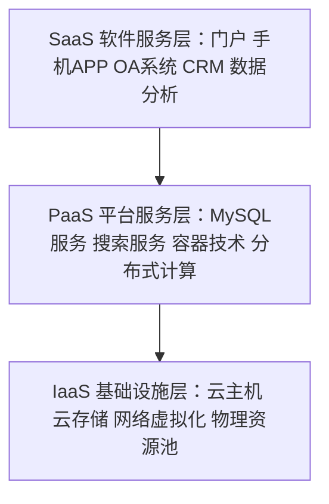
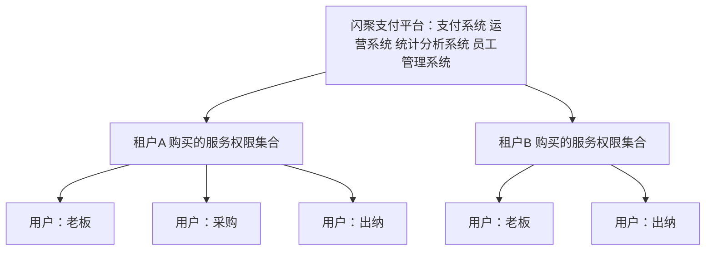
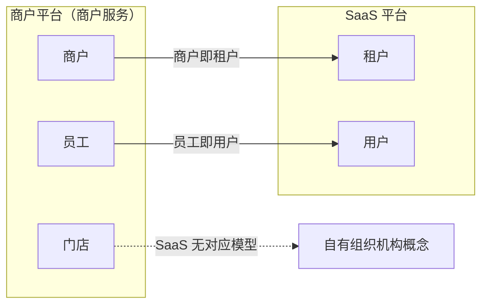
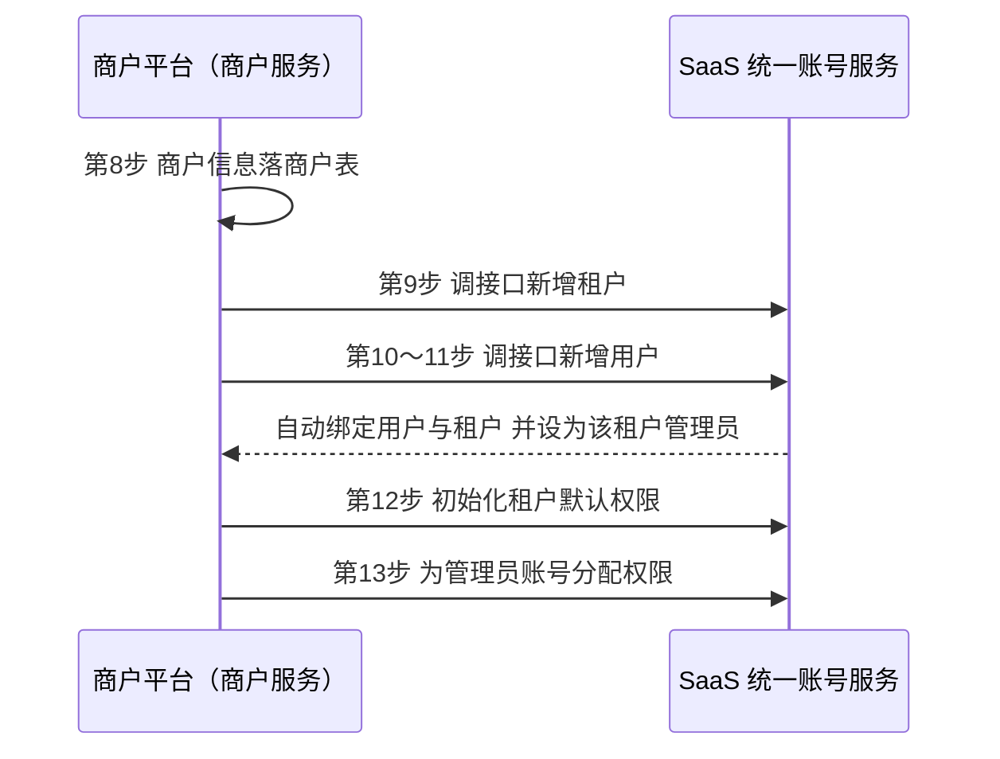
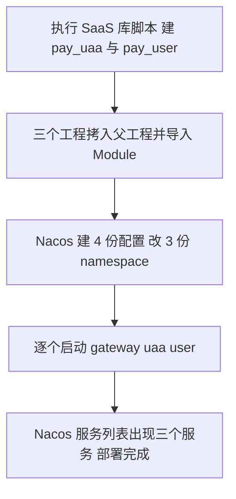

# 对接 SaaS 准备工作：SaaS 概念、模型对应与系统部署

> 🔒 安全提示：文中示例的口令/密钥均为课程教学环境演示口径，生产环境的安全要求见《安全与合规须知》。

## 先给结论

- 商户平台的资质申请与渠道参数配置眼下都挂在模拟 token 上跑，真正的登录要靠对接 SaaS 系统后的统一认证；动代码前先把概念、步骤与部署三件事备齐。
- SaaS 即软件即服务：软件部署在供应商侧，通过互联网对外提供租用服务；云计算三层里 IaaS 出租硬件、PaaS 出租平台、SaaS 出租应用软件。
- 多租户是 SaaS 最核心的概念：租户是购买平台服务的组织，用户是租户内实际登录操作的人；商户是一类租户类型，某家具体的商户才是一个租户。
- 对接不是开发 SaaS：SaaS 是沉淀成熟的通用系统，要做的只有两件事，把它部署起来，然后在商户注册流程里调用它的接口。
- 模型对应两条：商户平台的商户对应 SaaS 的租户，员工对应用户；门店是商户平台自有的组织机构，SaaS 里没有对应模型。
- 接入动作四步：新增租户、新增用户并自动绑定设为管理员、初始化租户默认权限、更新管理员权限，对应商户注册交互流程的第 9 到 13 步。
- SaaS 系统三个服务：网关服务、统一认证服务 uaa、统一账号服务 user；初始化脚本一次建 pay_uaa 与 pay_user 两个库。
- 部署四步走：执行库脚本、三工程导入父工程、Nacos 建 4 份配置改 3 份 bootstrap 的 namespace、逐个启动验证；报错集中在数据库连接与 namespace 配置两类。
- 对接完成后登录由 SaaS 统一认证接管，模拟 token 退役，后续资质申请与渠道参数配置都携带正式 token。

## 第1部分：对接SaaS-准备工作-基础概念

商户平台的资质申请与渠道参数配置，眼下都挂在一个模拟 token 上跑，那不是登录，只是占位。真正的登录要靠对接 SaaS 系统后的统一认证。动代码之前有一节概念课：SaaS 是什么、多租户是什么、它们在聚合支付平台里对应谁。概念不清，后面的接口对接就只能照抄不能变通。

### SaaS：把软件从「卖」变成「租」

传统企业要用一套软件，路径是自己采购服务器、自己组建团队开发或者定制，周期长、成本高，一套系统养下来花的大头往往不在软件本身。SaaS 模式换了个思路：软件供应商把系统开发好、部署在自己的服务器上，通过互联网开放给企业租用，企业不买软件，买的是「使用服务的权利」。

与传统软件相比，区别落在四点上。第一，软件不再向供应商定制或二次开发，而是供应商部署在自己的服务器上，通过互联网提供在线服务；第二，网络设备、软硬件平台这些基础设施全部由供应商搭建并负责运营维护；第三，用户按实际需要通过互联网订购服务，费用跟着订购的多少与时长走；第四，不需要一次性支付大笔定制费，付少量租用费就能用，发现不合用随时停租，风险极低。对中小企业来说，这就是用可承受的成本拿到了先进技术的使用权，CRM、OA 这类几乎每家公司都需要的系统，也因此成了 SaaS 模式最早普及的领域。

### 云计算的三层模式

SaaS 这个词来自云计算的分层概念。云计算发展至今，市场把它分成三个层次，每层出租的东西不同：



IaaS 是基础设施即服务，把服务器、存储、网络这些硬件资源打包出租，用户租一台云主机就不用买服务器；PaaS 是平台即服务，也叫中间件服务，数据库服务、搜索服务、容器环境开箱即用，用户免于安装维护；SaaS 是软件即服务，直接出租应用软件。阿里云、腾讯云这类云平台上，三层业务都在卖，从硬件到中间件到软件逐层往上租。项目采用的正是最上层：聚合支付平台开发完毕后对外提供支付能力，商户付费租用，平台就是商户的 SaaS。

### 多租户：SaaS 的核心概念

一个 SaaS 平台不可能只服务一家企业，多家企业同时租用，每一家都是独立的租用者，这就是多租户。围绕它有三个词要掰开。

**租户是购买服务的组织。** 一个组织在平台上购买了部分软件服务，这个组织就是平台的租户。组织可以是企业、学校、机构、商户，范围很宽。租户买到的不是零散功能，而是一份权限集合：平台把系统功能打包成套餐，比如支付系统、员工管理系统、统计分析系统组成套餐 A，租户购买套餐 A 就拥有这三个系统的使用权限。买什么套餐，就有什么权限，权限边界由此划出。

**租户类型是一类租户的分类。** 闪聚支付平台提供多租户管理，业务相同的租户归为一类。「商户」是一类租户类型，而某一家具体的商户才是其中一个租户，类型是模板，租户是按模板开通的一个个实例，两者不能混用。

**用户是租户内真正干活的人。** 用户是组织即租户内的成员，是软件平台的实际使用者，凭用户名与密码登录平台。商户下面有员工，员工登录平台操作业务，员工对应用户。用户还可以在租户内部新建其他用户、在租户购买的权限范围内给其他人授权，称为用户与权限的自管理。整个平台被多个租户共同使用，租户之间的数据相互隔离，这张结构图把关系摆出来：



租户 A 与租户 B 买的套餐不同，各自用户能登录使用的系统就不同；同一个用户账号只能在自己租户的权限范围内活动。用一组对照把三个词钉死：

```text
租户类型：  商户            （一类租户的分类）
租    户：  某某餐厅        （一个具体的组织，注册后产生）
用    户：  餐厅里的员工张三 （租户内成员，登录平台操作功能）
```

（上表为按本课概念整理的示意，租户类型与租户的编码约定在后续对接实现时给出。）

### 回到闪聚支付平台

概念落回项目就通了。闪聚支付平台提供支付能力，商户注册进来租用支付功能，平台对商户而言就是 SaaS；商户是租户，商户的员工是用户，员工登录后做资质申请、渠道参数配置，用的正是平台购买的套餐内的功能。此前商户注册流程里的 token 是模拟的，因为登录功能还没接入；对接 SaaS 之后，统一认证由 SaaS 系统提供，用户用真实账号登录，拿到正式 token 再去访问资质申请与参数配置这些接口，这条链路就是对接要兑现的目标。

## 第2部分：对接SaaS-准备工作-对接SaaS的步骤

概念课铺垫完毕，这一课回答落地问题：商户平台和 SaaS 系统之间到底怎么接。答案先给出来，对接不是开发 SaaS，SaaS 是一套已经沉淀成熟的通用系统，要做的只有两件事：把它部署起来，然后在商户注册的流程里调用它的接口。步骤拆得清，后面的实施就是照图施工。

### 为什么不自研一套 SaaS

先把动机钉牢，否则实施中容易走偏成「顺手把 SaaS 写了」。SaaS 系统承载三类通用能力：统一账号管理、权限管理、统一认证。这类能力在企业里是日积月累沉淀下来的通用系统，哪个业务系统都需要，也不会因为业务变化频繁改动。软件开发团队的主要精力应该放在业务功能上，对聚合支付平台来说就是如何把第三方支付通道聚合成统一通道、如何给商户提供各业务服务，而不是重复造账号与权限的轮子。

另外要摆正 SaaS 系统的位置：它不是外部第三方，就是闪聚支付平台的一部分。平台整体是一个 SaaS 形态的产品，商户即租户，商户员工即用户，租户管理、用户管理、权限管理、认证这一套由独立的 SaaS 系统提供，业务服务只管对接消费。这与云平台的逻辑同构，基础能力别人准备好了，业务团队专注自己的领域。

### 业务模型：谁对应谁

对接的第一步是把两边的概念对上，这张图画出了对应关系：



两条实线是正式的对应：商户在 SaaS 平台开通即成为租户，一一对应；员工是真正登录系统操作功能的人，对应用户，每个用户有账号。虚线的门店需要单独解释。

**门店是员工组织机构管理。** 商户平台要回答「这个员工属于哪个部门、哪个连锁店」的问题，门店就是这个组织单元。一家大型超市开了很多连锁店，每家店有自己的员工，员工必须归属某个门店，这是商户平台经营需要而设立的概念。

**门店在 SaaS 里没有对应模型。** SaaS 系统只管账号、权限、认证，不关心员工的物理归属，所以对接清单里找不到门店这一项。但没有对应不等于可以不了解：给员工在 SaaS 开用户时，员工实体上必须带所属门店属性，商户平台侧建员工必须先有门店可挂。概念清单里它是商户平台单方面承担的部分。

### 接入步骤：商户注册流程的第 9 到 13 步

商户注册的交互流程图共 15 步，第 8 步把商户信息写进商户表早已实现，第 9 步往后的部分当时留了空，标注为对接 SaaS 时再完成，现在补上。一次商户注册要调用的 SaaS 接口与内部动作如下：



**第一步，新增租户，对应第 9 步。** 商户平台新增商户的同时调用 SaaS 接口新增租户，商户与租户一一对应，租户开通了，SaaS 里才有地方挂用户与权限。

**第二步，新增用户，对应第 10 到 11 步。** 商户平台新增员工时调用 SaaS 接口新增用户。这个接口不只建账号，内部还做两件事：自动设置用户与租户的绑定关系，并把该用户设置为该租户的管理员。绑定关系对应「员工属于某商户」的隶属关系，管理员账号则解决了「租户开通后谁来登录操作」的问题，没有管理员，租户买了服务也没人能用。

**第三步，初始化租户权限，对应第 12 步。** 商户注册成功后给租户设置默认权限，也就是基础功能的使用权，比如新增员工、为员工设置权限这类运营必需的操作，没有它们管理员登录后寸步难行。

**第四步，更新管理员权限，对应第 13 步。** 为第二步新增的账号分配管理员权限，管理员权限即租户的权限集合，管理员是租户权限的完整持有者。

四步走完，注册一个商户等于在 SaaS 里开通了一个租户，配好一个管理员账号，挂上默认权限。商户平台侧的商户表、员工数据与 SaaS 侧的租户、用户、权限各就各位，两套体系靠调用关系缝合成一体。

### 开发准备清单

落到开发排期，按课程口径整理成两张清单：

```text
一、部署 SaaS 系统（前置条件）
    SaaS 是独立系统，包含网关服务、统一认证服务、统一账号服务
    需初始化 SaaS 系统数据库，并在 Nacos 完成相关配置
    部署细节见后续部署专题课

二、商户注册流程对接（本课之后的实施内容）
    商户平台自己完成：新增商户 / 新增员工 / 新增门店 / 为门店设置管理员
    调用 SaaS 接口完成：新增租户 / 新增用户（自动绑定租户并设管理员）
                        为租户设置默认权限 / 分配管理员权限
```

清单的逻辑很清晰：凡是商户域自己的实体，商户、员工、门店、门店管理员，落库与接口都由商户平台开发；凡是账号、租户、权限、绑定关系这些通用域的实体，一律调 SaaS 接口，不在商户平台落库。部署属于环境准备，其步骤由后续部署课专门展开，本课只要求明确它是第一步。

对接完成后整条链路串起来了：员工用管理员账号登录，SaaS 统一认证校验身份，签发正式 token；带着这个 token 访问资质申请、支付渠道参数配置等接口，权限由 SaaS 侧的租户权限集合把关。此前用模拟 token 走通的业务流程，从这一刻起换成真实认证，商户平台的注册闭环至此完整。

## 第3部分：对接SaaS-准备工作-部署SaaS系统

商户注册流程的第 9 步要调用 SaaS 接口开通租户，可这些接口还躺在三个没有部署的工程里。SaaS 系统是现成的通用系统，拿来即用，前提是先让它在本机完整跑起来。这件事没有业务开发量，全是工程操作：初始化数据库、导入工程、在 Nacos 落配置、启动验证。操作不难，坑都在细节里，一个 namespace 抄错、一处数据库密码没改，服务就起不来。

### SaaS 系统里有什么

部署之前先认清要部署的东西。三个服务都是标准 Spring Boot 工程，各自职责会在后续对接课里用到哪讲哪，这里先对上号：

```text
网关服务      gateway-service   统一入口，路由转发并校验令牌          端口 56010
统一认证服务  uaa-service       OAuth2.0 认证中心，签发与校验 token   端口 56020
统一账号服务  user-service      租户、账号、角色、权限的管理          端口 56030
```

其中两个服务要连数据库，初始化脚本里写得明白，一个脚本创建两个库：

```text
pay_uaa    统一认证库，2 张表
  oauth_client_details   OAuth2.0 客户端注册信息
  oauth_code             授权码

pay_user   统一账号库，13 张表
  tenant / tenant_type / tenant_account   租户、租户类型、租户与账号的绑定关系
  account / account_role                  账号、账号与角色关系
  authorization_role / authorization_role_privilege
  authorization_privilege / authorization_privilege_group   角色、权限与权限集
  bundle                 套餐
  resource_application / resource_menu / resource_button    应用、菜单、按钮资源
```

（表清单整理自 SaaS 初始化脚本；库名按本系列口径写作 `pay_uaa` 与 `pay_user`，脚本原始文件名含课程原始命名，存放位置见配套资料。）

这张清单值得多看一眼：后续对接要调的租户、用户、权限接口，背后就是 `pay_user` 库里这几张表；部署完成后它们也是验证对接是否成功的观察窗口。

### 部署路径总览

整条部署链路按依赖排序，数据库先于服务，配置先于启动：



前三步都是准备，第四步的启动验证会把前三步埋的错误全部暴露出来，所以启动报错不是坏事，按报错回查对应环节即可。

### 初始化数据库与导入工程

**数据库一步到位。** 打开数据库客户端执行 SaaS 初始化脚本，脚本内含建库语句，执行完核对库与表数量：`pay_uaa` 两张表，`pay_user` 十三张表。这是一套通用系统，表结构不必逐张研究，后面对接用到哪张再打开看哪张。

**工程拷进去不等于导进去。** 把网关、统一认证、统一账号三个工程目录拷贝到聚合支付父工程目录下，此时 IDEA 里它们只是三个普通目录，颜色与工程不同，pom 文件也不被识别。要到 Project Structure 的 Modules 里逐个 Import Module，选中工程目录、确认路径、确认 pom，导入后目录颜色变化、依赖开始解析，才算真正进了项目。三个工程都要做，缺一个后面就少一个服务。

### Nacos 配置落地

三个服务的配置全部外置在 Nacos，工程本地只留 `bootstrap.yml` 骨架。要落的配置一共四份，分属两个组。

**jwt.yaml，通用组。** 网关与统一认证都要校验令牌，签名密钥必须双方一致，这份配置就是给它们共同下发的：

```yaml
# JWT 签名密钥：网关与统一认证服务的 JWTConfig 均以 @Value("${siging-key}") 读取
# 属性名以工程内写法为准；密钥值一律用占位符，切勿提交真实密钥
siging-key: example-signing-key
```

属性名 `siging-key` 与工程内 `@Value("${siging-key}")` 一一对应，拼写以工程代码为准，不要顺手改成 signing；要替换的只是密钥值。这份配置 Data ID 为 `jwt.yaml`，Group 填 `COMMON_GROUP`，因为它属于跨项目复用的通用配置。

**gateway-service.yaml，项目组。** 网关的路由规则，节选如下（节选自授课资料中的同名配置文件，Data ID 为 `gateway-service.yaml`，Group 填 `PAY_GROUP`）：

```yaml
zuul:
  retryable: true
  add-host-header: true
  ignoredServices: "*"
  routes:
    operation-application:
      path: /operation/**
      stripPrefix: false
    merchant-application:
      path: /merchant/**
      stripPrefix: false
    uaa-service:
      path: /uaa/**
      stripPrefix: false
```

路由按服务名转发：`/operation/**` 进运营服务，`/merchant/**` 进商户平台应用，`/uaa/**` 进统一认证服务。后续的登录请求正是沿 `/uaa/**` 这条路由进入认证中心。

**uaa-service.yaml 与 user-service.yaml，项目组。** 两份配置结构相同，核心是覆盖上下文路径与数据库连接：

```yaml
# uaa-service.yaml，Group：PAY_GROUP
server:
  servlet:
    context-path: /uaa
spring:
  datasource:
    druid:
      url: jdbc:mysql://127.0.0.1:3306/pay_uaa?useUnicode=true&characterEncoding=UTF-8&serverTimezone=Asia/Shanghai&useSSL=false
      username: root
      password: 123456
```

```yaml
# user-service.yaml，Group：PAY_GROUP
server:
  servlet:
    context-path: /user
spring:
  datasource:
    druid:
      url: jdbc:mysql://127.0.0.1:3306/pay_user?useUnicode=true&characterEncoding=UTF-8&serverTimezone=Asia/Shanghai&useSSL=false
      username: root
      password: 123456
mybatis-plus:
  typeAliasesPackage: com.study.pay.user.entity
  mapper-locations: classpath:com/study/pay/*/mapper/xml/*.xml
sms:
  url: "http://localhost:56085/sailing"
  effectiveTime: 6000
```

数据库账号密码要改成本机真实值，本项目环境统一 root/123456；`sms` 一段指向此前部署的验证码服务，统一账号服务发送验证码时要用它。

**三份 bootstrap.yml 改 namespace。** 每个工程本地 `bootstrap.yml` 里 discovery 与 config 两处 namespace 都要改成自己 Nacos 控制台中的命名空间 ID，以统一认证服务为例：

```yaml
spring:
  application:
    name: uaa-service
  cloud:
    nacos:
      discovery:
        server-addr: ${nacos.server.addr}
        namespace: a1f8e863-3117-48c4-9dd3-e9ddc2af90a8 # 示例值，改为自己 Nacos 命名空间 ID
      config:
        server-addr: ${nacos.server.addr}
        file-extension: yaml
        namespace: a1f8e863-3117-48c4-9dd3-e9ddc2af90a8 # 与 discovery 保持一致
        group: PAY_GROUP
```

namespace 填的是控制台命名空间列表里的 ID 而不是名称，那串 UUID 才是要抄的东西；网关与统一账号两个工程同样处理，discovery 与 config 两处都不能漏。

### 启动验证与两类典型报错

三个服务都有标准启动类，在 IDEA 里逐个启动即可，后续对接课也一直用这个方式起服务。验证标准很明确：三个服务启动日志无异常，Nacos 控制台的服务列表里能看到 `gateway-service`、`uaa-service`、`user-service` 三个实例。

启动阶段的报错集中在两类。**一类是数据库连接失败。** 统一认证与统一账号启动时会连库，日志抛出连接异常，基本是 Nacos 上对应配置里的账号密码没改对，改完在 Nacos 重新发布，再重启服务。**另一类是配置读不到。** 网关启动时报找不到 `siging-key` 这类配置项，先核对两处：namespace 是否与控制台一致、Data ID 与 Group 是否拼写无误。都正确仍读不到，就把 Nacos 重启一次再重启服务，课程现场正是靠重启 Nacos 恢复的；遇到配置读取异常时，这是成本最低却最常被忽略的手段。

## 常见误区

- **把 SaaS 理解成「放在网页上的软件」。** 错例：只要有 Web 界面就算 SaaS。正解：判别点是租用模式与多租户架构，软件部署在供应商侧、按服务租用、多租户数据隔离，缺了这些只是普通的 Web 应用。
- **租户与用户混为一谈。** 错例：把登录的员工叫租户。正解：租户是组织，用户是组织内的成员；一个租户下有多个用户，权限挂租户上，账号挂用户上。
- **租户类型与租户不区分。** 错例：说「商户这个租户」时，没说清是类型还是实例。正解：商户是租户类型，具体某家商户才是租户；对接接口时要传的是具体租户，类型编码是开通时的分类参数。
- **以为多租户必须一租户一个数据库。** 错例：把数据隔离等同于物理分库。正解：隔离方案有独立库、独立表空间、共享表加租户字段等多种，按成本与规模选择，核心是逻辑隔离，租户之间互不可见。
- **把对接做成自研。** 错例：打算自己实现租户管理、账号、认证再谈对接。正解：SaaS 系统是现成的通用系统，只部署、只调用，开发精力留给聚合支付业务。
- **给门店在 SaaS 里找对应模型。** 错例：想在 SaaS 建门店实体或传门店参数。正解：门店是商户平台自有概念，SaaS 无对应，员工归属门店只落在商户平台的数据里。
- **以为商户注册只写商户表。** 错例：注册流程到落商户表就结束。正解：完整注册要经 SaaS 接口开通租户、创建用户并绑定、初始化权限、分配管理员权限，少一步登录或授权就断链。
- **忽略管理员账号的意义。** 错例：只建用户不设管理员，或初始化权限后不给管理员授权。正解：管理员是租户内第一个能登录的账号，默认权限加管理员权限共同保证注册完即可用。
- **namespace 填成命名空间名称。** 错例：`namespace: dev`，服务跑到 public 里找配置。正解：填控制台命名空间列表中的 ID（一串 UUID），discovery 与 config 两处都要填且保持一致。
- **jwt.yaml 放进项目组。** 错例：四份配置全建在 `PAY_GROUP` 下，网关启动读不到签名密钥。正解：`jwt.yaml` 的 Group 是 `COMMON_GROUP`，要与工程 `bootstrap.yml` 里 ext-config 声明的组一致。
- **数据库密码照抄资料不改。** 错例：配置里留着资料中的示例密码直接启动，统一账号服务报连接失败。正解：改成数据库本机真实账号密码，本项目环境为 root/123456。
- **把拷贝目录当成导入工程。** 错例：目录拷进父工程就直接找启动类，结果找不到。正解：在 Project Structure 里逐个 Import Module，pom 被识别、目录变为工程颜色才算完成。

## 面试可能被问到的问题

1. 面试官追问：「SaaS 和传统软件交付的区别是什么？」
   答：交付物从软件变成服务。传统模式卖软件，部署在客户环境，客户管运维；SaaS 部署在供应商侧，通过互联网提供在线服务，按订购与时长计费，基础设施与运维由供应商负责，用户随时可停租，风险和起步成本都低得多。
2. 面试官追问：「IaaS、PaaS、SaaS 各解决什么问题，举例说明。」
   答：IaaS 出租基础设施，典型是云主机、云存储，解决硬件投入；PaaS 出租平台能力，典型是数据库服务、搜索服务、容器，解决中间件安装维护；SaaS 出租应用软件，典型是 CRM、OA、电商平台，解决软件自研成本。三者从下到上，用户离底层越远越省心。
3. 面试官追问：「什么是多租户？实现数据隔离有哪些方案？」
   答：多租户指一个软件实例同时服务多个租户且数据互不可见。隔离方案从重到轻有：每租户独立数据库、独立 Schema、共享表加租户 ID 字段过滤，成本递减、共享度递增，按租户规模与合规要求选型，关键是所有查询都要带上租户维度。
4. 面试官追问：「在聚合支付项目里，谁是租户、谁是用户？」
   答：商户是租户，具体表现为每注册一家商户就在 SaaS 系统里开通一个租户；商户的员工是用户，员工用账号登录平台做资质申请、渠道参数配置等操作。租户类型是「商户」这一类，开通时指定类型编码。
5. 面试官追问：「为什么商户平台要对接 SaaS 系统，而不是自己做登录？」
   答：账号管理、权限管理、统一认证是所有系统都需要的通用能力，SaaS 系统里已经沉淀成熟，对接即可复用；商户平台的研发力量集中在聚合支付的业务功能上。对接之后登录、鉴权、租户与用户的组织关系都由 SaaS 统一维护，业务系统只消费认证结果。
6. 面试官追问：「商户平台为什么对接 SaaS 系统，而不是自己开发账号认证？」
   答：账号、权限、统一认证是通用能力，企业里通常由沉淀已久的通用系统承担，自研周期长且难以维护到位。对接复用成熟能力，业务团队专注支付聚合；SaaS 统一认证还能让后续所有系统的登录方式保持一致。
7. 面试官追问：「新增用户的 SaaS 接口为什么自动绑定用户与租户，并设置管理员？」
   答：绑定关系表达用户对租户的隶属，对应商户与员工的关系，由接口内部一并完成可以避免调用方漏建关系产生孤儿账号；设为管理员解决租户开通后无人可登录的问题，第一个用户天然要承担租户管理员角色，否则注册流程闭环不了。
8. 面试官追问：「门店在 SaaS 里没有对应模型，对接时会不会成为障碍？」
   答：不会，但要分清归属。SaaS 只管账号与权限，门店属于商户平台的组织机构，员工实体在商户平台侧必须带所属门店属性，先建门店再建员工是商户平台自己的流程约束，调用 SaaS 接口时不需要也不应该传门店信息。
9. 面试官追问：「一次商户注册，前后一共落了哪些数据？」
   答：商户平台侧写商户表、门店（根门店）、员工及员工与门店的归属关系；SaaS 侧产生租户、用户账号、用户与租户的绑定关系、租户默认权限与管理员权限。两边通过注册流程中的接口调用衔接，形成完整的租户开通链路。
10. 面试官追问：「对接之后，模拟 token 与正式 token 的差别体现在哪？」
   答：模拟 token 只是绕过登录的占位串，没有认证与权限含义；正式 token 由 SaaS 统一认证在用户登录后签发，承载用户身份与租户上下文，业务接口可据此校验身份并核对租户权限。资质申请、渠道参数配置等操作从模拟切换到正式后，安全性由平台统一保障。
11. 面试官追问：「部署一套多服务系统，你的操作顺序依据什么？」
   答：依据依赖关系排：先基础设施（数据库、Nacos），再配置，最后启动服务。服务启动时要连库、要拉配置，这两个条件不就绪启动必然失败；把依赖理顺之后，出错也能快速定位是哪一环没准备好。
12. 面试官追问：「Nacos 的 namespace、Group、Data ID 在项目里怎么用？」
   答：namespace 隔离环境，每个环境一个 ID；Group 按项目划分，支付项目的配置归 PAY_GROUP；Data ID 对应具体配置集，主配置按服务名加扩展名命名，如 uaa-service.yaml。跨项目通用的配置如 jwt.yaml 单独放 COMMON_GROUP，由各服务以 ext-config 引用。
13. 面试官追问：「JWT 签名密钥为什么放配置中心，而不是写死在代码里？」
   答：网关与统一认证两个服务要用同一个密钥校验令牌，配置中心统一下发能保证双方一致；更换密钥不需要改代码重新编译发布，还能按环境隔离与定期轮换，明文进代码库本身也是安全隐患。
14. 面试官追问：「服务启动报数据库连接失败，你怎么排查？」
   答：先看异常栈确认是哪个服务、哪个数据源连不上；核对 Nacos 上对应 Data ID 的 url、账号、密码与本机数据库是否一致；确认该配置的 namespace 与工程 bootstrap.yml 指向同一环境；修改后在控制台重新发布并重启服务验证。
15. 面试官追问：「配置中心里的配置客户端一直读不到，可能有哪些原因？」
   答：namespace 不匹配、Data ID 或 Group 拼写错误、file-extension 与实际文件不符、ext-config 引用写错组。排除这些坐标问题后，还要考虑 Nacos 自身状态异常，重启 Nacos 与客户端再验证；先做配置坐标三要素核对，再动重启这个手段。

## 配套资料

- 讲义：`materials/docs/10/闪聚支付-第2章-讲义-对接SaaSv1.0.md`，1.1 基础概念之 1.1.1 SaaS（定义与四点区别）与 1.1.2 多租户（租户、租户类型、用户、套餐与权限集合）为本课出处。
- 代码：本课为概念课，无对应源码；SaaS 系统的网关、统一认证、统一账号等工程已归档于 `materials/code/10/完整代码/`（内层工程目录为课程原始命名，不在此展开），供后续对接课参考。
- 说明：该阶段课程资料归档在 `materials/docs/10/` 与 `materials/code/10/`（不存在 09 编号目录）；文中套餐结构示意与租户对照表为按本课概念整理的示例，非课程源码。
- 讲义：`materials/docs/10/闪聚支付-第2章-讲义-对接SaaSv1.0.md`，1.2 对接SaaS步骤之 1.2.1 业务模型（商户对应租户、员工对应用户、门店无对应模型的说明）与 1.2.2 接入步骤（新增租户、新增用户、初始化租户权限、更新管理员权限四步与商户平台开发步骤清单）为本课出处。
- 代码：SaaS 系统的网关服务、统一认证服务、统一账号服务工程归档于 `materials/code/10/完整代码/`，SaaS 系统数据库初始化 SQL 转储见 `materials/code/10/_散落资料/`（内层工程目录为课程原始命名，不在此展开）。
- 说明：该阶段课程资料归档在 `materials/docs/10/` 与 `materials/code/10/`（不存在 09 编号目录）；开发准备清单为按讲义 1.2.2 口径整理的文字版，部署步骤细节由部署专题课展开，本课不展开配置项。
- 讲义：`materials/docs/10/闪聚支付-第2章-讲义-对接SaaSv1.0.md`，1.3 部署SaaS系统（1.3.1 初始化数据、1.3.2 部署服务、1.3.3 完善配置中的网关服务、UAA 服务与统一账户服务）为本课出处。
- 代码：`materials/code/10/代码/`，内含 SaaS 网关、统一认证、统一账号三个工程（启动类 GatewayBootstrap、JWTConfig 与 `bootstrap.yml` 为真实文件）以及 `gateway-service.yaml` 路由配置；内层工程目录为课程原始命名，正文模块名按 `pay-saas-*` 口径改写，路径只列到该目录层级。
- 数据库：`materials/code/10/_散落资料/`，SaaS 系统数据库初始化 SQL 转储与商户服务建库脚本在该目录内层（文件名为课程原始命名，不在此展开）。
- 说明：该阶段课程资料归档在 `materials/docs/10/` 与 `materials/code/10/`（不存在 09 编号目录）；库名 `pay_uaa`、`pay_user` 按本系列口径改写，密钥值与 namespace ID 均为示例占位，数据库账号密码按本项目环境写作 root/123456，验证码服务地址沿用课程环境的 56085 端口。
