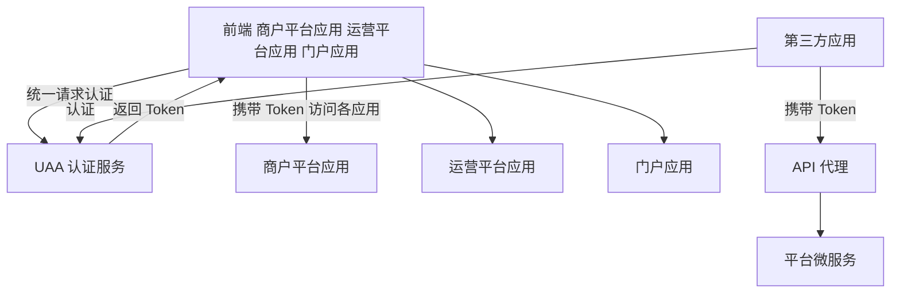
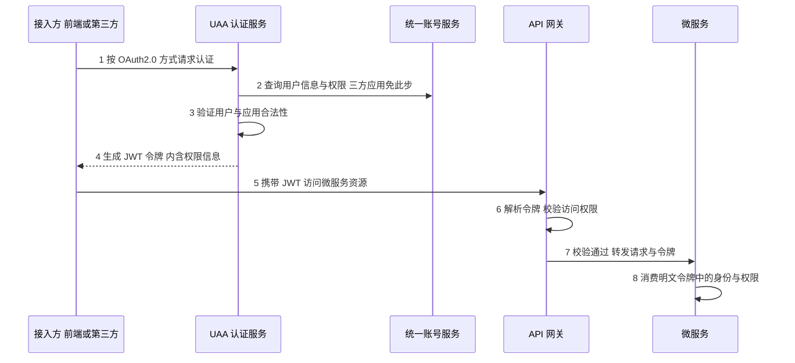

# 分布式系统怎么认证：从 session 的困境到 token 加统一认证中心

> 🔒 安全提示：文中示例的口令/密钥均为课程教学环境演示口径，生产环境的安全要求见《安全与合规须知》。

单机时代的认证方案搬到分布式系统里会立刻失灵：用户在商户平台登录了，转头访问交易服务，session 却留在商户平台的内存里，交易服务根本不认识这个人。闪聚支付平台本身就是分布式系统，商户平台应用、运营平台应用、门户应用各自都要认证，怎么统一，本课把需求、选型与最终技术方案一次讲透。

## 先给结论

- 分布式认证有两大需求：统一认证授权，由独立的认证服务集中处理认证与令牌签发；开放认证体系，一方应用与三方应用用同一套机制接入。
- 基于 session 的方案在分布式下要靠复制、黏贴、集中存储三种手段补救，各有容错与扩展的硬伤，不适合分布式系统。
- token 方式服务端不存会话，所有节点只认令牌，天然适配多节点与多客户端，代价是令牌随请求传输占带宽、验签消耗 CPU。
- 项目的技术方案是 token 体系落地：统一认证服务（UAA）签发 JWT 令牌，API 网关统一解析校验，微服务消费令牌中的身份与权限信息。
- 三个组件分工明确：统一账号服务管账号与权限数据，UAA 管认证与签发，网关管入口与校验。

## 两大需求：统一认证与开放认证

**第一，统一认证授权。** 微服务架构下每个应用、每个服务都有认证授权需求，如果每个服务各实现一套认证逻辑，冗余且体验割裂。分布式系统讲究各司其职、专人做专事，认证授权理应抽出来由独立服务承担。平台里的商户平台应用、运营平台应用、门户应用，统一由 UAA 认证服务完成认证：前端请求 UAA 认证，认证通过拿到 Token，之后携带 Token 访问各个应用。

**第二，开放认证体系。** 平台不只服务自己人。第三方应用要接入平台，比如一家电商网站想读取平台提供的支付与订单数据，它访问的是平台的资源服务，同样需要认证。不能给三方应用单独造一套认证、给内部服务再用另一套，正确做法是开放认证体系：认证服务既服务内部的一方应用，也服务外部的三方应用，统一机制接入。三方应用的访问路径多一跳，认证拿到 Token 后访问专门为第三方开发的 API 代理，由代理访问平台微服务返回业务数据：



需求定了方向：要一套既集中又开放的认证机制。接下来是选型，候选就是上一课的两种会话方式。

## 基于 session 的三种补救与它们的代价

分布式环境下 session 的麻烦在于每个应用服务都要存用户身份。用户在商户服务认证通过，session 写在商户服务的内存里，再访问交易服务时，交易服务没有这份 session，按机制用户就得重新登录。业界的补救做法有三种：

```text
Session 复制：多台应用服务器之间同步 session，保持一致，对外透明
Session 黏贴：用户访问集群中某台服务器后，强制后续所有请求均落到此机器
Session 集中存储：将 session 存入分布式缓存，所有实例统一从缓存存取
```

三种做法各有暗伤。复制方案在节点间来回同步，一旦复制出错，容错性无从保证，节点越多同步开销越大；黏贴方案把用户钉死在一台节点上，这台节点挂掉，用户落到其他节点只能重新登录，可用性打折；集中存储把 session 放进统一存储（数据库或 Redis），各服务统一取用，看似干净，却引入了一个新的强依赖组件，认证这个高频动作全压在存储上。

还有两层绕不开的底色：session 机制基于 Cookie，在种类繁杂的移动客户端上不能有效使用，Cookie 本身又无法跨域；系统扩展时，复制的容错、黏贴的高可用、存储的性能每一样都要单独加固。结论明确：基于 session 的方式不建议用在分布式系统中。

## 基于 token 的方案：节点只认令牌

token 方式从根上绕开了存储问题。服务端不存会话，认证服务校验通过后把用户身份信息写进令牌，令牌返回给前端，前端每次请求携带令牌访问。到服务端这边，不管有多少个节点、多少种服务，规则只有一条：有令牌就解析校验，解析出身份就放行访问，没有或无效就拒绝。

对分布式系统这套方式几乎量身合身：认证服务签发一次令牌，所有节点都只认令牌，任何节点都无需保存会话状态，节点随意扩缩容都不影响认证。代价也要认：令牌自包含信息，数据量比一个 sid 大得多，每次请求都要传输，占带宽；令牌的签名与验签操作要消耗 CPU，给服务端带来额外的处理负担。这两点在硬件条件宽裕的前提下都可以接受，换来的是免存储、易扩展的架构自由。

## 技术方案：UAA 签发，网关校验

选型定了 token，落地方案是三个组件协作的八步流程，这张图把主链路画了出来：



流程里有几个设计点值得展开。令牌选了 JWT 形态，权限信息直接编进令牌，网关与微服务拿到令牌即可自行读取权限，不必每次回查账号服务，这正是 token 自包含特性的用武之地。签发与校验依赖签名密钥，网关和统一认证服务必须用同一把密钥，课程通过 Nacos 的通用配置组统一下发（密钥一律用占位值，实际部署时替换为自己的密钥）：

```yaml
# Nacos 通用组 jwt.yaml：网关与统一认证服务共用
siging-key: example-signing-key
```

统一认证服务里对应的配置类直接读这个配置项构造 JWT 转换器：

```java
@Configuration
public class JWTConfig {

    @Value("${siging-key}")
    private String SIGNING_KEY;

    @Bean
    public TokenStore tokenStore() {
        return new JwtTokenStore(accessTokenConverter());
    }

    @Bean
    public JwtAccessTokenConverter accessTokenConverter() {
        JwtAccessTokenConverter converter = new JwtAccessTokenConverter();
        converter.setSigningKey(SIGNING_KEY); // 签名密钥，校验方需持有同一密钥
        return converter;
    }
}
```

三个组件的职责边界要划清。统一账号服务管数据：商户与运营人员的账号、密码、角色、权限、资源等系统级信息都归它管理，不含业务信息。统一认证服务（UAA）管动作：承载 OAuth2.0 的接入方认证、登录用户认证、授权以及令牌生成，完成实际的认证授权功能。API 网关管入口：作为系统唯一入口提供定制 API 集合，顺带承担身份验证、监控、负载均衡、缓存等职责，核心要点是所有接入方都经统一网关进入，非业务功能全部在网关层处理，微服务只管业务。

## 常见误区

- **给每个服务各配一套登录。** 错例：商户平台一套账号体系，交易服务再一套。正解：抽独立认证服务统一处理，各服务消费认证结果，用户一次登录全平台通行。
- **把 session 三种补救当成分布式方案。** 错例：上了 Redis 存 session 就认为可以支撑大规模分布式。正解：复制、黏贴、集中存储都只是缓解，Cookie 依赖与跨域限制仍在，容错与扩展成本仍在，选型时仍应倾向 token。
- **以为 token 方式零成本。** 错例：只讲无状态好处，忽略带宽与验签开销。正解：令牌自包含导致体积大、随请求传输，签名验签耗 CPU，容量规划与密钥算法选型要把它算进去。
- **把网关当成业务服务。** 错例：在网关里写业务逻辑。正解：网关处理路由、身份验证、监控这类非业务功能，业务一律下沉到微服务。

## 面试可能被问到的问题

1. 面试官追问：「分布式系统为什么需要统一认证服务，而不是各服务自己认证？」
   答：每个服务各做一套认证，逻辑冗余、维护成本高，用户体验也割裂，登录一次到处要求再登录。由独立认证服务集中签发令牌，各服务只做令牌校验与消费，符合分布式系统各司其职的分工，还能把开放接入的入口统一收口。
2. 面试官追问：「基于 session 的认证在分布式下有哪些补救手段，各有什么问题？」
   答：复制、黏贴、集中存储三种。复制在节点间同步 session，对外透明但同步出错影响容错；黏贴强制用户落同一节点，节点宕机就得重新登录；集中存储把 session 放分布式缓存统一存取，引入新的强依赖。加上 session 依赖 Cookie 与跨域限制，分布式场景整体不推荐。
3. 面试官追问：「token 方式的优缺点分别是什么？」
   答：优点是服务端不存认证数据，易维护、扩展性强，客户端存储位置不限，能统一 Web 与 App 的认证机制；缺点是令牌自包含信息量较大，每次请求都要传输占带宽，签名验签操作给 CPU 带来额外负担。
4. 面试官追问：「JWT 令牌在你们项目的流转路径是怎样的？」
   答：接入方按 OAuth2.0 向统一认证服务请求认证，认证服务查统一账号服务核对身份与权限后签发含权限信息的 JWT；接入方携带令牌访问 API 网关，网关解析令牌校验权限，通过后把令牌转发给微服务；微服务读取明文令牌中的用户身份与权限继续业务处理，全程无需回查账号服务。
5. 面试官追问：「统一账号服务、UAA、API 网关三者的职责边界怎么划？」
   答：账号服务管数据，账号、密码、角色、权限、资源等系统级信息的增删改查都在它；UAA 管动作，认证、授权、令牌生成与校验支撑；网关管入口，路由转发、令牌解析校验、监控、负载均衡等非业务功能集中在此。数据、动作、入口三层分开，任何一层替换都不波及另外两层。

## 配套资料

- 讲义：`materials/docs/10/闪聚支付-第2章-讲义-对接SaaSv1.0.md`，2.2 分布式系统认证方案之 2.2.1 分布式认证需求（统一认证授权、开放认证体系）、2.2.2.1 选型分析（session 三种做法与 token 方式）、2.2.2.2 技术方案（八步流程与三组件职责）为本课出处。
- 代码：`materials/code/10/代码/`，统一认证服务工程的 `JWTConfig.java`（签名密钥注入与 JWT 令牌转换器）、网关工程路由配置为真实文件（内层目录为课程原始命名，路径列至该目录层级）。
- 说明：该阶段课程资料归档在 `materials/docs/10/` 与 `materials/code/10/`（不存在 09 编号目录）；包名与模块名按 `com.study.pay`、`pay-saas-*` 系口径改写；签名密钥值以 example 占位，JWTConfig 节选省略了项目自定义的令牌转换器装配细节，完整实现以工程源码为准。
