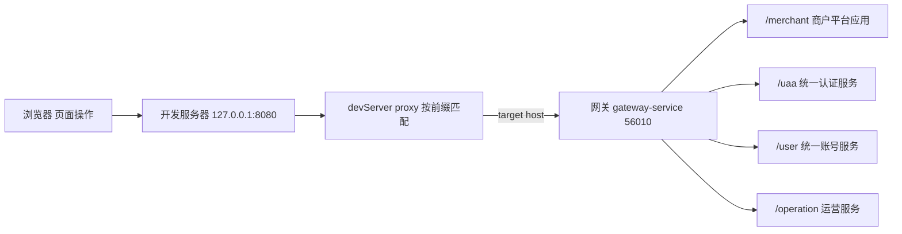

# 部署商户平台前端工程：Node 与 Yarn 环境、代理配置与启动验证

服务端接口全部就位之后，集成测试还差另一半：把前端工程师交付的前端工程在本地跑起来，让真实页面替代 Postman 发起请求。前端工程是现成的成品，拿到手就能用，部署本身没有一行业务代码要写，全是环境操作：装 Node.js 与 Yarn、解压工程、把请求地址指到网关、启动验证。链条不长，但每一环都可能卡住只写过 Java 的人，值得把每一步背后的原因讲透。

## 先给结论

- 前端工程是 Vue 2 加 TypeScript 加 Element UI 的单页应用，构建工具用 Yarn，它的角色等同于 Java 侧的 Maven。
- 环境三件事：安装 Node.js 与 Yarn 并把安装目录加入 Path；解压前端工程与随包依赖 `node_modules`；把 `node_modules/.bin` 也加入 Path。
- 唯一要改的配置在 `vue.config.js`：后端地址 `host` 指向网关 56010，五组业务路径 `/merchant`、`/uaa`、`/user`、`/operation`、`/zuul` 全部代理到网关。
- 启动两条命令：`yarn install --ignore-engines` 联网补齐缺失依赖，`yarn serve` 构建并启动，完成后自动打开首页，访问地址 `http://localhost:8080`。
- 编译期的 ESLint 缩进警告之类的小报错不碍事，浏览器能打开登录页就算部署成功。

## 前端工程里有什么

解压前端工程的压缩包，里面的东西比一个 Java 工程直白得多：`src` 目录装源码，`public` 装静态资源，`package.json` 是工程说明书，还有一个大块头 `node_modules`。Java 工程的依赖靠 Maven 从仓库下载，前端工程这次连依赖目录一起打包交付，`node_modules` 里躺着 `axios`、`vue-router`、`vuex` 这些构建时需要的包，相当于把本地仓库一并拷给了你。源码与依赖都在，部署的实质就只剩让工具链跑起来。

**包管理器用 Yarn，不是 npm。** 上一课的检查清单里以 npm 举例，课程实际用的是 Yarn，两者命令一一对应，`npm install` 对 `yarn install`，`npm run serve` 对 `yarn serve`。Yarn 是前端工程打包构建的工具，地位与 Java 的 Maven 相当；它本身也依赖 Node.js 的运行环境，所以 Node.js 要先装。

## 环境准备：两装两配

**装 Node.js。** 从官网或资料包里的安装包安装，一路下一步即可，难度与装 JDK 无异。装完把 Node.js 的安装目录（默认在 `C:\Program Files\nodejs`）加进系统环境变量 Path，逻辑与配 JAVA_HOME 后再往 Path 里加 bin 目录一致。

**装 Yarn。** 资料包里提供 `yarn-1.21.1.msi`，双击安装。**装完后配第二个环境变量：把前端工程下 `node_modules\.bin` 目录加入 Path。** 这一步新手最容易漏。`.bin` 目录里放着一堆可执行脚本，构建过程要调用它们；不加 Path，命令行里敲 `yarn serve` 时系统找不到这些脚本，构建直接失败。路径按工程实际位置填，例如 `C:\work\pay\pay-web\node_modules\.bin`。

两个环境变量配完，在命令行里敲 `yarn -v` 能出版本号，环境就算就位。

## 代理配置：把请求收敛到网关

前端工程里唯一需要动手改的文件是 `vue.config.js`。它做两件事：给开发服务器定端口，把后端请求的代理目标配出来。工程内的实际配置如下（节选，注释按本课口径补写）：

```js
const devServerPort = 8080
// 后端总地址：开发服务器代理之后，所有请求统一发往网关
const host = 'http://127.0.0.1:56010'

module.exports = {
  publicPath: '/',
  devServer: {
    port: devServerPort,
    open: true, // 编译完成后自动打开浏览器
    proxy: {
      [process.env.VUE_APP_BASE_API + '/merchant']: {
        target: host,
        changeOrigin: true,
        ws: true,
        pathRewrite: {
          ['^' + process.env.VUE_APP_BASE_API + '/merchant']: '/merchant'
        }
      }
      // /uaa、/user、/operation、/zuul 四组代理与上面同构，逐组照抄
    }
  }
}
```

`host` 是系统的总地址。此前部署 SaaS 时起过三个服务，网关 `gateway-service` 负责把所有请求转发到各个微服务，所以前端要把网关的端口 56010 配在这里。**前端永远只认网关一个地址**，至于 `/merchant` 进商户平台应用、`/uaa` 进统一认证、`/user` 进统一账号，那是网关路由规则的事，前端不关心。

这张图说明一次页面请求的完整路径：



图里有两个容易忽略的细节。请求先落在 8080 的开发服务器而不是直接打 56010，代理按 `VUE_APP_BASE_API` 环境变量加业务前缀匹配后转发；`pathRewrite` 把匹配用的前缀剥掉，还原成网关认识的 `/merchant`、`/uaa` 等真实路径。工程内 `src/utils/request.ts` 创建 axios 实例时把 `baseURL` 设成这个环境变量，前端所有 API 定义里写的相对路径都经它拼装，这条链路一旦断了，页面上的每个按钮都会失联。

## 安装依赖与启动验证

进入前端工程目录，依次执行两条命令：

```bash
# 联网补齐缺失依赖；依赖目录已随包提供，此步只是查漏补缺
yarn install --ignore-engines
# 构建并启动开发服务器
yarn serve
```

`install` 阶段要求电脑联网，会在线安装少量缺的东西；大头 `node_modules` 已经在包里，速度不会太慢。`--ignore-engines` 用于跳过 Node.js 版本检查，工程对运行环境版本有声明，版本不符时该参数让安装继续进行。`serve` 阶段是真正的构建，webpack 编译整个工程，控制台滚动输出进度。

编译过程中会冒出一些警告和小报错，比如「Expected indentation of 5 spaces but found 6」这类缩进检查提示，都是前端工程自身的代码风格问题，暂时不用处理。判断标准只有一条：**编译完成后浏览器自动弹出首页，登录页能正常显示，前端部署即告完成。**

页面打开后先别急着操作功能，按 F12 打开开发者工具把 Network 面板常开，调试窗口拖到右侧顺手的位置。此后每一次点击都会在面板里留下请求记录，请求 URL 就是排查集成问题的第一现场，这也是下一课功能测试的观察手段。

## 常见误区

- **前端直连微服务端口。** 错例：把 `host` 配成 57010 直打商户平台应用，令牌校验与转发都发生在网关层，绕过网关链路就断了。正解：`host` 只配网关 56010，其余交给网关路由。
- **漏配 `node_modules\.bin` 环境变量。** 错例：只装了 Node.js 与 Yarn 就敲 `yarn serve`，报命令或脚本找不到。正解：把工程内 `node_modules\.bin` 加入 Path，这是构建脚本的所在。
- **断网执行 install。** 错例：以为依赖全在包里，断网状态下执行 `yarn install` 报错。正解：安装阶段保持联网，虽然大部分依赖已就位，仍可能有少量包需要在线拉取。
- **被编译警告吓停。** 错例：看到控制台一片黄色警告与缩进报错就认为部署失败，反复重装。正解：警告不影响运行，以浏览器能否打开首页为准。

## 面试可能被问到的问题

1. 面试官追问：「前后端分离开发时，前端项目本地跑起来后为什么还要配一层代理？」
   答：开发环境下页面由前端开发服务器提供，浏览器直接请求它会有跨域限制。开发服务器自带 proxy，按路径前缀把请求转发给后端网关，并做路径重写还原真实路径，跨域问题在开发期就被消化掉。上线后则由 Nginx 等网关层承担同样的职责。
2. 面试官追问：「Yarn 和 npm 是什么关系，为什么要统一包管理器？」
   答：两者都是 Node.js 的包管理器，Yarn 在安装速度与依赖锁定上更有优势。工程用哪个管理器，`node_modules` 的目录结构与锁文件格式就按哪个生成，团队成员混用会造成依赖版本漂移，所以工程层面统一工具与命令。
3. 面试官追问：「前端工程的请求地址为什么指向网关，而不是各微服务？」
   答：网关是系统的统一入口，承担路由转发与令牌校验，前端只需要知道一个地址。微服务的地址、端口与内部结构对前端屏蔽，服务扩容或迁移时前端零改动，安全策略也在网关一层收口。
4. 面试官追问：「集成测试开始前，你如何确认前端环境是可用的？」
   答：三步核对：命令行执行 yarn -v 能出版本，说明 Node.js 与 Yarn 环境变量就位；工程内依赖目录解压完整；启动后浏览器自动打开登录页且控制台无阻断性报错。环境问题在这一步全部排除，功能测试时才能专注业务。
5. 面试官追问：「前端为什么要随包携带 node_modules 一起交付？」
   答：教学与离线场景下，在线安装受网络与版本影响，随包交付依赖目录可以让工程在断网环境也能构建。代价是包体积大且平台相关的二进制依赖可能不通用，正规团队协作还是靠锁文件加仓库拉取。

## 配套资料

- 指南：`materials/code/10/_散落资料/`，前端部署指南文档在该目录内层，Node.js 安装、Yarn 安装、解压源码与依赖、`node_modules\.bin` 环境变量、`vue.config.js` 后端地址、启动命令等步骤与本课一一对应（文件名为课程原始命名，不在此展开）。
- 前端：`materials/code/10/前端代码/`，商户平台前端工程，`vue.config.js`、`package.json`、`src/api/users.ts`、`src/utils/request.ts` 为真实文件，代理五组路径、devServer 端口与 axios 拦截器均取自该工程；内层目录为课程原始命名，路径只列至该目录层级。
- 讲义：`materials/docs/10/闪聚支付-第2章-讲义-对接SaaSv1.0.md`，SaaS 系统部署与 2.4 用户认证接口说明，对应本课代理配置所指向的服务端。
- 说明：该阶段课程资料归档在 `materials/docs/10/` 与 `materials/code/10/`（不存在 09 编号目录）；前端工程目录与内层名称为课程原始命名，正文统一称商户平台前端工程；网关地址 56010 取自工程 `bootstrap.yml` 真实配置，Nacos 分组按本系列口径写作 `PAY_GROUP`，无涉及密钥项。
