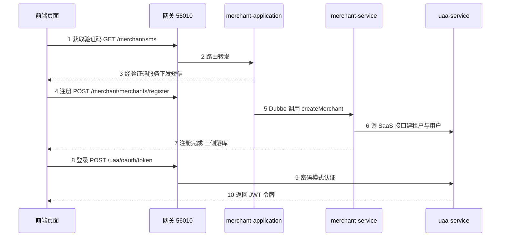
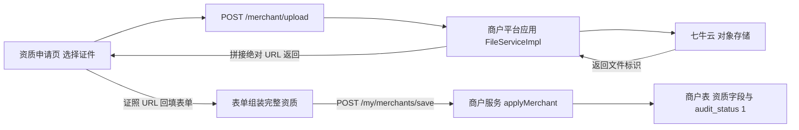
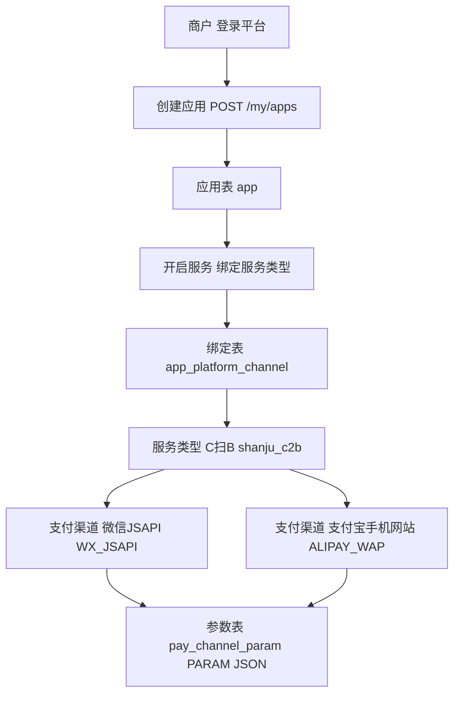

# 前后端集成测试-功能测试：注册登录、资质申请与支付渠道参数配置全流程

> 🔒 安全提示：文中示例的口令/密钥均为课程教学环境演示口径，生产环境的安全要求见《安全与合规须知》。

## 先给结论

- 系列定位：闪聚支付商户接入篇的收官三连，用真实前端把注册登录、资质申请、渠道参数配置三条业务流从头到尾走一遍。
- 测试环境清单：SaaS 三件套、商户服务、交易服务、商户平台应用与验证码服务按依赖顺序启动，测试顺序也按业务依赖排。
- 注册登录：注册三要素（新手机号、新账号、验证码）落库核对商户表、员工表与 SaaS 租户三处数据；登录走 `uaa/oauth/token` 密码模式拿 JWT 令牌，页面请求自动携带。
- 资质申请：证件上传终点在七牛云，商户表核对企业信息、三个证照 URL 与 `audit_status` 状态推进；状态字典为 0 未申请、1 已申请待审核、2 审核通过，测试期手动置 2 解锁进度。
- 渠道参数配置三级结构：商户建应用（app 表）、应用绑定服务类型（app_platform_channel 表）、服务类型下每个支付渠道配参（pay_channel_param 表），参数以 JSON 整串存 PARAM 大文本列。
- 验证纪律贯穿三篇：页面响应与数据库落库双核对，写操作的成败以数据库为准；页面测试暴露的多是环境类障碍，按接口规范开发的接口本身很少出新问题。
- 排查套路：Network 面板看失败请求的地址、请求头与响应体，定位到具体环节再动手，不盲目重试。
- 资料出处为闪聚支付对接 SaaS、商户注册与支付参数配置三份讲义，正文代码为按 `com.study.pay` 口径改写后的节选。

## 第1部分：功能测试之注册与登录：真实页面把令牌链路走通

前端工程部署完成，服务端起齐，集成测试从最基础的两件事开始：注册一个商户，再用它登录拿令牌。这两条流程此前在 Postman 里各自验证过，但真实的用户操作从页面发起，请求经网关转发、令牌由认证中心签发，任何一环的配置问题都会在页面上现出原形。测试的正确姿势不是点完就算，而是盯着 Network 面板跟踪每一次请求，页面操作与数据库核对双线并行。

### 启动服务端：一个都不能少
测试开跑前把服务按依赖顺序起齐。启动清单如下：

```text
SaaS 侧
  gateway-service        56010   网关，统一入口
  user-service           56030   统一账号，注册与登录都依赖
  uaa-service            56020   统一认证，签发令牌
商户侧
  merchant-service       56040   商户服务，注册接口的实现方
  transaction-service    56050   交易服务，渠道参数配置依赖
  merchant-application   57010   商户平台应用，前端请求落点
验证码服务
  sailing                56085   注册时下发验证码
```

清单过一遍时遇到一个前期准备遗留的编译报错，提示参数类型不匹配，把对应参数的类型声明改成 Long 后恢复正常。这类报错的定位方式值得记住：报错栈会指到具体类与方法，对着改类型即可，不必怀疑环境。全部启动后到 Nacos 控制台的服务列表逐个核对，缺一个就在启动阶段补上，别拖到功能测试时再回头查环境。

### 调试窗口与测试接口
打开集成测试文档，商户注册一节列出了两个入口接口：获取手机验证码 `GET /merchant/sms` 与注册商户 `POST /merchant/merchants/register`。前端工程里，这两个接口的定义在 `src/api/users.ts` 中（节选自工程源码，注释按本课口径补写）：

```typescript
// 注册
export const registryData = (data: any) =>
  request({
    url: `/merchant/merchants/register`,
    method: 'post',
    data
  })

// 注册时获取验证码
export const getMsgCode = (phone: string) =>
  request({
    url: `merchant/sms?phone=${phone}`,
    method: 'get'
  })

// 登录：密码模式申请令牌
export const login = (data: any) =>
  request({
    url: 'uaa/oauth/token',
    method: 'post',
    data
  })
```

浏览器按 F12 打开开发者工具，把调试窗口从底部挪到右侧，Network 面板常开。每一次页面操作触发的请求 URL、请求头、响应码都记录在这里，这是本次集成测试最重要的观察工具。排错的顺序是固定的：先看 Network 里的请求发到了哪个 URL、返回什么状态码，再到服务端日志与数据库核对，页面现象只是表象。

### 注册：页面操作与落库核对
注册页面上填四样东西：账号、密码、手机号、验证码。账号取一个没用过的，比如 `test03`，密码 `123456`；手机号必须换新的，商户表按手机号做唯一约束，用已注册的号码测注册只能换来「已存在」的报错。填完点获取验证码，请求经网关进商户平台应用再转验证码服务，验证码会直接打到验证码服务的控制台输出，把它抄进页面，点注册。

整条链路一图看全：



注册成功的验证分两半。**页面响应只算一半**，另一半在数据库：打开商户表找到新记录，记下它的商户 ID 与 `tenant_id` 字段，租户 ID 正是注册时商户服务调用 SaaS 接口创建租户后回填的；再到员工表核对新账号，SaaS 侧统一账号库里也能看到对应的租户与账号。三侧数据都对上，注册这条链才算真正通过。请求到达时带着的验证码 key 与验证码值在服务端校验，验证码超时或错填都会在 Network 面板里看到明确的错误应答。

### 登录：令牌从这里来
用刚注册的 `test03` 与密码 `123456` 登录。前端发起的是密码模式申请令牌，接口规格与用 curl 手工验证时一致：

```bash
# 经网关的 /uaa 路由申请令牌（密码模式）
curl -X POST "http://127.0.0.1:56010/uaa/oauth/token" \
  -d "grant_type=password" \
  -d "client_id=merchant-platform" \
  -d "client_secret=example-client-secret" \
  -d "username=test03" \
  -d "password=123456"
```

响应体里的 `access_token` 就是后续所有受保护接口的通行证。Network 面板里能看到登录请求返回一长串令牌，紧跟着页面会再发一个查询请求，把当前商户信息取回来渲染成首页的用户中心。这个查询就是此前补的「获取登录用户的商户信息」接口：前端请求头携带令牌与租户 ID，服务端按租户 ID 反查商户。请求拦截器的实现说明了令牌如何被自动携带（节选自工程源码）：

```typescript
service.interceptors.request.use(config => {
  if (UserModule.token) {
    config.headers['Authorization'] = 'Bearer ' + UserModule.token
    config.headers['tenantId'] = UserModule.tenantId
  }
  return config
})
```

登录态一建立，`Authorization` 与 `tenantId` 两个请求头就挂在了每一个后续请求上。网关校验令牌签名后向下游转发明文身份信息，商户平台应用里的过滤器解析出用户，工具类按租户 ID 换取商户 ID，这条在准备阶段替换的令牌链路，此刻在真实页面里完整跑了一遍。

### 报错现象与排查套路
页面测试会遇到的报错集中在几类。**验证码类：** 获取验证码失败先看验证码服务是否启动，再确认手机号没被用过；验证码填错或超时，注册接口会返回校验失败的错误码，重新获取即可。**令牌类：** 登录请求返回认证失败，核对账号密码，再确认统一认证服务与统一账号服务都已注册到 Nacos；令牌拿到了但后续接口报权限或令牌缺失，检查请求头里 `Authorization` 的 Bearer 前缀与 `tenantId` 是否真的带上了。**依赖类：** 请求直接失败或超时，看 Network 里失败请求的 URL 打到了哪个服务，八成是该服务没启动或没注册成功，回 Nacos 服务列表核对。

排查的纪律是顺着 Network 的请求记录走，而不是在页面上反复重试。每一次失败都对应一条具体的请求与一个具体的错误应答，把 URL、状态码、响应体三样东西拿到手，问题基本就锁定在那一环了。

## 第2部分：功能测试之资质申请：页面上传证件，七牛云与商户表对账

注册出来的商户还只是「候选」，资质申请把它升级成正式商户：上传营业执照与身份证照片、填写企业信息、提交落库、状态推进到待审核。这一步在页面上是几张表单加几次点击，背后是「前端传文件、服务端传七牛云、URL 回填表单、整体提交落库」四段链路。此前每个接口都用 Postman 单独测过，现在要在真实页面里串起来跑，重点看两条：上传的照片在七牛云里是否真有，提交的资质在商户表里是否真落。

### 页面与接口的对应关系
登录商户平台后，在「支付应用系统」上方菜单找到「资质申请」入口。页面分两个功能块：证件上传与资质申请，正好对应讲义里定义好的两个接口。表单分「基本信息」与「联系人信息」两段：前者是企业名称、企业营业执照编号、企业地址、行业类型与三个证件上传位（营业执照、身份证正面、身份证反面），后者是联系人与联系地址。填的内容最终都会写进商户表的对应字段，提交动作走的是此前实现的资质申请接口，商户 id 从令牌里解析，前端不用传。

整条链路的结构如下：



图里最值得注意的一条边是「证照 URL 回填表单」：上传接口返回的文件标识要由前端拿到并填进表单字段，三个证件三次上传、三次回填，然后才轮到整表提交。上传与提交是两个独立请求，中间隔着前端的状态维护，集成测试就是把这两段接口的衔接处跑实。

### 证件上传：终点在七牛云
上传接口在商户平台应用的控制器里，职责收得很窄：接文件、生成唯一文件名、转调文件服务、把访问地址还给前端（节选自工程源码，包名按本系列口径改写）：

```java
@ApiOperation("上传证件照")
@PostMapping("/upload")
public String upload(@ApiParam(value = "证件照", required = true)
                     @RequestParam("file") MultipartFile multipartFile) throws IOException {
    // 按原始扩展名生成 UUID 文件名，避免同名覆盖
    String originalFilename = multipartFile.getOriginalFilename();
    String suffix = originalFilename.substring(originalFilename.lastIndexOf("."));
    String fileName = UUID.randomUUID() + suffix;
    // 上传并把七牛云侧的访问地址返回给前端
    return fileService.upload(multipartFile.getBytes(), fileName);
}
```

真正的上传在 `FileServiceImpl` 里，七牛云的访问凭证从配置读取，上传成功后返回绝对访问地址（节选自工程源码，密钥与空间名按占位口径改写）：

```java
@Service
public class FileServiceImpl implements FileService {

    @Value("${oss.qiniu.url}")
    private String qiniuUrl;        // 七牛云空间的访问域名
    @Value("${oss.qiniu.accessKey}")
    private String accessKey;       // example-access-key
    @Value("${oss.qiniu.secretKey}")
    private String secretKey;       // example-secret-key
    @Value("${oss.qiniu.bucket}")
    private String bucket;          // 存储空间名

    @Override
    public String upload(byte[] bytes, String fileName) throws BusinessException {
        try {
            QiniuUtils.upload2qiniu(accessKey, secretKey, bucket, bytes, fileName);
        } catch (RuntimeException e) {
            throw new BusinessException(CommonErrorCode.E_100106);
        }
        // 上传成功，返回文件的绝对访问地址
        return qiniuUrl + fileName;
    }
}
```

页面上的验证方法很直接：选择证件文件，点上传，请求成功后到七牛云控制台的空间文件列表里刷新，刚传的照片应该在列；页面表单里对应的证照字段也拿到了一个形如 `http://qiniu.example.com/ab1108e1-44a7-a714-58fc1c1a8e48e.jpg` 的绝对地址。测试时用同一张图片充当营业执照与身份证正反面完全没问题，接口不校验图片内容，只管把文件送到存储并返回地址。若在服务端留有调试断点，务必放行走完，前端会一直等在请求上，上传成功的提示不出，七牛云里也不会有文件。

### 提交资质申请与落库核对
三个证件位都拿到 URL 后，补齐联系人与联系地址，点提交。前端把整个表单组装成 JSON 发给提交接口，请求体长这样（示例值按测试现场整理，证照域名为占位）：

```json
{
  "merchantName": "test03企业",
  "merchantNo": "91330100MA2ABC1234",
  "merchantAddress": "河南郑州",
  "merchantType": "教育",
  "businessLicensesImg": "http://qiniu.example.com/ab1108e1-44a7-a714-58fc1c1a8e48e.jpg",
  "idCardFrontImg": "http://qiniu.example.com/ab1108e1-44a7-a714-58fc1c1a8e48e.jpg",
  "idCardAfterImg": "http://qiniu.example.com/ab1108e1-44a7-a714-58fc1c1a8e48e.jpg",
  "contactsName": "张先生",
  "contactsAddress": "郑州高新区"
}
```

提交成功的核对依旧以数据库为准。打开商户表定位本账号对应的那条记录，逐列核对：企业名称、企业编号、企业地址、行业类型从空变为提交值；三个证照字段存的是带域名的绝对 URL，将来拿这个地址就能直接浏览证件图片；联系人信息同样就位。状态字段 `audit_status` 从 0 变成 1，含义是已申请待审核。到此资质申请的测试闭环完成。

### 状态推进与手动审核
商户表的审核状态是一台小状态机：0 未申请，1 已申请待审核，2 审核通过。审核动作本身安排在实战阶段实现，而后续的渠道参数配置等功能依赖「已审核商户」这个前提，所以测试阶段要把这条记录手动推到 2：

```sql
-- 教学推进：手动模拟审核通过；真实系统的状态推进必须走业务接口
UPDATE merchant SET audit_status = '2' WHERE id = 1212580971555771;
```

手动改库只为解锁后续开发与测试的进度，审计、通知、状态机校验这些真实系统里挂在审核接口上的东西，此时都不存在，这层认知要在测试阶段就建立起来。改完后刷新页面，用户中心里商户信息一栏的企业名称、营业执照号等字段回显出来，页面展示与库中数据一致，资质申请与回显两条链路同时得到验证。

## 第3部分：功能测试之支付渠道参数配置：应用、服务类型与渠道参数三级对齐

支付渠道参数配置是整个商户接入篇的最后一个功能，也是接口最多的一个：创建应用、绑定服务类型、查询服务类型下的支付渠道、配置渠道参数、回查参数，五个接口环环相扣。此前的开发课已经把这些接口逐个实现并用 Postman 测过，这一课在真实页面上按业务流程串起来跑，同时把 day06 的四项功能测试收口，对整个第 2 章做一次复盘。

### 业务主线：三级结构一图看全
渠道参数配置的复杂度不在接口代码，在数据模型。一个商户可以有多个应用，一个应用可以绑定多个服务类型，一个服务类型（如 C 扫 B）又由多个原始支付渠道实现，每个渠道有一套结构不同的参数。三级关系如下：



页面上的每个动作都对应三级结构里的一次写入：创建应用写 `app`，开启服务写 `app_platform_channel`，配置参数写 `pay_channel_param`。测试时按这条链核对库表，任何一环缺数据，后面扫码支付时就会出现「找不到渠道参数」的运行时错误，那是这批数据真正被消费的场景。

### 第一步：创建应用
进入商户平台的「应用管理」，点创建应用，填应用名称（如 `test03应用01`）与基本信息。表单里有一个应用公钥，此刻还用不上，随便填一个占位即可，它的用武之地在后续支付环节的验签。保存动作对应创建应用接口，实现在商户平台应用的控制器里，商户 id 照例从令牌解析（节选自工程源码，包名按本系列口径改写）：

```java
@ApiOperation("商户创建应用")
@PostMapping(value = "/my/apps")
public AppDTO createApp(@RequestBody AppDTO app) {
    // 商户 id 从令牌解析，前端无需传
    Long merchantId = SecurityUtil.getMerchantId();
    return appService.createApp(merchantId, app);
}
```

保存成功后页面自动跳转到服务类型绑定页，应用管理列表里也出现这条记录，带平台生成的应用 ID。到商户库 `app` 表核对一行新数据，商户 ID 与令牌身份一致，应用的创建就完成了。

### 第二步：绑定服务类型（开启服务）
应用创建完还不知道要用哪些支付通道。服务类型页把平台提供的服务类型列出来，有线上有线下，C 扫 B 属于线下。点亮 C 扫 B 旁边的「开启服务」，前端调用绑定接口，动作完成（节选自工程源码）：

```java
@ApiOperation("绑定服务类型")
@PostMapping(value = "/my/apps/{appId}/platform-channels")
void bindPlatformForApp(@PathVariable("appId") String appId,
                        @RequestParam("platformChannelCodes") String platformChannelCodes) {
    payChannelService.bindPlatformChannelForApp(appId, platformChannelCodes);
}
```

绑定接口在交易服务里落一条 `app_platform_channel` 记录。刷新页面可以继续开启别的服务类型，一个应用绑多条通道是常态。这一环节连同后面配参，涉及的接口清单如下：

```text
获取平台服务类型              GET  /merchant/my/platform-channels
为应用绑定平台服务类型        POST /merchant/my/apps/{appId}/platform-channels
根据服务类型查询支付渠道      GET  /merchant/my/pay-channels/platform-channel/{platformChannelCode}
商户配置支付渠道参数          POST /merchant/my/pay-channel-params
按应用与服务类型查参数列表    GET  /merchant/my/pay-channel-params/apps/{appId}/platform-channels/{platformChannel}
```

五条路径在 Network 面板里能按操作顺序对上号：进入服务类型页触发第一条查询，点开启服务触发第二条 POST，点配置参数触发渠道查询，保存参数触发配置 POST，回显时触发最后一条。接口清单与页面动作一一对应，是集成测试最舒服的状态。

### 第三步：为每个支付渠道配置参数
C 扫 B 只是一个服务类型，真正跟微信、支付宝打交道的是它下面的原始支付渠道。点「配置参数」，页面展示该服务类型下的渠道列表：支付 ID 1 的微信 JSAPI（`WX_JSAPI`）与支付 ID 2 的支付宝手机网站支付（`ALIPAY_WAP`）。给微信配参，表单填配置名称与一组渠道参数（商户 appId、公钥、私钥之类），测试阶段内容随便填，能保存即可，这些参数在支付课程里会逐个讲清来源。保存走的是配置参数接口（节选自工程源码）：

```java
@ApiOperation("商户配置支付渠道参数")
@RequestMapping(value = "/my/pay-channel-params", method = {RequestMethod.POST, RequestMethod.PUT})
void createPayChannelParam(@RequestBody PayChannelParamDTO payChannelParamDTO) {
    if (payChannelParamDTO == null || payChannelParamDTO.getChannelName() == null) {
        throw new BusinessException(CommonErrorCode.E_300009);
    }
    // 商户 id 由服务端补齐，参数串由前端组装
    Long merchantId = SecurityUtil.getMerchantId();
    payChannelParamDTO.setMerchantId(merchantId);
    payChannelService.savePayChannelParam(payChannelParamDTO);
}
```

表单上那一组输入框在参数表里没有一一对应的列，前端把它们格式化为一个 JSON 对象，整串放进 DTO 的 `param` 字段提交，服务端原样存入交易库 `pay_channel_param` 表的 `PARAM` 大文本列。微信参数与支付宝参数键名不同、个数不同，差异全被 JSON 吸收，表结构对渠道数量完全无感，这是当初系统设计的关键决策，页面上填的值只是它的最后一站。再次点开配置参数，已配置的内容回显出来，继续给支付宝渠道照此配一遍，交易库里就能看到 `WX_JSAPI` 与 `ALIPAY_WAP` 各自的参数记录，应用、服务类型、渠道、参数四级数据全部就位。

### day06 收官复盘
到这里，day06 的四项功能测试全部通过，整个第 2 章的业务也在真实前端下走完了完整闭环。复盘时值得把两天做的事串成一条线：部署 SaaS 系统让统一认证与统一账号就位；对接 SaaS 完成商户注册时租户与用户的联动创建；OAuth2.0 理论与密码模式打通登录拿令牌的链路；替换令牌工具类让正式令牌在微服务间流转；最后用部署好的前端从注册、登录、资质申请一路测到渠道参数配置。

测试侧的方法论同样值得沉淀：请求永远从页面发起，Network 面板全程跟踪，页面现象、请求三要素、数据库核对三线对照；报错先定位环节再动手，环境类问题（服务未启动、断点未放行、配置未生效）与代码类问题分开对待。往后进入 C 扫 B 支付，这些今天配置的参数就会被扫码请求真正消费：同一个应用生成的支付二维码，微信扫走微信那对参数，支付宝扫走支付宝那对参数，三级数据结构的价值在那一刻兑现。

## 常见误区

- **只看页面弹窗不看数据库。** 错例：注册页面提示成功就认为通过。正解：注册要核商户表、员工表与 SaaS 侧租户账号三处数据，页面响应与落库结果都正确才算通过。
- **用旧手机号测注册。** 错例：沿用此前测试注册过的号码，接口报已存在，误判为新功能故障。正解：每次注册换全新手机号与账号，唯一约束是刻意设计的校验，不是故障。
- **手工构造令牌测试页面功能。** 错例：跳过登录，拿 Postman 里伪造的临时令牌往页面请求上贴。正解：页面请求的令牌由前端登录自动携带，伪造令牌的权限内容与正式链路对不上，测不出真实链路的问题。
- **报错后盲目重试。** 错例：页面报错就反复点提交，浪费验证码时效还刷出一堆失败记录。正解：先开 Network 面板看失败请求的三要素，定位到具体环节再动手。
- **把上传成功的提示当成七牛云落储的证明。** 错例：页面提示上传完成就去提交表单。正解：到七牛云控制台核对文件确实存在，再核对表单回填的 URL 可访问，两端都实才算上传链路通过。
- **证照字段存相对路径。** 错例：服务端只返回文件名，库里存相对标识，页面回显时图片裂掉。正解：上传接口返回绝对访问地址，库里存完整 URL，任何环境拿到地址即可浏览。
- **提交后只看接口返回。** 错例：提交接口应答成功就宣布测试通过。正解：写操作的验证落到商户表，资质字段与 `audit_status` 逐列核对，静默失败只有数据库能暴露。
- **残留断点不放行。** 错例：此前调试留下的断点拦住上传请求，前端一直转圈，误判为环境故障。正解：联调前清掉各服务的调试断点，或遇到请求挂起时先检查断点再查配置。
- **把服务类型当成支付渠道去配参。** 错例：给 C 扫 B 直接填一套参数。正解：参数挂在原始支付渠道上，`shanju_c2b` 下有 `WX_JSAPI` 与 `ALIPAY_WAP` 两个渠道，每个渠道各配一份。
- **公钥表单当必填项较真。** 错例：测试时纠结应用公钥怎么填，卡在创建应用这一步。正解：现阶段公钥是占位，随便填一个合法字符串即可，支付环节讲验签时它才有真实用途。
- **以为每个参数要单独一列。** 错例：往参数表里加微信专用列、支付宝专用列。正解：表单参数由前端组装成 JSON 存进 `PARAM` 大文本列，结构差异由 JSON 吸收，表结构不随渠道变化。
- **配完参数不回查。** 错例：保存成功就翻篇，应用 ID 或渠道编码传错时参数挂错对象却无人知晓。正解：按应用与服务类型回查参数列表，核对商户 ID、应用 ID、渠道编码与参数内容四要素。

## 面试可能被问到的问题

1. 面试官追问：「密码模式下，前端登录请求里带了哪些参数，各自的作用是什么？」
   答：grant_type 声明授权类型为 password，client_id 与 client_secret 标识接入客户端，由认证中心在客户端注册表中核对，username 与 password 是用户凭证。认证通过后认证中心签发 JWT 令牌，前端拿到后放入请求头 Authorization，后续所有受保护接口靠它通行。

2. 面试官追问：「为什么登录拿的是令牌，服务端却按租户 ID 查商户？」
   答：用户经 SaaS 统一认证登录后，令牌与请求头携带的是 SaaS 侧的租户 ID；商户是商户平台的概念，两者靠商户表 tenant_id 字段关联。服务端按租户 ID 反查商户，是两个系统模型之间的换算点，这也是注册时必须回填租户 ID 的原因。

3. 面试官追问：「集成测试时你如何组织请求跟踪？」
   答：浏览器 Network 面板常开，按业务流程分组看请求序列；每个请求关注 URL、请求头、状态码与响应体四样。失败请求先复现再定位，服务端配合日志与断点，数据库做最终核对，形成页面、日志、数据三线对照。

4. 面试官追问：「注册接口的验证码校验放在服务端做，前端只收集，这样设计有什么讲究？」
   答：校验必须在服务端，前端收集的任何值都不可信。验证码服务下发后把校验值暂存在服务端可见的存储里，注册请求带上 key 与用户填写的值，服务端比对通过才放行，防止脚本绕过页面直接刷注册，也能控制验证码时效与次数。

5. 面试官追问：「测试环境里服务启动的顺序有讲究吗？」
   答：有。按依赖排：基础设施（Nacos、MySQL、Redis）先行，被依赖的服务（SaaS 三件套、商户服务、交易服务）先于调用方（商户平台应用）启动，验证码服务在注册测试前就位。顺序错了表现为启动报错或调用报找不到提供方，按依赖排顺序能把这类时序问题消灭在启动阶段。

6. 面试官追问：「证件上传为什么要经过服务端转存七牛云，而不是前端直传？」
   答：七牛云的上传凭证 accessKey 与 secretKey 是敏感信息，放在前端等于把存储控制权公开，任何人拿到都能往空间里塞文件甚至删除。服务端持有凭证并校验文件来源，前端只与服务端交互，凭证不落浏览器，上传策略、文件类型与大小限制也集中在服务端控制。

7. 面试官追问：「上传接口为什么用 UUID 生成文件名？」
   答：商户上传的原始文件名会重复，同名覆盖会造成证件互相顶替；UUID 保证全局唯一，扩展名取自原始文件以保留格式信息。七牛云以传入的 key 作为对象名，服务端先把名字生成好，存储侧就不会有命名冲突。

8. 面试官追问：「表单里三个证照字段存的是什么，回显时怎么展示？」
   答：存的是上传接口返回的绝对访问 URL，包含七牛云空间域名与文件名。回显时前端把这个 URL 直接填进图片标签的 src，浏览器即可加载；私有空间则需要服务端按凭证生成带时效的签名下载地址，本项目测试空间为公有读，直接访问即可。

9. 面试官追问：「测试阶段手动把审核状态改成 2，真实系统里应该怎么做？」
   答：真实系统要提供审核接口，由运营人员调用，接口内部完成权限校验、状态机校验（只有状态 1 可以推进到 2）、落库与通知。手动改库绕过了全部校验，会产生状态跳跃的脏数据，只可用于教学解锁进度，不可带入生产习惯。

10. 面试官追问：「资质申请接口的商户 id 为什么从前端请求里拿不到，要从令牌解析？」
   答：商户 id 是登录身份的属性，不是表单数据。由服务端从令牌解析，能防止 A 商户伪造请求替 B 商户提交资质，也避免前端构造参数时的主键猜测。接口参数只承载业务内容，身份与归属一律服务端说了算，这是写接口的安全基线。

11. 面试官追问：「应用、服务类型、支付渠道三层关系为什么这么设计？」
   答：服务类型面向商户的业务语义，如 C 扫 B；支付渠道面向支付机构的技术实现，如微信 JSAPI。中间隔一层可以做到：商户只感知业务选择，新增或更换实现渠道不动商户侧配置；同一服务类型可以有多个渠道实现，运行时按扫码方选择参数。

12. 面试官追问：「渠道参数为什么存 JSON 大字段而不是拆成列？」
   答：不同支付机构的参数键名、数量与结构都不同，且机构会随版本调整参数。拆列意味着每接一个渠道改一次表，JSON 大字段让表结构稳定，扩展渠道零迁移。代价是字段内无数据库级约束，参数合法性校验上移到服务层。

13. 面试官追问：「配置渠道参数接口里，哪些字段服务端补齐、哪些由前端提交？」
   答：身份与归属类字段服务端说了算，商户 id 从令牌解析后回填 DTO；前端只提交业务内容，应用 ID、服务类型编码、渠道编码与参数 JSON。防止商户越权替别人写参数，也避免前端伪造归属关系。

14. 面试官追问：「一个应用绑定了 C 扫 B，顾客扫码时系统怎么决定用哪套参数？」
   答：二维码本身由应用生成，顾客用微信扫，请求带着微信渠道的标识进来，系统按应用 ID、服务类型与支付渠道编码查出微信那对参数与微信交互；支付宝扫码同理。渠道选择发生在支付请求到达时，参数只是提前备好的弹药。

15. 面试官追问：「集成测试阶段渠道参数随便填，上生产前要补什么？」
   答：要换成各支付机构真实发放的商户号、应用 ID、密钥与证书，流程上先在沙箱环境联调通过再切生产。随便填的参数只能在库表与接口层面验证链路，签名、金额、回调这些真实约束都要靠真实凭证加机构沙箱来验证。

## 配套资料

- 讲义：`materials/docs/10/闪聚支付-第2章-讲义-对接SaaSv1.0.md`，2.4 用户认证接口（2.4.1 登录功能说明、解析令牌，2.4.2.1 密码模式认证）为本课登录测试的接口出处；商户注册流程见同目录 `materials/docs/10/闪聚支付-第2章-讲义-商户注册&资质申请v1.0.md`。
- 代码：`materials/code/10/完整代码/`，商户平台应用工程的 `MerchantController.java`（getSMSCode、registerMerchant、getMyMerchantInfo）、商户服务工程的 `MerchantServiceImpl.java`（queryMerchantByTenantId）、`_散落资料/` 内层的 `SecurityUtil`、`TokenAuthenticationFilter` 为真实文件，正文代码为按 `com.study.pay` 口径改写后的节选。
- 前端：`materials/code/10/前端代码/`，`src/api/users.ts`（registryData、getMsgCode、login）、`src/utils/request.ts`（令牌与租户 ID 拦截器）为真实文件，内层目录为课程原始命名，路径列至该目录层级。
- 说明：该阶段课程资料归档在 `materials/docs/10/` 与 `materials/code/10/`（不存在 09 编号目录）；客户端密钥按本系列口径写作 `example-client-secret` 占位，数据库账号密码为本项目环境的 root/123456，测试账号与验证码取值均为现场教学数据。
- 讲义：`materials/docs/10/闪聚支付-第2章-讲义-商户注册&资质申请v1.0.md`，3.2 资质申请需求（前端上传证件照片与七牛云的交互流程）、3.2.4 商户平台应用资质申请（接口③）、3.3 上传证件（3.3.1 商户平台应用证件上传接口①）为本课出处。
- 讲义：`materials/docs/10/七牛云对象存储使用指南.md`，七牛云空间开通与凭证配置对应 `FileServiceImpl` 读取的 `oss.qiniu` 配置段。
- 代码：`materials/code/10/完整代码/`，商户平台应用工程的 `MerchantController.java`（upload、saveMerchant）、`FileService.java` 与 `FileServiceImpl.java`、common 工程的 `QiniuUtils.java` 为真实文件，正文代码为按 `com.study.pay` 口径改写后的节选。
- 说明：该阶段课程资料归档在 `materials/docs/10/` 与 `materials/code/10/`（不存在 09 编号目录）；七牛云密钥与空间访问域名为 `example-*` 与 `example.com` 占位，商户 id 与测试数据取自测试现场，审核状态字典 0/1/2 与手动置 2 的教学口径沿用资质申请系列课。
- 讲义：`materials/docs/10/闪聚支付-第2章-讲义-支付参数配置v1.0.md`，4.2 应用管理创建应用、5.3 应用绑定服务类型、5.4 根据服务类型查询支付渠道、5.4.4 与 5.5 支付渠道参数配置及查询为本课接口出处。
- 代码：`materials/code/10/完整代码/`，商户平台应用工程的 `AppController.java`（createApp）、`PlatformParamController.java`（bindPlatformForApp、createPayChannelParam、queryPayChannelParam）、交易服务 API 的 `PayChannelParamDTO.java` 为真实文件，正文代码为按 `com.study.pay` 口径改写后的节选。
- 前端：`materials/code/10/前端代码/`，`src/api/pay.ts`（createApp、boundRoad、getServiceType）、`src/api/channel.ts`（setParams、getPayChannelIncludePayParams）为真实文件，内层目录为课程原始命名，路径列至该目录层级。
- 说明：该阶段课程资料归档在 `materials/docs/10/` 与 `materials/code/10/`（不存在 09 编号目录）；库名按本系列口径写作 `pay_merchant_service` 与 `pay_transaction`，服务类型与渠道编码 `shanju_c2b`、`WX_JSAPI`、`ALIPAY_WAP` 取自课程基础数据；测试参数值为现场占位，无真实密钥。
