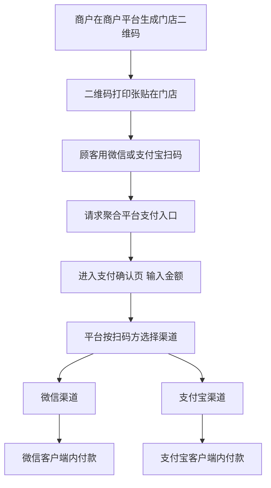
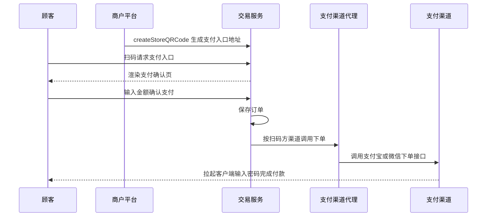

# C 扫 B 支付需求分析：顾客扫商家二维码的完整链路要怎么搭

前面把商户、应用、服务类型、支付渠道参数这条三级数据链在页面上完整测通了，参数表里躺着微信与支付宝两套渠道参数，当时说过它们真正的用武之地在扫码那一刻。第 3 章就是这个时刻的到来：实现 C 扫 B 支付，让顾客扫一张闪聚支付平台的门店二维码，微信扫就走进付，支付宝扫就走支付宝付。这一课先不写代码，把需求掰开：C 扫 B 到底是什么，一条完整的扫码支付链路经过哪些环节，落到系统上要开发哪些接口。

## 先给结论

- C 扫 B 中 C 是 Customer 顾客，B 是 Business 商户，指顾客扫描商户提供的二维码完成支付；反过来商户扫顾客付款码就是 B 扫 C。
- C 扫 B 有固定金额与输入金额两种形态，本阶段实现输入金额支付，固定金额只是把金额写死，思路完全一致。
- 业务链路五步：商户给门店生成二维码、顾客扫码进入支付确认页、输入金额确认支付、聚合平台按扫码方路由到对应渠道、在微信或支付宝客户端里输入密码完成支付。
- 平台要开发三件事：为门店生成统一支付二维码、与微信和支付宝对接、以中介身份调用渠道的下单接口。
- 接口落点在交易服务：`createStoreQRCode` 生成二维码入口地址，支付入口解析参数渲染确认页，`submitOrderByAli` 调支付宝下单。

## C 扫 B 是什么

C 扫 B 的字面拆解很简单：C 是 Customer 顾客，B 是 Business 商户，C 扫 B 就是顾客扫描商户提供的二维码来完成支付。这个动作每天都在发生：在餐厅吃完饭要结账，商家出示二维码，你打开支付宝或微信的扫一扫，对准码一扫，确认支付，完成。支付流程本身不复杂，复杂的是它背后的支撑系统，这正是本项目要搭的东西。

与它对应的是 B 扫 C，方向反过来：顾客出示自己的付款码，商户拿扫码枪扫顾客的码。超市收银台常见的就是这种，你把付款码调出来，收银员一扫，钱就扣了。两种方式只是扫码方向不同，作为商户侧的接入方案，C 扫 B 是聚合支付平台要覆盖的主力场景。

闪聚支付平台是聚合定位，把支付宝、微信等第三方支付渠道聚合成一个通道。落到 C 扫 B 上，就是不再让商户各贴一张支付宝码、一张微信码，而是给商户门店生成一张平台统一的二维码：这张码本身不关心你是谁，顾客用微信扫，请求带着微信的渠道特征进来，平台取微信那对参数与微信交互；用支付宝扫，就取支付宝那对参数。一张码完成多渠道收款，这就是一码多付，也是前一章配好的渠道参数被消费的地方。整条链路如下图：



关键在 F 这个分叉点：二维码是平台出的，钱却走渠道。扫码方是哪个 App，请求头里就带哪个 App 的特征，平台据此路由，这就是「聚合」两个字在支付环节的具象化。

## 固定金额与输入金额两种形态

C 扫 B 还能再往下分两种支付方式。一种是固定金额支付，顾客扫码后不用输金额，直接确认付款。最常见的场景是自动售货机：在写字楼里选一瓶饮料，屏幕上生成一个二维码，金额已经在码里定死了，扫一下确认，饮料掉下来。另一种是输入金额支付，商户提前生成一张二维码贴在结账处，顾客扫开之后自己输入本次消费的金额再付款，街边早餐店基本都用这种方式，老板不点名不结账，你自己扫自己填。

两种形态的技术底座是同一套：都是一张门店二维码、一个支付确认页、一笔订单、一次渠道下单。差别只在金额的来源，固定金额把金额写进码或写进售货机后台，输入金额让用户在页面填。所以本阶段以输入金额支付为主线，这个学会了，固定金额自助实现没有障碍。

输入金额的需求还决定了页面必须支持用户交互：扫码进来要能看订单信息、能填金额、能点支付按钮，这天然要求一个由服务端渲染的 H5 页面，而不是一张静态图。这个约束会在后面的调研里直接影响支付宝产品选型。

## 业务流程：从门店列表到扫码付款

把上面两种形态里选定的一种放到闪聚支付平台里走一遍。商户侧的操作起点是门店管理：登录商户平台，打开组织管理下的门店列表，列表里有门店编号、门店名称、地址，每行带一个「生成二维码」按钮。点按钮时有一个必填动作是选择应用，应用的概念在商户平台篇已经建立：所有支付订单都要挂在某个应用下，开餐厅的商户会创建一个餐厅应用，二维码隶属于哪个应用，将来扫这个码下的订单就属于哪个应用。所以严格说，不是每个门店一张码，而是每个门店针对某个应用生成一张码，连锁店每个分店都能给自己选中的应用生成自己的收款码。

生成动作完成后，二维码就归门店所有，打印出来贴到收银台即可。顾客侧的动作是：扫码，进入支付确认页，输入金额，点立即支付；平台判断扫码方，微信扫就拉起微信支付，支付宝扫就拉起支付宝，输入密码，付款完成。这四步覆盖了顾客从见到码到付完钱的全过程，后面所有开发都是给这四步补系统支撑。

## 需求列表：平台要开发的三件事

按业务流程反推，平台要做的开发收敛为三件，它们是后续所有工作的主线：

**第一，为门店生成统一的支付二维码。** 商户平台侧要有入口，交易服务侧要有能力，生成的是平台自己的统一码，用户扫一下即可走微信或支付宝付款。

**第二，闪聚支付平台与微信、支付宝对接。** 平台是中介，不碰资金，最终的支付动作（银行交易）仍通过微信、支付宝完成，所以对接工作躲不开。

**第三，作为中介调用渠道的下单接口。** 顾客确认支付那一刻，平台要把订单信息透传给渠道的下单接口拉起付款，并在后续通过订单查询接口获取支付结果。这三件事串起来，才构成完整的 C 扫 B 输入金额支付。

落到工程上，第一件事的输入参数在交易服务 API 工程里已经定义成型（节选自工程源码，包名按本系列口径改写为 `com.study.pay` 系）：

```java
package com.study.pay.transaction.api.dto;

@Data
@NoArgsConstructor
public class QRCodeDto implements Serializable {

    private Long merchantId;
    private String appId;
    private Long storeId;
    private String subject; // 商品标题
    private String body;    // 订单描述

}
```

商户、应用、门店、标题、内容五个字段，正是业务流程里那几次点击要传的东西。围绕这个 DTO，交易服务对外暴露的接口在 `TransactionService` 上（节选自工程源码）：

```java
/**
 * 生成门店二维码的 url
 * @param qrCodeDto 传入 merchantId、appId、storeId、subject、body
 * @return 支付入口 url，携带参数（将传入参数转成 JSON 并用 Base64 编码）
 */
String createStoreQRCode(QRCodeDto qrCodeDto) throws BusinessException;

/**
 * 保存支付宝订单：保存订单到平台，并调用支付渠道代理服务请求支付宝下单
 */
PaymentResponseDTO submitOrderByAli(PayOrderDTO payOrderDTO) throws BusinessException;
```

`createStoreQRCode` 返回的不是图片本身，而是一个支付入口地址，参数被打包编码后缀在地址上，扫码请求会落到这个入口；`submitOrderByAli` 则是第三件事在交易服务侧的签名，保存订单之后经支付渠道代理服务去调支付宝。这两个接口连同支付入口的页面渲染，就是从这一课开始到本章结尾要逐步填满的骨架。完整链路时序如下：



图中前两条消息是本章前半段要落地的生成链路，后面几条是支付链路，中间隔着一张 H5 确认页。需求分析到这里就完整了：一张码、一个入口、一笔订单、一次渠道对接，剩下的章节按这条时序逐段实现。

## 常见误区

- **把 C 扫 B 和 B 扫 C 混着说。** 错例：把顾客出示付款码让商户扫当成 C 扫 B。正解：主语是扫的动作发起方，C 扫 B 是顾客扫商户的码，商户扫顾客是 B 扫 C，两者的接口产品也不同。
- **忽略二维码上的应用维度。** 错例：认为给门店生成一张码就万事大吉，不选应用。正解：订单必须挂在应用下，生成时必须选择应用，实际是门店加应用二元组决定一张码的归属。
- **把生成二维码当成技术难点。** 错例：以为第 3 章的核心工作是把 URL 画成图片。正解：难点在聚合对接，如何与微信、支付宝交互并按扫码方路由，二维码生成只是链路的入口件。
- **以为聚合平台要参与资金流转。** 错例：认为顾客的钱先进平台再结算给商户。正解：平台只做信息流转的中介，资金清算发生在支付宝、微信等持牌渠道侧，平台无需支付牌照。

## 面试可能被问到的问题

1. 面试官追问：「C 扫 B 支付的完整链路是怎样的？系统里要开发哪些接口？」
   答：商户在平台为门店选择应用生成统一二维码；顾客扫码请求平台支付入口，服务端解析参数渲染确认页；用户输入金额确认后，交易服务保存订单并按扫码方选择渠道，经支付渠道代理服务调用支付宝或微信的下单接口拉起付款，再通过订单查询或异步通知获取支付结果。接口上对应生成二维码、支付入口、下单、查询四组。
2. 面试官追问：「一个二维码怎么同时支持微信和支付宝付款？」
   答：二维码内容是一个指向平台支付入口的 URL，本身不绑定渠道。顾客用哪个 App 扫码，请求就带哪个 App 的客户端特征，平台据此识别扫码方，再按应用、服务类型查出对应渠道的参数，与该渠道交互。渠道选择发生在扫码请求到达时，而不是生成码时。
3. 面试官追问：「为什么选择实现输入金额支付而不是固定金额？」
   答：两者底座相同，都是门店码、确认页、订单、渠道下单，差别只在金额来源。输入金额要求确认页支持表单交互，覆盖的场景更全；固定金额只是把金额写死，掌握了输入金额的链路，固定金额可自行推导实现。
4. 面试官追问：「二维码里带应用 ID，会不会有越权风险，怎么防？」
   答：生成接口对应用和门店做合法性校验，确认它们属于当前登录商户；顾客扫码时只携带编码后的参数，平台按参数恢复归属关系，再校验渠道参数是否已配置。用户侧参数不可信，校验必须放在服务端。
5. 面试官追问：「聚合支付平台在支付链路里的职责边界是什么？」
   答：负责商户运营与支付信息流转：生成收款码、确认页、订单管理、渠道路由与对接；不碰资金，银行交易由持牌渠道完成，平台也不持有商户结算资金。这个边界决定了平台无需支付业务许可，也让渠道可插拔。

## 配套资料

- 讲义：`materials/docs/10/闪聚支付-第3章-C扫Bv1.1.md`，1.1 C 扫 B 的概念、1.2 业务流程、1.3 需求列表为本课出处；第 2 节起是支付接口技术预研。
- 代码：`materials/code/10/完整代码/`，交易服务 API 工程的 `QRCodeDto.java`、`TransactionService.java`（createStoreQRCode、submitOrderByAli 定义）为真实文件，正文代码为按 `com.study.pay` 口径改写后的节选。
- 说明：该阶段课程资料归档在 `materials/docs/10/` 与 `materials/code/10/`（不存在 09 编号目录），引用路径截至章目录与工程目录层级，内层目录含课程原始命名不展开；支付入口、下单等接口的实现细节分布在后续小节。
