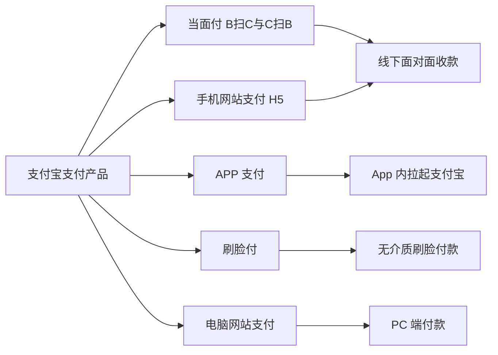

# 支付宝对接调研第一步：支付产品矩阵与手机网站支付的选型理由

C 扫 B 的需求清单里有三件事，其中生成二维码不难，真正决定系统怎么设计的是聚合对接：闪聚支付平台作为中介，要把用户的支付请求通过接口交给微信、支付宝这些第三方渠道。平台首期要求集成微信和支付宝，动手开发前得先调研两条渠道的对接方式，包括对接流程、接口协议与接口测试。这一课调研支付宝：先看它提供了哪些支付产品，再回答一个关键问题，C 扫 B 场景为什么选手机网站支付而不是当面付。

## 先给结论

- 对接渠道的三步曲：了解产品矩阵、配置开发环境（沙箱）、研读选定产品的接口定义与测试。
- 支付宝常见的支付产品有当面付、APP 支付、刷脸付、手机网站支付、电脑网站支付等，各自对应不同的用户场景。
- 当面付与手机网站支付都能覆盖线下收款，但闪聚支付平台 C 扫 B 选用手机网站支付。
- 选型理由一句话：平台要出自己的统一二维码并展示可输金额的 H5 确认页，手机网站支付天然支持，当面付的码是支付宝侧的，接入麻烦。
- 接口形态上是支付宝 SDK 的 `AlipayTradeWapPayRequest`，产品码固定为 `QUICK_WAP_PAY`，工程里封装在支付渠道代理服务。

## 支付产品矩阵：支付宝对外开放了哪些付款方式

支付宝在开放平台把支付能力按用户场景拆成一个个支付产品，做对接之前先把这张矩阵看全。与本项目最相关的几款：

**当面付。** 一句话概括是「当面扫一扫」，覆盖两个方向：顾客出示支付宝二维码、商家拿扫码设备扫顾客，这是 B 扫 C；反过来顾客扫商家出示的支付宝二维码完成付款，这是 C 扫 B。注意它这里的二维码是支付宝体系下开立的收款码，不是平台自己画的码。

**APP 支付。** 面向手机上装了 App 的业务方：App 软件要做支付功能，不必自己去调银行接口，选择支付宝付款时调用支付宝的 APP 支付接口，App 内拉起支付宝客户端完成付款。应用界面里常见那种「银行转账 / 支付宝」的支付方式选择页，选支付宝走的就是这条路。

**刷脸付。** 用户没带手机也能付款，自助结账机前刷脸完成支付，人工智能时代常见的一类方案，解决的是设备在场的无介质付款。

**手机网站支付。** 用户在手机浏览器打开一个 H5 网站下单，网站调支付宝的手机网站支付接口，页面会跳转并拉起支付宝客户端输入密码完成支付。界面上看与 App 支付几乎没差别，差别在承载介质：一个是原生 App 内嵌，一个是手机浏览器里的 H5 页面。

**电脑网站支付。** 面向 PC 网站的支付方式，移动互联网之前的主力形态，在线教育站点、大型电商等 PC 端场景仍在使用，扫码或输密码完成付款。

产品矩阵与场景的对应关系如下图：



线下收款一栏里出现了两个候选：当面付与手机网站支付。闪聚支付的 C 扫 B 主打线下商户，所以选型也就在这两个里做取舍。

## 为什么选手机网站支付

判断依据回到需求本身。闪聚支付平台的 C 扫 B 流程是：用户扫平台生成的统一二维码，打开一个网页，页面展示订单信息、商品信息和金额，还要让用户输入金额、点确认付款。这一串动作全是用户交互，需要一个由服务端渲染的 H5 页面来承载。手机网站支付正好契合：扫码后浏览器打开 H5 页面，页面里放支付按钮，点确认就对接支付宝手机网站支付接口，拉起支付宝客户端输入密码完成支付；微信扫进来同理走微信，平台在页面渲染时按扫码方分流。

当面付为什么不行？不是功能覆盖不了，而是接入形态对不上。当面付的场景是扫支付宝提供的二维码，那个码属于支付宝体系，扫它会直接请求到支付宝的链接上；而本项目要做的是闪聚支付平台自己出一张码，用户一扫先请求到平台，平台再决定后面怎么走。用当面付就得围着支付宝的码转，平台的统一二维码和 H5 确认页都插不进去，实现起来反而绕。手机网站支付则完全站在平台一侧：码是平台的，页面是平台的，接口只在最后一步把请求交给支付宝。

选定产品之后，调研的第二块是开发环境：支付宝提供沙箱环境，供开发测试时调用，沙箱里创建的订单不是正式订单，付款是假数据，下一课就来把它配起来。第三块是接口定义：C 扫 B 重点对接的就是手机网站支付接口，它在工程里的调用点已经落在支付渠道代理服务中（节选自工程源码，包名按本系列口径改写为 `com.study.pay` 系）：

```java
// 构造 SDK 客户端，参数来自支付渠道参数配置
AlipayClient alipayClient = new DefaultAlipayClient(url, appId, rsaPrivateKey,
        format, charest, alipayPublicKey, signtype);
AlipayTradeWapPayRequest alipayRequest = new AlipayTradeWapPayRequest();
AlipayTradeWapPayModel model = new AlipayTradeWapPayModel();
model.setOutTradeNo(alipayBean.getOutTradeNo());   // 平台订单号
model.setTotalAmount(alipayBean.getTotalAmount()); // 订单金额，单位元
model.setSubject(alipayBean.getSubject());         // 订单标题
model.setBody(alipayBean.getBody());               // 订单内容
model.setProductCode("QUICK_WAP_PAY");             // 产品码，手机网站支付固定值
model.setTimeoutExpress(alipayBean.getExpireTime());// 订单过期时间
alipayRequest.setBizModel(model);
// 同步跳转与异步通知地址
alipayRequest.setReturnUrl(returnUrl);
alipayRequest.setNotifyUrl(notifyUrl);
```

业务参数对象 `AlipayBean` 在支付渠道代理服务的 API 工程中定义（节选自工程源码）：

```java
@Data
@ToString
public class AlipayBean implements Serializable {

    private String outTradeNo;  // 商户订单号，必填
    private String subject;     // 订单名称，必填
    private String totalAmount; // 付款金额（元），必填
    private String productCode; // 产品编号，必填
    private String body;        // 商品描述，可空
    private String expireTime;  // 超时时间参数
    private Long storeId;       // 门店 id

}
```

SDK 客户端的七个构造参数全部来自商户配置的支付宝渠道参数：网关地址、应用 `appId`、应用私钥、数据格式、编码、支付宝公钥、签名算法，这些参数在沙箱环境配好后填进渠道参数表即可在开发期生效。请求模型里 `QUICK_WAP_PAY` 是手机网站支付的产品码，写死即可；`outTradeNo` 是闪聚支付平台的订单号，支付宝侧据此标识这笔外部订单。

## 调研产出如何落到工程结构上

支付宝的对接没有散落在交易服务里，而是收敛到一个独立微服务：支付渠道代理服务。有支付需求的微服务统一通过它调用第三方支付系统提供的接口，它对上屏蔽渠道差异，对下封装 SDK 细节，把第三方支付系统与平台内部服务解耦。这样的结构决定了聚合的多渠道扩展点：接银联时再加一个代理实现，交易服务的调用代码不用动。

本次调研的产出清单也照这个结构对号入座：产品矩阵确定对接哪个接口（手机网站支付）；沙箱环境提供 `appId`、密钥、网关这组配置值；接口定义明确请求模型与响应形态。三块对应支付宝接入指南文档的产品介绍、沙箱配置、手机网站支付接口定义三部分，开发环境与接口细节是接下来两课的主角。

## 常见误区

- **认为选当面付才是「正规」的线下方案。** 错例：看线下收款就条件反射选当面付。正解：选型看接入形态，平台要出统一码并提供 H5 确认页，手机网站支付契合；当面付的码在支付宝侧，平台的页面环节插不进去。
- **把 APP 支付与手机网站支付混为一谈。** 错例：H5 页面拉起支付宝就以为是 APP 支付。正解：两者界面相似但介质不同，APP 支付面向原生 App 内嵌，手机网站支付面向手机浏览器打开的 H5 页面，接口产品与产品码也不同。
- **把渠道参数当成写死在代码里的配置。** 错例：把 `appId`、私钥直接硬编码进交易服务。正解：这组参数属于商户级数据，存在渠道参数表，下单时按应用与服务类型查出，交给支付渠道代理服务组装 SDK 客户端。
- **忽略产品码这类固定值。** 错例：自造 `productCode` 值或传空。正解：手机网站支付的产品码为 `QUICK_WAP_PAY`，是商户与支付宝签订的产品标识，照文档取固定值。

## 面试可能被问到的问题

1. 面试官追问：「对接一个支付渠道之前要做哪些调研？」
   答：三块内容。看渠道的支付产品矩阵，确定业务场景对应哪个接口产品；配置开发环境，一般是渠道提供的沙箱；研读选定接口的定义，包括公共参数、业务参数、产品码与响应形态，并用沙箱跑通一次下单。调研产出直接决定系统设计。
2. 面试官追问：「你们的 C 扫 B 为什么选手机网站支付而不是当面付？」
   答：平台要出统一二维码并渲染可输金额的 H5 确认页，需要用户在平台侧完成交互后再进渠道。手机网站支付支持从 H5 页面调接口拉起支付宝客户端，与流程完全匹配；当面付的二维码属于支付宝体系，扫码直接到支付宝链接，平台的确认页插不进去，接入反而复杂。
3. 面试官追问：「手机网站支付和 APP 支付有什么区别？」
   答：面向的载体不同。APP 支付给原生 App 内嵌使用，App 调接口后拉起支付宝；手机网站支付给手机浏览器打开的 H5 网站使用，页面跳转后拉起支付宝。用户体验相似，但接口产品、产品码与接入文档是两套。
4. 面试官追问：「支付渠道代理服务存在的意义是什么？」
   答：统一收敛第三方支付对接。有支付需求的微服务只依赖它的统一接口与 DTO，不直接碰渠道 SDK；渠道的配置、下单、查询、异常翻译都在代理服务内完成。好处是内部服务与第三方系统解耦，新增渠道或升级 SDK 只改代理服务一处。
5. 面试官追问：「`returnUrl` 和 `notifyUrl` 分别是什么，为什么两个都要？」
   答：`returnUrl` 是同步跳转地址，用户付完款浏览器被带回的页面；`notifyUrl` 是异步通知地址，支付宝服务端把支付结果主动推给平台。同步跳转可能被用户关闭页面而丢失，支付状态的最终确认以异步通知加主动查询为准，两者职责不同不能互相替代。

## 配套资料

- 讲义：`materials/docs/10/闪聚支付-第3章-C扫Bv1.1.md`，2 支付接口技术预研、5.3 支付渠道代理服务支付宝下单（手机网站支付接口参数梳理）为本课选型与接口形态出处；讲义提及的支付宝接入指南原文可到支付宝开放平台文档查阅。
- 代码：`materials/code/10/完整代码/`，支付渠道代理服务工程的 `AliConfigParam.java`、`AlipayBean.java`、`PayChannelAgentServiceImpl.java`（createPayOrderByAliWAP）为真实文件，正文代码为按 `com.study.pay` 口径改写后的节选；支付渠道代理服务依赖的支付宝 SDK 为 `com.alipay.sdk:alipay-sdk-java`。
- 说明：该阶段课程资料归档在 `materials/docs/10/` 与 `materials/code/10/`（不存在 09 编号目录），引用路径截至章目录与工程目录层级，内层目录含课程原始命名不展开；支付宝 `appId`、应用私钥、支付宝公钥、网关地址等敏感值在后续配置一课中以 example-appid、example-private-key、example-public-key、example.com 占位。
