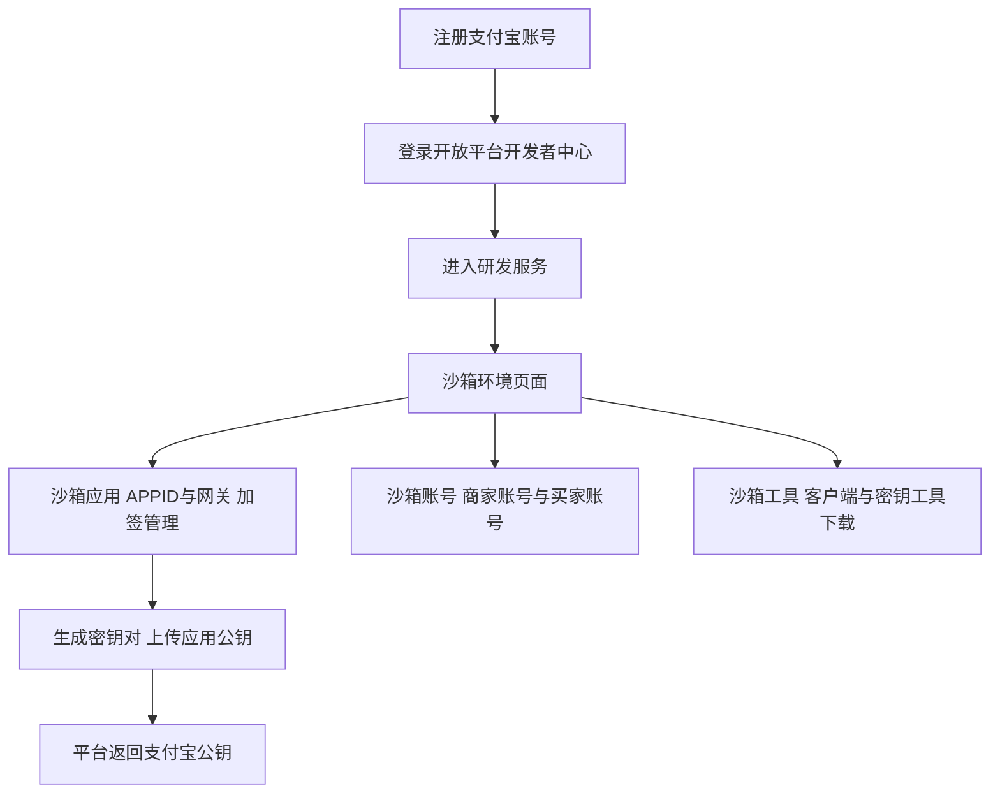

# 配置支付宝沙箱环境：给支付对接准备一套假数据的试验场

> 🔒 安全提示：文中示例的口令/密钥均为课程教学环境演示口径，生产环境的安全要求见《安全与合规须知》。

对接支付宝的第一步不是写代码，是准备环境。开发期要反复调下单接口、查询接口，拿正式环境试，每笔都是真金白银，显然不合适。支付宝为开发测试专门提供沙箱环境：创建的不是正式订单，付款走的是假数据，可以放心折腾。这一课把沙箱配到可用：注册开发者账号、进入沙箱、用工具生成密钥对并上传、拿到支付宝公钥、记下沙箱账号。这套配置产出的那组参数，正是上一课看到的 SDK 客户端构造参数的来源。

## 先给结论

- 沙箱环境是支付宝为开发测试提供的隔离环境，订单与付款均为假数据，正式接入手机网站支付才需要企业或个体工商户资质、营业执照与已备案的网站。
- 配置路径：注册支付宝账号并登录开放平台开发者中心，进入研发服务的沙箱环境，页面分沙箱应用、沙箱账号、沙箱工具三块。
- 密钥配置用官方密钥生成工具生成一对 RSA2 密钥：应用公钥上传到沙箱的加签管理，平台随之返回支付宝公钥。
- 开发者手里最终要留三样：自己生成的应用私钥、平台返回的支付宝公钥、沙箱 APPID 与沙箱网关地址。
- 沙箱账号含商家账号与买家账号，后续测试用买家账号登录沙箱版支付宝客户端执行付款。
- 正文中的 `appId`、私钥、公钥、网关一律以 example-appid、example-private-key、example-public-key、example.com 占位，实际值在各自沙箱控制台查看。

## 为什么必须用沙箱，以及正式接入的条件

沙箱环境解决的是开发期两件事的冲突：一是接口要反复调用，二是真实接口每次调用都涉及资金。沙箱里创建的订单不是正式订单，付款也是假数据，请求走的是同一套接口协议，代码写完在沙箱跑通，切到生产只需换参数。这正是支付对接区别于普通三方接口的地方：环境隔离是第一道安全线。

与沙箱对应的是正式接入的门槛。接入手机网站支付，支付宝要求申请方是企业或个体工商户，提供营业执照；既然是手机网站支付，还要有可用的网站，即域名与备案手续。课程没有演示企业注册流程，按产品文档走即可，开发人员不必被这些条件卡住：沙箱环境对个人开发者开放，注册一个支付宝账号就能用，本阶段全部开发测试都在沙箱完成。

## 从注册到沙箱控制台的路径

沙箱入口藏在开放平台里，路径如下：



已有支付宝账号的直接登录，账号分个人与企业两类，开发期用个人账号即可。登录后进入开发者中心，点研发服务菜单就到了沙箱环境页面。这个页面是后续所有配置的入口，三个分区各管一件事：沙箱应用管应用信息与密钥，沙箱账号管测试账号，沙箱工具管客户端等辅助资源的下载。

## 配置密钥：两把钥匙的生成与交换

密钥配置是沙箱里最重要的一步，理解它的关键是搞清楚 RSA2 非对称加密里两把钥匙的分工：应用私钥由开发者自己生成、自己保管，用于给请求加签；应用公钥要上传给支付宝，支付宝用它验证请求确实来自这个应用。方向反过来也一样，支付宝响应会用它的私钥加签，开发者拿支付宝公钥验签。加签管理的设置入口在沙箱应用页面的 RSA2 密钥一栏，初始状态为空。

生成密钥用官方的密钥生成工具，课程资料包里已经提供了安装包，安装后打开支付宝开放平台开发助手，选好密钥长度与格式，点生成密钥，一次得到一对：上方是应用私钥，下方是应用公钥。私钥只在生成时展示一次，界面一关就再也看不到了，务必当场复制保存；公钥后面要上传，也要留存。上传动作在沙箱的加签管理里完成：把应用公钥粘贴进去保存，平台立即返回一个支付宝公钥。到这里，手里就有了写代码要用的全套密钥材料：

```text
沙箱 APPID：example-appid
沙箱网关：https://example.com/gateway.do
应用私钥（自己生成，用于请求加签）：example-private-key
支付宝公钥（平台返回，用于验证支付宝响应）：example-public-key
```

这四样在工程里的落点很明确。支付渠道代理服务的 API 工程里有个 `AliConfigParam`，把渠道参数结构直接列了出来（节选自工程源码，包名按本系列口径改写为 `com.study.pay` 系）：

```java
@Data
public class AliConfigParam implements Serializable {
    public String appId;          // 应用 id，沙箱控制台的 example-appid
    public String rsaPrivateKey;  // 应用私钥，工具生成的 example-private-key
    public String notifyUrl;      // 异步回调通知地址
    public String returnUrl;      // 同步回调通知地址
    public String url;            // 支付宝网关，沙箱为 https://example.com/gateway.do
    public String charest;        // 编码方式 UTF-8
    public String format;         // 格式 JSON
    public String alipayPublicKey;// 支付宝公钥，上传应用公钥后平台返回
    public String logPath;        // 日志保存路径，目前不用
    public String signtype;       // 签名算法类型，支持 RSA2 与 RSA，推荐 RSA2
}
```

上一课下单代码里 `DefaultAlipayClient` 的七个构造参数，就是从这个对象逐个取的。商户配置渠道参数时，前端把这些键值组装成 JSON 存进参数表，下单时按应用与服务类型查出再反序列化回来，结构对齐如下（示例为按本课写法补全的参数 JSON 结构）：

```yaml
# pay_channel_param.PARAM 大文本列中支付宝渠道参数的键值结构
appId: "example-appid"
rsaPrivateKey: "example-private-key"
alipayPublicKey: "example-public-key"
url: "https://example.com/gateway.do"
format: "json"
charest: "utf-8"
signtype: "RSA2"
notifyUrl: "https://example.com/transaction/notify"
returnUrl: "https://example.com/transaction/return"
```

商户测试阶段参数值可以随便填，但键名必须与 `AliConfigParam` 的字段对得上，否则反序列化后取到的就是空值，下单时报签名或网关错误，排查起来要绕一大圈。

## 沙箱账号：给付款环节备好买家身份

密钥解决的是系统与支付宝服务端之间的信任，付款动作还需要一个用户身份，这就轮到沙箱账号。支付宝提供沙箱版本的客户端，与手机上装的真实版本并存：真实版本连的是生产环境，付款会真的发生银行交易；沙箱版本连的是沙箱环境，数据都是假的。沙箱账号页面自动生成了商家账号与买家账号两组，各带登录名与密码。后续测试要用买家账号去付款，登录沙箱版支付宝客户端就填它。

买家账号里的资金也可以操作：初始余额少的话，账号页有充值入口，额度可以填到很大，开发期不必心疼钱。账号信息连同前面三样密钥材料一起记下来，沙箱环境的配置就齐了，接下来装模拟器与沙箱客户端，扫码链路才能跑起来。

## 常见误区

- **应用公钥与支付宝公钥放反。** 错例：把平台返回的支付宝公钥填进加签管理，把自己生成的公钥填进代码的验签位置。正解：上传给支付宝的是自己生成的应用公钥，代码里 `alipayPublicKey` 存的是平台返回的支付宝公钥，两者方向相反，混用会导致验签全部失败。
- **生成私钥后不保存。** 错例：密钥工具界面一关，私钥再也找不回来，只能重新生成并重新上传公钥。正解：私钥在生成界面只出现一次，当场复制存档。
- **沙箱 APPID 与正式环境混用。** 错例：拿沙箱 `appId` 请求生产网关，或反过来。正解：沙箱与应用是一一对应关系，`appId`、网关、密钥三件套必须取自同一环境，切换生产时整组替换。
- **用真实支付宝账号登录沙箱客户端。** 错例：手机真实版支付宝扫码找不到沙箱商户。正解：沙箱客户端必须用沙箱买家账号登录，真实账号在沙箱环境里没有对应的资金账户。

## 面试可能被问到的问题

1. 面试官追问：「什么是沙箱环境？为什么支付对接必须用它？」
   答：渠道方为开发测试提供的隔离环境，接口协议与生产一致，但订单与资金都是模拟数据。支付接口涉及真实资金，不能拿生产环境调试；沙箱让代码在协议完全一致的条件下反复试错，上线前只需把 APPID、密钥、网关整组换成生产配置。
2. 面试官追问：「支付宝对接里应用私钥和支付宝公钥分别用来做什么？」
   答：应用私钥由开发者保管，对请求参数加签，支付宝用它验证请求来源与完整性；支付宝公钥由平台下发，用于验证支付宝响应或异步通知的签名，防止伪造。私钥加签、公钥验签，两端各持对方的公钥形成双向验证。
3. 面试官追问：「RSA2 是什么，为什么推荐它？」
   答：RSA2 指 SHA256WithRSA 签名算法，RSA 指较旧的 SHA1WithRSA。SHA1 已有碰撞风险，支付宝把 RSA2 作为默认推荐，配置里的 `signtype` 字段取 RSA2，与密钥工具生成时选择的算法保持一致。
4. 面试官追问：「渠道参数里网关地址为什么也要可配置？」
   答：开发、测试、生产要指向不同环境，沙箱与生产的网关不同，参数化后切环境只改数据不改代码。同时多商户、多应用可能使用不同渠道账号，按应用查出各自参数再组装客户端，是聚合平台支撑多商户的前提。
5. 面试官追问：「沙箱账号和真实账号是什么关系？」
   答：互不相通。沙箱账号由沙箱环境自动生成，只在沙箱版客户端与沙箱接口范围内有效，资金是模拟的；真实账号连生产环境。测试时用沙箱买家账号登录沙箱客户端付款，保证开发期不产生真实交易。

## 配套资料

- 讲义：`materials/docs/10/闪聚支付-第3章-C扫Bv1.1.md`，2 支付接口技术预研与 5.3 支付渠道代理服务支付宝下单中的渠道参数使用为本课配置材料的落点出处；沙箱注册、密钥配置步骤可按支付宝开放平台文档操作。
- 代码：`materials/code/10/完整代码/`，支付渠道代理服务 API 工程的 `AliConfigParam.java` 为真实文件，正文代码为按 `com.study.pay` 口径改写后的节选；参数 JSON 结构为按本课写法补全的示例。
- 说明：该阶段课程资料归档在 `materials/docs/10/` 与 `materials/code/10/`（不存在 09 编号目录），引用路径截至章目录与工程目录层级，内层目录含课程原始命名不展开；沙箱 APPID、应用私钥、支付宝公钥、网关地址、回调地址一律以 example-appid、example-private-key、example-public-key、example.com 占位，课程环境 MySQL 用 root/123456，Redis 密码 123456。
