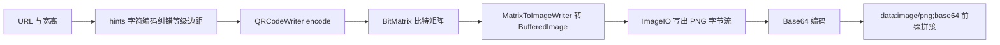

# 二维码技术预研：QR 码原理与 Java 侧 ZXing 生成方案

C 扫 B 的第一环是那张门店二维码：商户在平台点一下生成按钮，得到一张能被微信、支付宝同时识别的图。这一环看似只是画图，实际要回答三个问题：二维码里装的是什么，Java 里用哪个库生成，生成出来的东西以什么形式交给前端。选型上，项目采用 ZXing 这个开源组件，它用 Java 编写，专门处理一维、二维条码图像，既能生成也能识别；市面另一个常见工具 ZBar 近几年已不再更新，不作为首选。这一课把 QR 码的原理、依赖、工具类封装与验证方法一次讲透。

## 先给结论

- 二维码本质是把一段文本按规则编码成的黑白模块矩阵，扫码设备读出的就是这段文本；内容是 URL 时，扫码 App 会直接发起请求，这就是扫码支付的原理。
- Java 生态的二维码库首选 ZXing：Google 开源、Java 编写、支持多格式 1D/2D 条码的生成与识别；ZBar 已停止更新，排除。
- 依赖只有三个：`com.google.zxing:core` 与 `com.google.zxing:javase`（3.3.3），外加 `commons-lang3` 做字符串判空。
- 工程把 ZXing 的 API 封装进 common 工程的 `QRCodeUtil`，一个 `createQRCode` 方法输入 URL 与宽高，输出带 `data:image/png;base64` 前缀的图片字符串，前端直接放进 `img` 标签展示。
- 纠错等级 L、M、Q、H 从低到高，等级越高可修复的错误越多，可存储的数据越少，工具类取 M。

## QR 码基本原理：一段文本的图形化编码

二维码是相对一维码（条形码）的概念。一维码沿一个方向记录信息，容量小；二维码在横纵两个方向上排布黑白模块，一个方块矩阵里能装下几百个字符。常见的 QR 码把内容按编码规则转换成模块矩阵：黑与白代表比特，文本先按指定字符编码转成字节流，再按纠错规则补充冗余码，最后铺进网格。三个结构部件决定了这张图的可靠性：三个角的定位图案让扫码端快速确定图的边界与旋转角度；数据区承载编码后的内容；分散的纠错码字让部分污损不影响识别。

扫码设备做的事就是反着来一遍：定位、解码、纠错，还原出原始文本。还原出的文本怎么用，取决于扫码 App：内容是一段网址，App 通常直接弹窗提示并可跳转；这正是扫码支付的关键机制，二维码里存一个指向平台支付入口的 URL，顾客扫码即请求平台，平台据此渲染确认页。

纠错等级是生成端唯一必须理解的参数。QR 码分 L、M、Q、H 四级纠错，等级越高，能修复的受损面积越大，但纠错码字占用空间也越多，同等尺寸下能存的数据越少。门店二维码贴在收银台，可能有污渍折痕，M 级是容量与鲁棒性的常规折中，工具类里写死的正是它。

## 库选型：ZXing 胜出的理由

Java 生态里能生成二维码的库主要有两个。ZXing 是 Google 开源的项目，用 Java 编写，是多格式的一维、二维条码图像处理库，除了 QR 码还支持一维条码等格式，同时具备生成与识别两个方向的能力，社区持续维护，Maven 坐标稳定。ZBar 曾经也很常用，但近几年代码不再更新，新 JDK 版本的兼容性无从保障。企业选库除了功能匹配，更要看可维护性，两项对比后选 ZXing 没有悬念。

引入依赖到 common 工程，因为该工程下有统一的工具类包，后续商户平台与交易服务都能复用（节选自课程工程依赖清单）：

```xml
<!-- 二维码生成依赖 -->
<dependency>
    <groupId>com.google.zxing</groupId>
    <artifactId>core</artifactId>
    <version>3.3.3</version>
</dependency>
<dependency>
    <groupId>com.google.zxing</groupId>
    <artifactId>javase</artifactId>
    <version>3.3.3</version>
</dependency>
<dependency>
    <groupId>org.apache.commons</groupId>
    <artifactId>commons-lang3</artifactId>
</dependency>
```

`core` 是编码解码的核心库，`javase` 提供 Java 侧的辅助类，把比特矩阵转成 `BufferedImage` 图像对象就在这一层；`commons-lang3` 在工具类里负责内容判空。依赖极轻，没有传递负担，这也是工程把它放进 common 而不是单独建模块的原因。

## 工具类封装：从 URL 到 Base64 图片字符串

ZXing 原生 API 偏底层，直接用要处理编码提示、比特矩阵、图像转换一堆细节。工程里的做法与真实企业一致：把 API 封装成工具类，业务方一行调用拿到结果。`QRCodeUtil` 的核心方法如下（节选自工程源码，包名按本系列口径改写为 `com.study.pay` 系）：

```java
public String createQRCode(String content, int width, int height) throws IOException {
    String resultImage = "";
    // 除了尺寸，传入内容不能为空
    if (!StringUtils.isEmpty(content)) {
        ByteArrayOutputStream os = new ByteArrayOutputStream();
        // 二维码参数
        HashMap<EncodeHintType, Comparable> hints = new HashMap<>();
        // 指定字符编码为 utf-8
        hints.put(EncodeHintType.CHARACTER_SET, "utf-8");
        // L M Q H 四个纠错等级从低到高，取 M；等级越高可修正的错误越多，可存储的数据越少
        hints.put(EncodeHintType.ERROR_CORRECTION, ErrorCorrectionLevel.M);
        // 设置图片的边距
        hints.put(EncodeHintType.MARGIN, 1);
        try {
            // ZXing 生成二维码核心类
            QRCodeWriter writer = new QRCodeWriter();
            // 把输入文本按指定规则转成二维码比特矩阵
            BitMatrix bitMatrix = writer.encode(content, BarcodeFormat.QR_CODE, width, height, hints);
            // 生成二维码图片流
            BufferedImage bufferedImage = MatrixToImageWriter.toBufferedImage(bitMatrix);
            // 输出流
            ImageIO.write(bufferedImage, "png", os);
            // 原生转码前面没有 data:image/png;base64 前缀，返回给前端无法被解析，所以补上
            resultImage = new String("data:image/png;base64,"
                    + EncryptUtil.encodeBase64(os.toByteArray()));
            return resultImage;
        } catch (Exception e) {
            e.printStackTrace();
            throw new BusinessException(CommonErrorCode.E_200007);
        }
    }
    return null;
}
```

整条数据流水线用一张图看清：



从输入到输出的每一步都对应一个类或一次转换：`QRCodeWriter` 负责「文本变矩阵」，`MatrixToImageWriter` 负责「矩阵变图像」，`ImageIO` 负责「图像变字节」，`EncryptUtil.encodeBase64` 负责「字节变字符串」。最后拼上的 `data:image/png;base64` 前缀是 Data URI 协议的格式要求，少了它前端拿到一串裸 Base64 无法按图片渲染。返回值是字符串而不是文件流，接口不用落盘不用图床，前端 `img` 标签直接接收，门店二维码的生成接口就是这么用的。

## 验证方法：浏览器看图与模拟器扫码

工具类写完先单独验证，写一个 `main` 方法直接调用（示例为按本课写法补全的测试代码）：

```java
public static void main(String[] args) throws IOException {
    QRCodeUtil qrCodeUtil = new QRCodeUtil();
    // 传入目标网址与图片宽高
    String qrCode = qrCodeUtil.createQRCode("http://www.example.com/", 200, 200);
    System.out.println(qrCode);
}
```

控制台打印出一串 `data:image/png;base64,` 开头的字符串。学过 HTML 的都知道这串东西的用法：直接粘到浏览器地址栏回车，二维码图片就渲染出来了；拿到 `img` 标签里同样显示。这是验证生成正确性的最快路径，不用起服务不用写页面。

验证「扫得出」还有第二层。真实业务里，门店生成的二维码打印出来贴在门前，顾客在门外扫；开发时码里的地址是内网地址，外网真手机扫不到。替代方案就是上一课装好的模拟器：把二维码对应的 URL 输入模拟器自带浏览器，页面渲染出二维码图，模拟器截屏存进相册；打开模拟器里的支付宝，扫一扫里从相册选这张图，客户端解析出 URL 并跳转，等于完整走了一遍「扫码到请求」的过程。URL 能被解析、请求能落到本机服务，二维码技术预研就闭环了。

## 常见误区

- **把纠错等级当成清晰度调节。** 错例：图糊了就把纠错等级调到 H，以为越高越清晰。正解：纠错等级决定受损容忍度与数据容量，与清晰度无关；等级越高内容容量越小，常规场景取 M 即可。
- **返回裸 Base64 给前端。** 错例：接口只返回编码字符串，前端 `img` 渲染失败还以为是编码错误。正解：必须拼接 `data:image/png;base64,` 前缀构成完整 Data URI，浏览器才能按图片解析。
- **对空内容生成二维码。** 错例：上游拼接 URL 失败传了空串，`QRCodeWriter` 抛出难懂的异常。正解：工具类入口先判空，空内容直接返回或抛业务异常，把可读的错误码留在服务层。
- **把二维码当成支付凭证本身。** 错例：认为码里存的是金额或订单。正解：码里只是一个指向支付入口的 URL，订单信息编码在 URL 参数里，金额由确认页填写，真正下单发生在用户确认支付之后。

## 面试可能被问到的问题

1. 面试官追问：「二维码的技术原理是什么？扫码 App 怎么知道要付款？」
   答：QR 码把文本按字符编码转成比特流，附加纠错码后铺成黑白模块矩阵，扫码端定位、解码、纠错后还原出原始文本。码里并不携带「付款」语义，内容是一个指向平台支付入口的 URL，扫码 App 识别出 URL 后请求该地址，由平台返回支付确认页完成后续流程。
2. 面试官追问：「为什么选 ZXing 而不是 ZBar？」
   答：ZXing 是 Google 开源的 Java 条码图像处理库，支持多格式 1D/2D 码的生成与识别，社区持续维护，Maven 依赖稳定；ZBar 近几年已停止更新，对新环境的兼容性没有保障。可维护性决定了选 ZXing。
3. 面试官追问：「纠错等级 L、M、Q、H 怎么选？」
   答：等级越高，二维码可修复的受损比例越大，但纠错码字占用越多，同等尺寸可存数据越少。户外张贴、可能污损的场景用 M 或更高；追求小尺寸高容量时用 L。项目工具类固定 M，是容量与鲁棒性的通用折中。
4. 面试官追问：「接口返回二维码为什么用 Base64 字符串而不是图片文件？」
   答：门店二维码随生成随展示，落盘文件要管理存储与生命周期，还要暴露下载地址；Base64 字符串可直接嵌入接口响应，前端 `img` 标签通过 Data URI 渲染，一次请求完成生成与展示，省掉存储与二次加载。代价是响应体积比二进制大约三成，展示型小图完全可接受。
5. 面试官追问：「生成二维码时要注意哪些入参校验？」
   答：内容非空校验最关键，空内容会在编码阶段抛底层异常；宽高要有合理下限，过小会导致模块过密无法识别；字符编码固定 utf-8，中文 URL 参数才不会乱码；异常要翻译成业务错误码返回，不把 ZXing 的堆栈直接暴露给前端。

## 配套资料

- 讲义：`materials/docs/10/闪聚支付-第3章-C扫Bv1.1.md`，3.2 生成二维码技术预研为本课出处，其中给出 ZXing 依赖引入与 `QRCodeUtil` 工具类的使用方式。
- 代码：`materials/code/10/完整代码/`，公共工程 common 的 `QRCodeUtil.java`（createQRCode）为真实文件，正文代码为按 `com.study.pay` 口径改写后的节选；`main` 测试方法中的示例网址按规范以 example.com 占位。
- 说明：该阶段课程资料归档在 `materials/docs/10/` 与 `materials/code/10/`（不存在 09 编号目录），引用路径截至章目录与工程目录层级，内层目录含课程原始命名不展开。
