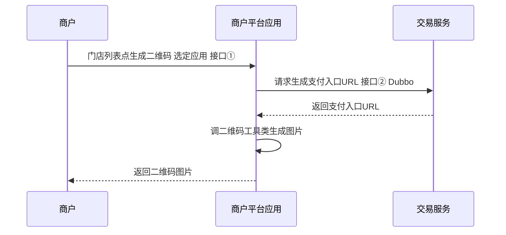
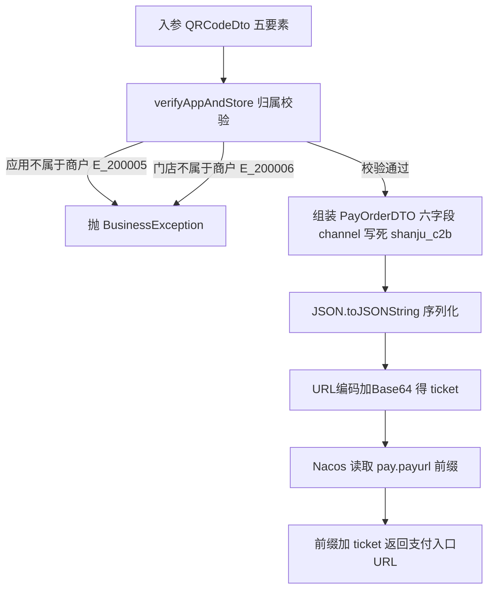
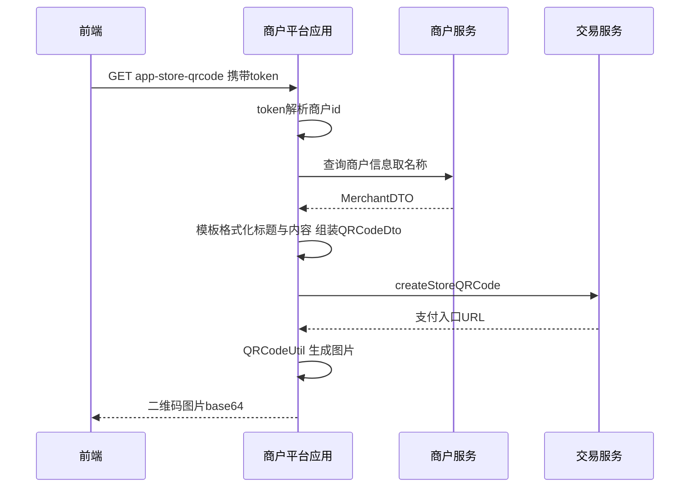
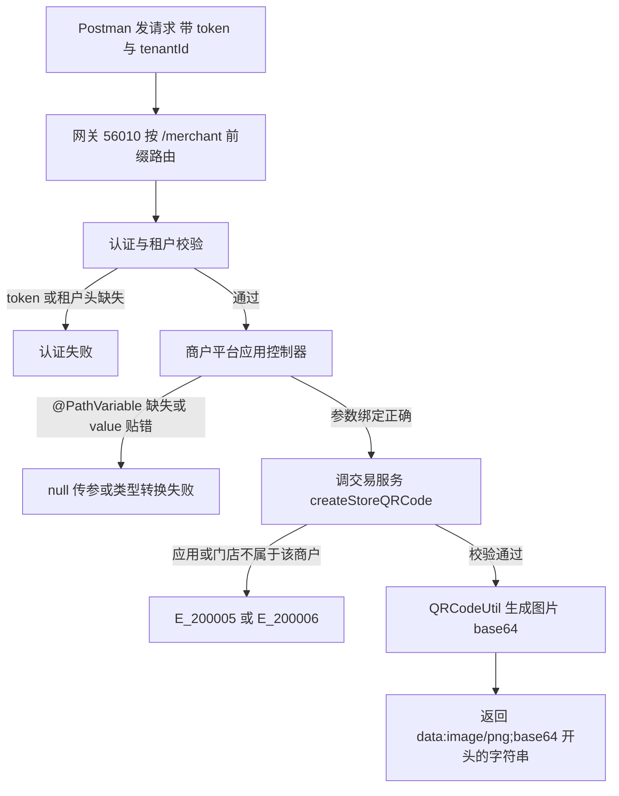

# 生成门店二维码：从交互流程设计到跨服务接口实现与测试

## 先给结论

- 门店列表页每行要挂一个「生成二维码」按钮，点下去系统里要跨两个服务跑一圈：先有人把二维码背后的 URL 算出来，再有人把 URL 变成一张能打印张贴的图片。
- 二维码的本体是一个 URL，课程里命名为「支付入口」，图片只是 URL 的可视化外壳，先有 URL 再有图片。
- 接口归属由此定死：交易服务提供「生成支付入口 URL」的 Dubbo 接口，商户平台应用提供「生成二维码图片」的 REST 接口；URL 与订单相关，订单属于交易域。
- 图片生成选 ZXing：开源、Java 编写、持续维护，依赖加在公共工程的 QRCodeUtil，200 像素见方，返回带 data:image/png;base64 前缀的字符串。
- 交易服务侧三段代码：createStoreQRCode 接口定义、应用与门店的归属校验、支付要素组装成 JSON 经 URL 编码加 Base64 得到参数 ticket，最终 URL 等于配置的入口地址前缀加 ticket。
- 入口地址前缀放 Nacos 配置，内网测试与上线域名只改配置不改代码；服务类型编码由交易服务内部写死，不作为入参。
- 商户平台侧是典型的 REST 转调：标题与内容走 Nacos 模板配置，商户 id 从登录 token 解析，五项入参交给交易服务，图片以 base64 交回前端。
- 测试阶段暴露的两个报错都与业务无关：漏写或贴错 @PathVariable 导致参数绑定失败，根源排查比成功返回值更有价值。
- 测试数据必须同源：应用、门店、登录账号、租户 id 都要取自同一个商户，跨商户拼数据会命中归属校验异常。

## 第1部分：生成门店二维码-生成二维码-交互流程

门店列表页上此前只做查询，现在每一行门店要挂上一个「生成二维码」按钮。按钮点下去，系统里要跨两个服务跑一圈：先有人把二维码背后的 URL 算出来，再有人把 URL 变成一张能打印张贴的图片。这一课不动代码，先把两个问题钉死：这个动作拆成几个接口，每个接口落在哪个微服务。归属判断错了，后面所有代码都会长在错误的位置。

### 业务流程：从门店列表到「生成二维码」按钮

交互流程图里，生成门店二维码被编为本章的 3.1 业务流程，三步走完。第一步，商户登录商户平台应用，点击「门店管理」进入门店列表页；门店列表的查询接口此前已经开发完毕，这里直接复用成果。第二步，在门店列表里选择应用，页面弹出「选择应用」窗口，让商户指定这个二维码挂在哪个支付应用下。第三步，点指定门店的「生成二维码」按钮，前端把应用与门店两个要素带给后端，进入生成流程。

「选择应用」这一步不是多余的设计。聚合支付的渠道参数按应用配置，应用再绑定服务类型，扫码支付走哪个通道，取决于二维码归属的应用绑了什么服务类型。同一商户可以有多个应用，门店与应用的组合才能唯一定位一份支付配置，所以二维码生成前必须把应用确定下来。

### 接口归属：为什么 URL 由交易服务生成

每写一个接口，先回答它属于哪个微服务，这是微服务开发的起手式。判断方法不看代码在哪个工程顺手，看职责与数据在哪边。生成二维码这个动作容易被想当然地放进商户平台应用，毕竟按钮在商户平台的页面上。把动作拆开看，结论就不同了。

**第一，二维码指向的不是门店介绍页，而是支付入口。** 用户拿微信或支付宝扫这个码，扫码工具会打开 URL 指向的页面；这个页面要判断扫码的是哪个客户端，再把用户引导到对应的支付确认页，确认页上展示商品标题与内容，用户确认后完成支付。整条链路围绕订单展开，URL 本质上是订单流程的入口地址。

**第二，订单数据与订单逻辑都在交易服务。** 支付确认页、后续的下单与支付状态流转，都是交易服务的职责域。让商户平台应用去拼一个自己不拥有、后续也维护不了的订单入口地址，等于把交易域的知识泄漏到商户域。URL 由交易服务生成，商户平台应用只做两件事：把商户侧的请求转发给交易服务，把拿到的 URL 转成图片。

**第三，二维码的本质决定了「生成」分两步。** 生成一张二维码图片，前提是先有要编码的内容，这里的内容就是支付入口 URL。URL 的生成需要商户、应用、门店、订单标题内容这些业务要素组装，属于业务逻辑；URL 到图片的转换是纯技术动作，任何字符串都能编码成二维码。业务逻辑与纯技术动作天然分属两层：URL 归交易服务，图片归商户平台应用。

### 交互流程：两次请求，一次跨服务调用

把上面的归属判断放进时序里，就是本章交互流程图的核心部分。



关键路径在这条线上：商户平台应用收到接口①的请求后，并不自己拼 URL，而是发起接口②的 Dubbo 调用，交易服务把携带订单要素的支付入口 URL 算好返回；商户平台应用拿到 URL 后调用二维码工具类生成图片，图片以 base64 形式返回给前端展示。URL 只在服务之间流动，面向前端和用户的永远是图片；支付入口地址的格式、参数规则由交易服务一方定义并演进，商户平台应用全程不需要理解它。支付入口这个地址本身怎么解析、怎么分流到微信与支付宝，本章后续有单独的实现环节。

流程图更远处还有支付渠道代理服务与第三方支付，那是用户确认支付之后的链路，与生成二维码这一段不重叠，画在一张图里是为了看全 C 扫 B 的完整闭环。

### 技术预研：ZXing 把 URL 变成图片

URL 到图片这一步用什么工具，课程做了简短的选型。Java 圈常用的二维码库有两个：zbar 与 ZXing。zbar 近几年已经停止更新代码，新项目没必要押上去；ZXing 是开源的、用 Java 编写的多格式 1D/2D 条码图像处理库，既能生成也能识别 QR Code，维护活跃，选它。

依赖加在公共工程里，谁需要生成二维码谁引入：

```xml
<!-- 二维码生成与识别组件 -->
<dependency>
    <groupId>com.google.zxing</groupId>
    <artifactId>core</artifactId>
    <version>3.3.3</version>
</dependency>
```

课程资料里带的二维码工具类 `QRCodeUtil` 放在公共工程，核心方法签名很朴素：传入二维码内容（也就是 URL）、宽、高，返回图片。开发期先用 main 方法自测一遍，确认工具链可用：

```java
public static void main(String[] args) throws IOException {
    QRCodeUtil qrCodeUtil = new QRCodeUtil();
    //内容就是支付入口URL，博客示例以 example.com 占位
    String qrCode = qrCodeUtil.createQRCode("http://pay.example.com/transaction/pay-entry/", 200, 200);
    System.out.println(qrCode);
}
```

打印出来的是一长串 base64 文本，带 `data:image/png;base64,` 前缀，前端把它直接塞进 `img` 标签就能显示。这个工具类的完整实现在商户平台应用接入时再展开，此处只需要记住两点：内容为空时不生成；生成失败抛出业务异常，错误码落在公共异常表的「二维码生成失败」。

## 第2部分：生成门店二维码-生成二维码-交易服务接口定义

交互流程已经定了两件事：交易服务生成支付入口 URL，商户平台应用把 URL 变成图片。本课集中做前一半，而且是交易服务三个连着的动作：把接口定义出来，把生成前的合法性校验补上（校验本身又落在商户服务里），把参数组装成 JSON 编码后拼出最终 URL。三段代码都不长，坑藏在契约与细节里：参数类型两端要严格一致，服务类型编码该不该让调用方传，入口地址为什么要走配置，这些想清楚了，实现只是照单落地。

### 支付入口：这个 URL 给谁用、长什么样

先把返回值想明白。C 扫 B 的二维码是给顾客扫的，顾客手里可能是微信，也可能是支付宝，扫完之后要发生什么？不是直接弹出一个收银台，而是进入一个统一的入口页面：入口先识别扫码的是哪个客户端，再把用户引导到对应渠道的支付确认页，页面上展示商品标题与内容，确认后完成支付。这个统一入口的地址，就是本接口要生成的「支付入口」。入口页内部如何识别客户端、如何分流到微信与支付宝，是本章后续的独立实现环节，此处只需要接受一个结论：URL 是整个扫码支付流程的起点，它携带的信息必须足以还原出「谁在哪个应用哪个门店买什么」。

URL 上挂哪些参数，从用途倒推。入口页要能定位一笔潜在的交易，至少需要三样定位信息：商户 id、应用 id、门店 id，三者缺一不可，应用与门店都隶属商户，商户 id 用来做归属与路由的根。确认页要展示商品信息，所以还要标题与内容两项，标题说明买的是什么商品，内容做订单描述。这五项就是接口的全部业务入参，由调用方传入；还有第六个要素是服务类型编码，它标识「这是 C 扫 B 场景」，属于系统自身的基础数据，由交易服务在实现里写死，后文展开。

生成规则决定 URL 的形态。参数有五六个，将来还可能增加，逐个拼成 `key=value` 的 query 串既啰嗦又容易在字符转义上出问题。课程的规则是：把参数组装成一个 JSON 对象，先按 UTF-8 做 URL 编码，再做 Base64 编码，得到一串可安全放入 URL 的文本，把它作为 URL 的一个参数，参数名叫 `ticket`（票据）。将来请求这个 URL 时，入口页按相反的顺序解码还原出 JSON，商户、应用、门店、标题、内容全部现形。JSON 负责结构化承载不定长的字段组合，编码负责让这段结构化文本能在 URL 与重定向链路里安全传输，两层各管一件事。

### 接口定义：DTO 与 TransactionService

接口契约的载体是 DTO。五项业务参数装进一个对象，放哪个工程有讲究：这是 Dubbo 接口，入参类型要被调用方与实现方同时引用，DTO 必须与接口声明一起放在交易服务的 api 工程里，消费方依赖 api 包就能参与调用，不必接触服务实现。在 api 工程的 dto 包下新建 `QRCodeDto`：

```java
package com.study.pay.transaction.api.dto;

import lombok.Data;
import lombok.NoArgsConstructor;

import java.io.Serializable;

@Data
@NoArgsConstructor
public class QRCodeDto implements Serializable {

    private Long merchantId;
    private String appId;
    private Long storeId;
    private String subject;//商品标题
    private String body;//订单描述

}
```

五个字段的类型值得盯一眼。`merchantId` 与 `storeId` 是数字主键，用 `Long`；`appId` 是应用的业务 id，一串字符串，用 `String`，这是项目从应用管理那一课就定下的口径：服务之间用业务 id 互相认识，服务内部才用主键。类型在这里错一点，后面 Dubbo 两端就对不上，编译期或者运行期都会给你颜色看。

接口与 DTO 同在 api 工程。交易服务此前只有渠道参数相关的 `PayChannelService`，二维码属于交易订单域，单独再建一个服务接口，命名 `TransactionService`，类注释写明「交易订单相关服务接口」：

```java
/**
 * 交易订单相关服务接口
 */
public interface TransactionService {

    /**
     * 生成门店二维码
     * @param qrCodeDto 传入 merchantId,appId,storeId,subject,body
     * @return 支付入口URL，将传入的参数转成json，用base64编码
     * @throws BusinessException
     */
    String createStoreQRCode(QRCodeDto qrCodeDto) throws BusinessException;
}
```

返回值是 `String`，一个 URL 而已，不需要包装成更复杂的对象；异常沿项目的统一口径抛 `BusinessException`，由全局异常处理转成错误响应。javadoc 里把生成规则写进 `@return` 说明，读接口的人不用翻实现就知道返回串的构成。

实现类按 Dubbo 服务的标准骨架搭起来。在交易服务 service 工程建 `TransactionServiceImpl`，类上挂 Dubbo 的 `@Service` 注解与 `@Slf4j`：

```java
@Slf4j
@org.apache.dubbo.config.annotation.Service
public class TransactionServiceImpl implements TransactionService {

    //支付入口url，从配置文件读取
    @Value("${pay.payurl}")
    String payurl;

    @Reference
    AppService appService;

    @Reference
    MerchantService merchantService;

    @Override
    public String createStoreQRCode(QRCodeDto qrCodeDto) throws BusinessException {
        //将参数生成一个支付入口（url），需要将传入的参数转成json，用base64编码
        String url = null;
        return url;
    }
}
```

两个 `@Reference` 引入的是商户服务侧的接口，校验环节马上要用。方法体此刻只有一个占位的 return，接口定义阶段把它立起来，实现逐段往里填。

### 归属校验：应用与门店必须属于当前商户

接口收到的三个定位参数都是调用方传来的，交易服务没有登录上下文，无法自己确认「这个应用真的属于这个商户吗」。不校验会怎样？拿别人的应用 id 加自己的门店 id，一样能生成出一个合法模样的 URL，扫码后订单挂在一个不相干的应用配置上，支付参数全错。所以生成动作的第一步是两道归属校验：应用是否属于该商户，门店是否属于该商户。

校验接口放商户服务，数据在哪校验就在哪。应用表与门店表都在商户库，商户服务里现成有应用相关的 `AppService` 与门店相关的 `MerchantService`，各加一个校验方法。入参两个：业务定位 id 加商户 id，出参一个布尔值，查到返回 true 表示合法：

```java
/**
 * 校验应用是否属于商户
 * @param appId
 * @param merchantId
 * @return true存在，false不存在
 */
Boolean queryAppInMerchant(String appId, Long merchantId);
```

```java
/**
 * 校验门店是否属于某商户
 * @param storeId
 * @param merchantId
 * @return true存在，false不存在
 */
Boolean queryStoreInMerchant(Long storeId, Long merchantId);
```

实现都是一次计数查询。应用与商户的匹配查应用表，应用的业务 id 加商户 id 两个等值条件同时成立，记录存在即合法：

```java
@Override
public Boolean queryAppInMerchant(String appId, Long merchantId) {
    Integer count = appMapper.selectCount(new LambdaQueryWrapper<App>().eq(App::getAppId, appId)
            .eq(App::getMerchantId, merchantId));
    return count > 0;
}
```

门店的校验结构完全一样，换到门店表，条件是门店主键加商户 id：

```java
@Override
public Boolean queryStoreInMerchant(Long storeId, Long merchantId) {
    Integer count = storeMapper.selectCount(new LambdaQueryWrapper<Store>().eq(Store::getId, storeId)
            .eq(Store::getMerchantId, merchantId));
    return count > 0;
}
```

`selectCount` 配 `LambdaQueryWrapper` 的两个 `eq`，是 MyBatis-Plus 条件构造器的标准用法，查到计数大于 0 即存在。校验语义与库内数据天然对齐：应用表里应用与商户本来就存成一行关系，门店表同理，能按两列同时命中，归属关系就是数据库里真实存在的，不靠调用方自证。

书写这两个方法时课堂上有过一段真实的插曲：方法签名里参数类型随手写串了，把 `Long` 写成 `String`，交易服务一调用就编译报错。小插曲说明的却是一条硬规则：Dubbo 契约两端共享同一个接口定义，参数类型是契约的一部分，`appId` 用 `String`、商户与门店主键用 `Long`，两端必须一字不差，改名改类型都属于破坏性变更。

校验逻辑回到交易服务侧收口。两道校验是一组固定动作，与其在主流程里各写一段，不如收进一个私有方法，主流程一行调用，读起来干净：

```java
/**
 * 检验应用和门店是否属于当前登录商户
 * @param merchantId
 * @param appId
 * @param storeId
 */
private void verifyAppAndStore(Long merchantId, String appId, Long storeId) {
    //判断应用是否属于当前商户
    Boolean contains = appService.queryAppInMerchant(appId, merchantId);
    if (!contains) {
        throw new BusinessException(CommonErrorCode.E_200005);
    }
    //判断门店是否属于当前商户
    Boolean containsStore = merchantService.queryStoreInMerchant(storeId, merchantId);
    if (!containsStore) {
        throw new BusinessException(CommonErrorCode.E_200006);
    }
}
```

私有方法的参数顺序按「商户、应用、门店」排列，与讲义口径一致。两道校验各自对应一个明确的业务异常：`E_200005` 应用不属于当前商户，`E_200006` 门店不属于当前商户，错误码表里这两个定义就候在这里，抛出去之后统一异常处理会把它们翻译成可读的响应。`E_200007` 二维码生成失败也顺带就位，留给图片生成环节使用。

返回值用包装类型 `Boolean` 还有个细节值得一提：Dubbo 远程调用的返回经序列化传输，正常路径下不会是 null，但 `!contains` 这种写法隐含了自动拆箱，一旦哪天接口实现返回了 null，这里就是一个空指针。远程契约里声明基本语义的布尔返回，调用侧如果追求稳，可以先判 null 再拆箱，或者契约直接用基本类型语义并在文档里写死「永不为 null」。

### 组装数据与生成 URL：从入参到 ticket

校验通过，进入组装。最终编码进 URL 的参数有六个，课程没有为它新建一个编码专用对象，而是复用了下单请求对象 `PayOrderDTO`。这个选择的逻辑值得体会：二维码里携带的本来就该是「将来下单所需的最小要素集合」，入口页解析出这些要素后，下一步就是构造支付订单，两者用同一个 DTO，解析完直接往下传，不需要二次转换。`PayOrderDTO` 字段很多，金额、币种、openId、支付渠道等都是下单环节才填的，本场景只填六个：

```java
//1.组装url所需要的数据
PayOrderDTO payOrderDTO = new PayOrderDTO();
payOrderDTO.setMerchantId(qrCodeDto.getMerchantId());
payOrderDTO.setAppId(qrCodeDto.getAppId());
payOrderDTO.setStoreId(qrCodeDto.getStoreId());
payOrderDTO.setSubject(qrCodeDto.getSubject());//显示订单标题
payOrderDTO.setBody(qrCodeDto.getBody());//订单内容
payOrderDTO.setChannel("shanju_c2b");//服务类型，要写为C扫B的服务类型
```

`channel` 字段在此处的语义是服务类型编码，写死为 `shanju_c2b`。为什么不留给调用方传？因为「生成门店 C 扫 B 二维码」这个接口的业务语义已经固定了服务类型，它是系统基础数据里定好的编码，不是随请求变化的输入。让前端传反而开了口子：传一个别的服务类型进来，生成的入口页会按错误的服务类型分流渠道。凡是系统自身语义决定的取值，一律服务端写死或从基础数据读取，不接收外部输入，这是参数设计的一条通用纪律。

组装完转 JSON，再编码成 `ticket`：

```java
//2.转成json
String jsonString = JSON.toJSONString(payOrderDTO);
log.info("transaction service createStoreQRCode,jsonString is {}", jsonString);
//3.base64编码
String ticket = EncryptUtil.encodeUTF8StringBase64(jsonString);
```

`JSON.toJSONString` 是 fastjson 的标准序列化。编码没有直接用 `Base64.getEncoder()`，而是走公共工程的 `EncryptUtil.encodeUTF8StringBase64`，它的内部顺序是先按 UTF-8 做 URL 编码，再对结果做 Base64 编码。多这一步 URL 编码，处理的是 JSON 串里的 `+`、`?`、`&` 这类字符：它们在 URL 传输场景各有既有含义，先转成百分号形式再整体编码，传输与还原都不会产生歧义；解码侧按相反顺序先 Base64 解码再 URL 解码，与编码严格对称。工具类在公共工程里，将来任何需要把 JSON 安全放进 URL 的场景都复用它。

URL 的前缀从哪来？入口地址是扫码后浏览器要真实请求的地址，内网联调时是内网地址，上线后必然是公网域名，同一份代码要适应两种环境，前缀只能配置化。在 Nacos 的交易服务主配置 `transaction-service.yaml` 尾部追加：

```yaml
#支付入口url，内网联调可指向内网网关，上线换公网域名，博客以 example.com 占位
pay:
  payurl: "http://pay.example.com/transaction/pay-entry/"
```

实现类开头的 `@Value("${pay.payurl}")` 就是读这个键。前缀指向的路径以 `/transaction/pay-entry/` 结尾，网关按 `/transaction` 路由把请求送进交易服务，`pay-entry` 是入口页的落脚点，它的实现属于本章后续环节。拿到前缀，拼上 `ticket`，返回：

```java
//4.支付入口
String payEntryUrl = payurl + ticket;
log.info("transaction service createStoreQRCode,pay-entry is {}", payEntryUrl);
return payEntryUrl;
```

把整条实现串起来看：

```java
@Override
public String createStoreQRCode(QRCodeDto qrCodeDto) throws BusinessException {
    //1.校验商户id、应用id和门店id的合法性
    verifyAppAndStore(qrCodeDto.getMerchantId(), qrCodeDto.getAppId(), qrCodeDto.getStoreId());
    //2.组装url所需要的数据
    PayOrderDTO payOrderDTO = new PayOrderDTO();
    payOrderDTO.setMerchantId(qrCodeDto.getMerchantId());
    payOrderDTO.setAppId(qrCodeDto.getAppId());
    payOrderDTO.setStoreId(qrCodeDto.getStoreId());
    payOrderDTO.setSubject(qrCodeDto.getSubject());
    payOrderDTO.setBody(qrCodeDto.getBody());
    payOrderDTO.setChannel("shanju_c2b");//服务类型，写为C扫B的服务类型
    //3.转成json再base64编码
    String jsonString = JSON.toJSONString(payOrderDTO);
    log.info("transaction service createStoreQRCode,jsonString is {}", jsonString);
    String ticket = EncryptUtil.encodeUTF8StringBase64(jsonString);
    //4.拼接支付入口
    String payEntryUrl = payurl + ticket;
    log.info("transaction service createStoreQRCode,pay-entry is {}", payEntryUrl);
    return payEntryUrl;
}
```

方法四步：校验、组装、编码、拼接，每步一行调用加一行注释，顺序就是本课三个环节的顺序。两处日志不是装饰：JSON 串日志用来核对编码前的数据对不对，入口 URL 日志用来在联调时直接复制出来做解码验证，排查问题时这两行能省掉大半猜测。



图上两条失败路径都汇到同一个异常出口，成功路径上最值得盯的是 `channel` 写死这一格：它让调用方五项入参之外的信息全部由服务端掌控。最终交给商户平台应用的，就是一个形如「入口前缀 + 长串 ticket」的 URL，图片生成是下一课的事。

## 第3部分：生成门店二维码-生成二维码-商户平台接口实现

交易服务已经能把支付入口 URL 算出来了，但顾客扫的是一张图片，不是一串文本。把 URL 变成图片、把整条链路接到前端，是商户平台应用的活。这一课的接口本身是典型的 REST 转调，真正值得注意的是三个衔接点：标题与内容的文案从哪来，商户 id 与商户名称这类隐含信息从哪拿，图片以什么形式交回前端。衔接点想清楚，代码就是按流程顺序组装。

### 配置先行：标题与内容的模板

支付确认页要展示「某某餐厅商品」「向某某餐厅付款」这样的文案，这两段话不能写死在代码里，不同商户的门店码要展示各自的名称。也不能让前端传：前端只掌握应用 id 与门店 id，等确认页发现文案不对再回头改，链路已经走了一半。文案的生成时机在商户平台应用组装参数这一步，生成规则配成模板放在 Nacos 的商户平台应用配置里：

```yaml
pay:
  c2b:
    subject: "%s商品"
    body: "向%s付款"
```

`%s` 是占位符，生成时用商户名称替换。模板放配置的好处与支付入口地址配置化同源：文案规则属于可运营的内容，改一句措辞不该动代码。控制器里用 `@Value` 把两段模板读进来：

```java
//"%s商品"
@Value("${pay.c2b.subject}")
String subject;
//"向%s付款"
@Value("${pay.c2b.body}")
String body;
```

替换用的商户名称此时还没有，控制器手里只有 token 里的商户 id，拿 id 调商户服务查一次商户信息才能取到名称。这次查询让文案与真实商户严格对应，商户改名后新生成的二维码自动跟着变，不存在第二处需要同步的数据。

### 接口定义：路径参数与返回值

接口落在 `StoreController`。放门店控制器还是应用控制器都讲得通，门店是扫码的主体，二维码又从门店列表页发起，放在门店侧更顺。URL 要与前端的调用约定一字不差：

```java
@ApiOperation("生成商户应用门店的二维码")
@ApiImplicitParams({
        @ApiImplicitParam(name = "appId", value = "商户应用id", required = true, dataType = "String", paramType = "path"),
        @ApiImplicitParam(name = "storeId", value = "商户门店id", required = true, dataType = "String", paramType = "path"),
})
@GetMapping(value = "/my/apps/{appId}/stores/{storeId}/app-store-qrcode")
public String createCScanBStoreQRCode(@PathVariable("storeId") Long storeId, @PathVariable("appId") String appId) throws IOException {
    //实现见下节
}
```

两个路径参数经 `@PathVariable` 接收，Swagger 注解沿用项目一贯写法。URL 的拼写纪律要专门强调：这段路径前端已经按约定写死，控制器里多一个字母少一个下划线，联调时表现出来的就是前端请求全部 404，而且很难一眼看出来。标准做法是从接口定义处复制 URL，不手敲。返回值是 `String`，内容为二维码图片的 base64 编码，这是开发期就用工具类验证过的形态：图片转成一长串文本，前端塞进 `img` 标签即可渲染，接口无须处理二进制流。

### 接口实现：五步串起两个服务

方法体按数据流动顺序写，五步走完：

```java
//1.获取商户id
Long merchantId = SecurityUtil.getMerchantId();
//2.查询商户信息，取商户名称
MerchantDTO merchantDTO = merchantService.queryMerchantById(merchantId);
//3.组装交易服务入参
QRCodeDto qrCodeDto = new QRCodeDto();
qrCodeDto.setMerchantId(merchantId);
qrCodeDto.setStoreId(storeId);
qrCodeDto.setAppId(appId);
//标题，用商户名称替换 %s
String subjectFormat = String.format(subject, merchantDTO.getMerchantName());
qrCodeDto.setSubject(subjectFormat);
//内容
String bodyFormat = String.format(body, merchantDTO.getMerchantName());
qrCodeDto.setBody(bodyFormat);
//4.调用交易服务，获取支付入口URL
String storeQRCodeURL = transactionService.createStoreQRCode(qrCodeDto);
//5.调用工具类生成二维码图片，返回base64
QRCodeUtil qrCodeUtil = new QRCodeUtil();
String qrCode = qrCodeUtil.createQRCode(storeQRCodeURL, 200, 200);
return qrCode;
```

逐段看衔接点。第一步商户 id 取自 `SecurityUtil`，与项目里所有「我的门店」「我的应用」接口同一套路：商户身份只认 token，前端传来的任何身份字段都不可信。第三步组装 `QRCodeDto`，盘点一下字段：merchantId、appId、storeId、subject、body，五项。交易服务编码进 URL 的参数有六项，缺的那项 `channel`（服务类型编码）由交易服务写死，这正是上一课定下的分工：系统语义决定的取值不经过调用方，商户平台应用自然只传五项。

第四步的 Dubbo 转调拿到形如「入口前缀 + ticket」的 URL，第五步交给 `QRCodeUtil` 生成图片。工具类内部用 ZXing 把内容编码成位矩阵再渲染成 PNG，几个参数值得知道：字符集固定 utf-8，纠错等级取 M（四个等级从低到高为 L、M、Q、H，越高可修正的错误越多，但可容纳的数据越少，M 是常用折中），边距为 1，宽高按入参 200 像素。内容为空时直接不生成；生成过程出错则抛出公共异常表里的「二维码生成失败」。输出统一加 `data:image/png;base64,` 前缀，没有这个前缀，浏览器不会把返回串当作图片数据解析。



关键路径读一遍：一次页面点击，商户平台应用先后发起两次 Dubbo 调用，一次拿文案原料（商户名称），一次拿二维码本体（URL），图片转换发生在商户平台应用本地，前端最终只接触 base64 文本。归属校验不在图上，因为它发生在交易服务内部，这正是分工的兑现：商户平台应用负责收集与转发，交易服务负责把关。

### 测试验证

按讲义的测试步骤走。第一步请求认证，用商户账号登录换取 token 与租户信息，联调环境里这一步沿用此前接口测试的登录流程。第二步请求获取二维码，Postman 新建 GET 请求，URL 为 `http://localhost:57010/merchant/my/apps/{appId}/stores/{storeId}/app-store-qrcode`，`appId` 从商户平台的应用数据里取字符串形式的业务 id，`storeId` 取门店主键，请求头带登录 token。

正常路径的预期返回是一段以 `data:image/png;base64,` 开头的长文本，把它粘进浏览器地址栏或直接在前端页面渲染，一张门店码图片出现；扫码确认内容正确后，可以把 URL 里 `pay-entry/` 之后的 ticket 拿去解码，核对商户、应用、门店、标题、内容五项与本次请求一致。负例同样要测：把 `storeId` 换成一个不属于当前商户的门店 id，接口应返回「门店不属于当前商户」，换成不属于当前商户的应用 id 应返回「应用不属于当前商户」。两个负例都命中，说明交易服务的归属校验在这条链路里真实生效，而不是只存在于代码里。

## 第4部分：生成门店二维码-生成二维码-测试

接口代码写完只是纸面上的完成，测试阶段暴露的问题往往与业务逻辑无关。生成门店二维码这条链路横跨商户平台应用、商户服务、交易服务三个进程，请求还要穿过网关，任何一环没就绪、任何一个注解没贴对，表现出来的都是一个看起来莫名其妙的错误。这一课把整条链路真实跑一遍，两次报错的排查过程比成功的返回值更有价值：一次是「应用不属于当前商户」，一次是类型转换异常，根源都在 `@PathVariable` 的参数绑定上。

### 测试前把三件事备齐

服务要在线。这条链路一次请求会唤醒三个进程：商户平台应用接收 HTTP 请求并转调 Dubbo 服务，商户服务提供商户信息查询与归属校验，交易服务生成支付入口 URL。任何一个没启动，请求都会以连接失败或「未知错误」收场，所以动手前先把三个服务依次重启到位。

数据要同源。接口的路径参数是应用 id 与门店 id，交易服务会校验二者是否属于当前登录商户，因此准备数据时只有一个原则：全部取自同一个商户。联调库里随便挑一个名下既有应用又有门店的商户即可，课程环境里用的是商户 7106：它的应用、它的门店、它对应的租户 id 为 4，登录账号也用这个商户下的用户。如果沿用了上次测门店列表时另一个商户的数据，登录 token 与路径参数分属两家，归属校验必然不通过，这不是缺陷，恰恰是校验在正常工作。

请求要配对。Postman 里在门店管理目录下新建 GET 请求，地址从控制器注解处复制，不手敲：

```bash
curl -X GET \
  "http://localhost:56010/merchant/my/apps/{appId}/stores/{storeId}/app-store-qrcode" \
  -H "Authorization: Bearer <登录接口返回的token>" \
  -H "tenantId: <商户对应的租户id，课程环境为4>"
```

`{appId}` 替换成应用的业务 id（字符串），`{storeId}` 替换成门店主键（数字）。端口为什么是 56010：项目接入统一认证后，外部请求一律走网关，网关按 `/merchant` 前缀把请求转发给 57010 上的商户平台应用，上一课直连 57010 的写法在联调期可用，规范口径是走网关。`Authorization` 的值是 `Bearer` 加空格再加 token，多一个空格少一个空格都可能导致认证解析失败；`tenantId` 来自登录响应，它的作用是让 SaaS 层识别当前租户。

### 两次报错，都出在参数绑定上

请求发出，第一次的返回是「应用不属于当前商户」。表面看是归属校验抛了 `E_200005`，但数据明明是同源的，校验不该失败。在交易服务的 `verifyAppAndStore` 处打断点观察：商户 id 有值，应用 id 却是 null。问题不在校验逻辑，而在上游参数根本没传进来，顺着调用链回到商户平台应用的控制器，答案是方法签名里有一个参数漏写了 `@PathVariable` 注解，Spring MVC 不知道这个参数要从路径里取值，于是它保持 null 一路传到了交易服务。

把注解补上，重启，第二次请求换来一个更含糊的「未知错误」。这次在控制器的第一行打断点，断点根本进不去，说明错误发生在进入方法之前。控制台的堆栈指向类型转换：试图把一个字符串转成 `Long` 时失败。原因同样出在 `@PathVariable`：注解的 value 写串了，把 `appId` 写到了 `storeId` 参数上，Spring MVC 忠实地按注解行事，把路径里的 `appId` 值赋给了声明为 `Long` 的 `storeId` 参数，字符串转数字当场失败。两种写法的对照：

```java
//错误写法一：漏写 @PathVariable，appId 拿不到路径值，一路是 null
public String createCScanBStoreQRCode(Long storeId, String appId)

//错误写法二：注解 value 贴错参数，appId 的值被塞给 Long 型 storeId，进入方法前类型转换即失败
public String createCScanBStoreQRCode(@PathVariable("appId") Long storeId,
                                      @PathVariable("storeId") String appId)

//正确写法：注解 value 与路径占位符一一对应
@GetMapping(value = "/my/apps/{appId}/stores/{storeId}/app-store-qrcode")
public String createCScanBStoreQRCode(@PathVariable("storeId") Long storeId,
                                      @PathVariable("appId") String appId)
```

这类错误的特点值得记牢：漏写注解时错误延迟爆发，null 传到几百公里外的归属校验才变成一条误导性的业务异常；写错注解 value 时错误提前爆发，请求根本进不了方法体，堆栈里只有转换失败没有业务逻辑。排查的通用顺序是固定的：



图上三条失败路径对应三种完全不同的修法：认证失败查请求头，绑定失败查注解，归属失败查数据。看到报错先归类，再动手，不要一上来就怀疑业务代码。

### 成功返回与核对

两处注解修正后，第三次请求返回了一段以 `data:image/png;base64,` 开头的长文本。把它粘进浏览器地址栏或前端页面的 `img` 标签，一张门店码渲染出来，扫码应能进入支付入口。返回值对不对，还要往下核对一层。在控制器调用交易服务之后打断点（讲义在实现里补了一行日志，`log.info("[merchantId:{},appId:{},storeId:{}]createCScanBStoreQRCode is {}", merchantId, appId, storeId, storeQRCodeURL)`，联调期建议照抄），把 `storeQRCodeURL` 复制出来观察：前半段是 Nacos 配置的支付入口地址，固定不变；`pay-entry/` 之后是一长串 `ticket`，它就是上一课把 `PayOrderDTO` 序列化成 JSON 后经 URL 编码加 Base64 编码得到的结果。核对的方法是对称解码：先 Base64 解码再做 URL 解码，还原出的 JSON 里商户 id、应用 id、门店 id、标题、内容、服务类型六项应与本次请求一致，标题与内容应是「某某商品」「向某某付款」的模板文案被商户名称替换后的样子。

```java
//控制器实现末尾的图片生成，出错时抛公共异常表中的二维码生成失败
String storeQRCodeURL = transactionService.createStoreQRCode(qrCodeDto);
log.info("[merchantId:{},appId:{},storeId:{}]createCScanBStoreQRCode is {}",
        merchantId, appId, storeId, storeQRCodeURL);
QRCodeUtil qrCodeUtil = new QRCodeUtil();
String qrCode = qrCodeUtil.createQRCode(storeQRCodeURL, 200, 200);
return qrCode;
```

负例同样要跑：把 `storeId` 换成不属于当前商户的门店，应返回「门店不属于当前商户」；把 `appId` 换成别的商户的应用，应返回「应用不属于当前商户」。两个负例都命中，归属校验才算在这条链路里被真实验证过。

## 常见误区

- **把二维码当图片资源来设计。** 错例：为每个门店预生成一张二维码图片存到对象存储，图片成了需要管理的数据。正解：URL 才是本体，图片即用即生成，不落存储；URL 规则变了重新生成即可，历史图片不会残留旧格式。
- **生成 URL 的接口写进商户平台应用。** 错例：商户平台应用自己拼支付入口地址，把交易服务的 URL 规则复制一份。正解：URL 与订单相关，归交易服务；商户平台应用只转发请求与转换图片，URL 格式变更时不该需要改商户侧代码。
- **以为要给微信和支付宝各生成一张码。** 错例：门店墙上贴两张码，微信扫微信码、支付宝扫支付宝码。正解：C 扫 B 的聚合意义就在一张码通吃，用户任意客户端扫码都进入同一个支付入口，由入口页识别客户端再分流到对应渠道。
- **二维码依赖随手加在业务工程里。** 错例：商户平台应用、交易服务各自引一遍二维码库，版本还可能不一致。正解：ZXing 依赖放公共工程统一管理，工具类也放公共工程，两个需要它的服务直接复用同一份代码。
- **信任调用方传来的定位参数，不做归属校验。** 错例：拿到商户 id、应用 id、门店 id 直接组装编码。正解：先 `verifyAppAndStore`，应用与门店必须同时属于该商户，不通过抛业务异常；归属关系由商户服务查库确认，不由前端自证。
- **服务类型编码让前端一起传。** 错例：`channel` 作为第六个入参由页面提交。正解：接口的业务语义已固定为 C 扫 B，编码由服务端写死，外部传值只会扩大伪造面。
- **把支付入口地址硬编码进代码。** 错例：URL 前缀直接写在字符串常量里，换环境改代码重新发版。正解：前缀放 Nacos 配置，`@Value` 读取，内网与公网只差一行配置。
- **JSON 串不经处理直接拼进 URL。** 错例：`url + "?data=" + jsonString`，引号与 `&` 在传输中被截断或拆解。正解：按「URL 编码加 Base64」的固定顺序编码成 `ticket`，解码侧对称还原。
- **Dubbo 接口两端参数类型随手写。** 错例：api 工程里 `appId` 是 `String`，实现或调用侧把它当 `Long` 传。正解：接口、DTO、两端调用使用完全一致的类型，主键 `Long`、业务 id `String` 的口径全程不动摇。
- **编码载体另造一个新 DTO。** 错例：为二维码单独设计一个只含五个字段的对象，入口页解析后又要转回下单对象。正解：复用下单请求 `PayOrderDTO`，二维码携带的就是未来下单的最小要素集，解析后无缝衔接。
- **接口 URL 手敲，与前端约定不一致。** 错例：控制器里凭记忆敲路径，前端调不通还以为是自己配置问题。正解：URL 从前端调用约定复制而来，改路径时两端同步改，联调失败先 diff 路径字符串。
- **标题内容让前端传或写死在代码里。** 错例：前端拼好「向某某付款」传给后端，或服务端把某商户名称写进常量。正解：模板放 Nacos 配置，服务端取商户名称做格式化，文案变更只改配置，商户名称永远与数据一致。
- **商户 id 由前端提交。** 错例：请求参数里带 merchantId，后端直接使用。正解：身份信息从 token 解析，前端传来的商户 id 一律不采信，否则可以替任何商户生成收款码。
- **返回的 base64 缺 `data:image/png;base64,` 前缀。** 错例：只返回裸编码串，前端 `img` 标签渲染空白。正解：工具类输出统一带前缀，前端直接使用；自行拼接时注意前缀与编码之间用逗号分隔。
- **只测正常路径。** 错例：拿到图片就收工，归属校验从未被触发过。正解：补两个负例，错配的应用 id 与门店 id 各测一次，确认业务异常如实返回。
- **三个服务没起齐就发请求。** 错例：只启动了商户平台应用，转调交易服务时连接失败，报错信息只有「未知错误」。正解：请求前确认交易服务、商户服务、商户平台应用全部在线，网关也在运行。
- **测试数据跨商户拼凑。** 错例：用 A 商户的账号登录，却传 B 商户的应用 id 与门店 id，期待拿到二维码。正解：应用、门店、账号、租户 id 全部同源；跨商户数据命中归属校验属于预期行为，反而是验证负例的好素材。
- **`@PathVariable` 的 value 与路径占位符不一致。** 错例：注解 value 写成别的参数名，或者干脆漏写注解。正解：value 必须与 `{}` 里的占位符逐字一致，方法参数顺序与路径顺序不要求对应，起决定作用的是注解 value。
- **只看页面错误不看控制台堆栈。** 错例：Postman 里一句「未知错误」就开始乱猜。正解：先看服务端控制台的异常堆栈定位抛错点，再决定打断点的位置；进不了方法体的报错基本都在参数绑定与转换阶段。
- **拿到 base64 就算测试完成。** 错例：图片能显示即收工。正解：解码 `ticket` 核对六项参数，再跑两个归属校验负例，正常与异常路径都覆盖。

## 面试可能被问到的问题

1. 面试官追问：「生成门店二维码这个功能，你怎么决定接口放在哪个微服务？」
   答：看接口操作的数据与职责归属，而不是看界面入口在哪。二维码指向的支付入口与订单强相关，订单属于交易域，所以生成 URL 的接口放交易服务；商户平台应用只负责承接页面请求和把 URL 转成图片。归属判断清楚后，接口演进各自独立，不会互相牵连。
2. 面试官追问：「二维码里存的是什么？为什么存 URL 而不直接存订单信息？」
   答：存的是一个支付入口 URL，URL 参数里携带商户、应用、门店、标题内容等要素。二维码的容量有限且只适合承载一个可被扫码工具直接打开的地址，直接塞订单信息既放不下也无法驱动页面跳转；URL 还天然具备可演进性，入口页背后的逻辑变化不需要重印二维码。
3. 面试官追问：「为什么把生成拆成生成 URL 和生成图片两个接口，一个接口不行吗？」
   答：两个接口分属两个服务，一个是 Dubbo 业务接口，一个是面向前端的 REST 接口。交易服务不应该也不会输出图片这类展示层产物，商户平台应用也不应该理解支付入口的拼装规则。拆开后各自职责单一，也方便单独测试：URL 可以先用 Postman 验证，图片生成可以离线自测。
4. 面试官追问：「二维码库选型时你关注什么？ZXing 与 zbar 怎么选？」
   答：关注维护活跃度、语言生态与功能覆盖。zbar 已多年不更新，Java 集成也不算顺；ZXing 用 Java 编写、开源、支持一维与二维多种码制，生成与识别都有，Maven 坐标引入即用。新项目选维护活跃的库，避免把停更组件带进生产依赖树。
5. 面试官追问：「二维码 URL 的参数为什么用 JSON 加 Base64，而不是普通 query 参数？」
   答：参数是一组会扩展的结构化数据，JSON 能整体承载且字段增减不影响解析方式；直接把 JSON 拼进 URL 会遇到引号、`&`、`+` 等字符的转义歧义，先 URL 编码再 Base64 编码得到字符集安全的 `ticket`，解码按对称顺序还原。相比逐个参数拼接，这种方式可扩展、可整体校验。
6. 面试官追问：「Base64 是加密吗？ticket 里带了商户信息，被解开伪造怎么办？」
   答：Base64 只是编码不是加密，任何人拿到 ticket 都能解出内容。防线不在编码而在服务端校验：生成前校验了应用与门店的归属，解析后入口页还要用这些要素去查真实的渠道参数与商户配置，伪造的要素在数据库里对不上号就走不下去。敏感数据如密钥绝不能放进 ticket。
7. 面试官追问：「归属校验为什么调商户服务的接口，交易服务自己查商户库不行吗？」
   答：应用表与门店表在商户库里，属于商户域的数据，交易服务跨库直查会打破库与服务同域的边界，商户库的表结构变更会直接影响交易服务。通过 Dubbo 接口调用，数据所有权清晰，校验逻辑与数据在一起，将来校验规则变化只改商户服务一处。
8. 面试官追问：「服务类型编码写死在服务端，将来要支持别的场景怎么办？」
   答：写死的前提是接口语义单一，本接口就叫生成门店 C 扫 B 二维码。将来出现新场景时，正确做法是新增接口或把服务类型升级为受控的入参（服务端校验合法性后再使用），而不是让现有接口接收任意编码。语义固定的接口保持封闭，扩展靠新增而不是靠放宽。
9. 面试官追问：「这个生成接口并发压力大会成为瓶颈吗？」
   答：接口内没有写操作，校验是两次索引友好的计数查询，编码是 CPU 密集的轻量操作，单次耗时主要花在两次远程调用上。压力大时可以先对归属校验结果做短期缓存，应用与门店的归属关系变化频率极低，缓存收益明显；URL 生成本身无状态，水平扩容即可。
10. 面试官追问：「私有方法 verifyAppAndStore 为什么值得单独抽出来？」
   答：两道校验是一个语义完整的动作，主流程只需要「校验通过了吗」这一个信息，不需要两段查询细节。抽成私有方法后主流程一行调用，可读性好；将来增加校验项（比如门店停用状态）只改私有方法，主流程零改动，也便于单独构造数据测试异常路径。
11. 面试官追问：「二维码文案的标题和内容为什么放配置中心，而不做成参数或数据库表？」
   答：文案是低频变化、全局生效的规则，模板放 Nacos 改动即时可控；做成请求参数等于把文案责任推给每个调用方，做成数据库表则要为两行数据引入查询与缓存。配置中心解决「改配置不改代码」的场景，这里恰好是。
12. 面试官追问：「返回 base64 图片与返回图片 URL 相比，各有什么优劣？」
   答：base64 一次请求拿全数据，前端无需二次请求，也没有图片文件的管理问题，适合即用即生成、不落存储的场景；缺点是传输体积膨胀约三分之一。图片 URL 适合图片需缓存、复用、CDN 分发的场景。门店码按需生成且不落库，base64 更贴合。
13. 面试官追问：「这条链路里，商户 id、应用归属、门店归属分别在哪里确认？」
   答：商户 id 在商户平台应用从 token 解析，属于认证体系的职责；应用与门店的归属在交易服务生成 URL 前校验，通过 Dubbo 调商户服务的两个查询接口完成。分层确认让每一层只做自己可信的事，商户平台应用不必也不该替交易服务做归属判断。
14. 面试官追问：「如果商户要求二维码尺寸更大更清晰，改动涉及哪些地方？」
   答：宽高是 `QRCodeUtil.createQRCode` 的入参，控制器里 200 改成需要的值即可；必要时可以把尺寸也做成配置项。二维码纠错等级与边距在工具类内部设置，内容长度不变时尺寸增大只影响清晰度，不影响解析内容。
15. 面试官追问：「生成图片这一步为什么放在商户平台应用，交易服务直接返回图片不行吗？」
   答：交易服务的职责是交易域逻辑，图片是面向用户的展示产物，职责上不归属交易服务；架构上 Dubbo 接口传输结构化数据，让业务服务输出图片数据会把展示细节混进服务契约。商户平台应用本来就是面向前端的聚合层，图片转换属于它的分内事。
16. 面试官追问：「@PathVariable 漏写注解时，Spring MVC 不会报错吗？为什么错误出现在业务校验环节？」
   答：不会报错。Spring MVC 对无法从路径解析的参数按默认策略处理，对象或包装类型保持 null，请求照常进入方法。null 沿调用链传到下游的归属校验，查库计数为零，才以业务异常的形式暴露。这也是为什么简单的 null 检查或参数校验注解应当在入口处就加上。
17. 面试官追问：「注解 value 贴错参数，为什么断点进不了方法第一行？」
   答：Spring MVC 在调用控制器方法之前由参数解析器完成参数绑定与类型转换，`@PathVariable` 的 value 决定取哪个路径变量，取到的字符串要转成参数声明的类型，转换发生在方法调用前。转换失败直接抛出类型不匹配异常，控制器方法根本没有被执行，所以断点不生效。
18. 面试官追问：「为什么测试请求要走网关 56010，而不是直连商户平台应用？」
   答：接入统一认证后，token 校验与租户识别由网关与认证中心统一承担，外部请求一律经过网关，路由按路径前缀分发到各应用。直连会绕过网关的认证链路，虽然联调期图快可以直连，但规范口径与上线形态都是走网关，测试应该贴近真实链路。
19. 面试官追问：「tenantId 这个请求头是做什么的？」
   答：项目是多租户 SaaS 形态，租户 id 标识请求归属于哪个租户，认证过滤器依据它做租户级的数据隔离。商户与租户存在对应关系，测试时要从登录响应里取当前商户对应的租户 id 放进请求头，取错租户同样会通不过认证或查不到数据。
20. 面试官追问：「返回的 base64 字符串为什么要带 data:image/png;base64, 前缀？」
   答：这是 Data URI 格式，浏览器依据 MIME 声明决定如何解析内容。没有前缀的裸 base64 是一串文本，`img` 标签无法把它当图片渲染。工具类在输出时统一拼接前缀，前端拿到即可直接使用，这也是接口返回字符串而不返回二进制流的原因。

## 配套资料

- 讲义：`materials/docs/10/闪聚支付-第3章-C扫Bv1.1.md`，3.1 业务流程、3.2 生成二维码技术预研（ZXing 选型与依赖）、3.4.1 系统交互流程为本课出处。
- 代码：`materials/code/10/完整代码/完整代码/` 与 `materials/code/10/基准代码/zip/` 归档中，公共工程的 `QRCodeUtil.java`（zxing 生成二维码、base64 输出、失败抛 `E_200007`）为真实文件，正文 main 方法示例按 `example.com` 占位改写（内层工程目录与包名为课程原始命名，不在此展开）。
- 说明：该阶段课程资料归档在 `materials/docs/10/` 与 `materials/code/10/`（不存在 09 编号目录），引用路径截至该层级；支付入口地址的域名在博客示例中统一以 `example.com` 占位。
- 讲义：`materials/docs/10/闪聚支付-第3章-C扫Bv1.1.md`，3.4.2.1 接口定义（`QRCodeDto` 与 `TransactionService`）、3.4.2.2 商户服务应用合法校验接口（`queryAppInMerchant`、`queryStoreInMerchant`）、3.4.2.4 接口实现（Nacos 支付入口配置与 `createStoreQRCode` 全量实现）为本课出处。
- 代码：`materials/code/10/完整代码/完整代码/` 归档中，交易服务 api 工程的 `QRCodeDto.java`、`TransactionService.java`、`PayOrderDTO.java`，service 工程的 `TransactionServiceImpl.java`（含 `verifyAppAndStore`），公共工程的 `EncryptUtil.java`（`encodeUTF8StringBase64`），商户服务工程的 `AppServiceImpl.java`（`queryAppInMerchant`）与 `MerchantServiceImpl.java`（`queryStoreInMerchant`）均为真实文件；`materials/code/10/基准代码/zip/` 归档含同一套文件的基准版本。正文代码为按 `com.study.pay` 系口径改写后的节选（内层工程目录与包名为课程原始命名，不在此展开）。
- 说明：该阶段课程资料归档在 `materials/docs/10/` 与 `materials/code/10/`（不存在 09 编号目录），引用路径截至该层级；支付入口地址域名按博客口径以 `example.com` 占位，课程原值均为内网地址。
- 讲义：`materials/docs/10/闪聚支付-第3章-C扫Bv1.1.md`，3.4.3 商户平台应用生成二维码之 3.4.3.1 接口实现（c2b 模板配置、`StoreController` 接口）与 3.4.3.2 测试（请求认证获取 token、请求获取二维码、应用及门店合法性注意项）为本课出处。
- 代码：`materials/code/10/完整代码/完整代码/` 归档中，商户平台应用工程的 `controller/StoreController.java`（`createCScanBStoreQRCode` 与 `@Value` 模板注入）、商户服务 api 的 `MerchantService`（`queryMerchantById`）、公共工程的 `QRCodeUtil.java`（ZXing 生成与 base64 输出）、`SecurityUtil`，以及交易服务 api 的 `TransactionService`、`QRCodeDto` 均为真实文件；`materials/code/10/基准代码/zip/` 归档含同一套文件的基准版本。正文代码为按 `com.study.pay` 系口径改写后的节选（内层工程目录与包名为课程原始命名，不在此展开）。
- 说明：该阶段课程资料归档在 `materials/docs/10/` 与 `materials/code/10/`（不存在 09 编号目录），引用路径截至该层级；测试 URL 按课程环境口径书写（商户平台应用 57010），支付入口域名在博客示例中统一以 `example.com` 占位。
- 讲义：`materials/docs/10/闪聚支付-第3章-C扫Bv1.1.md`，3.4.3.2 测试（请求认证获取 token 及租户 id、请求获取二维码、应用及门店合法性注意项）为本课出处；接入统一认证后请求统一走网关端口 56010 的口径同样出自该讲义。
- 代码：`materials/code/10/完整代码/完整代码/` 归档中，商户平台应用工程的 `controller/StoreController.java`（`createCScanBStoreQRCode` 的注解与实现）、公共工程的 `QRCodeUtil.java`（base64 输出带 `data:image/png;base64,` 前缀）、交易服务工程的 `TransactionServiceImpl.java`（`verifyAppAndStore` 校验）均为真实文件；`materials/code/10/基准代码/zip/` 归档含同一套文件的基准版本。正文代码为按 `com.study.pay` 系口径改写后的节选（内层工程目录与包名为课程原始命名，不在此展开）。
- 说明：该阶段课程资料归档在 `materials/docs/10/` 与 `materials/code/10/`（不存在 09 编号目录），引用路径截至该层级；网关与端口为课程联调环境口径，博客示例统一以 `localhost` 书写。
