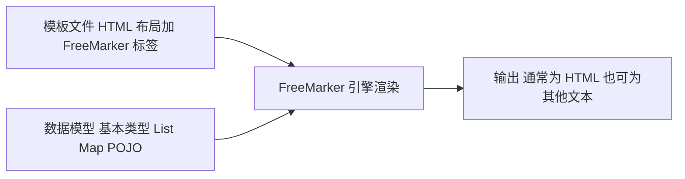
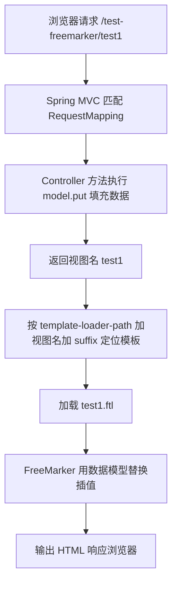
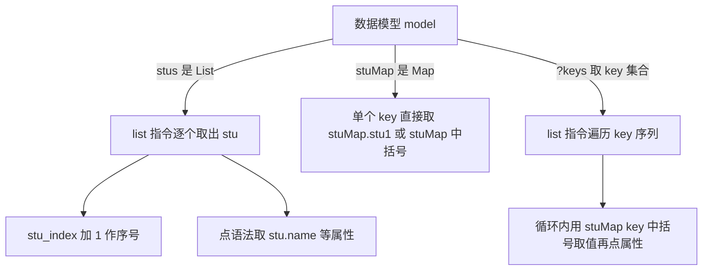
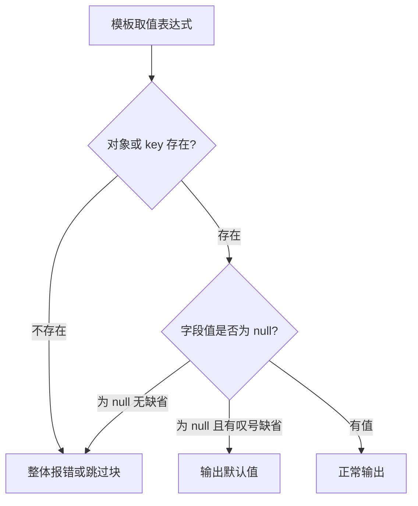

# Freemarker基础四讲：模板引擎原理、快速入门与 list、Map、if 等基础指令

## 先给结论

这套 Freemarker 基础落在聚合支付的商户平台场景：门店二维码生成需要服务端渲染页面，支付入口选了模板引擎路线。全系列四讲从为什么选它讲到快速入门，再到基础指令，覆盖渲染页面所必需的全部语法。
第一讲立工作模型：模板定骨架、数据填空位，服务端渲染与前端渲染的分工。第二讲三件套跑通：模型类、模板、Controller，一次请求从渲染到回页的完整路径。第三讲与第四讲是语法主体：list 遍历与序号、Map 单值取法与整体遍历、keys 与 ?keys 的必踩坑，再到 if 条件、空值处理、缺省值、内置对象、assign 与模板引入。
学完能独立把一套 ftl 模板挂进 Spring Boot 工程完成服务端渲染。
四讲依次是：
- 模板引擎介绍：支付入口的渲染选型与工作模型。
- 快速入门：搭工程、三件套与一次请求的完整路径。
- 基础指令 list 和 Map：数据模型先行、遍历与取值、keys 的坑。
- 其它指令：if、空值处理、缺省值、内置对象与 assign。

## 第1部分：FreeMarker 是什么：模板加数据模型等于输出

二维码生成完毕，顾客扫码后会请求支付入口，也就是一个订单确认页面：页面上要有商品名称、订单内容、付款金额和「立即支付」按钮。这个页面不能提前写死，每个门店、每笔潜在交易的内容都来自 URL 里携带的 `ticket` 参数，服务端必须拿数据现拼页面。用什么技术拼，就是这一课要回答的问题：服务端渲染与模板引擎，以及项目为什么选 FreeMarker。

### 支付入口为什么选服务端渲染

顾客扫的是一张二维码，二维码内容是上一章生成的支付入口 URL。浏览器请求这个 URL 时，交易服务要返回一个能看的页面：标题显示买的是什么，内容显示订单描述，不同商户的门店进入各自的页面。页面骨架是相同的，变化的只有数据部分，这正是「模板」技术的适用场景：把不变的布局做成模板文件，把变化的数据用变量占位，渲染时填充。

这个思路与前后端分离是对立的另一条路线。前后端分离里服务端只给 JSON，页面由浏览器里的 JavaScript 拼装；服务端渲染则是服务端把数据填进模板，输出完整的 HTML 直接给浏览器。订单确认页选择后者，原因有二：页面结构简单、逻辑集中在展示，没有必要引入一套前端工程；支付场景要求页面在扫码后尽快呈现，服务端一次渲染一次响应，不依赖浏览器再发多个接口请求。

服务端渲染的可选技术不少：最早的 JSP、 Velocity、Thymeleaf，以及 FreeMarker。JSP 本质是在 HTML 里嵌 Java 代码，页面与逻辑耦合重；Velocity 语法简洁但生态活跃度下降；Thymeleaf 主打自然模板，适合与 Spring Boot 深度集成的场景；FreeMarker 在 Java 服务端渲染领域应用广泛，语法清晰、与 Spring MVC 集成成本低（默认就被支持），本项目采用 FreeMarker 实现支付入口页面，后续几课先把它作为独立技术掌握，目标是看得懂、写得出订单确认页里的 FreeMarker 标签。

### 模板引擎的工作模型

FreeMarker 的全部工作可以画成一张三输入一输出的图：



模板与数据模型两条输入汇入引擎，引擎按模板的指令取数据、做替换，吐出最终文本。图虽简单，两条输入各自的内容需要拆开看。

**模板的本质是「网页布局加占位标签」。** 一个模板文件与普通 HTML 几乎长得一样，区别只在嵌入了 FreeMarker 自己的标记。官方文档的经典示例最能说明问题：

```html
<html>
<head>
<title>Welcome!</title>
</head>
<body>
<h1>Welcome ${user}!</h1>
<p>Our latest product:
<a href="${latestProduct.url}">${latestProduct.name}</a>
</body>
</html>
```

`${user}`、`${latestProduct.url}`、`${latestProduct.name}` 这些美元符号大括号就是插值（Interpolation），是模板里唯三「看不懂」的部分，作用类似早期 JSP 里 JSTL 标签的输出。渲染时引擎取出插值里变量名对应的值，替换到这个位置，其余 HTML 原样保留。

**数据模型是变量的取值来源。** 上述模板对应的数据模型在官方示例里长这样：

```text
(root)
  - user = "Big Joe"
  - latestProduct
    - url = "products/greenmouse.html"
    - name = "green mouse"
```

数据模型的根是一个类似 Map 的结构，里面放基本类型的 `user`，也放对象类型的 `latestProduct`，对象再往下挂 `url` 与 `name` 两个属性。在 Java 侧准备这些数据没有任何特殊要求，普通 Map 与普通对象即可：

```java
//数据模型：一个 Map 承载所有模板需要的变量
Map<String, Object> model = new HashMap<>();
model.put("user", "Big Joe");

//复杂类型直接放对象，模板里用点语法取属性
Product latestProduct = new Product();
latestProduct.setUrl("products/greenmouse.html");
latestProduct.setName("green mouse");
model.put("latestProduct", latestProduct);
```

模板里的 `latestProduct.url` 与 Java 代码里的对象取值对应关系一目了然：等价于调用 `getLatestProduct().getUrl()`，只是模板里省掉了方法调用，直接写属性名。写 Java 代码的思维可以平移过来，这是 FreeMarker 上手成本低的重要原因。

两份输入合并，渲染输出：

```html
<html>
<head>
<title>Welcome!</title>
</head>
<body>
<h1>Welcome Big Joe!</h1>
<p>Our latest product:
<a href="products/greenmouse.html">green mouse</a>
</body>
</html>
```

三个插值全部被真实值替换，一份完整 HTML 就绪。整个过程可以概括为一个等式：模板 + 数据模型 = 输出，这个等式就是「模板引擎」四个字的全部含义。

### 不只渲染 HTML

模板引擎容易让人以为它只会产网页，实际上模板只是文本，输出也只是文本，HTML 仅仅是模板最常见的内容形态。把模板写成 Java 类的骨架，让标签位填包名、类名、字段列表，渲染出来的就是一份 Java 源码文件。前一个阶段学过的 MyBatis-Plus 自动代码生成工具，底层正是用 FreeMarker 按模板生成 Entity、Mapper、Service 这些类。这一特性说明模板技术的适用边界是「固定骨架加变化数据」的一切场景，网页只是其中一种。

落到闪聚支付项目，订单确认页属于最典型的用法：页面骨架固定，商品标题与订单内容来自 URL 中的 `ticket` 解析结果，付款金额由用户输入。掌握数据模型、插值、指令这三样基础，就能读懂并写出这样的页面，后面两课从快速入门与基础指令两个方向展开。
## 第2部分：FreeMarker 快速入门：从依赖到渲染出一个页面

概念上知道「模板 + 数据模型 = 输出」还不够，落到工程里要回答三个具体问题：依赖怎么引，配置写什么，Controller 返回一个字符串是怎么变成页面的。支付入口页面最终在交易服务里实现，直接在业务工程里练手太重，课程的做法是先单独搭一个最小测试工程把 FreeMarker 跑通，把这套流程掌握了，再迁移到业务工程只是复制粘贴的事。

### 搭工程：依赖与配置

测试工程取名 `test-freemarker`，挂在父工程之下，父工程统一管理 Spring Boot 版本，课程使用的是 2.1.3 版本，对应整合的 FreeMarker 为 2.3.28。pom 里与 FreeMarker 直接相关的依赖只有两个：

```xml
<parent>
    <groupId>com.study.pay</groupId>
    <artifactId>pay</artifactId>
    <version>1.0-SNAPSHOT</version>
</parent>
<artifactId>test-freemarker</artifactId>

<dependencies>
    <!--FreeMarker 与 Spring Boot 的整合包-->
    <dependency>
        <groupId>org.springframework.boot</groupId>
        <artifactId>spring-boot-starter-freemarker</artifactId>
    </dependency>
    <!--服务端渲染要暴露 HTTP 接口，需要 web 一套-->
    <dependency>
        <groupId>org.springframework.boot</groupId>
        <artifactId>spring-boot-starter-web</artifactId>
    </dependency>
</dependencies>
```

其余如 Lombok、okhttp、starter-test 属于顺手带上的工具依赖，与 FreeMarker 本身无关。starter 引入后，Spring Boot 的自动配置已经把 FreeMarker 的视图渲染机制装配好，需要做的只是按项目需求改几个配置项。

配置文件里 FreeMarker 相关的段落如下（含工程基础的端口与服务名）：

```yaml
server:
  port: 8088 #服务端口
  servlet:
    context-path: /test-freemarker

spring:
  application:
    name: test-freemarker #指定服务名
  freemarker:
    charset: UTF-8 #渲染编码
    content-type: text/html #输出类型，服务端渲染可产出多种格式
    suffix: .ftl #模板文件扩展名，不配置时默认即 .ftl
    enabled: true #启用 FreeMarker 视图
    template-loader-path: classpath:/templates/ #模板存放目录，默认值也是它
    resources:
      add-mappings: false #关闭工程中默认的静态资源处理
    mvc:
      throw-exception-if-no-handler-found: true #出现错误时直接抛出异常
```

每一项都值得知道改了会发生什么。`suffix` 决定视图名到文件名的映射规则，配置成 `.ftl` 时返回视图名 `test1` 就去找 `test1.ftl`，将来把扩展名改成别的（比如 `.html`），模板文件随之改名即可，代码里的返回值不用动。`template-loader-path` 指明模板根目录，默认就是 `classpath:/templates/`，可以改成任意目录，改了之后模板文件按新目录存放。`charset` 与 `content-type` 决定响应的编码与类型，中文页面不配 UTF-8 必乱码。`add-mappings: false` 与 `throw-exception-if-no-handler-found: true` 是排障向的配置：关掉静态资源默认映射、让找不到处理器的请求直接抛异常，错误能第一时间暴露出来而不是返回一张默认错误页。

### 三件套：模型类、模板、Controller

数据模型需要一个类型来承载，课程用一个非常简单的 `Student`：

```java
package com.study.pay.test.freemarker.model;

import lombok.Data;
import lombok.ToString;
import java.util.Date;
import java.util.List;

@Data
@ToString
public class Student {
    private String name;//姓名
    private int age;//年龄
    private Date birthday;//生日
    private Float money;//钱包
    private List<Student> friends;//朋友列表
    private Student bestFriend;//最好的朋友
}
```

字段故意覆盖了多种类型：字符串、数字、日期、集合、自引用对象，后续练习基础指令时这些字段正好都用得上。本课快速入门阶段先用最简单的字符串。

模板文件放在 `src/main/resources/templates` 下，命名 `test1.ftl`，内容先压到最简：

```html
<!DOCTYPE html>
<html>
<head>
    <meta charset="utf-8">
    <title>Hello World!</title>
</head>
<body>
Hello ${name}!
</body>
</html>
```

整个模板与静态页面的唯一区别就是 `${name}` 这个插值，它等待渲染时被数据模型里的 `name` 替换。

Controller 把两者连起来：

```java
package com.study.pay.test.freemarker.controller;

import org.springframework.stereotype.Controller;
import org.springframework.web.bind.annotation.RequestMapping;
import java.util.Map;

@Controller
public class FreemarkerController {

    @RequestMapping("/test1")
    public String freemarker(Map<String, Object> model) {
        //向数据模型放数据
        model.put("name", "world");
        //返回模板文件名称
        return "test1";
    }
}
```

两个细节是快速入门的核心。其一，方法入参声明一个 `Map<String, Object>`，Spring MVC 会自动注入一个模型 Map，往里 `put` 的每一个键值对都是数据模型的一个变量，不需要手动 new。其二，返回值不是 JSON 也不是页面路径，而是视图名 `test1`，它之所以能定位到模板文件，靠的是配置里的 `suffix` 与 `template-loader-path` 三者拼合：`classpath:/templates/` 加 `test1` 加 `.ftl`。模板里的 `${name}` 与模型 Map 里 put 进去的 key `name` 是同一个词，渲染引擎按这个名字取值替换；假如模型里没有这个 key，渲染就会报错，模板变量与数据模型的对应关系是硬约束。

启动类没有任何特殊之处，标准的 Spring Boot 写法：

```java
@SpringBootApplication
public class FreemarkerTestApplication {
    public static void main(String[] args) {
        SpringApplication.run(FreemarkerTestApplication.class, args);
    }
}
```

### 一次请求的完整路径

把从点击到渲染的全过程串起来：



关键路径在第 D 步到第 F 步之间：视图名的解析规则完全由配置决定，目录、后缀两个变量都可调整，代码不动。浏览器访问 `http://localhost:8088/test-freemarker/test1`（端口、context-path、RequestMapping 三段拼出完整地址），页面显示 `Hello world!`，说明模板被找到、数据被填上、渲染成功。

调试时的两个高频小问题顺带交代。改了模板内容想立刻看到效果，不必重启整个工程，重新 build 一次再刷新页面即可，模板文件不缓存时改动即时生效。请求 404 时按三段式排查：端口对不对，context-path 漏没漏，RequestMapping 路径拼没拼对，完整地址是三者的串联，少一段都是 404。
## 第3部分：FreeMarker 基础指令：list 遍历与 Map 取值

快速入门里数据模型只有一个字符串，模板里只有一个插值，真实页面远不止如此：订单确认页可能要列订单项，后台页面要列商户门店列表，数据模型必然出现 List 与 Map。本课在一个可运行工程里把两类结构练透：list 指令怎么写、序号怎么加，Map 的单个值怎么取、整个 Map 怎么遍历，以及取 key 时那个最容易踩的 `?keys` 坑。

### 数据模型先行：每个标签都对应一个 key

练习指令前先把数据模型备齐。工程沿用快速入门的 `Student`（姓名、年龄、生日、钱包等字段）与 `FreemarkerController`，本课往模型里放的东西多了起来：

```java
@RequestMapping("/test1")
public String freemarker(Map<String, Object> model) {
    model.put("name", "world");
    //准备两个学生
    Student stu1 = new Student();
    stu1.setName("小明");
    stu1.setAge(18);
    stu1.setMoney(1000.86f);
    stu1.setBirthday(new Date());
    Student stu2 = new Student();
    stu2.setName("小红");
    stu2.setAge(19);
    stu2.setMoney(200.1f);
    stu2.setBirthday(new Date());
    //List 数据
    List<Student> stus = new ArrayList<>();
    stus.add(stu1);
    stus.add(stu2);
    model.put("stus", stus);
    //Map 数据
    HashMap<String, Student> stuMap = new HashMap<>();
    stuMap.put("stu1", stu1);
    stuMap.put("stu2", stu2);
    model.put("stuMap", stuMap);
    model.put("stu1", stu1);
    //返回模板文件名称
    return "test1";
}
```

模型里放了四样东西：字符串 `name`、List 的 `stus`、Map 的 `stuMap`、单个对象的 `stu1`。写模板前要把这张清单记在脑子里：模板里将出现的每一个变量名，都必须是这里的某一个 key。写指令出错的大半根因，都在变量名与 key 对不上。

### list 指令：遍历列表与序号

模板是一张学生表格，表头写死，数据行由 list 指令循环生成：

```html
Hello ${name}!
<table>
    <tr>
        <td>序号</td>
        <td>姓名</td>
        <td>年龄</td>
        <td>钱包</td>
    </tr>
    <#list stus as stu>
    <tr>
        <td>${stu_index + 1}</td>
        <td>${stu.name}</td>
        <td>${stu.age}</td>
        <td>${stu.money}</td>
    </tr>
    </#list>
</table>
```

`<#list stus as stu>` 的读法是「对数据模型里的 `stus`（一个 List）逐个取出，每次取出的元素叫 `stu`」。井号开头是 FreeMarker 指令的固定形式，用来与 HTML 标签区分；循环体内 `stu` 就是一个 Student 对象，取属性用点语法，`${stu.name}` 等价于 Java 里的 `getStu().getName()`，IDE 能根据模型对象自动提示属性名，写错名字会立刻标红。

序号靠内置循环变量 `_index`：在循环变量名后追加 `_index` 得到当前下标，从 0 开始。展示给人看的序号习惯从 1 开始，所以模板里写成 `${stu_index + 1}`，漏掉加 1 页面第一行序号就是 0。请求页面，输出与预期一致：`Hello world!` 下面一张两行数据的表格，1 小明 18 1,000.86，2 小红 19 200.1。

调整模板的迭代节奏也交代一下：改动 `.ftl` 文件后不必重启服务，重新 build 一次再刷新浏览器即可看到效果，模板渲染是请求时执行的，改动即时可用；如果 build 后页面没变化，再考虑重启。

### Map：单值取法与整体遍历

Map 的单个值直接按 key 取。模板里两种写法都试一遍：

```html
输出stu1的学生信息：<br/>
姓名：${(stuMap["stu1"].name)!""}
年龄：${stuMap['stu1'].age}<br/>
输出stu1的学生信息：<br/>
姓名：${(stuMap.stu1.name)!""}<br/>
年龄：${stuMap.stu1.age}<br/>
```

中括号写法 `stuMap['stu1']` 在括号里放 key，key 是字符串字面量就带引号；点语法 `stuMap.stu1` 把 key 当属性名直接点出来，两种写法渲染结果完全一致。取到 value 之后继续点属性，`stuMap.stu1.age` 就是先按 key 拿到 Student 再取年龄，与 Java 里 `map.get("stu1").getAge()` 逐层对应。写法的选择有个实用规则：key 是写死的字面量，两种都行；key 来自循环变量，只能用中括号，下面遍历就会遇到。

整体遍历 Map 稍微绕一步：list 指令只能遍历序列，而 Map 不是序列，所以要先把 key 拿出来变成序列，再循环。Java 里的对应物是 `keySet()`：

```html
<table>
    <tr>
        <td>序号</td>
        <td>姓名</td>
        <td>年龄</td>
        <td>钱包</td>
    </tr>
    <#list stuMap?keys as key>
    <tr>
        <td>${key_index + 1}</td>
        <td>${(stuMap[key].name)!""}</td>
        <td>${stuMap[key].age}</td>
        <td>${stuMap[key].money}</td>
    </tr>
    </#list>
</table>
```

`stuMap?keys` 返回 Map 所有 key 组成的序列，list 指令遍历它，循环变量 `key` 每次得到一个 key 字符串；循环体内再用 `stuMap[key]` 中括号取值，此处 key 是变量，点语法用不上。整条链路完整走一遍：



### 那个必踩的坑：keys 与 ?keys

把遍历写出来第一次运行，十有八九会报错，因为顺手写成的是 `stuMap.keys`。点语法在这里的语义是「取 stuMap 这个对象的 keys 属性」，Student 类型的 Map 并没有这样的属性，FreeMarker 视其为不存在，抛出的异常提示一大段嵌套信息，页面上铺满错误堆栈，观感相当吓人。修正方法是把点换成问号：`?keys` 是取 key 集合的内置运算符，问号开头的写法在 FreeMarker 里专用于这类内置操作。

排查这类错误的顺序有一条经验：不要盯着浏览器里的错误页看，那里输出的是面向页面的包装信息，噪声很多；到服务端控制台找异常堆栈，`<#list stuMap.keys as key>` 这一行会直接出现在堆栈里，一眼定位。控制台信息同时会提示某个数据为空或不存在，FreeMarker 的模板错误绝大多数属于同一类：模板试图取一个模型里不存在的值。把变量名、key、运算符三件事核对一遍，问题就出在那三处之一。
## 第4部分：FreeMarker 其它常用指令：if 条件、空值处理、缺省值与内置对象

模板循环遍历已经练熟，但把测试数据换成真实数据，页面立刻暴露新问题：某个学生对象没填姓名，整页渲染直接抛异常；数据模型里少放一个 key，列表遍历当场报错。这些都不是代码写错，而是模板语言必须面对的常态：数据永远可能缺席。把 if 条件、空值判断、缺省值、内置对象这组指令补齐，模板才算具备上生产的资格，交易服务的支付确认页也全靠它们撑起来。

### if 指令与运算符

`if` 是判断指令，FreeMarker 解析到它时求条件表达式的值，为真输出标签中间的内容，为假整块跳过。需求长这样：学生列表里姓名是小明的那一行，单元格加红色背景。放在表格的单元格里写：

```html
<td <#if stu.name == '小明'>style="background:red;"</#if>>${stu.name!""}</td>
```

条件成立时输出 `style` 属性，不成立时 `<td>` 干干净净。刷新页面，小明的姓名格有了红底，其他行不变，模板里的条件渲染就这么直接。

if 里能写什么表达式，由运算符体系决定。算术运算符 `+`、`-`、`*`、`/`、`%` 完整支持，序号列的 `${stu_index + 1}` 就用到了加法，`stu_index` 是 list 循环自带的下标，从 0 起算。逻辑运算符与或非对应 `&&`、`||`、`!`，只能作用于布尔值。比较运算符里 `==` 判相等、`!=` 判不等，两侧必须是同类型值，FreeMarker 做精确比较，`"x"`、`"x "`、`"X"` 互不相等；大于小于这类比较对数字和日期有效，字符串不能比较大小。

`>` 有一个专门的坑：FreeMarker 会把它解释成 FTL 标签的结束字符，写 `<#if x > y>` 可能直接解析失败。两种规避写法：

```html
<#if (x > y)>用括号包住表达式</#if>
<#if x gt y>或者直接用字母运算符</#if>
```

`gt`、`gte`、`lt`、`lte` 分别对应大于、大于等于、小于、小于等于，字母形式不与标签语法冲突，多数场景下比括号更顺手。

### 空值处理：先问存在再遍历

报错现场值得还原一次。数据模型里 `stus` 这个 key 被注释掉，模板里 `<#list stus as stu>` 照样执行，页面直接抛 FreeMarker template error，错误信息指到模板里取值的那一行。列表遍历不到数据是小事，抛异常把整页打挂才是问题。

Java 的判空写法在这里行不通，FreeMarker 用两个问号表达「存在性」：`variable??` 存在返回 true，不存在返回 false。把遍历包进 if：

```html
<#if stus??>
<#list stus as stu>
    <tr>
        <td>${stu_index + 1}</td>
        <td>${stu.name!""}</td>
        <td>${stu.age}</td>
    </tr>
</#list>
</#if>
```

模型里有 `stus` 就渲染表格，没有就整块跳过，页面不再报错。这个习惯应当推广到所有集合遍历：不管 list 还是 map，遍历前先 `??` 判断一次，代价一行，收益是把「数据缺席」从异常降级成空白。

### 缺省值：给取值留一条退路

`??` 解决了遍历的存在性，单个字段的缺失还要另一件武器。把控制器里 `stu1.setName(...)` 注释掉再刷新，`${stu.name}` 一样报错；就算 if 里写了 `<#if stu.name?? && stu.name == '小明'>`，条件判断这一步安全了，后面取值输出那一行还是炸，报错位置从条件挪到了 `${stu.name}`。取一个不存在的值和输出一个不存在的值，是两次独立的风险点。

叹号 `!` 负责缺省值：`${stu.name!""}` 表示 name 为空时输出空字符串。把模板里所有可能缺失的字段都补上，刷新页面恢复正常输出。叹号后面跟什么，缺了就显示什么，空串、固定文案、数字 0 都可以。

嵌套取属性是重灾区。`${stu.bestFriend.name}` 这串表达式，`stu`、`bestFriend`、`name` 三层任何一层为空，整串都会抛错；只给最后的 `name` 加叹号挡不住前两层。FreeMarker 的规则是：括号把整串包住再叹号，任何一层为空都整体落到默认值：

```html
姓名：${(stu.bestFriend.name)!""}
朋友个数：${(stu.friends?size)!0}
```

`(stu.bestFriend.name)!""` 三个层级缺谁都输出空串，`(stu.friends?size)!0` 在集合不存在时显示 0。养成固定习惯：没有特殊要求的情况下，嵌套取属性的表达式一律用括号整体包住加缺省值，这比逐层判断省事，也更不容易漏。



图里两条报错路径对应两个指令的分工：`??` 在分支判断处拦截不存在，`!` 在输出处兜底缺失值，两者配合才能把模板的防御做完整。

### 内置对象：模板里取 request、session 与请求参数

数据模型是自己 put 进去的 map，但很多数据不在模型里：登录成功后用户信息放在 session，工程路径在 contextPath，URL 上还挂着零散的请求参数。FreeMarker 可以直接访问这些 Servlet 环境的内置对象，前提是配置里把暴露开关打开：

```yaml
spring:
  freemarker:
    request-context-attribute: rc #把 RequestContext 暴露为变量 rc
    expose-request-attributes: true #可取出 request 属性
    expose-session-attributes: true #可取出 session 属性
```

控制器的入参声明 `HttpServletRequest`，往 request 和 session 里各放一个属性，模拟真实场景里登录信息写入 session 的动作：

```java
@RequestMapping("/test1")
public String freemarker(Map<String, Object> model, HttpServletRequest request){
    request.setAttribute("attr1", "test");
    HttpSession session = request.getSession();
    session.setAttribute("session1", "user1");
    return "test1";
}
```

模板里的取法和 map 一致，用中括号下标访问，各自配一个缺省值兜底：

```html
url请求参数值：${RequestParameters['param1']!""}
Request属性值 : ${Request['attr1']!""}
Session属性值 : ${Session['session1']!""}
contextPath: ${rc.contextPath}
请求地址: ${rc.requestUri}
```

`RequestParameters` 取的是 URL 上 `?param1=xx` 这类请求参数，浏览器地址栏追加 `?param1=aabb` 再刷新，值就显示出来；没传参时靠叹号缺省值输出空串，不会报错。`rc.contextPath` 与 `rc.requestUri` 来自 `request-context-attribute` 这个配置，`rc` 是变量名，可以换成别的名字，但配置里叫什么模板里就得叫什么。`contextPath` 在配置了 `server.servlet.context-path` 的工程里返回配置的路径前缀，页面里拼 CSS、JS、表单提交地址都靠它，表单提交写相对路径还是绝对路径的分歧，一个 `rc.contextPath` 就消掉了。

### assign 与模板引入

`assign` 指令在模板里定义变量，最实用的玩法是配合内建函数 `?eval` 把一段字符串当表达式求值，现场解析出结构化数据：

```html
<#assign text="{'bank':'工商银行','account':'10101920201920212'}" />
<#assign data=text?eval />
开户行：${data.bank}  账号：${data.account}
```

字符串形式的 JSON 被转成可点取属性的对象，页面上直接输出开户行与账号。模板片段复用则靠 `include` 与 `import`：`include` 把公共模板文件原样插进当前位置，页头页脚不必每页复制一份；`import` 引入别的模板里定义的宏与变量，走命名空间调用。两者的相对路径都从模板加载根目录（`template-loader-path` 指向的 `classpath:/templates/`）起算，这段课程未做专门演示，示例按 FreeMarker 通用写法补充，用法以官方文档为准。
## 常见误区

- **把 FreeMarker 当作替代 Java 的编程语言。** 错例：试图在模板里写复杂业务逻辑。正解：模板只负责展示层的数据填充与简单控制（遍历、判断），业务计算留在 Java 侧，算好的结果放进数据模型。
- **认为输出只能是 HTML。** 错例：需要生成代码文件或报表文本时另找工具。正解：模板引擎输出的是文本，内容形态由模板决定，HTML、XML、Java 源码、SQL 都可以。
- **混淆模板里的变量名与数据模型的 key。** 错例：模板写 `${userName}`，模型里放的是 `name`，渲染报变量不存在。正解：插值里的名字必须与数据模型中的 key 或属性名逐字对应，大小写敏感。
- **把 FreeMarker 与 JSP 等同看待。** 错例：以为模板会像 JSP 一样被编译成 Servlet、依赖 Web 容器运行。正解：FreeMarker 是纯 Java 的模板库，不依赖 Servlet 容器也能独立运行（如生成代码文件的场景），在 Web 场景中只是作为 Spring MVC 的一种视图格式被集成。
- **Controller 返回值当成页面文件路径写全。** 错例：`return "templates/test1.ftl"`，视图解析反而找不到。正解：返回纯视图名，目录与后缀由 `template-loader-path` 和 `suffix` 配置负责，代码里不重复表达。
- **模板变量与模型 key 对不上。** 错例：模板写 `${name}`，Controller 里 put 的是 `username`，渲染抛变量不存在的异常。正解：插值内的变量名必须与数据模型中的 key 逐字一致，大小写敏感；排查渲染错误先对名。
- **模板文件放错位置。** 错例：随意放在 `resources` 根目录下。正解：默认放在 `classpath:/templates/`，与配置的 `template-loader-path` 对齐；自定义了目录就按新目录存放。
- **以为必须手动创建 FreeMarker 的 Configuration 对象。** 错例：照网上原生用法在代码里 new Configuration、setDirectoryForTemplateLoading。正解：Spring Boot 场景下 starter 与自动配置已代劳，只需要写 Controller 与模板；原生 API 只在脱离 Spring 的场景（如代码生成工具）才需要。
- **中文乱码去改页面而不改配置。** 错例：模板里加各种 meta 标签仍乱码。正解：确认 `spring.freemarker.charset: UTF-8`，模板文件的 `meta charset` 与文件本身编码三处一致。
- **遍历 Map 时写点语法取 keys。** 错例：`<#list stuMap.keys as key>`，运行报变量不存在的异常。正解：`stuMap?keys`，问号是内置运算符的固定前缀，点语法只会去找名为 keys 的属性。
- **序号直接用 `_index`，忘了从 0 开始。** 错例：表格序号列出现 0、1。正解：`${stu_index + 1}`，`_index` 是下标不是序号。
- **key 是循环变量时仍用点语法取值。** 错例：`stuMap.key.name`，点语法把 `key` 当字面量属性名去找，永远取不到。正解：中括号 `stuMap[key].name`，括号内放变量。
- **循环变量与数据模型 key 混为一谈。** 错例：在 `<#list stus as stu>` 循环体内写 `${stus.name}`，List 上当然没有 name。正解：分清「模型 key」「循环临时变量」「对象属性」三层，各取各的名字。
- **对可能为空的字段不做任何保护。** 错例：某学生没设姓名，`${stu.name}` 直接抛错。正解：可能缺失的值用 `${stu.name!""}` 给缺省值，或用 `stu.name??` 先判断存在性；归档的完整工程模板里对姓名字段就同时做了这两种处理。
- **把 `??` 和 `!` 混为一谈。** 错例：`${stu.name??}` 想输出姓名，结果页面上打印 true 或 false。正解：`??` 是存在性判断返回布尔值，配合 `<#if>` 做分支；要输出默认值用 `!`，两者一个管判断一个管兜底。
- **嵌套属性只给最后一层加叹号。** 错例：`${stu.bestFriend.name!""}`，`bestFriend` 为空时照样报错。正解：整串用括号包住 `${(stu.bestFriend.name)!""}`，让任何一层缺失都落到默认值。
- **在 if 条件里直接写 `>`。** 错例：`<#if price > 100>`，`>` 被当成 FTL 标签结束字符，模板解析失败。正解：写 `<#if price gt 100>`，或者 `<#if (price > 100)>` 用括号隔离。
- **没开暴露配置就在模板里取内置对象。** 错例：配置里没有 `expose-request-attributes`，模板里 `${Request['attr1']}` 取不到值或直接报错。正解：`expose-request-attributes`、`expose-session-attributes`、`request-context-attribute` 三项先配齐，再用 `Request`、`Session`、`rc` 取值。

## 面试可能被问到的问题

1. 面试官追问：「模板引擎解决什么问题？和直接用字符串拼接 HTML 比有什么优势？」
   答：模板引擎把页面骨架与数据分离，布局写在模板文件里，数据在 Java 侧准备，渲染时填充。相比字符串拼接，模板保留 HTML 原生结构、可读可维护，支持遍历、判断等控制指令，修改页面不需要改动 Java 代码，也不会出现引号转义地狱。

2. 面试官追问：「FreeMarker、JSP、Thymeleaf 三者的核心区别是什么？」
   答：JSP 在 HTML 中嵌 Java 代码并被编译为 Servlet，页面与逻辑耦合重，依赖 Web 容器；Thymeleaf 是自然模板，未渲染时也能作为静态 HTML 打开，与 Spring Boot 官方契合度高；FreeMarker 是通用模板引擎，语法以指令和插值为主，不依赖容器，除页面外还广泛用于代码生成等任意文本输出场景。本项目选 FreeMarker 看重其成熟度与 Spring MVC 的默认支持。

3. 面试官追问：「数据模型里的对象，模板里是怎么取属性的？」
   答：用点语法，`latestProduct.url` 等价于 Java 里调用 `getLatestProduct().getUrl()`。FreeMarker 通过内省读取对象的属性，所以对象需要提供 getter 方法，通常配合 Lombok 的 `@Data` 自动生成。Map 类型则可以用点语法或中括号按 key 取值。

4. 面试官追问：「为什么支付订单确认页选服务端渲染而不是前后端分离？」
   答：页面结构固定、数据项少、来源单一（URL 中的参数解析而来），没有复杂交互，服务端一次渲染一次响应即可完成，链路短且快。前后端分离的价值在富交互与多端复用，为这样一个确认页引入独立前端工程成本大于收益。

5. 面试官追问：「FreeMarker 渲染发生在什么时机？每次请求都渲染吗？」
   答：模板本身可以被缓存，首次使用时解析加载，之后每次请求传入新的数据模型重新执行替换生成输出，模板解析与数据填充是两个阶段。数据每次不同所以填充必须每次执行，模板解析可以复用，这也是配置里模板缓存开关的意义。

6. 面试官追问：「Spring Boot 里 Controller 返回一个字符串为什么会渲染模板，而不是当 JSON 返回？」
   答：类上标注 `@Controller` 而不是 `@RestController` 时，返回值会被视图解析器当作视图名处理。FreeMarker 自动配置注册了对应的视图解析器，按模板目录加后缀定位模板并渲染。`@RestController` 的返回值才走消息转换器输出 JSON，两者的分界就在返回值的处理方式上。

7. 面试官追问：「suffix 配置有什么实际价值？」
   答：它把视图名与物理文件名解耦。模板扩展名从 `.ftl` 改成 `.html` 时只改配置与文件名，Controller 返回值不动；同一工程也可以通过它统一模板的命名规范。视图名是逻辑名，配置负责映射，这是典型的约定优于配置的落地。

8. 面试官追问：「模板里的 ${name} 是怎么和 Java 代码关联起来的？」
   答：Controller 方法入参的 `Map<String, Object>` 就是数据模型，put 进去的 key 与模板插值里的变量名按名字匹配，渲染引擎取值替换。Map 是最通用的数据模型形态，也可以放对象，对象在模板里用点语法取属性。

9. 面试官追问：「模板修改后必须重启应用吗？」
   答：不必须。开发期把模板缓存关闭或重新 build 后刷新即可生效，Spring Boot 集成下模板文件的加载支持热更新检测。生产环境则建议开启模板缓存，避免每次请求都重新解析模板带来的开销。

10. 面试官追问：「这个测试工程和支付入口页面的实现是什么关系？」
   答：测试工程验证的是 FreeMarker 在 Spring Boot 里的接入方式、配置项含义与视图解析规则，这套东西在交易服务里完全复用：业务工程引入同样的 starter，模板放 `templates` 下，Controller 返回视图名，数据模型换成从 URL 参数解析出的支付要素，页面内容从 `Hello world` 换成订单确认信息，骨架没有任何变化。

11. 面试官追问：「FreeMarker 的 list 指令和 JSTL 的 foreach 有什么异同？」
   答：语义相同，都是对序列逐元素循环。语法上 FreeMarker 用 `<#list 序列 as 变量>`，循环下标以内置变量 `变量_index` 提供，从 0 开始；JSTL 用 `varStatus` 拿状态对象。FreeMarker 指令以井号开头与 HTML 区分，不依赖标签库引入，写在 `.ftl` 文件里由引擎解析。

12. 面试官追问：「?keys 和点语法取 Map 的区别是什么？」
   答：点语法 `stuMap.keys` 会被解释为取对象的 keys 属性，Map 上不存在该属性，渲染报错；`?keys` 是内置运算符，返回 Map 全部 key 组成的序列，对应 Java 的 `keySet()`。凡是内置能力（判空、取序列、类型处理）都用问号前缀，这是 FreeMarker 的语法约定。

13. 面试官追问：「模板里取一个对象的属性，底层是怎么工作的？」
   答：FreeMarker 通过内省调用对象的 getter，模板里 `stu.name` 等价于 `getName()` 的调用结果，所以模型类要提供 getter，通常配合 Lombok 生成。Map 类型特殊一些，点语法按 key 查找，也可以用中括号；key 含特殊字符或来自变量时只能用中括号。

14. 面试官追问：「模板渲染报错说变量不存在，你怎么排查？」
   答：先看服务端控制台堆栈定位到模板的具体行，再核对三处：模板变量名是否与数据模型的 key 一致、大小写是否相同、嵌套属性的中间层是否存在。可能为空的值用 `??` 判断存在性或 `!` 给缺省值兜底，嵌套对象建议加括号整体保护。

15. 面试官追问：「List 和 Map 在数据模型里怎么选？」
   答：元素是同质的有序集合、按位置或整体展示，用 List，配 list 指令遍历；需要按业务键快速定位某个元素（如按编号取某个学生），用 Map，key 提供语义化寻址。页面既要遍历又要按 key 定位时两者可以并存，模型里同时放 List 与 Map 引用同一批对象。

16. 面试官追问：「FreeMarker 里 `??` 和 `!` 有什么区别？」
   答：`??` 判断变量是否存在，返回布尔值，典型用法是 `<#if stus??>` 控制代码块是否渲染；`!` 为缺失的变量指定默认值，如 `${name!""}`，缺失时输出空串而不是抛异常。前者用于分支逻辑，后者用于输出兜底，嵌套取属性时整串括号包住再加 `!` 才能覆盖每一层。

17. 面试官追问：「为什么模板里的比较运算推荐用 gt、lt 这种字母形式？」
   答：FreeMarker 解析模板时把 `>` 当作 FTL 标签的结束字符，`<#if a > b>` 这类写法会导致解析歧义甚至失败。字母运算符没有这个冲突，或者用括号把含 `>` 的表达式包起来。工程上统一用字母形式能避免一类很难排查的模板解析错误。

18. 面试官追问：「模板怎么拿到 Session 里的登录用户信息？需要什么配置？」
   答：配置 `spring.freemarker.expose-session-attributes` 为 true 后，session 里的属性会暴露给模板，页面上用 `${Session['user']}` 取值。配套还有 `expose-request-attributes` 暴露 request 属性、`request-context-attribute` 把 RequestContext 暴露为指定变量用于取工程路径。没开这些开关，模板访问不到内置对象。

19. 面试官追问：「服务端渲染页面和前后端分离相比，什么时候选 FreeMarker？」
   答：页面结构稳定、以展示为主、对首屏与 SEO 有要求的场景适合服务端渲染，模板在服务端拼好完整 HTML 一次输出；交互密集、频繁局部刷新的管理后台更适合前后端分离。本项目的支付确认页要按客户端类型输出不同提交地址、直接展示订单要素，服务端渲染链路短，选 FreeMarker 合理。

20. 面试官追问：「`?eval` 把字符串转成对象，直接用在生产有什么风险？」
   答：`?eval` 会把字符串当 FreeMarker 表达式求值，如果字符串来源不可控，等于在模板里执行了外部输入，存在注入风险。生产中应保证被求值的内容来自服务端可信数据，来源不可控的 JSON 解析应放到 Java 侧用正规反序列化完成，模板只负责展示。

## 配套资料

- 讲义：`materials/docs/10/freemarker基础v1.1.md`，1.1 FreeMarker 介绍（模板引擎定义、常用模板引擎列表、模板 + 数据模型 = 输出、官方示例）为本课出处，官方示例原文见 FreeMarker 文档 dgui_quickstart_basics 页面。
- 代码：本课为概念介绍，无对应工程；配套的可运行测试工程在 `materials/code/10/完整代码/完整代码/` 归档中，名为 `test-freemarker`（下一课快速入门的载体）。数据模型与模板示例为按本课讲义与官方文档口径补全（内层工程目录与包名为课程原始命名，不在此展开）。
- 说明：该阶段课程资料归档在 `materials/docs/10/` 与 `materials/code/10/`（不存在 09 编号目录），引用路径截至该层级。
- 讲义：`materials/docs/10/freemarker基础v1.1.md`，1.2 FreeMarker 快速入门（1.2.1 创建测试工程、1.2.2 配置文件、1.2.3 创建模型类、1.2.4 创建模板、1.2.5 创建 controller 与启动类、1.2.6 测试）为本课出处。
- 代码：`materials/code/10/完整代码/完整代码/` 归档中的 `test-freemarker` 测试工程为真实工程，含 `pom.xml`、`application.yml`、`model/Student.java`、`controller/FreemarkerController.java`、启动类与 `templates/test1.ftl`；`materials/code/10/基准代码/zip/` 归档含同一工程的基准版本。正文代码为按 `com.study.pay` 系口径改写后的节选（内层工程目录与包名为课程原始命名，不在此展开）。
- 讲义：`materials/docs/10/freemarker基础v1.1.md`，2.1 数据模型（两个学生的 List 与 Map 准备）、2.2 List 指令（含 `_index` 说明）、2.3 遍历 Map 数据（`?keys` 取 key 集合与中括号取值）为本课出处。
- 代码：`materials/code/10/完整代码/完整代码/` 归档中的 `test-freemarker` 测试工程为真实工程，本课对应 `controller/FreemarkerController.java`（数据模型准备）、`templates/test1.ftl`（list 指令、两种 Map 取值写法与 `?keys` 遍历）、`model/Student.java`；`materials/code/10/基准代码/zip/` 归档含同一工程的基准版本。正文代码为按 `com.study.pay` 系口径改写后的节选（内层工程目录与包名为课程原始命名，不在此展开）。
- 讲义：`materials/docs/10/freemarker基础v1.1.md`，2.4 if 指令、2.5 运算符、2.6 空值处理、2.7 内置对象为本课出处，附完整模板可对照测试。
- 代码：`materials/code/10/完整代码/完整代码/` 归档中，独立 FreeMarker 测试工程的 `FreemarkerController.java`（模拟空姓名、内置对象赋值）、`templates/test1.ftl`（if、`??`、`!`、内置对象取值全量示例）、`model/Student.java`、`application.yml`（expose 与 rc 配置）均为真实文件；`materials/code/10/基准代码/zip/` 归档含同一套文件的基准版本。正文代码为按 `com.study.pay` 系口径改写后的节选（归档内层工程目录与包名为课程原始命名，不在此展开）。
- 说明：`include` 与 `import` 指令课程未做专门演示，文中示例为按 FreeMarker 通用写法补全，可编译验证；其余代码均出自上述真实文件。
