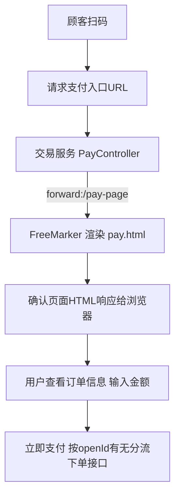

# 交易服务的支付确认页面：FreeMarker 集成与视图配置

二维码被扫之后，浏览器会带着 ticket 请求支付入口 URL，交易服务必须回给用户一个看得见的页面：订单确认页，顶部是商品名称，下面是订单信息与付款金额输入框，底部一枚「立即支付」。页面本身不必从零画起，课程的思路是把现成的页面文件放进交易服务，让 FreeMarker 接管渲染；配置做成公共配置放在配置中心，哪个服务要渲染页面就引入哪份，交易服务由此补上「响应用户」这半边能力。

## 先给结论

- 确认页面是两个现成文件：`pay.html` 与 `pay_error.html`，拷贝到交易服务工程的 `resources/templates` 目录，页内用 `${RequestParameters['xxx']!}` 取请求参数、`${rc.contextPath}` 取工程路径、`<#if>` 按 openId 是否存在切换表单提交地址。
- 交易服务工程引入 `spring-boot-starter-freemarker` 依赖，渲染能力由此接入。
- FreeMarker 配置独立成 Nacos 公共配置 `spring-boot-freemarker.yaml`，分组 `COMMON_GROUP`，后缀定为 `.html`；交易服务的 `bootstrap.yml` 用 `ext-config` 引入。
- `WebMvcConfig` 注册视图控制器：`/pay-page` 对应视图 `pay`，`/pay-page-error` 对应 `pay_error`，纯转发的页面地址一次配置永久生效。
- 入口接口 `PayController` 用 `@Controller` 而非 `@RestController`，`@RequestMapping("/pay-entry/{ticket}")`，本课先把方法立起来，体内 `forward` 到 `/pay-page`，准备数据留给后续环节。

## 确认页面长什么样、靠什么渲染

交互流程先把位置摆正：顾客扫描门店二维码，请求打到交易服务的支付入口；交易服务解析请求、准备数据，生成支付确认页面；确认页面响应给用户。支付入口的最终产物就是一个订单确认页面，页面里要有商品标题、订单描述、金额，还有一个确认支付的动作按钮。

页面文件直接从课程资料拷入工程，`pay.html` 是确认页主体，`pay_error.html` 是出错兜底页，放进 `resources/templates`。先认一遍页面里和我们学过的指令对得上的部分：

```html
<div class="content">
    <p class="name">${RequestParameters['subject']!}</p>
</div>
<div class="form-container">
    <form id="form" action="" method="post">
        <input type="hidden" name="appId" value="${RequestParameters['appId']!}"/>
        <input type="hidden" name="openId" value="${RequestParameters['openId']!}"/>
        <input type="hidden" name="channel" value="${RequestParameters['channel']!}"/>
        <p><span>商品名称 :</span><input type="text" name="subject" value="${RequestParameters['subject']!}"/></p>
        <p><span>订单描述 :</span><input type="text" name="body" value="${RequestParameters['body']!}"/></p>
        <p><span>付款金额(元) :</span><input type="text" name="totalAmount" value="..."/></p>
        <input type="button" value="立即支付" onclick="IsWeixinOrAlipay()" class="pay">
    </form>
</div>
```

页面上所有动态内容都来自 `RequestParameters`，也就是上一课讲过的内置对象取请求参数：入口把订单要素拼成 query 参数转发过来，页面逐个取出回填，缺了就靠叹号留空。隐藏域把 `appId`、`openId`、`channel` 这些要素原样随表单带走，点击「立即支付」时提交给后端下单接口。提交地址是页面里最关键的一段脚本：

```javascript
function IsWeixinOrAlipay(){
    var totalAmount = document.getElementsByName("totalAmount")[0];
    if (!totalAmount.value) {
        alert("付款金额不能为空");
        return;
    }
    var action;
    <#if RequestParameters['openId']?? >
        action = "${rc.contextPath}/wxjspay";
    <#else>
        action = "${rc.contextPath}/createAliPayOrder";
    </#if>
    document.getElementById("form").action = action;
    document.getElementById("form").submit();
}
```

FreeMarker 的 if 指令直接长在 JavaScript 里：请求参数里有 `openId` 说明用户从微信侧进来，表单提交到微信下单接口；没有则提交到支付宝下单接口。`${rc.contextPath}` 把工程路径拼进地址，避免写死。一个页面同时服务两种扫码客户端，服务端渲染在这里的灵活性是静态页面给不了的。



链路的终点就是这张确认页：入口负责把人带到页面，页面负责把订单要素摆到用户眼前，两者之间的数据传递靠 URL 参数加模板取值。

## 依赖与公共配置：让交易服务具备渲染能力

渲染能力来自一个 starter 依赖，交易服务工程的 `pom.xml` 中加入：

```xml
<!-- freemarker依赖 -->
<dependency>
    <groupId>org.springframework.boot</groupId>
    <artifactId>spring-boot-starter-freemarker</artifactId>
</dependency>
```

依赖就位后，FreeMarker 的行为要靠配置约束。项目里凡是用到 FreeMarker 的服务都需要这份配置，所以它不写进某个服务私有的配置文件，而是在 Nacos 单独建一个 `spring-boot-freemarker.yaml`，分组放 `COMMON_GROUP`，将来哪个服务要渲染页面，引入这份配置即可，这就是公共配置组的用法：

```yaml
#freemarker基本配置
spring:
  freemarker:
    charset: UTF-8
    request-context-attribute: rc
    content-type: text/html
    suffix: .html
    enabled: true
    resources:
      add-mappings: false #关闭工程中默认的资源处理
    mvc:
      throw-exception-if-no-handler-found: true #出现错误时直接抛出异常
```

逐项看要点。`suffix: .html` 规定视图名补上 `.html` 后缀去模板目录找文件，页面文件就叫 `pay.html`，配置与文件名必须严格一致；早期 FreeMarker 测试工程里模板后缀是 `.ftl`，那是那个工程自己的选择，本项目的确认页面就是 html 文件，后缀千万别乱写。`request-context-attribute: rc` 暴露 `rc` 变量，页面里 `${rc.contextPath}` 依赖它。`resources.add-mappings: false` 关闭 Spring Boot 默认的静态资源映射，避免静态资源处理抢走本应进模板渲染的请求；`mvc.throw-exception-if-no-handler-found: true` 让找不到处理器的请求直接抛异常而不是落进默认错误页，两个开关配合，问题会在第一时间暴露出来，而不是被兜底逻辑悄悄吞掉。

配置发布后，交易服务的 `bootstrap.yml` 里把它追加到 `ext-config` 列表：

```yaml
spring:
  cloud:
    nacos:
      config:
        ext-config:
          - refresh: true
            data-id: spring-boot-freemarker.yaml # spring boot freemarker配置
            group: COMMON_GROUP # 通用配置组
```

至此配置链路完整：Nacos 发布公共配置，各服务的 bootstrap 引入，Spring Boot 按 `spring.freemarker.*` 前缀装配 FreeMarker 引擎。

## 视图控制器与入口接口骨架

页面地址 `/pay-page` 需要有一个落点。它没有任何业务逻辑，只是把一个 URL 映射到一个视图名，为此单独写一个 Controller 方法不划算，Spring MVC 提供了视图控制器注册机制，在配置类里一次声明：

```java
package com.study.pay.transaction.config;

import org.springframework.stereotype.Component;
import org.springframework.web.servlet.config.annotation.ViewControllerRegistry;
import org.springframework.web.servlet.config.annotation.WebMvcConfigurer;

@Component
public class WebMvcConfig implements WebMvcConfigurer {
    @Override
    public void addViewControllers(ViewControllerRegistry registry) {
        registry.addViewController("/pay-page").setViewName("pay");
        registry.addViewController("/pay-page-error").setViewName("pay_error");
    }
}
```

`/pay-page` 对应视图 `pay`，加上后缀配置就是 `templates/pay.html`；错误页同理。两个纯转发地址一次配好，永久生效。

支付入口接口按讲义定义写在 `PayController`。类上的注解有个不容替换的细节：必须用 `@Controller`，不能用 `@RestController`。原因是方法要返回视图名做页面转发，`@RestController` 等于给每个方法默认加了 `@ResponseBody`，返回的字符串会被直接写进响应体，用户看到的将是 `forward:/pay-page` 这串文本而不是页面：

```java
@Slf4j
@Controller
public class PayController {

    /**
     * 支付入口
     * @param ticket 传入数据，对json数据进行的base64编码
     * @param request
     * @return
     */
    @RequestMapping("/pay-entry/{ticket}")
    public String payEntry(@PathVariable("ticket") String ticket, HttpServletRequest request) {
        //1、准备确认页面所需要的数据（解析ticket，后续环节实现）
        //2、解析客户端的类型（微信、支付宝），此处为后续环节预留
        return "forward:/pay-page";
    }
}
```

路径里的 `{ticket}` 与生成二维码时拼接的 URL 严格对应：入口前缀之后挂的那一长串编码就是它，`@PathVariable` 接收。方法体当前只做转发，`forward:/pay-page` 是请求转发，用户的请求原样交给 `/pay-page` 对应的模板渲染，地址栏不变，请求参数也全程可见，这正是页面随后能用 `RequestParameters` 取到订单要素的前提；换成重定向，参数就要另想办法传了。数据准备与客户端识别两个环节马上会把这个方法填满，骨架先立稳。

## 常见误区

- **入口 Controller 用了 `@RestController`。** 错例：沿用业务接口的习惯写注解，浏览器访问后显示一串 `forward:/pay-page` 文本。正解：响应用户页面的接口必须用 `@Controller`，返回视图名交给视图解析器处理。
- **后缀配置与模板文件名对不上。** 错例：配置 `suffix: .ftl`，模板文件叫 `pay.html`，渲染时找不到模板，页面异常。正解：`suffix` 定为 `.html`，与拷入的页面文件名保持一致，视图名 `pay` 加后缀正好命中 `pay.html`。
- **把 pay.html 放进 static 目录当静态页面。** 错例：图省事放静态目录直接访问，页面里的 `${RequestParameters['subject']!}` 原样显示在页面上。正解：模板必须放 `resources/templates`，由 FreeMarker 渲染，指令才会被执行。
- **公共配置建好了，服务却没引入。** 错例：Nacos 里发布了 `spring-boot-freemarker.yaml`，交易服务的 `bootstrap.yml` 的 `ext-config` 没加条目，启动后渲染行为全靠默认值，`rc` 变量不存在，页面报错。正解：发布配置与引入配置是两步，缺一步都等于没配，启动日志里核对引入的 data-id 列表。

## 面试可能被问到的问题

1. 面试官追问：「支付确认页为什么选服务端渲染的 FreeMarker，而不是前后端分离？」
   答：确认页是面向 C 端用户的轻展示页，需要按客户端类型（微信或支付宝）输出不同的表单提交地址，页面结构稳定、数据来自入口转发的参数。服务端渲染一次输出完整 HTML，链路短、无需前端工程与接口层，维护成本低；前后端分离的价值在交互复杂的多页面系统，这里用它属于过重设计。
2. 面试官追问：「`@Controller` 和 `@RestController` 的区别？这个场景为什么必须用前者？」
   答：`@RestController` 是 `@Controller` 加 `@ResponseBody` 的组合注解，方法返回值默认序列化进响应体，适合接口服务；`@Controller` 的方法返回视图名，由视图解析器定位模板渲染。支付入口要返回 `forward:/pay-page` 这样的视图转向，用 `@RestController` 会把字符串原样写给浏览器。
3. 面试官追问：「forward 和 redirect 有什么区别？入口转发确认页为什么用 forward？」
   答：forward 是服务端内部转发，浏览器地址栏不变，共享同一次请求与请求参数；redirect 是服务端让浏览器重新发起新请求，地址栏变化，原请求参数丢失。入口把订单要素拼在转发地址的 query 上，页面靠 `RequestParameters` 取参，forward 让参数传递零成本，重定向还得额外拼参数或借存储中转。
4. 面试官追问：「add-mappings 设为 false、throw-exception-if-no-handler-found 设为 true，这两个配置的用意是什么？」
   答：关闭默认静态资源映射后，所有找不到处理器的请求都不会被静态资源兜底逻辑接走；配合抛异常开关，这类请求直接抛出 NoHandlerFoundException 进入统一异常处理。两条配置让「路径配错」这类问题在第一时间以异常形式暴露，而不是返回一个默认错误页让排查失去线索。
5. 面试官追问：「FreeMarker 的配置为什么放 COMMON_GROUP 公共组，而不是每个服务自己一份？」
   答：渲染配置是所有需要页面渲染的服务共享的基础行为，内容一致、变更低频。放公共组，新增渲染服务只需在 bootstrap 引入一行 data-id，配置修改在一处生效；各自维护一份迟早出现配置漂移，模板后缀、字符集这类参数不一致时问题极难定位。项目里 HTTP、MyBatis-Plus、Redis 等基础配置同样按公共组管理，口径统一。

## 配套资料

- 讲义：`materials/docs/10/闪聚支付-第3章-C扫Bv1.1.md`，4.2 Freemarker 技术预研（服务端渲染选型：jsp、freemarker、velocity、Thymeleaf 对比，本项目采用 freemarker）与 4.3 交易服务支付入口之 4.3.1 支付确认页面（页面拷贝、依赖引入、Nacos 公共配置、bootstrap 引入、WebMvcConfig 视图配置、支付入口接口定义）为本课出处。
- 代码：`materials/code/10/完整代码/完整代码/` 归档中，交易服务工程的 `controller/PayController.java`、`config/WebMvcConfig.java`、`templates/pay.html`、`templates/pay_error.html`、`bootstrap.yml`（ext-config 引入公共配置）、`pom.xml`（freemarker 依赖）均为真实文件；`materials/code/10/基准代码/zip/` 归档含对应基准版本。正文代码为按 `com.study.pay` 系口径改写后的节选（归档内层工程目录与包名为课程原始命名，不在此展开）。
- 说明：该阶段课程资料归档在 `materials/docs/10/` 与 `materials/code/10/`（不存在 09 编号目录），引用路径截至该层级；确认页面提交地址按课程环境口径书写，示例域名在博客中统一以 `example.com` 占位。
