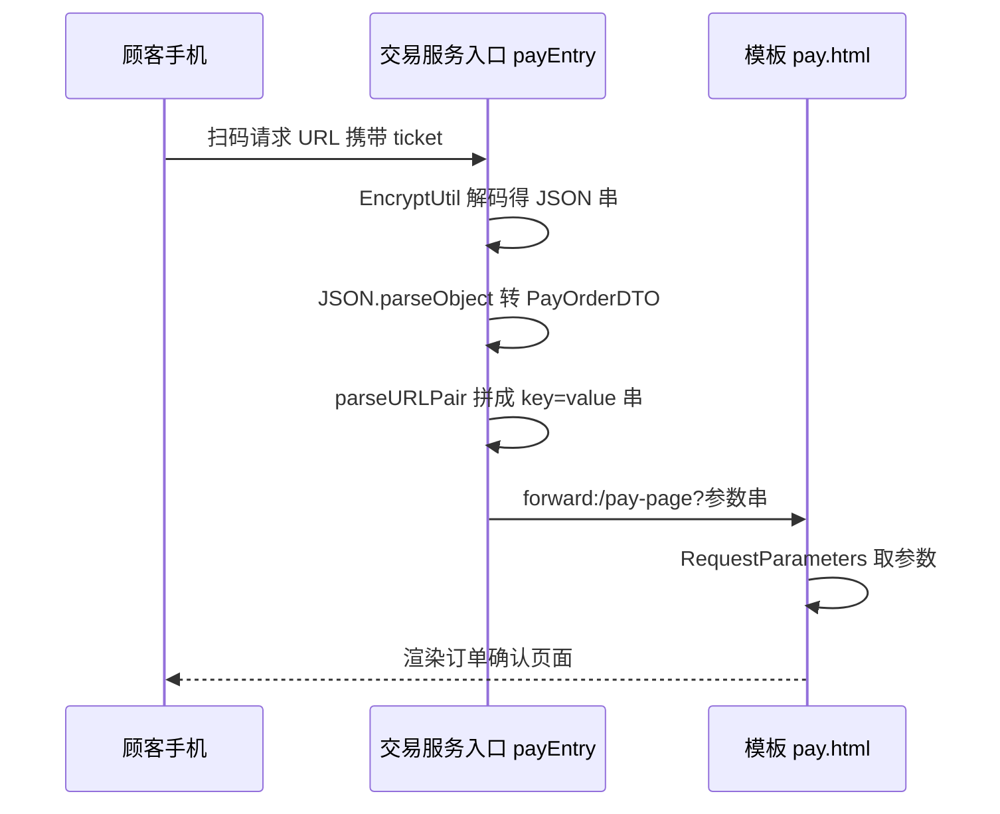
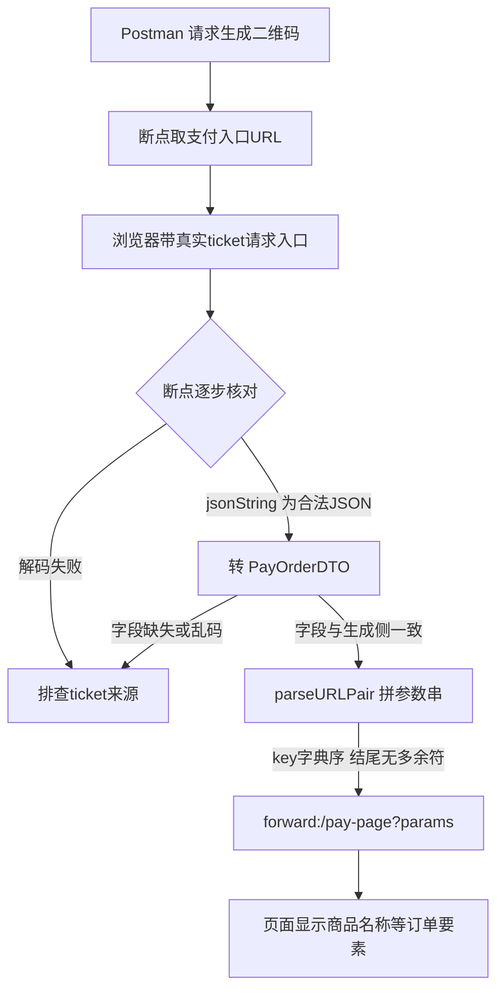

# 支付入口解析 ticket：从 Base64 编码串还原订单信息交给确认页面

确认页面能渲染出来了，但商品名称、订单描述一片空白。空白的原因不在页面，在入口：`payEntry` 目前只做转发，页面需要的订单信息还没有人准备。补齐这件事要动两处代码，还要先想透一个前提。前提是：顾客扫码时 URL 上挂着的 ticket，就是当初生成二维码时编码进去的那串订单要素，入口必须把它原样还原。实现上是三个动作，解码、转对象、拼参数串；测试上有一条纪律，ticket 必须来自真实生成的二维码 URL，随手编一串是解不动的。这一课把生成侧与消费侧的编码契约对上，整条 C 扫 B 的入口链路才算真正闭环。

## 先给结论

- ticket 的本质是 `PayOrderDTO` 序列化成的 JSON 串，先 URL 编码再 Base64 编码的产物；解析按严格对称的顺序还原：Base64 解码、URL 解码、fastjson 反序列化。
- 解码工具是公共工程的 `EncryptUtil.decodeUTF8StringBase64`，与生成侧的 `encodeUTF8StringBase64` 成对出现，编码与解码的顺序互为镜像。
- 交易服务的 `PayOrderDTO` 要用本课资料提供的新版覆盖旧版：旧版字段是为生成二维码场景精简的，新版补齐下单全量要素；同时拷入 `PayOrderConvert`（MapStruct 对象转换），为下单环节备好转换器。
- 对象转 query 参数串用公共工程的 `ParseURLPairUtil.parseURLPair`：反射遍历字段，非空字段拼成 `k=v&k=v`，`TreeMap` 保证 key 字典序。
- `payEntry` 主流程四步：解码得 JSON，`JSON.parseObject` 转 `PayOrderDTO`，`parseURLPair` 拼参数串，`forward:/pay-page?` 加参数串转发；页面用 `${RequestParameters['subject']!}` 一类表达式取到数据。
- 测试闭环：Postman 调生成二维码接口拿真实 URL，浏览器带 ticket 请求入口，断点观察 JSON 串与参数串，页面显示商品名称等订单要素。

## ticket 的来路：理解编码契约

解析之前先把生成侧的口径复述一遍，因为解析的每一步都由它决定。生成门店二维码时，交易服务把商户 id、应用 id、门店 id、商品标题、订单描述、服务类型编码六个要素装进 `PayOrderDTO`，用 fastjson 序列化成 JSON 串，然后调用公共工程的 `EncryptUtil.encodeUTF8StringBase64`：先按 UTF-8 做 URL 编码，再对结果做 Base64 编码，得到一串可以安全放进 URL 的文本，最后把入口前缀和这串文本拼起来返回，前缀之后的全部内容就是 ticket。顾客扫的二维码里存的就是这个完整 URL。

现在站在入口一侧，手里是 ticket，要做的是逆过程。公共工程里成对的解码方法长这样：

```java
/**
 * 将字符串str 先进行base64解码 然后在使用utf-8字符集进行url解码
 * @param str
 * @return
 */
public static String decodeUTF8StringBase64(String str){
    String decoded = null;
    byte[] bytes = Base64.getDecoder().decode(str);

    try {
        decoded = new String(bytes,"utf-8");
        decoded = URLDecoder.decode(decoded, "utf-8");
    }catch(UnsupportedEncodingException e){
        logger.warn("不支持的编码格式",e);
    }
    return decoded;
}
```

方法的注释把顺序写得明明白白：先 Base64 解码，再用 UTF-8 字符集做 URL 解码，与编码侧「先 URL 编码再 Base64」严格互为镜像。顺序为什么不能乱？编码侧先 URL 编码，是为了把 JSON 里的 `+`、`?`、`&` 这类在 URL 里有既有含义的字符转成百分号形式，再整体 Base64 化；解码侧只有先剥掉 Base64 这层外壳，才能用 URL 解码把百分号形式还原回原字符。两层顺序颠倒，还原出来的就是乱码。字符集同理，编码按 UTF-8，解码必须还是 UTF-8，中文标题在字符集不一致时直接变问号。

解码得到的是当初那个 JSON 串。到这里有的读者会想：JSON 串已经拿到了，为什么还要再转对象？两个原因。JSON 串取字段要么靠字符串截取要么靠 Map 取值，类型不安全也不方便传递；而这条链路的下游，入口解析客户端类型、构造下单请求，处处都要用结构化的订单对象。转回 `PayOrderDTO` 之后，字段是强类型的，下游直接复用，不再需要二次转换。当初生成侧选 `PayOrderDTO` 做编码载体，图的就是「二维码携带的是将来下单所需的最小要素集」，解析侧转回同一个对象，契约两端严丝合缝。



时序图里入口内部的三步就是本课的主体实现，最后一步转发把数据交给了模板。值得留意的是 forward 转发不换请求，参数串挂在转发地址上，对模板而言就是同一个请求的 query 参数，取值机制天然成立。

## 补齐数据模型：覆盖 PayOrderDTO 与拷入转换器

转对象的目标类型是 `PayOrderDTO`，但交易服务 api 工程里现有的这版 DTO 不够用了。它是生成二维码环节按需建的，字段只覆盖那六个要素；入口解析之后要继续支撑下单流程，订单号、币种、金额、openId、客户端 IP 这些下单要素全都没有。课程资料提供了一版字段齐全的 `PayOrderDTO.java`，直接覆盖 api 工程 dto 包里的旧文件：

```java
/**
 * 下单请求对象
 */
@Data
public class PayOrderDTO implements Serializable {

    private Long merchantId;//商户id
    private Long storeId;//商户下门店，如果未指定，默认是根门店
    private String appId;//此处使用业务id，服务与服务之间用业务id
    private String channel;//聚合支付的渠道，此处使用渠道编码
    private String tradeNo;//聚合支付平台订单号
    private String outTradeNo;//商户订单号
    private String subject;//商品标题
    private String body;//订单描述
    private String currency;//币种CNY
    private Integer totalAmount;//订单总金额，单位为分
    private String optional;//自定义数据
    private String extra;//特定渠道发起时额外参数
    private String openId;//c端付款用户身份标识
    private String authCode;//付款条码，支付宝或者微信点「付款」产生的付款条码
    private String device;//设备，存放UA等信息
    private String clientIp;//客户端IP

    private String payChannel;//支付渠道
    private String tradeState;//订单状态

    private LocalDateTime createTime;//创建时间
    private LocalDateTime updateTime;//更新时间
    private LocalDateTime expireTime;//订单过期时间
    private LocalDateTime paySuccessTime;//支付成功时间
}
```

字段按生命周期排布很清晰：前半段是下单的输入要素（谁、在哪个门店、什么渠道、买什么、多少钱），后半段是交易过程与结果的记录要素（订单号、状态、各个时间点）。几个语义点值得标注：`totalAmount` 单位是分，用 `Integer`，前端页面输入的元要经过换算才能进来；`openId` 是付款用户的身份标识，微信侧必填、支付宝侧没有；`outTradeNo` 与 `tradeNo` 一个是商户侧订单号一个是平台侧订单号，两个体系各自管理。本课的解析环节只用到其中六个字段，其余字段留给即将到来的下单环节，这正是「一个对象走完整条链」的设计。

资料同时提供了 `PayOrderConvert.java`，MapStruct 转换器接口，拷入交易服务工程的 convert 包：

```java
@Mapper
public interface PayOrderConvert {

    PayOrderConvert INSTANCE = Mappers.getMapper(PayOrderConvert.class);

    PayOrderDTO entity2dto(PayOrder entity);

    PayOrder dto2entity(PayOrderDTO dto);

    //忽略totalAmount，不做映射
    @Mapping(target = "totalAmount", ignore = true)
    PayOrderDTO vo2dto(OrderConfirmVO vo);
}
```

三个方法分别服务三段链路：实体转 DTO、DTO 转实体、页面表单对象转 DTO。第三个方法的入参 `OrderConfirmVO` 是确认页面表单对应的对象，此刻还没有创建，拷贝进来会编译报错，按课程的处置是先把 `vo2dto` 方法临时注释，等下单环节建好 VO 再放开。`ignore = true` 的含义也提前看清：页面传来的金额是元，进 DTO 前必须换算成分，这个字段不能让转换器自动映射，留给出入口代码显式处理。转换器在本课虽然还没被主流程调用，先把家底备齐，是工程上顺手的做法。

## 对象到参数串：ParseURLPairUtil 的反射实现

数据转成了对象，页面却不是直接消费对象的。确认页面里写的是 `${RequestParameters['subject']!}` 这类表达式，`RequestParameters` 取的是请求参数，也就是 URL 问号后面的 `k=v&k=v` 串。所以入口在转发之前，要把 `PayOrderDTO` 的属性和值组成一个 URL 的 key/value 串，拼在转发地址后面。这个转换如果手写，二十多个字段一个一个 get 再拼，啰嗦且容易漏；公共工程里有一个现成的反射工具：

```java
public class ParseURLPairUtil {

    public static String parseURLPair(Object o) throws Exception{
        Class<? extends Object> c = o.getClass();
        Field[] fields = c.getDeclaredFields();
        Map<String, Object> map = new TreeMap<String, Object>();
        for (Field field : fields) {
            field.setAccessible(true);
            String name = field.getName();
            Object value = field.get(o);
            if(value != null)
                map.put(name, value);
        }
        Set<Map.Entry<String, Object>> set = map.entrySet();
        Iterator<Map.Entry<String, Object>> it = set.iterator();
        StringBuffer sb = new StringBuffer();
        while (it.hasNext()) {
            Map.Entry<String, Object> e = it.next();
            sb.append(e.getKey()).append("=").append(e.getValue()).append("&");
        }
        return sb.deleteCharAt(sb.length()-1).toString();
    }
}
```

实现全是 Java 基础技术的组合：`getDeclaredFields` 拿到对象的全部私有字段，`setAccessible(true)` 打开访问权限，逐个取字段名与字段值，值为 null 的字段直接跳过，不为 null 的放进一个 `TreeMap`。用 `TreeMap` 而不是 `HashMap` 是有讲究的：它按 key 的字典序排列，拼出来的参数串顺序稳定，肉眼核对、日志比对、将来若做参数签名都受益于这个确定性。最后遍历拼接 `k=v&`，结尾多出的一个 `&` 用 `deleteCharAt` 删掉，返回干净的字串。对 `PayOrderDTO` 的六个已赋值字段，输出形如 `appId=xxx&body=向某某付款&channel=shanju_c2b&merchantId=1&storeId=1&subject=某某商品`，key 天然按字典序排好。

工具类本身不要求掌握到能手写的程度，它的价值在于把重复劳动收进公共工程，让业务代码保持一行调用的整洁；实现里用到的反射、集合、字符串处理都是学过的技术，有兴趣逐行读一遍反而是一次很好的 Java 基础复习。需要心里有数的边界是：字段值原样拼接，没有做 URL 转义，当前链路里字段内容受服务端控制，页面取参按请求编码解析，中文值在 UTF-8 环境下工作正常；若是将来把不受控内容塞进参数串，转义问题要另行处理。

## payEntry 主流程：四步还原与转发

材料齐备，回到 `PayController` 把入口方法填满：

```java
@Slf4j
@Controller
public class PayController {

    /**
     * 支付入口
     * @param ticket 传入数据，对json数据进行的base64编码
     * @param request
     * @return
     */
    @RequestMapping("/pay-entry/{ticket}")
    public String payEntry(@PathVariable("ticket") String ticket, HttpServletRequest request) throws Exception {
        //1、准备确认页面所需要的数据
        String jsonString = EncryptUtil.decodeUTF8StringBase64(ticket);
        //将json串转成对象
        PayOrderDTO payOrderDTO = JSON.parseObject(jsonString, PayOrderDTO.class);
        //将对象的属性和值组成一个url的key/value串
        String params = ParseURLPairUtil.parseURLPair(payOrderDTO);
        //2、解析客户端的类型（微信、支付宝），此处为后续环节预留
        return "forward:/pay-page?" + params;
    }
}
```

四步串起来读。第一步解码，`@PathVariable` 接住的 ticket 还给成 JSON 串；第二步 `JSON.parseObject` 反序列化成 `PayOrderDTO`，fastjson 按字段名装配，当初编码进去的六个要素全部归位；第三步 `parseURLPair` 把对象拼成参数串；第四步转发到 `/pay-page`，参数串以 query 形式跟随。转发之后，模板里的 `${RequestParameters['subject']!}` 从请求参数里取出商品标题，顶部区块显示出来；隐藏域把 `appId`、`channel` 等要素带回表单；金额输入框空着等用户填写，因为生成二维码时本来就没有金额，这正是 C 扫 B「顾客自己输入付款金额」的产品形态。

方法的 `throws Exception` 来源于 `parseURLPair` 的方法签名，它声明抛出反射相关的受检异常。入口是面向公网用户的门面，解析失败意味着 ticket 非法或被篡改，这类场景的统一出口是把用户引向错误页面，工程上通常在这里补上 try/catch 转发到错误视图，配合已注册的 `pay_error` 视图；课程在此处先保持主干清晰，异常收口随客户端类型解析一起完善。

## 测试：用真实生成的 ticket 走通全链

测试有一条前置纪律：ticket 不能编。Base64 解码对输入是挑剔的，随手敲的字符串解不出合法 JSON，后面每一步都会连带失败，测不出任何有效结论。测试的第一步是制造一个真实的 ticket。

生成 URL 的动作复用商户平台应用的二维码接口：Postman 登录商户账号拿 token，请求生成二维码接口，返回的 base64 图片串前面那段就是入口 URL；更直观的办法是在交易服务的 `createStoreQRCode` 方法里打断点，Postman 触发请求后，调试器变量窗口里能看到拼好的支付入口 URL，整串复制出来。两条路拿到的是同一个东西：入口前缀加 ticket。

第二步让请求真正走进入口。交易服务带着新代码重启，浏览器地址栏粘贴刚才的 URL 发起访问；在 `payEntry` 方法入口提前打好断点，请求进来时程序停在第一行。单步往下走，每一步都有一个核对点：

- 解码后的 `jsonString` 应当是一个 JSON 对象串，形如 `{"appId":"xxx","body":"向某某付款","channel":"shanju_c2b","merchantId":1,"storeId":1,"subject":"某某商品"}`，六个字段与生成时组装的完全一致；
- 反序列化后的 `payOrderDTO` 各字段在调试器里逐个可见，重点核对 `channel` 是 `shanju_c2b`、标题内容是中文原样而非乱码；
- `params` 参数串的 key 按字典序排列，`appId` 打头，结尾没有多余的 `&`；
- 放行断点，浏览器收到渲染完成的确认页面。

第三步核对页面。顶部区块显示商品名称，表单里商品名称与订单描述回填，金额输入框空白可输，按钮就位。页面上这行商品名称的来源可以倒着追：模板 `${RequestParameters['subject']!}`，请求参数 `subject`，参数串里的 `subject=某某商品`，参数串来自对象属性，对象来自 ticket。生成侧编码的字段与解析侧展示的字段在页面上重逢，编码契约被两个方向的代码共同兑现。



图上两条失败路径都指向同一个排查起点：ticket 的来源。真实链路里解析失败的原因几乎总是「用了旧 URL 或手改过 ticket」，生成侧的数据是准的。测试全部通过后，入口的「数据准备」职责完成，剩下的「解析客户端类型」属于入口的另一项职责：识别扫码者是微信还是支付宝，决定直接进收银台还是先走授权码获取，那是紧随其后的实现环节。

## 设计复盘：ticket 为什么这样设计

把链路跑通之后再回头看两个设计决策，理解会更深。第一个决策：订单要素随 URL 走，不落在数据库或 Redis 里中转。二维码是打印出来挂在墙上的，可能一个月后被扫，也可能同时被一百个人扫，生成那一刻的会话早就不存在了；把订单要素放进 ticket，URL 自包含，任何时间任何设备扫进来都能完整还原，服务端不用为「可能永远不被扫的码」维护状态，这就是无状态设计在支付场景的价值。入口解析出要素后按归属关系去查库核对，数据真实有效才继续走流程。

第二个决策：Base64 不承担安全职责。ticket 任何人都能解开，里面也没有加密的必要，它的职责只是让结构化数据安全穿越 URL。真正的防线在服务端：生成前的应用与门店归属校验，解析后的要素与库内数据核对，伪造的要素在数据库里对不上号就走不下去。编码管传输，校验管安全，两个问题两层方案，混为一谈反而会漏防。

## 常见误区

- **解码顺序与编码侧写反。** 错例：先 URL 解码再 Base64 解码，还原出乱码或直接抛异常。正解：严格镜像编码顺序，`decodeUTF8StringBase64` 内部先 Base64 后 URL 解码，字符集两侧同为 UTF-8。
- **测试时手编 ticket。** 错例：在入口地址后面随手粘一段字符串或拿旧 URL 测试，解码失败还以为是解析代码有错。正解：ticket 必须来自刚生成的二维码 URL，用断点或接口响应原样复制，排查时先怀疑来源再怀疑代码。
- **拿着 JSON 串直接转发。** 错例：`forward:/pay-page?data=` 加 JSON 串，页面取不到结构化数据。正解：转成对象后用 `parseURLPair` 拼成 `k=v` 参数串，页面按 `RequestParameters` 的取参契约逐字段获取。
- **忘了覆盖旧版 PayOrderDTO。** 错例：继续用生成二维码时的精简 DTO，解析出的对象缺 `outTradeNo`、`totalAmount` 等字段，下单环节才发现要返工。正解：用本课资料提供的新版覆盖 api 工程旧文件，字段一次备齐。
- **转换器拷进来没处理编译错误。** 错例：`PayOrderConvert` 里的 `vo2dto` 引用尚不存在的 `OrderConfirmVO`，编译失败后随手删方法。正解：暂时注释该方法，下单环节建好 VO 后放开，`totalAmount` 的忽略映射保持不动。
- **把参数串的拼接理解成通用转义方案。** 错例：以为 `parseURLPair` 能处理任意内容，把用户输入原样拼进转发地址。正解：该工具面向服务端受控字段，值不做 URL 转义；面向不受控内容时需先做转义或改走服务端中转。

## 面试可能被问到的问题

1. 面试官追问：「订单信息为什么要编码进 ticket 随 URL 传递，而不是存 Redis 用一个 id 引用？」
   答：二维码是离线载体，生成之后可能很久才被扫，也可能被无数人重复扫，服务端为每个码维护状态既浪费又不可靠。ticket 让 URL 自包含，扫码即还原，服务零状态；同时生成码与扫码天然是两个独立会话，引用方案反而需要处理过期与并发。要素的真实性靠解析后查库核对保证，不靠编码层。
2. 面试官追问：「Base64 解码和 URL 解码的顺序为什么不能颠倒？」
   答：编码侧是先 URL 编码再 Base64，目的分别是消除 URL 特殊字符歧义和得到传输安全的字符集。解包必须从最外层开始：先 Base64 还原出「URL 编码形态」的字符串，再 URL 解码还原特殊字符。顺序颠倒等于先拆内层再拆外层，必然解不出原文，这是所有多层编码的通用规律。
3. 面试官追问：「ParseURLPairUtil 用反射拼参数串，性能和类型安全上你怎么评价，有什么替代方案？」
   答：反射遍历字段有一次性的元数据开销，单请求几十个字段的量级完全可以忽略；代价是字段名错误只能运行期发现。替代方案有手写拼接（直观但字段多时易漏）、转 Map 后拼接、MapStruct 映射。项目选反射工具的意义在于一处实现全局复用，订单字段增减时参数串自动跟随，维护成本最低。
4. 面试官追问：「forward 携带 query 参数，浏览器地址栏会变吗？参数安全吗？」
   答：forward 是服务端内部转发，地址栏停留在入口 URL，用户看不到 `/pay-page?params`，这对用户体验和安全都有利：订单要素不暴露在地址栏，也无法被收藏或篡改后重放。参数只在这次请求内部有效，模板通过 RequestParameters 取到，请求结束即消失，不会污染后续请求。
5. 面试官追问：「ticket 被篡改了会怎样？系统有哪些防线？」
   答：篡改者可以解开 ticket 改字段再编码，但防线不在编码层。生成前有应用与门店的归属校验，解析后入口要用这些要素去查渠道参数与商户配置，改过的应用 id、门店 id 在库里对不上就推进不下去；金额这类关键字段不进 ticket，由用户在确认页输入并经服务端校验。敏感数据如密钥从不放进 ticket，泄露面从一开始就被控制住。
6. 面试官追问：「TreeMap 在这个工具类里的作用是什么，换成 HashMap 行不行？」
   答：TreeMap 按 key 字典序输出参数串，顺序稳定可预期，日志核对、问题排查、将来做参数签名都以稳定顺序为前提。换成 HashMap 功能上也能拼出串，但顺序随哈希分布漂移，同一笔交易两次生成的参数串可能不同，比对和签名都会引入不确定性。这类「顺序即契约」的场景，有序容器是正确选择。

## 配套资料

- 讲义：`materials/docs/10/闪聚支付-第3章-C扫Bv1.1.md`，4.3.2 页面完善之 4.3.2.1 解析ticket（拷贝 `PayOrderDTO.java`、`PayOrderConvert.java` 到交易服务工程，解析代码：Base64 还原、转对象、转 url 格式、forward 携带参数）为本课出处；测试流程对应生成门店二维码接口复用与入口请求跟踪。
- 代码：`materials/code/10/完整代码/完整代码/` 归档中，交易服务工程的 `controller/PayController.java`（`payEntry` 解析与转发）、公共工程的 `util/EncryptUtil.java`（`decodeUTF8StringBase64`）、`util/ParseURLPairUtil.java`（反射拼参数串）、`convert/PayOrderConvert.java`（MapStruct 三方法）、api 工程的 `PayOrderDTO.java`（全量字段）均为真实文件；`materials/code/10/_散落资料/` 归档另含资料分发的 `PayOrderDTO.java`、`PayOrderConvert.java`、`pay.html` 等单文件版本；`materials/code/10/基准代码/zip/` 归档含对应基准版本。正文代码为按 `com.study.pay` 系口径改写后的节选（归档内层工程目录与包名为课程原始命名，不在此展开）。
- 说明：该阶段课程资料归档在 `materials/docs/10/` 与 `materials/code/10/`（不存在 09 编号目录），引用路径截至该层级；入口前缀域名按博客口径以 `example.com` 占位，课程原值为内网网关地址。
