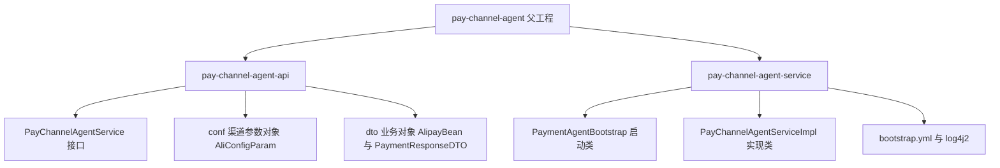
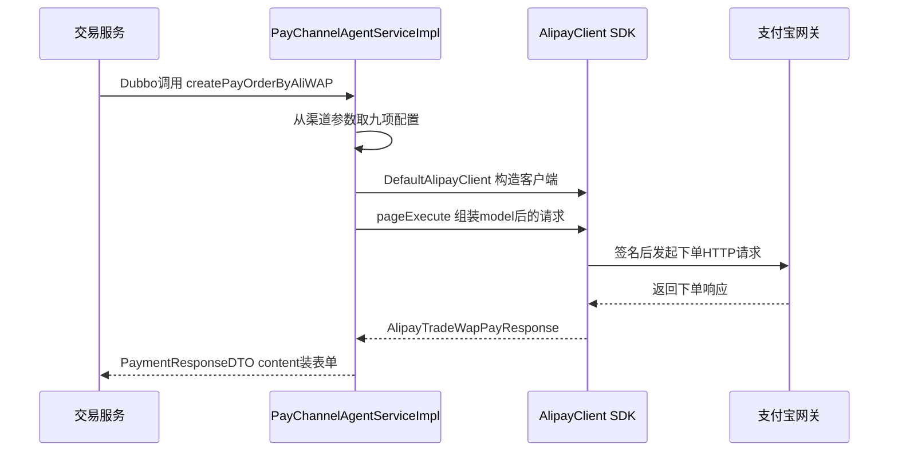

# 支付渠道代理服务落地：工程导入配置，支付宝下单接口的定义与实现

立即支付的需求分析定了链路：交易服务收请求、存订单，然后把支付宝下单这件事托付给支付渠道代理服务。现在轮到代理服务登场，它在本章之前只存在于流程图里，工程都还没有。这一课把两件事连着做完：把代理服务的工程从资料导入进来、接上配置；把支付宝下单接口定义出来并实现完整。定义与实现分开讲是有意的，接口定义阶段要回答「这个接口凭什么长这样」，实现阶段要回答「支付宝 SDK 怎么被正确地用起来」，两个问题各自的坑都不算少。

## 先给结论

- 支付渠道代理服务是双工程结构：`pay-channel-agent-api` 定义接口与 DTO，`pay-channel-agent-service` 实现接口，Dubbo 服务；工程从课程资料整体导入，启动类与初始代码都已就位。
- 配置三件事：`bootstrap.yml` 的 namespace 换成自己的 dev 命名空间 ID，服务名 `pay-channel-agent-service`，端口 56070，Dubbo 端口 20896；Nacos 新增服务主配置 `pay-channel-agent-service.yaml`（Group 为 `PAY_GROUP`），暂时只覆盖 context-path `/payment-receiver`。
- 定接口的方法论：先定职责，再由职责反推入参与返回。本接口职责是调用支付宝手机网站支付下单接口，入参因此分两类，渠道参数 `AliConfigParam`（网关、appId、密钥、公钥、编码、格式、签名算法、回调地址）与业务订单参数 `AlipayBean`（订单号、标题、金额、描述、过期时间、产品码），返回统一用 `PaymentResponseDTO<T>`。
- 实现套路固定：从渠道参数取出九项配置，构造 `DefaultAlipayClient`，组装 `AlipayTradeWapPayRequest` 与 `AlipayTradeWapPayModel`，`pageExecute` 发起请求，响应体放进 `content` 返回；异常翻译为 `BusinessException(CommonErrorCode.E_400002)`。
- `setBizModel` 传对象优于 `setBizContent` 拼 JSON 串，字段名与引号错误在编译期就能暴露。
- 金额单位契约：平台内部用分，支付宝下单接口要求元，`AlipayBean.totalAmount` 以元为单位，由交易服务在调用前完成换算。

## 工程落地：导入、配置与启动类

支付渠道代理服务与企业里的大多数工程一样，不是从空目录开始手搭的。有支付需求的微服务统一通过代理服务调用第三方支付系统，这个定位决定了它的骨架早就该有，课程资料提供了完整工程目录，要做的只是导入。把 `pay-channel-agent` 目录复制到聚合支付工程的根目录，打开 IDEA 的 Project Structure，通过 Modules 窗口依次导入三个 Maven 工程：父工程与两个子工程。导入时 SDK 选 1.8，依赖按 `.iml` 配置确认即可。这套动作值得练熟，企业开发中接手存量工程是常态，从 Git 上把工程拉下来导入开发环境，比从零搭建常见得多。

导入后的结构一张图说清：



api 工程里已经有现成的类型：渠道参数对象、业务对象、统一响应对象，导入时一并就位，本课只补接口方法。service 工程里启动类 `PaymentAgentBootstrap` 也已存在，此刻可以先不启动，配置接好再跑。

配置分工程内与 Nacos 两侧。工程内的 `bootstrap.yml` 关键段落如下（namespace 按自己环境替换）：

```yaml
server:
  port: 56070 #启动端口

spring:
  application:
    name: pay-channel-agent-service
  cloud:
    nacos:
      discovery:
        server-addr: ${nacos.server.addr}
        namespace: your-dev-namespace-id
      config:
        server-addr: ${nacos.server.addr} #配置中心地址
        file-extension: yaml
        namespace: your-dev-namespace-id #替换为自己创建的dev命名空间ID
        group: PAY_GROUP
        ext-config:
          - refresh: true
            data-id: spring-boot-http.yaml #通用HTTP配置
            group: COMMON_GROUP
          - refresh: true
            data-id: spring-boot-freemarker.yaml
            group: COMMON_GROUP
          - refresh: true
            data-id: spring-boot-starter-rocketmq.yaml
            group: COMMON_GROUP

dubbo:
  scan:
    base-packages: com.study.pay
  protocol:
    name: dubbo
    port: 20896
  registry:
    address: nacos://127.0.0.1:8848
  application:
    qos:
      port: 22270
  consumer:
    check: false
    timeout: 3000
```

结构与其他服务完全同款，差异只有数值：服务端口 56070、Dubbo 端口 20896、qos 端口 22270，与本机其他服务错开。最容易漏的一步在 namespace：资料里的 ID 是教师环境的，照抄会把服务注册进别人的命名空间，必须换成自己在 Nacos 创建的 dev 命名空间 ID，发现与配置两处都要改。

Nacos 侧为代理服务建服务主配置，Data ID 是服务名加扩展名即 `pay-channel-agent-service.yaml`，Group 选项目业务组 `PAY_GROUP`，格式 YAML。当前这个服务还是个纯粹的 Dubbo 提供方，暂时只需要覆盖访问路径一项：

```yaml
server:
  servlet:
    context-path: /payment-receiver
```

`/payment-receiver` 这个路径是为后续预留的，支付结果异步通知类请求将按它进入本服务，现阶段先立住配置骨架，内容随课程推进再加。发布之后启动 `PaymentAgentBootstrap`，服务注册进 Nacos，工程落地完成。

## 定接口：职责先行，参数与返回随后

接口不是拍脑袋定出来的。代理服务要暴露很多接口分别对接微信与支付宝，因为两家渠道的接口协议、参数结构、下单流程全都不同，交易服务会根据扫码客户端的类型选择调用哪个：微信扫码调微信下单接口，支付宝扫码调支付宝下单接口。所以现在要定义的，是其中面向支付宝的那一个。按课堂反复强调的顺序自问三句：这个接口的职责是什么？要满足职责需要哪些数据？处理完返回什么？

**职责：** 调用支付宝手机网站支付的下单接口，替平台完成一笔支付宝侧的订单创建。手机网站支付即此前调研选定的 C 扫 B 产品，接口形态早已研究过，当初在交易服务里还写过直连支付宝的测试代码，参数清单就是从那时积累下来的。

**数据：** 把测试代码里的参数摊开，能清晰地分成两摞。一摞是身份类参数，`app_id`、应用私钥、支付宝公钥、签名算法、数据格式、编码、网关地址，这些是开通沙箱环境后渠道分配给应用的，还记得支付渠道参数配置那一课往表里随手填的 appId 和密钥吗，当时占位的就是它们，如今在下单接口里全部派上用场。另一摞是业务订单参数，`out_trade_no` 商户订单号、`subject` 订单标题、`total_amount` 订单金额、`body` 订单描述、`timeout_express` 过期时间，这些描述「这笔订单买什么、多少钱、多久有效」。讲义给支付宝接口的参数表按必填与否、最大长度逐项标注，公共参数与业务参数分表列出，两类参数在表格里颜色分组，SDK 自动设置的项无需关心，代理服务要处理的就是上述两摞。

**返回：** 渠道下单的响应内容要原样传回调用方，同时调用方还需要知道这次调用本身成功与否。项目为此定义了统一的支付响应类型，api 工程里现成的 `PaymentResponseDTO<T>`：

```java
@Data
@AllArgsConstructor
@NoArgsConstructor
@ApiModel(value = "PaymentResponseDTO", description = "支付响应信息")
public class PaymentResponseDTO<T> implements Serializable {

    private String code = "0"; //系统状态 "0"代表请求成功
    private String msg;
    private String tradeNo;//原始渠道订单号
    private String outTradeNo;//商户订单号
    private TradeStatus tradeState;//支付状态
    private T content;

    public static <T> PaymentResponseDTO<T> success(T content) {
        PaymentResponseDTO<T> response = new PaymentResponseDTO<T>();
        response.setContent(content);
        return response;
    }

    public static <T> PaymentResponseDTO<T> validfail(String msg) {
        PaymentResponseDTO<T> response = new PaymentResponseDTO<T>();
        response.setCode("999999");
        response.setMsg(msg);
        return response;
    }
}
```

设计上最值得学的是泛型字段 `content`。下单、查询、通知，渠道给什么就往 `content` 里装什么，支付宝下单响应是一段表单文本就装 `String`，查询响应是结构化结果就装对应类型，一个响应类覆盖全部渠道场景，不必每对接一个接口就造一个返回类。`code` 默认 `"0"` 表示请求成功，失败时置为错误码并填 `msg`；`tradeNo` 与 `outTradeNo` 一个是渠道侧订单号一个是平台侧订单号，查询与对账场景才用得上，下单时留空。配套的枚举 `TradeStatus` 定义了 `SUCCESS`、`FAILED`、`UNKNOWN`、`USERPAYING`、`REVOKED` 五种状态，同样是为全渠道统一而设。

## 两个入参对象与接口签名

参数的两摞分类直接落成两个入参对象，都是 api 工程现成的类型。第一摞渠道参数装进 `AliConfigParam`：

```java
@Data
public class AliConfigParam implements Serializable {
    //应用id
    public String appId;
    //私钥
    public String rsaPrivateKey;
    //异步回调通知
    public String notifyUrl;
    //同步回调通知
    public String returnUrl;
    //支付宝网关
    public String url;
    //编码方式 UTF-8
    public String charest;
    //格式JSON
    public String format;
    //ali公钥
    public String alipayPublicKey;
    //日志保存路径，目前不用
    public String logPath;
    //RSA2 签名算法类型
    public String signtype;
}
```

十个字段与渠道参数配置表里配置的项一一对应，将来由交易服务从配置或缓存中查出，作为第一个入参传进来。有一个细节要先打招呼：编码字段的拼写是 `charest`，这是工程里的原样写法，getter 相应为 `getCharest()`。它不是标准英文，读代码时容易看走眼，实现时千万别顺手写成 `getCharset()`，那会直接编译失败；同理，若要修正拼写，两端必须同步改动，对已被序列化传输的字段更应保守。

第二摞业务订单参数装进 `AlipayBean`：

```java
@Data
@ToString
public class AlipayBean implements Serializable {

    private String outTradeNo;  //商户订单号，必填
    private String subject;     //订单名称，必填
    private String totalAmount; //付款金额，必填
    private String productCode; //产品编号，必填
    private String body;        //商品描述，可空
    private String expireTime;  //超时时间参数
    private Long storeId;       //门店id
    private String attach;      //订单附加数据
}
```

两个对象的类型选择都有说法。`totalAmount` 用 `String` 而非数值类型：金额在传输与展示环节天然是文本形态，避免浮点精度问题，用 `String` 承载再由使用方按需转换是支付领域的常见做法；`storeId` 用 `Long`，它是平台内部的主键，附在业务对象里便于渠道侧回调时定位门店；`attach` 预留给需要随单透传的附加数据。`outTradeNo` 是整个关联体系的锚点，平台订单号作为商户订单号传给支付宝，后续凭证、异步通知、对账全靠它对号入座。

接口本身定义在 api 工程的 `PayChannelAgentService` 中，该接口承担与第三方支付渠道交互的全部职责，本课添加支付宝下单方法：

```java
/**
 * 与第三方支付渠道进行交互
 */
public interface PayChannelAgentService {

    /**
     * 调用支付宝手机WAP下单接口
     * @param aliConfigParam 支付渠道配置的参数（配置的支付宝的必要参数）
     * @param alipayBean 业务参数（商户订单号，订单标题，订单描述...）
     * @return 统一返回PaymentResponseDTO
     * @throws BusinessException
     */
    public PaymentResponseDTO createPayOrderByAliWAP(AliConfigParam aliConfigParam, AlipayBean alipayBean) throws BusinessException;
}
```

方法名 `createPayOrderByAliWAP` 里的 WAP 指手机网站支付，名字长一点，但渠道、产品、动作三层语义都在里面。javadoc 把两个入参的语义写死在接口上：第一个是渠道配置参数，第二个是业务订单参数。抛出的是项目统一的 `BusinessException`，与全系统的异常口径一致。到这里接口契约完全定型，值得回看一眼方法论的闭环：职责决定了「调支付宝 WAP 下单」，于是必须要有渠道身份参数与业务订单参数，于是有了两个入参对象；职责的产物是渠道响应，于是有了泛型 `content` 的统一返回。拿到任何一个新需求定接口，都可以走同一条推理链。

## 接口实现：SDK 客户端、请求模型与响应收口

实现类放在 service 工程的 service 包，命名 `PayChannelAgentServiceImpl`。类上挂的是 Dubbo 的 `@Service` 注解，它与 Spring 的同名注解极易混淆，工程惯例是写全限定名以示区分，这个接口将被交易服务远程调用，走的正是 Dubbo 通道。实现的第一步是把此前研究支付宝接口时写的测试代码拷进来改造，企业里复用既有验证过的代码提升效率，前提是改造得彻底：测试代码里写死的常量全部换成入参，测试专用的输出语句全部换成业务逻辑。

```java
@org.apache.dubbo.config.annotation.Service
@Slf4j
public class PayChannelAgentServiceImpl implements PayChannelAgentService {

    /**
     * 调用支付宝手机WAP下单接口
     * @param aliConfigParam 支付渠道配置的参数
     * @param alipayBean 业务参数（商户订单号，订单标题，订单描述...）
     * @return 统一返回PaymentResponseDTO
     */
    @Override
    public PaymentResponseDTO createPayOrderByAliWAP(AliConfigParam aliConfigParam, AlipayBean alipayBean) throws BusinessException {
        log.info("支付宝请求参数：{}", alipayBean.toString());
        //支付宝渠道参数
        String gateway = aliConfigParam.getUrl();//支付宝下单接口网关地址
        String appId = aliConfigParam.getAppId();//appid
        String rsaPrivateKey = aliConfigParam.getRsaPrivateKey();//应用私钥
        String format = aliConfigParam.getFormat();//数据格式json
        String charest = aliConfigParam.getCharest();//字符编码
        String alipayPublicKey = aliConfigParam.getAlipayPublicKey();//支付宝公钥
        String signtype = aliConfigParam.getSigntype();//签名算法类型
        String notifyUrl = aliConfigParam.getNotifyUrl();//支付结果异步通知地址
        String returnUrl = aliConfigParam.getReturnUrl();//支付完成跳转地址

        //支付宝sdk客户端
        AlipayClient client = new DefaultAlipayClient(gateway, appId, rsaPrivateKey,
                format, charest, alipayPublicKey, signtype);
        //封装请求支付信息
        AlipayTradeWapPayRequest alipayRequest = new AlipayTradeWapPayRequest();
        AlipayTradeWapPayModel model = new AlipayTradeWapPayModel();
        model.setOutTradeNo(alipayBean.getOutTradeNo());//平台订单号
        model.setSubject(alipayBean.getSubject());//订单标题
        model.setTotalAmount(alipayBean.getTotalAmount());//订单金额，单位元
        model.setBody(alipayBean.getBody());//订单内容
        model.setTimeoutExpress(alipayBean.getExpireTime());//订单过期时间
        model.setProductCode("QUICK_WAP_PAY");//产品码，手机网站支付固定值
        alipayRequest.setBizModel(model);
        //设置异步通知地址与同步跳转地址
        alipayRequest.setNotifyUrl(notifyUrl);
        alipayRequest.setReturnUrl(returnUrl);
        try {
            //调用SDK提交表单，发起http请求
            AlipayTradeWapPayResponse response = client.pageExecute(alipayRequest);
            log.info("支付宝手机网站支付预支付订单信息：{}", response);
            PaymentResponseDTO res = new PaymentResponseDTO();
            res.setContent(response.getBody());
            return res;
        } catch (Exception e) {
            e.printStackTrace();
            throw new BusinessException(CommonErrorCode.E_400002);//支付宝确认支付失败
        }
    }
}
```

实现按动作分四段读。**第一段取参数。** 九个局部变量从 `aliConfigParam` 逐项取出，每个都带注释说明用途，取值顺序与 SDK 构造参数的顺序对应，书写时对着注释一项项核，课上演示时就因为取错一位参数导致后续调用失败，密钥这类参数错一位就是调不通。**第二段建客户端。** `DefaultAlipayClient` 的七个构造参数依次是网关、appId、应用私钥、数据格式、编码、支付宝公钥、签名算法。私钥用于对请求签名，公钥用于对支付宝的响应验签，一对钥匙各管一个方向，谁也不能少。客户端对象当前每次请求都新建，官方客户端本身线程安全且开销可控，后续优化时可以按应用缓存复用。**第三段组请求。** `AlipayTradeWapPayRequest` 是请求载体，业务参数装在 `AlipayTradeWapPayModel` 里再 `setBizModel` 挂上去。SDK 同时提供 `setBizContent` 直接收 JSON 字符串，两种写法效果等价，选 model 的理由很实际：对象属性有类型有名字，字段拼错编译期就报错，而手工拼 JSON 串多一个引号少一个逗号都要等运行期才能发现。`productCode` 写死 `QUICK_WAP_PAY`，这是手机网站支付的产品码，协议固定值，不随订单变化；`timeoutExpress` 对应订单过期时间，格式如 `90m`，决定订单在渠道侧多久未付自动关闭。**第四段收响应。** `pageExecute` 同步调用支付宝网关，返回的 `AlipayTradeWapPayResponse` 里，`getBody()` 是自动提交的表单 HTML，整段放进 `PaymentResponseDTO.content` 返回。将来交易服务拿到 content 直接写给前端，浏览器执行表单自动提交，支付宝收银台弹起。

异常收口在 catch 块里：任何调用异常都不能静默吞掉，`printStackTrace` 留下现场后必须抛出 `BusinessException(CommonErrorCode.E_400002)`。这个错误码是本课在公共错误码枚举的支付渠道代理服务段新增的，同段还有 `E_400001` 微信确认支付失败，两个渠道各占一个码，排障时一眼定位是哪家渠道出的问题。返回值不带支付状态字段是有意的：下单成功时状态必然是「待支付」，渠道响应体本身已含全部凭据，状态留给查询接口去填充。

整条调用路径用时序图收拢：



图中最右侧的一次 HTTP 往返是全部复杂度的所在，签名、验签、序列化都被 SDK 封装，代理服务的实现因此只剩「取参数、组模型、调客户端、收响应」四个干净的动作，这正是接入层代码应有的样子。

还有一条暗线值得点破：渠道参数为什么作为入参传入，而不是让代理服务自己去库里查？支付渠道参数是商户与应用级的数据，存在商户侧的参数表里，并在此前的缓存课程中进入了 Redis，按应用与服务类型即可查出。把「查出参数」留给交易服务，「使用参数」留给代理服务，代理服务就不必依赖商户库与缓存细节，保持纯粹的协议适配层；参数随请求传入，天然支持多商户多应用，不同应用各自的密钥互不干扰。此时代理服务还没有调用方，端到端的联调要等交易服务的下单接口就位后才能做，那正是下一课的内容。另外后续课程引入消息队列后，这里还会在下单成功后补发一条用于查询支付结果的消息，当前版本先保持主干。

## 常见误区

- **业务参数用 `setBizContent` 手拼 JSON 串。** 错例：`"{'out_trade_no':'...','total_amount':'...'}"` 一串引号嵌套拼出来，字段名打错、逗号遗漏都要到运行期才炸。正解：用 `AlipayTradeWapPayModel` 装字段后 `setBizModel`，编译器替你检查字段名与类型。
- **金额单位传错。** 错例：把平台内部的分直接塞进 `totalAmount`，用户付 1 元渠道却建了 100 元的单。正解：支付宝下单接口以元为单位，`AlipayBean.totalAmount` 的契约是元，平台持有分，换算动作落在交易服务调用之前。
- **想当然拼写渠道参数 getter。** 错例：编码字段按直觉调 `getCharset()`，工程里字段实为 `charest`，编译直接失败。正解：以工程字段定义为准 `getCharest()`，若决定修正拼写必须两端同步，并确认无序列化兼容问题。
- **渠道参数写死在代理服务里。** 错例：appId 与私钥作为常量写在实现类中，换应用要改代码。正解：渠道参数属于商户与应用级配置，由调用方查出后随请求传入，代理服务保持无状态适配层，天然支持多应用。
- **异常只打印不抛出。** 错例：catch 里 `printStackTrace` 后返回一个空 content 的响应对象，调用方拿到空表单还以为成功。正解：打印现场后抛 `BusinessException(CommonErrorCode.E_400002)`，让调用方明确感知下单失败并走失败分支。
- **为每次响应自造返回类型。** 错例：下单接口返回自己定义的 Map 或专用 DTO，查询接口再造一个。正解：统一 `PaymentResponseDTO<T>`，系统状态、双订单号、支付状态、泛型 content 各司其职，全渠道全接口一个返回契约。

## 面试可能被问到的问题

1. 面试官追问：「定义一个服务接口，你的方法论是什么？」
   答：三步。先一句话说清职责，职责说不清说明需求没理解透；再由职责反推入参，把参数按来源分类，本课的接口就分出渠道身份参数与业务订单参数两摞；最后定返回，优先用系统统一的响应类型，渠道差异收进泛型字段。职责、数据、返回三者对齐，接口契约自然成立。
2. 面试官追问：「`DefaultAlipayClient` 七个构造参数分别是什么？哪些最关键？」
   答：网关地址、应用 appId、应用私钥、数据格式、编码、支付宝公钥、签名算法。最关键的是一对密钥：私钥用于请求签名，证明请求来自合法应用；公钥用于响应验签，确认响应确实来自支付宝。两者方向相反、不可互替，配错任何一个都会在调用或回调环节失败。
3. 面试官追问：「`setBizModel` 和 `setBizContent` 有什么区别，生产代码该用哪个？」
   答：`setBizContent` 接收 JSON 字符串，`setBizModel` 接收 SDK 定义的模型对象，最终序列化结果等价。生产代码用 model：字段名与类型由编译器检查，重构时改名有工具支持，可读性也远好于嵌套引号的字符串。拼串写法只适合快速验证场景。
4. 面试官追问：「渠道参数为什么由调用方传入而不是代理服务自己查库？」
   答：渠道参数是商户与应用级数据，代理服务自己查就要依赖商户库或缓存，协议适配层掺进了数据访问职责。参数随请求传入后，代理服务无状态、可水平扩容，多商户多应用的密钥隔离天然成立，参数的正确性与缓存策略由交易服务负责，职责边界干净。
5. 面试官追问：「金额字段为什么用 String 传元，而不是 long 分或 BigDecimal？」
   答：支付宝接口协议以元为单位的字符串接收金额，入参对象对齐协议用 String 最直接；支付领域忌讳浮点类型，float 与 double 的精度误差会直接造成金额错误。平台内部以 long 分做计算，边界处显式换算并格式化成元字符串，两头各自守约，换算点集中可控。
6. 面试官追问：「Dubbo 的 `@Service` 与 Spring 的 `@Service` 同名，怎么避免用错？」
   答：实现类上用全限定名 `org.apache.dubbo.config.annotation.Service` 书写，一眼可辨；配错的症状很典型，Spring 注解会让类成为普通 Bean 但服务不发布，消费方找不到提供者。团队也可以在代码规范里禁用裸 import，扫描工具统一检查。

## 配套资料

- 讲义：`materials/docs/10/闪聚支付-第3章-C扫Bv1.1.md`，5.2 搭建支付通道代理工程（工程构成、导入步骤、Nacos 配置与 namespace 替换）、5.3 支付渠道代理服务支付宝下单、5.3.1.1 支付宝接口参数（公共参数与业务参数表）、5.3.1.2 接口定义（`PayChannelAgentService.createPayOrderByAliWAP`）、5.3.2 接口实现（SDK 客户端构造与 `pageExecute` 全量实现）为本课出处。
- 代码：`materials/code/10/完整代码/完整代码/` 归档中，支付渠道代理服务 api 工程的 `PayChannelAgentService.java`、`conf/AliConfigParam.java`、`dto/AlipayBean.java`、`dto/PaymentResponseDTO.java`、`dto/TradeStatus.java`，service 工程的 `PayChannelAgentServiceImpl.java`（`createPayOrderByAliWAP`）、`PaymentAgentBootstrap.java`、`resources/bootstrap.yml`（端口 56070 与 Dubbo 20896 为真实配置）均为真实文件；`materials/code/10/基准代码/zip/` 归档含同一套文件的基准版本。正文代码为按 `com.study.pay` 系口径改写后的节选（归档内层工程目录与包名为课程原始命名，不在此展开）。
- 说明：该阶段课程资料归档在 `materials/docs/10/` 与 `materials/code/10/`（不存在 09 编号目录），引用路径截至该层级；Nacos 分组按本系列口径写作 `PAY_GROUP` 与 `COMMON_GROUP`，支付宝 appId、私钥、公钥等敏感值一律以 example-appid、example-private-key、example-public-key 风格占位，正文代码中密钥均来自入参对象，不含字面密钥。
