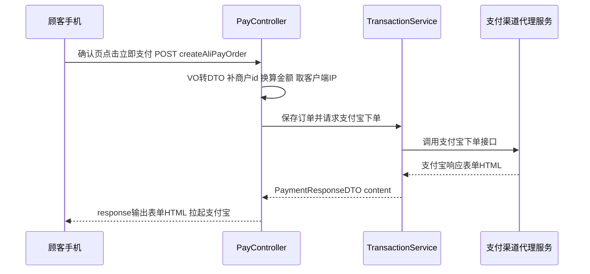
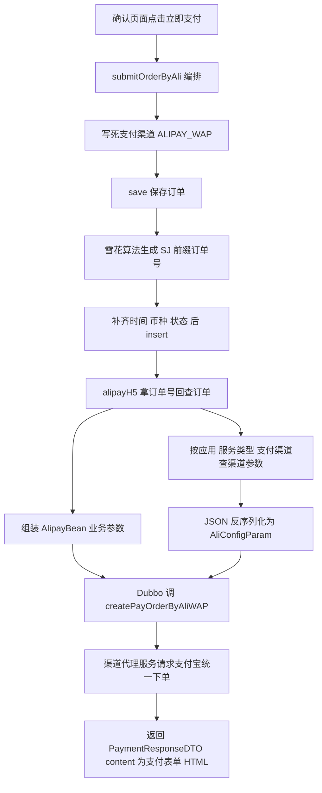
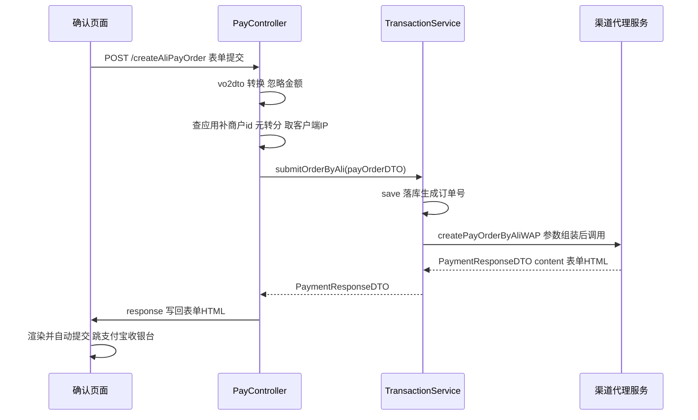

# 交易服务支付宝下单接口全流程：接口定义、订单落库与表单 HTML 回写

## 先给结论

- 支付宝下单接口是链路最前端的 HTTP 门面：交易服务 `PayController` 的 `/createAliPayOrder`，与 `pay.html` 表单提交的目标地址严格对应。
- 接口职责四步：接收前端支付请求、保存订单信息到闪聚支付平台、调用支付渠道代理服务请求支付宝下单接口、把响应结果返回前端拉起支付宝开始支付。
- 接参对象 `OrderConfirmVO` 八个字段与确认页表单一一对应，`totalAmount` 为 String 类型的元，前端输入原样接住；入参另有 `HttpServletRequest` 取客户端 IP、`HttpServletResponse` 用于直接输出。
- 返回值是 void：支付宝手机网站支付的下单响应是一段自动提交的表单 HTML，控制器把它直接写进响应流，不经视图解析。
- 实现主干两行：先 `save(payOrderDTO)` 落库，再 `alipayH5` 调渠道代理服务下单；save 是多渠道复用的公用私有方法，订单号 `SJ` 前缀加雪花 id、过期时间当前加 30 分钟、币种 `CNY`、状态 0 订单生成，前端传不来的字段一律服务端补齐。
- 调代理服务前按订单号回查，金额用 `AmountUtil` 分转元；渠道参数按应用 id、服务类型、支付渠道查库，JSON 串反序列化成 `AliConfigParam`；渠道代理服务是远程服务，用 Dubbo 的 `@Reference` 注入。
- controller 收口：`PayOrderConvert.vo2dto` 放开使用，`totalAmount` 标注忽略映射，金额由元转分必须显式处理；VO 缺的三个字段由 controller 补齐，分别是商户 id 远程查应用、金额元转分、`IPUtil` 从请求取 IP。
- 拿到 `content` 后设置 `text/html;charset=UTF-8`，用 `response.getWriter().write(content)` 输出并 flush、close，浏览器渲染表单自动提交，跳进支付宝收银台；讲义版方法开头的 `appId` 判空成稿省略了，工程上建议补回。

## 第1部分：交易服务支付宝下单接口定义：接住确认页表单的 HTTP 门面与 OrderConfirmVO

支付渠道代理服务的支付宝下单接口已经就位，但它是给服务间调用用的，用户的手指点不到 Dubbo 接口。链路最前端还空着：确认页面点击立即支付，请求发往哪里、由谁接住、接住之后要把哪些数据收进来，这是交易服务要回答的问题。这一课定义交易服务的支付宝下单接口，重点在三处：接口为什么必须是 HTTP 形态、接参对象为什么单独新建一个 VO、方法签名里三个入参与 void 返回各司其职的理由。方法体保持空占位，实现连同保存订单留给下一课。

### 接口职责：链路最前端的 HTTP 门面

把立即支付的交互流程放到交易服务的视角再走一遍。用户扫码进入确认页面，输入金额点击立即支付，请求到达交易服务；交易服务先把订单信息保存到闪聚支付平台，随后调用支付渠道代理服务的支付宝下单接口；代理服务向支付宝发起下单请求并把响应带回；交易服务最终把支付宝的响应结果返回到前端，用户手机上支付宝的支付界面弹起，输入密码完成支付。交易服务的下单接口就是这条链路的第一站，职责描述可以写成四句话：接收前端支付请求、保存订单到平台、调用代理服务下单、响应结果回传前端。

这个接口必须是 HTTP 的，原因不在偏好而在调用者。请求的发起方是用户手机浏览器里跑着的确认页面，表单提交只会说 HTTP，Dubbo 是服务框架内部的通信协议，浏览器既不认识也不需要认识。项目里两类接口的分工由此清晰：凡面向前端页面的一律 HTTP 接口，由 Controller 承载；凡服务与服务之间的一律 Dubbo 接口，由 api 工程的接口声明承载。交易服务向下调代理服务走 Dubbo，向上接前端页面走 HTTP，同一笔业务在两层协议间穿行，各走各的通道。



时序图里 `PayController` 内部的三行小字是下一课实现的全部动作清单，此刻先把接口的「门面」立起来：地址、方法、入参、出口。图中也标出了这个门面与代理服务接口的本质差别，前者对人说 HTTP，后者对服务说 Dubbo。

### OrderConfirmVO：为前端表单定制的接参对象

接口的第一个参数要接住表单提交的全部数据。看一眼确认页面 `pay.html` 里表单有哪些字段：隐藏域带着 `appId`、`openId`、`channel`、`storeId`、`tradeNo`，只读输入框带着 `subject`、`body`，可编辑输入框是 `totalAmount`。这些字段凑成一个对象，项目没有拿现成的 `PayOrderDTO` 直接接，而是新建了 `OrderConfirmVO`：

```java
package com.study.pay.transaction.vo;

import io.swagger.annotations.ApiModel;
import lombok.Data;

@ApiModel(value = "OrderConfirmVO", description = "订单确认信息")
@Data
public class OrderConfirmVO {

    private String appId;    //应用id
    private String tradeNo;  //交易单号
    private String openId;   //微信openid
    private String storeId;  //门店id
    private String channel;  //服务类型
    private String body;     //订单描述
    private String subject;  //订单标题
    private String totalAmount; //金额
}
```

为什么单独建 VO 而不复用 DTO？两个理由，都关乎边界。**其一是字段边界。** `PayOrderDTO` 是服务间传输的全量模型，字段二十多个，包含商户 id、币种、客户端 IP、各时间点等页面根本没有的数据；让前端按 DTO 的字段清单提交，等于把服务端内部模型暴露给了外部，多余字段既是干扰也是攻击面。VO 只声明页面真实会提交的八个字段，接参范围与页面契约严格一致。**其二是类型边界。** `totalAmount` 在 DTO 里是 `Integer` 且单位为分，而页面上用户输入的是「88.88」这样的元字符串；VO 用 String 接元原样收下，换算职责留给服务端，前端永远不碰分。`openId` 在支付宝链路里是空的，但 VO 同时服务微信链路，字段保留正是两个下单接口共用一个表单的设计后果。`@ApiModel` 注解让这个 VO 出现在 Swagger 文档里，前端对接时字段含义一目了然。

转换的桥此前已经搭好。解析 ticket 课时拷入的 `PayOrderConvert` 里有一个当时被临时注释的 `vo2dto` 方法，入参正是 `OrderConfirmVO`，`totalAmount` 标注了忽略映射。本课建好 VO 之后，注释放开，转换器与接参对象在两个课程单元里隔空对接，MapStruct 按字段名自动映射七个同名字段，金额留给显式处理。分层用一句话概括：VO 接页面，DTO 走服务，转换器在中间，三层各自可变互不牵连。

### 接口签名：三入参与 void 返回的取舍

接口定义在 `PayController` 中，注解与签名如下，方法体暂为空占位：

```java
/**
 * 支付宝的下单接口，前端订单确认页面点击确认支付后请求进来
 * @param orderConfirmVO 订单信息
 * @param request
 * @param response
 */
@ApiOperation("支付宝门店下单付款")
@PostMapping("/createAliPayOrder")
public void createAlipayOrderForStore(OrderConfirmVO orderConfirmVO, HttpServletRequest request, HttpServletResponse response) throws BusinessException, IOException {
}
```

`@PostMapping` 对应表单的 post 提交，路径 `/createAliPayOrder` 与 `pay.html` 里 JS 拼出的 action 完全一致，两端靠这个字符串握手。`OrderConfirmVO` 参数上没有任何注解，表单按 `application/x-www-form-urlencoded` 提交，Spring MVC 按字段名自动装配，每个 input 的 name 与 VO 字段同名即可，这是表单场景最省事的接法。

第二与第三个参数值得关注，它们不是摆设。`HttpServletRequest` 留着取请求环境，最直接的用途是客户端 IP：下单要素里有一项 `clientIp`，由服务端从请求中解析（项目里用公共工程的 `IPUtil.getIpAddr`），绝不能让前端自报，环境数据一律以服务端视角为准。`HttpServletResponse` 的存在解释了返回值为什么是 void：支付宝手机网站支付下单接口的响应体是一段完整的自动提交表单 HTML，它的归宿是原样写回给浏览器，控制器直接 `response` 输出最顺畅，先设 `text/html;charset=UTF-8`，再拿 writer 写出表单，前端页面收到后表单自动提交，支付宝收银台随即拉起。若声明返回值走 Spring 的视图解析或 JSON 序列化，反而要把 HTML 塞进模型绕一圈。方法声明的异常有两个来源：业务异常对应下单失败等业务分支，`IOException` 对应响应写出。

到这里，接口的定义部分全部落地。方法体里的四步实现（转换与补数据、换算金额、保存订单、调代理服务并输出响应）是下一课的主菜，本课把契约立稳，实现便只是照单施工。

## 第2部分：交易服务支付宝下单实现：订单先落库，再经渠道代理服务调起支付宝

确认页面上顾客填好金额、点下「立即支付」，请求就到了交易服务。交易服务的下单接口此前已经声明出来，本课把它实现完整。实现说起来只有两个动作：把这笔订单保存到闪聚平台数据库，然后调用渠道代理服务，由它去向支付宝下单。动作不多，细节却都藏在里面：订单号由谁生成、哪些字段前端不会传、金额在库与支付宝两端单位不一致怎么办、渠道参数从哪里取出来交给代理服务。两个动作之间还有严格的先后顺序，先落库再调第三方，顺序反了整条链路都站不住。

### 为什么先落库、再调第三方

下单的职责边界先划清。交易服务是订单的归属地：`pay_transaction` 库里的 `pay_order` 表记录平台自己的每一笔订单；渠道代理服务是对接第三方的唯一出口，支付宝的 SDK 细节全部封在它后面。交易服务的下单接口要做的，就是在自己的库里把订单立起来，再把「这笔订单去支付宝下单」这件事委托给渠道代理服务。

**第一，订单号在落库时才产生，而它正是调第三方下单的锚点。** 渠道代理服务下单接口需要的业务参数里，最关键的一项就是平台订单号，支付宝侧的 `out_trade_no` 用的就是它；此后的查单、关单、对账，全部以这个订单号为钥匙。订单号不落库就去调第三方，等于拿着一张没有编号的支票出门。

**第二，顺序反了会产生悬空交易。** 先调支付宝后落库，一旦落库失败，第三方那边已经受理了一笔交易，本地却无单可对，用户付了钱平台找不到订单。先落库再下单，最坏的情况是落库成功而下单失败，库里留下一笔状态为「订单生成」的记录，后续补偿或关闭都有据可依。

**第三，保存订单是所有渠道共用的动作。** 支付宝下单要保存，微信下单同样要保存，两个渠道的差别只在渠道编码与后续的下单调用。把它抽成独立的 `save` 方法，两条下单流程各自一行调用，字段补齐逻辑只维护一份。

整条链路串起来是下面的样子，`submitOrderByAli` 是编排者，`save` 与 `alipayH5` 是它的两只手：



图上 `save` 与 `alipayH5` 之间只传递一个订单号，这是刻意收窄的接口：落库产生的所有数据都进了库，下单环节需要什么就按订单号回来查，两个动作之间不搬大对象，数据永远以库为准。

### 第一步：把订单写进 pay_order 表

接口声明先到位。`submitOrderByAli` 的返回类型 `PaymentResponseDTO` 定义在渠道代理服务的 api 工程里，所以交易服务的 api 模块要先引入它的依赖：

```xml
<dependency>
    <groupId>com.study.pay</groupId>
    <artifactId>pay-channel-agent-api</artifactId>
    <version>1.0-SNAPSHOT</version>
</dependency>
```

一个服务的 api 工程依赖另一个服务的 api 工程，这个动作的语义是「类型即契约」：`submitOrderByAli` 返回的 `PaymentResponseDTO` 定义在渠道代理服务的 api 里，交易服务要把它写进自己的接口签名，就必须能看见这个类型。Dubbo 的消费方只依赖接口所在的双方便捷包，看不到对方的服务实现，依赖链干净，接口变更时编译期就能感知。

交易服务 api 工程的 `TransactionService` 追加方法声明，注释把两步职责写全：

```java
/**
 * 保存支付宝订单，1、保存订单到闪聚平台，2、调用支付渠道代理服务调用支付宝的接口
 * @param payOrderDTO
 * @return
 * @throws BusinessException
 */
public PaymentResponseDTO submitOrderByAli(PayOrderDTO payOrderDTO) throws BusinessException;
```

落库之前要认识一下订单表。`pay_order` 表对应的实体是交易服务工程里的 `PayOrder`，字段多但分组清楚，挑与本课直接相关的看：

```java
@Data
@TableName("pay_order")
public class PayOrder implements Serializable {

    @TableId(value = "ID", type = IdType.ID_WORKER)
    private Long id;//主键，MyBatis-Plus 雪花算法自动填充

    @TableField("TRADE_NO")
    private String tradeNo;//聚合支付订单号，唯一，但不是主键

    @TableField("MERCHANT_ID")
    private Long merchantId;//所属商户

    @TableField("STORE_ID")
    private Long storeId;//商户下门店

    @TableField("APP_ID")
    private String appId;//所属应用

    @TableField("PAY_CHANNEL")
    private String payChannel;//原始支付渠道编码

    @TableField("PAY_CHANNEL_TRADE_NO")
    private String payChannelTradeNo;//原始渠道订单号，拿到支付结果后再回填

    @TableField("CHANNEL")
    private String channel;//聚合支付的渠道，本课写入 ALIPAY_WAP

    @TableField("OUT_TRADE_NO")
    private String outTradeNo;//商户订单号，第三方系统接入时使用

    @TableField("SUBJECT")
    private String subject;//商品标题

    @TableField("BODY")
    private String body;//订单描述

    @TableField("CURRENCY")
    private String currency;//币种 CNY

    @TableField("TOTAL_AMOUNT")
    private Integer totalAmount;//订单总金额，单位为分

    @TableField("TRADE_STATE")
    private String tradeState;//交易状态，0-订单生成，2-支付成功，4-关闭

    @TableField("CLIENT_IP")
    private String clientIp;//客户端 IP

    @TableField("CREATE_TIME")
    private LocalDateTime createTime;//创建时间

    @TableField("EXPIRE_TIME")
    private LocalDateTime expireTime;//订单过期时间

    @TableField("PAY_SUCCESS_TIME")
    private LocalDateTime paySuccessTime;//支付成功时间
}
```

字段里有两组容易混淆的概念值得停一下。主键 `id` 与业务订单号 `tradeNo` 是两个东西：主键由 MyBatis-Plus 的 `ID_WORKER` 策略在插入时自动填雪花 id，它只服务于表本身；`tradeNo` 是平台对外的订单号，走进支付宝的参数、出现在对账单里，两者唯一的共同点是都靠雪花算法保证唯一。`payChannel`（原始支付渠道编码）与 `channel`（聚合支付渠道）也是一对：前者记录真正完成支付的渠道侧信息，本课先留空，等支付结果回来再回填；后者写入写死的 `ALIPAY_WAP`，表示这笔单走的是支付宝手机网站支付。

实现类里把订单相关的依赖注进来，然后写 `submitOrderByAli` 的编排：

```java
@Autowired
PayOrderMapper payOrderMapper;

@Override
public PaymentResponseDTO submitOrderByAli(PayOrderDTO payOrderDTO) throws BusinessException {

    payOrderDTO.setChannel("ALIPAY_WAP");//支付渠道
    //保存订单到闪聚平台数据库
    PayOrderDTO save = save(payOrderDTO);

    //调用支付渠道代理服务支付宝下单接口
    PaymentResponseDTO paymentResponseDTO = alipayH5(save.getTradeNo());
    return paymentResponseDTO;
}
```

`save` 方法承担全部落库细节。解析 ticket 一课拷入交易服务的 `PayOrderConvert` 在这里派上用场，`dto2entity` 与 `entity2dto` 一进一出各用一次：

```java
//保存订单（公用）
private PayOrderDTO save(PayOrderDTO payOrderDTO) throws BusinessException{
    PayOrder payOrder = PayOrderConvert.INSTANCE.dto2entity(payOrderDTO);
    //订单号，采用雪花算法
    payOrder.setTradeNo(PaymentUtil.genUniquePayOrderNo());
    payOrder.setCreateTime(LocalDateTime.now());//创建时间
    payOrder.setExpireTime(LocalDateTime.now().plus(30, ChronoUnit.MINUTES));//过期时间是30分钟后
    payOrder.setCurrency("CNY");//人民币
    payOrder.setTradeState("0");//订单状态，0：订单生成
    payOrderMapper.insert(payOrder);//插入订单
    return PayOrderConvert.INSTANCE.entity2dto(payOrder);
}
```

哪些字段来自前端、哪些必须服务端补，逐项过一遍。商户 id、门店 id、应用 id、标题、描述、金额，入口链路已经装进 DTO 原样带下来；订单号、创建时间、过期时间、币种、状态，这五项调用方不会传，也绝不该让调用方传，全部由交易服务自己定。订单号走 `PaymentUtil.genUniquePayOrderNo`，工具类按讲义口径拷入公共工程的 util 包，内部是雪花算法的实现类加一个前缀：

```java
public class PaymentUtil {

    private static final String PAY_ORDER_PREFIX = "SJ";

    //生成平台订单号：SJ 前缀加雪花算法 id
    public static String genUniquePayOrderNo() {
        return PAY_ORDER_PREFIX + WorkId();
    }

    public static String WorkId() {
        long id = IdWorkerUtils.getInstance().nextId();
        return String.valueOf(id);
    }
}
```

`SJ` 是平台订单号的前缀，雪花算法保证 id 全局唯一且趋势递增，订单号因此既不重复又能按时间粗略排序。过期时间的写法值得一记：`LocalDateTime.now().plus(30, ChronoUnit.MINUTES)`，`plus` 的第二个参数是时间单位，`ChronoUnit` 枚举里从纳秒到千年一应俱全，选 `MINUTES` 就是当前时间加 30 分钟。这个 30 分钟与后面传给支付宝的过期参数、与订单有效期是同一个语义在三处的落点，改一处要想着另外两处。状态 `0` 对应「订单生成」，此刻用户还没输密码，订单只是立起来了。

### 第二步：组装参数，调渠道代理服务下单

有了订单号，`alipayH5` 私有方法接手后半程。它需要两组参数：一是订单信息，二是支付渠道配置参数。订单信息刚落完库，按订单号查回来最稳；渠道参数是商户平台应用当初配置在支付渠道参数表里的 JSON，按应用 id、服务类型、支付渠道三个条件取。

查询订单的方法写成公开的接口方法，而不是私有方法。保存订单、下单、查单、对账，后续许多环节都要按订单号查订单，这个能力注定被反复使用：

```java
/**
 * 根据订单号查询订单信息
 * @param tradeNo
 * @return
 */
public PayOrderDTO queryPayOrder(String tradeNo){
    PayOrder payOrder = payOrderMapper.selectOne(new LambdaQueryWrapper<PayOrder>().eq(PayOrder::getTradeNo, tradeNo));
    return PayOrderConvert.INSTANCE.entity2dto(payOrder);
}
```

`selectOne` 配 `LambdaQueryWrapper` 按 `tradeNo` 等值查询，查到实体转 DTO 返回。实现类里同时注入三样东西，注入方式有讲究：

```java
@Reference
PayChannelAgentService payChannelAgentService;//渠道代理服务，远程调用

@Autowired
PayChannelService payChannelService;//渠道参数查询，交易服务本地实现

@Autowired
PayOrderMapper payOrderMapper;
```

渠道代理服务是独立部署的远程服务，必须用 Dubbo 的 `@Reference`；`PayChannelService` 的实现在交易服务工程内部，本地 bean 用 `@Autowired` 就够。两种注入混用时张冠李戴，是最常见的启动期错误。

组装业务参数之前，先看一眼渠道代理服务对外承诺的下单参数结构。`AlipayBean` 定义在渠道代理服务的 api 工程里，字段就是支付宝手机网站下单业务参数的映射：

```java
@Data
@ToString
public class AlipayBean implements Serializable {

    private String outTradeNo;//商户订单号，必填，此处传闪聚平台订单号
    private String subject;//订单名称，必填
    private String totalAmount;//付款金额（元），必填
    private String productCode;//产品编号，渠道代理服务内部写死
    private String body;//商品描述，可空
    private String expireTime;//超时时间参数
    private Long storeId;//门店id
}
```

站在交易服务的视角，这个类的意义在于划清了两边的分工：订单号、标题、金额、描述、过期时间由交易服务按订单数据填好，产品编码这类支付宝侧的固定约定不归交易服务管，渠道代理服务内部处理。交易服务不接触任何支付宝 SDK 类型，将来对接的渠道再多，交易服务的下单代码也不变。

`alipayH5` 的完整实现如下：

```java
//调用支付渠道代理服务的支付宝下单接口
private PaymentResponseDTO alipayH5(String tradeNo){
    //订单信息，从数据库查询订单
    PayOrderDTO payOrderDTO = queryPayOrder(tradeNo);
    //组装alipayBean
    AlipayBean alipayBean = new AlipayBean();
    alipayBean.setOutTradeNo(payOrderDTO.getTradeNo());//订单号
    try {
        //支付宝侧入参是元，库内是分，转换
        alipayBean.setTotalAmount(AmountUtil.changeF2Y(payOrderDTO.getTotalAmount().toString()));
    } catch (Exception e) {
        e.printStackTrace();
        throw new BusinessException(CommonErrorCode.E_300006);//订单金额转换异常
    }
    alipayBean.setSubject(payOrderDTO.getSubject());
    alipayBean.setBody(payOrderDTO.getBody());
    alipayBean.setExpireTime("30m");

    //支付渠道配置参数，从数据库查询
    PayChannelParamDTO payChannelParamDTO = payChannelService.queryParamByAppPlatformAndPayChannel(payOrderDTO.getAppId(), "shanju_c2b", "ALIPAY_WAP");
    String paramJson = payChannelParamDTO.getParam();
    //支付渠道参数
    AliConfigParam aliConfigParam = JSON.parseObject(paramJson, AliConfigParam.class);
    //字符编码
    aliConfigParam.setCharest("utf-8");
    PaymentResponseDTO payOrderByAliWAP = payChannelAgentService.createPayOrderByAliWAP(aliConfigParam, alipayBean);
    return payOrderByAliWAP;
}
```

方法两头各对应渠道代理服务下单接口的一个入参。业务参数装进 `AlipayBean`：订单号、标题、描述从回查的订单里直接取；金额必须换算，库里存的是分，支付宝手机网站支付接口收的是元，`AmountUtil.changeF2Y` 负责这个转换，转换失败抛 `E_300006` 订单金额转换异常，把工具类的受检异常收口成项目的业务异常；过期时间 `30m` 是支付宝 `timeout_express` 参数的格式，30 分钟的语义与库里的 `expireTime` 保持一致。

渠道参数这半边，`queryParamByAppPlatformAndPayChannel` 按应用 id、服务类型编码 `shanju_c2b`、支付渠道 `ALIPAY_WAP` 三个条件查支付渠道参数表，命中配置记录后取出的 `param` 是一串 JSON，内容正是当初商户平台应用配置支付宝渠道时保存的 appid、应用私钥、支付宝公钥、网关地址这些字段。`JSON.parseObject` 把它还原成 `AliConfigParam` 对象，正好是渠道代理服务定义的参数类型，当初设计渠道参数配置接口时按这个结构存，就是为了这一次反序列化。`setCharest("utf-8")` 单独设一次字符编码，`charest` 这个字段名是工程里的原样拼写，语义就是 charset；配置里若已带编码，这一行就是兜底。

讲义在这一步还多了一道防线：渠道参数查出来为 null 时抛 `E_300007`（原始支付渠道为空）。成稿代码里省了这道判断，应用没绑定支付宝渠道、或者参数没配置时，空指针会在更深处爆出来。工程上这道判空值得保留，错误信息直指「渠道参数没配置」，排查能省半小时。

`createPayOrderByAliWAP` 的返回 `PaymentResponseDTO` 是渠道代理服务定义的统一响应：

```java
@Data
@ApiModel(value = "PaymentResponseDTO", description = "支付响应信息")
public class PaymentResponseDTO<T> implements Serializable {

    private String code = "0"; //系统状态，"0"代表请求成功
    private String msg;
    private String tradeNo;//聚合平台角度：原始交易号
    private String outTradeNo;//商户订单号
    private TradeStatus tradeState;//支付状态
    private T content;//内容，下单场景是支付宝拼装好的表单 HTML
}
```

下单场景里最要紧的是 `content`：渠道代理服务内部调支付宝 SDK 的 `pageExecute`，支付宝返回的就是一段完整的表单 HTML，里面有自动提交的脚本，浏览器渲染后直接跳进支付宝收银台。交易服务原样把它带回来，交给 controller 输出，支付就调起来了。此刻订单库里躺着一笔状态 `0` 的订单，支付宝侧立起一笔等待付款的交易，两边靠同一个订单号拴着，剩下的环节是收银台里的那串密码。

金额在这个环节走完了它的完整旅程，值得单独复盘一遍。用户在确认页输入的是元，入口 controller 会把元换算成分再交给下单接口；库里 `totalAmount` 字段存的是分，`Integer` 类型；走到本课调支付宝，又由分换算回元字符串。一来一回两次转换，全部收敛在公共工程的 `AmountUtil` 里，任何一处绕开工具类手写乘除，精度问题就会在某天深夜准时上线。金额不让前端直接传分，除了体验，更因为金额属于服务端权威数据，前端传什么只能当参考，落库与下单用的值必须由服务端自己算出来。

## 第3部分：交易服务下单接口收口：完善 controller，把支付宝的表单 HTML 写回浏览器

service 层的两步已经就绪：`save` 落库，`alipayH5` 经渠道代理服务调支付宝。剩下的收口工作在 controller：确认页面点击「立即支付」，表单提交到交易服务，controller 要把前端参数整理成下单对象，调 service 的下单方法，再把支付宝返回的表单 HTML 原样写回响应。方法不长，但要回答三个问题：表单参数用什么对象接、DTO 里缺的字段去哪补、拿到 HTML 之后怎么交回浏览器。另有一个此前的伏笔要兑现：转换器里注释掉的 `vo2dto` 方法，现在可以放开了。

### 接口骨架与表单对象

确认页面提交的表单里有什么，VO 里就放什么。新建 `OrderConfirmVO`，字段与页面的输入项、隐藏域一一对应：

```java
@ApiModel(value = "OrderConfirmVO", description = "订单确认信息")
@Data
public class OrderConfirmVO {

    private String appId; //应用id
    private String tradeNo;//交易单号
    private String openId;//微信openid
    private String storeId;//门店id
    private String channel; //服务类型
    private String body;//订单描述
    private String subject;//订单标题
    private String totalAmount;//金额
}
```

`appId`、`storeId`、`channel`、`subject`、`body` 是解析 ticket 一课由入口转发带进页面的隐藏域，用户看不见但提交时原样带回；`totalAmount` 是用户在页面输入的金额；`openId` 是微信侧才有的身份标识，支付宝场景为空；`tradeNo` 此刻还没有，留给以后的复用场景。VO 放在交易服务工程的 `vo` 包里，它只服务页面交互，不进 api 工程，外部服务不需要认识它。

有了 VO，转换器里那句临时注释可以放开了。`PayOrderConvert` 三个方法里，`vo2dto` 单独标了忽略映射：

```java
//忽略totalAmount，不做映射
@Mapping(target = "totalAmount", ignore = true)
PayOrderDTO vo2dto(OrderConfirmVO vo);
```

忽略的原因当时埋下了伏笔：VO 的 `totalAmount` 是 String 类型的元，DTO 的 `totalAmount` 是 Integer 类型的分，类型与单位都不同，MapStruct 的自动映射在这里只会帮倒忙。放开注释的时机就是现在，因为第一个调用方马上就要出现了。

controller 方法把骨架立起来：

```java
/**
 * 支付宝的下单接口,前端订单确认页面，点击确认支付，请求进来
 * @param orderConfirmVO 订单信息
 * @param request
 * @param response
 */
@ApiOperation("支付宝门店下单付款")
@PostMapping("/createAliPayOrder")
public void createAlipayOrderForStore(OrderConfirmVO orderConfirmVO, HttpServletRequest request, HttpServletResponse response) throws BusinessException, IOException {

}
```

返回类型是 `void`，这一点值得想清楚再写。常见的两种返回都通不了这条路：返回视图名，意味着要走模板渲染，但手里这段内容是支付宝给的完整 HTML，不需要也不能再套模板；返回 JSON，前端还得再处理一层，而支付宝的表单 HTML 里自带自动提交脚本，必须原样直达浏览器。所以方法直接操作 `HttpServletResponse` 把内容写出去，`IOException` 也来自这里。

### 补齐 DTO 缺的三个字段

VO 转 DTO 之后，对照 `pay_order` 表的必填字段检查一遍，会发现三个缺口。判断依据很朴素：页面上没有的，VO 里就没有，DTO 里也就没有，得由 controller 补。

第一个缺口是商户 id。页面参数里只有 `appId`，但订单表要记 `merchantId`，两者的对应关系在商户库里：应用隶属于商户，按应用 id 查应用，取回它的商户 id。`AppService` 是商户服务的远程接口，注入用 Dubbo 的 `@Reference`：

```java
@Reference
AppService appService;
```

第二个缺口是金额单位。前端输入的元要转成分才能进 DTO，`AmountUtil.changeY2F` 负责换算，结果用 `Integer.parseInt` 收成整数：

```java
PayOrderDTO payOrderDTO = PayOrderConvert.INSTANCE.vo2dto(orderConfirmVO);
//应用id
String appId = payOrderDTO.getAppId();
AppDTO app = appService.getAppById(appId);
payOrderDTO.setMerchantId(app.getMerchantId());//商户id
//将前端输入的元转成分
payOrderDTO.setTotalAmount(Integer.parseInt(AmountUtil.changeY2F(orderConfirmVO.getTotalAmount().toString())));
//客户端ip
payOrderDTO.setClientIp(IPUtil.getIpAddr(request));
//保存订单，调用支付渠道代理服务的支付宝下单
PaymentResponseDTO<String> paymentResponseDTO = transactionService.submitOrderByAli(payOrderDTO);
```

第三个缺口是客户端 IP。顾客从哪个 IP 发起支付，是风控与对账的基础数据，公共工程的 `IPUtil.getIpAddr(request)` 会依次检查代理相关的请求头再回落到远程地址，网关后面取真实 IP 的惯用做法。

`TransactionService` 的实现在交易服务工程内部，这里注入用 `@Autowired` 而不是 `@Reference`，与上一课 `alipayH5` 里的规则一致。service 返回的 `PaymentResponseDTO` 是泛型类，下单场景的 `content` 是字符串，按 `PaymentResponseDTO<String>` 接收，类型信息一目了然。

讲义版在方法开头还有一道防线：`appId` 为空直接抛 `E_300003`（appId 为空），避免带着残缺参数往下走、到远程调用处才报错。成稿代码把这道判空省了，工程上建议保留，入口参数的校验永远发生在最前面，错误信息也更直白。

### 把表单 HTML 写回浏览器

响应处理只有四行，却是整条链路的临门一脚：

```java
//支付宝下单接口响应
String content = paymentResponseDTO.getContent();
response.setContentType("text/html;charset=UTF-8");
response.getWriter().write(content);//直接将完整的表单html输出到页面
response.getWriter().flush();
response.getWriter().close();
```

`content` 里是支付宝 SDK 拼装好的表单，`form` 的 `action` 指向支付宝网关，隐藏域装着签名后的订单参数，末尾一段脚本自动提交。浏览器收到这段 HTML 渲染执行，用户几乎没有感知就到了支付宝收银台，输入密码完成支付。`charset=UTF-8` 不设，订单标题里的中文会在表单参数里变成乱码，签名对不上，支付宝直接拒绝请求，这是实测里很容易踩的坑。`flush` 与 `close` 把响应彻底交还容器，后面不再有视图渲染。

整条链路收拢成一张时序图：



从提交到收银台一共十步，controller 自己只占三步：转换、补齐、输出。业务判断一个都没有，这正是它该有的样子，controller 是数据的搬运与装配工，规则都在 service 与更深处。

## 常见误区

- **拿 PayOrderDTO 直接接前端表单。** 错例：Controller 入参写 `PayOrderDTO`，页面被要求提交二十多个字段，服务端模型暴露给外部。正解：新建只含页面字段的 `OrderConfirmVO` 接参，内部模型用转换器转回 DTO，两个世界各有各的字段清单。

- **金额入参用 Double 接。** 错例：`totalAmount` 声明为 Double，`88.88` 在浮点表示下出现精度尾巴，换算分时四舍五入出错。正解：VO 用 String 接元，服务端用公共金额工具换算成整型分，支付链路全程不碰浮点。

- **给接口配 @ResponseBody 返回 JSON。** 错例：把支付宝表单 HTML 包进 JSON 或当作字符串经消息转换器返回，浏览器拿到的是转义后的文本，表单无法执行。正解：返回 void，直接向 `HttpServletResponse` 写 `text/html`，让浏览器原样渲染并自动提交。

- **客户端 IP 让前端传。** 错例：表单里加一个 clientIp 隐藏域由页面填写。正解：`clientIp` 属于请求环境数据，从 `HttpServletRequest` 由服务端解析，前端自报的值不可信。

- **接口路径与前端 action 脱节。** 错例：后端写 `/createAliPayOrderForStore`，前端 JS 拼 `/createAliPayOrder`，提交 404。正解：`@PostMapping` 的路径与页面 JS 拼接的 action 字符串严格一致，改任何一侧都要同步另一侧。

- **先调第三方后落库。** 错例：直接调渠道代理服务下单，成功后再 insert 订单，落库失败即产生本地无单的悬空交易。正解：先 `save` 拿到订单号，再以订单号为锚点调第三方，失败可查单、可补偿。

- **金额单位一锅端。** 错例：把库里的分直接塞给支付宝的金额参数，用户付 1 元被扣 100 元。正解：库内一律存分（`Integer`），出口用 `AmountUtil.changeF2Y` 转元，入口用 `changeY2F` 转分，转换失败抛业务异常而不是吞掉。

- **订单号用表主键充当。** 错例：`insert` 后拿雪花主键当订单号传给第三方。正解：主键服务于表，订单号是业务身份，`PaymentUtil` 生成带前缀的独立订单号，两者互不替代。

- **过期时间格式随手写。** 错例：把 `30分钟`、`1800s` 这类格式传给支付宝，参数被忽略或报错。正解：`timeout_express` 接受 `30m` 这类「数字加单位」格式，与库内 `expireTime` 的 30 分钟同源，最好收敛成一处配置。

- **远程与本地注入不分。** 错例：给渠道代理服务的接口标 `@Autowired`，启动报找不到 bean 或调不通。正解：跨服务的 Dubbo 引用用 `@Reference`，工程内部实现用 `@Autowired`。

- **渠道参数不判空直接用。** 错例：应用未配置支付宝渠道时 `param` 取出为 null，`JSON.parseObject` 抛出的空指针让人摸不着头脑。正解：查完参数先判空，抛 `E_300007` 这类语义明确的业务异常。

- **让转换器自动映射金额。** 错例：`vo2dto` 不加 `ignore = true`，String 的元被硬转 Integer 的分，报错或得到错误数值。正解：金额字段显式忽略，由 controller 调 `changeY2F` 换算后手工 set。

- **商户 id 让页面一起传。** 错例：表单隐藏域里塞商户 id，前端自证身份。正解：按应用 id 远程查应用取商户 id，归属关系以商户库为准，前端传值不可信。

- **直接 `return content` 当视图名。** 错例：方法返回 String，框架把 HTML 当视图名去找模板，报模板不存在。正解：返回 void，通过 `response.getWriter()` 原样输出，内容直达浏览器。

- **响应不设 UTF-8。** 错例：漏掉 `setContentType` 的 `charset=UTF-8`，中文标题在表单里乱码，支付宝签名校验失败。正解：写响应前先设置 `text/html;charset=UTF-8`。

- **把 `IPUtil` 取 IP 想成读固定头。** 错例：以为一个 `getRemoteAddr` 就够，经过网关与代理后拿到的是代理 IP。正解：`getIpAddr` 依次检查 `X-Forwarded-For` 等代理头再回落，链路里谁设了头谁负责，取值逻辑统一收在工具类。

- **本地服务误用 `@Reference`。** 错例：给 `TransactionService` 标 `@Reference`，期望走 Dubbo，结果服务并未单独部署，启动报错。正解：工程内实现用 `@Autowired`，跨服务引用才用 `@Reference`。

## 面试可能被问到的问题

1. 面试官追问：「交易服务的下单接口为什么是 HTTP 的，而调支付渠道代理服务用 Dubbo？」
   答：调用者决定协议。下单接口的调用方是手机浏览器里的确认页面，只能走 HTTP；交易服务与代理服务都是微服务，服务间调用走 Dubbo，享受注册发现、序列化与超时治理。同一业务链路里两段协议各取所长，面向前端用 HTTP 门面，服务内部用 RPC。

2. 面试官追问：「为什么要新建 OrderConfirmVO，直接用 PayOrderDTO 接表单不行吗？」
   答：VO 与 DTO 的受众不同。DTO 是服务间全量传输模型，含商户 id、时间戳等页面没有的数据；VO 只声明页面真实提交的字段，接参范围即页面契约，避免内部模型外泄，金额字段还能按页面形态用 String 接元。VO 进服务端后经 MapStruct 转回 DTO，分层各自演化互不牵连。

3. 面试官追问：「方法返回值为什么是 void，直接把 HTML 写进 response 有什么讲究？」
   答：支付宝手机网站支付的下单响应是自动提交的表单 HTML，浏览器收到后要原样执行才能拉起收银台。直接设置 `text/html` 后向 response 写出最短路径，不经过视图解析与 JSON 序列化，避免 HTML 被转义或包裹。void 与 response 输出是一对配套选择。

4. 面试官追问：「这个接口在实现时要做哪些校验与数据补齐？」
   答：金额非空与格式校验，元转分的换算；VO 里没有商户 id，要按应用 id 查应用补出归属商户；客户端 IP 从请求解析。下单前订单要素与库内数据核对，伪造的应用或门店在下单环节对不上号，这些都是实现阶段的服务端防线。

5. 面试官追问：「确认页表单同时服务支付宝和微信两个下单接口，VO 怎么做到两边通用？」
   答：VO 字段取两个渠道下单需求的并集，`openId` 只在微信链路有值，支付宝链路为空不影响；页面 JS 按参数里有无 openId 决定提交到 `/createAliPayOrder` 还是 `/wxjspay`，两个接口共用同一个 VO 接参，字段口径一致，前端表单无需为渠道做两套。

6. 面试官追问：「为什么先保存订单再调第三方下单？顺序颠倒会出什么问题？」
   答：订单号在落库时生成，它是调第三方的锚点，查单、关单、对账都靠它。先调第三方后落库，一旦落库失败，第三方已受理而本地无单，用户付款后平台无从对账，产生悬空交易。先落库再下单，失败时库里留有状态可查的记录，补偿与关单都有依据。

7. 面试官追问：「订单号为什么用雪花算法生成，不用数据库自增？」
   答：雪花算法在应用侧生成全局唯一且趋势递增的 id，不依赖数据库，适合分库分表与高并发写入；自增 id 在分库下会冲突，也暴露业务量。本项目主键交给 MyBatis-Plus 的 ID_WORKER 策略，业务订单号用工具类生成并加平台前缀，两者都源于雪花算法但职责不同。

8. 面试官追问：「金额为什么用分存 Integer，不用 BigDecimal 存元？」
   答：整数分没有小数精度问题，参与运算不会出现浮点误差，也是微信、支付宝接口的通行口径，微信直接收分。支付宝侧收元字符串，转换收敛在 `AmountUtil` 一处。BigDecimal 存元也可行，但数据库字段、前后端传输、渠道适配都要跟着统一，工程成本更高。

9. 面试官追问：「调第三方下单前按订单号回查一次订单，是不是多余？」
   答：不多余。落库返回的 DTO 与库内数据一致性最强，回查让后续环节永远以库为准，避免方法间大对象搬运与中途篡改；同时 `queryPayOrder` 是公开接口，查单、对账、结果更新都要复用，下单处调用只是它的第一个消费者。代价是一次索引等值查询，几乎可以忽略。

10. 面试官追问：「insert 成功但调支付宝失败，这笔订单怎么处理？」
   答：库里留下状态「订单生成」的记录，本身不构成资金风险。处理路径有两种：用户重试支付时按原订单号继续下单，或后台任务扫描超时未支付的订单、按过期时间关闭。订单有效期 30 分钟与关闭机制配合，保证这类数据最终被收敛。

11. 面试官追问：「渠道参数为什么设计成 JSON 存在库里，而不是写在配置文件？」
   答：渠道参数按商户、应用、服务类型、支付渠道四个维度组合，每个接入应用都有自己的 appid 与密钥，规模随业务增长，配置文件既装不下也无法运营。存库后商户平台可自助配置，下单时按维度查出 JSON 反序列化成渠道代理服务定义的参数对象，新增一个渠道只需约定新的参数结构，不改下单主流程。

12. 面试官追问：「下单接口为什么设计成 void 直接写 response，而不是返回字符串或 JSON？」
   答：响应体是支付宝返回的完整表单 HTML，自带自动提交脚本，必须原样直达浏览器才能跳进收银台。走视图渲染会多套一层模板，走 JSON 前端还要再插一次 DOM。controller 直接写 response 是对外部 HTML 内容的最短路径，也是支付场景的通行做法。

13. 面试官追问：「金额单位转换为什么放在 controller，不在前端转好或 service 里转？」
   答：前端只负责输入体验，金额属于服务端权威数据，转几分、金额合法性都由服务端决定，防止篡改。controller 是前端输入进入服务端的第一站，在这里把「元」这个展示单位翻译成系统内部单位「分」，service 之下全程分，出口再转元，单位边界清晰，转换点唯一。

14. 面试官追问：「商户 id 为什么不随表单传，要远程查一次应用？」
   答：应用与商户的归属关系是商户域的数据，必须以商户库为准。前端传的商户 id 可以是任何值，服务端无法自证；按应用 id 查应用取商户 id，等于用一次远程调用换数据可信。这也是防越权的基本思路：身份与归属一律服务端反查。

15. 面试官追问：「OrderConfirmVO 为什么放 service 工程的 vo 包，不进 api 工程？」
   答：VO 是页面表单的映射，生命周期只存在于交易服务的 web 层内部，外部服务不需要也不应该认识它。api 工程放的是跨服务契约（DTO 与接口），两者的受众不同。混在一起会让 api 包背上一堆页面专属类，消费方被迫理解无关细节。

16. 面试官追问：「如果用户重复点击立即支付，会产生多笔订单吗？」
   答：会，每次提交都会走一遍落库与下单，库里出现多笔同标题的待支付订单。生产上要在入口做幂等控制：前端按钮置灰防重复提交，服务端可按用户、门店、金额加时间窗口限流，或对同一用户的未支付订单先查后建。课程链路聚焦主流程，幂等属于工程加固项。

17. 面试官追问：「response.getWriter 拿到的输出流，写完后为什么必须 flush 和 close？」
   答：flush 把缓冲区内容强制推给容器，避免部分内容滞留在内存；close 释放流并声明响应结束，容器随后提交响应。不 close 时容器通常也会在请求结束时兜底，但显式关闭语义清晰，尤其在写入较大 HTML 时能尽早让浏览器开始渲染，用户感知更快。

## 配套资料

- 讲义：`materials/docs/10/闪聚支付-第3章-C扫Bv1.1.md`，5.4 交易服务支付宝下单、5.4.1 接口定义（接口描述四点、定义 `OrderConfirmVO` 接收前端请求的支付参数、在 `PayController` 中以 `@PostMapping` 定义接口）为本课出处；5.4.2 接口实现为下一课内容。

- 代码：`materials/code/10/完整代码/完整代码/` 归档中，交易服务工程的 `vo/OrderConfirmVO.java`（八个字段与注释）、`controller/PayController.java`（`createAlipayOrderForStore` 接口定义与响应输出）、`convert/PayOrderConvert.java`（`vo2dto` 忽略 `totalAmount` 的映射）、`templates/pay.html`（表单字段与立即支付按钮 JS）均为真实文件；`materials/code/10/基准代码/zip/` 归档含同一套文件的基准版本。正文代码为按 `com.study.pay` 系口径改写后的节选（归档内层工程目录与包名为课程原始命名，不在此展开）。

- 说明：该阶段课程资料归档在 `materials/docs/10/` 与 `materials/code/10/`（不存在 09 编号目录），引用路径截至该层级；接口实现细节（保存订单与调用代理服务）属于下一课，本课只按画面线与讲义口径交代契约，示例中未引入任何密钥或环境敏感值。

- 讲义：`materials/docs/10/闪聚支付-第3章-C扫Bv1.1.md`，5.4.2.1 保存订单（拷贝 `IdWorkerUtils.java`、`PaymentUtil.java` 到 common 工程，`submitOrderByAli` 与 `save` 的实现）、5.4.2.2 请求代理服务调用支付宝下单（`alipayH5` 私有方法、渠道参数反序列化、金额分转元）为本课出处；5.4.3 测试一节预告了 controller 完善与整体测试。

- 代码：`materials/code/10/完整代码/完整代码/` 归档中，交易服务 service 工程的 `TransactionServiceImpl.java`（`submitOrderByAli`、`save`、`alipayH5`、`queryPayOrder`）、`entity/PayOrder.java`、`mapper/PayOrderMapper.java`，交易服务 api 工程的 `TransactionService.java`、`dto/PayOrderDTO.java`，公共工程的 `util/PaymentUtil.java`、`util/IdWorkerUtils.java`、`util/AmountUtil.java`，渠道代理服务 api 工程的 `PayChannelAgentService.java`、`dto/AlipayBean.java`、`dto/PaymentResponseDTO.java`、`conf/AliConfigParam.java` 均为真实文件；`materials/code/10/基准代码/zip/` 归档含同一套文件的基准版本。正文代码为按 `com.study.pay` 系口径改写后的节选（归档内层工程目录与包名为课程原始命名，不在此展开）。

- 说明：该阶段课程资料归档在 `materials/docs/10/` 与 `materials/code/10/`（不存在 09 编号目录），引用路径截至该层级；常量取值（订单号前缀 `SJ`、支付渠道编码 `ALIPAY_WAP`、服务类型 `shanju_c2b`）保持课程原值，涉及域名处以 `example.com` 占位。

- 讲义：`materials/docs/10/闪聚支付-第3章-C扫Bv1.1.md`，5.4.1 接口定义（`OrderConfirmVO` 与 `createAliPayOrder` 方法骨架）、5.4.2.3 完善交易服务下单接口（vo2dto 放开、商户 id 补齐、元转分、客户端 IP、写回表单 HTML）为本课出处。

- 代码：`materials/code/10/完整代码/完整代码/` 归档中，交易服务 service 工程的 `controller/PayController.java`（`createAlipayOrderForStore`）、`vo/OrderConfirmVO.java`、`convert/PayOrderConvert.java`，商户服务 api 工程的 `AppService.java`、`dto/AppDTO.java`，公共工程的 `util/AmountUtil.java`、`util/IPUtil.java` 均为真实文件；`materials/code/10/基准代码/zip/` 归档含同一套文件的基准版本。正文代码为按 `com.study.pay` 系口径改写后的节选（归档内层工程目录与包名为课程原始命名，不在此展开）。

- 说明：该阶段课程资料归档在 `materials/docs/10/` 与 `materials/code/10/`（不存在 09 编号目录），引用路径截至该层级；确认页面与下单接口的访问地址按博客口径以 `example.com` 占位。
