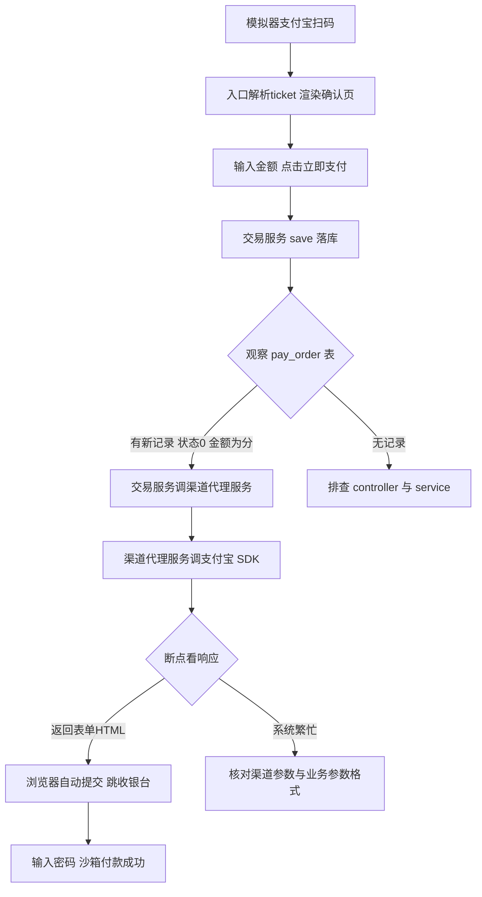

# 立即支付整体流程测试：模拟器扫码进确认页，一路调通沙箱支付

下单链路的代码全部就位，本课做验收：顾客扫码、确认页输入金额、点击立即支付、订单落库、渠道代理服务调支付宝、调起收银台、付款成功，一口气走完。测试跑在沙箱环境加模拟器上，链路每一段都可能出问题，所以这一课一半在测试步骤，一半在排查方法：订单清空观察落库、断点打在调 SDK 的根部、公私钥逐项核对、业务参数格式逐个对文档。课堂实录里还真踩中一个参数格式的坑，从「系统繁忙」修到付款成功，过程比结论更值钱。

## 先给结论

- 测试前置两条：支付入口地址 `pay.payurl` 必须配成模拟器能访问到的局域网 IP；渠道代理服务要的支付宝渠道参数必须先在商户平台配置好，编码 `ALIPAY_WAP`，保存进支付渠道参数表。
- 渠道参数里的 appid、应用私钥、支付宝公钥，从沙箱环境申请的账号与此前测试通过的代码里复制，手动输入错一个字符支付就失效；同步与异步通知地址测试期可先占位。
- 正常链路观察点按顺序是：订单写入 `pay_transaction` 库的 `pay_order` 表（`SJ` 前缀订单号、渠道 `ALIPAY_WAP`、金额分为单位、状态 `0`），交易服务日志出现支付宝下单响应，浏览器被表单带进收银台。
- 出现「系统繁忙，请稍后再试」时的排查顺序：先确认订单落库，再在渠道代理服务调支付宝 SDK 处打断点看响应，然后逐项核对渠道参数（公私钥、appid），最后核对业务参数格式；本课的坑就落在最后一步，过期时间没映射到支付宝要求的 `timeout_express` 参数。
- 修正参数映射后付款成功，day08 的 C 扫 B 链路全部打通，遗留问题只有一个：订单状态还停在 `0`，支付结果的获取交给下一阶段的 RocketMQ。

## 测试前置：让模拟器扫得进来

二维码是给手机扫的，测试用的手机是模拟器，所以支付入口地址必须配成模拟器可达的地址。Nacos 里交易服务的配置把 `pay.payurl` 指向局域网 IP，模拟器与宿主机在同一网段，扫码后浏览器才能请求到交易服务：

```yaml
pay:
  payurl: "http://192.168.x.x:56010/transaction/pay-entry/"
```

内网联调阶段用局域网 IP，这个键的值以后换成公网域名即可，代码不动。生成二维码的动作复用商户平台应用：Postman 登录商户账号请求二维码接口，返回的图片串对应一个入口 URL，模拟器里打开支付宝客户端扫码即可。

服务重启清单别漏：交易服务重启加载新代码，渠道代理服务也要重启，因为下单链路的最后一跳在它那里。注册中心的服务注册有几秒延迟，起服务后稍等再测，避免把「服务刚启动没注册上」误判成代码问题。

## 配置支付宝渠道参数

渠道代理服务调支付宝要两组参数，业务参数来自订单，渠道参数来自库里，后者要先配。商户平台进入应用管理，选中测试应用，在服务类型配置里找到 C 扫 B，它下面挂着微信与支付宝两个渠道，这里配置支付宝一项。表单里的参数名与 `AliConfigParam` 的字段一一对应：appid、应用私钥、支付宝公钥、支付宝网关、编码、签名类型、同步地址、异步通知地址。

沙箱账号在对接支付宝调研阶段申请过，公私钥也在此前的测试类里验证通过，直接从那里复制。私钥是长串 Base64 文本，手敲必错，复制粘贴后最好比对首尾几个字符。同步与异步通知地址此刻用不到，先随意占位，不影响下单。保存之后数据落进支付渠道参数表，可以在库里核对：

```sql
SELECT ID, APP_ID, PLATFORM_CHANNEL, PAY_CHANNEL, PARAM
FROM pay_channel_param
WHERE PAY_CHANNEL = 'ALIPAY_WAP';
```

`PARAM` 列就是一串 JSON，形如：

```json
{
  "appId": "example-appid",
  "rsaPrivateKey": "example-private-key",
  "alipayPublicKey": "example-public-key",
  "url": "https://openapi.alipaydev.com/gateway.do",
  "format": "json",
  "charest": "utf-8",
  "signtype": "RSA2",
  "returnUrl": "http://pay.example.com/transaction/pay-page",
  "notifyUrl": "http://pay.example.com/transaction/notify"
}
```

下单时交易服务按应用 id、服务类型 `shanju_c2b`、支付渠道 `ALIPAY_WAP` 三个条件查这张表，把 `PARAM` 反序列化成 `AliConfigParam` 传给渠道代理服务，配置与消费的闭环就在这里。

## 一路到收银台的观察点

整条链路与每一段的观察点如下图，测之前把观察点想好，出问题时才知道往回退到哪一格：



动手前把 `pay_order` 表清空，观察才干净。点击立即支付后刷新表：新增记录的 `TRADE_NO` 是 `SJ` 打头的长串，`CHANNEL` 是 `ALIPAY_WAP`，`SUBJECT` 与 `BODY` 是商品的标题描述，`TOTAL_AMOUNT` 输入 1 元这里是 100（库内单位是分），`TRADE_STATE` 是 `0`。这几列对上了，落库环节与金额换算就同时验完。

## 从「系统繁忙」到付款成功

真实测试里第一次点击立即支付，订单落库正常，支付宝却弹了「系统繁忙，请稍后再试」。这个报错来自支付宝侧，说明请求发出去了，被拒了。排查按嫌疑从高到低展开。

**第一嫌疑人永远是渠道参数。** 公钥、私钥、appid 三项只要错一个字符，签名就过不了。验证方式是在渠道代理服务调支付宝 SDK 的位置打断点，重新扫码走一遍，单步到 `pageExecute` 的返回处，观察响应内容；同时把断点里拿到的 appid、私钥、公钥逐项复制出来，与库里 `PARAM` 的值比对。课堂里比对了三项全部一致，渠道参数嫌疑排除。

**第二嫌疑人压在业务参数格式上。** 下单接口的响应既然拿到了，说明通信与签名都通，剩下的是支付宝对参数的校验。对着支付宝手机网站支付的接口文档逐项核对请求参数，发现过期时间一项有问题：代码里把 30 分钟的过期时间传了出去，但支付宝要求的参数是 `timeout_express`，格式为「数字加单位」的 `30m`，而渠道代理服务的组装代码里这个值没有映射到正确的参数位上。修正映射，让过期时间落进 `timeout_express`：

```java
//构造sdk的客户端对象
AlipayClient alipayClient = new DefaultAlipayClient(url, appId, rsaPrivateKey, format, charest, alipayPublicKey, signtype);
AlipayTradeWapPayRequest alipayRequest = new AlipayTradeWapPayRequest();
AlipayTradeWapPayModel model = new AlipayTradeWapPayModel();
model.setOutTradeNo(alipayBean.getOutTradeNo());//商户的订单号，就是闪聚平台的订单号
model.setTotalAmount(alipayBean.getTotalAmount());//订单金额（元）
model.setSubject(alipayBean.getSubject());
model.setBody(alipayBean.getBody());
model.setProductCode("QUICK_WAP_PAY");//产品码，固定为QUICK_WAP_PAY
model.setTimeoutExpress(alipayBean.getExpireTime());//订单超时时间，30m
alipayRequest.setBizModel(model);
alipayRequest.setReturnUrl(returnUrl);
alipayRequest.setNotifyUrl(notifyUrl);
//请求支付宝下单接口，发起http请求
AlipayTradeWapPayResponse response = alipayClient.pageExecute(alipayRequest);
```

渠道代理服务重启后再扫一次，确认页输入金额点击立即支付，收银台顺利调起，输入沙箱账号的支付密码，付款成功。回到订单表，那笔状态 `0` 的订单还安静地躺着，交易状态要等支付结果回来才会更新，这是下一阶段的主线。

排查方法比结论更值得带走：断点打在离第三方最近的位置，先确认「请求通不通」，再核对「参数对不对」；渠道参数是长字符串，人工比对要复制原值而不是肉眼扫；报错信息里的「系统繁忙」是支付宝的通用拒绝提示，它不代表任何具体原因，具体原因只能靠自己逐项排除。生产环境里这类位置还应该留日志，渠道代理服务在拿到响应后记一行：

```java
log.info("调用支付宝下单接口，响应内容:{}", response.getBody());
```

线上没有断点可打，这行日志就是排查的断点。

## 常见误区

- **支付入口配成公网或 localhost。** 错例：`pay.payurl` 指向本机回环地址，模拟器扫了码却连不上。正解：配置成模拟器网段可达的局域网 IP，上线再换公网域名。
- **渠道参数手工敲。** 错例：私钥公钥靠手抄，错一两位后报「系统繁忙」，还以为是代码问题。正解：从沙箱申请页与测试通过的代码里复制，保存后在库里核对首尾字符。
- **没配渠道参数就直接测下单。** 错例：应用没绑定支付宝渠道参数，下单时查参数为空，空指针藏在深栈里。正解：测试前置清单里先配参数，配置后用 SQL 核对 `PARAM` 内容。
- **观察点不清理。** 错例：订单表里残留旧数据，分不清哪笔是本次测试产生的。正解：测试前清空 `pay_order` 表，或按订单号前缀与时间过滤，一次只看一次点击的结果。
- **看到「系统繁忙」就改代码。** 错例：报错后到处乱改，越改越偏。正解：按「落库、响应、渠道参数、参数格式」的顺序逐项排除，每改一处只验证一件事。
- **把模拟器卡顿当故障。** 错例：模拟器网络不稳、页面加载慢，误判成接口失败反复重试，落下一堆重复订单。正解：模拟器环境网络波动是常态，重试前先看库与日志，确认上一次请求的真实结局。

## 面试可能被问到的问题

1. 面试官追问：「测试支付链路为什么要配局域网 IP，直接用域名不行吗？」
   答：模拟器里的支付宝客户端扫的是二维码里的 URL，这个 URL 必须是手机可达的地址。本地测试没有公网域名，宿主机与模拟器同处一个局域网，用局域网 IP 是最直接的可达方案；上线把配置键换成公网域名即可，代码无感知。
2. 面试官追问：「下单接口返回成功，但用户说收银台打不开，你怎么排查？」
   答：按链路从后往前确认。先看订单是否落库、下单响应是否拿到了表单 HTML；再核对渠道参数三项（appid、应用私钥、支付宝公钥）与库里配置一致；最后对照渠道接口文档核对业务参数格式，比如过期时间的 `30m`、产品码 `QUICK_WAP_PAY` 这类固定约定。每一步用断点或日志取证，不靠猜。
3. 面试官追问：「timeout_express 配错会怎样，订单过期到底谁说了算？」
   答：格式不符时支付宝忽略该参数，订单按渠道默认有效期处理，与平台侧 30 分钟不一致会造成「平台关单了支付宝还能付」的窗口。严谨做法是平台库里的 `expire_time` 与传给渠道的 `timeout_express` 同源配置，关单与过期以同一把尺子量。
4. 面试官追问：「测试时为什么要把订单表清空？不清理有什么风险？」
   答：清空是为了让观察点唯一，新增记录一定属于本次点击。不清理时新旧数据混杂，容易把历史订单的状态变化误判成测试结果，也会让重复下单、状态更新这类问题被掩盖。生产环境不能清数据，靠订单号与时间窗过滤达到同样目的。
5. 面试官追问：「沙箱测试通过，切生产环境要注意什么？」
   答：至少换四样东西：网关地址从沙箱切到生产网关，appid 与密钥换成正式应用的，渠道参数表里的配置随环境重建，通知地址换成公网可达地址。代码零改动是渠道参数配置化的价值，切环境只是换数据。
6. 面试官追问：「这轮测试通过后，支付链路还差什么？」
   答：差支付结果的获取与订单状态的流转。当前订单停在「订单生成」，用户是否付款平台并不知情，需要通过查询或通知拿到渠道侧的支付结果，再更新订单状态并驱动后续业务。结果获取涉及服务间异步通信与定时补查，是独立的一条技术线。

## 配套资料

- 讲义：`materials/docs/10/闪聚支付-第3章-C扫Bv1.1.md`，5.4.3 测试（生成二维码且 URL 可被模拟器访问、扫码进入支付确认页面、输入金额点击确认支付、订单写入闪聚平台数据库、验证支付宝下单接口是否成功）为本课出处；渠道参数配置的操作口径对应应用服务类型配置环节。
- 代码：`materials/code/10/完整代码/完整代码/` 归档中，渠道代理服务 service 工程的 `PayChannelAgentServiceImpl.java`（`createPayOrderByAliWAP` 组装 `AlipayTradeWapPayModel` 并调 SDK）、api 工程的 `dto/AlipayBean.java`、`conf/AliConfigParam.java`，交易服务的 `TransactionServiceImpl.java` 均为真实文件；`materials/code/10/基准代码/zip/` 归档含同一套文件的基准版本。正文代码为按 `com.study.pay` 系口径改写后的节选（归档内层工程目录与包名为课程原始命名，不在此展开），渠道参数 JSON 里的密钥为占位示例。
- 说明：该阶段课程资料归档在 `materials/docs/10/` 与 `materials/code/10/`（不存在 09 编号目录），引用路径截至该层级；沙箱网关为支付宝沙箱公开地址，测试用域名与 IP 均按博客口径以 `example.com` 或内网占位形式呈现。
