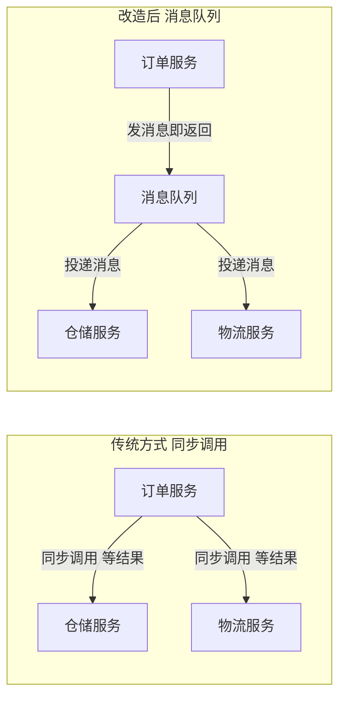
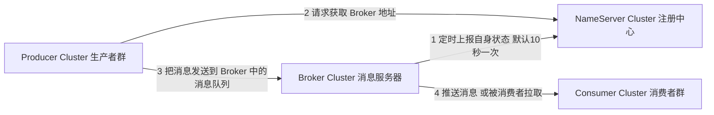
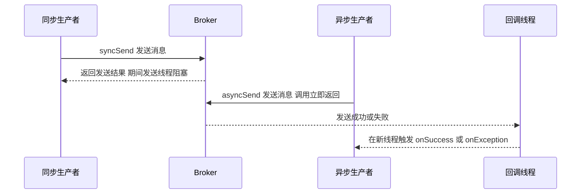
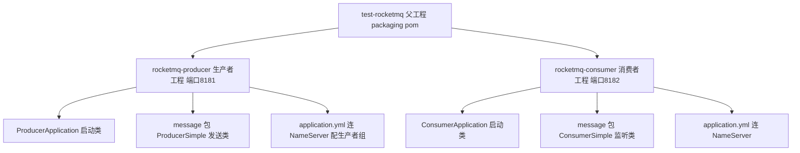
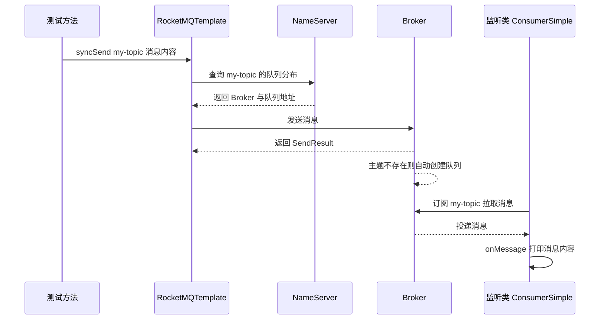
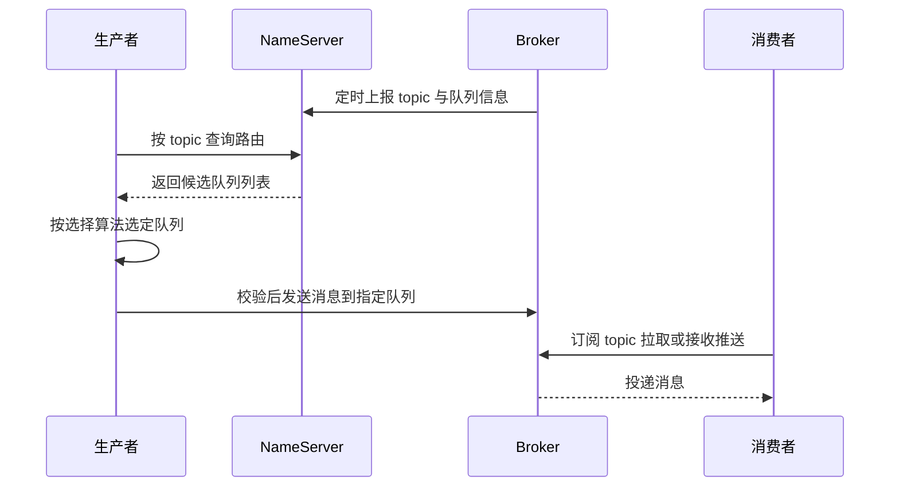
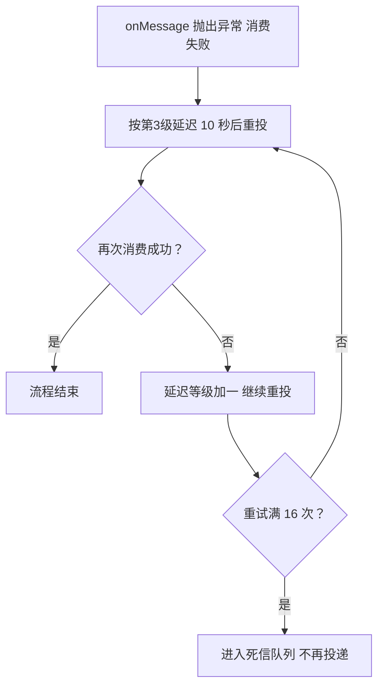

# RocketMQ 研究之基础合辑：选型理由、角色架构、三种发送方式与消息发送过程

## 先给结论

- 五篇内容构成 RocketMQ 的理论与上手主线：为什么需要 MQ、组成结构与安装、三种发送方式与消息结构、快速入门工程、消息发送过程与进阶要点。
- MQ 三大应用场景：任务异步处理、应用程序解耦合、日志收集；同步调用有顺序必须等结果，引入消息队列后发送方与接收方互不等待。
- 选 RocketMQ 的四个理由：支持事务消息、支持延迟消息、天然支持集群与负载均衡、失败消息支持指定次数和时间间隔重发；对比口径是 RabbitMQ 灵活但吞吐最弱、Kafka 吞吐最强但无事务与延迟。
- 四角色分工：Producer 发送、Broker 接收存储转发、Consumer 消费、NameServer 只做注册中心不碰消息；Broker 每 10 秒上报状态，超时 2 分钟判失效。
- 安装要点：解压到无空格无中文目录、runserver 与 runbroker 各调小一次内存、磁盘阈值提到 0.98；启动先 NameServer 后 Broker，Broker 带 `-n` 指明注册中心地址，自测跑官方示例。
- 三种发送方式看返回值区分：syncSend 有 SendResult 是同步，asyncSend 靠 SendCallback 回调，单向发完不管；消息结构分 topic、消息体、Flag 与 tag、keys、waitStoreMsgOK 等扩展属性。
- Spring 整合收口在 RocketMQTemplate：starter 一个依赖，nameServer 与 producer.group 两根定海神针，生产者三行核心代码，消费者一个注解一个接口即成。
- topic 自动创建默认 4 写 4 读共 8 个队列，多队列是为了高可用与并发；延迟消息固定 18 个等级从 1s 到 2h，消费重试复用这套等级，16 次后进死信队列，生产上通常重试两三次就落库转人工。

## 第1部分：RocketMQ 介绍：消息队列解决什么问题，聚合支付平台为什么选它

支付结果获取的需求分析已经把整条链路压在两条消息上：一条延迟消息决定「什么时候查」，一条结果消息决定「结果交给谁」，消息队列选型定为 RocketMQ。这个决定不能只凭一句「它支持延迟消息」就拍板，MQ 本身解决什么问题、RocketMQ 从哪来、它和市面上其他消息队列差在哪里，都得先摆出来看清楚。这一课是 RocketMQ 技术预研的第一课，地基打牢了，后面的安装、快速入门和支付链路实现才不会悬空。

### MQ 的三个应用场景

MQ 全称 Message Queue，翻译过来就是消息队列，可以把想象成一个存放消息的容器：生产者把消息放进去，消费者从里面取出来处理。它解决什么问题，用三个场景就能讲透。

**第一，任务异步处理。** 电商下单是最经典的例子。下单之后系统要通知仓储服务扣库存、通知物流服务创建运单，微服务架构下这是三个服务之间的交互。同步调用有两个绕不开的特征：一是调用有顺序，创建订单、调仓储服务、调物流服务依次进行；二是必须等待，仓储服务不返回结果，物流服务那一步就不会执行，整个链路被最慢的一环拖住。

```java
//同步调用示意（非工程真实代码）：每一步都要等上一步返回，链路被最慢的一环拖住
orderService.createOrder();               //1 创建订单
stockService.deductStock(orderId);        //2 调仓储服务扣库存，阻塞等待返回
logisticsService.createDelivery(orderId); //3 仓储服务不返回，这一步不执行
```

引入消息队列后形状完全变了：订单服务不再直接调用仓储与物流服务，而是发一条消息到消息队列，消息队列把消息投递给仓储服务和物流服务，两个服务各自接收消息做业务处理。

```java
//改造后示意（非工程真实代码）：订单服务发完消息即返回，扣库存与建运单由消费方异步完成
mqProducer.send("ORDER_CREATED_TOPIC", orderId); //不等任何下游的结果
```

两种方式的结构差异一眼就能看明白：



左边订单服务被两个下游串在一起，右边订单服务只认消息队列一个出口。不需要同步处理、耗时又长的操作交给消息队列通知接收方异步处理，应用程序的响应时间就是这么提上来的。

**第二，应用程序解耦合。** 没有消息队列时，订单服务必须知道仓储服务的接口才能调它，服务之间耦合得很紧。消息队列相当于一个中介，生产方通过它与消费方交互，双方互不知道对方的存在，只认消息。服务下线、扩容、更换实现，只要消息格式不变，另一方毫无感知。微服务开发里这种解耦手段非常常用。

**第三，日志收集。** 这个场景主要出现在大数据领域：采集系统从各服务的 log 日志文件里采集数据，源源不断地发送至消息队列；各日志需求服务从消息队列接收消息做分析处理，消息队列充当日志数据的中转站。采集端与分析端速率不一致也没关系，队列在中间缓冲。

异步也不是万能药。写成一、二、三的步骤，如果第三步必须依赖第二步的结果，那想都不用想必须同步执行；只有那些不需要同步处理、结果不阻塞后续动作的操作，才适合丢给消息队列。

### RocketMQ 从哪来

RocketMQ 是阿里开源的一款非常优秀的中间件产品，脱胎于阿里的另一款队列技术 MetaQ，后来捐赠给 Apache 基金会作为孵化项目，仅经历一年多时间就成为 Apache 顶级项目。它现在在阿里内部被广泛应用，经受过多次双十一极致场景的压力：2017 年双十一，RocketMQ 流转的消息量达到万亿级，峰值 TPS 达到 5600 万。官网 rocketmq.apache.org 上可以查到它的资料，课程使用的是 4.5.0 版本。

还有一点对开发者很实际：RocketMQ 内部用 Java 语言开发，遇到疑难问题时可以顺着源码往下读，排查与改造都比黑盒中间件容易。

### 市面上的消息队列与选型理由

市场上常见的消息队列有 ActiveMQ、RabbitMQ、ZeroMQ、Kafka、MetaMQ，Redis 也能实现简单的消息队列。本项目在这么多候选里选 RocketMQ，主要原因有四条：支持事务消息，支持延迟消息，天然支持集群与负载均衡，支持指定次数和时间间隔的失败消息重发。事务消息暂且按下不表，等用到时再展开；延迟消息正是需求分析里「下单后延迟一段时间查支付结果、未查到继续等」这条节奏的现成实现；失败重发保证了发消息失败会重试、消费失败也会重试，对支付这种不容丢数据的场景是硬能力。

三款主流消息队列的对比放在一张表里看：

| 对比维度 | RabbitMQ | RocketMQ | Kafka |
|---|---|---|---|
| 吞吐量（单机 TPS） | 1～2 万 | 5～10 万 | 高吞吐，海量堆积 |
| 事务消息 | 不支持 | 支持 | 不支持 |
| 延迟消息 | 支持 | 支持 | 不支持 |
| 失败消息重发 | 需手动设置 | 指定次数与间隔 | 不支持 |
| 消息重复消费 | 不支持 | 支持 | 支持 |
| 生态圈 | 较成熟 | 不如 Kafka | 用户多，生态完善 |
| 其他短板 | 不支持水平扩容，堆积后性能下降明显 | 不支持主从自动切换，只支持 Java | 依赖分区，消费者数量受限于分区数 |

RabbitMQ 基于 erlang 开发，高并发性能较好，支持 AMQP 协议，工作模式灵活，后台管理页面友好，但消息吞吐量在三款中最差，产生堆积后性能下降明显。Kafka 在高可用、高吞吐、低延迟上表现出色，技术生态圈完善，可它不支持事务消息，也没有指定次数和时间间隔的失败重发。RocketMQ 的 api 与架构设计更贴切业务场景，顺序消息、消息过滤、消息跟踪一应俱全；缺点也要认，生态圈与消息吞吐量、堆积能力都不如 Kafka。没有全能选手，只有合不合适的场景，支付平台要的事务与延迟能力恰好都在 RocketMQ 一边，选型由此定型。

## 第2部分：RocketMQ 组成结构与安装：四个角色各管什么，本机怎么跑起来

RocketMQ 的名字里带 Server 的角色不止一个，Producer、Consumer、Broker、NameServer 四个角色初见时很容易搅成一团：消息到底存在谁那里，NameServer 是不是也是一台存消息的服务器，为什么发消息前还要先问一次地址。安装环节同样埋着两个默认值地雷，默认内存 4g、磁盘利用率 85% 就拒收消息，开发机上几乎必踩。这一课把组成结构与安装两件事连着讲完，结构是安装的理解前提，装好又能反过来印证结构。

### 四个角色各管什么

消息队列的底层是经典的生产者消费者模式：一方生产，一方消费，中间隔着仓库。RocketMQ 把这个模式拆成了四个角色，看懂每个角色的职责，后面的所有概念都有了挂靠点。

**Producer Cluster，消息生产者群。** 负责发送消息的角色，一般由业务系统充当：下单的业务系统发订单消息，支付的业务系统发支付消息。生产者本身是个集群，多个业务实例可以同时往队列里发消息。

**Consumer Cluster，消息消费者群。** 负责消费消息，一般是后台系统负责异步消费。消费有两种模式：Push Consumer 由服务端向消费者端推送消息，消息到了就送上门；Pull Consumer 由消费者端定时向服务端拉取消息，自己掌握节奏。两种模式各有适用场景，Spring 整合方式下写的大多是 Push 形态的监听器。

**NameServer，名称服务器。** 它是集群架构中的组织协调员，作用相当于注册中心，收集 Broker 的工作情况，不负责消息的处理。微服务开发里注册中心这个概念已经不陌生，Nacos 干的就是这件事：服务提供方上报地址，消费方来查地址。NameServer 与 Broker 之间、NameServer 与生产者消费者之间，玩的正是同一套注册与发现的把戏。

**Broker，消息服务器。** 它是 RocketMQ 的核心，负责消息的接收、存储、发送等，前面反复说的「消息队列」物理上就长在 Broker 里面。Broker 需要定时发送自身状态到 NameServer，默认 10 秒发送一次，NameServer 超过 2 分钟收不到心跳就把该 Broker 判为失效。消息存哪、队列在谁那里，答案都是 Broker。

四个角色画在一张图上，谁连着谁、连线上写着什么，就是组成结构的全部：



图上四条连线正好对应四步交互，编号就是消息世界里一件事发生的先后顺序。值得注意的是没有任何消息流过 NameServer，它只当登记处，消息永远走生产者到 Broker、Broker 到消费者这两条直路。

四个角色名字里都带 Cluster 或集群的含义，这不是巧合而是必要。生产者做成集群，业务系统多实例并发发送互不影响；消费者做成集群，同一批消费任务可以分摊到多个实例；Broker 做成集群，单机宕机后消息队列还有别的节点顶上，高可用与并发能力都来自这里；NameServer 同样多节点部署，但它彼此之间不通信，各自独立提供查询，挂掉一台只是少一份地址簿副本。

把 RocketMQ 的角色与已经熟悉的微服务组件对照着看，陌生感会消掉大半：

| 微服务世界 | RocketMQ 世界 | 相同点 | 不同点 |
|---|---|---|---|
| 服务提供者 | Broker | 都是被发现、被调用的一方 | Broker 存的是消息，不是 HTTP 或 Dubbo 接口 |
| 注册中心 Nacos | NameServer | 都做登记与发现 | NameServer 只登记 Broker，不参与业务流量 |
| 服务消费者 | Producer 与 Consumer | 都要先查注册中心再干活 | 消息客户端查到的是队列分布，不是接口地址 |
| 注册与心跳 | Broker 定时上报 | 都靠心跳维持存活列表 | RocketMQ 失效判定周期是 2 分钟 |

这张表也解释了课程为什么把 RocketMQ 安排在微服务技术栈之后学：概念全部可以在 Nacos 那套体系里找到锚点，学新组件的成本只剩它的领域细节。

### 一条消息的完整旅程

把交互过程按时间轴走一遍。第一步，Broker 启动后定时向 NameServer 上报自身状态，NameServer 手里于是有了所有存活 Broker 及其主题、消息队列的信息。第二步，生产者要发消息时先请求 NameServer，拿到目标主题分布在哪些 Broker、哪些队列上。第三步，生产者按选择算法挑一个队列，把消息发过去。第四步，消费者从 NameServer 找到自己订阅的队列在哪个 Broker，订阅之后要么主动拉取，要么由 Broker 把消息推送过来。

四个步骤各有各的看点。上报是整个体系的地基，NameServer 的路由表全部来自 Broker 的主动汇报，它自己从不探测，也不持久化，重启后等下一轮上报就能把表重建起来，这就是它能保持无状态的底气。生产者查地址发生在发消息之前，查询结果会在客户端缓存一段时间，不是每条消息都跑一趟注册中心。消费者那边对称地做同一件事：连上 NameServer，查出订阅的主题落在哪些 Broker 哪些队列，然后开始监听，队列里一有新消息就处理。

这个结构与微服务架构里的调用惊人地相似：Nacos 里服务提供者注册、消费者发现，RocketMQ 里 Broker 上报、生产者消费者发现。理解了这一点，NameServer 为什么不需要处理消息、为什么它可以做成无状态的多节点集群，就都顺理成章了。Producer Cluster 与 Consumer Cluster 都可以有任意多个节点，Broker 也能横向扩，唯独 NameServer 保持极简，它丢的只是地址簿，消息本体从不经过它。

### 安装前的两处调整：内存与磁盘阈值

环境要求三条：64 位 JDK 1.8 以上、Maven 3.2 以上、64 位操作系统，课程在 Windows 上操作。版本用 4.5.0，下载 `rocketmq-all-4.5.0-bin-release.zip` 后解压，解压目录有一条硬要求：不能带空格和中文。解压出来的目录里真正要关心的是两个：`bin` 目录放执行脚本，`conf` 目录放配置，`lib` 里是它自身运行的依赖 jar，不用管。

RocketMQ 默认的启动参数是按服务器配的，直接在开发机上启动会出两类问题，各有一处要改。默认值不无道理：生产环境的 Broker 要扛海量消息，堆内存 4g 只是起步线，磁盘 85% 的警戒线也是为了给消息存储留足余量。开发机既没有那么多内存，磁盘也早被各种环境占掉大半，不改这两个默认值，安装这一步就会变成劝退一步。

第一处是内存。Broker 默认堆内存 4g，NameServer 也不小，开发机内存吃紧就起不来或者起来后拖垮整机。编辑 `bin` 目录下的 `runserver.cmd`，把 JVM 参数调小：

```bash
rem runserver.cmd 中找到 JAVA_OPT 一行，替换为小内存版本
set "JAVA_OPT=%JAVA_OPT% -server -Xms512m -Xmx512m -Xmn512m -XX:MetaspaceSize=128m -XX:MaxMetaspaceSize=320m"
```

Linux 环境对应的脚本扩展名是 `.sh`，参数内容相同。`runbroker.cmd` 里同样有一串 1g、2g 的默认值，把堆内存也换成 512m 级别。

第二处是磁盘报警阈值，这一处更容易让新手摸不着头脑。Broker 会自动检测所在磁盘的利用率，达到 85% 就拒绝再接收消息，直接报错。开发机的磁盘往往早就用掉七八成，把 RocketMQ 拷进去后很可能已经越过这条线，Broker 看起来启动正常却收不了消息。解决办法是在 `runbroker.cmd` 的 JVM 参数里加一个开关，把阈值提高到 0.98：

```bash
rem runbroker.cmd 中调整磁盘利用率报警阈值与内存
set "JAVA_OPT=%JAVA_OPT% -server -Drocketmq.broker.diskSpaceWarningLevelRatio=0.98 -Xms512m -Xmx512m -Xmn512m"
```

这个参数的含义是磁盘利用率到 98% 才报警拒收，开发环境腾出这一点余量足够用。两处修改都是改完保存即生效，不用重新编译什么，脚本内容本身就是启动参数的来源，下次启动按新参数执行。

安装这条线到此收尾，回过头看整段流程其实只有四个动作：下载解压、改两个脚本、按顺序启动、跑官方示例自测。中间每个动作背后都站着组成结构里的一个知识点，改内存对应 Broker 的存储与并发开销，改磁盘阈值对应消息落盘的检查策略，`-n` 参数对应 Broker 的注册行为，`NAMESRV_ADDR` 对应客户端的发现行为。结构没学明白就装，每一步报错都像玄学；结构装进脑子再装软件，报错信息自己会说话。

### 启动与自测：让官方示例替你验证安装

启动顺序是先 NameServer 后 Broker。进入 `bin` 目录，双击或命令行执行 `mqnamesrv.cmd`，NameServer 起来后窗口停在那里监听默认端口 9876。接着启动 Broker，它比 NameServer 多一个参数 `-n`，用来告诉 Broker 该向哪个 NameServer 注册：

```bash
cd F:\devenv\rocketmq-all-4.5.0-bin-release\bin
mqnamesrv.cmd
::另开一个窗口
mqbroker.cmd -n 127.0.0.1:9876
```

`-n` 后面的 `127.0.0.1:9876` 是本机地址加 NameServer 默认端口。这一步省不得：Broker 不带注册中心地址就等于一个人找不到组织，消息没人能路由到它。

装完不能只看窗口没报错，得发一条真消息验证。RocketMQ 自带的测试工具是 `tools.cmd`，它背后是发布包里 `org.apache.rocketmq.example.quickstart` 包下的 Producer 与 Consumer 两个示例类。运行它们之前还有一步容易漏：示例类自己不知道 NameServer 在哪，要先设置环境变量：

```bash
::发送消息：先设 NameServer 地址，再跑官方生产者示例
set NAMESRV_ADDR=127.0.0.1:9876
tools.cmd org.apache.rocketmq.example.quickstart.Producer
::另开一个窗口，同样先设地址，再跑官方消费者示例
set NAMESRV_ADDR=127.0.0.1:9876
tools.cmd org.apache.rocketmq.example.quickstart.Consumer
```

生产者窗口刷出一串 `SendResult` 与消息 ID，说明消息发出去了；消费者窗口滚动出 `Receive New Messages`，说明消息被取走了。两个窗口同时滚动的那一下，就是安装成功的时刻。还有个更直观的玩法：生产者先连发几十条消息，再启动消费者，能看到消费者把堆积的消息一口气全接走，这正好演示了 Broker 的存储能力，消息先落库、消费者随时来取，两边完全不用碰头。

这里有个反例值得记住：漏掉 `set NAMESRV_ADDR` 直接跑示例，报错是 `No name server address`，原因正是组成结构里讲的那一步，生产者必须先从 NameServer 拿 Broker 地址，不知道地址自然寸步难行。消费者窗口在消费完堆积消息后不会退出，它要保持监听等新消息，光标一直闪是正常状态；生产者示例发完消息进程就结束了，两个窗口的生命周期差异，本质就是发送与监听两种行为模式的差异。

### 管理端 rocketmq-console：把黑窗口换成图形界面

命令行自测通过后，日常运维需要一个看得见摸得着的界面。RocketMQ 官方提供了 UI 管理工具 rocketmq-console，它只有源码，是一个标准 Maven 工程，要用 Maven 打包后运行。课程资料包里已经带了源码压缩包，解压后改三个配置，位置在 `src/main/resources/application.properties`。

这三个配置各管一摊。`server.port` 是管理端自己的 Web 端口，讲义示例用 9877，刻意避开 NameServer 的 9876，也避开 Spring Boot 默认的 8080，免得跟其他服务撞车。`namesrvAddr` 是管理端连 NameServer 的地址，管理端自己也是个客户端，要看集群数据同样得先问注册中心，连远程集群时必须如实填写。`dataPath` 是它落数据与日志的目录，随便指一个空间够用的位置即可，管理端不存业务消息，这里只是查询缓存与运行日志。

```yaml
server.port=9877                     #管理端自己的服务端口
rocketmq.config.namesrvAddr=127.0.0.1:9876   #NameServer 地址
rocketmq.config.dataPath=/tmp/rocketmq-console/data  #数据与日志存放路径
```

管理端本身也要连 NameServer，`namesrvAddr` 就是干这个的；连远程 NameServer 时这一项必须如实填写，本机默认值可以不配。改完在工程根目录打包：

```bash
mvn clean package -Dmaven.test.skip=true
cd target
java -jar rocketmq-console-ng-1.0.1.jar --server.port=9877 --rocketmq.config.namesrvAddr=127.0.0.1:9876
```

打包要联网下载依赖，跳过测试能省不少时间。启动时通过命令行参数把端口和 NameServer 地址再传一遍，命令行参数的优先级高于配置文件，配置文件里写没写都不影响。浏览器访问 `http://127.0.0.1:9877`，控制台支持简体中文，Broker 运行趋势、Topic 列表、消息查询都能看到，后续课程每发一条消息都会来这里验货。

控制台里最常用的三块功能对应三种排查场景。集群页看 Broker 的存活与收发量，Broker 掉线最先在这里现形；Topic 页看主题与队列的分布，消息发到哪了、积压多少一目了然；消息查询页按主题与时间检索消息，配合 `keys` 索引键能精确定位一条消息，排查「消息到底发出去没有」这类问题时比翻日志快得多。

## 第3部分：三种消息发送方式与消息结构：一条 RocketMQ 消息长什么样，怎么送出去

组成结构已经装进脑子：生产者把消息发到 Broker，消费者从 Broker 拿。动手写快速入门程序之前还差两块拼图，发消息这个动作有几种做法、一条消息由什么组成。同一次「发送」，等不等 Broker 的回执、要不要结果，对应着三种完全不同的发送方式；而消息本身也不是一个裸字符串，主题、消息体、标记、扩展属性各有各的用处。这两块知识直接决定后面支付链路里那条延迟消息怎么写。

### 同步、异步、单向：等与不等的三档

生产者向 Broker 发消息，本质上是一次网络请求，请求发出去之后怎么对待 Broker 的回应，就是三种发送方式的分野。

**同步消息，sync message。** 生产者向 Broker 发送消息，执行 API 时同步等待，直到 Broker 返回发送结果才继续往下走。跟当初讲同步调用时的语义一模一样：不拿到结果，代码不往下执行。好处是发送结果当场可知，消息发没发成功、存没存上，返回的 `SendResult` 里写得明明白白，可靠性最强，代价是发送线程被挂住等一个来回。

**异步消息，async message。** 生产者发送消息时指定发送成功与发送异常两个回调方法，调用 API 后立即返回，发送线程不阻塞；消息最终成功还是失败，由一个新线程执行回调来通知。注意区分两件事：调用返回只代表消息交出去了，真正的结果在回调里拿，成功走 `onSuccess`，失败走 `onException`。它适合发送方不想被 Broker 的处理耗时拖住、但仍然在乎结果的高并发场景。

**单向消息，oneway message。** 生产者把消息发出去就完事，不等待 Broker 服务器的结果，连回调机制都没有。至于 Broker 收没收到、存没存上，发送方一概不关心。它的代价是可靠性最弱，换来的是发送开销最小，适合对丢失有一定容忍度的场景，例如周期性的心跳、指标上报。

三种方式摆进一张时序图，等待策略的差异一目了然：



图上单向消息没有位置，因为它连第二行都没有：发出即结束，后续什么都不会发生。选择口诀可以记成「要结果用同步，要通知用异步，可丢才用单向」，绝大多数业务消息落在前两档。

### 消息结构：基础属性与扩展属性

消息要发，得先知道消息由什么构成。RocketMQ 的消息包括基础属性和扩展属性两部分，快速入门程序里每一项都会碰到。

**基础属性一：topic，主题。** 相当于消息的一级分类，具有相同 topic 的消息将发送至该 topic 下的消息队列中。电商系统可以按业务划出商品消息、订单消息、物流消息，Broker 里对应建商品主题、订单主题，发商品消息就发到商品主题下的消息队列里。每个主题下面挂着一批消息队列，发送时指定主题，消息就进到该主题下的某一个队列。发消息必须指定 topic，这是所有发送方式共同的前提。

**基础属性二：消息体。** 即消息的内容，可以是字符串、对象等可序列化的类型，实际开发中习惯把对象转成 JSON 串发送，扩展性最好。消息体的最大长度是 4M，超长的内容应该拆分或者把大块数据放到别处、消息里只放引用。

**基础属性三：消息 Flag。** 一个标记字段，RocketMQ 本身不处理它，留给业务系统自行使用。

**扩展属性一：tag。** 相当于消息的二级分类，用于消费消息时进行过滤，可为空。主题管大类，tag 管大类下面的小类，同一个订单主题下可以再用 tag 区分订单创建、订单支付、订单关闭，消费者订阅时声明只吃哪几个 tag。

**扩展属性二：keys。** 消息的索引键，运维中可以根据这些 key 快速检索到消息，可为空。排查「某笔订单的消息到底发出去没有」时，拿订单号当 key 一查便知，这是消息跟踪的抓手。

**扩展属性三：waitStoreMsgOK。** 消息发送时是否等消息存储完成后再返回，是个存储侧的确认开关。

把属性整理成一张速查表：

| 属性 | 定位 | 是否必填 | 用途 |
|---|---|---|---|
| topic | 基础属性，一级分类 | 必填 | 决定消息进入哪个主题下的队列 |
| 消息体 | 基础属性 | 必填 | 业务内容，字符串或可序列化对象，上限 4M |
| 消息 Flag | 基础属性 | 可空 | RocketMQ 不处理，留给业务系统 |
| tag | 扩展属性 | 可空 | 二级分类，消费端过滤 |
| keys | 扩展属性 | 可空 | 索引键，运维检索消息 |
| waitStoreMsgOK | 扩展属性 | 有默认值 | 是否等待存储完成再返回 |

着重要记住的是 topic 与消息体这两项：一个决定消息去哪，一个装着业务内容，快速入门程序里发送消息的最小参数组合就是它们俩。

### 发送侧的代码形状

三种方式落到 Spring 整合的代码上，就是 RocketMQTemplate 的三个方法。模板类的套路在 Redis、JDBC 那里都见过，注入即用。对照讲义的示例，把三种方式并排放在一起看差异：

```java
//三种发送方式对应 RocketMQTemplate 的三个方法（节选自课程示例类的写法）
//1 同步消息：阻塞等待，拿到 SendResult 才返回
SendResult sendResult = rocketMQTemplate.syncSend("my-topic", "第一条同步消息");

//2 异步消息：立即返回，结果在回调线程里拿
rocketMQTemplate.asyncSend("my-topic", "第一条异步消息", new SendCallback() {
    @Override
    public void onSuccess(SendResult sendResult) {
        System.out.println(sendResult.getSendStatus()); //发送成功回调
    }
    @Override
    public void onException(Throwable e) {
        System.out.println(e.getMessage()); //发送异常回调
    }
});

//3 单向消息：发完即返回，无任何结果
rocketMQTemplate.sendOneWay("my-topic", "一条单向消息");
```

同步方式拿到 `SendResult`，里面有发送状态与消息 ID；异步方式把成败的处理权交给回调对象；单向方式连参数都最少。三个方法共用同一个模板对象，切方式只是换方法名，这让后续根据场景升级发送策略的成本极低。异步发送的测试要注意一点，主线程发完就退了，回调线程可能还没来得及执行，测试代码里需要暂停几秒给回调留出时间窗口。

消息结构在这里也能对上号：方法第一个参数就是 topic，第二个参数会被包装进消息体；tag 与 keys 在需要过滤和检索的场景通过消息构造工具补上，简单场景可以全省。

## 第4部分：RocketMQ 快速入门：搭起生产者与消费者两个工程，把第一条消息送进队列

结构与安装都就位了，NameServer 与 Broker 在本机跑着，管理台也开了。这一课把快速入门程序完整写出来：一个生产者工程往队列里发消息，一个消费者工程把消息收回来。程序虽小，骨架一样不缺，Spring Boot 工程该有的依赖、配置、启动类、业务类、测试类一个不少；后面支付结果查询链路里的生产消息与消费消息，写法与这里一模一样，只是消息内容换成了订单。

### 工程怎么搭：一个父工程带两个子工程

快速入门虽然叫「快速」，该有的工程规范一样要有。在聚合支付工程下面新建一个 test-rocketmq 工程，专门用来做 RocketMQ 的功能测试，它下面再挂两个子工程：rocketmq-producer 负责发消息，rocketmq-consumer 负责收消息。结构是标准的 Maven 聚合：



创建顺序值得复述一遍，因为父工程选错是新手最常见的翻车点。先建 test-rocketmq，父工程选择聚合支付的根工程；再建 rocketmq-producer 与 rocketmq-consumer 时，父工程不要选聚合支付根工程，而要选刚才建好的 test-rocketmq，源码路径也要落在 test-rocketmq 目录下面。两个子工程的 pom 因此都继承自 test-rocketmq。

父工程的 pom 承担两件事，声明打包方式为 pom，把公共依赖集中管理：

```xml
<parent>
    <artifactId>study-pay</artifactId>
    <groupId>com.study.pay</groupId>
    <version>1.0-SNAPSHOT</version>
</parent>
<modelVersion>4.0.0</modelVersion>
<packaging>pom</packaging>
<artifactId>test-rocketmq</artifactId>
<dependencies>
    <dependency>
        <groupId>org.apache.rocketmq</groupId>
        <artifactId>rocketmq-spring-boot-starter</artifactId>
    </dependency>
    <dependency>
        <groupId>org.springframework.boot</groupId>
        <artifactId>spring-boot-starter-test</artifactId>
    </dependency>
    <dependency>
        <groupId>org.springframework.boot</groupId>
        <artifactId>spring-boot-starter-web</artifactId>
    </dependency>
    <dependency>
        <groupId>org.projectlombok</groupId>
        <artifactId>lombok</artifactId>
    </dependency>
</dependencies>
```

四个依赖各司其职：rocketmq-spring-boot-starter 是主角，RocketMQ 与 Spring Boot 的整合能力全在它里面；starter-test 支撑单元测试；starter-web 引入 Spring MVC，工程能作为 Web 服务启动；lombok 省掉模型类的样板代码。依赖写在父工程上，两个子工程自动继承，子工程自己的 pom 只需要声明 artifactId 与父工程指向：

```xml
<parent>
    <artifactId>test-rocketmq</artifactId>
    <groupId>com.study.pay</groupId>
    <version>1.0-SNAPSHOT</version>
</parent>
<modelVersion>4.0.0</modelVersion>
<artifactId>rocketmq-producer</artifactId>
```

把测试工程挂在聚合支付工程下而不是单独另起，好处是版本管理与依赖清单跟主工程保持一致，RocketMQ 客户端的版本号由根工程统一锁定，避免测试环境与真实业务环境各用一套版本。这也是子工程 pom 里依赖都不写版本号的原因：版本统一交给父级管理，子工程只声明用什么，不声明用哪个版本，升级时改一处即可全局生效。这是课程工程组织的惯例，也是企业里多模块项目的通行做法。

目录本身按 Maven 约定落位：每个子工程下 `src/main/java` 放源码，`src/main/resources` 放 `application.yml`，`src/test/java` 放测试类。别看这是常识，快速入门里最隐蔽的一个坑就藏在源码的位置上：启动类 `@SpringBootApplication` 默认只扫描它自己所在包及子包，发送类与监听类必须落在启动类的同级或下级包里，本课统一放在 `com.study.pay.test.rocketmq` 下正是为此。如果随手把监听类挪进了别的包，应用照样能启动，日志一片祥和，唯独消息永远收不到，这类「看起来都配了、就是不生效」的问题，排查方向就是组件扫描的覆盖范围。

两个子工程各要一个启动类，标准的 Spring Boot 写法，包名按 `com.study.pay` 系口径落在 `com.study.pay.test.rocketmq` 下面：

```java
@SpringBootApplication
public class ProducerApplication {
    public static void main(String[] args) {
        SpringApplication.run(ProducerApplication.class, args);
    }
}
```

消费者工程的 ConsumerApplication 除类名不同外完全同构。到这里两个工程的骨架就立住了，剩下的血肉是配置文件与业务类。

### 两个 application.yml：地址、端口与生产者组

配置文件是两个工程唯一有实质差别的地方，也是能否连上 RocketMQ 的命门。

```yaml
#生产者工程 application.yml
server:
  port: 8181 #服务端口
  servlet:
    context-path: /rocketmq-producer

spring:
  application:
    name: rocketmq-producer #指定服务名
rocketmq:
  nameServer: 127.0.0.1:9876
  producer:
    group: demo-producer-group
```

```yaml
#消费者工程 application.yml
server:
  port: 8182 #服务端口
  servlet:
    context-path: /rocketmq-consumer

spring:
  application:
    name: rocketmq-consumer #指定服务名
rocketmq:
  nameServer: 127.0.0.1:9876
```

逐项拆开看。`server.port` 一个 8181 一个 8182，两个工程要在同一台机器上同时启动，端口必须错开；`context-path` 与 `spring.application.name` 是 Spring Boot 的常规配置，与 RocketMQ 无关。真正的关键在 `rocketmq` 段：`nameServer` 指向本机 9876 端口，两个工程都要配，生产者要来查 Broker 地址发消息，消费者要来查队列位置做监听，谁缺了这一项谁都连不上。

差别在 `producer.group` 这一项：生产者组只有生产者工程配了，消费者工程没配。生产者组把同一个业务的生产者实例圈成一个集群，现阶段先把名字记下，等讲到事务消息时它的回查机制会用到。消费者工程是纯消费方，不生产消息，生产者组可以省略；但真实生产环境里一个服务往往既是某些消息的生产者又是另一些消息的消费者，届时两项都要配全。

除了必填项，starter 还留了一批按需启用的调优参数，最常用的是生产者侧的两个（以下为通用参数示例，工程里用到哪项再配哪项）：

```yaml
rocketmq:
  nameServer: 127.0.0.1:9876
  producer:
    group: demo-producer-group
    send-message-timeout: 3000 #同步发送的等待上限，毫秒
    retry-times-when-send-failed: 2 #同步发送失败后的自动重试次数
    retry-times-when-send-async-failed: 2 #异步发送失败后的自动重试次数
    max-message-size: 4194304 #单条消息上限，字节，默认 4MB
```

`send-message-timeout` 管住 `syncSend` 的阻塞时长上限，默认 3000 毫秒，业务主流程里发消息不想被 Broker 的瞬时抖动拖死，就在这一项上权衡；`retry-times-when-send-failed` 是同步发送失败时客户端自动补发的次数，重试用尽仍失败才把异常抛给调用方，发送可靠性因此又多了一层客户端兜底；`retry-times-when-send-async-failed` 是异步链路的对应项，重试用尽走的是 `onException` 回调，不抛异常。`max-message-size` 是客户端发送前的第一道门，超限直接抛异常进不来 Broker，与 Broker 侧的 4M 校验互为呼应；消息体超过压缩阈值（默认 4096 字节）还会先压缩再传输，这几个参数都不配就吃默认值，入门阶段保持默认即可，知道它们在哪，遇到发送瓶颈时才有处下手。

消费者一侧的可调参数大多写在 `@RocketMQMessageListener` 注解上，例如消费模式 `consumeMode`（并发消费或顺序消费）、消息模式 `messageModel`（集群消费或广播消费）、消费线程数 `consumeThreadMax`、消费超时 `consumeTimeout`，注解里不声明就吃默认值，可用项以工程锁定的 starter 版本为准。键名风格是 starter 的宽松绑定，`nameServer` 写成 `name-server` 一样生效，只是团队内部要统一，别一个工程一个写法。

依赖版本这件事也值得留一句。`rocketmq-spring-boot-starter` 自身锁定了一版配套的 `rocketmq-client`，课程工程锁的是 2.0.2，对应的客户端是 4.4.0 一代，两者是配套关系。企业里升级 starter 时要连着确认客户端版本，随手在子工程里再引一个高版本 `rocketmq-client` 盖掉它，启动可能没事，运行期的行为差异就难查了，版本统一交给父工程管理正是为了堵这类口子。

### 生产者：RocketMQTemplate 的模板套路

Spring 全家桶对接中间件有个惯例，JdbcTemplate、RedisTemplate、RestTemplate，一个模板类包掉所有繁琐的连接管理与协议细节，RocketMQ 也不例外。rocketmq-spring-boot-starter 引入后，容器里就有一个现成的 RocketMQTemplate，注入即可发消息。

在 `message` 包下建发送类：

```java
@Component
public class ProducerSimple {

    @Autowired
    private RocketMQTemplate rocketMQTemplate;

    /**
     * 发送同步消息
     * @param topic 主题
     * @param msg 消息内容
     */
    public void sendSyncMsg(String topic, String msg){
        SendResult sendResult = rocketMQTemplate.syncSend(topic, msg);
        System.out.println(sendResult);
    }
}
```

`@Component` 让 Spring 接管实例化，`@Autowired` 注入模板，发送方法只有一行 `syncSend(topic, msg)`：第一个参数是发往哪个主题，第二个参数是消息内容。方法名里的 Sync 表明这是同步发送，调用会阻塞到 Broker 返回结果，返回值 `SendResult` 里带着发送状态、消息 ID 与这条消息落在了哪个队列，发送状态正常情况下是 SEND_OK，出了问题则可能是超时或异常直接抛出。模板上还有一批重载与其他发送方法，多出来的参数能控制发送超时时间、延迟等级，异步、单向、带延迟等级的发送在后面的课程里逐个登场。

光写好类还不够，得有个入口触发它。测试类用 Spring Boot 的测试框架，把容器拉起来再调发送方法：

```java
@SpringBootTest
@RunWith(SpringRunner.class)
public class ProducerSimpleTest {

    @Autowired
    private ProducerSimple producerSimple;

    //测试发送同步消息
    @Test
    public void testSendSyncMsg(){
        this.producerSimple.sendSyncMsg("my-topic", "第一条同步消息");
        System.out.println("end...");
    }
}
```

`@SpringBootTest` 会启动完整的 Spring 上下文，所以发送类能被注入进来；`@RunWith(SpringRunner.class)` 是 JUnit 4 搭配 Spring 的固定写法。测试方法里传了两个值：主题 `my-topic` 是随手起的分类名，消息内容是句中文。运行之前有个前提，NameServer 与 Broker 必须都活着，测试一跑容器要连 NameServer，连接不上直接报错。

执行测试，控制台打出 `end...` 表示发送流程走完。此刻消息已经在 Broker 的队列里躺着了，打开管理台能看到 `my-topic` 这个主题凭空出现，消息查询里躺着刚才那条内容。主题并没有人事先创建，生产者发送时发现主题不存在，会自动创建出来，默认给每个主题配一组读写队列，管理台上的主题列表因此会随着测试不断变长。

### 消费者：一个注解加一个接口

消费者工程与生产者的形态不同，它不主动调什么，而是站在原地监听，等消息找上门。监听怎么写？一个注解声明「我听谁」，一个接口规定「听到的消息交给哪个方法」：

```java
@Component
@RocketMQMessageListener(topic = "my-topic", consumerGroup = "demo-consumer-group")
public class ConsumerSimple implements RocketMQListener<String> {

    //接收到消息调用此方法
    @Override
    public void onMessage(String msg) {
        //此方法被调用表示接收到消息，msg 形参就是消息内容
        //处理消息...
        System.out.println(msg);
    }
}
```

`@RocketMQMessageListener` 的两个参数对应两个必须搞清的概念。topic 是监听的主题，必须与发送方写入的主题一字不差，这里就是 `my-topic`；消费者一启动就会连 NameServer，查出这个主题分布在哪些 Broker 的哪些队列上，然后驻守在那里。consumerGroup 是消费组，相同消费组的消费者共同消费该主题的消息，它们组成一个集群：同组内多个实例时，一条消息只被其中一个实例处理，负载就这样天然分摊；不同消费组之间互不干扰，各自都能收到全量消息，广播给多个业务方的需求靠多建消费组实现。

泛型 `RocketMQListener<String>` 声明了消息内容的类型，`onMessage` 的形参就是 Broker 投递来的消息内容。方法被调用即表示接收到消息，方法体里就该写业务逻辑了，示例只打印一下，真实系统里这里是更新订单、发通知的完整事务。`@Component` 同样不可少，监听类要交给 Spring 容器，starter 扫描到注解才会替它建立与 Broker 的订阅关系。

验证方法是让两个工程碰个头。启动消费者工程，控制台安静地驻守；跑到生产者工程再执行一次测试发第二条消息，消费者控制台几乎同时打出消息内容。还有一个现象值得注意：如果消费者启动时主题里已经堆着此前发的消息，启动瞬间会把这些历史消息一并消费掉，因为消息一旦进入 Broker 就持久保存，消费者任何时候上线都能接着吃，这正是「先发后收也能通」的原因。

消费是否正常，管理台上有一个专门的页签可以量化。消费者页列出每个消费组对每个主题的消费进度：已消费多少条、还堆积多少条、最近消费时间是什么时候。堆积量持续增长说明消费能力跟不上生产速度，最近消费时间长期不动说明消费者掉线了，这两个指标是运维监控队列健康度的基本盘，快速入门阶段就养成看它的习惯，后面排查支付链路时会省很多力气。

### 端到端跑通一遍

把三段代码的协作画成一张时序图，整条链路就完整了：



跑通的检查清单固化成操作序列：启动 NameServer，启动 Broker，启动消费者工程等它驻守，执行生产者的测试方法，观察消费者控制台输出，再到管理台核对主题与消息。六步里任何一步报错，都回到组成结构去找原因：连不上先看 NameServer 活着没有，发送失败再看 Broker 有没有注册上去，收不到消息核对 topic 与 consumerGroup 是否两端一致。

两类高频报错的现场值得提前认一认。测试一跑就抛连接异常、日志里反复出现连不上 9876，十有八九是 NameServer 没启动，或者配置文件里 `rocketmq.nameServer` 写错了端口；发送阶段卡住几秒后超时，NameServer 正常却报 send failed，多半是 Broker 没起来或没带 `-n` 参数注册，NameServer 的路由表里根本没有可用节点。对照组成结构的四步交互，报错发生在查路由还是发消息的阶段，问题范围立刻缩小一半。

把这些现场整理成一张对照清单，排查时按报错关键字对号入座：

```text
报错关键字                                    根因方向                动作
RemotingConnectException: connect to ...9876  NameServer 不可达      先启 mqnamesrv，再核对配置里的地址端口
No route info of this topic                   路由表查不到主题        检查 Broker 是否带 -n 注册；确认自动建主题没被关掉
SendResult 非 SEND_OK / 发送超时               Broker 收下了但处理慢  看 Broker 日志、磁盘水位与网络
Port 8181 was already in use                  两个工程端口冲突       改 application.yml 的 server.port，一个服务一个端口
```

`No route info of this topic` 单独多说一句。发送端按 topic 问 NameServer 查路由，路由表里查不到就抛它。触发它的路径有两条：Broker 压根没注册上（启动时漏了 `-n` 参数，组成结构一节的老朋友），或者 Broker 侧关掉了主题自动创建（`autoCreateTopicEnable` 配置为 false 时，没人事先建好的主题一律拒绝）。本地快速入门默认开启自动创建，企业集群通常关闭，走审批预建，这个差异决定了同样的代码在开发机能跑、在测试环境报错。

消费端无声无息不打印，是另一类要单独对待的现象，因为它不报错，只沉默。核对顺序：主题名两端是否一字不差，消费组是否与发送方预期的分组一致，监听类是否落在启动类的扫描范围内，最后确认消费者工程真的活着（管理台消费者页里能看到它在线）。四步对完，绝大多数「收不到」都能定位到具体一格。

回头看快速入门的两组代码，生产者与消费者的知识量其实非常有限。生产者的要点是模板类加两个必填参数，topic 决定发往哪个分类下的队列，msg 是消息内容；消费者的要点是监听注解的两个参数加一个接口实现，topic 决定监听哪个分类，consumerGroup 决定和谁组成消费集群。掌握到这里，RocketMQ 的基本使用就算过关，后面的消息发送过程、延迟消息、消费重试，都是在这副骨架上添细节。

### 把入门骨架长成支付链路的雏形

入门程序的价值不止于跑通，它和支付结果查询链路是同一副骨架的两档形态，几处差异提前对照，后面落地时就能按图施工。

**一处是命名从随手起变成有规矩。** `my-topic` 这种主题名只在演示里成立，真实链路里订单查询主题、支付结果主题各有专名，消费组、生产者组同理，见名知角色，管理台上几十个主题与几十个组混在一起时，前缀就是第一眼的位置感。

**一处是消息内容从字符串变成统一载体。** 入门发的 `msg` 是句中文字符串，支付链路里换成统一的响应结构对象，订单号、渠道标识、支付状态、渠道参数都在里面，生产端转 JSON、消费端转回对象，这套自定义消息格式的做法前一课刚练过，直接平移。

**一处是配置从写死在工程里变成集中管理。** 演示工程把 NameServer 地址写进各自的 `application.yml` 没有问题，真实微服务里这个地址要放进配置中心的共享配置，谁要用谁引入一份，改地址时一处生效，不用逐个工程翻配置文件。聚合支付项目的配置组织方式与此一致，服务本地只留少量自持配置，公共配置交给配置中心。

**一处是收发角色从同进程变成跨进程。** 入门程序的发送与接收在同一台机器的两个工程里完成，支付链路里发送方与接收方是渠道代理服务与交易服务两个独立部署的服务，骨架还是生产者、Broker、消费者三段，只是两端分属不同团队维护的进程，出问题时按进程边界划分排查范围反而更清晰。入门阶段把每一环单独跑通的功夫，到这里全部兑现成跨服务联调时的底气。

## 第5部分：RocketMQ 进阶五连：消息发送过程、异步回调、JSON 载荷、延迟消息与消费重试

快速入门把一条同步消息发了出去、消费者也收到了，很多人对 RocketMQ 的认识就停在这里，一旦被追问立刻露怯：新建一个 topic，管理端里凭空多出 8 个队列，为什么？`asyncSend` 调完就返回，发送成功与否谁来告诉我？消息体只能塞字符串，那订单对象怎么传？想等 10 秒再把消息投给消费者，哪里设置？消费者一直抛异常，这条消息会不会被折腾到天荒地老？这五个问题背后是五个进阶知识点，而且环环相扣：弄懂发送过程才知道队列与路由，会选发送方式才知道结果怎么回，会自定义消息格式才知道载荷长什么样，会延迟消息才编得出「过会儿再查」的节奏，会消费重试才守得住最后一道可靠性防线。聚合支付项目选 RocketMQ，看中的正是这套完整能力，预研阶段把每一环都吃透，后面接支付结果查询才不会心里发虚。

### 一条消息从生产到消费的完整路径

把发送过程摆出来之前先建立一个层次感：一个 Broker 下挂多个 topic，一个 topic 下挂多个消息队列，队列才是消息真正的落点。生产者调用发送 API 时给的是 topic，但消息最终要写进某个 Broker 的某个具体队列，这个「选哪个」的动作就发生在发送之前。它为什么要先去问 NameServer？因为 Broker 会把自己的 topic 与队列信息定时上报给 NameServer，NameServer 里存着一张「哪个 Broker 有哪些队列」的路由表，生产者按 topic 一查就能拿到全部候选队列，查询结果形如：

```json
[
  {"brokerName": "broker-1", "queueId": 0},
  {"brokerName": "broker-1", "queueId": 1},
  {"brokerName": "broker-2", "queueId": 0},
  {"brokerName": "broker-2", "queueId": 1}
]
```

拿到候选列表后按选择算法挑一个队列发送。队列信息里带着 Broker 的地址，所以选完队列就等于选定了通信对端。这里有一层容错设计：如果某次发送失败，生产者会在下次选择时把失败的 Broker 规避掉，不让同一块石头绊倒两次。整条路径画出来是这样：



发送前还有一轮校验把门：消息内容长度不能为 0，长度不能超过上限 4M，必要属性必须齐备，topic、消息体、生产组缺一不可。校验通过后如果发现该 topic 还没有队列，RocketMQ 会自动创建，默认 4 个写队列加 4 个读队列。为什么要一口气建 8 个而不是省事建 1 个？从两个角度算账就明白了。**一是高可用。** 只有一个队列时，队列所在节点出问题消息就发不出去；多个队列分布在集群里，一个坏了其余的顶上。**二是并发。** 生产侧一堆生产者同时发消息，多个队列分散承接，写入吞吐自然上去；消费侧同理，多个消费者各盯一部分队列，并行消费的能力随队列数扩展。

发送时必须指定生产者组，这个组不是摆设。以事务消息为最典型的场景，Broker 需要回查生产者确认本地事务状态，回调是按生产者组发起的，组内多个生产者组成一个集群，回查请求落在集群里的任意成员上，可靠性随组内成员数提高。消费侧的结构是对称的：消费者组内成员同样组成集群，同一个消费者可以同时监听多个队列，但一个队列同一时刻只能被组内一个消费者监听，这条「一对多、一对一」的规矩是消费端负载均衡的基石。消费模式还有集群模式与广播模式之分：集群模式下一主题的一条消息只被组内一个消费者消费，广播模式下组内每个消费者都消费一遍，本项目用的是默认的集群模式。消费者与 Broker 之间有推与拉两种接收方式，推模式由 Broker 主动送，拉模式由消费者定时来取，Spring Boot 整合用的监听器本质上是推模式的封装。

### 同步、异步、单向：按返回值选发送方式

三种发送方式的区别，用一句大白话概括：同步是寄挂号信等回执，异步是留个电话等通知，单向是把信扔进邮筒扭头就走。判断一个发送方法是同步还是异步，看它有没有返回值即可，`syncSend` 返回 `SendResult`，拿到返回值才算发完，这中间的等待就是同步；`asyncSend` 调用后立即返回，发送结果通过回调在另一个线程里送达。项目测试工程里的真实写法：

```java
@Component
public class ProducerSimple {

    @Autowired
    RocketMQTemplate rocketMQTemplate;

    /**
     * 发送同步消息
     * @param topic 主题
     * @param msg 消息内容
     */
    public void sendSyncMsg(String topic, String msg) {
        SendResult sendResult = rocketMQTemplate.syncSend(topic, msg);
        System.out.println(sendResult.getSendStatus());
    }

    /**
     * 发送异步消息
     * @param topic 主题
     * @param msg 消息内容
     */
    public void sendASyncMsg(String topic, String msg) {
        rocketMQTemplate.asyncSend(topic, msg, new SendCallback() {
            //消息发送成功的回调
            @Override
            public void onSuccess(SendResult sendResult) {
                System.out.println(sendResult);
            }
            //消息发送失败的回调
            @Override
            public void onException(Throwable throwable) {
                System.out.println(throwable.getMessage());
            }
        });
    }
}
```

`SendCallback` 的两个回调方法一一对应两种结局：`onSuccess` 拿到发送状态，`onException` 拿到异常信息。回调执行在单独的线程里，这一点在写单元测试时必须 explicit 处理，否则会踩到一个很隐蔽的坑：测试方法发送完立即返回，JVM 进程随之退出，回调线程还没来得及跑进程就没了，你会误以为发送失败。解法是让测试方法延迟几秒再结束：

```java
@Test
public void testSendASyncMsg() {
    producerSimple.sendASyncMsg("my-topic", "第1条异步消息");
    try {
        Thread.sleep(5000); //异步回调在新线程执行，延迟结束以便观察回调输出
    } catch (InterruptedException e) {
        e.printStackTrace();
    }
}
```

单向发送对应 `sendOneWay`，API 直接收发不问结果，吞吐最高但可靠性最弱，适合日志采集这类丢几条无所谓的场景。三种方式在企业里的出场率：对结果敏感、吞吐要求不极端的业务用同步；高吞吐又想感知结果的用异步；纯投递不管死活的用单向。支付域的消息关系到资金状态，同步与异步为主，单向基本不碰。

### 消息内容从字符串升级为对象

前面发的消息内容都是字符串，生产环境的载荷通常是结构化对象，比如一笔订单。直接传对象做不到，跨网络传输需要序列化成字节，RocketMQ 生态里的通行做法是 JSON：格式标准、扩展方便、语言无关。先在工程里定义模型类，生产端消费端各放一份：

```java
@Data
@NoArgsConstructor
@ToString
public class OrderExt implements Serializable {

    private String id;

    private Date createTime;

    private Long money;

    private String title;
}
```

发送用 `convertAndSend`，名字直译就是「先转换再发送」，把对象转成 JSON 串后投递。顺着模板类的源码往下追，转换之后调用的发送链路最终有返回值，所以它是一个同步发送方法，只是把序列化这步替你做了：

```java
//发送对象消息，内部先转成json串
public void sendMsgByJson(String topic, OrderExt orderExt) {
    rocketMQTemplate.convertAndSend(topic, orderExt);
    System.out.printf("send msg : %s", orderExt);
}
```

发出去的载荷是 JSON，消费端有两条接法。第一条沿用字符串监听器，拿到的本身就是 JSON 串，需要时用 `JSON.parseObject` 手动转回对象；第二条更省心，定义一个新的监听类，让 `RocketMQListener` 的泛型直接写对象类型，框架反序列化后把现成对象递到你手里：

```java
@Component
@RocketMQMessageListener(topic = "my-topic-obj", consumerGroup = "demo-consumer-group-obj")
public class ConsumerSimpleObj implements RocketMQListener<OrderExt> {

    @Override
    public void onMessage(OrderExt orderExt) {
        //泛型指定对象类型，框架自动完成json到对象的转换
        System.out.println(orderExt);
    }
}
```

注意这个监听器挂在新的 topic 与新的消费组上，与原来接字符串的监听器互不干扰。一个监听类绑定一个 topic 加一个消费组，这是 `@RocketMQMessageListener` 的固定结构，想用不同载荷类型接同一个主题，就要拆成多个监听类分开声明。生产开发中消息基本都以 JSON 形态传输，对象直收的写法能用就用，代码干净且类型安全。

### 延迟消息：把时间表达成等级

延迟消息也叫定时消息，发送后不立即投递，等到指定时间才送到消费者手里。它解决的业务问题一抓一把：电商下单后 30 分钟未支付自动关单，用户创建订单时发一条带订单内容的延迟消息，30 分钟后消费者收到，查一下支付状态，未支付就关单。聚合支付项目里它更是主角，渠道代理服务调完支付宝下单接口后不能立刻查结果，用户还在输密码，查询必然是「等待付款」，于是发一条延迟消息给自己，到期再查，这个节奏后面马上落地。

RocketMQ 4.x 的延迟时间不是任意指定的，而是固定 18 个等级，从 1s、5s、10s、30s，到 1m 一直到 2h，发送时指定等级而非秒数。用 `syncSend` 的四参数重载就能发同步延迟消息，关键差异是要先构建 Spring Message 载体：

```java
/**
 * 发送延迟消息
 * @param topic 主题
 * @param orderExt 消息内容
 */
public void sendMsgByJsonDelay(String topic, OrderExt orderExt) {
    //构建消息体
    Message<OrderExt> message = MessageBuilder.withPayload(orderExt).build();
    //参数依次为：主题、消息体、发送超时时间（毫秒）、延迟等级
    rocketMQTemplate.syncSend(topic, message, 1000, 3);
    System.out.printf("send msg : %s", orderExt);
}
```

第 3 级对应 10s，验证时生产者日志立刻打印，消费者要等 10 秒才收到，管理端里也能查到这条带延迟标记的消息。异步发送延迟消息是另一套写法，模板的直接方法没有带延迟的异步重载，需要取出原生生产者来发，此时消息类型换成了 RocketMQ 原生的 `org.apache.rocketmq.common.message.Message`，用 `setDelayTimeLevel` 设置等级，与 Spring Message 是两套类型体系，混用会编译报错。这一段讲义标注为自学内容，动手跑一遍即可。延迟等级这套设计要记牢，因为它马上会在消费重试里再出场一次。

### 消费重试：Broker 的兜底与生产的收敛

消息顺利到达 Broker 只是上半场，消费失败怎么办？场景分两种：一种是消费者与 Broker 网络异常，消息根本没送达，Broker 会持续重投；另一种是消息送达了，`onMessage` 处理时抛了异常，消费者没能向 Broker 返回成功。后者才是生产开发的常态，代码里一次空指针、一次数据库超时都会触发。Broker 判定成败的依据很朴素：监听方法正常返回即消费成功，抛异常即失败，失败就重试。

重试的节奏直接复用了延迟消息的等级表：从第 3 级（10s）开始，每失败一次等级加一，等 5s、10s、30s、1m 这样一路拉长，最多重试 16 次，16 次后仍不成功，消息被投进死信队列，从此不再投递。把节奏画出来：



16 次要拖上数个小时，生产上没人真等它跑完。明明是确定性失败，比如消息内容不合法、业务规则不满足，重试一百次也不会成功，白白占用队列与资源。工程做法是主动收敛：把监听器的泛型换成 `MessageExt`，取出行号与重试次数，超过阈值就落库转人工，然后正常返回让 Broker 不再重投：

```java
@Component
@RocketMQMessageListener(topic = "my-topic-obj", consumerGroup = "demo-consumer-group-obj")
public class ConsumerSimpleObj implements RocketMQListener<MessageExt> {

    @Override
    public void onMessage(MessageExt messageExt) {
        byte[] body = messageExt.getBody();
        String jsonString = new String(body);
        System.out.println(jsonString);
        //取出当前重试次数
        int reconsumeTimes = messageExt.getReconsumeTimes();
        if (reconsumeTimes > 2) {
            //将消息写入数据库，由单独的程序或人工处理，之后正常返回
            //...
            return;
        }
        throw new RuntimeException("处理消息失败！！");
    }
}
```

这段代码里藏着两个知识点。一个是泛型从对象换成 `MessageExt` 后，对象要自己转：`getBody()` 拿到字节数组，`new String` 还原 JSON 串，需要对象再 `parseObject`，这就是自定义消息格式一节说的两条接法的取舍，要重试次数就得用 `MessageExt`。另一个是消费失败后的分支语义：抛异常是「这次不行，下次再来」，正常返回是「这条我处理完了」，落库转人工后必须 return，否则 Broker 会永远重投下去。聚合支付项目后面实现支付结果查询时，渠道代理服务消费查询消息若发现支付状态未知，就抛异常触发重试，让 Broker 隔 10 秒再来一遍，恰好把重试机制变成了「未查到就再查」的循环引擎，这是本课知识点在真实业务里最漂亮的一次复用。

## 常见误区

- **把异步当成万能优化。** 错例：把所有服务间调用都改成消息队列，以为响应时间一律变快。正解：依赖上一步结果的步骤必须同步；只有不需要同步处理、耗时长的操作才适合异步化。
- **只拿吞吐量选型。** 错例：看 Kafka 吞吐最强就选 Kafka。正解：支付场景需要事务消息与延迟消息，还要按指定次数和间隔重发失败消息，这些 Kafka 都不支持，吞吐量只是维度之一。
- **把 Redis 当正规消息队列。** 错例：用 Redis 的列表实现一个「队列」顶替 MQ。正解：Redis 队列没有消费重试、消息跟踪与堆积治理这些成熟能力，只适合轻量临时场景，正经链路还是要用消息中间件。
- **认为解耦就是彻底不关心对方。** 错例：以为用了消息队列，消息格式可以随意变更。正解：解耦解掉的是服务发现与调用依赖，消息的格式与语义是双方的契约，改动要两端协同。
- **拿默认参数直接启动。** 错例：解压完双击 `runbroker.cmd`，内存不够起不来，或者起来后因为磁盘超 85% 拒收消息。正解：先把两个脚本的内存调到 512m 级别，再加 `diskSpaceWarningLevelRatio=0.98` 提高磁盘阈值。
- **Broker 启动不带 `-n` 参数。** 错例：直接执行 `mqbroker.cmd`，Broker 孤立运行，生产者发消息时查不到它。正解：`mqbroker.cmd -n 127.0.0.1:9876`，先有注册中心登记，路由才通。
- **测试示例忘了设 `NAMESRV_ADDR`。** 错例：运行 `tools.cmd` 直接报 `No name server address`。正解：官方示例同样遵循「先问 NameServer 再干活」的结构，运行前先 `set NAMESRV_ADDR=127.0.0.1:9876`。
- **解压到带空格或中文的目录。** 错例：放在 `D:\开发环境\rocketmq 4.5\` 这类路径下，脚本执行时路径解析出错。正解：纯英文、无空格目录，这是 Windows 下 Java 中间件的通用纪律。
- **把异步发送的返回当成发送成功。** 错例：`asyncSend` 调用没抛异常就认为消息已存到 Broker。正解：异步调用立即返回只代表消息交给了客户端，成败要等 `onSuccess` 或 `onException` 回调，关键业务在回调里做补偿。
- **把 topic 与 tag 的层级搞混。** 错例：给每种业务建一个 topic，tag 却闲置不用，主题数量爆炸。正解：topic 管一级业务分类，tag 管主题内的事件细分，两级配合才能既隔离又灵活。
- **拿消息体塞超大内容。** 错例：把整个报表或文件字节流塞进消息，超过 4M 上限发送失败。正解：消息里放关键数据或引用，大内容走对象存储，消息只携带地址。
- **用单向消息发关键业务。** 错例：支付结果消息用 `sendOneWay` 发送图省事。正解：单向消息不保证到达，支付、订单这类不容丢失的消息必须用同步或异步方式，确认 Broker 已收到。
- **两个工程的端口配置成一样。** 错例：消费者工程复制生产者的配置后忘了改端口，第二个工程起不来报端口占用。正解：8181 与 8182 各归各，同时启动的服务端口必须错开，`context-path` 与服务名也同步改掉。
- **以为必须先有消费者才能发消息。** 错例：先跑生产者测试看到没人接收，以为发送失败。正解：消息进入 Broker 即持久化，消费者任何时候启动都会从队列接着消费，堆积消息不会丢。
- **消费者的 topic 写成别的名字。** 错例：发送方发 `my-topic`，监听注解写成 `myTopic`，消费者永远收不到。正解：topic 是字符串精确匹配，两端必须一字不差；收不到消息先对两端主题名与消费组名。
- **把生产者组与消费者组混为一谈。** 错例：消费者工程里照抄 `demo-producer-group` 当消费组。正解：生产者组 `producer.group` 配在生产者侧，消费组 `consumerGroup` 写在监听注解上，两者是不同维度的集群划分，各配各的。
- **以为延迟时间可以任意指定。** 错例：`syncSend(topic, message, 1000, 25)` 想延迟 25 秒。正解：RocketMQ 4.x 固定 18 个等级（1s 到 2h），只能传 1 到 18 的等级值，10 秒对应第 3 级；要任意时间需 RocketMQ 5.x 的定时消息或自行设计中转。
- **异步消息测试不设延迟，回调永远不执行。** 错例：测试方法发完 `asyncSend` 直接结束，进程退出，`onSuccess` 与 `onException` 都看不到。正解：回调在独立线程执行，测试里 `Thread.sleep` 数秒保住进程，生产代码不受影响。
- **把「一个队列只能被一个消费者消费」理解成一条消息只能被一台机器处理。** 正解：这条约束说的是同一消费组内队列的独占分配，不同消费组各自都会消费该主题的消息；要广播效果用广播模式，要组内分摊用集群模式，混为一谈会导致容量规划失真。
- **消费失败后既不抛异常也不落库，静默 return。** 错例：`onMessage` 里 catch 住异常打个日志就返回，Broker 认为消费成功，这条消息再也回不来。正解：可重试的失败要抛异常交给 Broker 重投，确定性失败要落库转人工后再返回，失败必须有出口。

## 面试可能被问到的问题

1. 面试官追问：「消息队列的作用有哪些，分别举一个场景？」
   答：三大作用。任务异步处理，如下单后异步通知仓储扣库存、物流建运单，缩短响应时间；应用程序解耦合，生产方与消费方通过队列这个中介交互，互不依赖对方的接口细节；日志收集，采集系统把日志写入队列，分析服务从队列消费，队列充当缓冲中转站。

2. 面试官追问：「项目为什么选 RocketMQ，而不是更流行的 Kafka？」
   答：选型看业务需求。支付平台需要事务消息和延迟消息，失败消息还要按指定次数与间隔重发，这三点 RocketMQ 都支持而 Kafka 都不支持；RocketMQ 天然支持集群与负载均衡，适合分布式系统。Kafka 的吞吐量与生态虽然更强，但缺的恰好是本项目的硬需求。

3. 面试官追问：「同步调用和异步调用的本质区别是什么？」
   答：同步调用有顺序且必须等待结果，上一步不返回下一步不执行，调用方被被调方的耗时绑住；异步调用发出请求后不等结果，结果的取得靠回调或消息投递，双方节奏互不影响。判断标准就看后续步骤是否依赖上一步的返回值。

4. 面试官追问：「RocketMQ 的缺点是什么，你们怎么接受这些缺点的？」
   答：生态圈不如 Kafka，消息吞吐量与堆积能力也弱一些，不支持主从自动切换，社区只提供 Java 客户端为主。对交易类业务这些缺点可以接受：单机 5 到 10 万的 TPS 远超支付平台的峰值需求，主从切换可以在运维层用多主多从与监控兜底，换来的是事务、延迟与重试这些关键能力。

5. 面试官追问：「什么是事务消息，它解决什么问题？」
   答：事务消息保证本地事务与消息发送的最终一致性，例如订单落库与「订单已创建」消息要么都成功要么都不生效。RocketMQ 通过半消息与回查机制实现，生产者先发半消息，本地事务执行成功再提交消息，执行失败则删除，Broker 还会定时回查生产者确认状态。项目里暂时用不到，选型时它是加分项。

6. 面试官追问：「NameServer 和 Broker 是什么关系，为什么 Broker 要定时上报？」
   答：NameServer 是注册中心，Broker 是存储与转发消息的核心，消息队列都在 Broker 上。Broker 默认每 10 秒向 NameServer 上报自身状态，NameServer 超过 2 分钟收不到就判定该 Broker 失效，把它从路由表里剔除。上报机制保证路由信息始终反映集群的存活状态，生产者与消费者查询到的地址都是活的。

7. 面试官追问：「消息存在 NameServer 里吗？」
   答：不在。NameServer 只收集 Broker 的工作情况，做组织协调，完全不处理消息；消息的接收、存储、发送都在 Broker。NameServer 无状态、极轻量，宕一台不影响已缓存路由的客户端继续收发。

8. 面试官追问：「Push Consumer 和 Pull Consumer 的区别是什么？」
   答：Push Consumer 由 Broker 把消息推送给消费者，实时性好，消费端写监听器即可；Pull Consumer 由消费者定时向 Broker 拉取，消费节奏自己控制，适合批处理或消费能力需要精细限流的场景。推模式下消费太慢会堆积在客户端，拉模式下不及时消费会堆积在 Broker，取舍点在实时性与节奏控制之间。

9. 面试官追问：「开发环境装 RocketMQ 为什么要改磁盘阈值？」
   答：Broker 默认在磁盘利用率达 85% 时拒绝接收消息，这是生产环境的保护策略。开发机磁盘占用普遍偏高，拷入安装包后很容易越过 85%，Broker 表面正常却收不了消息。加 `-Drocketmq.broker.diskSpaceWarningLevelRatio=0.98` 把阈值提到 98%，开发环境即可正常运行。

10. 面试官追问：「生产者发消息前为什么先要访问 NameServer，不能直连 Broker 吗？」
   答：Broker 是集群，一个主题的消息队列分布在不同 Broker 节点上，客户端不知道地址也没有选择依据。先查 NameServer 拿到主题的路由信息，再按选择算法挑队列发送，发送失败下次还会规避掉失败的 Broker。直连单台 Broker 意味着放弃集群的可用性与负载均衡。

11. 面试官追问：「rocketmq-console 是怎么跑起来的，为什么要自己打包？」
   答：管理端官方只提供源码，是个 Maven 工程。改 `application.properties` 里的服务端口、NameServer 地址与数据路径，执行 `mvn clean package -Dmaven.test.skip=true` 打成 jar，再 `java -jar` 启动，端口与地址也可以用命令行参数覆盖配置文件。自己打包换来的是可以按需改源码，企业里常在它基础上做权限与审计定制。

12. 面试官追问：「RocketMQ 的三种消息发送方式分别适合什么场景？」
   答：同步消息发送后阻塞等待 Broker 返回结果，适合对可靠性要求高、允许等待的核心链路，如支付与订单消息；异步消息指定成功与异常回调、调用后立即返回，适合高并发又需要结果通知的场景，发送吞吐不受单个往返拖累；单向消息不等结果也无回调，适合心跳、指标上报这类允许个别丢失的数据。

13. 面试官追问：「异步消息的回调在哪个线程执行，有什么要注意的？」
   答：回调任务在客户端新起的线程中执行，不在发送线程上。要注意回调里不要做重耗时操作拖垮回调线程池，测试异步发送时主线程需等待回调完成，另外回调失败只意味着本次发送失败，业务侧要有记录与补偿机制。

14. 面试官追问：「消息的 tag 和 topic 有什么区别，消费时怎么用？」
   答：topic 是一级分类，决定消息进入主题下的队列；tag 是二级分类，存于消息扩展属性，消费端订阅时声明 tag 过滤表达式，Broker 与消费者据此把不匹配的消息挡掉。订单主题下用 tag 区分创建、支付、关闭等事件，消费方各取所需。

15. 面试官追问：「消息体最大多大，超了怎么办？」
   答：单条消息体上限 4M，超出会在发送前校验失败。超大数据应拆分发送，或者把内容存到对象存储、数据库，消息里只带引用与摘要，这也是大消息治理的通行做法。

16. 面试官追问：「waitStoreMsgOK 这个属性是干什么的？」
   答：它是消息的扩展属性，控制发送时是否等待消息存储完成再返回。置为 true 时 Broker 要把消息落盘确认后才应答，可靠性更高、时延略增；false 则存储动作可以异步完成。关键业务消息保持默认的等待语义，日志类消息可以放宽。

17. 面试官追问：「消费组 consumerGroup 是什么概念，同组与不同组的消费者行为有什么差别？」
   答：消费组是一组共同消费一个主题的消费者集合。同组内的消费者组成集群，主题下一条消息只被组内一个消费者消费，实现负载均衡；不同消费组之间相互独立，每个组都能收到全量消息，相当于广播。分组机制让一个主题的消息可以同时供给多个业务方而互不影响。

18. 面试官追问：「生产者组 producerGroup 有什么用？」
   答：生产者组把同类业务的生产者实例组织成一个集群，正常收发时作用不明显，主要体现在事务消息上：Broker 需要回查生产者确认本地事务状态时，会找同组内的任一实例询问，同组实例互为备份。日常开发中它也是运维上标识消息来源的单位。

19. 面试官追问：「topic 不存在时发送会失败吗，队列是怎么来的？」
   答：不会失败。发送时客户端或 Broker 发现主题不存在会自动创建，默认给主题分配一组读写队列，消息随即入队。生产环境出于治理考虑常关闭自动创建，要求主题走审批预先建好，避免随手发消息造出一堆无人管理的主题。

20. 面试官追问：「@SpringBootTest 跑发送测试，工程没以 Web 方式启动会不会有问题？」
   答：没有问题。@SpringBootTest 默认不监听 Web 端口，只构建 Spring 上下文，测试需要的是容器里的 RocketMQTemplate 与网络客户端，不是 HTTP 服务。工程引入 starter-web 是为了让它也能以常规服务方式部署，对测试本身不是必要条件。

21. 面试官追问：「消费者启动后把以前的消息都消费了，怎么避免新实例重复处理历史消息？」
   答：消息在 Broker 持久化，同组新实例上线会参与队列的重新分配并从消费位点继续消费，已消费过的消息靠位点机制不会重复投递；不同消费组各有各的位点。若业务上确实存在重复可能，消费逻辑要按业务键做幂等，例如按订单号查状态后再更新。

22. 面试官追问：「快速入门里同步发送，如果 NameServer 挂了会发生什么？」
   答：客户端缓存了路由信息时，短时间内可以继续向已知的 Broker 发送，消息不丢；路由缓存过期或 Broker 也失联时，发送会因查不到路由而失败。NameServer 应多节点部署，客户端配多个地址轮流使用，任一节点存活就能提供路由查询。

23. 面试官追问：「讲一下生产者发送一条消息的完整流程。」
   答：Broker 定时把自身 topic 与队列信息上报 NameServer；生产者按 topic 向 NameServer 查询路由，拿到候选队列列表；按选择算法选定一个具体队列；发送前校验消息长度、必要属性与生产组；不存在 topic 时自动创建，默认 4 写 4 读共 8 个队列；发送失败的 Broker 下次选择时被规避。

24. 面试官追问：「同步、异步、单向三种发送方式怎么选？」
   答：同步有返回值，阻塞等到 Broker 确认，可靠且简单，适合对结果敏感的业务；异步传 `SendCallback`，调用立即返回，成功失败在新线程回调，吞吐更高，适合高并发场景；单向不关心结果，吞吐最高可靠性最弱，适合日志类。支付域对状态敏感，同步与异步为主。

25. 面试官追问：「延迟消息的延迟时间是怎么实现的？能任意指定吗？」
   答：4.x 固定 18 个等级，1s 起步 2h 封顶，发送时传等级值，Broker 侧按等级调度投递，不能任意指定秒数。需要秒级灵活定时要 RocketMQ 5.x 的定时消息，或者用多级延迟消息拼接、时间轮等方案自行实现。本项目用第 3 级 10 秒做支付结果查询的重查间隔。

26. 面试官追问：「消费重试的机制讲一下，重试次数有上限吗？」
   答：监听方法抛异常即消费失败，Broker 按延迟等级从第 3 级（10s）开始重投，每失败一次等级加一，最多 16 次，之后消息进死信队列不再投递。生产上不会放任 16 次，通常通过 `MessageExt.getReconsumeTimes()` 判断，超过两三次就落库转人工并正常返回，避免数小时的无效重试。

27. 面试官追问：「为什么一个队列同一时刻只能被组内一个消费者消费？」
   答：这是消费端负载均衡的分配规则，队列是并行度的基本单位，独占分配保证了一条消息在同一组内只被一台机器处理，避免重复消费，也让消费能力随队列数与消费者数线性扩展；同时它是顺序消息的基础，同一队列内消息按序投递给唯一消费者。

28. 面试官追问：「生产者组和消费者组分别有什么用？」
   答：生产者组主要服务于事务消息回查，Broker 回查时按组发起，组内成员集群化提高回查可用性；消费者组决定消息分摊模式，同组内集群消费互为备份，不同组之间互不影响各自都会收到消息。组的划分本质是「谁和谁构成一个集群」的声明。

## 配套资料

- 讲义：`materials/docs/10/RocketMQ研究v1.0.md`，第 1 章 RocketMQ 介绍（1.1 MQ 的应用场景、1.2 RocketMQ 介绍、1.3 消息队列技术选型对比）为本课出处，安装与快速入门部分留给后续课程。
- 代码：本课为概念预研课，无配套源码改动；文中两段 Java 片段为按本课场景补全的示意，非工程真实代码。
- 说明：该阶段课程资料归档在 `materials/docs/10/` 与 `materials/code/10/`（不存在 09 编号目录），引用路径截至该层级。
- 讲义：`materials/docs/10/RocketMQ研究v1.0.md`，第 2 章 RocketMQ 基础的 2.1 组成结构（角色职责、交互过程、Push 与 Pull 消费模式、Broker 上报周期）与 2.2 安装 RocketMQ（环境要求、下载解压、内存与磁盘阈值调整、启动测试、管理端安装）为本课出处。
- 代码与工具：`materials/code/10/rocketmq-all-4.5.0-bin-release/`（4.5.0 服务端二进制包，含 bin 脚本与 conf 配置）、`materials/code/10/rocketmq-console/`（管理端 Maven 源码工程）。
- 讲义：`materials/docs/10/RocketMQ研究v1.0.md`，2.3.1 三种消息发送方式（同步、异步、单向的定义）、2.3.2 消息结构（基础属性 topic、消息体、Flag 与扩展属性 tag、keys、waitStoreMsgOK）为本课出处；2.5 三种消息发送方式含三段的完整示例代码。
- 代码：`materials/code/10/完整代码/完整代码/` 归档中 test-rocketmq 工程的 `rocketmq-producer/src/main/java/.../message/ProducerSimple.java`（同步与异步发送的真实实现，归档内层目录与包名为课程原始命名，不在此展开，正文代码为按 `com.study.pay` 系口径改写后的节选）；单向发送方法取自讲义 2.5.3 的示例。
- 讲义：`materials/docs/10/RocketMQ研究v1.0.md`，2.3.3 生产者工程（创建工程、application.yml、启动类、发送同步消息与测试）、2.3.4 消费者工程（创建工程、消费消息监听类与测试）为本课出处。
- 代码：`materials/code/10/完整代码/完整代码/` 归档中 test-rocketmq 工程：父工程 `pom.xml`、`rocketmq-producer` 的 `message/ProducerSimple.java` 与 `src/test/.../ProducerSimpleTest.java`、`rocketmq-consumer` 的 `message/ConsumerSimple.java`（归档内层工程目录与包名为课程原始命名，不在此展开，正文代码为按 `com.study.pay` 系口径改写后的内容）。
- 讲义：`materials/docs/10/RocketMQ研究v1.0.md`，2.4 消息发送过程（路由查询、队列选择、自动建队列与多队列意义）、2.5 三种消息发送方式（同步、异步与回调、单向）、2.6 自定义消息格式（JSON 载荷与对象接收）、2.7 延迟消息（18 个延迟等级与同步、异步写法）、2.8 消费重试（处理策略与死信队列、生产收敛写法）为本课出处。
- 代码：`materials/code/10/完整代码/完整代码/` 归档中 RocketMQ 测试工程 `test-rocketmq`，含生产端 `ProducerSimple.java`（同步、异步、对象、延迟四类发送）、`ProducerSimpleTest.java`（异步测试的 sleep 处理）、`model/OrderExt.java`，消费端 `ConsumerSimple.java`、`ConsumerSimpleObj.java`（对象接收与重试落库两个版本）、两个工程的 `application.yml`（`rocketmq.nameServer: 127.0.0.1:9876`）均为真实文件；`materials/code/10/基准代码/zip/` 归档含同一套文件的基准版本。正文代码为按 `com.study.pay` 系口径改写后的节选（归档内层工程目录与包名为课程原始命名，不在此展开）。
- 关联：聚合支付项目渠道代理服务的消息发送类 `PayProducer` 已用上本课的 `syncSend` 延迟重载与 `convertAndSend`，见同归档支付渠道代理服务 `message/PayProducer.java`，落地细节由后续课程展开。
