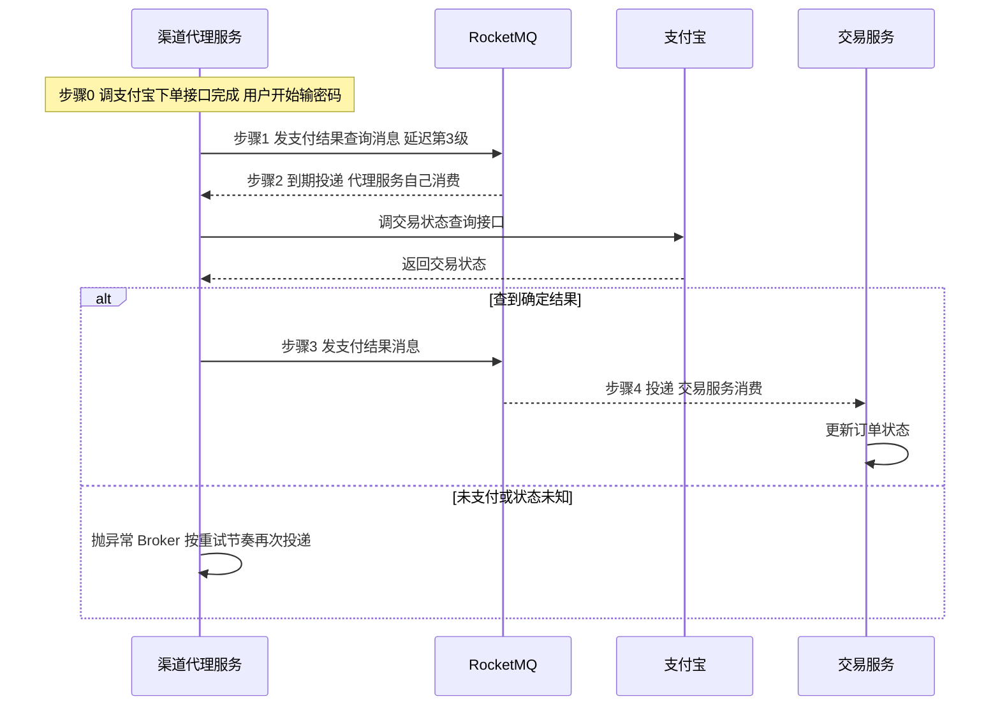

# 获取支付结果技术方案：两条消息的接力，五步执行图

RocketMQ 预研收尾了，延迟消息的等级表、消费重试的节奏都已经在手，需求分析阶段立下的「代理服务查渠道、交易服务管订单、中间用消息传话」可以兑现成执行图了。这张图上有五个编号步骤、两条消息，看着简单，真动手前每个格子都值得多问一句：这一步谁做，消息里装什么，查不到结果走哪条岔路，订单什么时候停止查询。把这些问号全部拉直，后面三步接口实现、消息生产与消费、订单状态更新，就是照图施工。

## 先给结论

- 全链路两个服务加一个中间件：渠道代理服务负责与支付宝、微信通信，交易服务负责维护订单，RocketMQ 站在中间传话；代理服务发两条消息，交易服务只消费其中一条。
- 五个编号步骤：0 代理服务调第三方下单接口（立即支付章节已完成）→ 1 代理服务发支付结果查询消息（延迟消息）→ 2 代理服务自己消费这条消息并调渠道查询 → 3 查到结果后发支付结果消息 → 4 交易服务消费结果消息更新订单状态。
- 查询消息用延迟消息表达节奏，首次查询取延迟等级第 3 级即 10 秒，正好避开用户输密码的时间窗。
- 未查到结果不在业务代码里写循环，而是消费端抛异常，交给 Broker 按消费重试的等级节奏重投，预研学过的重试机制在这里变成免费的查询定时器；重试上限后落库转人工的口子在消费端预留。
- 两条消息语义不同、主题分开：查询消息是代理服务内部的闹钟，结果消息是交给交易服务的跨服务结论。

## 三个角色与两条消息

方案图上的角色只有三个，职责一句话说清：渠道代理服务干所有「跟渠道说话」的事，下单如此，查询也如此；交易服务干所有「跟订单数据打交道」的事，状态更新落在它手里；RocketMQ 不产生任何业务结论，只负责把消息送到该收的人手里。

两条消息在链路里的角色不同。第一条叫支付结果查询消息，意思是「谁收到它，谁就去查这笔订单的支付结果」，发送方与消费方都是渠道代理服务，它在服务内部转一圈，为的是把查询的触发时机交给消息队列的投递节奏。第二条叫支付结果消息，载荷里带着确定的支付结论，发送方是渠道代理服务，消费方是交易服务，它是两个服务之间真正交付的内容。整条链路画成时序图：



图里有两个分岔值得多看一眼。查询自发自收、结果跨服务传递，两条消息的发送方都是代理服务，但消费方一内一外；状态未知时链路不是向下走，而是回到步骤 2 再来一遍，这个回环不靠代码里的定时器，靠的是 Broker 的重投机制。

## 五步拆解：每一步做什么、为什么

**步骤 0 是既有的起点。** 渠道代理服务调支付宝下单接口在立即支付章节已经实现并测通，调完那一刻顾客正在收银台输密码，此刻发起查询必然拿回「等待付款」，所以查询动作必须往后推，这就是整个方案要靠延迟消息起步的原因。

**步骤 1 发查询消息，消息里装齐查询所需的一切。** 载荷沿用统一响应结构：平台订单号必带，渠道参数一起放进泛型的 `content`，再用一个渠道标识字段标明这笔查询该走支付宝还是微信的接口。消费端将来要凭这三个东西调对渠道、查对订单，发送时不放齐，消费时就得返工：

```java
//查询消息的载荷示意，实现细节由后续课程展开
PaymentResponseDTO<AliConfigParam> notice = new PaymentResponseDTO<>();
notice.setOutTradeNo(outTradeNo);//平台订单号，回答查谁
notice.setContent(aliConfigParam);//支付渠道参数，回答用什么查
notice.setMsg("ALIPAY_WAP");//渠道标识，回答走哪条渠道
```

延迟等级取第 3 级 10 秒，等级值写在发送调用的参数里，想调快调慢改一个数字。

**步骤 2 是方案里最有意思的一步。** 消息说了「谁收到谁去查」，按职责边界，与支付宝通信的只能是渠道代理服务，于是它自己消费自己发的那条消息。有人觉得别扭，其实这正是延迟消息的标准用法：发消息的动作发生在下单线程里，消费的动作发生在 10 秒后由 Broker 触发的另一次投递里，两个时刻之间隔着用户支付的真实耗时，中间不需要任何线程挂着等待。查到确定结果就往下走；查回来是「等待付款」或「状态未知」，方法里直接抛异常，消费判为失败，Broker 按预研里讲过的节奏从第 3 级起逐级拉长间隔重投，等于用消息系统自带的机制实现了「过会儿再查」。重试不是无限的，消费端预留一个次数判断，超过阈值把消息落库转人工，兜住那些注定查不到结果的异常订单。

**步骤 3 与步骤 4 是交付。** 查到确定结论后，代理服务把结果发往另一个主题，交易服务消费，按支付状态更新订单：成功就置为成功，失败与撤销也如实落库，订单闭环不只记录成功一种结局。至此两个服务各自回归本职，谁也没越界碰对方的数据。

顺带把一个常见替代方案排除掉：让交易服务起定时任务扫订单表，把未决订单捞出来逐笔查询。这条路能走通，但粒度粗（扫描周期固定，表达不了「下单后 10 秒先查一次」）、压力集中（全表扫描压在订单库上）、职责越界（交易服务得直连渠道接口）。延迟消息方案里，查询触发精确到单笔订单，触发点就发生在代理服务自己手里，三个短板一次避开。

查询循环的终止条件沿用需求分析定下的口径：订单有效期 30 分钟，有效期内查到结果则链路完成，一直未支付则重试与订单超时双双收敛，订单转关闭，不再无限查询。

## 从方案到代码的施工顺序

五步图的实现顺序不是从左到右一把梭，而是先做最不确定的一环：


先把「凭平台订单号查支付宝」做成渠道代理服务里一个能独立单元测试的接口，测通之后再挂消息：生产消息在代理服务下单代码的尾部补发送，消费消息由代理服务新增监听类调刚做好的查询接口，最后交易服务消费结果消息更新订单状态。排序的理由很实际：消息骨架是确定性强的通用件，渠道查询才是整条链路里不确定性最高的部分（参数、签名、状态码全在渠道那边），先把高不确定性收进一个可单测的单元，再往上搭骨架，联调出问题时能明确划清是消息的问题还是渠道的问题。

## 常见误区

- **让交易服务消费查询消息去调支付宝。** 错例：消息谁抢到谁查，交易服务也监听查询主题。正解：与渠道通信的职责归渠道代理服务，查询消息由它自发自收；交易服务只消费结果消息，越界会让渠道参数、签名逻辑渗进订单域。
- **用线程加 sleep 代替延迟消息。** 错例：下单线程里起个线程睡 10 秒再查。正解：线程挂着占资源，服务一重启查询就丢；延迟消息持久化在 Broker，到期必投，服务重启不丢触发时机。
- **把「未查到结果」当成失败终止链路。** 错例：查回「等待付款」就返回失败或干脆吞掉。正解：未支付是正常中间态，抛异常触发 Broker 重投再查，确定的成功与失败才向下交付。
- **两条消息混用一个主题与一个消费组。** 错例：图省事都发 `TP_PAYMENT_ORDER`，两个服务都监听。正解：不同消费组各自收到全量消息，混用会让交易服务收到查询消息、代理服务重复消费结果消息，两条消息必须分主题分组件隔离。

## 面试可能被问到的问题

1. 面试官追问：「渠道代理服务自己发消息自己消费，这不是绕圈子吗？」
   答：绕这一圈买到的是延迟语义与解耦。查询触发点从下单线程里剥离，10 秒后由 Broker 投递触发，服务重启、下单线程结束都不影响查询照常发生；同时消息持久化与重投机制天然提供「未查到再查」的循环，不需要自己维护定时器或线程池。
2. 面试官追问：「首次查询的延迟时间和重查间隔怎么定？」
   答：RocketMQ 4.x 的延迟是 18 个固定等级，课程取第 3 级 10 秒做首次查询，重试复用同一张等级表逐级拉长。间隔要平衡及时性与渠道接口配额，订单越临近有效期重查越没意义，终止条件是订单有效期 30 分钟，到期转超时关闭。
3. 面试官追问：「一直查不到结果的订单会不会把消息队列拖垮？」
   答：不会放任。消费重试从第 3 级起最多 16 次，消费端还预留了次数判断，超过阈值把消息落库转人工后正常返回，Broker 不再重投；订单本身也有有效期，两条边界叠加，队列里不会积累永不终结的查询。
4. 面试官追问：「查询消息和结果消息为什么分成两条、两个主题？」
   答：语义与消费方都不同。查询消息是代理服务内部的触发信号，结果消息是交给交易服务的业务结论；分主题后各自的消费组、监控指标、堆积告警独立，交易服务不会被查询噪音干扰，代理服务也不会误消费自己发出的结果。
5. 面试官追问：「这条链路里哪些环节会重复执行，怎么保证订单状态不被改乱？」
   答：状态未知时消费重试会让查询反复执行，查询是读操作天然幂等；真正要防的是结果消息重复投递导致重复更新，交易服务更新前校验当前状态，已终态的订单不再被后续消息改写，更新按业务键幂等。
6. 面试官追问：「RocketMQ 整个不可用，支付结果是不是就丢了？」
   答：不会永久丢。发送失败有客户端重试与同步返回值兜底，调用方能感知；已落 Broker 的消息持久化。最坏情况是查询消息没能发出，此时订单停在未决状态，主动查询接口依然可用，按订单号手工或由巡检任务补查即可，消息链路是加速通道，主动查询才是可靠性底座。

## 配套资料

- 讲义：`materials/docs/10/闪聚支付-第3章-C扫Bv1.1.md`，第 6 章 获取支付结果，6.3 技术方案为本课出处（五步流程图即课程用图）。
- 代码：本课为方案课，无配套源码改动；方案里两条消息的真实落地可提前查阅 `materials/code/10/完整代码/完整代码/` 归档中渠道代理服务 `message/PayProducer.java`（查询消息延迟发送）与 `message/PayConsumer.java`（自消费查询、状态未知抛异常重试），实现细节由后续课程逐段展开（归档内层工程目录与包名为课程原始命名，不在此展开）。
- 说明：该阶段课程资料归档在 `materials/docs/10/` 与 `materials/code/10/`（不存在 09 编号目录），引用路径截至该层级。
