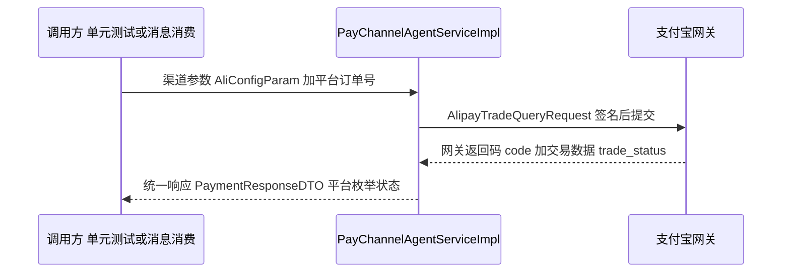
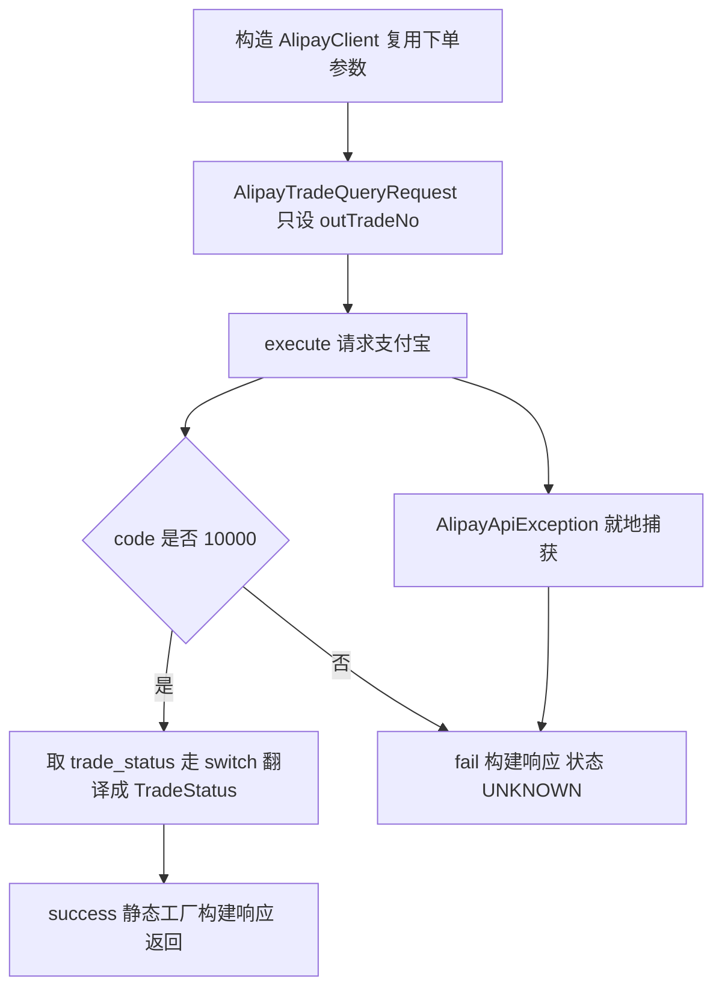

# 获取支付结果第一步：渠道代理服务的支付宝订单查询接口

技术方案把五步链路铺好了，施工顺序定的是先做最不确定的一环：凭平台订单号查支付宝。这一课就是把「查询」做成渠道代理服务里一个能独立单元测试的方法，接口定义、实现、测试三段一口气走完。它将来是消息链路步骤 2 的执行体，现在先单独把它钉死，渠道参数、签名、状态码这些不确定性全部收进这一个方法里，后面接消息骨架时，联调出问题能一眼分清是消息的事还是渠道的事。

## 先给结论

- 支付宝交易状态查询接口的请求参数，公共参数之外业务参数只需一个 `out_trade_no`，当初下单传过去的平台订单号，原样拿来就能查回整笔交易的结论。
- 响应看两处：网关返回码 `code` 为 10000 表示接口调用成功，业务数据里 `trade_status` 有四档，覆盖等待付款、支付成功、交易结束、交易关闭。
- 接口定义在 `pay-channel-agent-api` 的 `PayChannelAgentService`：入参是支付渠道参数与平台订单号，返回统一的 `PaymentResponseDTO`；实现复用下单接口的 `AlipayClient` 构造，只换请求对象。
- 渠道返回的 `trade_status` 必须翻译成平台统一枚举 `TradeStatus`，switch 一对一映射，订单表的状态机不接渠道方言。
- `code` 非 10000、SDK 抛异常等一切不确定情形，统一返回 `fail` 加 `UNKNOWN` 状态，「未知」是刻意设计的中间态，它就是后续消息链路里触发重试的开关。

## 接口定义：从支付宝文档读出方法签名

看支付宝接口有一套固定的读法，下单接口时练过：先弄清职责，再过请求参数，最后过响应参数。交易状态查询接口的职责一句话，凭商户订单号查回这笔交易的当前状态。请求参数分两截，公共参数（`app_id`、`method`、`sign_type`、`timestamp`、`version` 这些）与下单时打过交道，SDK 会替你拼好；业务参数里有四个，真正必须传的只有 `out_trade_no`，下单时把平台订单号交给了支付宝，查询时拿它原样取回即可。至于 `trade_no`（支付宝侧的交易号），下单时平台根本没拿到过、也没存过，查询恰恰是把它查回来的机会。业务参数的另外三个（指定交易号查、指定商户号查、附加结算信息查）是特殊场景的补充选项，日常对账查询用不上，接口能力清单里知道有它们即可。

响应参数同样分两截。公共响应里的 `code` 是网关返回码，10000 表示这次接口调用成功，调成功才有资格往下解析业务数据；`msg`、`sub_code` 是配套的错误信息，调用失败时靠它们定位。业务响应里值得记下的字段有五个：`trade_no` 支付宝交易号，对账与退款时引用渠道侧凭证全靠它；`out_trade_no` 商户订单号，回传原值方便按单对齐；`buyer_logon_id` 买家账号的脱敏值，客服核对「谁付的款」用；`total_amount` 交易金额，与平台订单金额核对防串单；以及最关键的 `trade_status`，四档取值与含义如下：

```text
WAIT_BUYER_PAY   交易创建，等待买家付款
TRADE_CLOSED     未付款交易超时关闭，或支付完成后全额退款
TRADE_SUCCESS    交易支付成功
TRADE_FINISHED   交易结束，不可退款
```

支付宝的状态是支付宝的方言，平台的 `pay_order` 表有自己的状态机：订单生成、支付中、支付成功、处理完成、关闭。两边对得上但字面不同，中间必须立一层翻译，翻译的目标关系先放在这里，实现一节按它逐档落地：

```text
平台订单状态     支付宝 trade_status            平台枚举 TradeStatus
订单生成/支付中   WAIT_BUYER_PAY                 USERPAYING
支付成功         TRADE_SUCCESS 或 TRADE_FINISHED SUCCESS
关闭            TRADE_CLOSED                    REVOKED
其余未收录状态   default 分支                     FAILED
```

这也是接口返回类型定为统一响应结构 `PaymentResponseDTO` 的原因之一。方法签名如下，落在 `pay-channel-agent-api` 的 `PayChannelAgentService` 里，与下单方法同住：

```java
/**
 * 查询支付宝订单状态
 * @param aliConfigParam 支付渠道参数（网关、密钥、格式、签名类型）
 * @param outTradeNo 平台订单号
 * @return 统一返回PaymentResponseDTO
 */
public PaymentResponseDTO queryPayOrderByAli(AliConfigParam aliConfigParam, String outTradeNo) throws BusinessException;
```

两个入参缺一不可的逻辑很顺：调支付宝要渠道身份（网关地址、应用私钥、支付宝公钥、签名类型），全装在 `AliConfigParam` 里；查哪笔订单要订单号。返回值沿用 `PaymentResponseDTO`，渠道交易号、平台订单号、统一支付状态都在里面，消息链路将来直接拿它当消息载荷。签名上的 `throws BusinessException` 保留项目统一异常口径，渠道 SDK 自己的异常后面单独处理，不让它混进业务异常体系。

## 接口实现：换一个 request，其余全是下单的老路

实现从支付宝文档里的 SDK 样例代码起步，拷进工程再改造，套路与当初写下单接口一致。先把查询这一次调用的参与方摆出来：



改造完的样子：

```java
@Override
public PaymentResponseDTO queryPayOrderByAli(AliConfigParam aliConfigParam, String outTradeNo) throws BusinessException {
    String gateway = aliConfigParam.getUrl();//支付宝接口网关地址
    String appId = aliConfigParam.getAppId();//支付宝应用id
    String rsaPrivateKey = aliConfigParam.getRsaPrivateKey();//应用私钥
    String format = aliConfigParam.getFormat();//数据格式json
    String charest = aliConfigParam.getCharest();//字符编码
    String alipayPublicKey = aliConfigParam.getAlipayPublicKey();//支付宝公钥
    String signtype = aliConfigParam.getSigntype();//签名算法类型

    //构造sdk客户端对象，与下单接口同一套参数
    AlipayClient alipayClient = new DefaultAlipayClient(gateway, appId, rsaPrivateKey, format, charest, alipayPublicKey, signtype);
    AlipayTradeQueryRequest request = new AlipayTradeQueryRequest();
    AlipayTradeWapPayModel model = new AlipayTradeWapPayModel();
    model.setOutTradeNo(outTradeNo);//平台订单号，下单时传的就是它
    request.setBizModel(model);

    AlipayTradeQueryResponse response = null;
    try {
        //请求支付宝订单状态查询接口
        response = alipayClient.execute(request);
        //支付宝响应的code，10000表示接口调用成功
        String code = response.getCode();
        if (AliCodeConstants.SUCCESSCODE.equals(code)) {
            String tradeStatusString = response.getTradeStatus();
            //解析支付宝返回的状态，转成平台统一的TradeStatus
            TradeStatus tradeStatus = covertAliTradeStatusToShanjuCode(tradeStatusString);
            return PaymentResponseDTO.success(response.getTradeNo(), response.getOutTradeNo(), tradeStatus, response.getMsg());
        }
    } catch (AlipayApiException e) {
        e.printStackTrace();
    }
    return PaymentResponseDTO.fail("支付宝订单状态查询失败", outTradeNo, TradeStatus.UNKNOWN);
}
```

几处取舍值得展开。客户端构造与下单接口逐字相同，七个参数全来自渠道参数对象，这一步没有新东西，属于复用既有验证过的代码。请求对象换成 `AlipayTradeQueryRequest`；请求参数有两条等价的设置路径，拼 `biz_content` JSON 串，或建模型对象走 `setBizModel`，模型对象有编译期检查，选后者。模型类直接复用了下单的 `AlipayTradeWapPayModel`，查询只需要 `outTradeNo` 一个字段，其余 setter 一个不调，富余能力闲置不影响正确性。

与下单接口并排看，同与不同就更清楚。相同的是准备动作：取渠道参数、构造客户端、建请求模型，三步一模一样。不同的是执行那一下：下单用的是 `pageExecute`，它要的是一张能跳转的支付表单，返回体是给收银台渲染的页面数据；查询用的是 `execute`，纯粹的接口调用，直接拿回 JSON 响应对象 `AlipayTradeQueryResponse`，状态码与交易数据都在字段里。还有一个不同藏在返回值之后：下单方法返回前会向消息队列发延迟查询消息，这是后续课程补上的动作；查询方法本身是纯读操作，除日志外不留任何副作用，被反复调用也安全。

异常设计是一条双轨：方法签名上的 `BusinessException` 是项目业务异常口径，留着给真正的业务错误；SDK 调用抛出的 `AlipayApiException` 在方法内就地捕获，不能让它把渠道异常类一路冒泡到消费方。捕获之后也不返回成功，代码顺势落到方法尾部统一返回 `fail`，`code` 非 10000 的情形（比如订单号写错，支付宝返回 40004，业务错误码里能对上交易不存在）同样落在这里。所有「没查到确定结论」的情形出口只有一个：`UNKNOWN`。

判断 10000 时不写字面量，常量集中在一个状态码常量类里，与支付宝文档对照着维护：

```java
/**
 * 支付宝查询返回状态码常量类
 */
public class AliCodeConstants {

    public static final String SUCCESSCODE = "10000"; //接口调用成功
    public static final String PAYINGCODE  = "10003"; //用户支付中
    public static final String FAILEDCODE  = "40004"; //失败
    public static final String ERRORCODE   = "20000"; //系统异常

    //支付宝交易状态
    public static final String WAIT_BUYER_PAY = "WAIT_BUYER_PAY"; //等待买家付款
    public static final String TRADE_CLOSED   = "TRADE_CLOSED";   //超时关闭或全额退款
    public static final String TRADE_SUCCESS  = "TRADE_SUCCESS";  //交易支付成功
    public static final String TRADE_FINISHED = "TRADE_FINISHED"; //交易结束不可退款
}
```

状态翻译是一个私有方法，switch 逐档映射，多档共落点用 case 贯穿：

```java
//解析支付宝的订单状态为平台统一状态
private TradeStatus covertAliTradeStatusToShanjuCode(String aliTradeStatus) {
    switch (aliTradeStatus) {
        case AliCodeConstants.TRADE_FINISHED:
        case AliCodeConstants.TRADE_SUCCESS:
            return TradeStatus.SUCCESS;//业务交易支付明确成功
        case AliCodeConstants.TRADE_CLOSED:
            return TradeStatus.REVOKED;//交易已撤销
        case AliCodeConstants.WAIT_BUYER_PAY:
            return TradeStatus.USERPAYING;//交易新建，等待支付
        default:
            return TradeStatus.FAILED;//交易失败
    }
}
```

映射表里有两条值得琢磨。支付宝有两个成功态：`TRADE_SUCCESS` 是支付成功（还能退款的窗口期内），`TRADE_FINISHED` 是交易结束、不可退款，对支付平台的状态机而言，这两档都意味着钱到账了，订单往前走，所以贯穿映射到同一个 `SUCCESS`；至于还能不能退款，是售后域关心的细分，不占用主状态。`TRADE_CLOSED` 的两种成因（未付款超时关闭、支付后全额退款）映射为 `REVOKED`，语义是这笔交易已撤销，订单侧据此走关闭流程。default 分支落到 `FAILED` 而不是 `UNKNOWN` 也有讲究：能进到这个 switch，说明网关返回码已是 10000，接口调用本身成功了，只是拿回一档翻译表没收录的状态，按渠道语义给它一个确定的失败结论；真正的 UNKNOWN 留给接口调用失败的场景，两条路径不混。整个方法实现把接口内部逻辑串起来就是下图：



成功路径的落点也有讲究。`PaymentResponseDTO.success(tradeNo, outTradeNo, tradeState, msg)` 是个静态工厂，`msg` 文案不靠调用方现编，按传入状态在工厂内部统一生成：成功是「业务交易支付 明确成功」，等待是「交易新建 等待支付」，撤销是「交易已撤销」。调用方拿到对象即可直接进日志、进消息，同一状态在任何终端看到的文案一致。

这个统一响应结构值得把五个字段记全：`code` 系统内部的处理标志，`msg` 状态文案，`tradeNo` 渠道侧交易号，`outTradeNo` 平台订单号，`tradeState` 平台统一枚举状态，外加一个泛型 `content` 装任意扩展载荷。它的类上带着 Swagger 注解与序列化接口，是全项目接口交互的通用信封，下单响应用它，查询响应用它，后续课程里两条 MQ 消息的载荷还是它。一套结构贯穿到底，消费方解析逻辑只学一次。

## 接口测试：给单元测试造一笔真订单

方法写完要用单元测试单独验证，测试类建在 service 工程的 `src/test/java` 下，包结构与实现类对齐。有个不起眼的小坑：新建 test 目录后 IDEA 里的图标可能是灰色的，Maven 不认它，刷新一下 POM 让工程重新导入，目录才会变绿获得测试源码身份。POM 变更后随手刷新，这个动作要形成肌肉记忆。

测试代码把容器拉起来，注入接口，手工造齐两个入参：

```java
@SpringBootTest
@RunWith(SpringRunner.class)
public class TestPayChannelAgentService {

    @Autowired
    PayChannelAgentService payChannelAgentService;

    @Test
    public void testqueryPayOrderByAli() {
        //应用id
        String APP_ID = "example-appid";
        //应用私钥
        String APP_PRIVATE_KEY = "example-app-private-key";
        //支付宝公钥
        String ALIPAY_PUBLIC_KEY = "example-alipay-public-key";
        String CHARSET = "utf-8";
        //沙箱网关
        String serverUrl = "https://openapi.alipaydev.com/gateway.do";
        AliConfigParam aliConfigParam = new AliConfigParam();
        aliConfigParam.setUrl(serverUrl);
        aliConfigParam.setCharest(CHARSET);
        aliConfigParam.setAlipayPublicKey(ALIPAY_PUBLIC_KEY);
        aliConfigParam.setRsaPrivateKey(APP_PRIVATE_KEY);
        aliConfigParam.setAppId(APP_ID);
        aliConfigParam.setFormat("json");
        aliConfigParam.setSigntype("RSA2");

        //平台订单号，取自一笔刚在沙箱里下的真实订单
        PaymentResponseDTO paymentResponseDTO = payChannelAgentService.queryPayOrderByAli(aliConfigParam, "SJ1217987323129917440");
        System.out.println(paymentResponseDTO);
    }
}
```

渠道参数不走数据库，测试里手填，值取自此前对接调研阶段验证支付宝接口时用过的那套沙箱配置，私钥与公钥是长串 Base64 文本，手敲必错，复制粘贴后比对首尾几个字符再跑。真正的难点是订单号：库里躺着的历史订单多半是当初测试留下的废单，拿去查只能得到「交易关闭」，让人误以为接口写错了。稳妥的做法是重走一遍立即支付：模拟器扫门店二维码，金额随手填个三元，支付完成后 `pay_order` 表里多出一条新记录，取最新那笔的订单号填进测试。这笔订单支付成功，查询理应返回成功状态，测试的预期才立得住。

跑测试前还有一件事必须做：停掉正在运行的渠道代理服务进程。`@SpringBootTest` 会加载完整的 Spring Boot 配置，服务端口照起不误，原服务占着端口，测试一起来就冲突。这也是单元测试在这个工程里的特殊之处，它不是脱离容器的纯方法调用，而是一次完整的应用启动加定点调用。

报错现场也提前认一眼。订单号填错或订单从未在沙箱里下过，支付宝的网关返回码是 40004，业务错误码能对上交易不存在，此时方法不会抛异常，而是安静地返回 `UNKNOWN`，控制台打印的 `msg` 是「支付宝订单状态查询失败」。看到这个输出先查订单号，再查沙箱网关与密钥，别急着怀疑转换逻辑，`code` 没过 10000 时根本走不到翻译那一步。

执行测试，控制台打印出完整对象，形态如下（输出为按统一结构补全的示例）：

```text
PaymentResponseDTO(code=0, msg=业务交易支付 明确成功, tradeNo=example-trade-no,
    outTradeNo=SJ1217987323129917440, tradeState=SUCCESS, content=null)
```

`msg` 是「业务交易支付 明确成功」，`tradeState` 是 `SUCCESS`，`tradeNo` 带回了支付宝侧的交易号，`outTradeNo` 与传入一致。三样东西齐了，接口闭环。测试的预期要按订单状态设计成一个验证矩阵：刚支付成功的订单查回 `SUCCESS`，只下单未支付的订单查回 `USERPAYING` 加「交易新建 等待支付」，历史废单查回 `REVOKED`，订单号填错则落到 `UNKNOWN`。四个用例把映射表的主干分支全覆盖，转换方法的正确性不再靠感觉。

这个方法接下来会被消息链路征用：渠道代理服务消费自己发出的查询消息时，调的就是它。单元测试验证的是「给定参数能查、状态能翻译」，它管不到时序问题，消息什么时候触发、查不到怎么办，都留给后面的生产与消费两课。

## 常见误区

- **拿历史废单号去测查询接口。** 错例：从 `pay_order` 表随手取一个旧订单号，查回交易关闭或交易不存在，误判接口有 bug。正解：测试用例重走一遍下单与支付，拿新鲜订单号验证成功路径，再补一个未支付订单验证等待路径。
- **在代码里硬编码 10000 和状态字符串。** 错例：`if ("10000".equals(code))` 与 switch 里直接写 `"TRADE_SUCCESS"`。正解：常量类集中定义，与支付宝文档对照维护，改口径只动一处，也方便多渠道各自建自己的常量类。
- **把 `trade_status` 直接落库或返回给上游。** 错例：订单表里出现 `WAIT_BUYER_PAY` 这类渠道字面量。正解：状态翻译层收口，渠道方言只存在于渠道代理服务内部，出了这个服务一律是平台枚举 `TradeStatus`。
- **测试前不停正在运行的服务。** 错例：代理服务挂着，单元测试一跑报端口占用。正解：`@SpringBootTest` 加载完整配置起端口，先停原进程再跑测试，或者给测试指定不同端口。
- **`code` 非 10000 时让方法返回 null。** 错例：只写成功分支，失败路径返回 null，消费端解引用直接空指针。正解：一切未明统一走 `fail` 加 `UNKNOWN`，消费端拿「未知」触发重试，永不返回 null。

## 面试可能被问到的问题

1. 面试官追问：「查询为什么只传 out_trade_no，trade_no 什么时候用？」
   答：`out_trade_no` 是下单时平台传给支付宝的，平台手里有，凭它就能查。`trade_no` 是支付宝生成的交易号，下单时还没有，正常情况下查询就是把它带回平台的第一次机会；文档也允许凭 `trade_no` 查，但平台通常没存过它，实际入口始终是商户订单号。
2. 面试官追问：「TRADE_SUCCESS 和 TRADE_FINISHED 有什么区别，平台为什么都映射成成功？」
   答：两者都表示买家已付款，区别在于退款窗口：`TRADE_SUCCESS` 还可退款，`TRADE_FINISHED` 不可退款。对订单主状态机而言钱已到账，都是成功；能否退款是售后域的细分，不需要占用主状态，映射层把它们合并，订单流程保持简单。
3. 面试官追问：「接口为什么设计 UNKNOWN 状态，而不是直接返回失败？」
   答：查询失败的成因分两类，渠道明确告知失败与结果暂时不可知。网络抖动、订单还在支付中都属于后者，判成失败会把还在路上的订单错杀。UNKNOWN 表达「这次没拿到结论」，在消息链路里它就是触发消费重试的开关，稍后再查即可，语义上更诚实。
4. 面试官追问：「渠道状态与平台状态之间为什么要加翻译层？」
   答：聚合支付要接多个渠道，每家渠道的状态词汇表都不一样。翻译层把方言收在渠道代理服务内部，订单域只认平台统一枚举，将来新增微信渠道只需新增一份映射，订单状态机与下游逻辑零改动，多渠道的差异被隔离在最薄的一层。
5. 面试官追问：「单元测试里的渠道参数是手填的，生产环境这些参数从哪来？」
   答：生产参数配置化，存在支付渠道参数表里，商户应用绑定渠道时录入，交易服务按应用、服务类型、渠道三个条件查出并反序列化成 `AliConfigParam` 传给代理服务。测试手填是为隔离数据库依赖，真实调用链的参数来源与测试参数的字段结构完全一致。
6. 面试官追问：「这个查询接口被消息链路反复调用，有幂等问题吗？」
   答：没有。查询是纯读操作，不写任何数据，同一订单查一百次结果一致；重复调用的成本只是渠道接口配额，所以才要在触发节奏上用延迟消息与重试间隔控制频次，而不是在接口里加防重逻辑。

## 配套资料

- 讲义：`materials/docs/10/闪聚支付-第3章-C扫Bv1.1.md`，第 6 章 获取支付结果，6.4 支付渠道代理查询支付宝交易状态（6.4.1 支付宝交易状态查询接口的请求参数与响应参数、6.4.2 接口实现与 6.4.2.3 接口测试）为本课出处。
- 代码：`materials/code/10/完整代码/完整代码/` 归档中渠道代理服务工程：`api/PayChannelAgentService.java`（`queryPayOrderByAli` 定义）、`service/PayChannelAgentServiceImpl.java`（查询实现与状态翻译）、`common/constant/AliCodeConstants.java`（状态码常量）、`dto/TradeStatus.java` 与 `dto/PaymentResponseDTO.java`（统一状态与响应结构）、`src/test/.../TestPayChannelAgentService.java`（单元测试）均为真实文件（归档内层工程目录与包名为课程原始命名，不在此展开，正文代码为按 `com.study.pay` 系口径改写后的节选）。
- 说明：该阶段课程资料归档在 `materials/docs/10/` 与 `materials/code/10/`（不存在 09 编号目录），引用路径截至该层级。
