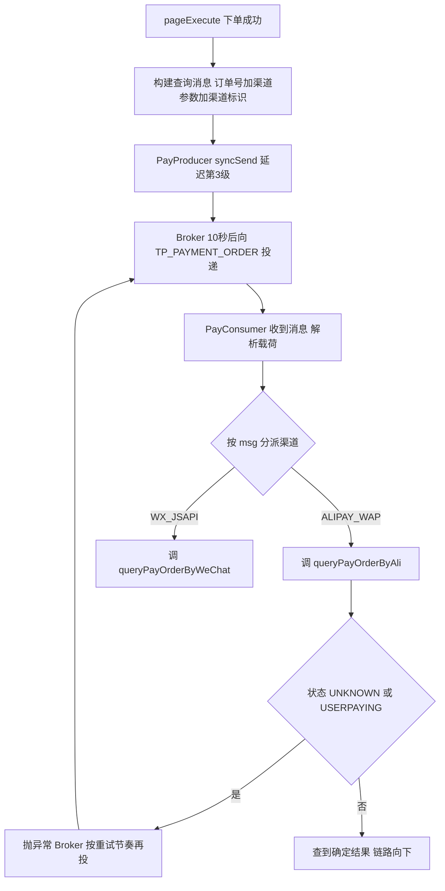

# 获取支付结果第二步：查询消息的生产与消费，把查询接口挂上消息链路

查询接口已经能凭平台订单号查回支付宝的交易状态，但它自己不会开火，得有人在对的时机调它。技术方案里这个时机由延迟消息触发：渠道代理服务调完下单接口发一条查询消息，10 秒后 Broker 投递回来，自己消费、自己调刚写好的查询接口，查不到就抛异常让 Broker 再投，循环到查出确定结论为止。这一课把生产端与消费端两段代码补齐，链路中段就活了。

## 先给结论

- 配置先行：`pay-channel-agent-service` 引入 `rocketmq-spring-boot-starter`，Nacos 的 `COMMON_GROUP` 里建共享配置 `spring-boot-starter-rocketmq.yaml` 只放 NameServer 地址，服务 `bootstrap.yml` 引入它并配上生产者组。
- 生产端三件套：主题常量 `TP_PAYMENT_ORDER`、`PayProducer` 发送类、`syncSend` 的四参数重载，延迟取第 3 级即 10 秒。
- 消息载荷沿用统一响应结构 `PaymentResponseDTO`：订单号、`content` 装渠道参数、`msg` 装渠道标识 `ALIPAY_WAP`，消费端凭这三个字段就知道查谁、用什么查、走哪条渠道。
- 消费端一个类搞定：`@RocketMQMessageListener` 绑定同主题与消费组 `CID_PAYMENT_CONSUMER`，泛型选 `MessageExt` 而不是业务对象，为的是拿重试次数。
- 最容易踩的坑在 `content` 的二次解析：对象经消息传输后变成 JSON 串，外层转一次、`content` 再转一次，两次 `parseObject` 缺一不可。
- 未查到结果不是错误分支而是设计：状态为 `UNKNOWN` 或 `USERPAYING` 时抛出异常，Broker 按重试等级再投，查询循环由此形成；重试次数上限后落库转人工的分支按预研写法预留。

## 发消息前的两块准备：依赖与配置

代理服务此前是纯 Dubbo 提供方，跟 RocketMQ 没打过交道，先把依赖补上。`pay-channel-agent-service` 的 pom 加一个依赖，版本沿用课程锁定的 2.0.2：

```xml
<dependency>
    <groupId>org.apache.rocketmq</groupId>
    <artifactId>rocketmq-spring-boot-starter</artifactId>
    <version>2.0.2</version>
</dependency>
```

有了 starter，容器里就有 `RocketMQTemplate` 可注入，剩下的配置问题是 NameServer 地址从哪来。这个地址不是代理服务一家的事，交易服务、后续任何要收发消息的服务都需要它，所以放进 Nacos 的共享配置组：Data ID 为 `spring-boot-starter-rocketmq.yaml`，Group 选 `COMMON_GROUP`，格式 YAML，内容薄得只剩一根柱子：

```yaml
rocketmq:
  nameServer: 127.0.0.1:9876
```

共享配置建好后，服务要在 `bootstrap.yml` 的 `ext-config` 列表里把这一份引入，与既有的 `spring-boot-http.yaml` 等共享项并列；生产者组是服务自己的属性，写在本地配置的 `rocketmq` 段：

```yaml
spring:
  cloud:
    nacos:
      config:
        ext-config:
          -
            refresh: true
            data-id: spring-boot-http.yaml # spring boot http配置
            group: COMMON_GROUP # 通用配置组
          -
            refresh: true
            data-id: spring-boot-starter-rocketmq.yaml # rocketmq配置
            group: COMMON_GROUP # 通用配置组

rocketmq:
  nameServer: 127.0.0.1:9876
  producer:
    group: PID_PAY_PRODUCER
```

两个配置组的分工与全项目一致：`PAY_GROUP` 放各服务的主配置，`COMMON_GROUP` 放跨服务共用的技术配置。NameServer 地址进了共享组，将来换集群改一处即可；`PID_PAY_PRODUCER` 里的 PID 前缀标明这是生产者组，与消费组的 CID 前缀在管理台上一眼可分。`ext-config` 每一项上的 `refresh: true` 顺带说明一下：它让这份配置支持动态刷新，配置中心里改完地址，服务在不重启的前提下拿到新值，中间件连接类配置能否热生效还要看客户端的实现，但开关先打开总没有坏处。

## 生产端：下单尾部把消息发出去

发送的位置定在下单方法里，`pageExecute` 调用成功之后、返回之前。此刻支付宝侧已经受理了下单，用户马上开始支付，查询倒计时从这一刻起算最合理。先把载荷拼出来：

```java
//向MQ发一条延迟消息，支付结果查询
PaymentResponseDTO<AliConfigParam> notice = new PaymentResponseDTO<AliConfigParam>();
notice.setOutTradeNo(alipayBean.getOutTradeNo());//平台订单号
notice.setContent(aliConfigParam);//支付渠道参数
notice.setMsg("ALIPAY_WAP");//标识是查询支付宝的接口
//发送消息
payProducer.payOrderNotice(notice);
```

三个字段的语义值得逐个说透。`outTradeNo` 回答「查谁」，平台订单号是整个链路的业务主键。`content` 回答「用什么查」，渠道参数随消息走，消费端调支付宝时直接取用，不必再回数据库查一遍配置，也让消费逻辑保持无状态，多实例随便扩。`msg` 回答「走哪条渠道」，`ALIPAY_WAP` 标明这笔查询该调支付宝的接口，将来接入微信时同一个字段会填 `WX_JSAPI`，消费端按标识分派。一个泛型信封装三个答案，消息才自足。

对既有下单方法的侵入控制得很小：类里加一个 `PayProducer` 字段注入，成功分支尾部追加这四行，原有的客户端构造、请求发送、响应组装一行未动。改造老代码的通用心法在这里可以照抄一遍，新能力以追加为主、修改为辅，出问题时新老逻辑的边界清晰，回退也只需要摘掉追加的那几行。

发送动作收进独立的 `PayProducer` 类，新建 `message` 包安放它，与预研工程的 `ProducerSimple` 是同一套路，只是参数升级为四参重载：

```java
@Component
@Slf4j
public class PayProducer {

    //订单结果查询主题
    private static final String TOPIC_ORDER = "TP_PAYMENT_ORDER";

    @Autowired
    RocketMQTemplate rocketMQTemplate;

    //发送消息（查询支付宝、微信订单状态）
    public void payOrderNotice(PaymentResponseDTO paymentResponseDTO) {
        //发送延迟消息
        Message<PaymentResponseDTO> message = MessageBuilder.withPayload(paymentResponseDTO).build();
        //延迟第3级发送（延迟10秒）
        rocketMQTemplate.syncSend(TOPIC_ORDER, message, 1000, 3);
        log.info("支付渠道代理服务向mq发送订单查询的消息：{}", JSON.toJSONString(paymentResponseDTO));
    }
}
```

四参 `syncSend` 依次是主题、消息体、发送超时毫秒数、延迟等级。`MessageBuilder` 先把业务对象包成 Spring Message 载体，这是延迟重载的固定前置。第 3 级对应 10 秒，RocketMQ 4.x 的延迟是 18 个固定等级，等级表在预研时背过，忘了回头翻；它不能任意指定秒数，想调查询节奏就在等级表里挑档位。主题名 `TP_PAYMENT_ORDER` 写成常量，发送端与消费端共用这一个出处，杜绝两端各写一遍字面量后悄悄分叉。

同步发送的可靠性边界在这里复习一遍：`syncSend` 会阻塞到 Broker 应答，返回的 `SendResult` 里带着发送状态，`SEND_OK` 之外的状态与抛出的异常都表明这条消息没有稳妥落地。发送发生在下单方法的主流程里，一旦失败调用方是能感知的，交易服务可以按异常走自己的错误处理；客户端还有 `retry-times-when-send-failed` 的自动补发垫在底下。换 `asyncSend` 能让下单线程更快返回，但失败只能靠回调感知，本课选同步，就是要这份「发不出去就立刻知道」的确定性，查询消息是整条链路的触发器，它丢了循环就不存在了。

生产与消费的完整流转，连同状态未知时的回环，画成一张图：



## 消费端：监听、解析、分派、重试

消费端新建 `PayConsumer`，一个类完成监听与处理。骨架与预研工程的监听类相同，泛型的选择有了新理由：

```java
@Component
@RocketMQMessageListener(topic = "TP_PAYMENT_ORDER", consumerGroup = "CID_PAYMENT_CONSUMER")
@Slf4j
public class PayConsumer implements RocketMQListener<MessageExt> {

    @Autowired
    PayChannelAgentService payChannelAgentService;

    @Autowired
    PayProducer payProducer;

    @Override
    public void onMessage(MessageExt messageExt) {
        byte[] body = messageExt.getBody();
        String jsonString = new String(body);
        log.info("支付渠道代理服务接收到查询订单的消息：{}", JSON.toJSONString(jsonString));
        //将消息转成对象
        PaymentResponseDTO paymentResponseDTO = JSON.parseObject(jsonString, PaymentResponseDTO.class);
        String outTradeNo = paymentResponseDTO.getOutTradeNo();//订单号
        String params = String.valueOf(paymentResponseDTO.getContent());//支付渠道参数

        PaymentResponseDTO responseDTO = null;
        if ("ALIPAY_WAP".equals(paymentResponseDTO.getMsg())) {
            //调用支付宝订单状态查询接口
            AliConfigParam aliConfigParam = JSON.parseObject(params, AliConfigParam.class);
            responseDTO = payChannelAgentService.queryPayOrderByAli(aliConfigParam, outTradeNo);
        } else if ("WX_JSAPI".equals(paymentResponseDTO.getMsg())) {
            //调用微信的接口去查询订单状态
            WXConfigParam wxConfigParam = JSON.parseObject(params, WXConfigParam.class);
            responseDTO = payChannelAgentService.queryPayOrderByWeChat(wxConfigParam, outTradeNo);
        }
        //当没有获取到订单结果，抛出异常，再次重试消费
        if (responseDTO == null || TradeStatus.UNKNOWN.equals(responseDTO.getTradeState())
                || TradeStatus.USERPAYING.equals(responseDTO.getTradeState())) {
            throw new RuntimeException("支付状态未知，等待重试");
        }
        //如果重试的次数达到一定数量，不要再重试消费，将消息记录到数据库，由单独的程序或人工进行处理

        //将订单状态，再次发到mq（下一课支付结果更新的内容）
    }
}
```

监听注解两个参数，`topic` 必须与发送端的常量一字不差，消费组按讲义口径起名 `CID_PAYMENT_CONSUMER`，同组内的多实例天然分摊查询消息，代理服务横向扩容时消费能力跟着走。注解没写消息模式，吃的是默认的集群消费：同组实例瓜分主题的队列，一条消息只被组内一个实例处理，这正是查询场景想要的形态，一笔订单的查询始终只有一个实例在做；广播模式会让每个实例都查一遍同一笔订单，渠道配额翻倍还毫无收益，注解保持默认即可。泛型没写业务对象而写 `MessageExt`，是本课的一个刻意选择：`getBody()` 拿到消息体字节，`getReconsumeTimes()` 拿到这条消息已被重试的次数，后者是预留的重试上限判断要用的，业务对象泛型给不了这个信息。

解析是两段式，也是新手最容易翻车的位置。第一段，`body` 字节数组还原成 JSON 串，`parseObject` 转回 `PaymentResponseDTO`，这一步与预研的自定义消息格式完全一致。第二段藏在 `content` 里：发送时它装的是 `AliConfigParam` 对象，消息经序列化落库再投递，消费端拿到的 `content` 已经是 JSON 字符串，必须再 `parseObject` 一次转回渠道参数对象。为什么嵌套的会变串：序列化按字段递归进行，`content` 声明为泛型对象，消息传输层手里没有它的类型信息，只能把它按普通值序列化成 JSON 串嵌在外层里，反序列化时外层有明确类型可以还原，内层没有，于是停在这一步等人来认领。直接把字符串当对象用，调查询接口时类型对不上，报错信息还不一定指到这里，排查很费时。两次转换是消息载荷带嵌套对象的固定代价，记得它，以后遇到同类结构不再愣住。

渠道分派用最朴素的 if 与字符串常量比对 `msg`：`ALIPAY_WAP` 走支付宝查询，`WX_JSAPI` 走微信查询。微信分支的参数对象是 `WXConfigParam`，同一个 `content` 字段能装两家渠道的参数，靠的是泛型信封加 JSON 的自描述能力：发什么类型、收什么类型，各分支自己转换自己认领。微信查询方法此前已随微信下单一并实现过，两个分支的代码形态对称，未来加第三家渠道就是再加一个分支与一个标识，分派逻辑的扩展成本一眼见底。

重试循环的时间体感值得提前演算一遍。等级表从第 3 级起是 10 秒、30 秒、1 分、2 分、3 分，一条始终查不到结果的查询消息，投递时刻大致是发送后 10 秒、40 秒、1 分 40 秒，间隔一档比一档宽，用户的支付动作通常在头一两次重试内就完成了，后续的宽间隔只是低成本的收尾扫描。拿日志对时刻看，发送日志立刻打印，消费日志每段间隔出现一次，状态未知的告警日志逐渐稀疏，这就是循环在按设计运转；等哪天日志里出现了确定状态，循环自然终止。

循环引擎藏在最后那段异常里。查询返回 `UNKNOWN`（接口调用失败或结果未知）或 `USERPAYING`（用户还在支付）时，方法抛出 `RuntimeException`，监听框架据此向 Broker 回应消费失败，Broker 按预研学过的节奏重投：从第 3 级 10 秒起，每失败一次延迟等级加一，间隔越来越长。这个设计把「过会儿再查」的循环完全外包给了消息系统：业务代码只负责表达「这次没查到」，重试的调度、计数、持久化全由 Broker 负责，服务重启都不会丢。无限重试显然不行，注释里预留了出口：`reconsumeTimes` 超过阈值时不再抛异常，把消息落库，交给单独的程序或人工处理，写法与预研的消费重试一课相同，动手补全即可。

查到确定结果后链路继续向下：把订单状态再次发到 MQ，交易服务才能接手更新订单。这一步属于下一课「支付结果更新」的内容，此处不展开；最终归档代码里它就是重试判断之后紧随的一行，发往结果主题 `TP_PAYMENT_RESULT`。

验证这闭环有两种打法。快的一种是单元测试直接调 `payProducer.payOrderNotice(notice)`，构造一笔沙箱订单的载荷发出去，观察消费端日志 10 秒后出现；稳的一种是走一遍真实的立即支付流程，下单成功即触发发送。两段日志对时间看：发送日志立刻打印，消费日志迟到 10 秒；订单已支付则日志里是「业务交易支付 明确成功」，未支付则能看到状态未知的重试，间隔一档比一档长。消息的生产与消费至此接通，技术方案图的步骤 1 与步骤 2 落地完毕，剩下的步骤 3 与步骤 4 交给下一课。

重复消费的可能性也提前想清楚。Broker 的重投保证至少一次送达，网络抖动下同一条消息可能被消费不止一次，好在查询是纯读操作，多查几次结果一致，本课的循环天然免疫重复。真正要防重的是下一课的结果更新：结果消息重复投递时订单状态不能被来回改写，届时由交易服务在更新前校验当前状态来兜住，两个环节各管各的幂等，合起来链路才是稳的。

## 常见误区

- **两端主题或消费组名不一致。** 错例：发送常量写 `TP_PAYMENT_ORDER`，注解里手敲成 `TP_PAYMENT_ORDER_` 或小写。正解：主题名收进常量类两端引用，消费组名同样定义成常量，字符串精确匹配差一个字符就永远收不到。
- **忘了 content 的二次解析。** 错例：`getContent()` 的返回值直接强转 `AliConfigParam`，运行时 ClassCastException。正解：消息里的嵌套对象一律按 JSON 串对待，外层转一次、content 再转一次，两次 `parseObject` 缺一不可。
- **发送位置放错，下单失败也发查询消息。** 错例：把 `payOrderNotice` 挪出 try 块，或放在异常分支里。正解：`pageExecute` 成功之后才发，查一笔不存在的订单只会空转重试直至落库，白耗渠道配额与队列资源。
- **把重试异常 catch 掉。** 错例：消费方法里 try 住整个业务逻辑，异常打个日志就吞了，Broker 收到的是消费成功。正解：状态未知的异常必须冒出 `onMessage`，这是驱动 Broker 重投的唯一信号，吞掉它循环就断了。
- **放任重试无限进行。** 错例：只写抛异常，不判断次数，注定查不到结果的订单被重投十几个小时。正解：`reconsumeTimes` 超过阈值即落库转人工并正常返回，重试要有界，队列才会健康。

## 面试可能被问到的问题

1. 面试官追问：「渠道参数为什么随消息走，消费端再查一次库不行吗？」
   答：随消息走让消费端无状态，不依赖数据库也能完成查询，多实例扩容与消费重试都不受影响；参数与下单时刻保持一致，避免配置中途被改导致的查询错位。代价是消息体变大，渠道参数仅几百字节，在可控范围内。
2. 面试官追问：「消息里的 msg 字段是干什么的，为什么不分渠道建主题？」
   答：它标识这笔查询走哪家渠道，消费端据此分派到支付宝或微信的查询实现。单主题加分派的设计让查询编排集中在一处，主题数量不随渠道数膨胀；管理与监控的粒度也统一。分主题方案同样可行，取舍在于治理偏好。
3. 面试官追问：「延迟第 3 级 10 秒是怎么定的？」
   答：用户从打开收银台到完成支付通常需要几十秒，10 秒后的第一次查询大概率还没结果，但代价小，能尽快捕获快的支付；未查到时消费重试按等级递增间隔，整体节奏是先密后疏。RocketMQ 4.x 延迟是固定 18 级，只能在表内选档。
4. 面试官追问：「抛异常触发 Broker 重投，和自己在代码里 catch 后循环重试，差别在哪？」
   答：Broker 重投的间隔按等级递增、次数有统计、消息持久化，服务重启后循环依然继续；自己 catch 循环会长期占用消费线程，重启即丢，重试间隔还得自己造轮子。异常驱动还让业务代码只表达「这次不行」，调度细节完全下沉。
5. 面试官追问：「监听器泛型用 MessageExt 还是业务对象，怎么选？」
   答：纯业务处理选对象泛型，框架自动反序列化，代码最干净；需要消息元信息时选 `MessageExt`，比如本课要重试次数做上限判断，或要拿消息 ID 做幂等键。选了 `MessageExt` 就要自己完成字节到 JSON 到对象的转换。
6. 面试官追问：「重试 16 次进死信队列，这个机制在生产上怎么配合业务？」
   答：生产上不会等它走完。消费端按 `reconsumeTimes` 设业务阈值，超限即落库转人工并正常返回，让 Broker 停止重投；落库记录配告警，人工按订单号核对渠道后处理。死信队列是系统级兜底，业务阈值才是第一道闸。

## 配套资料

- 讲义：`materials/docs/10/闪聚支付-第3章-C扫Bv1.1.md`，第 6 章 获取支付结果，6.5 支付结果查询（6.5.2 发送消息下的配置 RocketMQ 与生产消息类、6.5.3 接收消息）为本课出处。
- 代码：`materials/code/10/完整代码/完整代码/` 归档中渠道代理服务工程：`message/PayProducer.java`（`TP_PAYMENT_ORDER` 延迟发送）、`message/PayConsumer.java`（监听、二次解析、渠道分派与重试）、`service/PayChannelAgentServiceImpl.java`（下单方法尾部的消息构建与发送）、`src/main/resources/bootstrap.yml`（ext-config 引入共享配置与 `rocketmq` 本地段）、service 工程 `pom.xml`（starter 2.0.2）均为真实文件（归档内层工程目录与包名为课程原始命名，不在此展开，正文代码为按 `com.study.pay` 系口径改写后的节选）。
- 说明：该阶段课程资料归档在 `materials/docs/10/` 与 `materials/code/10/`（不存在 09 编号目录），引用路径截至该层级。
