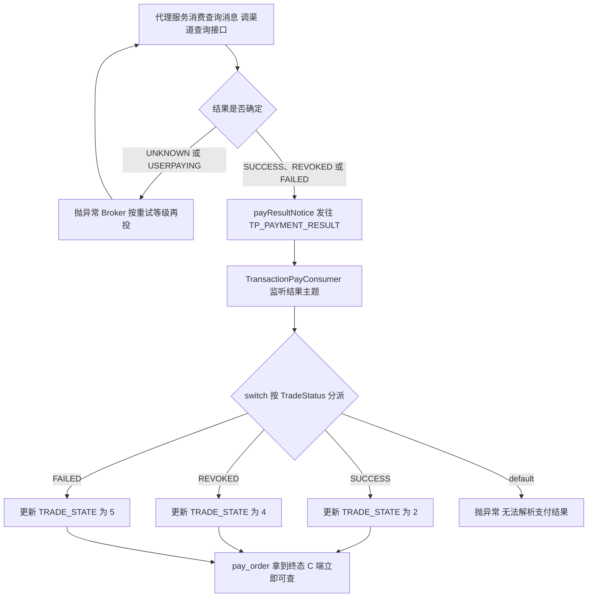
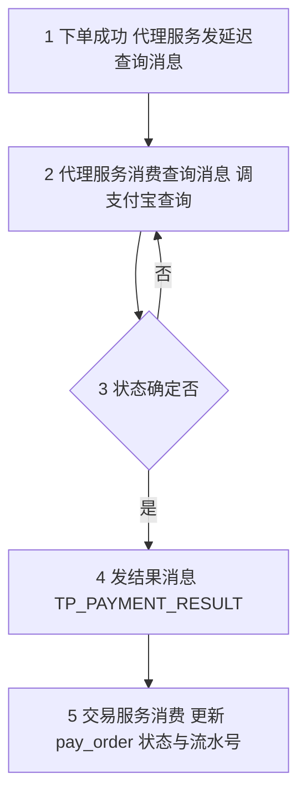

# 支付结果更新：结果消息落进 pay_order 表，day09 收官

查询循环已经能拿到确定的支付结果，但这个结果此刻只存在于渠道代理服务的一次方法调用里，`pay_order` 表的状态字段还停在「订单生成」，C 端刷新一万次也不会变。技术方案的最后两步要补齐：渠道代理服务把查到的结果发上 MQ，交易服务监听结果主题、解析状态、更新订单表；写完再用一次真实的沙箱支付从扫码到落库整条跑通，获取支付结果功能到此收官。

## 先给结论

- 结果消息单独建主题 `TP_PAYMENT_RESULT`，与查询主题 `TP_PAYMENT_ORDER` 各管一段：前者装「查询指令」，后者装「查询结论」，两端语义与消费方都不同，绝不能混用。
- 查到结果就发，不再延迟：发送方法从延迟四参 `syncSend` 换成即发即走的 `convertAndSend`，载荷还是 `PaymentResponseDTO`。
- 交易服务接入 RocketMQ 的动作与代理服务同款：pom 引入 `rocketmq-spring-boot-starter` 2.0.2，`bootstrap.yml` 的 `ext-config` 引入共享配置 `spring-boot-starter-rocketmq.yaml`。
- 更新订单接口 `updateOrderTradeNoAndTradeState` 收三个参数：闪聚平台订单号、支付宝或微信的交易流水号、订单状态；实现用 `LambdaUpdateWrapper` 按 `TRADE_NO` 定位，set `TRADE_STATE` 与 `PAY_CHANNEL_TRADE_NO`。
- 交易服务监听类 `TransactionPayConsumer` 绑定结果主题与消费组 `CID_ORDER_CONSUMER`，按 `TradeStatus` 枚举做状态映射：SUCCESS 到 2、REVOKED 到 4、FAILED 到 5，映射不出来的抛异常拒绝消费。
- 测试暴露真实瑕疵一枚：支付成功时间没落库，修复方式是在更新方法里对状态 2 追加 set `PAY_SUCCESS_TIME` 为当前时间。
- 幂等由「按确定终态覆盖更新」兜底：结果消息重复投递只是把同一个状态再写一遍；要更严格，就在更新条件里带上期望的前置状态。

## 交互流程：技术方案的步骤 3 与步骤 4

讲义把支付结果更新拆成四步：支付渠道代理服务查询到支付结果；向 MQ 发送「支付结果更新」消息；交易服务监听「支付结果更新」消息队列；交易服务接收到消息，更新订单状态。前两步发生在渠道代理服务内部，是查询循环的出口；后两步发生在交易服务内部，是订单数据的入口，中间靠一个新主题衔接。

整条链路连同状态未知时的回环，画成一张图：



读图的关键在两个判断节点：状态不确定时代理服务自己消化，靠异常驱动 Broker 重投，消息不出查询循环；状态一旦确定，才换主题发给交易服务。两个服务之间只通过消息耦合，谁也不直接调谁，任何一侧重启都不影响另一侧。

## 结果消息的生产：第二个主题，不再延迟

发送方法照旧写在渠道代理服务的 `PayProducer` 里，但与查询消息有三处不同。一是主题：查询消息发往 `TP_PAYMENT_ORDER`，消费方是代理服务自己；结果消息的接收方换成交易服务，同一主题里混两种语义不同、收件人不同的消息，将来想单独调整消费组、堆积监控、重试策略都会互相牵连，所以独立建主题。二是时机：查询消息必须延迟，因为发出时用户还没付完钱；结果消息发出时结果已经攥在手里，越快送到交易服务越好，延迟毫无意义。三是发送方式：不需要 `MessageBuilder` 包装与延迟等级参数，`convertAndSend` 一行即可，消息体直接是查询返回的 `PaymentResponseDTO`。

```java
//订单结果 主题
private static final String TOPIC_RESULT = "TP_PAYMENT_RESULT";

//发送消息（支付结果）
public void payResultNotice(PaymentResponseDTO paymentResponseDTO){
    rocketMQTemplate.convertAndSend(TOPIC_RESULT,paymentResponseDTO);
    log.info("支付渠道代理服务向mq发送支付结果消息：{}", JSON.toJSONString(paymentResponseDTO));
}
```

`convertAndSend` 看似比四参 `syncSend` 随意，可靠性并没有打折：`RocketMQTemplate` 的 `convertAndSend` 底层走的仍是同步发送，默认等到 Broker 应答才返回，消息落盘成功的确认与 `syncSend` 是同一套。真正被省掉的只有延迟语义，而这正是结果消息想要的形态。发送失败依然会抛异常，调用方是消费回调，异常会体现在消费结果上，Broker 侧该重投的重投。只有对吞吐极度敏感、允许少量丢失的场景才考虑异步或单向发送，本课的结果消息每一笔都对应真实资金状态，不在这类场景之列。

发送的触发点不在业务代码里另起炉灶，而是接在 `PayConsumer` 查询逻辑的尾部。查询方法返回后先做既有判断：结果为空、状态为 `UNKNOWN` 或 `USERPAYING` 时抛异常交给 Broker 重投；只有穿过这道闸门的确定结果，才有资格往下走：

```java
//当没有获取到订单结果，抛出异常，再次重试消费
if(responseDTO == null || TradeStatus.UNKNOWN.equals(responseDTO.getTradeState())
        || TradeStatus.USERPAYING.equals(responseDTO.getTradeState())){
    throw new RuntimeException("支付状态未知，等待重试");
}
//如果重试的次数达到一定数量，不要再重试消费，将消息记录到数据库，由单独的程序或人工进行处理

//将订单状态，再次发到mq
payProducer.payResultNotice(responseDTO);
```

类里本来就注入了 `PayProducer`，这一行追加完，渠道代理服务的全部角色就齐了：既是查询消息的消费者，又是结果消息的生产者。重试上限的落库转人工分支仍按预研写法预留，`reconsumeTimes` 超阈值时把消息记录下来并正常返回，此处不展开。

## 交易服务的准备：依赖、配置与更新订单接口

镜头切到交易服务。它此前与 RocketMQ 无缘，接入动作两件：pom 文件加依赖，版本沿用课程锁定的 2.0.2：

```xml
<dependency>
    <groupId>org.apache.rocketmq</groupId>
    <artifactId>rocketmq-spring-boot-starter</artifactId>
    <version>2.0.2</version>
</dependency>
```

`bootstrap.yml` 的 `ext-config` 列表引入 NameServer 共享配置，与 `spring-boot-http.yaml` 等既有共享项并列。NameServer 地址放在 Nacos 的 `COMMON_GROUP` 共享配置里，两个服务读的是同一份，换集群改一处即可：

```yaml
spring:
  cloud:
    nacos:
      config:
        ext-config:
          -
            refresh: true
            data-id: spring-boot-starter-rocketmq.yaml # rocketmq配置
            group: COMMON_GROUP # 通用配置组
```

消费端不需要配生产者组，`rocketmq.nameServer` 一项就够监听器开工。

接着写更新订单的接口。参数想清楚三件事：按什么定位订单，靠闪聚平台订单号；要不要记渠道侧的单号，要，支付宝查询时把支付宝自己的交易流水号一并返回了，平台侧留存它，对账时才能两边的账对得上；改哪个字段，订单状态。接口定义带上状态字典：

```java
/**
 * 更新订单支付状态
 *
 * @param tradeNo           闪聚平台订单号
 * @param payChannelTradeNo 支付宝或微信的交易流水号(第三方支付系统的订单)
 * @param state             订单状态 交易状态支付状态,0-订单生成,1-支付中(目前未使用),2-支付成功,4-关闭 5--失败
 */
void updateOrderTradeNoAndTradeState(String tradeNo, String payChannelTradeNo, String state) throws BusinessException;
```

实现用 MyBatis Plus 的 `LambdaUpdateWrapper`，不构造实体对象，条件与更新值直接挂在 wrapper 上：

```java
@Override
public void updateOrderTradeNoAndTradeState(String tradeNo, String payChannelTradeNo, String state) throws BusinessException {
    LambdaUpdateWrapper<PayOrder> payOrderLambdaUpdateWrapper = new LambdaUpdateWrapper<>();
    payOrderLambdaUpdateWrapper.eq(PayOrder::getTradeNo,tradeNo)
            .set(PayOrder::getTradeState,state)
            .set(PayOrder::getPayChannelTradeNo,payChannelTradeNo);
    if(state!=null && state.equals("2")){
        payOrderLambdaUpdateWrapper.set(PayOrder::getPaySuccessTime,LocalDateTime.now());
    }
    payOrderMapper.update(null,payOrderLambdaUpdateWrapper);
}
```

`eq` 写条件、`set` 写值，第一个参数传 `null` 表示不借助实体，SQL 层面生成的就是一条按 `TRADE_NO` 过滤的 `update pay_order set` 语句。相比先 `selectById` 再 `updateById` 的两步写法，wrapper 一条 SQL 完成，天然规避了两次往返之间数据被并发修改的窗口。

## 消费结果消息：switch 里的状态机

监听类 `TransactionPayConsumer` 的骨架与上一课的 `PayConsumer` 同构：泛型选 `MessageExt`，字节转 JSON 串，`parseObject` 还原成 `PaymentResponseDTO`。差别在解析之后做的事：

```java
@Component
@RocketMQMessageListener(topic = "TP_PAYMENT_RESULT",consumerGroup="CID_ORDER_CONSUMER")
@Slf4j
public class TransactionPayConsumer implements RocketMQListener<MessageExt> {

    @Autowired
    TransactionService transactionService;

    @Override
    public void onMessage(MessageExt messageExt) {
        byte[] body = messageExt.getBody();
        String jsonString = new String(body);
        log.info("交易服务接收到支付结果消息：{}", JSON.toJSONString(jsonString));
        //接收到消息，内容包括订单状态
        PaymentResponseDTO paymentResponseDTO = JSON.parseObject(jsonString, PaymentResponseDTO.class);
        String tradeNo = paymentResponseDTO.getTradeNo();//支付宝微信的订单号
        String outTradeNo = paymentResponseDTO.getOutTradeNo();//闪聚平台的订单号
        //订单状态
        TradeStatus tradeState = paymentResponseDTO.getTradeState();
        //更新数据库
        switch (tradeState){
            case SUCCESS:
                transactionService.updateOrderTradeNoAndTradeState(outTradeNo,tradeNo,"2");
                return ;
            case REVOKED:
                //关闭
                transactionService.updateOrderTradeNoAndTradeState(outTradeNo,tradeNo,"4");
                return ;
            case FAILED:
                //失败
                transactionService.updateOrderTradeNoAndTradeState(outTradeNo,tradeNo,"5");
                return ;
            default:
                throw new RuntimeException(String.format("无法解析支付结果:%s",body));
        }
    }
}
```

两个单号字段的语义必须咬死，这里最容易弄反。`tradeNo` 装的是支付宝或微信自己系统的订单号，即渠道交易流水号；`outTradeNo` 装的才是闪聚平台的订单号。消息是谁发的要看清楚：发送方渠道代理服务在查询支付宝后组装载荷，渠道返回的原始交易号放进了 `tradeNo`，平台订单号原样带在 `outTradeNo` 里。调用更新方法时对应关系是 `updateOrderTradeNoAndTradeState(outTradeNo, tradeNo, state)`，第一个参数传平台订单号。容易混淆还因为命名巧合：更新接口的第一个参数签名里也叫 `tradeNo`，与 DTO 的 `tradeNo` 同名不同义，接口这个位置指的是平台订单号。排查字段错位时，拿日志里的消息体逐一对照字段的来路，比记变量名可靠。

状态映射这张表值得单独记：渠道侧的 `TradeStatus` 枚举五个值，本课用上三个。`SUCCESS` 映射 2 支付成功；`REVOKED` 表示交易已撤销，映射 4 订单关闭；`FAILED` 映射 5 支付失败，注意数据库状态字典注释里原本只写到 4，5 是本课单独约定的扩展值，`pay_order` 表与代码注释要同步补上。`UNKNOWN` 与 `USERPAYING` 根本到不了交易服务，代理服务的异常闸门把它们拦在查询循环里了。`default` 分支抛异常而非吞掉：将来枚举新增取值而消费端没跟上时，消息不会假装消费成功，Broker 会按重试节奏再投，日志里的「无法解析支付结果」带着原始报文，排查有据可查。每个 case 用 `return` 结束，防止分支执行完后误入后续逻辑。

## 幂等与重复投递

RocketMQ 的投递语义是至少一次，网络抖动或消费超时会让同一条结果消息被消费不止一次。更新是否经得起重复，取决于写的性质：三个状态值 2、4、5 都是终态且互斥，一笔订单只会落到其中之一；重复投递的同一批消息载着同一个状态值，覆盖写的效果与写一次相同，业务上无副作用，这是本课设计的天然幂等。真正的边界情况是乱序：假设渠道先报失败后报成功（现实中极少见，渠道对终态的处理是单调的），先到 5 后到 2 就会出现状态回退。要彻底锁死，把覆盖更新升级为条件更新即可：wrapper 的 `eq` 除订单号外再加一条状态限制，或更新前先查当前状态、终态即拒绝变更。查询环节与更新环节各管各的幂等，上一课的查询是纯读天然免疫重复，本课的更新靠终态覆盖加条件锁，合起来链路才稳。

## 端到端测试：日志埋点与一次真实支付

整条链路全靠消息传递，出了问题不能靠断点，生产环境更只能看日志，测试前先补埋点。四处日志覆盖消息的四次关键跳变：代理服务发出订单查询消息；代理服务消费到自己发的查询消息；代理服务发出支付结果消息；交易服务接收到支付结果消息。文案里写明服务名、动作与消息内容，消息内容转 JSON 打印，将来线上排障对时间轴就靠它们。

两个服务重启，走一遍真实支付：打开收银台，支付宝沙箱扫码，输入密码完成 2 元支付。控制台日志按预期铺开：下单成功即出现代理服务发查询消息的日志；10 秒后代理服务消费查询消息并调支付宝查询，用户还在输密码时反复出现「支付状态未知，等待重试」，间隔按等级一档比一档宽，这是循环在正常运转；支付完成的下一次查询拿到 `SUCCESS`，紧接着是发结果消息的日志与交易服务的接收日志。刷新 C 端订单页：支付结果字段变成 2，交易流水号一栏出现了支付宝的原始订单号，金额 2 元对应 200 分，全部对上。

测试发现一个小瑕疵：表里支付成功时间一栏是空的。状态更新到位了，但 `PAY_SUCCESS_TIME` 这个业务衍生字段没人写。修法就一句：状态为 2 时把当前时间一并 set 进去，也就是前面 `updateOrderTradeNoAndTradeState` 实现里那个 `if`。教训通用化：状态机更新时，除了状态本身，随状态变更的衍生字段（成功时间、关闭时间、流水号）要在同一个方法里一并落库，漏一个就要再发一次消息来补，代价远大于多写一行 set。

## day09 收官复盘

获取支付结果功能整体落地，全链路五个环节串起来看：



RocketMQ 在链路里承担的角色可以一句话概括：查询循环外包给 Broker 的重投机制，结果传递外包给独立主题的消费监听。两个主题各自的专业分工由此清晰，`TP_PAYMENT_ORDER` 面向代理服务自身，装载「去查一次」的指令，生命周期跟着重试走；`TP_PAYMENT_RESULT` 面向交易服务，装载「结果是这个」的结论，生命周期止于一次落库。服务间全程无同步调用，用户支付完成后最长 10 秒出头，订单表就是终态。

日志习惯是本课另一个值得带走的工程素养。测试之前补的那四处埋点，开发期用来对时间轴，上线后就是唯一的排障线索：生产环境没有断点，客服报来一笔订单状态不对，第一动作是拿订单号去日志文件里捞「发送查询消息」「接收查询消息」「发送支付结果消息」「接收支付结果消息」这四条，消息体里带着完整载荷，四个时间戳一摆，链路卡在哪一跳一目了然。写日志的成本在开发期，收益贯穿整个生命周期，这正是教师反复强调「开发时就养成写日志习惯」的原因。

## 常见误区

- **结果消息复用查询主题。** 错例：`payResultNotice` 也发往 `TP_PAYMENT_ORDER`，代理服务把自己的结果又消费了一遍，无限自循环。正解：指令与结论分主题，发送前核对常量，主题名收进常量统一引用。
- **tradeNo 与 outTradeNo 弄反。** 错例：更新时把 `tradeNo` 当平台订单号传，`TRADE_NO` 条件永远匹配不上，状态静默不更新。正解：`tradeNo` 是渠道流水号，`outTradeNo` 是平台订单号；拿日志里的消息体对照发送方的组装代码确认，别靠猜。
- **switch 漏写 default。** 错例：只写三个 case，渠道枚举扩展后新值被静默忽略，订单永远停在旧状态。正解：default 抛异常拒绝消费，让 Broker 重投并留下原始报文日志。
- **衍生字段漏更新。** 错例：只 set 状态与流水号，支付成功时间为空。正解：随状态变更的衍生字段在同一方法内一并落库，成功时间取 `LocalDateTime.now()`。
- **消费方法里吞异常。** 错例：把 switch 包进 try，解析失败打条日志返回。正解：解析不了的异常必须冒出 `onMessage`，这是 Broker 重投的唯一驱动，也是消息不丢的保障。

## 面试可能被问到的问题

1. 面试官追问：「结果消息为什么单独建主题，和查询消息共用一个不行吗？」
   答：两者的生产者、消费者、语义、重试诉求都不同。查询消息由代理服务自产自销，依赖延迟与重投；结果消息由代理服务发往交易服务，最好即时送达。共用主题会导致消费组过滤混乱、监控粒度混杂，想单独扩容或调整重试策略也互相牵连，分主题是按职责切分的最小代价方案。
2. 面试官追问：「更新订单为什么用 LambdaUpdateWrapper，不用 updateById？」
   答：本次更新只动两个到三个字段，用 wrapper 一条 SQL 按 `TRADE_NO` 定点更新，不必先查再改；`updateById` 要先构造全字段实体，容易把 null 值之外的既有字段误覆盖，还多一次查询往返。wrapper 写法把条件与更新值集中在一条语句里，语义也更直观。
3. 面试官追问：「结果消息重复投递，订单状态会不会被改乱？」
   答：正常情况下不会。状态值 2、4、5 是互斥终态，重复消息载着同一状态做覆盖写，效果幂等。乱序这种极端情况可加条件更新防御：更新语句带上期望的前置状态，或先查当前状态、已是终态则拒绝变更，把幂等从「效果上无害」升级为「逻辑上禁止」。
4. 面试官追问：「如果交易服务挂了很久，结果消息堆积在 Broker 会怎样？」
   答：消息持久化在 Broker，服务恢复后按堆积顺序继续消费，状态最终会被正确写入，这正是异步解耦的价值：下单链路不等结果，下游宕机只延迟不丢失。若堆积超出业务容忍度，消费端要评估并行度与消费组实例数；对时效敏感的查询侧还可以加定时对账任务做兜底补偿，这类补偿属于工程扩展，课程方案里由重试落库转人工承担兜底职责。
5. 面试官追问：「支付成功时间这类衍生字段，放在哪一步写合适？」
   答：与状态变更放在同一个更新方法里原子落库。状态 2 是唯一携带成功语义的终态，写状态的语句顺手 set 当前时间，保证状态与时间永远一致；放到消费端另写一次或靠定时补偿，都会引入状态与衍生字段不一致的窗口。

## 配套资料

- 讲义：`materials/docs/10/闪聚支付-第3章-C扫Bv1.1.md`，第 6 章 获取支付结果，6.6 支付结果更新（6.6.1 交互流程与后续发送消息、更新订单状态小节）为本课出处。
- 代码：`materials/code/10/完整代码/完整代码/` 归档中交易服务工程：`message/TransactionPayConsumer.java`（监听结果主题与 switch 状态映射）、`api/TransactionService.java`（更新订单接口与状态字典注释）、`service/TransactionServiceImpl.java`（`LambdaUpdateWrapper` 实现与支付成功时间修补）、`src/main/resources/bootstrap.yml`（ext-config 引入 RocketMQ 共享配置）、service 工程 `pom.xml`（starter 2.0.2）；渠道代理服务工程：`message/PayProducer.java`（`TP_PAYMENT_RESULT` 与 `payResultNotice`）、`message/PayConsumer.java`（查询尾部接线）。均为真实文件（归档内层工程目录与包名为课程原始命名，不在此展开，正文代码为按 `com.study.pay` 系口径改写后的节选）。
- 说明：该阶段课程资料归档在 `materials/docs/10/` 与 `materials/code/10/`（不存在 09 编号目录），引用路径截至该层级。
