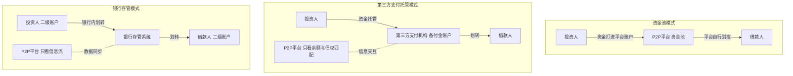

# 从网贷平台说起：万信金融的项目背景与资金监管三种模式

接触一个金融类项目，多数 Java 学习者的第一道坎不在技术，而在业务：P2P、发标、存管这些词没听过，后面再讲架构和代码都是空中楼阁。项目开工第一天在企业里通常就干两件事，把项目整体了解一遍，把基础开发环境搭起来；这两件事里，「了解项目」占的分量远比想象中重。本课先把万信金融是个什么生意讲清楚，从行业背景到资金监管的三种模式，给接下来十几天的开发铺一层业务地基。

## 先给结论

- 万信金融属于金融类项目，具体形态是网络贷款平台：把「借钱」这件事搬到网上，借款人与投资人通过平台完成借贷交易，平台交易的不是商品而是资金。
- 商业模式是 P2P（person to person），借贷双方都是自然人，个人对个人，区别于 B2B、B2C 这类企业参与的交易模式。
- 这个生意最大的风险不是借款人不还钱，而是平台挪用资金跑路，所以资金监管模式是行业生死线。
- 资金监管三种模式按安全性递进：资金池模式最危险，第三方支付托管模式次之，银行存管模式最稳；前两种已被监管政策认定不合规，国家主张银行存管。
- 银行存管的核心是资金与交易分离：平台管理交易，银行管理资金，用户在银行开立二级账户，平台只能看到信息流动。
- 平台与银行存管系统之间要做数据同步，这是后续开发中一系列对接需求的来源。

## 从网络购物平台到网络贷款平台

理解网贷平台最快的路径，是拿最熟悉的网络购物平台做类比。天猫、京东、淘宝这类平台的结构很简单：消费者购买商品，商家销售商品，交易在平台上完成，买卖双方不用见面，也不需要实体店。平台的本质是撮合与见证：把两端的人拉到一起，把交易流程管起来。

网络贷款平台把交易对象从商品换成了资金。贷款这个词拆开看就是两件事：缺钱的人借钱，到期连本带息还回去。于是一方是借款人，手里没钱，需要借钱；另一方是投资人，手里有余钱，出借资金并收取利息作为回报。交易同样在平台上完成，双方不见面，不进实体门店。购物平台撮合的是商品交易，网贷平台撮合的是资金借贷，结构完全同构，只是监管的严格程度天差地别，资金交易牵扯的风险与商品交易不在一个量级。

## P2P：个人对个人的借贷模式

网贷平台内部还细分多种商业模式，万信金融采用的是 P2P。这个词在网购语境的亲戚们早已耳熟能详：B2B 是企业对企业，B2C 是企业对消费者，C2C 是个人对个人在电商平台上的二手交易。P2P 里的 P 指 person，个人对个人：借款人是自然人，投资人也是自然人，借贷纯粹发生在个人之间，既不是公司与公司之间，也不是个人跟公司之间。

落到具体场景：一个人想换手机但钱不够，在网贷平台发布一条借款信息，写明金额、期限与利息；另一个投资人刷到这条信息，觉得利息可观，就把钱借了出去。借出的是个人的钱，借入的也是个人，平台只提供场所与规则，这种模式就是 P2P。模式本身决定了参与门槛低、交易频次高、单笔金额小，也决定了后面要讲的风险问题格外突出。

## 平台跑路：这个生意最大的风险

投资人对风险的直觉通常落在借款人身上：借出去的钱收不回来怎么办。但真正要担心的是另一层：投资人与借款人并不直接交易，资金从投资人到借款人，中间要经过平台的手。借款人不还钱，损失是一笔坏账；平台带着沉淀资金跑路，损失是所有用户的全部资金，新闻里网贷平台出事，绝大多数是后一种。

所以这个行业绕不开一个概念：资金监管模式，即资金由谁来管、怎么流转。没有监管的资金流转风险极大，国家近年来持续加大监管与治理力度，目的就是保障投资人、借款人各方的权益。监管模式经历了三种形态的演进，讲义里把它们画成对比图，按时间与安全性依次是资金池模式、第三方支付托管模式、银行存管模式。

## 三种资金监管模式，一种比一种稳

三种模式的差异全部体现在「钱放在谁手里」：



资金池模式下，投资人经第三方支付或银行的支付通道把钱直接打进平台的银行账户，平台像池子一样汇聚了投资人与借款人的资金，谁要借钱由平台从池子里划拨。钱始终握在平台手里，经营不善或者蓄意作恶，卷款跑路只有一步之遥，这是三种模式里最不保险的一种。

第三方支付托管模式往前走了一步：钱不让平台碰，交给第三方支付机构。投资人与借款人除了在平台注册，还要在第三方支付平台注册，平台与第三方各管一套账户体系；资金沉淀发生在第三方支付在银行的备付金账户上，平台运营方只能看到账户余额的变化与债权匹配关系，挪用资金的通道被堵上了大半。遗留的问题在于第三方本身：一个普通的支付公司凭什么是可信的，它与平台之间有没有利益勾连，谁也说不准。

银行存管模式把「第三方」换成了银行，也是国家主张、目前行业公认风险最低的形态。它本质上是托管模式的特例，只是承接方不是任意一家支付公司，而是受国家严密管控的银行。资金存管在银行，平台的每一次资金转移都以银行为主体完成，可信度问题在这一层基本终结。

把三种模式记成代码里的枚举，边界最清楚（示例为按本课写法补全，课程资料未含此类）：

```java
/** 资金监管模式 */
public enum FundSuperviseMode {
    /**
     * 资金池模式：资金汇入平台账户，由平台划拨，风险最高，已被监管禁止
     */
    POOL,
    /**
     * 第三方支付托管模式：资金沉淀在第三方支付机构的备付金账户，平台不碰资金
     */
    THIRD_PAY_ESCROW,
    /**
     * 银行存管模式：资金存管在银行，由银行完成划转，平台只看信息流
     */
    BANK_DEPOSIT
}
```

## 银行存管落地：两套账户体系与数据同步

银行存管模式涉及两套账户体系，P2P 平台一套，银行一套。投资人在平台注册后，会同时跳转到银行再开一个电子账户，两个账户之间一一对应。当投资人投资时，资金进入的是银行侧为投资人开设的二级账户；每一笔交易由银行在投资人与借款人之间完成划转，P2P 平台仅能看到信息的流动。平台管交易，银行管资金，两边的职责被制度性地切开。

用表结构把这个双账户关系具象化（示例为按本课写法补全，示意账户绑定关系用）：

```sql
-- 平台侧用户账户（示例）
CREATE TABLE platform_account (
    id          BIGINT PRIMARY KEY,
    user_id     BIGINT      NOT NULL COMMENT '平台用户ID',
    mobile      VARCHAR(20) NOT NULL COMMENT '手机号',
    created_at  DATETIME    NOT NULL
);

-- 银行存管侧电子账户（示例），与平台账户一一对应
CREATE TABLE bank_deposit_account (
    id              BIGINT PRIMARY KEY,
    user_id         BIGINT      NOT NULL COMMENT '对应平台用户ID',
    bank_account_no VARCHAR(64) NOT NULL COMMENT '银行二级账户号',
    bind_at         DATETIME    NOT NULL COMMENT '开户绑定时间'
);
```

双账户带来了一个必然的开发任务：平台与银行存管系统之间的数据同步。用户在平台侧的交易指令要传给银行执行，银行侧的账户变动要同步回平台展示，充值、出借、还款每条链路都跨两个系统。这是本阶段后续反复出现的主题，开户、充值、投标放款、还款都要跟银行存管系统打交道，资金流转的每一步都留下可对账的痕迹。

## 常见误区

- **把 P2P 理解成企业参与的模式。** 错例：以为是平台公司借钱给用户。正解：P2P 是个人对个人，借款人与投资人都是自然人，平台只提供撮合与交易场所，不是资金供给方。
- **把第三方支付托管当成银行存管。** 错例：认为资金放第三方支付就合规了。正解：托管与存管的差别在承接方身份，支付公司承接是托管，银行承接才是存管；监管政策已明确资金池与第三方支付托管不合规，主张银行存管。
- **以为最大的风险是借款人逾期。** 错例：把风控焦点只放在借款人信用上。正解：行业性风险源头是平台挪用资金跑路，资金监管模式才是制度层面的防线，借款人信用风控是业务层面的第二道防线。
- **忽略双账户对应关系。** 错例：以为平台账户就是资金账户。正解：银行存管下平台侧账户只记信息，真实资金在银行二级账户里，两侧账户一一对应且需要持续同步。

## 面试可能被问到的问题

1. 面试官追问：「你们项目是做什么的，P2P 是什么意思？」
   答：万信金融是一个 P2P 网络贷款平台，P2P 即 person to person，借款人与投资人都是自然人，通过平台完成个人对个人的资金借贷。平台撮合交易并管理流程，资金本身按银行存管模式存放在银行，平台只处理交易信息。
2. 面试官追问：「为什么 P2P 行业必须做银行存管？」
   答：早期资金池模式把钱汇进平台账户，平台挪用甚至跑路的风险极高；第三方支付托管把资金移出平台，但支付公司自身可信度不足。银行受国家严格管控，作为资金承接方可信度最高，所以监管政策明确主张银行存管，让平台管理交易、银行管理资金，从制度上隔离挪用风险。
3. 面试官追问：「银行存管模式下，平台和银行的职责边界在哪？」
   答：平台负责业务与信息：用户注册、发标、投标的流程与数据都在平台侧；银行负责资金：每位用户在银行开立电子账户即二级账户，充值、出借、还款的实际资金划转全部由银行完成。平台只能看到信息流动，接触不到资金本体，两侧账户一一对应并做数据同步。
4. 面试官追问：「平台与银行存管系统之间为什么要做数据同步？」
   答：交易指令在平台产生，资金划转在银行执行，两边各有一套账。同步保证平台的业务状态与银行的资金状态一致，出借、还款后平台才能展示正确结果，也才能据此与银行对账，发现并处理不一致的异常交易。

## 配套资料

- 讲义：`materials/docs/10/万信金融-第1章-讲义-项目介绍v1.0.md`，1.1 项目背景（P2P 定义、监管趋势、资金池模式、第三方支付托管模式、银行存管模式三种定义）为本课出处。
- 代码：本课无配套源码包，正文中的枚举与建表示例为按本课写法补全，仅用于把业务概念落成代码形态；项目源码自微服务基础工程起，见 `materials/code/10/wanxinp2p/`。
- 说明：该阶段资料归档在 `materials/docs/10/` 与 `materials/code/10/`，目录编号与相邻阶段共用。
