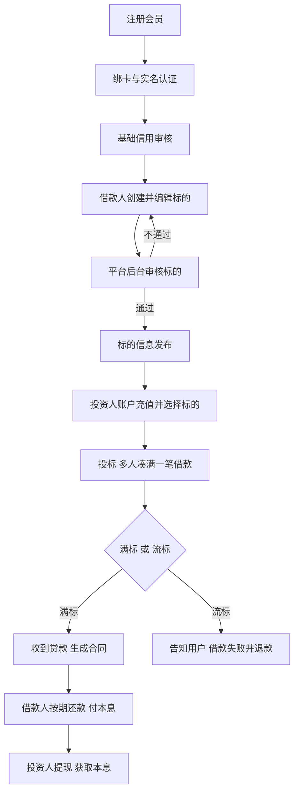

# 万信金融产品全景：行话、两大系统与一笔借款的完整生命周期

项目背景弄清了这是个什么生意，接下来要看产品本身长什么样。企业里这一步通常由架构师接棒：功能模块怎么划、核心业务怎么跑，都会在这一轮交代清楚。动代码之前还有一道更实际的门槛，P2P 行业有一套自己的行话，标的、发标、投标这些词天天挂在需求文档里，听不懂就没法跟产品经理对话。本课把万信金融的产品形态、模块划分与核心业务流程一次讲透。

## 先给结论

- 项目正式名称是万信金融网络贷款平台，一款面向互联网大众提供理财服务与个人消费信贷服务的金融平台，采用银行存管模式，资金与交易分离。
- 三个行话必须先吃透：标的是借款人在平台发布的借款信息（金额、期限、利息）；发标是发布这个信息的动作；投标是投资人针对某个标的出借的动作。
- 产品分两大系统：万信交易平台面向 C 端的借款人与投资人，业务支撑系统面向 B 端的平台运营方。
- 核心业务只有两条主线：借款人借钱，投资人出借；一标可多人凑满，满标生成合同进入还款周期，流标则告终退款。
- 银行存管决定了流程里绑卡实名是前置条件：资金在银行侧流转，用户必须先绑定银行卡完成实名认证才能交易。

## 三个行话：标的、发标、投标

标的是借款人视角的概念。借款人想在平台借钱，必须在平台上发布借款的相关信息，包括借多少钱、借多长时间、愿意付多少利息，这一组信息合起来就叫一个标的。借一次钱产生一个标的，它是 P2P 平台里最核心的业务对象，后面几乎所有模块，标的管理、出借、债权转让，都围着它转。

发标是动作：借款人在平台上发布借款信息，也就是把标的挂上去，这个过程叫发标。投标是投资人视角的动作：投资人浏览平台上各个标的，相中某个标的（比如利息给得高），把钱出借给它，这个动作叫投标。三个词的关系一句话说清：标的是数据，发标是借款人写数据，投标是投资人消费数据。

把标的信息落成代码对象，便于建立直观印象（示例为按本课写法补全，标的建模在后续发标章节正式实现）：

```java
/** 借款标的（示例） */
public class LoanItemDTO {
    private Long id;           // 标的ID
    private Long borrowerId;   // 借款人用户ID
    private BigDecimal amount; // 借款金额
    private Integer period;    // 借款期限（月）
    private BigDecimal rate;   // 年化利率
    private ItemStatus status; // 标的状态
}

/** 标的状态（示例） */
public enum ItemStatus {
    INIT,      // 待审核
    BIDDING,   // 投标中
    FULL,      // 满标，待复审放款
    FAILED     // 流标
}
```

## 两大系统：交易平台与业务支撑

功能模块图上下一切为两块。上面一块是万信交易平台，给借款人与投资人用，对应 C 端；下面一块是业务支撑系统，给运营万信金融平台的公司自己用，相当于公司的后台，对应 B 端。UI 层的两类产品界面与这两块系统一一对应，后续技术架构篇里说的「交易平台前台、业务支撑系统后台」就是从这里来的。

交易平台侧六个模块：首页是进入理财服务的入口，放活动、公告与推荐标的，电商平台推荐商品，这里推荐的是标的；借钱模块让借款人完成发标，前置动作是身份认证与开户，填好借款金额发布标的后还要等审核通过；出借模块让投资人挑选标的投资，经过满标复审最终出借成功；发现模块为会员提供积分商城这类增值服务；我的模块是个人中心，快捷查询自己的标的与债权；债权转让让债权人把手里未到期的债权转让出去，相当于把标的变成二手的再流通。

业务支撑系统侧六个模块：用户管理统一管理 B 端用户的信息与权限；会员管理统一管理 C 端用户的会员信息与积分；标的管理对所有标的做初审、复审；风控管理统一管理借款人的认证信息与信用信息，把风险降到最低，资金虽然不归平台管，风险管控责任仍在平台，平台越安全生意越好做；对账管理核对平台与银行存管之间的账单是否一致，这是银行存管模式带出来的必然模块；统计分析用大数据技术对借款、还款、逾期做统计分析。

## 核心业务流程：一笔借款的完整生命周期

功能再多，最核心的业务就一条主线：一个人借钱，一群人出借。流程图把它串起来：



借款人一侧：注册成为会员并登录，交易前必须绑卡与实名认证，原因是资金走银行存管，银行侧的账户与划转都以真实身份为前提；通过基础信用审核后创建标的，平台后台再审一遍，审核不通过会被驳回重新发起；发布成功后标的对全体投资人可见。投资人一侧：同样先注册绑卡，接受投资风险评估的提示，账户充值后浏览标的，凭自己的判断选择标的投标。

投标环节有个关键机制：一笔借款通常不是一个人借出来的。借款人发 5 万的标的，可能是十个人各投 5 千凑满的，这就是多人凑满一笔借款，也是「满标」的由来。凑够金额即满标，平台生成合同，借款人与投资人双方都和平台签订合同，因为双方本就不是直接交易，合同是平台作为撮合方的见证；随后借款人收到贷款，进入按期还本付息的周期，投资人则坐等收息，到期提现拿回本息。另一个分支是流标：期限内金额没凑够，借款失败，已投标的资金退还投资人，平台会提示原因，比如利息给得低投资人意愿弱，调高利率可以再试。

投标记录正是一标对多投的结构，用最小表结构示意（示例为按本课写法补全，真实建表脚本随发标章节给出）：

```sql
-- 投标记录（示例）：一个标的对应多条投标
CREATE TABLE bid_record (
    id          BIGINT PRIMARY KEY,
    item_id     BIGINT        NOT NULL COMMENT '标的ID',
    investor_id BIGINT        NOT NULL COMMENT '投资人用户ID',
    amount      DECIMAL(12,2) NOT NULL COMMENT '投标金额',
    bid_at      DATETIME      NOT NULL COMMENT '投标时间'
);
```

满标判定、复审、放款、还款这些环节如何落进代码与数据库，是后续发标、投标放款、用户还款几个章节的主题，本课只需要把业务走向记牢：流程走向图上的每个节点，将来都是一段真实的接口与状态流转。

## 常见误区

- **把标的当成实物或凭证。** 错例：以为标的是一份资产。正解：标的就是借款人发布的借款信息集合（金额、期限、利息），是数据不是物，投标是投资人消费这条信息并出借资金。
- **以为一笔借款对应一个投资人。** 错例：设计投标表时做成一对一。正解：一标可由多人凑满，5 万的标可能是十个人各投 5 千，标的一对多投标记录，满标金额是所有投标之和。
- **认为绑卡实名是可选项。** 错例：跳过实名直接投标。正解：银行存管模式下资金在银行侧流转，实名与绑卡是银行开户的前提，审核不过无法交易。
- **把业务支撑系统当成给用户用的。** 错例：把标的管理、风控管理算进 C 端功能。正解：交易平台面向借款人与投资人，业务支撑系统面向平台运营方，初审复审、对账、风控都是 B 端操作。

## 面试可能被问到的问题

1. 面试官追问：「介绍一下你们 P2P 项目的整体产品结构。」
   答：产品分两大系统。万信交易平台面向 C 端借款人与投资人，含首页、借钱、出借、发现、我的、债权转让六个模块；业务支撑系统面向 B 端运营方，含用户管理、会员管理、标的管理、风控管理、对账管理、统计分析。平台定位是面向互联网大众的理财服务与个人消费信贷服务平台。
2. 面试官追问：「标的、发标、投标分别是什么？」
   答：标的是借款人在平台发布的借款信息，核心字段是金额、期限、利息，借一次钱产生一个标的；发标是借款人发布标的信息的动作；投标是投资人针对某个标的出借的动作。三者是数据与两个方向的操作的关系。
3. 面试官追问：「满标和流标是什么，分别怎么处理？」
   答：满标是标的金额被投资人凑满，进入复审与放款，生成合同后借款人按期还本付息，投资人到期提现；流标是期限内金额没凑够，借款失败，已投标资金退还投资人。满标与流标是投标阶段仅有的两个终局。
4. 面试官追问：「为什么用户交易前必须绑卡实名？」
   答：平台采用银行存管模式，资金划转在银行侧完成，用户在银行开立的电子账户以真实身份为前提；绑卡实名既是银行开户的要求，也是风控审核的基础数据，未实名用户无法参与交易。
5. 面试官追问：「对账管理模块解决什么问题？」
   答：平台与银行各有一套账，业务状态在平台侧，资金状态在银行侧，对账管理定期核对两侧账单是否一致，发现不一致的交易及时处理，保证双账户体系下的数据可信。

## 配套资料

- 讲义：`materials/docs/10/万信金融-第1章-讲义-项目介绍v1.0.md`，1.2 项目概述、1.3 功能模块（十二个模块的功能说明表）、1.4 核心业务流程为本课出处。
- 代码：本课为产品介绍课，无直接配套源码；正文中的标的 DTO、状态枚举与投标记录表为按本课写法补全的示例，标的相关代码在后续发标、投标放款章节的工程中实现；微服务基础工程见 `materials/code/10/wanxinp2p/`，前端工程见 `materials/code/10/wanxinp2p_front/`。
- 说明：该阶段资料归档在 `materials/docs/10/` 与 `materials/code/10/`，目录编号与相邻阶段共用。
