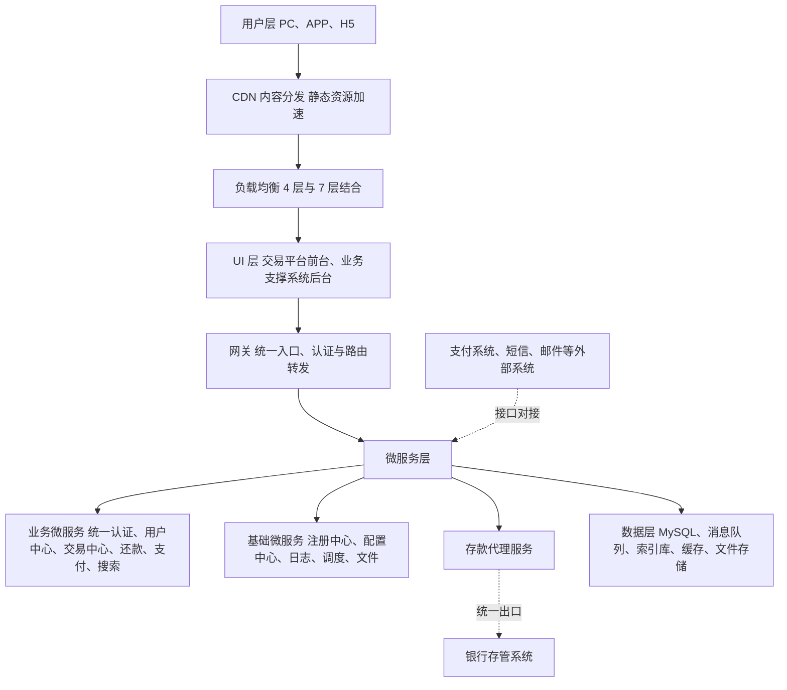
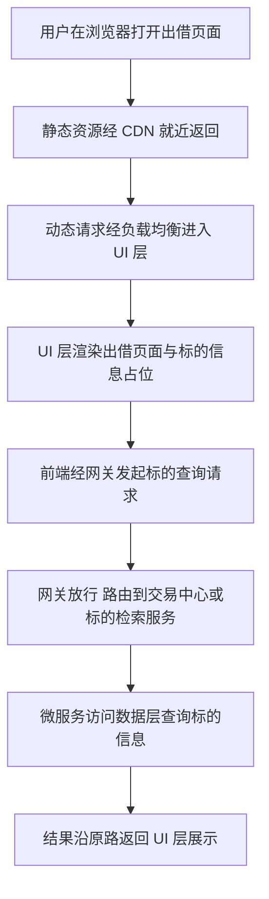

# 一张技术架构图怎么读：万信金融的前后端分离与分层设计

拿到一个新项目的架构图，密密麻麻画着用户层、CDN、负载均衡、UI 层、微服务层、数据层，右侧还挂着银行存管系统和支付系统，很多人的第一反应是不知道从哪行开始看，也说不清每一层跟自己写的代码有什么关系。把万信金融这张架构图按层拆开，理清「请求从哪进、业务在哪算、数据在哪存」，后面搭环境、写代码时才知道每个工程落在图的哪个位置。

## 先给结论

- 万信金融采用前后端分离架构：前端单独一个工程，后端 Java 代码单独一个工程，可以独立开发、独立部署到不同服务器。
- 系统由用户层、CDN、负载均衡、UI 层、微服务层、数据层组成，右侧是银行存管系统、支付系统等需要接口对接的外部系统。
- 与 Java 工程师关系最密切的是 UI 层、微服务层、数据层；前端是现成工程直接使用，学习重点在微服务层。
- 微服务层分两类：业务微服务承载具体业务，基础微服务提供注册中心、配置中心这类系统级公共服务；所有与银行存管系统的交互统一收敛到存款代理服务。
- 用「打开出借页面」这一个动作，可以把所有层串成一条完整链路。

## 单体与前后端分离：为什么先分家

早年的开发方式是在 IDEA 里建一个工程，html 页面、JSP 页面和 Servlet、Java 代码全混在一起，这种形态叫单体应用：前端和后端代码存在于同一个项目中。单体应用的协作成本很高，改一个页面和改一段业务逻辑动的是同一份代码，上线也要整体一起发。

前后端分离把这事拆开：前端那一套界面代码放进独立的项目或工程，后端 Java 代码放进另一个项目或工程，两者完全分开，各自独立部署和运行。前端项目可以放在一台服务器上，后端可以放在另一台上。最直接的好处是有利于团队协作，企业里前端有前端团队、服务端有服务端团队，各自按接口约定开发，最后一起做集成测试即可。万信金融采用的就是这套前后端分离架构。

## 一张图看懂系统分层



请求从用户层进来，静态资源先被 CDN 拦下加速，动态请求经负载均衡进入 UI 层；UI 层通过网关访问微服务层，业务数据最终落进数据层。微服务层右侧挂着一个特殊角色：存款代理服务，它是整个平台与银行存管系统打交道的唯一出口。系统同时为 PC、APP、H5 等多端用户提供服务，UI 层也对应分成面向 C 端用户的交易平台和面向 B 端的业务支撑系统后台两部分。

## 与开发关系最近的三层

**UI 层，用户看到的一切界面。** 首页、借钱、出借、我的这些页面都属于 UI 层。万信金融的前端是开发好的现成工程，直接拿来用，需要做的是打开页面时配合浏览器开发者工具观察它发出了哪些请求。前端不用管，但要知道它就是后端接口的消费方。

**微服务层，后端开发的主战场。** 请求先过网关，网关相当于整个后端的守卫，前端不是想访问谁就能访问谁，全部要在网关这里把关放行。过了网关就是一组微服务集群：跟登录注册相关的统一账号认证、用户中心，跟交易相关的发标、投标所在的交易中心，还有还款、支付、搜索等，这些都是后续要逐个开发的业务功能模块。另一类是基础服务，注册中心负责服务注册，配置中心统一管理配置，再加上日志、调度等，它们作为微服务体系的地基存在。存款代理服务的角色比较特殊：平台采用银行存管模式，资金由银行存管系统管理，所以所有与银行侧的交互都必须通过这个专门开发的微服务转发，统一入口便于管理，也便于对账和排障。

**数据层，业务数据的去处。** 持久化业务数据用 MySQL；服务间异步通信用消息队列，收发消息；标的信息的检索靠索引库；缓存存放热点数据；还有文件的上传下载，对应文件存储服务。微服务层实现功能时自然要落到这一层。

## 用户层、CDN 与负载均衡在干嘛

上面三层属于部署视角：用户层就是拿着浏览器或手机打开网站和 APP 的人；CDN 全称 Content Delivery Network，内容分发网络，可以理解成前端静态资源的一层缓存，html、js、css、图片、视频从就近节点调度，提高访问速度；负载均衡层负责把请求调配到合适的服务器上。类型上系统支持 4 层与 7 层结合：4 层按 IP 和端口转发流量，7 层完成 HTTP 协议的负载均衡与反向代理，按 URL 转发请求。这两层的最终目的都是提高访问速度，日常开发接触不到，但面试和上线部署时会用到。

## 用「打开出借页面」串一遍全链路



用户打开出借页面，看到的是一条标的信息列表：谁借款、借多少、利息多少。这些数据不是前端凭空画的，UI 层要先经过 CDN 和负载均衡才能把页面送达到用户眼前；页面上的标的数据则由前端调用后端接口获得，请求先到网关，网关放行后路由到交易中心或标的检索服务，微服务再去数据层查询，查完沿原路返回，UI 层负责展示。这条链路把六层全部走了一遍，记住它，后面每个微服务开发完成后都能对应到链路上的某一环。

分层架构落到工程上也有直接例证：后续搭建的微服务基础工程里，用户中心的访问路径配置为 `/consumer`，网关里为它配了一条路由。

```properties
# 用户中心 application.properties（节选）：微服务访问路径
spring.application.name=consumer-service
server.servlet.context-path=/consumer
```

```properties
# 网关 application.properties（节选）：把 /consumer/** 转发给用户中心
zuul.routes.consumer-service.path=/consumer/**
zuul.add-host-header=true
zuul.ignoredServices=*
```

前端请求打到网关的 `/consumer/**`，网关按路由规则转发给用户中心，用户中心以 `/consumer` 作为上下文路径接收，这正是架构图上「UI 层经网关到微服务层」那两根线在代码里的样子。

## 常见误区

- **把 CDN 当成存储系统。** 错例：以为图片和视频就存在 CDN 上。正解：CDN 是内容分发加速层，源数据保存在系统的文件存储服务里，CDN 上保存多份副本用于就近访问。
- **认为前后端分离就是前端也归 Java 工程师写。** 错例：搭环境时试图把前端工程一起配起来。正解：本项目前端是现成工程，直接运行即可，后端重点在微服务层，学会用浏览器开发者工具看前端发出了什么请求就够了。
- **把存款代理服务当成普通业务微服务。** 错例：让交易中心直接调用银行存管系统接口。正解：与银行的一切交互都收敛到存款代理服务这一个出口，资金链路统一管理、统一对账。
- **以为单体应用只是「代码组织方式不同」。** 错例：觉得分不分离无所谓，反正都能跑。正解：分离带来独立部署、独立伸缩与并行协作，单体形态下任何一端改动都要整体重新发布。

## 面试可能被问到的问题

1. 面试官追问：「说说你们项目的技术架构。」
   答：前后端分离的微服务架构。前端独立成工程，服务端由用户层、CDN、负载均衡、UI 层、微服务层、数据层组成；UI 层分面向用户的交易平台和面向运营的业务支撑系统后台；微服务层分业务微服务与基础微服务，所有与银行存管系统的交互统一经存款代理服务转发；数据层由 MySQL、消息队列、索引库、缓存和文件存储组成。
2. 面试官追问：「为什么采用前后端分离，比单体应用好在哪？」
   答：前后端代码分属不同工程，可独立开发、独立部署、独立伸缩；前端团队与后端团队按接口约定并行开发，最后做集成测试。单体应用里页面和业务逻辑混在一个工程，任何改动都要整体发布，协作和发布成本都高。
3. 面试官追问：「业务微服务和基础微服务怎么划分？」
   答：划分依据是是否承载具体业务语义。统一认证、用户中心、交易中心、还款、支付、搜索这些直接支撑业务的算业务微服务；注册中心、配置中心、调度、文件这类系统级公共服务算基础微服务，它们不涉及业务，被所有业务微服务复用。
4. 面试官追问：「为什么所有与银行的交互都要走存款代理服务？」
   答：平台采用银行存管模式，资金与交易分离，平台本身接触不到资金。把银行接口收敛到一个专门微服务，可以统一管理鉴权、报文、对账和异常处理，银行侧变化时只需要改这一个服务，其他微服务不用动。
5. 面试官追问：「CDN 和负载均衡分别解决什么问题？」
   答：CDN 做内容分发，把 html、js、css、图片、视频等静态资源缓存在就近节点，缩短访问路径；负载均衡把动态请求按策略分摊到多台服务器，4 层按 IP 与端口转发，7 层按 URL 做 HTTP 反向代理。一个解决「资源离用户近」，一个解决「请求分摊」。

## 配套资料

- 讲义：`materials/docs/10/万信金融-第1章-讲义-项目介绍v1.0.md`，其中 2.1 技术架构与各模块说明表、业务流程举例为本课出处。
- 代码：`materials/code/10/wanxinp2p/`，微服务基础工程聚合工程，正文引用的网关路由与用户中心访问路径取自该工程配置文件；内层目录为原始包名，与正文 `com.study.finance` 改写口径不一致，引用路径到工程目录为止。
- 前端：`materials/code/10/wanxinp2p_front/`，现成前端工程，用于观察 UI 层发出的请求。
- 说明：该阶段资料归档在 `materials/docs/10/` 与 `materials/code/10/`，目录编号与相邻阶段共用。
