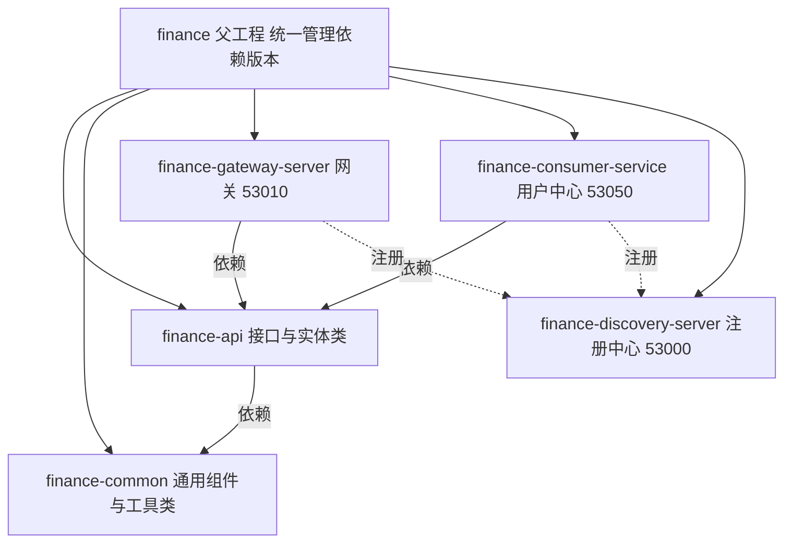
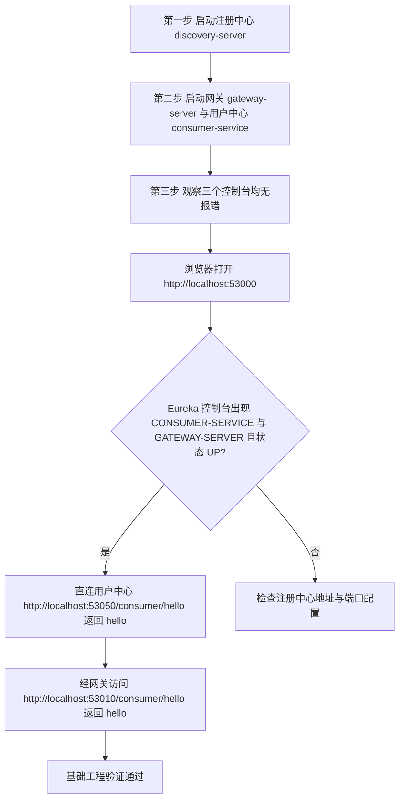
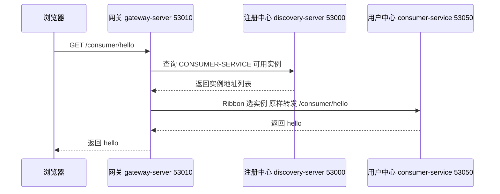

# 万信金融微服务基础工程：五个模块怎么读、依赖怎么串、启动怎么验

> 🔒 安全提示：文中示例的口令/密钥均为课程教学环境演示口径，生产环境的安全要求见《安全与合规须知》。

用 IDEA 打开发放的微服务基础工程，一排模块陈列在眼前：一个只有 pom 的父工程、一个空的 api 模块、一个装满工具类的 common 模块，外加注册中心、网关、用户中心三个可运行的微服务。不少人跳过熟悉代码直接开写，结果在「接口该定义到哪」「为什么别人引了依赖我没引」「网关转发 404」这些地方反复卡壳。把这套基础工程的模块职责、依赖关系和启动验证流程一次读透，后续每一章的开发都在这个骨架上进行。

## 先给结论

- 父工程 `finance` 只有一个 pom，统一管理全项目依赖版本，五个模块全部继承它。
- `finance-api` 存放整个项目的接口与实体类，`finance-common` 存放通用组件；其他微服务只依赖 api，api 已依赖 common，依赖传递会把公共能力带过去。
- 三个可运行服务各有固定端口：注册中心 53000（写死在配置文件），网关 53010，用户中心 53050（用启动参数配置）。
- 启动顺序是注册中心、网关、用户中心；验证分三步：看控制台报错、看 Eureka 控制台实例列表、浏览器访问 hello 接口。
- 经网关访问 `http://localhost:53010/consumer/hello` 能返回 hello，才算把「网关路由、注册发现、服务提供」整条链路验证通过。

## 父工程：一个 pom 管住所有版本

基础工程的根是聚合工程 `finance`，它没有任何 Java 代码，packaging 为 pom，价值全在依赖管理上。全项目用到什么、用什么版本，都在它的 `dependencyManagement` 里锁定，模块引依赖时不写版本号，从源头杜绝版本漂移：

```xml
<!-- 聚合工程 finance/pom.xml 节选（groupId 与模块名已按本系列口径改写） -->
<groupId>com.study.finance</groupId>
<artifactId>finance</artifactId>
<packaging>pom</packaging>
<version>1.0-SNAPSHOT</version>
<modules>
    <module>finance-common</module>
    <module>finance-api</module>
    <module>finance-gateway-server</module>
    <module>finance-consumer-service</module>
    <module>finance-discovery-server</module>
</modules>

<parent>
    <groupId>org.springframework.boot</groupId>
    <artifactId>spring-boot-starter-parent</artifactId>
    <version>2.1.3.RELEASE</version>
</parent>

<properties>
    <project.build.sourceEncoding>UTF-8</project.build.sourceEncoding>
    <project.reporting.outputEncoding>UTF-8</project.reporting.outputEncoding>
    <java.version>1.8</java.version>
</properties>
```

父工程以 Spring Boot 2.1.3 为基座，依赖管理一节涵盖了分布式事务、分布式任务调度、Swagger、Lombok、Apollo 客户端、Druid、MySQL 驱动、MyBatis-Plus、RocketMQ、Spring Security JWT、OAuth2、Sharding-jdbc、OkHttp、Sentinel 等全部成员。读基础工程的第一步就是把这段依赖清单过一遍，多数组件在前几个阶段已经打过交道，陌生的几个就是本阶段的重点学习对象。

## 五个模块的职责与依赖关系



这张关系图是整个基础工程的地图，蓝色主干要刻在脑子里：业务微服务依赖 api，api 依赖 common，所有微服务都继承父工程并注册到注册中心。逐个模块展开。

顺带沉淀一个读陌生聚合工程的固定套路，按这个顺序走一遍，任何一个没见过的工程都能在半小时内建立全貌：先读父 pom，把版本基线和技术栈范围圈出来；再看 modules 列表划分模块角色，分清哪些是纯 jar 模块、哪些是可运行服务；对每个模块仍然先读 pom 看它引了什么，再读配置文件看应用名、端口和中间件地址，然后读启动类看开了哪些开关，最后浏览现成的代码。基础工程正好按这个套路走。

**api 工程，接口与实体类的统一存放点。** 项目的约定是：所有对外接口定义和各种实体类（DTO、VO 这类数据载体）单独放在 `finance-api` 里。目前它是空包，没有现成代码，后续每章开发时定义 Feign 接口、写传输对象都要放进这里，找位置不要找错。它的 pom 有两个看点，一是 parent 指向父工程，二是依赖里已经带上了 common 与一组 Spring Cloud 组件：

```xml
<!-- finance-api/pom.xml 依赖节选 -->
<dependencies>
    <dependency>
        <groupId>com.study.finance</groupId>
        <artifactId>finance-common</artifactId>
        <version>${project.version}</version>
    </dependency>
    <dependency>
        <groupId>org.springframework.cloud</groupId>
        <artifactId>spring-cloud-starter-openfeign</artifactId>
    </dependency>
    <dependency>
        <groupId>org.springframework.cloud</groupId>
        <artifactId>spring-cloud-starter-netflix-hystrix</artifactId>
    </dependency>
    <dependency>
        <groupId>org.springframework.cloud</groupId>
        <artifactId>spring-cloud-starter-netflix-ribbon</artifactId>
    </dependency>
</dependencies>
```

Feign、Hystrix、Ribbon 出现在 api 模块的原因是：接口定义往往就是 Feign 客户端契约，声明在 api 里，调用方与服务方共用，熔断与负载均衡是这套契约的配套能力。

**common 工程，通用组件仓库。** 各微服务都可能用到、又不属于具体业务的东西都放这里：业务封装类与工具类。工程里已经提供了成套的现成工具类，包括 `Base64Util`、`CommonUtil`、`DateUtil`、`EncryptUtil`、`FileUtil`、`HttpUtil`、`IDCardUtil`、`IPUtil`、`JsonUtil`、`MD5Util`、`PasswordUtil`、`RSAUtil`、`StringUtil` 十余个。挑几个和本项目强相关的：`IDCardUtil` 用于身份证号码校验，对应 P2P 实名认证场景；`RSAUtil`、`MD5Util`、`EncryptUtil` 构成加密工具族，对应交易安全方案；`HttpUtil` 封装 HTTP 请求，`JsonUtil` 封装序列化。写业务前先翻一遍这里，能拿来直接用的就不要自己造轮子。

**依赖传递是关键细节。** 打开网关和用户中心的 pom 会发现一个现象：它们都只依赖了 api，并没有直接依赖 common。原因在 api 的 pom 里已经引入了 common，Maven 的依赖传递机制会把 common 连同 api 一起带进来。所以新建一个微服务模块时的固定动作只有两件：继承父工程，依赖 api 工程。想当然地再引一遍 common 不算错，但会破坏这套单一链条的设计。

## 注册中心 discovery-server

`finance-discovery-server` 就是服务注册中心，基于 Eureka Server 实现，端口号 53000。它的配置文件把 Eureka 服务端的典型开关都展示了出来：

```yaml
spring:
  application:
    name: discovery-server

server:
  port: 53000

eureka:
  server:
    enable-self-preservation: false      # 开发期关闭自我保护，失效实例快速剔除
    eviction-interval-timer-in-ms: 10000 # 剔除检查间隔 10 秒
  client:
    register-with-eureka: false          # 自己不再注册到自己
    fetch-registry: false                # 服务端不需要拉取注册表
    serviceUrl:
      defaultZone: http://localhost:${server.port}/eureka/
  instance:
    hostname: ${spring.cloud.client.ip-address}
    prefer-ip-address: true              # 注册时使用 IP 而不是主机名
```

启动类只有两个注解值得看：

```java
package com.study.finance.discovery;

import org.springframework.boot.SpringApplication;
import org.springframework.boot.autoconfigure.SpringBootApplication;
import org.springframework.cloud.netflix.eureka.server.EnableEurekaServer;

@SpringBootApplication
@EnableEurekaServer
public class DiscoveryServer {

    public static void main(String[] args) {
        SpringApplication.run(DiscoveryServer.class, args);
    }
}
```

配置里每一项都有明确语义。`register-with-eureka: false` 与 `fetch-registry: false` 是 Eureka Server 的标准姿势，注册中心自己既不注册也不拉取注册表；`enable-self-preservation: false` 关闭自我保护机制，配合 10 秒的剔除间隔，开发期实例下线后能快速从注册列表消失，避免调试时被过期实例干扰；`prefer-ip-address: true` 让实例以 IP 注册而不是主机名，局域网联调时其他人拿到的是可直连的地址。这套配置在前几个阶段学 Eureka 时都见过，这里是它的实战落位。

注册中心的端口号直接写在配置文件里，因为它的角色固定，端口基本不会再变；网关和用户中心就不一样了，端口存在变数，所以用启动参数配置，这一点在测试环节会用到。

## 网关 gateway-server

`finance-gateway-server` 是系统统一入口，基于 Zuul 实现，端口号 53010。启动类上一共三个注解：`@SpringBootApplication` 之外，`@EnableZuulProxy` 开启网关代理功能，`@EnableDiscoveryClient` 把网关自己也注册成 Eureka 的客户端：

```java
package com.study.finance.gateway;

import org.springframework.boot.SpringApplication;
import org.springframework.boot.autoconfigure.SpringBootApplication;
import org.springframework.cloud.client.discovery.EnableDiscoveryClient;
import org.springframework.cloud.netflix.zuul.EnableZuulProxy;

@SpringBootApplication
@EnableZuulProxy
@EnableDiscoveryClient
public class GatewayServer {

    public static void main(String[] args) {
        SpringApplication.run(GatewayServer.class, args);
    }
}
```

配置文件里能看到一个微服务接入这套体系所需的全部要素：应用名、注册中心地址、Ribbon 超时与重试、Zuul 路由规则：

```properties
# 应用名称与访问路径
spring.application.name=gateway-server
server.servlet.context-path=/

# 注册中心地址：网关作为 Eureka 客户端要把自己注册上去
eureka.client.serviceUrl.defaultZone=http://localhost:53000/eureka/

# Ribbon：连接超时、读取超时与重试策略
ribbon.MaxAutoRetries=1
ribbon.MaxAutoRetriesNextServer=1
ribbon.ConnectTimeout=3000
ribbon.ReadTimeout=20000
ribbon.OkToRetryOnAllOperations=false

# Zuul 路由：/consumer/** 转发给用户中心，转发时不去除前缀
zuul.routes.consumer-service.path=/consumer/**
zuul.routes.consumer-service.stripPrefix=false
zuul.retryable=true
zuul.add-host-header=true
zuul.ignoredServices=*
```

路由条目 `zuul.routes.consumer-service.path=/consumer/**` 的含义是：路径匹配 `/consumer/**` 的请求转发给名为 `consumer-service` 的服务（路由 id 默认对应服务名）。`stripPrefix=false` 表示转发时保留 `/consumer` 前缀原样转发，这与用户中心的上下文路径配置是配套的。`zuul.add-host-header=true` 让请求头随转发传递，`zuul.ignoredServices=*` 关闭自动路由匹配，所有路由手动声明，更安全。目前只有一条路由，后续每加一个微服务就要加一条。

Ribbon 那一组参数也有讲究：`ribbon.MaxAutoRetries` 是同一实例的重试次数，服务在注册表里存在但连不上时先原地重试；`ribbon.MaxAutoRetriesNextServer` 是换实例重试的次数，原地不行就换一台；`ribbon.OkToRetryOnAllOperations=false` 值得单独记忆，GET 请求重试无害，POST、PUT 这类非幂等操作重试可能造成重复提交，所以只对 GET 重试是保守而正确的默认。`zuul.retryable=true` 则打开网关层的重试开关，与 Ribbon 的参数配合工作。网关自己的上下文路径是 `/`，也就是它没有额外的路径前缀，前端打到什么路径就按路由规则解析什么路径。

配置文件里还有一组模板化的公共项在网关与用户中心都出现了：`swagger.enable=true` 控制接口文档开关，`logging.config=classpath:log4j2-dev.xml` 指定 Log4j2 日志配置，`spring.mvc.throw-exception-if-no-handler-found=true` 配合全局异常处理器把 404 也纳入统一处理，`spring.http.encoding` 三项解决中文乱码。这些属于微服务的标配配置，新加服务时整段复制微调即可。

网关还有一个绕不开的配置类。前后端分离后前端域名与后端不同源，跨域问题统一在网关这一层解决：

```java
package com.study.finance.gateway.config;

import org.springframework.boot.web.servlet.FilterRegistrationBean;
import org.springframework.context.annotation.Bean;
import org.springframework.context.annotation.Configuration;
import org.springframework.core.Ordered;
import org.springframework.web.cors.CorsConfiguration;
import org.springframework.web.cors.UrlBasedCorsConfigurationSource;
import org.springframework.web.filter.CorsFilter;

@Configuration
public class ZuulConfig {

    @Bean
    public FilterRegistrationBean corsFilter() {
        UrlBasedCorsConfigurationSource source = new UrlBasedCorsConfigurationSource();
        CorsConfiguration config = new CorsConfiguration();
        config.setAllowCredentials(true);
        config.addAllowedOrigin("*");
        config.addAllowedHeader("*");
        config.addAllowedMethod("*");
        config.setMaxAge(18000L);
        source.registerCorsConfiguration("/**", config);
        CorsFilter corsFilter = new CorsFilter(source);
        FilterRegistrationBean bean = new FilterRegistrationBean(corsFilter);
        bean.setOrder(Ordered.HIGHEST_PRECEDENCE);
        return bean;
    }
}
```

这个 CORS 过滤器对 `/**` 全路径放行跨域并注册为最高优先级，浏览器端的跨域请求在网关就得到处理，各微服务不用各自为政。

## 用户中心 consumer-service

`finance-consumer-service` 是项目里的第一个业务微服务：用户中心。投资人、借款人这些平台用户的相关能力都从这里起步，端口号 53050。启动类比网关多了一个注解：

```java
package com.study.finance.consumer;

import org.springframework.boot.SpringApplication;
import org.springframework.boot.autoconfigure.SpringBootApplication;
import org.springframework.cloud.client.discovery.EnableDiscoveryClient;
import org.springframework.cloud.openfeign.EnableFeignClients;

@SpringBootApplication
@EnableDiscoveryClient
@EnableFeignClients(basePackages = {"com.study.finance.consumer.agent"})
public class ConsumerService {

    public static void main(String[] args) {
        SpringApplication.run(ConsumerService.class, args);
    }
}
```

`@EnableFeignClients` 指定扫描 `agent` 包，将来通过 Feign 发起远程调用时，Feign 客户端接口都定义在这个包下，暂时还用不到，先记住它的位置。它的 `application.properties` 与网关高度相似：应用名 `consumer-service`、上下文路径 `server.servlet.context-path=/consumer`、同一个注册中心地址、同样的一组 Ribbon 配置与模板化公共项。差异点在两处：上下文路径不是 `/` 而是 `/consumer`，配置文件里没有 `server.port`，端口留给启动参数。工程结构上，controller、service、config、agent 这些包都已经建好骨架，test 目录里也预置了测试类，业务代码按包落位即可。

代码部分目前只有一个专门用来测试环境的 `ConsumerController`：

```java
package com.study.finance.consumer.controller;

import io.swagger.annotations.Api;
import io.swagger.annotations.ApiImplicitParam;
import io.swagger.annotations.ApiOperation;
import org.springframework.web.bind.annotation.GetMapping;
import org.springframework.web.bind.annotation.PostMapping;
import org.springframework.web.bind.annotation.RestController;

@RestController
@Api(value = "用户服务的Controller", tags = "Consumer", description = "用户服务API")
public class ConsumerController {

    @ApiOperation("测试hello")
    @GetMapping(path = "/hello")
    public String hello() {
        return "hello";
    }

    @ApiOperation("测试hi")
    @ApiImplicitParam(name = "name", value = "姓名", required = true, dataType = "String")
    @PostMapping(value = "/hi")
    public String hi(String name) {
        return "hi," + name;
    }
}
```

`/hello` 无参数直接返回字符串，`/hi` 带一个 `name` 参数，Swagger 注解已经就位，正好给后续 Swagger 章节当示例素材。

## 端口约定与启动参数配置

每个微服务占用哪个端口，讲义里有明确约定，不允许随意分配：

| 工程 | 端口 | 配置方式 |
|---|---|---|
| finance-discovery-server | 53000 | 写死在 `application.yml` |
| finance-gateway-server | 53010 | 启动参数 VM options |
| finance-consumer-service | 53050 | 启动参数 VM options |

配置方式不同的理由值得想明白：注册中心的角色与端口基本不会变，写死省事；网关和用户中心的端口存在调整可能，作为启动参数配置可以做到同一份代码、不同环境不同端口，也避免每个人改配置文件造成合并冲突。在 IDEA 的 Run/Debug Configurations 里给两个工程分别加 VM options：`-Dserver.port=53010` 与 `-Dserver.port=53050`，检查一遍别配错。

## 启动验证：从控制台到网关转发

环境值不值得信任，拉出来溜一遍。验证按三步走，任何一步不通过就停在当前步骤排查。



同时启动三个服务会稍慢，耐心等控制台稳定。注册中心控制台出现 Tomcat started on port 53000 且无报错；网关与用户中心的控制台同样无报错，能看到 DiscoveryClient 输出的注册与心跳日志，例如 `DiscoveryClient CONSUMER-SERVICE ... registering service` 表示注册动作完成，之后周期性出现的心跳续约日志说明客户端与注册中心的联系保持正常。

打开浏览器访问 `http://localhost:53000/`，看到 Eureka 的服务注册控制台：Instance currently registered with Eureka 一栏列出 `CONSUMER-SERVICE` 和 `GATEWAY-SERVER` 两个应用，状态为 UP。实例的状态列显示形如 `UP (1 - consumer-service:192.168.x.x:53050)` 的内容，括号里的格式正是配置文件中 `eureka.instance.instance-id` 的模板：应用名、IP、端口拼在一起，一眼就能定位实例归属。到这里注册中心与两个客户端的注册关系全部打通。

再验证服务本身可用。直接访问用户中心 `http://localhost:53050/consumer/hello`，页面返回 hello，说明用户中心这个微服务可以正常对外服务。带参数的 `/hi` 是 POST 接口，浏览器地址栏不好直接测，用 Postman 以 form 表单提交 `name` 参数即可，返回 `hi,` 加上参数值，顺带把 Postman 的基本用法练了。关键的一步在网关：把地址换成 `http://localhost:53010/consumer/hello`，端口从 53050 改成 53010，其余不变，依然返回 hello。53010 是网关的端口，这个请求实际发往的是网关，网关根据路由配置把 `/consumer/**` 转发给了用户中心，最终由用户中心的 `ConsumerController` 处理并返回。完整链路如下：



三步全部通过，就证明了注册中心、网关、用户中心三个基础工程可以正常运行，后续开发都在这套经过验证的骨架上叠加。

## 三个启动类的注解对照

把三个启动类摆在一起看，注解就是每个服务角色的自我声明，也是读微服务代码时优先扫一眼的位置：

| 启动类 | 关键注解 | 含义 |
|---|---|---|
| DiscoveryServer | `@EnableEurekaServer` | 我是注册中心，负责服务注册与发现 |
| GatewayServer | `@EnableZuulProxy`、`@EnableDiscoveryClient` | 我是网关，开启路由代理，同时作为客户端注册自己 |
| ConsumerService | `@EnableDiscoveryClient`、`@EnableFeignClients` | 我是业务微服务，注册自己，并按包扫描 Feign 客户端 |

规律很清晰：注册中心开服务端开关；网关与业务微服务开客户端开关；业务微服务额外开 Feign 扫描，为跨服务调用做准备。后续每新建一个微服务，启动类基本照着 ConsumerService 复制，再按需增减开关，这套模式贯穿整个项目。

## 常见误区

- **不先起注册中心。** 错例：网关和用户中心先启动，控制台刷一堆 Cannot execute request on any known server。正解：先启动注册中心，再启动其余服务；客户端有重试机制最终会注册成功，但日志噪音会干扰判断。
- **把网关和用户中心的端口改在配置文件里。** 错例：直接往 `application.properties` 加 `server.port`。正解：网关与用户中心的端口按课程约定用 VM options 启动参数配置，保持代码零改动，注册中心端口才写在配置文件里。
- **直连通、网关 404 就认为网关坏了。** 错例：`53050/consumer/hello` 正常，`53010/consumer/hello` 报 404，转而怀疑网关服务。正解：先查路由配置，`stripPrefix` 是否为 false、路由 id 是否与服务名一致；前缀被误裁剪是与用户中心 `context-path=/consumer` 不匹配的典型原因。
- **以为 common 要每个微服务都显式引入。** 错例：在用户中心 pom 里再加一条 common 依赖。正解：api 工程已依赖 common，业务微服务依赖 api 即可传递获得，遵循 api 到 common 的单一链条。
- **忽视 `zuul.ignoredServices=*`。** 错例：新增微服务后没配路由，以为服务注册上就能被网关转发。正解：自动路由匹配已关闭，每个微服务接入网关都必须手动声明一条 `zuul.routes.<id>.path` 路由。

## 面试可能被问到的问题

1. 面试官追问：「你们微服务工程是怎么组织模块的，公共代码放哪里？」
   答：聚合工程加多模块。父工程只有一个 pom 统一管依赖版本；api 模块集中放全部接口定义与实体类；common 模块放通用组件和工具类；业务微服务只依赖 api，通过 Maven 依赖传递获得 common 的能力，所有微服务继承父工程并注册到 Eureka。
2. 面试官追问：「新建一个微服务模块时要做哪些约定动作？」
   答：三件事，继承父工程获得统一版本管理，依赖 api 工程获得公共接口与实体类，在网关配置一条到该服务的路由；再加上按约定分配端口并以启动参数方式配置，应用名、注册中心地址沿用既有模板。
3. 面试官追问：「`stripPrefix=false` 是什么意思，为什么这里必须这样配？」
   答：Zuul 转发时默认会按 `zuul.routes.<id>.path` 匹配到的前缀裁剪路径；设为 false 表示保留前缀原样转发。本项目用户中心配置了上下文路径 `/consumer`，网关侧路由前缀也是 `/consumer`，只有不裁剪，请求才能落到用户中心的上下文路径上，否则会出现 404。
4. 面试官追问：「Eureka 的自我保护机制是什么？你们为什么关闭它？」
   答：Eureka 在短时间内丢失大量心跳时，会怀疑自己网络出了问题而不是实例挂了，从而保留过期实例不剔除，防止网络抖动误杀。生产开启可提高可用性，开发环境网络稳定、希望失效实例快速下线，所以配置 `enable-self-preservation=false` 并把剔除间隔缩短到 10 秒。
5. 面试官追问：「服务从启动到能被别人调用，中间发生了什么？」
   答：服务启动时作为 Eureka 客户端向注册中心注册自己的服务名、IP 与端口，之后周期性发心跳续约；调用方（如网关）从注册中心拉取服务列表，按服务名查到实例，再经 Ribbon 做客户端负载均衡选中一个实例发起调用。注册中心的控制台能看到每个实例的状态是否为 UP。
6. 面试官追问：「跨域为什么在网关处理，而不是各微服务自己处理？」
   答：跨域是浏览器同源策略对前端请求的限制，网关是所有前端请求的统一入口，在这里注册一个最高优先级的 CORS 过滤器即可全站生效；分散到各微服务处理会重复配置且容易遗漏，统一收敛到入口层最干净。

## 配套资料

- 代码：`materials/code/10/wanxinp2p/`，微服务基础工程聚合工程，正文引用的父 pom、api 依赖、Eureka 配置、网关路由与 CORS 配置类、用户中心启动类与测试 Controller 均为该工程真实文件；内层目录为原始包名，与正文 `com.study.finance` 改写口径不一致，引用路径到工程目录为止。
- 讲义：`materials/docs/10/万信金融-第1章-讲义-开发环境搭建v1.0.md`，其中 1.2.2 了解基础工程的模块清单、基础工程关系图与基础工程测试为本课出处。
- 说明：该阶段资料归档在 `materials/docs/10/` 与 `materials/code/10/`，目录编号与相邻阶段共用。
