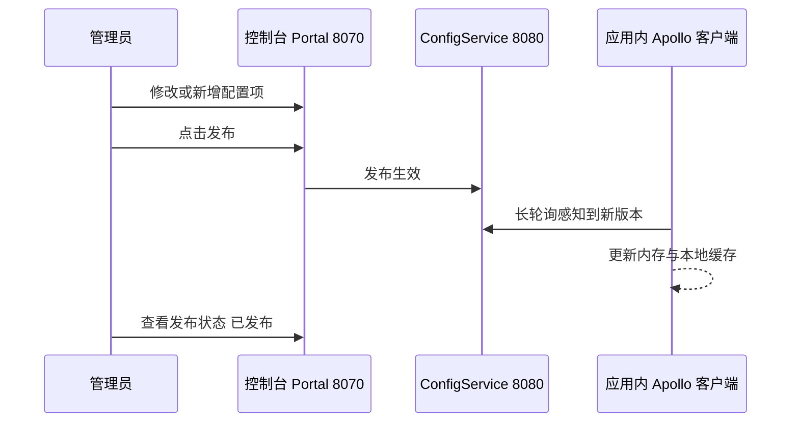
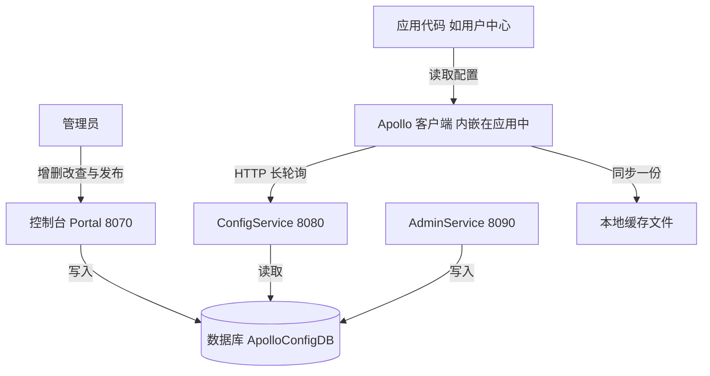

# Apollo 选型与初体验：从四个配置中心产品到第一次发布配置

配置中心的概念清楚了，接下来的问题很实际：市面上的配置中心产品不止一个，选哪个？选定的产品又长什么样、值不值得把整个项目的配置托付给它？这两个疑问分别对应两步动作：先把主流产品盘一遍，给出选型依据；再登录控制台，亲手做一次配置的增删改与发布，把 Apollo 的工作机制一次看全。踩过一次「配置改了半天就是不生效」的坑之后，这些概念会记得格外牢。

## 先给结论

- 主流配置中心有四个：Disconf、Spring Cloud Config、Apollo、Nacos；Disconf 已停止维护，万信金融项目采用 Apollo。
- Apollo 是携程框架部门研发、2016 年 5 月开源的分布式配置中心，本身基于 Spring Boot 与 Spring Cloud 体系开发，打包后可直接运行。
- 它把配置持久化到数据库，内置 Eureka 注册中心，通过 HTTP 长轮询把变更在一秒内推到客户端，同时自带版本管理、灰度发布与权限体系。
- 控制台里的增删改只是草稿动作，点「发布」配置才真正生效；客户端从配置中心拉取配置并落一份本地缓存文件，服务端故障也不影响应用启动。
- 工程接入 Apollo 只需要三样东西：`apollo-client` 依赖、`app.id` 应用标识、namespaces 命名空间列表。

## 四个主流配置中心产品

按出现时间和出处过一遍，每个产品的现状比它的历史更重要。

**Disconf，最早登场。** 百度推出的配置中心产品，2014 年开源，属于行业里较早的一批探索者。目前该项目已不再维护、不再更新，选型时可以直接排除，作为行业脉络了解即可。

**Spring Cloud Config，体系内方案。** 来自 Spring Cloud 平台的配置组件，同样是 2014 年开源，与 Eureka 一样是 Spring Cloud 家族的一员。它的版本管理依托 Git 实现，能力可用，但在实时推送上要额外借助 Spring Cloud Bus 做消息广播，架构上多一层依赖。

**Apollo，本项目的选择。** 携程框架部门研发并开源的分布式配置管理中心，2016 年 5 月开源，名字取自登月计划，是国内配置中心领域的标杆产品。它专为微服务和分布式场景设计，后面整章内容都围绕它展开。

**Nacos，后起之秀。** 阿里巴巴开源的产品，2018 年 6 月开源，兼有服务发现与配置管理两套能力，在后续的项目里还会与它打交道。

## Apollo 的定位与特性

一句话定位：Apollo 是适用于微服务架构、分布式架构场景的配置管理中心。它有一个对项目非常友好的先天条件：本身基于 Spring Boot 与 Spring Cloud 开发，而绝大多数项目的技术栈也是这套体系，两边可以无缝对接；服务端是打包好的可运行产物，部署时不需要额外搭建复杂环境。

往深一层看，Apollo 不是一个单纯的键值仓库，而是若干能力的组合体。它把配置持久化保存到数据库里；内部集成了一个注册中心，用的是 Eureka；自带版本控制与权限管理；客户端与服务端之间通过 HTTP 长轮询保持联系。这些能力稍后逐条对应到传统配置的痛点上。

官方给出的特性清单，逐条读过去：

**统一管理不同环境、不同集群、不同命名空间的配置。** 开发、测试、生产各一套配置，同一环境下多机房、多集群各一套配置，全部收进一个平台，配置不再散落在各个工程里。

**配置修改实时生效（热发布）。** 传统方式改配置要重启应用，Apollo 通过 HTTP 长轮询把变更推送出去，一秒之内送达客户端，不重启。

**版本发布管理。** 每一次发布都有记录，配置改错了可以一键回滚到上一版，相当于给配置补上了 Git 级别的后悔药。

**灰度发布。** 变更先下发给一部分实例观察效果，确认没问题再全量发布，把配置事故的爆炸半径控制住。

**权限管理、发布审核与操作审计。** 谁能改配置、谁能发布、改了什么，都有账号和记录管着，直接回应传统配置「人人可改、改了无痕」的问题。

**客户端配置信息监控。** 哪些实例在用哪一版配置，在界面上看得见，排障时不再靠猜。

**多语言客户端与开放平台 API。** 提供 Java 与 .Net 原生客户端，另有开放平台 API 支持其他语言和系统的接入。

## 产品对比与选型理由

三款仍在活跃维护的产品放在一张表里比，差异立刻显形：

| 功能点 | Spring Cloud Config | Apollo | Nacos |
|---|---|---|---|
| 配置实时推送 | 支持（依赖 Spring Cloud Bus） | 支持（HTTP 长轮询，1s 内） | 支持（HTTP 长轮询，1s 内） |
| 版本管理 | 支持（依托 Git） | 支持（发布历史与回滚内置） | 支持 |
| 配置回滚 | 支持（依托 Git） | 支持（一键回滚） | 支持 |

Spring Cloud Config 的实时推送与回滚都建立在 Git 和消息总线之上，每个环节都引入了额外组件；Apollo 与 Nacos 把这些能力做进了产品自身。从功能完整度看，Apollo 是全绿的那一个，这也是选它的直接技术依据。

热度与落地情况是另一把尺子。截至课程录制时，Apollo 在码云上有 800 多颗 Star，在 GitHub 上的 Star 数超过 1.6 万，社区热度可见一斑。比 Star 更有说服力的是落地应用：Apollo 项目主页维护着一份 Known Users 名单，列出大量在生产环境真实使用 Apollo 的公司。一个配置中心产品把项目的配置安全托付过去，「有没有公司真的在用」往往比「功能列表多长」更关键，Apollo 在这一点上交得出答案。

把选型收拢成一句话：Apollo 等于数据库加内置注册中心，再加版本控制、权限管理和 HTTP 长轮询的组合体，每一项能力都精准对着传统配置形式的一个痛点，因此是当下最合适的配置中心选项。

痛点与能力有一张清晰的对应账可算：

| 传统配置的痛点 | Apollo 的对应能力 |
|---|---|
| 缺少权限控制 | 账号体系、修改与发布权限分离、操作审计 |
| 缺少版本控制 | 每次发布留记录，支持一键回滚 |
| 缺少实时控制 | HTTP 长轮询推送，变更 1s 内生效 |
| 配置分散、多环境多集群难管理 | 环境、集群、命名空间三层组织，统一收口 |

这张对应表值得记牢：面试里被问到「配置中心解决了什么问题」时，答案就藏在这一一对应的关系里。

## 长轮询为什么快，又不浪费资源

初体验里「1s 内生效」依赖的是 HTTP 长轮询，它和普通轮询的区别值得单独说清。普通轮询是客户端每隔固定时间问一次「有新配置吗」，间隔短了请求量巨大，间隔长了生效就慢。长轮询反过来：客户端发一次请求，服务端发现没有新版本时不立刻答复，而是把请求挂住，等到有配置发布、或者挂到超时才返回；客户端收到响应后马上发起下一轮。于是绝大多数时间网络里没有多余的空请求，而新配置一发布几乎是零延迟送达，兼顾了实时性与开销。Apollo 客户端与服务端之间维持的就是这种联系，这也是「修改实时生效（热发布）」特性的技术底座。

## 初体验：登录控制台，把配置当数据来操作

产品说得再好，不如亲手点一遍。提前部署好的体验环境可以通过 `http://example.com:8070` 访问（演示地址以实际环境为准），默认账号 apollo、密码 admin。登录这个动作本身就在兑现第一个承诺：传统配置谁都能改，Apollo 的控制台必须登录才能操作，登不进去就动不了任何配置。

登录后看到的是一列项目列表，一个项目对应一个应用，页面上那些测试项目先不用管。点进一个项目，控制台的层次结构就铺开了：左侧是环境列表与集群列表，默认打开名为 default 的集群。环境对应开发、测试、生产这些部署阶段，一套项目在不同环境里各有一份配置，切换环境就是切换一套配置视角；集群则把同一环境下的实例按机房、地域分组，各组的配置允许存在差异。这两个名词在初体验阶段混个脸熟即可，核心概念一课会单独展开。右侧是该项目的各个命名空间，页签一样排列着，application 是每个项目都有的默认命名空间，旁边还有一批自定义命名空间。命名空间的作用是把配置分类，比如中文乱码处理的三行 `spring.http.encoding` 配置归一类，Ribbon 的超时重试配置归一类，Eureka 的注册配置归一类，分类之后查找和维护都省力。

点开一个命名空间，配置项以表格呈现，一列键、一列值，和本地配置文件的内容完全同构；切换到文本模式，则按 `properties` 的原样格式展示，看起来更亲切。在这张表格上可以做四个动作，正好对应增删改查：

- **修改。** 点开某条配置，例如把 `requestTimeout` 的值从 200 改成 100，确认提交。
- **删除。** 选中不要的配置项，确认删除。
- **新增。** 点新增按钮，填一个键如 `abc`、一个值如 `123`，再勾选这条配置要放到哪个环境、哪个集群，提交。
- **发布。** 表格上方有发布按钮，是整个流程的开关。

关键就在发布这一步：前面改了值、删了项、加了键，这些操作此刻都还没生效，只是把变更记录了下来。点开发布，页面列出本次所有变更的清单，确认之后配置才真正推向客户端，配置项的发布状态随之变为「已发布」。把从修改到生效的完整链路画出来：



流程里的关键路径是「发布」那一行：没有发布动作，客户端的长轮询永远等不到新版本，界面改了等于白改。

## 工作机制全貌：配置存在哪，应用怎么拿到

初体验只看到了控制台这一层，完整的工作机制要用一张架构图讲清。假设场景是用户中心这个微服务：接入 Apollo 之后，它本地 `application.properties` 里那一大串配置，大部分要上移到 Apollo 统一管理，本地文件不会清空，但只留少量内容；配置的真身保存在数据库里；应用内部嵌入一个 Apollo 客户端，负责替应用和配置中心打交道。



这张图分三条线读。管理线：管理员在 Portal 控制台对配置做增删改查，配置数据最终落到数据库，配置的存储是数据库而非文件，这正是初见配置时提到的第五种配置形式。服务线：ConfigService 从数据库读出配置对外提供服务，AdminService 负责配置的写入，两者配合 Portal 工作。客户端线：应用里的 Apollo 客户端通过 HTTP 长轮询从 ConfigService 拿到最新配置，交给应用代码使用，同时在本地写一份缓存文件。

本地缓存文件是这套机制里容易被忽略却非常重要的一环。配置中心从数据库迁到了 Apollo，应用对它的依赖变重了，万一 Apollo 整个服务端出问题，应用不能跟着起不来。客户端每次拿到配置都在本地留一份副本，配置中心失联时，应用凭这份缓存照常启动、照常运行，可用性没有被单点拖垮。

## 工程接入的样子：三样东西

机制清楚了，接入工程需要准备什么也就清楚了。课程资料里有一套 Apollo 环境的微服务基础工程，用户中心模块的配置文件已经瘦身成这样：

```yaml
# Apollo 环境基础工程中用户中心的 application.yml（节选，模块名已按本系列口径改写）
# 个性化参数仍用启动参数传入：-Denv=dev -Dapollo.cluster=DEFAULT -Dserver.port=53050
app:
  id: consumer-service
apollo:
  bootstrap:
    enabled: true
    namespaces: application,micro_service.spring-boot-http,micro_service.spring-eureka,micro_service.spring-ribbon
spring:
  application:
    name: consumer-service
logging:
  config: classpath:log4j2-dev.xml
```

三样东西都在这份文件里。`app.id` 是应用标识，对应控制台里创建的项目，客户端靠它找到自己该读哪个项目的配置；`apollo.bootstrap.enabled` 打开加载开关，让 Apollo 的配置在应用启动阶段就注入 Spring 环境；namespaces 列出要加载的命名空间，application 是默认命名空间，`micro_service.` 前缀的几个是按组件拆分的公共命名空间，完整的清单与拆分方式在核心概念一课展开。

第二样是客户端依赖，版本由父工程的 `dependencyManagement` 统一锁定：

```xml
<!-- 父 pom 已锁定 apollo-client 版本为 1.2.0，业务模块引用时不写版本号 -->
<dependency>
    <groupId>com.ctrip.framework.apollo</groupId>
    <artifactId>apollo-client</artifactId>
</dependency>
```

第三样是环境与地址的映射文件，告诉客户端每个环境该连哪台服务端：

```properties
# apollo-env.properties：环境到 meta 服务地址的映射（列出开发环境，其余环境格式相同）
dev.meta=http://localhost:8080
```

`dev.meta` 指向的 8080 是 ConfigService 的地址，也就是客户端长轮询的目标。这里要和项目自己的注册中心划清界限：万信金融项目的 Eureka 在 53000 端口，Apollo 内部的注册中心在 8080 端口，是两套互不相干的注册体系，端口别混。

## 常见误区

- **改完配置不点发布就去验证。** 错例：在控制台把值改了，回到应用一测还是旧值，开始怀疑客户端坏了。正解：控制台的修改只是草稿，必须点发布、确认变更清单后配置才生效。
- **以为客户端连的是控制台端口。** 错例：给应用配 `http://localhost:8070`。正解：8070 是 Portal 控制台，给人用；客户端连的是 ConfigService 的 meta 地址，开发环境是 8080。
- **把 Apollo 内置注册中心与项目 Eureka 混为一谈。** 错例：看到 ConfigService 里的 Eureka 界面，以为是 53000 那个注册中心换了地方。正解：Apollo 内部自带一套 Eureka，服务它自己的 ConfigService 与 AdminService，与项目微服务的注册中心是两码事。
- **接入 Apollo 后把本地配置文件删空。** 错例：以为配置全部上移，本地文件可以清零。正解：本地要保留 `app.id`、namespaces 这类引导配置和日志等少量内容，其余大部分配置才交给 Apollo 管理。

## 面试可能被问到的问题

1. 面试官追问：「Apollo 和 Spring Cloud Config、Nacos 有什么区别？」
   答：Spring Cloud Config 是 Spring Cloud 体系内的组件，实时推送要依赖 Spring Cloud Bus，版本管理与回滚依托 Git；Apollo 是携程开源的分布式配置中心，实时推送、版本管理、回滚、灰度、权限都内置，功能最完整；Nacos 是阿里开源的，配置管理与服务发现一体，实时推送能力与 Apollo 相当。项目选 Apollo 看重的是功能完整度和大量企业的落地案例。
2. 面试官追问：「Apollo 怎么做到配置修改秒级生效？」
   答：客户端与服务端之间用 HTTP 长轮询保持联系，客户端发起请求后服务端挂住，一旦有新版本配置发布立即返回，变更在一秒内送达客户端，客户端更新内存配置并刷新本地缓存文件，应用不需要重启。
3. 面试官追问：「Apollo 的配置存在哪里，为什么不继续用配置文件？」
   答：存在数据库里，控制台的每次增删改查本质是操作数据库。存数据库天然获得了权限控制、版本记录、审计与事务性，多环境多集群的配置也能用库表结构清晰组织，这些是散落在各工程里的配置文件做不到的。
4. 面试官追问：「配置中心挂了，应用会怎么样？」
   答：应用不会起不来。Apollo 客户端每次拉取配置都会在本地保存一份缓存文件，配置中心失联时客户端用本地缓存初始化配置，应用照常启动运行；等配置中心恢复后再继续接收变更推送。
5. 面试官追问：「什么是热发布？」
   答：配置修改后不重启应用就能生效。传统方式改配置要重启进程甚至重启机器，热发布通过长轮询把新配置实时推给客户端并立即替换运行时配置，省掉重启的时间与风险。
6. 面试官追问：「接入 Apollo 的应用，本地配置文件还剩什么？」
   答：剩少量引导内容：应用标识 `app.id`、要加载的命名空间列表、环境与 meta 地址映射，以及日志配置这类启动期就需要的信息；数据库连接、Eureka、Ribbon 等业务与组件配置都上移到 Apollo 统一管理。

## 配套资料

- 讲义：`materials/docs/10/万信金融-第1章-讲义-开发环境搭建v1.0.md`，1.3 节即 Apollo 配置中心的引入说明，明确各微服务大部分配置信息由 Apollo 统一管理。
- 讲义：`materials/docs/10/Nacos-服务发现与配置管理v1.0.md`，对比产品 Nacos 的课程资料，可作为选型对照阅读。
- 代码：`materials/code/10/wanxinp2p_apollo/`，Apollo 环境的微服务基础工程，正文引用的 `application.yml`、`apollo-env.properties` 与父 pom 中的 `apollo-client` 版本管理均为该工程真实文件；内层目录沿用原始模块命名，与正文 `consumer-service` 等改写口径不一致，引用路径到工程目录为止。
- 说明：控制台体验地址为外部演示环境，文中以 `example.com:8070` 占位；账号 apollo、密码 admin 为 Apollo 控制台的默认账号，正式环境使用前必须修改。
