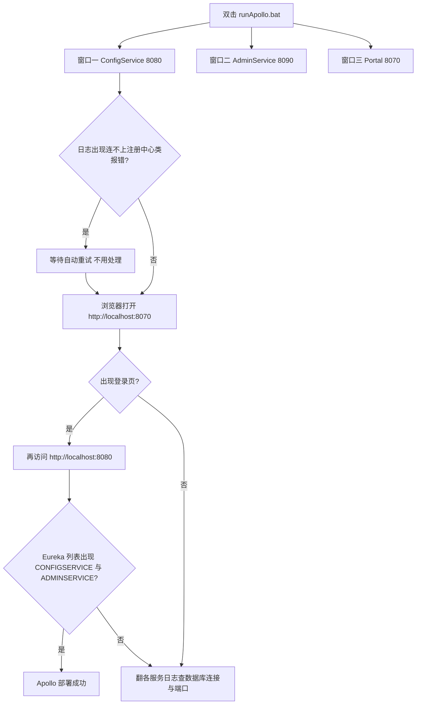

# 把 Apollo 服务端跑起来：建库、改脚本、启动验证

> 🔒 安全提示：文中示例的口令/密钥均为课程教学环境演示口径，生产环境的安全要求见《安全与合规须知》。

初体验是在别人部署好的环境里逛了一圈，感觉终究隔着一层。真正的掌握要在自己电脑上完整部署一遍：建好它依赖的数据库，读懂并改好启动脚本，双击运行，最后用浏览器验证三个服务都活了。过程本身不难，Apollo 是打包成熟的产物，该执行的执行、该运行的运行，容易翻车的是几个不起眼的细节：密码没改、端口被占、启动初期的报错把人吓退。

## 先给结论

- 运行环境三件套：JDK 1.8 以上（服务端要求 1.8+，客户端 1.7+）并配置好 `JAVA_HOME`，MySQL 5.6.5 以上、建议直接装 5.7，外加 8070、8080、8090 三个空闲端口。
- Apollo 依赖两个数据库：ApolloConfigDB 每个环境部署一套，ApolloPortalDB 整套部署一个即可，开发阶段各建一个，执行课程 SQL 脚本即可，顺序是先 Config 后 Portal。
- 服务端是三个打包好的 Spring Boot 微服务：Portal 占 8070 提供控制台，ConfigService 占 8080 提供配置读取，AdminService 占 8090 提供配置写入。
- 双击 `runApollo.bat` 启动，必须修改的是 MySQL 连接信息；启动初期报「连不上注册中心」类错误可以忽略，它会自动重试连上。
- 验证两个入口：`http://localhost:8070` 出现登录页，`http://localhost:8080` 出现 Apollo 内部的 Eureka 界面，列表里注册着 ConfigService 与 AdminService。

## 部署前的环境清单

讲义把运行环境的要求列得很明确。JDK 方面，服务端要求 1.8 以上，客户端要求 1.7 以上，本机统一装 1.8 即可两头兼顾，同时要配置好 `JAVA_HOME` 环境变量，启动脚本靠它找到 Java。数据库方面，MySQL 要求 5.6.5 以上版本，建议直接安装 5.7。端口方面，Apollo 的三个微服务分别占用 8070、8080、8090，启动前务必确认这三个端口没有被其他进程占用，否则一启动就报错。

## 第一步：创建两个数据库

配置以数据库形式存储是 Apollo 的底层设计，所以数据库环境必须先就位。它需要两个库，职责划分别弄混：`ApolloConfigDB` 存放配置数据本身，生产环境中每个环境要部署一套；`ApolloPortalDB` 存放门户侧的数据，比如项目、用户、权限，生产环境整套系统部署一个就够。目前处于开发阶段，两个库各建一个即可，用不到多环境规划。

课程提供了现成的初始化脚本 `p2p_apollo.sql`，里面除了 Apollo 两个库的建表语句与初始数据，还包含基础工程的初始配置，也就是后续工程要用到的命名空间与配置项数据。执行时按顺序来，先执行 Config 库的部分，再执行 Portal 库的部分，跑完刷新数据库就能看到两张成套的库表：

```sql
-- 课程脚本 p2p_apollo.sql 的执行顺序示意（先 Config 后 Portal）
CREATE DATABASE IF NOT EXISTS ApolloConfigDB DEFAULT CHARACTER SET utf8; -- 配置数据，每环境一套
CREATE DATABASE IF NOT EXISTS ApolloPortalDB DEFAULT CHARACTER SET utf8; -- 门户数据，整系统一套
```

建好的库里已经带出了一些初始数据，可以打开几张贴着默认配置的表大致过一遍，对后续排查问题有帮助：配置数据都落在 `ApolloConfigDB`，登录账号与项目信息在 `ApolloPortalDB`。

## 第二步：读懂并修改 runApollo.bat

数据库就绪后，不需要任何编译部署动作，直接启动即可。课程提供 `runApollo.bat` 一键启动，但双击之前必须先编辑它。用记事本或任意文本编辑器打开，能看到三段结构一致的启动命令，一段对应一个微服务：

```bat
@echo off
rem 分别启动 Apollo 的三个微服务，各占一个命令行窗口
rem ConfigService：8080，配置读取与长轮询入口，与 AdminService 共用 ApolloConfigDB
start "apollo-configservice" java -Dspring.datasource.url="jdbc:mysql://localhost:3306/ApolloConfigDB?characterEncoding=utf8" -Dspring.datasource.username=root -Dspring.datasource.password=123456 -Dlogging.file=./logs/apollo-configservice.log -Dserver.port=8080 -jar apollo-configservice-1.3.0.jar

rem AdminService：8090，配置写入服务，供 Portal 调用
start "apollo-adminservice" java -Dspring.datasource.url="jdbc:mysql://localhost:3306/ApolloConfigDB?characterEncoding=utf8" -Dspring.datasource.username=root -Dspring.datasource.password=123456 -Dlogging.file=./logs/apollo-adminservice.log -Dserver.port=8090 -jar apollo-adminservice-1.3.0.jar

rem Portal：8070，控制台，自己使用 ApolloPortalDB
start "apollo-portal" java -Dspring.datasource.url="jdbc:mysql://localhost:3306/ApolloPortalDB?characterEncoding=utf8" -Dspring.datasource.username=root -Dspring.datasource.password=123456 -Dlogging.file=./logs/apollo-portal.log -Dserver.port=8070 -jar apollo-portal-1.3.0.jar
```

脚本按画面线还原并按 Apollo 1.3.0 官方启动写法补全，课程原始的 `runApollo.bat` 与 `p2p_apollo.sql` 未随代码资料归档；数据库账号密码按本课约定为 root/123456，实际以本机 MySQL 为准。

每段命令的骨架完全一样，值得逐项读懂。`java -D` 系列参数在进程启动前注入配置，`-Dspring.datasource.url` 指定连接哪个库，注意前两个服务连的是 `ApolloConfigDB`，Portal 连的是 `ApolloPortalDB`，URL 末尾拼了编码参数避免中文乱码；`-Dspring.datasource.username` 与 `-Dspring.datasource.password` 是数据库账号密码，这是唯一必须按本机情况修改的地方，照抄别人的密码启动必失败；`-Dlogging.file` 指定日志落盘路径，Apollo 运行期出了问题就翻这里的日志，路径理论上可以放到硬盘任何位置；`-Dserver.port` 指定服务端口；最后 `java -jar` 运行对应的 jar 包，这正是早前学 Java 技术时接触过的 jar 运行方式。三个 jar 包就是三个独立运行的微服务。

## 第三步：双击启动，看懂三个窗口

双击 `runApollo.bat`，屏幕上会弹出三个命令行窗口，一个窗口一个微服务，和三个 jar 包一一对应。窗口里的滚动日志能看到 Spring Boot 与 Spring Cloud 的启动痕迹，Apollo 内部用的正是这套体系。

三个服务启动初期可能刷出一些报错，多数是「连不上注册中心」之类的提示，此时不必处理。原因是 Apollo 内部集成了注册中心，ConfigService 与 AdminService 启动时要把自己注册进去，注册中心没就绪时连接失败，客户端会自动重试，总有一次连上。要特别注意这里的注册中心指的是 Apollo 内部的那一套，与万信金融项目里 53000 端口的 Eureka 完全是两码事，别看到注册中心三个字就去检查基础工程。



这张图是启动验证的完整决策路径：三个窗口起来后，先用登录页确认 Portal，再用内部 Eureka 确认两个后端服务，任何一步卡住都去翻对应服务的日志文件。

## 启动后的两个验证入口

三个服务全部启动完毕，用浏览器依次验证。第一个入口是 `http://localhost:8070`，打开后是 Apollo 的登录页面，账号 apollo、密码 admin，这是 Apollo 的默认账号，登录后建议第一时间修改。回想传统配置形式的第一个痛点是缺少权限控制，而在这里，登录不进去就动不了任何配置，权限这层壳实实在在套上了。能打开控制台，就证明 Portal、数据库这一条链路是通的。

第二个入口是 `http://localhost:8080`。打开后看到的同样是 Eureka 的界面，因为它就是 ConfigService 内置的注册中心。服务列表里注册着两个实例：AdminService 与 ConfigService。这与项目的注册中心再次划清界限，项目的 Eureka 端口是 53000，注册的是网关与用户中心；这里的 Eureka 在 8080，注册的是 Apollo 自己的两个后端服务。至于第三个微服务 Portal，它不在注册列表里，因为它的职责是支撑 8070 那个控制台页面，是给人用的前台，每个微服务各司其职。

端口的分工整理成一张表，这张表来自生产环境部署文档的服务总览，开发期与生产期的端口约定一致：

| 服务 | 端口 | 职责 |
|---|---|---|
| apollo-configservice | 8080 | 配置读取与长轮询入口，内置注册中心 |
| apollo-adminservice | 8090 | 配置写入，供 Portal 调用 |
| apollo-portal | 8070 | 控制台，管理员操作界面 |

部署完成后养成一个固定习惯：每次开发都先启动 Apollo，再启动项目的微服务工程，因为后面的基础工程都依赖它取配置，顺序反了会在启动日志里看到一片取不到配置的报错。排查时可以用一条命令确认三个端口是否都在监听：

```bash
# Windows 下确认 Apollo 三个端口已被监听
netstat -ano | findstr "8070 8080 8090"
```

## 常见误区

- **不改数据库密码直接双击启动。** 错例：脚本里的账号密码照搬别人的，三个服务齐刷刷连接数据库失败。正解：按本机 MySQL 实际账号密码修改，本课约定为 root/123456。
- **8070 或 8080 被占用仍然强行启动。** 错例：端口冲突报错后反复重启脚本。正解：用 `netstat -ano` 查出占用进程处理掉，或确认是哪个程序占了这三个端口，再启动 Apollo。
- **看到启动初期报错就手动停止排查。** 错例：日志里刷出连不上注册中心的异常，立刻 Ctrl+C 关掉。正解：这类报错是内部注册中心未就绪导致的临时现象，客户端会自动重试，等待片刻窗口日志转为正常即可。
- **把 Apollo 内部 Eureka 当成项目的注册中心。** 错例：访问 8080 看到 Eureka，以为项目微服务也该注册到这里。正解：8080 是 Apollo 内部注册中心，服务 ConfigService 与 AdminService；项目微服务照旧注册到 53000 的 Eureka，两套体系互不干扰。
- **漏执行或颠倒 SQL 脚本顺序。** 错例：只建了 Portal 库就启动，或先 Portal 后 Config。正解：两个库都要建，顺序先 Config 后 Portal，脚本还包含基础工程的初始配置，漏了会导致后续工程取不到配置。

## 面试可能被问到的问题

1. 面试官追问：「Apollo 服务端由哪几个服务组成，各负责什么？」
   答：三个微服务。Portal 是控制台，占 8070，供管理员做配置的增删改查与发布；ConfigService 占 8080，负责配置的读取与长轮询推送，并内置注册中心；AdminService 占 8090，负责配置的写入，供 Portal 调用。
2. 面试官追问：「Apollo 为什么需要数据库？两个库有什么区别？」
   答：Apollo 把配置持久化到数据库，从而获得权限、版本与审计能力。ApolloConfigDB 存配置数据本身，生产环境每个环境部署一套；ApolloPortalDB 存门户侧的项目、用户与权限数据，整套系统部署一个即可。开发阶段两个库各一个。
3. 面试官追问：「ConfigService 和 AdminService 为什么要拆成两个服务？」
   答：读写分离、职责单一。ConfigService 面向海量客户端的高频读取与长轮询挂载，AdminService 只承接控制台的写入操作，两者流量特征完全不同，拆开可以独立扩容与治理，也避免写操作挤占读资源。
4. 面试官追问：「生产环境多环境部署时，Apollo 的数据库怎么规划？」
   答：ApolloConfigDB 按环境各部署一套，开发、测试、生产的配置数据彼此隔离；ApolloPortalDB 全局一套，管理员在同一个控制台里切换查看各环境。服务侧 ConfigService 与 AdminService 每环境一套，Portal 全局一个。
5. 面试官追问：「为什么开发时要先启动 Apollo 再启动业务微服务？」
   答：业务微服务的配置已经交给 Apollo 统一管理，启动阶段就要从配置中心拉取配置，顺序反了会因取不到配置而报错；虽然客户端具备本地缓存与重试能力，但保证启动顺序是最稳妥的做法。

## 配套资料

- 讲义：`materials/docs/10/万信金融-第1章-讲义-开发环境搭建v1.0.md`，1.4.1 节即 Apollo 环境搭建的三步操作出处：执行 `p2p_apollo.sql`、修改 `runApollo.bat` 的 MySQL 密码、双击启动并访问 8070。
- 讲义：`materials/docs/10/万信金融-生产环境-部署文档.md`，服务总览一节给出 apollo-configservice 8080、apollo-adminservice 8090、apollo-portal 8070 与 MySQL 3306 的端口规划，正文端口表即出自此处。
- 说明：`runApollo.bat` 与 `p2p_apollo.sql` 属运行环境文件，未随代码资料归档在 `materials/code/10/`，正文脚本按画面线与 Apollo 1.3.0 官方启动脚本写法补全，数据库账号密码按本课约定 root/123456。
