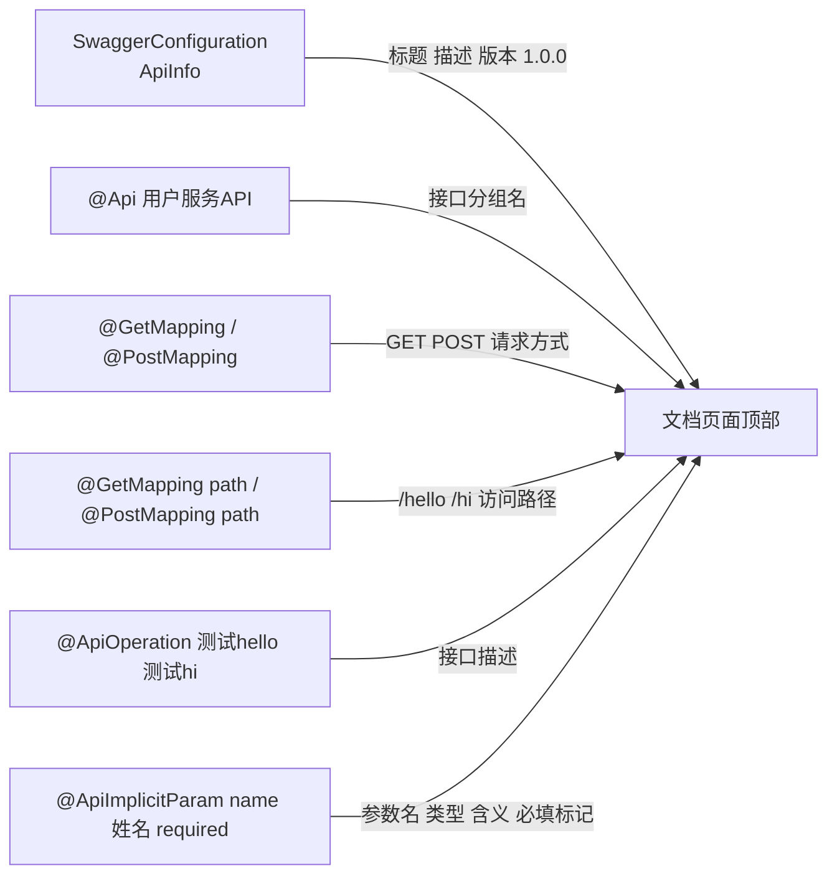
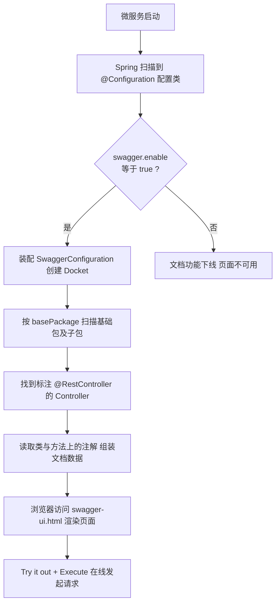

# Swagger 生成文档：页面从哪来、内容对不对、怎么在线调试

注解已经写进 Controller，配置类和开关也各就各位，接下来只剩一个问题：文档到底长什么样，从哪看？这一课启动用户中心，把文档页面打开逐块核对，再看它在页面里直接发请求调试的本事，最后把从启动到出页面这条链路的原理串起来。

## 先给结论

- 不用再做什么，微服务启动的过程中 Swagger 就已经完成扫描，文档数据已经生成。
- 文档是一个网页，不是 Word 文件；地址为 `http://localhost:53050/consumer/swagger-ui.html`，前三段是主机与端口、context-path，最后一段 `swagger-ui.html` 是固定写法。
- 页面上每个字都能对上代码：标题与版本来自 `ApiInfo`，接口分组来自类上注解，方法列表与参数说明来自方法注解。
- 页面内置 Try it out 与 Execute 按钮，填上参数就能发请求，状态码、响应体、请求命令全都回显。
- 原理一条线：启动扫描配置类，Docket 按基础包找到 Controller，读注解组装数据，页面渲染展示。

## 启动服务与访问地址

启动用户中心微服务，启动期间控制台只要没有报错即可，日志里能看到端口号 53050，服务同时向注册中心 53000 完成注册。等启动完成后，打开浏览器访问文档页面，路径分三段拼：

```bash
# 用户中心文档页面 = 服务地址 + context-path + 固定页面名
http://localhost:53050/consumer/swagger-ui.html
```

前两段来自 `application.properties`：端口 53050 是服务端口，`server.servlet.context-path=/consumer` 是基础访问路径。第三段 `swagger-ui.html` 是 springfox-swagger-ui 自带页面的固定文件名，写错就 404。回车之后，文档页面就出来了。

原来「接口文档」的真身是一个网页，或者说是一个 HTML 页面，随时打开随时是最新状态，不存在传阅一份过期文件的问题。

## 页面内容与代码逐块对上

页面打开后，逐块核对内容出处。顶部标题「万信金融P2P平台-用户服务API文档」、描述与版本号 1.0.0，全部来自配置类里 `ApiInfo` 的组装。往下是接口分组「用户服务API」，来自类上的 `@Api` 注解。展开分组，能看到两个接口条目：

```java
package com.study.finance.consumer.controller;

import io.swagger.annotations.Api;
import io.swagger.annotations.ApiImplicitParam;
import io.swagger.annotations.ApiOperation;
import org.springframework.web.bind.annotation.GetMapping;
import org.springframework.web.bind.annotation.PostMapping;
import org.springframework.web.bind.annotation.RestController;

@RestController
@Api(value = "用户服务的Controller", tags = "Consumer", description = "用户服务API")
public class ConsumerController {

    @ApiOperation("测试hello")
    @GetMapping(path = "/hello")
    public String hello() {
        return "hello";
    }

    @ApiOperation("测试hi")
    @ApiImplicitParam(name = "name", value = "姓名", required = true, dataType = "String")
    @PostMapping(path = "/hi")
    public String hi(String name) {
        return "hi," + name;
    }
}
```

页面上两个条目看着像两条路径，实际对应两个方法，hello 与 hi。条目右侧的 GET、POST 标识来自 `@GetMapping` 与 `@PostMapping`，这些 Spring MVC 注解 Swagger 也认识；条目名 `-hello`、`-hi` 是路径值，「测试hello」「测试hi」是 `@ApiOperation` 里的描述。点开 hi 的详情，参数区列着 name、String 类型，`required` 为 true 的参数还会带上红色必填标记，参数含义「姓名」同样原样呈现。对应关系画成图：



一开始讨论过的痛点在此全部消失：要发请求，请求方式、路径、参数、返回值四类信息在页面上一次看全，前端拿着这一页就能写请求代码，不用进工程翻 Controller。

## 页面里直接发请求做测试

文档不只是给人看的，页面还能当调试工具用。每个接口展开后有一个 Try it out 按钮，意思是试一试，点它进入编辑状态：参数区出现输入框，按参数含义填一个值，比如姓名填「小黑」。下面有一个 Execute 按钮，点击之后 Swagger 就向 `/consumer/hi` 发出请求，参数随之带过去。

响应区随后回显：Response body 里是 `hi,小黑`，与方法的返回值逻辑完全一致；状态码 200 表示请求成功；页面上还会展示本次请求对应的 curl 命令与请求 URL，等于顺手给出了一份可复制的请求样例。展示信息与在线测试合在同一页，说它是联调神器并不夸张。

## 从启动到页面：一条原理链

页面是怎么变出来的，链路其实不长：



按讲义的表述：服务启动时会扫描到 SwaggerConfiguration 类；该类指定了扫描包路径，据此找到基础包及子包下标注 `@RestController` 的 Controller；再根据 Controller 中的 Swagger 注解生成 API 文档。开关注解挡在最前面，`swagger.enable` 不为 true，后面整条链路都不会发生。补充一个主流细节：springfox 会在服务内部暴露一个文档数据接口，页面渲染用的 JSON 数据就来自那里，浏览器直接访问 `http://localhost:53050/consumer/v2/api-docs` 可以看到原始文档数据（此接口为本课写法按 springfox 主流行为补全的说明）。

## 常见误区

- **访问文档 404 就以为集成失败。** 错例：直接访问 `http://localhost:53050/swagger-ui.html`。正解：context-path `/consumer` 不能漏，完整地址是 `http://localhost:53050/consumer/swagger-ui.html`。
- **把文档当成一份离线文件。** 错例：想在工程里找导出的 Word 或 PDF。正解：文档是随服务运行的网页，代码改完重启即最新，不需要也不能导出维护。
- **页面打开但接口列表为空。** 错例：开关配了 false，或 Docket 的 `basePackage` 没盖住 Controller 所在包。正解：确认 `swagger.enable=true`，扫描包写到项目基础包一层。
- **页面调通等于功能正确。** 错例：Execute 返回 200 就认为业务没问题。正解：页面测试验证的是接口联通与契约正确，业务逻辑仍要靠测试用例覆盖。

## 面试可能被问到的问题

1. 面试官追问：「Swagger 文档的访问地址是怎么构成的？」
   答：服务地址加 context-path，再加固定页面名。用户中心端口 53050、context-path 为 /consumer，完整地址就是 `http://localhost:53050/consumer/swagger-ui.html`，最后一段是 springfox-swagger-ui 自带页面的固定文件名。
2. 面试官追问：「文档页面上显示的内容是从哪来的？」
   答：全部来自代码。标题、描述、版本号来自配置类里 ApiInfo 的组装；接口分组来自类上的 `@Api`；请求方式与路径来自 Spring MVC 的映射注解；接口描述与参数说明来自 `@ApiOperation`、`@ApiImplicitParam` 等注解。
3. 面试官追问：「Swagger 生成文档的工作原理是什么？」
   答：服务启动时 Spring 扫描到 `@Configuration` 配置类，条件装配确认开关闭合后创建 Docket；Docket 按配置的基础包扫描，找到标注 `@RestController` 的 Controller，读取类与方法上的注解组装成文档数据；浏览器访问 swagger-ui.html 时页面加载这些数据完成渲染。
4. 面试官追问：「Swagger 页面能做功能测试吗，怎么做的？」
   答：能。点 Try it out 进入编辑状态，按参数说明填值后点 Execute，页面直接向接口发起请求，回显状态码、响应体，还会给出对应的 curl 命令与请求 URL。适合快速验证接口联通性与契约。
5. 面试官追问：「文档与代码的一致性靠什么保证？」
   答：靠同源。文档数据由服务在运行时从代码注解里读出来生成，代码改了、注解改了，重启后页面就是最新内容，不存在手写文档那种代码与文档两张皮的问题。前提是注解要跟着接口一起维护。

## 配套资料

- 代码：`materials/code/10/wanxinp2p/wanxinp2p/`，`wanxinp2p-consumer-service` 模块 `controller` 包下的 `ConsumerController.java`、`config` 包下的 `SwaggerConfiguration.java`、`resources/application.properties` 均为真实文件；内层目录沿用原始命名，与正文 `com.study.finance` 改写口径不一致，引用路径到工程目录为止。
- 讲义：`materials/docs/10/万信金融-第1章-讲义-开发环境搭建v1.0.md`，其中 2.1.4 节 Swagger 生成文档（含访问步骤与工作原理三步说明）为本课出处。
- 说明：`/v2/api-docs` 数据接口为按 springfox 主流行为补全的补充说明；正文包名统一为 `com.study.finance` 系，文档联系人已按本系列改写口径处理。
