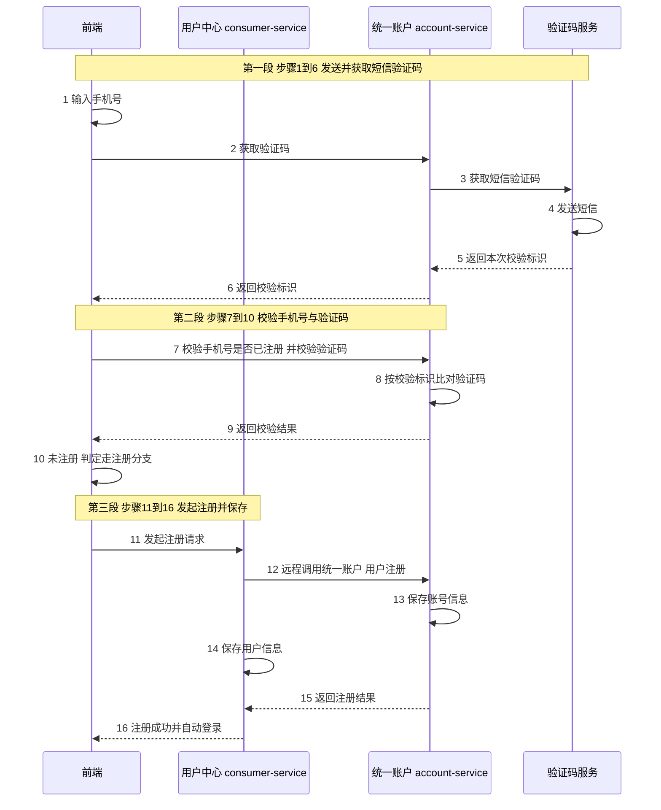

# 注册功能需求分析：一张时序图圈定四个参与者与十六个步骤

开户业务已经被拆成三块：注册、登录、开户，三者按顺序推进。本课进入第一块注册。拆到这一层，讨论的对象终于从「业务」变成了「可开发的单元」，而注册这一块的分析结果是一张交互时序图：谁参与、谁先谁后、每一步发什么请求、返回什么东西，全部画在一张图上。看懂这张图，后面两课搭建统一账户微服务、部署验证码服务才有靶子。

## 先给结论

- 注册功能由四个参与者协作完成：前端、用户中心服务、统一账户微服务、验证码服务；时序图上的编号 1 到 16 就是注册的全部步骤。
- 统一账户微服务目前并不存在，本课要新建；验证码服务也尚未部署，这两个就是动手编码前的准备工作。
- 用户信息与账号信息分开管理：用户中心管用户信息，统一账户管账号信息，两个微服务各管一摊，谁也不能替代谁。
- UAA 认证服务也出现在时序图上，但它属于编号 17 到 20 的登录段，注册阶段用不到，可以先放一放。
- 前端在整个注册链路里一共发三次请求：获取验证码、校验手机号与验证码、发起注册，编码时按步骤号逐条对照实现。

## 时序图：编码阶段的主参考图

业务流程图回答「按什么顺序做」，时序图回答「每一步谁发给谁、发什么、回什么」。它通常由团队的架构师画好交给开发，程序员的工作就是看图编码：图上第 3 步是统一账户调用验证码服务，代码里就得真的有这一跳；图上第 5 步返回校验标识，代码里就得把标识接住往回传。需求分析阶段最重要的产出物就是它，比文字描述精确得多。

读时序图先看两样东西：参与者泳道和步骤编号。注册这条链路一共 16 步，编号写在每条消息上，顺着编号走就是完整的用户旅程。初次看会嫌乱，方法很笨但有效：把 16 步按归属切成几段，一段一段读。

## 注册链路的四个参与者

图上一共四条泳道，各自的角色与现状如下：

| 参与者 | 职责 | 现状 |
|---|---|---|
| 前端 | 收集输入、发起三次请求、跳转页面 | 已就绪，登录页复用注册表单 |
| 用户中心 consumer-service | 管理用户信息：姓名、手机号等 | 基础工程已提供，端口 53050 |
| 统一账户 account-service | 管理账号信息：账号、密码、权限 | 尚不存在，需要新建，端口 53030 |
| 验证码服务 | 生成并发送短信验证码 | 尚未部署，需要按指南部署 |

用户中心与统一账户的分工值得单独说。很多系统把「用户」和「账号」捏在一张表里，这个项目刻意拆开：用户信息指自然属性，姓名、性别、手机号这一类；账号信息指登录属性，登录账号、密码，往远了说还有权限。拆开之后，用户中心专注维护「这个人在平台上是谁」，统一账户专注维护「这个人怎么登录进去」。注册时要两边都落数据，所以两个服务都得在场，这正是后两课要做搭建与部署的原因。

UAA 认证服务在图上占了一条泳道，容易误判成注册的参与者。它的位置在编号 17 之后，那是登录段的事：认证发令牌靠它。当前只研究注册，UAA 的部署与集成等到登录章节再处理。

## 十六步流程走读

把 16 步按含义切成三段，读起来就顺了：



第一段解决「验证码怎么来」：请求先打到统一账户而不是验证码服务，统一账户再远程调用验证码服务，验证码服务生成验证码发到用户手机上，同时生成一个校验标识逐级返回前端。为什么中间垫一层统一账户：验证码的生成与校验都要和账号业务挂钩，标识由统一账户记录，后面校验时才有据可比。

第二段是注册与登录的分水岭。用户填完验证码提交后，前端先问统一账户「这个手机号注册过没有」，顺带把验证码和校验标识一起送过去比对。前端代码里的分流逻辑与图上完全对应：

```javascript
login() {
    const data = {
        username: this.mobile,
        password: this.password,        // 此处填的是验证码
        mobile: this.mobile,
        key: this.codeKey               // 获取验证码时返回的校验标识
    };
    this.request({
        url: `account/mobiles/${this.mobile}/key/${this.codeKey}/code/${this.password}`
    }).then(res => {
        if (res.data.result == 1) {
            this.log(data)   // 已注册 走登录
        } else {
            this.reg(data)   // 未注册 走注册
        }
    }).catch(err => {
        uni.showToast({icon: 'none', title: err.data.msg});
    })
}
```

第三段是数据的最终归宿。手机号不存在，前端发起第三次请求，这次打到用户中心；用户中心自己保存用户信息，同时远程调用统一账户保存账号信息，两边都落库成功后把结果逐级返回前端，注册完成。注册请求这段走用户中心中转而不是前端直连统一账户，因为注册的主语是「用户」，用户中心是用户业务的入口，账号数据只是随之产生的附属品。

```javascript
reg(data) {
    const _this = this;
    this.request({
        url: 'consumer/consumers',          // 打到用户中心
        params: {...data, role: ''},
        method: 'POST'
    }).then(res => {
        setTimeout(function () {
            _this.log(data)                 // 注册成功后自动登录
        }, 1000)
    }).catch(err => {
        uni.showToast({icon: 'none', title: err.data.msg});
    })
}
```

三段读完，开发的先后顺序也就定了：先搭统一账户微服务（第 2 步的接收方），再部署验证码服务（第 3 步的接收方），然后按接口定义、功能实现的节奏把三段逻辑补齐。后两课正是照这个顺序做准备工作。

## 常见误区

- **把 UAA 认证服务当成注册的参与者。** 错例：搭建准备时把 UAA 也部署了。正解：UAA 服务于编号 17 之后的登录段，注册段 16 步里没有它，先专注统一账户与验证码服务两件事。
- **用户和账号混在一张表里实现。** 错例：注册只写用户中心，把手机号、密码全存用户表。正解：用户信息归用户中心、账号信息归统一账户，注册时两个服务各自落库，这也是为什么时序图里第三段有两个保存动作。
- **跳过时序图直接编码。** 错例：凭感觉写注册，漏掉校验标识的传递或「已注册分流」的判断。正解：16 步逐条对照，图上每个编号在代码里都要有落点，菱形分支与返回消息一个都不能少。
- **以为前端只发一次请求。** 错例：一个接口把发码、校验、注册全干了。正解：前端共发三次请求，分别对应时序图上的三段，各自独立、各自可测。

## 面试可能被问到的问题

1. 面试官追问：「时序图和业务流程图有什么区别，开发时各起什么作用？」
   答：流程图描述业务的阶段与分支，粒度粗，主要帮人建立整体认知；时序图精确到对象间的消息往来，标明谁调用谁、传什么参数、返回什么结果，是编码阶段的直接依据。项目里通常架构师产出时序图，程序员看图实现，步骤编号就是开发清单。
2. 面试官追问：「为什么注册要把用户信息和账号信息拆到两个服务？」
   答：两者的变化频率与使用场景不同。用户信息是自然属性，查询展示频繁、变更少；账号信息涉及认证与权限，安全要求高、变更频繁。拆开后各自独立演进，账号安全策略调整不影响用户资料维护，也让统一账户未来能服务多个业务线的登录需求。
3. 面试官追问：「获取验证码为什么不前端直接调验证码服务，要经过统一账户中转？」
   答：验证码不是孤立功能，它与账号校验强绑定。统一账户持有校验标识，后续校验阶段要用它比对验证码，把发码入口收敛到统一账户，标识的生成、记录与消费就在同一方手里，避免跨服务对账，也让验证码服务保持纯粹，只管生成与发送。
4. 面试官追问：「注册请求为什么经用户中心转发，前端直接调统一账户不行吗？」
   答：注册产生的数据有两份，用户信息与账号信息。用户中心是用户业务的入口，由它发起注册并在本地保存用户信息，再远程调用统一账户保存账号信息，职责边界清晰；前端只面对一个业务入口，不必知道账号数据存到了哪个服务。
5. 面试官追问：「如果校验阶段发现手机号已注册，流程怎么走？」
   答：校验结果返回已注册，前端走登录分支而不是注册分支，这正是注册登录合一的分流点。同一个接口按手机号是否存在自动决定后续动作，新用户注册后自动登录，老用户直接登录，两种情况互不干扰。

## 配套资料

- 讲义：`materials/docs/10/万信金融-第2章-讲义-开户v1.0.md`，第 2 节「注册功能中的分布式事务」印证了注册请求由用户中心服务与统一账号服务协调共同完成、两边各保存一份数据的口径。
- 代码：`materials/code/10/wanxinp2p_front/`，前端真实工程，正文两段代码出自 `pages/user/login.vue` 的 `login` 与 `reg` 方法，对应时序图第二段分流与第三段注册请求；内层目录保留原始命名，引用路径列到工程目录为止。
- 代码：`materials/code/10/wanxinp2p/`，微服务基础工程，用户中心 `consumer-service` 已在其中，统一账户微服务本阶段尚无成品源码，需按后两课的步骤新建。
- 说明：注册功能交互时序图出自本章课件，资料归档在 `materials/docs/10/` 与 `materials/code/10/`，目录编号与相邻阶段共用。
